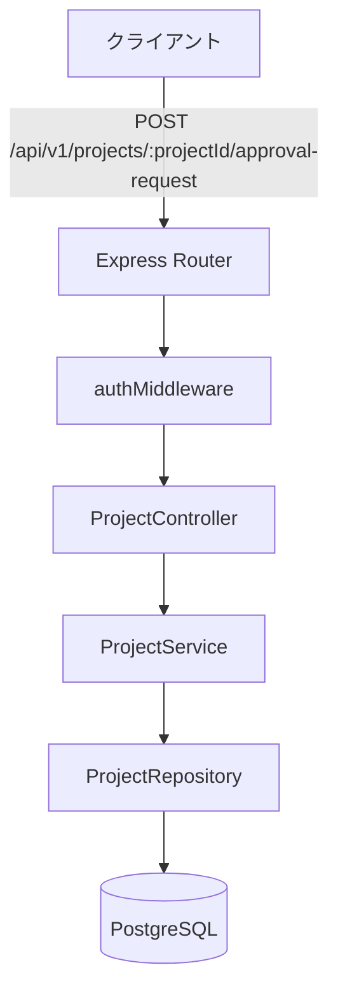
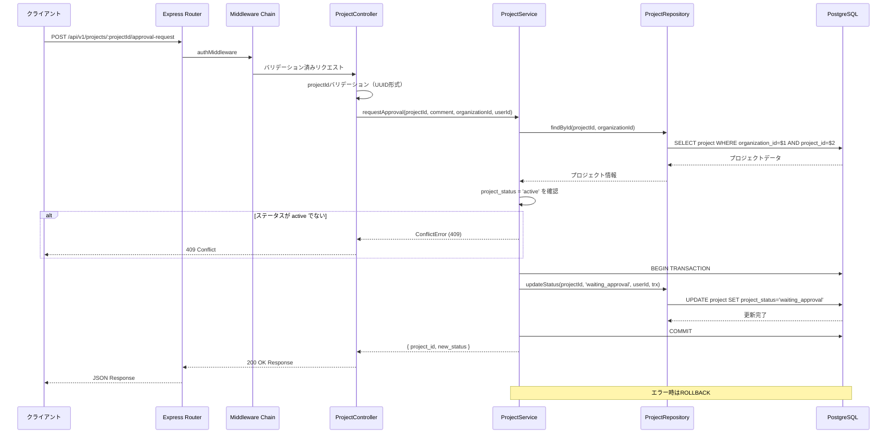

# 設計書: 承認依頼API実装

## Overview

本機能は、実験作業者が実験作業完了後に実験管理者へ承認依頼を送信するためのバックエンドAPIを提供します。プロジェクトステータスを「実行中(active)」から「承認待ち(waiting_approval)」に遷移させます。

**Purpose**: 実験作業の完了から承認プロセスへの遷移を管理し、品質保証ワークフローを実現する

**Users**: 実験作業者（Experiment Worker）が本APIを使用して承認依頼を送信します

**Impact**: プロジェクトステータスが「実行中(active)」から「承認待ち(waiting_approval)」に遷移し、実験管理者が結果を確認・承認できる状態になります

### Goals

- 実験作業完了時の承認依頼機能の提供
- プロジェクトステータスの自動遷移（active → waiting_approval）
- 承認依頼前の前提条件チェック（ステータス確認のみ）
- トランザクション一貫性の保証

### Non-Goals

- 承認処理機能（別API）
- 承認却下機能（別API）
- 承認履歴管理（将来実装）
- 承認フロー設定（将来実装）

## Architecture

### Existing Architecture Analysis

本機能は既存のプロジェクト管理APIの拡張として実装されます。

**既存パターンの保持:**
- Layered Architecture (Routes → Controller → Service → Repository)
- Kysely Query Builder によるDB操作
- JWT + Session Hybrid 認証
- マルチテナント分離（organization_id必須）

**既存ドメイン境界:**
- プロジェクト管理ドメイン内に配置
- 既存のprojectテーブルと統合

**統合ポイント:**
- GET /api/v1/projects（一覧取得）でステータス確認
- POST /api/v1/projects/:projectId/approval-request（本API）
- 承認処理API（将来実装）へ遷移

### Architecture Pattern & Boundary Map



**Architecture Integration:**
- **選択パターン**: Layered Architecture（既存パターンを踏襲）
- **ドメイン境界**: プロジェクト管理ドメイン内の新規メソッド
- **既存パターン保持**: ミドルウェアチェーン、リポジトリパターン、トランザクション管理
- **新規コンポーネント理由**: 
  - ProjectController.requestApproval: 承認依頼リクエストの専用ハンドリング
  - ProjectService.requestApproval: 前提条件チェックとトランザクション管理
- **Steering準拠**: バックエンド規約、API設計ポリシー、セキュリティ規約に完全準拠

### Technology Stack

| Layer | Choice / Version | Role in Feature | Notes |
|-------|------------------|-----------------|-------|
| Backend | Express.js 4.18.3 | HTTPルーティング、ミドルウェア | 既存 |
| Language | TypeScript 4.x | 型安全な実装 | 既存 |
| Data | PostgreSQL 18+ | データ永続化 | 既存 |
| Query Builder | Kysely | 型安全なDB操作 | 既存、Parameterized Query自動生成 |
| Authentication | jsonwebtoken | JWT認証 | 既存 |
| Session | express-session | セッション管理 | 既存 |
| Logging | Winston | 構造化ログ | 既存 |
| Validation | Manual + Express | リクエストバリデーション | 既存パターン |

**新規依存関係**: なし（すべて既存スタックを使用）

## System Flows

### シーケンス図: 承認依頼フロー



**Key Decisions:**
- トランザクション境界: Service層で管理
- エラー時のロールバック: DB操作が失敗した場合、全てロールバック
- ステータスチェック: トランザクション開始前に実施（早期失敗）

## Requirements Traceability

| Requirement | Summary | Components | Interfaces | Flows |
|-------------|---------|------------|------------|-------|
| 1 | 承認依頼エンドポイント提供 | ProjectController, Router | POST /api/v1/projects/:projectId/approval-request | Main Sequence |
| 2 | 認証の実施 | authMiddleware | Middleware Chain | Authentication Flow |
| 3 | マルチテナント分離 | All Repositories | organization_id filter | All DB Operations |
| 4 | リクエストバリデーション | ProjectController | Validation Logic | Validation Flow |
| 5 | プロジェクト存在・ステータス検証 | ProjectService, ProjectRepository | findById, status check | Status Verification |
| 6 | トランザクション管理 | ProjectService, Kysely | transaction() | Transaction Flow |
| 7 | プロジェクトステータス更新 | ProjectRepository | updateStatus | Status Update |
| 8 | レスポンス生成 | ProjectController | Response Format | Response Flow |
| 9 | エラーハンドリング | errorHandlerMiddleware | Error Response | Error Flow |
| 10 | セキュリティ保護 | All Layers | Parameterized Query, Input Sanitization | Security Flow |
| 11 | ロギングと監査 | Winston logger | Structured Logging | Logging Flow |

## Components and Interfaces

### Component Summary

| Component | Domain/Layer | Intent | Req Coverage | Key Dependencies | Contracts |
|-----------|--------------|--------|--------------|------------------|-----------|
| ProjectController | API/Controller | リクエスト処理・バリデーション | 1, 4, 9 | ProjectService (P0) | API |
| ProjectService | Business/Service | ステータスチェック・トランザクション管理 | 5, 6, 7 | ProjectRepository (P0) | Service |
| ProjectRepository | Data/Repository | projectテーブル操作 | 5, 7 | Kysely DB (P0) | Service |
| authMiddleware | Infrastructure/Middleware | JWT認証 | 2 | JWT Service (P0) | - |

### API Layer

#### ProjectController

| Field | Detail |
|-------|--------|
| Intent | 承認依頼APIのリクエスト/レスポンス処理とバリデーション |
| Requirements | 1, 4, 11 |

**Responsibilities & Constraints**
- HTTPリクエストの受信とパラメータ抽出
- projectIdのバリデーション（UUID形式）
- サービス層への処理委譲
- HTTPレスポンスの生成（200 OK）
- エラーの適切な伝播

**Dependencies**
- Inbound: Express Router - ルーティング (P0)
- Outbound: ProjectService - ビジネスロジック実行 (P0)
- Outbound: Logger - ログ記録 (P1)

**Contracts**: API [x] / Service [ ]

##### API Contract

| Method | Endpoint | Request | Response | Errors |
|--------|----------|---------|----------|--------|
| POST | /api/v1/projects/:projectId/approval-request | ApprovalRequestInput | ApprovalRequestResponse | 400, 401, 403, 404, 409, 500 |

**Request Headers:**
```typescript
{
  Authorization: string;  // "Bearer {jwt_token}"
}
```

**Request Path Parameters:**
```typescript
{
  projectId: string;  // UUID
}
```

**Request Body:**
```typescript
interface ApprovalRequestInput {
  comment?: string;  // 0〜1000文字、オプショナル
}
```

**Response (200 OK):**
```typescript
interface ApprovalRequestResponse {
  success: true;
  data: {
    project_id: string;
    project_name: string;
    previous_status: string;
    new_status: string;
    requested_by: string;
    requested_by_name: string;
    requested_at: string;  // ISO 8601
    comment: string | null;
  };
  meta: {
    timestamp: string;
    requestId: string;
  };
}
```

**Implementation Notes**
- Integration: Express Routerで `/api/v1/projects/:projectId/approval-request` にマウント
- Validation: projectId UUID形式チェック、comment文字数制限
- Risks: なし（標準的なコントローラー実装）

### Business Layer

#### ProjectService

| Field | Detail |
|-------|--------|
| Intent | 承認依頼のビジネスロジックとステータスチェック |
| Requirements | 5, 6, 7, 8 |

**Responsibilities & Constraints**
- プロジェクト存在・ステータス確認（project_status = 'active'のみ許可）
- トランザクション内でプロジェクトステータス更新
- エラー時の適切なロールバック

**Dependencies**
- Inbound: ProjectController - API層からの呼び出し (P0)
- Outbound: ProjectRepository - プロジェクト操作 (P0)
- Outbound: Kysely Transaction - トランザクション管理 (P0)

**Contracts**: Service [x]

##### Service Interface

```typescript
interface ProjectService {
  /**
   * 承認依頼を送信
   * 
   * @param projectId - プロジェクトID
   * @param comment - コメント（オプショナル）
   * @param organizationId - 組織ID
   * @param userId - リクエストユーザーID
   * @returns 承認依頼結果
   * @throws NotFoundError - プロジェクトが存在しない
   * @throws ConflictError - ステータス不正
   * @throws DatabaseError - DB操作失敗
   */
  requestApproval(
    projectId: string,
    comment: string | null,
    organizationId: string,
    userId: string
  ): Promise<ApprovalRequestResult>;
}

interface ApprovalRequestResult {
  project_id: string;
  project_name: string;
  previous_status: string;
  new_status: string;
  requested_by: string;
  requested_by_name: string;
  requested_at: string;
  comment: string | null;
}
```

**Implementation Notes**
- Integration: Kyselyの`transaction()`メソッドを使用
- Validation: ステータスチェックをトランザクション前に実施（早期失敗）
- Risks: トランザクションタイムアウト → タイムアウト設定（30秒）

### Data Layer

#### ProjectRepository

各リポジトリは単一テーブルへの操作を担当し、organization_idフィルタを必須適用します。

**共通Implementation Notes**
- Integration: Kyselyのクエリビルダー使用
- Validation: organization_idフィルタを全クエリに適用
- Risks: なし（標準的なリポジトリ実装）

## Data Models

### テーブル定義

#### project (更新対象)

| Column | Type | Constraint | Notes |
|--------|------|------------|-------|
| project_id | UUID | PK | 変更なし |
| organization_id | UUID | FK, NOT NULL | マルチテナント分離 |
| project_status | VARCHAR(50) | NOT NULL | 'active' → 'waiting_approval' |
| updated_at | TIMESTAMP | NOT NULL | 更新時刻 |
| updated_user_id | UUID | FK | 更新ユーザーID |

## Error Handling

### エラーコード体系

| HTTP Status | Error Code | Condition | Message Example |
|-------------|------------|-----------|-----------------|
| 400 | VALIDATION_ERROR | バリデーションエラー | "Invalid request parameters" |
| 401 | AUTH_TOKEN_EXPIRED | JWT期限切れ | "Authentication token has expired" |
| 403 | PERMISSION_INSUFFICIENT | 権限不足 | "Insufficient permissions to request approval" |
| 404 | RESOURCE_NOT_FOUND | プロジェクト不存在 | "Project not found" |
| 409 | BUSINESS_STATUS_INVALID | ステータス不正 | "Project status must be 'active' to request approval. Current status: X" |
| 500 | SYSTEM_DATABASE_ERROR | DB操作失敗 | "Database operation failed" |

### エラーレスポンス例

```json
{
  "success": false,
  "error": {
    "code": "BUSINESS_STATUS_INVALID",
    "message": "Project status must be 'active' to request approval. Current status: archived",
    "details": [
      {
        "field": "project_status",
        "current": "archived",
        "required": "active"
      }
    ]
  },
  "meta": {
    "timestamp": "2026-01-28T17:30:00.000Z",
    "requestId": "req_abc123"
  }
}
```

## Testing Strategy

### ユニットテスト（Jest）

**ProjectService.requestApproval**
- ✅ 正常系: 前提条件を満たす場合
- ✅ 異常系: プロジェクト不存在
- ✅ 異常系: ステータスが active でない
- ✅ 異常系: トランザクション失敗

**Repository層**
- ✅ organization_idフィルタの適用確認
- ✅ Parameterized Queryの使用確認

### 統合テスト（Supertest）

**POST /api/v1/projects/:projectId/approval-request**
- ✅ 正常系: 200 OK、レスポンス形式確認
- ✅ 認証エラー: 401 Unauthorized
- ✅ 権限エラー: 403 Forbidden
- ✅ バリデーションエラー: 400 Bad Request
- ✅ ビジネスルール違反: 409 Conflict

### カバレッジ目標
- **Statements**: 70%以上
- **Branches**: 70%以上
- **Functions**: 70%以上

## Security

### マルチテナント分離
- ✅ すべてのクエリに organization_id フィルタ適用
- ✅ JWT トークンから organization_id を抽出
- ✅ クロステナントアクセス防止

### SQLインジェクション対策
- ✅ Kysely Query Builder 使用（自動Parameterized Query）
- ✅ 文字列連結でのクエリ構築禁止

### 入力バリデーション
- ✅ projectId: UUID形式チェック
- ✅ comment: 1000文字制限、XSS対策（エスケープ処理）

### 認証
- ✅ authMiddleware: JWT認証

### 監査ログ
- ✅ Winston logger で承認依頼をログ記録
- ✅ ログ項目: userId, organizationId, projectId, requestId, timestamp

## Performance

### パフォーマンス要件
- **レスポンスタイム**: < 500ms (95パーセンタイル)
- **同時実行**: 50 req/sec
- **トランザクションタイムアウト**: 30秒

### 最適化戦略
- ✅ インデックス活用（organization_id, project_id, project_status）
- ✅ 早期失敗（トランザクション前のステータスチェック）
- ✅ コネクションプーリング（PostgreSQL接続プール）
- ✅ トランザクション最小化（必要な操作のみ）

### ボトルネック対策
- 同時実行の増加: コネクションプール設定の調整

## Deployment

### デプロイ要件
- ✅ ダウンタイムなし（ローリングアップデート）
- ✅ ロールバック可能
- ✅ DBマイグレーション不要（既存テーブル使用）

### 環境変数
```bash
# 既存の環境変数を使用
DATABASE_URL=postgresql://...
JWT_SECRET=...
SESSION_SECRET=...
```

### モニタリング
- ✅ CloudWatch Logs でエラーログ監視
- ✅ API Gateway でレスポンスタイム監視
- ✅ 承認依頼件数の監視（ダッシュボード）

## References

### 関連ドキュメント
- [Requirements](requirements.md) - 要件定義
- [Research Log](research.md) - 調査結果と設計判断
- [API仕様書](../../design/api/api_project_management.md) - プロジェクト管理API仕様
- [バックエンド規約](../../../.clinerules/development/backend.md)
- [API設計ポリシー](../../../.clinerules/development/api.md)
- [セキュリティ規約](../../../.clinerules/development/security.md)

### 外部リソース
- [Kysely Documentation](https://kysely.dev/) - Query Builder
- [Express.js Best Practices](https://expressjs.com/en/advanced/best-practice-performance.html)

## Change History

| Version | Date | Author | Changes |
|---------|------|--------|---------|
| 1.0.0 | 2026-01-28 | Cline | 初版作成 - 承認依頼API設計完成 |
