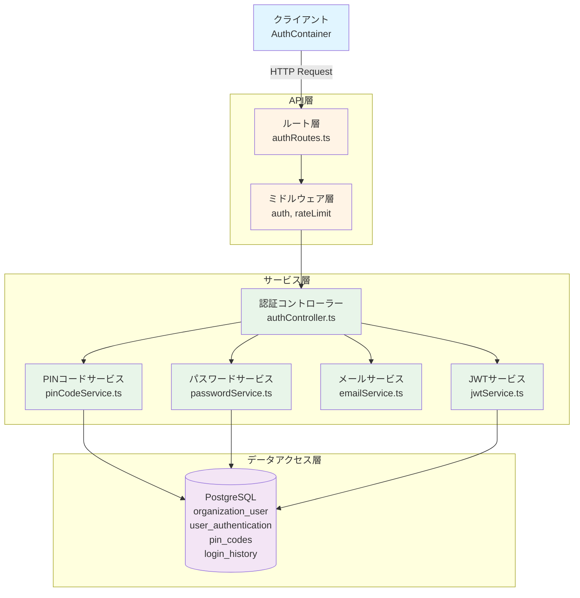
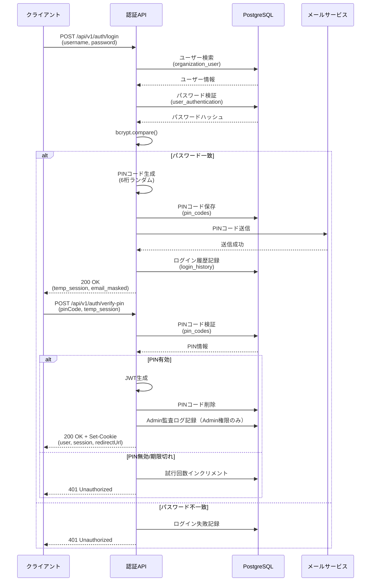
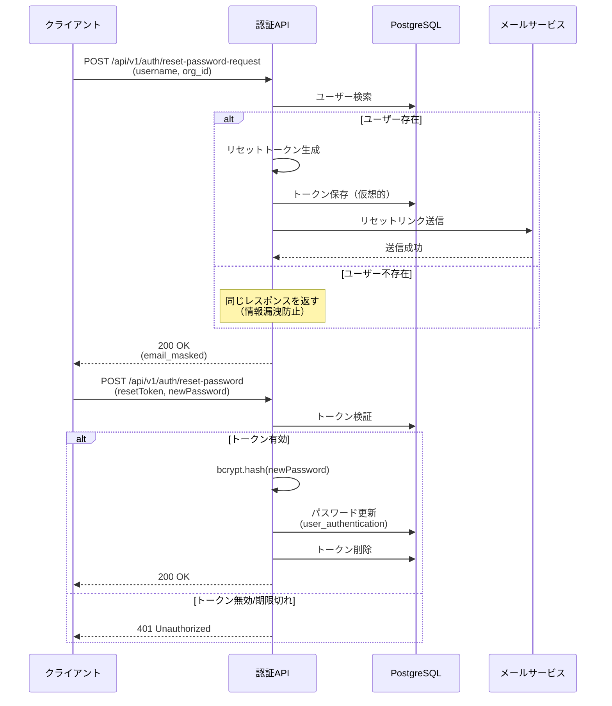
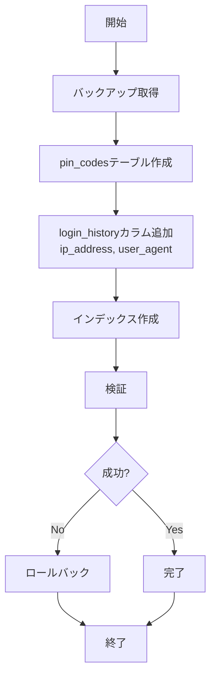

# Design Document: 認証バックエンドAPI

## Overview

**Purpose**: このバックエンドAPI実装は、既存のmmdpfプロジェクトにセキュアな二段階認証（パスワード + メールPINコード）を提供します。既存のフロントエンド（login-screen機能）と統合し、ロールベースアクセス制御（RBAC）とマルチテナント分離を実現します。

**Users**: 
- **provider**: システムプロバイダー（最高権限）
- **system_admin**: システム管理者
- **data_admin**: データ管理者
- **experiment_admin**: 実験管理者
- **experiment_worker**: 実験作業者
- **mi_engineer**: MI技術者

**Impact**: 現在のモックベースの認証を本番レベルのセキュアな認証システムに置き換えます。既存のER図に準拠し、最小限のテーブル追加（pin_codesのみ）で実装します。

### Goals
- メールPINコード二段階認証の実装
- パスワードリセット機能の提供
- JWTベースのセッション管理
- レート制限によるブルートフォース攻撃対策
- 既存システムへの影響最小化（既存テーブル活用）

### Non-Goals
- Google Authenticatorなど外部2FAアプリ連携（将来実装）
- OAuth/SAML統合（将来実装）
- user_sessionsテーブルの使用（現時点ではJWTのみ）
- Redis統合（将来のパフォーマンス最適化で検討）

## Architecture

### Existing Architecture Analysis

**既存システムの制約:**
- ER図準拠: `organization_user`, `user_authentication`, `login_history`テーブルを活用
- 複合主キー設計: `(user_id, organization_id)`パターンを踏襲
- マルチテナント分離: すべてのクエリで`organization_id`フィルタ必須

**統合ポイント:**
- フロントエンド: 既存のAuthContainer（login-screen機能）
- データベース: PostgreSQL（既存ER図のテーブル）
- 環境: Docker Compose（開発）、AWS ECS（本番）

### Architecture Pattern & Boundary Map

**選択パターン**: **レイヤードアーキテクチャ（Layered Architecture）**



**ドメイン境界:**
- **認証ドメイン**: ログイン、セッション管理、パスワードリセット
- **通知ドメイン**: メール送信（PINコード、パスワードリセットリンク）
- **監査ドメイン**: ログイン履歴、Admin監査ログ

**Steering準拠:**
- バックエンド規約（backend.md）: レイヤードアーキテクチャ、Parameterized Queries
- セキュリティ規約（security.md）: bcryptハッシュ化、マルチテナント分離、レート制限
- API設計ポリシー（api.md）: RESTful設計、統一レスポンス形式

### Technology Stack

| Layer | Choice / Version | Role in Feature | Notes |
|-------|------------------|-----------------|-------|
| Runtime | Node.js 18+ | サーバー実行環境 | LTS版、async/await対応 |
| Framework | Express.js 4.18.3 | HTTPサーバー | 軽量、ミドルウェアエコシステム |
| Language | TypeScript 5.x | 型安全な開発 | 厳格な型チェック有効 |
| Database | PostgreSQL 18+ | メインデータベース | 既存ER図準拠 |
| Password Hashing | bcrypt 5.x | パスワードハッシュ化 | Admin: 14 rounds, Others: 12 rounds |
| JWT | jsonwebtoken 9.x | セッショントークン生成 | HS256署名アルゴリズム |
| Email | nodemailer 6.x | メール送信 | SMTP設定可能 |
| Validation | express-validator 7.x | リクエストバリデーション | チェーン可能なバリデーター |
| Logging | winston 3.x | 構造化ロギング | 日次ローテーション対応 |

**選択理由:**
- **bcrypt**: 業界標準、レインボーテーブル攻撃耐性、調整可能なコストファクター
- **JWT**: ステートレス、スケーラブル、HTTPOnly Cookieで保存可能
- **nodemailer**: 柔軟なSMTP設定、テンプレート対応、非同期送信

## System Flows

### ログインフロー（二段階認証）



**フロー決定:**
- **仮セッショントークン**: PINコード入力フォームへの遷移を安全に管理
- **PINコード即削除**: 検証成功後、再利用を防止
- **レート制限**: ログイン5回/15分、PIN検証3回/5分

### パスワードリセットフロー



**セキュリティ決定:**
- **情報漏洩防止**: ユーザー存在の有無を返さない
- **トークン有効期限**: 1時間（PINコードより長い）
- **レート制限**: リセット要求3回/15分/組織ID

## Requirements Traceability

| Requirement | Summary | Components | Interfaces | Flows |
|-------------|---------|------------|------------|-------|
| 1.1-1.4 | パスワード認証とPINコード送信 | authController, pinCodeService, passwordService, emailService | POST /api/v1/auth/login | ログインフロー |
| 2.1-2.5 | PINコード検証とセッション生成 | authController, pinCodeService, jwtService | POST /api/v1/auth/verify-pin | ログインフロー |
| 3.1-3.2 | PINコード再送信 | authController, pinCodeService, emailService | POST /api/v1/auth/resend-pin | - |
| 4.1-4.2 | ログアウト | authController, jwtService | POST /api/v1/auth/logout | - |
| 5.1-5.2 | パスワードリセット要求 | authController, emailService | POST /api/v1/auth/reset-password-request | パスワードリセットフロー |
| 6.1-6.2 | パスワードリセット実行 | authController, passwordService | POST /api/v1/auth/reset-password | パスワードリセットフロー |
| 7.1-7.3 | セキュリティとレート制限 | rateLimitMiddleware, passwordService | - | - |
| 8.1-8.2 | データ管理とメンテナンス | pinCodeService | - | - |
| 9.1-9.2 | エラーハンドリングとロギング | errorMiddleware, authController | - | - |
| 10.1-10.2 | パフォーマンスと信頼性 | emailService, データベースインデックス | - | - |

## Components and Interfaces

### Summary

| Component | Domain/Layer | Intent | Req Coverage | Key Dependencies (P0/P1) | Contracts |
|-----------|--------------|--------|--------------|--------------------------|-----------|
| authController | 認証/コントローラー | 認証APIエンドポイントの処理 | 1-6 | pinCodeService (P0), passwordService (P0), jwtService (P0), emailService (P0) | API |
| pinCodeService | 認証/サービス | PINコード生成・検証・管理 | 1, 2, 3, 8 | PostgreSQL (P0) | Service |
| passwordService | 認証/サービス | パスワードハッシュ化・検証 | 1, 6, 7 | bcrypt (P0), PostgreSQL (P0) | Service |
| emailService | 通知/サービス | メール送信（PINコード、リセット） | 1, 3, 5, 10 | nodemailer (P0) | Service |
| jwtService | 認証/サービス | JWTトークン生成・検証 | 2, 4 | jsonwebtoken (P0) | Service |
| authMiddleware | 認証/ミドルウェア | JWT認証チェック | 4 | jwtService (P0) | - |
| rateLimitMiddleware | セキュリティ/ミドルウェア | レート制限チェック | 7 | PostgreSQL (P0) | - |

### 認証ドメイン

#### authController

| Field | Detail |
|-------|--------|
| Intent | 認証APIエンドポイントの処理とレスポンス生成 |
| Requirements | 1.1-1.4, 2.1-2.5, 3.1-3.2, 4.1-4.2, 5.1-5.2, 6.1-6.2 |
| Owner / Reviewers | Backend Team |

**Responsibilities & Constraints**
- 6つのAPIエンドポイント処理（login, verify-pin, resend-pin, logout, reset-password-request, reset-password）
- リクエストバリデーション（express-validator使用）
- 統一レスポンス形式での返却
- エラーハンドリングとロギング

**Dependencies**
- Inbound: Express Router — HTTPリクエスト受信 (P0)
- Outbound: pinCodeService — PINコード管理 (P0)
- Outbound: passwordService — パスワード検証・更新 (P0)
- Outbound: jwtService — JWTトークン生成 (P0)
- Outbound: emailService — メール送信 (P0)
- Outbound: PostgreSQL — ログイン履歴記録 (P0)

**Contracts**: API [x]

##### API Contract

| Method | Endpoint | Request | Response | Errors |
|--------|----------|---------|----------|--------|
| POST | /api/v1/auth/login | `{ username: string, password: string }` + Header: `X-Organization-Id` | `{ success: true, data: { sessionToken, email, expiresIn } }` | 400, 401, 403, 429, 500 |
| POST | /api/v1/auth/verify-pin | `{ pinCode: string }` + Header: `Authorization: Bearer temp_session` | `{ success: true, data: { user, session, redirectUrl } }` + Set-Cookie | 400, 401, 429 |
| POST | /api/v1/auth/resend-pin | `{}` + Header: `Authorization: Bearer temp_session` | `{ success: true, data: { message, email, expiresIn } }` | 401, 429 |
| POST | /api/v1/auth/logout | `{}` + Header: `Authorization: Bearer session` | `{ success: true, data: { message } }` + Set-Cookie (clear) | 401 |
| POST | /api/v1/auth/reset-password-request | `{ username: string }` + Header: `X-Organization-Id` | `{ success: true, data: { message, email } }` | 400, 429 |
| POST | /api/v1/auth/reset-password | `{ resetToken: string, newPassword: string }` | `{ success: true, data: { message } }` | 400, 401 |

**エラーレスポンス形式:**
```typescript
{
  success: false,
  error: {
    code: "AUTH_INVALID_CREDENTIALS" | "AUTH_PIN_INVALID" | "AUTH_RATE_LIMIT_EXCEEDED" | ...,
    message: string,
    details?: Array<{ field: string, message: string, code: string }>
  },
  meta: {
    timestamp: string,
    requestId: string
  }
}
```

**Implementation Notes**
- Integration: express-validator でバリデーションチェーン実装
- Validation: ユーザー名1-100文字、パスワード8-255文字、PINコード6桁数字
- Risks: メール送信失敗時のリトライ処理必須

#### pinCodeService

| Field | Detail |
|-------|--------|
| Intent | PINコード生成、検証、ライフサイクル管理 |
| Requirements | 1.2, 2.1, 2.4, 3.1, 8.1 |

**Responsibilities & Constraints**
- 6桁ランダムPINコード生成（crypto.randomInt使用）
- pin_codesテーブルへの保存・検索・削除
- 有効期限チェック（5分）
- 試行回数管理（最大3回）
- 期限切れPINコードの定期削除（1時間ごと）

**Dependencies**
- Outbound: PostgreSQL — pin_codesテーブル操作 (P0)
- External: crypto.randomInt — ランダム数生成 (P0)

**Contracts**: Service [x]

##### Service Interface
```typescript
interface PinCodeService {
  // PINコード生成・保存
  generateAndSave(userId: string, orgId: string, sessionToken: string): Promise<Result<PinCodeData, ServiceError>>;
  
  // PINコード検証
  verify(pinCode: string, sessionToken: string): Promise<Result<UserInfo, ServiceError>>;
  
  // PINコード削除
  delete(sessionToken: string): Promise<Result<void, ServiceError>>;
  
  // 期限切れPINコード削除（定期実行）
  deleteExpired(): Promise<Result<number, ServiceError>>;
  
  // 試行回数インクリメント
  incrementAttempts(pinCode: string, sessionToken: string): Promise<Result<void, ServiceError>>;
}

interface PinCodeData {
  pinCode: string;
  expiresAt: Date;
}

interface UserInfo {
  id: string;
  username: string;
  email: string;
  role: UserRole;
  organizationId: string;
  organizationName: string;
  displayName: string;
}
```

**Preconditions:**
- `generateAndSave`: userId, orgIdは有効なユーザーを指す
- `verify`: sessionTokenは有効な仮セッショントークン

**Postconditions:**
- `generateAndSave`: pin_codesテーブルに新規レコード挿入
- `verify`: 成功時、pin_codesテーブルからレコード削除
- `deleteExpired`: 期限切れレコード削除、削除件数返却

**Invariants:**
- PINコードは常に6桁の数字
- 有効期限は生成時刻+5分
- 最大試行回数は3回

**Implementation Notes**
- Integration: PostgreSQLクライアントライブラリ（pg）使用、Parameterized Queries必須
- Validation: PINコード形式`/^\d{6}$/`、有効期限チェック、試行回数チェック
- Risks: 期限切れ削除の定期実行タイミング（cronジョブまたはNode.js setIntervalで実装）

#### passwordService

| Field | Detail |
|-------|--------|
| Intent | パスワードハッシュ化・検証 |
| Requirements | 1.1, 6.2, 7.3 |

**Responsibilities & Constraints**
- パスワードのbcryptハッシュ化（Admin: 14 rounds, Others: 12 rounds）
- ハッシュの検証（bcrypt.compare）
- user_authenticationテーブルへの保存・取得

**Dependencies**
- Outbound: bcrypt — ハッシュ化・検証 (P0)
- Outbound: PostgreSQL — user_authenticationテーブル操作 (P0)

**Contracts**: Service [x]

##### Service Interface
```typescript
interface PasswordService {
  // パスワードハッシュ化
  hash(password: string, role: UserRole): Promise<Result<string, ServiceError>>;
  
  // パスワード検証
  verify(userId: string, orgId: string, password: string): Promise<Result<boolean, ServiceError>>;
  
  // パスワード更新
  update(userId: string, orgId: string, newPasswordHash: string): Promise<Result<void, ServiceError>>;
}
```

**Preconditions:**
- `hash`: passwordは8-255文字
- `verify`: userId, orgIdは有効なユーザーを指す

**Postconditions:**
- `hash`: bcryptハッシュ文字列返却
- `verify`: パスワード一致時true、不一致時false
- `update`: user_authenticationテーブル更新

**Invariants:**
- Admin権限（provider, system_admin）は14 rounds
- その他のユーザーは12 rounds
- ハッシュは常にbcrypt形式

**Implementation Notes**
- Integration: bcrypt.hash(), bcrypt.compare() 使用
- Validation: パスワード長8-255文字、ロール別rounds設定
- Risks: bcrypt処理は同期的で遅いため、非同期版（bcrypt.hash, bcrypt.compare）を使用

#### emailService

| Field | Detail |
|-------|--------|
| Intent | メール送信（PINコード、パスワードリセット） |
| Requirements | 1.2, 3.1, 5.1, 10.1 |

**Responsibilities & Constraints**
- PINコードメール送信
- パスワードリセットリンクメール送信
- 非同期送信・リトライ処理
- タイムアウト管理（30秒）

**Dependencies**
- External: nodemailer — SMTP送信 (P0)
- External: SMTPサーバー — メール配信 (P0)

**Contracts**: Service [x]

##### Service Interface
```typescript
interface EmailService {
  // PINコードメール送信
  sendPinCode(email: string, pinCode: string, username: string): Promise<Result<void, ServiceError>>;
  
  // パスワードリセットメール送信
  sendPasswordReset(email: string, resetToken: string, username: string): Promise<Result<void, ServiceError>>;
}

interface EmailConfig {
  smtpHost: string;
  smtpPort: number;
  smtpUser: string;
  smtpPassword: string;
  fromAddress: string;
  fromName: string;
}
```

**Preconditions:**
- `sendPinCode`: emailは有効なメールアドレス、pinCodeは6桁
- `sendPasswordReset`: emailは有効なメールアドレス、resetTokenは有効

**Postconditions:**
- メール送信成功時、Resultは成功を返す
- 送信失敗時、最大3回までリトライ
- 3回失敗後、エラーを返す

**Implementation Notes**
- Integration: nodemailer.createTransport() でSMTP設定、sendMail() で送信
- Validation: メールアドレス形式チェック（RFC 5322準拠）
- Risks: SMTP障害時の対応、送信タイムアウト設定（30秒）、リトライロジック実装

#### jwtService

| Field | Detail |
|-------|--------|
| Intent | JWTトークン生成・検証 |
| Requirements | 2.2, 4.1 |

**Responsibilities & Constraints**
- JWTトークン生成（maiml_session-{id}_{timestamp}形式）
- JWTトークン検証（署名、有効期限）
- ロール別有効期限設定
- HTTPOnly Cookie設定

**Dependencies**
- External: jsonwebtoken — JWT生成・検証 (P0)
- Outbound: 環境変数 — JWT_SECRET取得 (P0)

**Contracts**: Service [x]

##### Service Interface
```typescript
interface JwtService {
  // JWTトークン生成
  generate(payload: JwtPayload, role: UserRole): Promise<Result<string, ServiceError>>;
  
  // JWTトークン検証
  verify(token: string): Promise<Result<JwtPayload, ServiceError>>;
  
  // トークンから情報抽出（検証なし）
  decode(token: string): JwtPayload | null;
}

interface JwtPayload {
  userId: string;
  organizationId: string;
  role: UserRole;
  sessionId: string;
  iat: number;
  exp: number;
}

type UserRole = 'provider' | 'system_admin' | 'data_admin' | 'experiment_admin' | 'experiment_worker' | 'mi_engineer';
```

**Preconditions:**
- `generate`: payloadは必要なフィールドをすべて含む
- `verify`: tokenは Bearer スキームから抽出済み

**Postconditions:**
- `generate`: HS256署名されたJWTトークン返却
- `verify`: 有効なトークンの場合、ペイロード返却

**Invariants:**
- トークン形式: `maiml_session-{sessionId}_{timestamp}`
- 有効期限:
  - provider, system_admin: 48時間
  - data_admin, experiment_admin, mi_engineer: 24時間
  - experiment_worker: 12時間

**Implementation Notes**
- Integration: jwt.sign(), jwt.verify() 使用、アルゴリズムはHS256
- Validation: 署名検証、有効期限チェック、issuer/audienceチェック（オプション）
- Risks: JWT_SECRETの管理（環境変数、Secrets Manager使用）

### セキュリティドメイン

#### authMiddleware

| Field | Detail |
|-------|--------|
| Intent | API保護・JWT認証チェック |
| Requirements | 4.1 |

**Responsibilities & Constraints**
- Authorizationヘッダーからトークン抽出
- JWTトークン検証
- req.userへのユーザー情報格納
- 認証失敗時の401エラー返却

**Dependencies**
- Inbound: Express Middleware Chain (P0)
- Outbound: jwtService — トークン検証 (P0)

**Implementation Notes**
- Integration: Express middleware パターン、`(req, res, next) => {}`
- Validation: Bearer スキームチェック、トークン形式チェック
- Risks: トークン期限切れ時の処理、無効トークン時のエラーレスポンス

#### rateLimitMiddleware

| Field | Detail |
|-------|--------|
| Intent | レート制限によるブルートフォース攻撃対策 |
| Requirements | 7.1, 7.2 |

**Responsibilities & Constraints**
- エンドポイント別レート制限
- login_historyテーブルを使用した失敗回数カウント
- 制限超過時の429エラー返却
- Retry-Afterヘッダー設定

**Dependencies**
- Inbound: Express Middleware Chain (P0)
- Outbound: PostgreSQL — login_historyテーブル (P0)

**Implementation Notes**
- **レート制限設定:**
  - POST /api/v1/auth/login: 5回/15分/組織ID+ユーザー名
  - POST /api/v1/auth/verify-pin: 3回/5分/セッショントークン
  - POST /api/v1/auth/resend-pin: 3回/15分/セッショントークン
  - POST /api/v1/auth/reset-password-request: 3回/15分/組織ID
- Integration: login_historyテーブルのlogin_atカラムでタイムウィンドウ判定
- Validation: 組織ID、ユーザー名、セッショントークンでグループ化
- Risks: 分散環境でのレート制限（将来的にRedis使用を検討）

## Data Models

### Domain Model

**エンティティ:**
- **User**: システムユーザー（organization_userテーブル）
- **UserAuthentication**: 認証情報（user_authenticationテーブル）
- **PinCode**: 二段階認証用PINコード（pin_codesテーブル）
- **LoginHistory**: ログイン履歴（login_historyテーブル）

**バリューオブジェクト:**
- **JwtToken**: セッショントークン（文字列、有効期限付き）
- **PinCodeValue**: 6桁数字（100000-999999）
- **UserRole**: ロール列挙型

**ドメインイベント:**
- LoginAttempted（ログイン試行）
- LoginSucceeded（ログイン成功）
- LoginFailed（ログイン失敗）
- PinCodeGenerated（PINコード生成）
- PinCodeVerified（PINコード検証）
- PasswordResetRequested（パスワードリセット要求）
- PasswordChanged（パスワード変更）

**ビジネスルール:**
- パスワードは8文字以上
- PINコードは5分間有効
- PIN入力は3回まで試行可能
- ログイン失敗は15分以内に5回まで

### Logical Data Model

既存ER図に準拠。詳細は`docs/design/db/db_auth.md`を参照。

**主要テーブル:**
1. **organization_user** (既存)
   - 主キー: (user_id, organization_id)
   - 属性: user_name, role, mail_address, is_active, locked_until
   
2. **user_authentication** (既存)
   - 主キー: (user_id, organization_id)
   - 外部キー: organization_user(user_id, organization_id)
   - 属性: password (bcryptハッシュ), entry_flg
   
3. **pin_codes** (新規作成)
   - 主キー: id (UUID)
   - 外部キー: organization_user(user_id, org_id)
   - 属性: pin_code, session_token, expires_at, attempts_count, is_used
   - ユニーク制約: (pin_code, session_token)
   
4. **login_history** (既存、カラム追加推奨)
   - 主キー: id
   - 属性: user_id, org_cd, login_at, login_sf, failure_reason, ip_address, user_agent

### Physical Data Model

**pin_codesテーブルのDDL:**

```sql
CREATE TABLE pin_codes (
  id UUID PRIMARY KEY DEFAULT uuid_generate_v4(),
  user_id VARCHAR(30) NOT NULL,
  org_id UUID NOT NULL,
  pin_code VARCHAR(6) NOT NULL,
  session_token VARCHAR(255) NOT NULL,
  is_used BOOLEAN NOT NULL DEFAULT false,
  used_at TIMESTAMP,
  expires_at TIMESTAMP NOT NULL,
  attempts_count INTEGER NOT NULL DEFAULT 0,
  max_attempts INTEGER NOT NULL DEFAULT 3,
  created_at TIMESTAMP NOT NULL DEFAULT CURRENT_TIMESTAMP,
  
  CONSTRAINT fk_pin_codes_user 
    FOREIGN KEY (user_id, org_id) 
    REFERENCES organization_user(user_id, organization_id) 
    ON DELETE CASCADE,
  
  CONSTRAINT chk_pin_codes_pin_format 
    CHECK (pin_code ~ '^[0-9]{6}$'),
  
  CONSTRAINT chk_pin_codes_attempts 
    CHECK (attempts_count >= 0 AND attempts_count <= max_attempts)
);

-- インデックス
CREATE UNIQUE INDEX idx_pin_codes_pin_session ON pin_codes(pin_code, session_token);
CREATE INDEX idx_pin_codes_user ON pin_codes(user_id, org_id);
CREATE INDEX idx_pin_codes_token ON pin_codes(session_token);
CREATE INDEX idx_pin_codes_expires ON pin_codes(expires_at);
```

**login_historyテーブルへのカラム追加（オプション）:**

```sql
ALTER TABLE login_history
ADD COLUMN ip_address VARCHAR(45),
ADD COLUMN user_agent TEXT;

CREATE INDEX idx_login_history_rate_limit 
  ON login_history(org_cd, user_id, login_at, login_sf);
```

**パフォーマンス最適化:**
- pin_codes.expires_at にインデックス（期限切れ削除クエリ用）
- login_history にレート制限判定用複合インデックス
- organization_user.mail_address にインデックス（メール送信先検索用、オプション）

### Data Contracts & Integration

**APIデータ転送:**

```typescript
// ログインリクエスト
interface LoginRequest {
  username: string;  // 1-100文字
  password: string;  // 8-255文字
}

// ログインレスポンス
interface LoginResponse {
  sessionToken: string;  // temp_session-{id}_{timestamp}
  message: string;
  email: string;  // マスキング済み (use***@example.com)
  expiresIn: number;  // 300秒（5分）
}

// PINコード検証リクエスト
interface VerifyPinRequest {
  pinCode: string;  // 6桁数字
}

// PINコード検証レスポンス
interface VerifyPinResponse {
  user: UserInfo;
  session: SessionInfo;
  redirectUrl: string;
}

interface UserInfo {
  id: string;
  username: string;
  email: string;
  role: UserRole;
  organizationId: string;
  organizationName: string;
  displayName: string;
}

interface SessionInfo {
  token: string;  // maiml_session-{id}_{timestamp}
  expiresAt: string;  // ISO 8601
}
```

**バリデーションルール:**
- username: `/^[a-zA-Z0-9_-]{1,100}$/`
- password: 8-255文字
- pinCode: `/^\d{6}$/`
- email: RFC 5322準拠
- organizationId: UUID v4形式

## Error Handling

### Error Strategy

**エラーカテゴリと処理方針:**

1. **認証エラー（401）**
   - 原因: 無効な認証情報、トークン期限切れ
   - 処理: ログイン画面へリダイレクト、エラーメッセージ表示
   - ログ: login_historyテーブルに記録

2. **認可エラー（403）**
   - 原因: 権限不足、アカウント無効化
   - 処理: エラーメッセージ表示、アクセス拒否
   - ログ: Admin監査ログに記録（該当時）

3. **バリデーションエラー（400）**
   - 原因: 不正な入力値
   - 処理: フィールド別エラーメッセージ表示
   - ログ: デバッグレベルでロギング

4. **レート制限エラー（429）**
   - 原因: 試行回数超過
   - 処理: Retry-Afterヘッダー付きレスポンス、待機時間表示
   - ログ: セキュリティログに記録

5. **サーバーエラー（500）**
   - 原因: データベース障害、メール送信失敗
   - 処理: 汎用エラーメッセージ、リトライボタン表示
   - ログ: エラーレベルでスタックトレース記録

### Error Categories and Responses

**統一エラーレスポンス形式:**

```typescript
interface ErrorResponse {
  success: false;
  error: {
    code: string;
    message: string;
    details?: ErrorDetail[];
  };
  meta: {
    timestamp: string;
    requestId: string;
  };
}

interface ErrorDetail {
  field: string;
  message: string;
  code: string;
}
```

**エラーコード一覧:**

| コード | HTTPステータス | 説明 | ユーザーメッセージ |
|--------|---------------|------|------------------|
| AUTH_INVALID_CREDENTIALS | 401 | ユーザー名またはパスワードが不正 | ユーザー名またはパスワードが正しくありません |
| AUTH_TOKEN_EXPIRED | 401 | セッショントークンの有効期限切れ | セッションの有効期限が切れました。再度ログインしてください |
| AUTH_TOKEN_INVALID | 401 | セッショントークンが不正 | 無効なセッションです。再度ログインしてください |
| AUTH_PIN_INVALID | 401 | PINコードが不正 | PINコードが正しくありません |
| AUTH_PIN_EXPIRED | 401 | PINコードの有効期限切れ | PINコードの有効期限が切れました。再送信してください |
| AUTH_PIN_MAX_ATTEMPTS | 401 | PIN入力試行回数超過 | 試行回数の上限に達しました。再度ログインしてください |
| AUTH_ACCOUNT_DISABLED | 403 | アカウントが無効化されている | アカウントが無効化されています。管理者にお問い合わせください |
| AUTH_RATE_LIMIT_EXCEEDED | 429 | レート制限超過 | 試行回数が多すぎます。しばらく待ってから再試行してください |
| AUTH_RESEND_LIMIT_EXCEEDED | 429 | 再送信制限超過 | 再送信回数が上限に達しました。しばらく待ってから再試行してください |
| VALIDATION_ERROR | 400 | 入力値のバリデーションエラー | 入力内容を確認してください |
| SYSTEM_EMAIL_SEND_FAILED | 500 | メール送信失敗 | メール送信に失敗しました。しばらく待ってから再試行してください |
| SYSTEM_DATABASE_ERROR | 500 | データベースエラー | システムエラーが発生しました。しばらく待ってから再試行してください |

### Monitoring

**ログ記録:**
- **Winstonによる構造化ロギング**
- **ログレベル**: error, warn, info, debug
- **ログ出力先**: 
  - コンソール（開発環境）
  - ファイル（backend/logs/）
  - CloudWatch Logs（本番環境）

**メトリクス:**
- ログイン成功率（login_history テーブルから集計）
- PINコード検証成功率
- レート制限発動回数
- メール送信失敗率
- API レスポンスタイム（percentile: p50, p95, p99）

**アラート条件:**
- ログイン失敗率が50%を超えた場合
- メール送信失敗率が10%を超えた場合
- レート制限発動が1分間に10回を超えた場合
- データベース接続エラーが発生した場合

## Testing Strategy

### Unit Tests
- **passwordService.hash()**: ロール別rounds設定、ハッシュ形式検証
- **passwordService.verify()**: パスワード一致/不一致ケース
- **pinCodeService.generateAndSave()**: 6桁数字生成、有効期限設定
- **pinCodeService.verify()**: 有効期限チェック、試行回数管理
- **jwtService.generate()**: ロール別有効期限設定、ペイロード検証
- **jwtService.verify()**: 署名検証、有効期限チェック、改ざん検知
- **emailService.sendPinCode()**: メール送信成功/失敗、リトライロジック

### Integration Tests
- **ログインフロー（成功）**: login → verify-pin → JWT発行
- **ログインフロー（失敗）**: パスワード不一致 → 401エラー → login_history記録
- **PINコード期限切れ**: 5分経過後 → verify-pin → 401エラー
- **PIN試行回数超過**: 3回失敗 → 4回目のverify-pin → 401エラー
- **レート制限**: 5回ログイン失敗 → 6回目 → 429エラー
- **パスワードリセット**: reset-password-request → メール送信 → reset-password → パスワード更新
- **ログアウト**: logout → Cookie削除 → 次回リクエストで401エラー

### E2E Tests（フロントエンド統合）
- **正常ログイン**: ユーザー名入力 → パスワード入力 → PINコード入力 → ダッシュボード遷移
- **PINコード再送信**: PINコード未受信 → 再送信ボタン → 新しいPINコード受信
- **パスワードリセット**: パスワード忘れリンク → メール受信 → 新パスワード設定 → ログイン成功
- **レート制限表示**: 5回ログイン失敗 → 「しばらく待ってください」メッセージ表示
- **セッション期限切れ**: 24時間経過 → API呼び出し → ログイン画面へリダイレクト

### Performance Tests
- **同時ログイン**: 100並行ユーザー、平均レスポンス時間<500ms
- **PINコード生成**: 1秒間に50リクエスト、エラー率<1%
- **メール送信**: 非同期処理、APIレスポンスブロックなし
- **期限切れPINコード削除**: 1時間ごと、処理時間<10秒

## Security Considerations

### 認証セキュリティ
- **パスワードハッシュ化**: bcrypt（Admin: 14 rounds, Others: 12 rounds）
- **PINコード生成**: crypto.randomInt（暗号学的に安全な乱数）
- **JWTトークン**: HS256署名、秘密鍵は環境変数で管理
- **HTTPOnly Cookie**: XSS攻撃対策、Secure属性でHTTPS強制

### レート制限
- **ログイン**: 5回/15分/組織ID+ユーザー名
- **PIN検証**: 3回/5分/セッショントークン
- **PIN再送信**: 3回/15分/セッショントークン
- **パスワードリセット要求**: 3回/15分/組織ID

### 情報漏洩防止
- **ユーザー存在確認**: パスワードリセット時、ユーザー不存在でも同じレスポンス
- **エラーメッセージ**: 具体的な失敗理由を返さない（「ユーザー名またはパスワードが正しくありません」）
- **メールアドレスマスキング**: レスポンスでは`use***@example.com`形式

### CSRF対策
- **HTTPOnly Cookie**: JavaScriptからアクセス不可
- **SameSite=Strict**: クロスサイトリクエスト防止
- **CORS設定**: 許可されたオリジンのみ

### Admin監査ログ
- **記録対象**: Admin権限（provider, system_admin）のログイン/ログアウト
- **記録内容**: ユーザーID、組織ID、アクション、IPアドレス、User-Agent、タイムスタンプ
- **保存先**: admin_audit_logテーブル（削除不可）

## Migration Strategy

### マイグレーション手順



**Phase 1: データベースマイグレーション（5分）**
1. バックアップ取得
2. pin_codesテーブル作成（DDL実行）
3. login_historyカラム追加（オプション）
4. インデックス作成
5. 検証（テーブル作成確認、制約確認）

**Phase 2: アプリケーションデプロイ（10分）**
1. バックエンドAPIデプロイ（Docker image push）
2. ヘルスチェック確認
3. 疎通テスト（/api/health）
4. フロントエンド統合確認

**Phase 3: 検証（15分）**
1. ログイン機能テスト（各ロール）
2. PINコード送受信テスト
3. パスワードリセットテスト
4. レート制限動作確認
5. エラーハンドリング確認

**ロールバックトリガー:**
- データベースマイグレーション失敗
- アプリケーション起動失敗
- ヘルスチェック失敗
- 重大なバグ発見（ログイン不可など）

**ロールバック手順:**
1. 前バージョンのDockerイメージに戻す
2. データベースロールバック（DROP TABLE pin_codes）
3. バックアップから復元（必要に応じて）

## Supporting References

### TypeScript型定義

```typescript
// services/types.ts

// Result型（エラーハンドリング用）
type Result<T, E = Error> = 
  | { success: true; data: T }
  | { success: false; error: E };

// ServiceError
interface ServiceError {
  code: string;
  message: string;
  details?: any;
  originalError?: Error;
}

// UserRole
type UserRole = 
  | 'provider' 
  | 'system_admin' 
  | 'data_admin' 
  | 'experiment_admin' 
  | 'experiment_worker' 
  | 'mi_engineer';

// ロール別有効期限マッピング
const SESSION_EXPIRY: Record<UserRole, number> = {
  provider: 48 * 60 * 60, // 48時間
  system_admin: 48 * 60 * 60,
  data_admin: 24 * 60 * 60,
  experiment_admin: 24 * 60 * 60,
  mi_engineer: 24 * 60 * 60,
  experiment_worker: 12 * 60 * 60
};

// ロール別リダイレクトURL
const ROLE_REDIRECT_URL: Record<UserRole, string> = {
  provider: '/provider',
  system_admin: '/system-admin',
  data_admin: '/data-admin',
  experiment_admin: '/experiment-admin',
  experiment_worker: '/experiment-worker',
  mi_engineer: '/mi-engineer'
};
```

### 環境変数

```bash
# .env.example

# データベース
DB_HOST=localhost
DB_PORT=5432
DB_NAME=mmdpf_db
DB_USER=postgres
DB_PASSWORD=

# JWT
JWT_SECRET=  # 32文字以上のランダム文字列
JWT_ISSUER=mmdpf-auth-api
JWT_AUDIENCE=mmdpf-client

# メール送信
SMTP_HOST=smtp.example.com
SMTP_PORT=587
SMTP_SECURE=false
SMTP_USER=
SMTP_PASSWORD=
SMTP_FROM_ADDRESS=noreply@mmdpf.example.com
SMTP_FROM_NAME=MMDPF Authentication

# レート制限
RATE_LIMIT_LOGIN=5  # 15分間の最大試行回数
RATE_LIMIT_PIN=3    # 5分間の最大試行回数
RATE_LIMIT_RESEND=3 # 15分間の最大再送信回数
RATE_LIMIT_RESET=3  # 15分間の最大リセット要求回数

# その他
NODE_ENV=production
LOG_LEVEL=info
```

### 参照ドキュメント
- [API設計書](../../design/api/api_auth.md)
- [データベース設計書](../../design/db/db_auth.md)
- [実装計画書](../../20251229_1451_認証機能バックエンド実装_PLAN.md)
- [セキュリティ規約](../../.clinerules/development/security.md)
- [バックエンド規約](../../.clinerules/development/backend.md)
- [API設計ポリシー](../../.clinerules/development/api.md)
