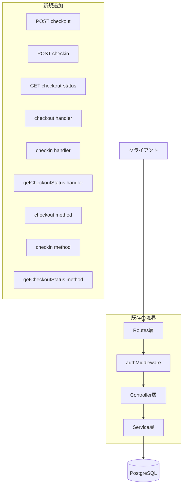
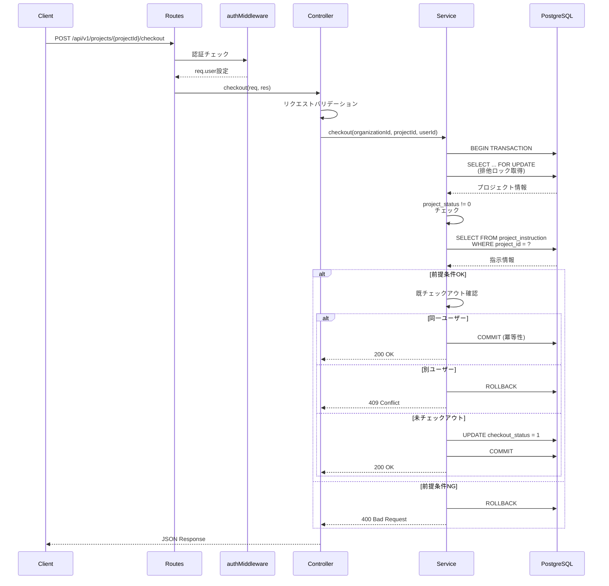
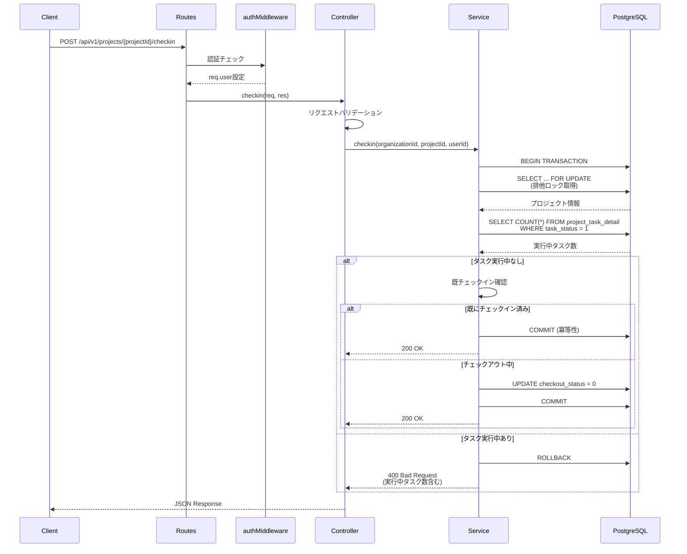
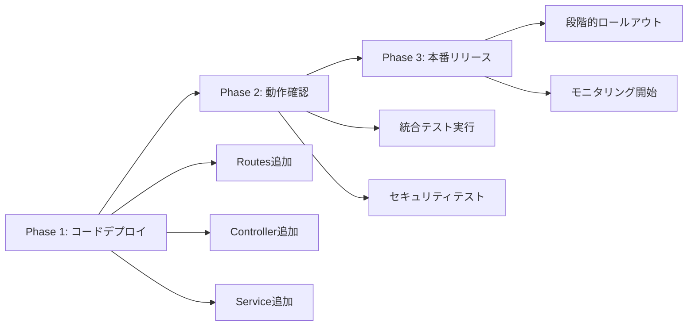

# 技術設計書: チェックイン/チェックアウト状態切り替えAPI

## メタデータ
- **機能名**: checkout-status-toggle-api
- **バージョン**: 1.0.0
- **作成日時**: 2026-01-16T11:17:00+09:00
- **ステータス**: 設計生成済み

---

## 概要

本機能は、既存のプロジェクト管理APIを拡張し、MAIMLファイルの排他制御を実現するチェックイン/チェックアウト機能を提供する。複数ユーザーが協調してプロジェクトファイルを編集する際、ファイルの整合性を保ち、同時編集による競合を防止する。

**目的**: プロジェクトファイル（MAIML）のチェックイン/チェックアウト状態を管理し、排他的なファイル編集を可能にする。

**対象ユーザー**: Experiment Admin、Experiment Worker（認証済みユーザー）がプロジェクトファイルの編集権限を取得・解放する際に利用する。

**影響**: 既存のprojectテーブルの`checkout_status`カラムを活用し、新たなテーブル追加やスキーマ変更は不要。

### Goals

- プロジェクトのチェックアウト/チェックインAPIエンドポイントの提供（FR-1, FR-2）
- チェックアウト状態照会APIの提供（FR-3）
- 同時チェックアウトの競合検出と防止（FR-1.2）
- ビジネスルールに基づく前提条件チェック（project_status、project_instruction、task_status）
- 冪等性の保証（同一ユーザーによる重複操作）
- レスポンス時間2秒以内の目標達成（NFR-1）

### Non-Goals

- ファイルバージョン管理機能（既存機能で対応）
- ファイル内容の編集機能（既存エディタで対応）
- ロールバック・マージ機能
- チェックアウトの自動タイムアウト機能
- 強制チェックイン機能（管理者による他ユーザーのチェックアウト解除）

---

## Architecture

### 既存アーキテクチャ分析

本機能は既存のプロジェクト管理APIの拡張として実装される。既存システムは以下のレイヤードアーキテクチャを採用している：

- **Routes層**: Express Routerによるエンドポイント定義、express-validatorによるリクエストバリデーション
- **Controller層**: リクエストハンドリング、レスポンス生成、統一されたエラーフォーマット
- **Service層**: ビジネスロジック、トランザクション管理、Parameterized Query
- **Middleware層**: JWT認証（authMiddleware）

**統一されたレスポンス形式**:
```typescript
interface ApiResponse<T> {
  success: boolean;
  data?: T;
  error?: { code: string; message: string; details?: any[] };
  meta: { timestamp: string; requestId: string };
}
```

**既存の制約**:
- マルチテナント分離: すべてのDBクエリでorganization_idフィルタ必須
- トランザクション管理: BEGIN/COMMIT/ROLLBACKパターン
- 型安全性: ServiceResult<T>型による明示的なエラーハンドリング

### アーキテクチャパターンと境界

**選択パターン**: レイヤードアーキテクチャ（既存パターンの踏襲）

**境界の分離**:


**ドメイン境界**:
- プロジェクト管理ドメイン内の拡張（新しいドメイン境界は不要）
- 既存の`ProjectService`クラスにメソッド追加
- 既存の`projectRoutes.ts`、`projectController.ts`に関数追加

**既存パターンの維持**:
- エンドポイント命名: `/api/v1/projects/:projectId/{action}`
- ミドルウェアチェーン: `authMiddleware`のみ（tenantIsolationとpermissionCheckはController内で実装）
- トランザクション管理: `BEGIN` → 前提条件チェック → `UPDATE` → `COMMIT`
- エラーハンドリング: 統一されたエラーコードとステータスコード体系

### 技術スタックと整合性

| Layer | Choice / Version | Role in Feature | Notes |
|-------|------------------|-----------------|-------|
| Backend | Node.js 18+ | ランタイム | 既存環境 |
| Framework | Express.js 4.18.3 | HTTPサーバー | 既存フレームワーク |
| 言語 | TypeScript 5.x | 型安全性の確保 | 既存の型システム活用 |
| Database | PostgreSQL 18+ | データ永続化 | 既存テーブル（project）使用 |
| Validation | express-validator | リクエストバリデーション | 既存ライブラリ |
| UUID | uuid v9.0.1 | requestID生成 | 既存ライブラリ |

**新規依存**: なし（既存ライブラリのみで実装可能）

**既存スタックとの整合性**:
- `ServiceResult<T>`型によるエラーハンドリングパターンを踏襲
- `authMiddleware`による認証チェックを再利用
- `getPool()`によるPostgreSQL接続プール管理を利用
- `logError()`による統一されたログ記録を使用

---

## System Flows

### チェックアウトフロー



**主要な決定**:
- `SELECT ... FOR UPDATE`による排他ロックで競合を防ぐ
- トランザクション内で前提条件チェック→ステータス更新を実行
- 同一ユーザーの重複チェックアウトは冪等性を保つ（200 OK）

### チェックインフロー



**主要な決定**:
- `task_status = 1`のタスク存在チェックをトランザクション内で実行
- 既にチェックイン済みの場合は冪等性を保つ（200 OK）
- エラー時は実行中タスク数を返却

---

## Requirements Traceability

| Requirement | Summary | Components | Interfaces | Flows |
|-------------|---------|------------|------------|-------|
| FR-1.1 | チェックアウト実行 | CheckoutRoute, CheckoutController, CheckoutService | POST /api/v1/projects/:projectId/checkout | チェックアウトフロー |
| FR-1.2 | チェックアウト競合検出 | CheckoutService | ProjectService.checkout | チェックアウトフロー（競合分岐） |
| FR-2.1 | チェックイン実行 | CheckinRoute, CheckinController, CheckinService | POST /api/v1/projects/:projectId/checkin | チェックインフロー |
| FR-3.1 | 状態取得 | StatusRoute, StatusController, StatusService | GET /api/v1/projects/:projectId/checkout-status | - |
| NFR-1 | パフォーマンス | すべてのService層 | - | トランザクション最小化 |
| NFR-2 | セキュリティ | authMiddleware, Controller層 | - | 認証・マルチテナント分離 |

---

## Components and Interfaces

### Summary

| Component | Domain/Layer | Intent | Req Coverage | Key Dependencies | Contracts |
|-----------|--------------|--------|--------------|------------------|-----------|
| CheckoutRoute | Routes | チェックアウトエンドポイント定義 | FR-1.1, FR-1.2 | authMiddleware (P0) | API |
| CheckinRoute | Routes | チェックインエンドポイント定義 | FR-2.1 | authMiddleware (P0) | API |
| StatusRoute | Routes | 状態照会エンドポイント定義 | FR-3.1 | authMiddleware (P0) | API |
| CheckoutController | Controller | チェックアウトリクエスト処理 | FR-1.1, FR-1.2 | ProjectService (P0) | Service |
| CheckinController | Controller | チェックインリクエスト処理 | FR-2.1 | ProjectService (P0) | Service |
| StatusController | Controller | 状態照会リクエスト処理 | FR-3.1 | ProjectService (P0) | Service |
| CheckoutService | Service | チェックアウトビジネスロジック | FR-1.1, FR-1.2 | PostgreSQL (P0) | Service |
| CheckinService | Service | チェックインビジネスロジック | FR-2.1 | PostgreSQL (P0) | Service |
| StatusService | Service | 状態照会ビジネスロジック | FR-3.1 | PostgreSQL (P0) | Service |

### Routes層

#### CheckoutRoute

| Field | Detail |
|-------|--------|
| Intent | チェックアウトエンドポイントのルーティング定義 |
| Requirements | FR-1.1, FR-1.2 |

**Responsibilities & Constraints**
- HTTPリクエストのルーティング
- authMiddlewareによる認証チェック
- projectIdパラメータの存在確認

**Dependencies**
- Inbound: HTTPクライアント（ブラウザ、API呼び出し元）
- Outbound: authMiddleware — JWT認証 (P0)
- Outbound: projectController.checkout — リクエスト処理 (P0)

**Contracts**: API [x]

##### API Contract

| Method | Endpoint | Request | Response | Errors |
|--------|----------|---------|----------|--------|
| POST | /api/v1/projects/:projectId/checkout | `{ projectId: string }` (params) | `{ success: true, data: ProjectCheckoutInfo }` | 400, 401, 403, 409, 500 |

**Request Parameters**:
```typescript
interface CheckoutRequest {
  projectId: string;  // UUID形式
}
```

**Response Schema**:
```typescript
interface ProjectCheckoutInfo {
  projectId: string;
  projectName: string;
  isCheckedOut: boolean;
  checkedOutBy: string | null;
  checkedOutAt: string | null;  // ISO 8601
}
```

**Implementation Notes**
- Integration: `projectRoutes.ts`に追加
- Validation: projectIdはUUID形式であること
- Risks: なし（既存パターンの踏襲）

#### CheckinRoute

| Field | Detail |
|-------|--------|
| Intent | チェックインエンドポイントのルーティング定義 |
| Requirements | FR-2.1 |

**Responsibilities & Constraints**
- HTTPリクエストのルーティング
- authMiddlewareによる認証チェック
- projectIdパラメータの存在確認

**Dependencies**
- Inbound: HTTPクライアント
- Outbound: authMiddleware — JWT認証 (P0)
- Outbound: projectController.checkin — リクエスト処理 (P0)

**Contracts**: API [x]

##### API Contract

| Method | Endpoint | Request | Response | Errors |
|--------|----------|---------|----------|--------|
| POST | /api/v1/projects/:projectId/checkin | `{ projectId: string }` (params) | `{ success: true, data: ProjectCheckoutInfo }` | 400, 401, 403, 500 |

**Implementation Notes**
- Integration: `projectRoutes.ts`に追加
- Validation: projectIdはUUID形式であること
- Risks: なし

#### StatusRoute

| Field | Detail |
|-------|--------|
| Intent | チェックアウト状態照会エンドポイントのルーティング定義 |
| Requirements | FR-3.1 |

**Responsibilities & Constraints**
- HTTPリクエストのルーティング
- authMiddlewareによる認証チェック
- projectIdパラメータの存在確認

**Dependencies**
- Inbound: HTTPクライアント
- Outbound: authMiddleware — JWT認証 (P0)
- Outbound: projectController.getCheckoutStatus — リクエスト処理 (P0)

**Contracts**: API [x]

##### API Contract

| Method | Endpoint | Request | Response | Errors |
|--------|----------|---------|----------|--------|
| GET | /api/v1/projects/:projectId/checkout-status | `{ projectId: string }` (params) | `{ success: true, data: ProjectCheckoutInfo }` | 400, 401, 403, 404, 500 |

**Implementation Notes**
- Integration: `projectRoutes.ts`に追加
- Validation: projectIdはUUID形式であること
- Risks: なし

### Controller層

#### CheckoutController

| Field | Detail |
|-------|--------|
| Intent | チェックアウトリクエストのハンドリングとレスポンス生成 |
| Requirements | FR-1.1, FR-1.2, NFR-2 |

**Responsibilities & Constraints**
- リクエストパラメータの抽出とバリデーション
- req.userからのorganizationId、userId取得
- ProjectService.checkout()の呼び出し
- エラーハンドリングとステータスコードマッピング
- 統一されたレスポンス形式の生成

**Dependencies**
- Inbound: Routes層 — HTTPリクエスト (P0)
- Outbound: ProjectService — ビジネスロジック実行 (P0)
- Outbound: logError — エラーログ記録 (P1)

**Contracts**: Service [x]

##### Service Interface

```typescript
async function checkout(req: Request, res: Response): Promise<void> {
  // Preconditions:
  // - req.user が存在する（authMiddleware で設定済み）
  // - req.params.projectId がUUID形式
  
  // Postconditions:
  // - 成功時: 200 OK、ProjectCheckoutInfo を返却
  // - エラー時: 適切なHTTPステータスコードとエラー情報を返却
  // - requestId がレスポンスに含まれる
}
```

**Implementation Notes**
- Integration: `projectController.ts`に関数追加
- Validation: 
  - UUID形式チェック（正規表現）
  - req.user存在確認（authMiddlewareで保証されるが念のためチェック）
- Risks: なし

#### CheckinController

| Field | Detail |
|-------|--------|
| Intent | チェックインリクエストのハンドリングとレスポンス生成 |
| Requirements | FR-2.1, NFR-2 |

**Responsibilities & Constraints**
- リクエストパラメータの抽出とバリデーション
- req.userからのorganizationId、userId取得
- ProjectService.checkin()の呼び出し
- エラーハンドリングとステータスコードマッピング
- 統一されたレスポンス形式の生成

**Dependencies**
- Inbound: Routes層 — HTTPリクエスト (P0)
- Outbound: ProjectService — ビジネスロジック実行 (P0)
- Outbound: logError — エラーログ記録 (P1)

**Contracts**: Service [x]

##### Service Interface

```typescript
async function checkin(req: Request, res: Response): Promise<void> {
  // Preconditions:
  // - req.user が存在する（authMiddleware で設定済み）
  // - req.params.projectId がUUID形式
  
  // Postconditions:
  // - 成功時: 200 OK、ProjectCheckoutInfo を返却
  // - エラー時: 適切なHTTPステータスコードとエラー情報を返却
}
```

**Implementation Notes**
- Integration: `projectController.ts`に関数追加
- Validation: UUID形式チェック
- Risks: なし

#### StatusController

| Field | Detail |
|-------|--------|
| Intent | チェックアウト状態照会リクエストのハンドリング |
| Requirements | FR-3.1, NFR-2 |

**Responsibilities & Constraints**
- リクエストパラメータの抽出とバリデーション
- req.userからのorganizationId取得
- ProjectService.getCheckoutStatus()の呼び出し
- エラーハンドリングとステータスコードマッピング
- 統一されたレスポンス形式の生成

**Dependencies**
- Inbound: Routes層 — HTTPリクエスト (P0)
- Outbound: ProjectService — ビジネスロジック実行 (P0)
- Outbound: logError — エラーログ記録 (P1)

**Contracts**: Service [x]

##### Service Interface

```typescript
async function getCheckoutStatus(req: Request, res: Response): Promise<void> {
  // Preconditions:
  // - req.user が存在する（authMiddleware で設定済み）
  // - req.params.projectId がUUID形式
  
  // Postconditions:
  // - 成功時: 200 OK、ProjectCheckoutInfo を返却
  // - 404: プロジェクトが存在しない
}
```

**Implementation Notes**
- Integration: `projectController.ts`に関数追加
- Validation: UUID形式チェック
- Risks: なし

### Service層

#### CheckoutService

| Field | Detail |
|-------|--------|
| Intent | チェックアウトビジネスロジックの実装とデータベース操作 |
| Requirements | FR-1.1, FR-1.2, NFR-1, NFR-2 |

**Responsibilities & Constraints**
- トランザクション管理（BEGIN/COMMIT/ROLLBACK）
- 排他ロック取得（SELECT ... FOR UPDATE）
- 前提条件チェック（project_status、project_instruction）
- チェックアウト競合検出（別ユーザーによるチェックアウト）
- 冪等性の保証（同一ユーザーによる重複チェックアウト）
- checkout_statusの更新
- マルチテナント分離（organization_idフィルタ）

**Dependencies**
- Inbound: Controller層 — リクエスト処理 (P0)
- Outbound: PostgreSQL — データ永続化 (P0)
- External: getPool() — DB接続プール (P0)

**Contracts**: Service [x]

##### Service Interface

```typescript
interface CheckoutService {
  checkout(
    organizationId: string, 
    projectId: string, 
    userId: string
  ): Promise<ServiceResult<ProjectCheckoutInfo>>;
}

interface ServiceResult<T> {
  success: boolean;
  data?: T;
  error?: {
    code: string;
    message: string;
    originalError?: Error;
  };
}
```

**Preconditions**:
- organizationId、projectId、userIdがすべて非空文字列
- projectIdがUUID形式

**Postconditions**:
- 成功時: `success: true`, checkout_statusが1に更新される
- 失敗時: `success: false`, トランザクションがロールバックされる

**Invariants**:
- マルチテナント分離: 常にorganization_idでフィルタ
- アトミック性: トランザクション内で前提条件チェック→更新を実行
- 排他制御: FOR UPDATEロックにより同時更新を防ぐ

**Implementation Notes**
- Integration: `projectService.ts`の`ProjectService`クラスにメソッド追加
- Validation:
  - `project_status != 0`
  - `project_instruction`レコード存在確認
  - 既存チェックアウト状態確認
- Risks: 
  - FOR UPDATEロックによる待機時間増加 → タイムアウト設定で緩和
  - トランザクションの長時間保持 → クエリを最小限に抑える

#### CheckinService

| Field | Detail |
|-------|--------|
| Intent | チェックインビジネスロジックの実装とデータベース操作 |
| Requirements | FR-2.1, NFR-1, NFR-2 |

**Responsibilities & Constraints**
- トランザクション管理（BEGIN/COMMIT/ROLLBACK）
- 排他ロック取得（SELECT ... FOR UPDATE）
- 前提条件チェック（task_status = 1のタスク存在確認）
- 冪等性の保証（既にチェックイン済みの場合）
- checkout_statusの更新
- マルチテナント分離（organization_idフィルタ）

**Dependencies**
- Inbound: Controller層 — リクエスト処理 (P0)
- Outbound: PostgreSQL — データ永続化 (P0)
- External: getPool() — DB接続プール (P0)

**Contracts**: Service [x]

##### Service Interface

```typescript
interface CheckinService {
  checkin(
    organizationId: string, 
    projectId: string, 
    userId: string
  ): Promise<ServiceResult<ProjectCheckoutInfo>>;
}
```

**Preconditions**:
- organizationId、projectId、userIdがすべて非空文字列
- projectIdがUUID形式

**Postconditions**:
- 成功時: `success: true`, checkout_statusが0に更新される
- 失敗時: `success: false`, トランザクションがロールバックされる

**Invariants**:
- マルチテナント分離: 常にorganization_idでフィルタ
- アトミック性: トランザクション内で前提条件チェック→更新を実行
- 排他制御: FOR UPDATEロックにより同時更新を防ぐ

**Implementation Notes**
- Integration: `projectService.ts`の`ProjectService`クラスにメソッド追加
- Validation:
  - `project_task_detail`テーブルで`task_status = 1`のレコード数確認
  - 既存チェックイン状態確認
- Risks:
  - 実行中タスクの見落とし → トランザクション内でCOUNT(*)実行

#### StatusService

| Field | Detail |
|-------|--------|
| Intent | チェックアウト状態照会ビジネスロジックの実装 |
| Requirements | FR-3.1, NFR-2 |

**Responsibilities & Constraints**
- プロジェクト情報取得（checkout_status含む）
- マルチテナント分離（organization_idフィルタ）
- 存在しないプロジェクトのハンドリング

**Dependencies**
- Inbound: Controller層 — リクエスト処理 (P0)
- Outbound: PostgreSQL — データ取得 (P0)
- External: getPool() — DB接続プール (P0)

**Contracts**: Service [x]

##### Service Interface

```typescript
interface StatusService {
  getCheckoutStatus(
    organizationId: string, 
    projectId: string
  ): Promise<ServiceResult<ProjectCheckoutInfo>>;
}
```

**Preconditions**:
- organizationId、projectIdが非空文字列
- projectIdがUUID形式

**Postconditions**:
- 成功時: `success: true`, 現在のチェックアウト状態を返却
- プロジェクト不存在: `success: false`, `RESOURCE_NOT_FOUND`エラー

**Invariants**:
- マルチテナント分離: 常にorganization_idでフィルタ

**Implementation Notes**
- Integration: `projectService.ts`の`ProjectService`クラスにメソッド追加
- Validation: プロジェクト存在確認
- Risks: なし（読み取り専用操作）

---

## Data Models

### Domain Model

**エンティティ**:
- **Project**: プロジェクト（既存）
  - 属性: organization_id, project_id, project_name, checkout_status, project_status, owner_user_id, create_at
  - ビジネスルール: 
    - checkout_status = 0 (チェックイン中) | 1 (チェックアウト中)
    - project_status != 0 の場合のみチェックアウト可能

**値オブジェクト**:
- CheckoutStatus: 0 (チェックイン中) | 1 (チェックアウト済)
- ProjectStatus: 0 (プロジェクト計画中) | 1 (タスク実行待ち) | 2 (タスク実行中) | 3 (タスク結果レビュー待ち) | 4 (プロジェクト完了) | 5 (タスク異常終了)
- TaskStatus: 0 (実行待ち) | 1 (実行中) | 2 (レビュー待ち) | 3 (完了) | 4 (異常終了)

**ビジネスルール**:
1. チェックアウト: project_status != 0 かつ project_instructionレコード存在
2. チェックイン: task_status = 1のタスクが存在しない
3. 冪等性: 同一ユーザーによる重複操作は成功を返す

### Physical Data Model

**projectテーブル** (既存):

| カラム名 | データ型 | 制約 | 説明 |
|---------|---------|------|------|
| organization_id | UUID | PK | 組織ID |
| project_id | UUID | PK | プロジェクトID |
| project_name | VARCHAR(255) | NOT NULL | プロジェクト名 |
| description | TEXT | | 説明 |
| department_id | UUID | | 部門ID |
| owner_user_id | UUID | NOT NULL | オーナーユーザーID |
| project_status | NUMERIC(2,0) | NOT NULL, DEFAULT 0 | プロジェクトステータス |
| checkout_status | NUMERIC(2,0) | NOT NULL, DEFAULT 0 | チェックアウトステータス |
| project_maiml_flg | BOOLEAN | NOT NULL, DEFAULT false | MAIMLフラグ |
| create_at | TIMESTAMP | NOT NULL | 作成日時 |

**インデックス**:
- PRIMARY KEY: `(organization_id, project_id)`
- INDEX: `organization_id` (マルチテナント分離用)
- INDEX: `checkout_status` (状態検索用、追加推奨)

**参照テーブル**:
- `project_instruction`: プロジェクト指示情報
- `project_task_detail`: タスク詳細（task_status確認用）

### Data Contracts & Integration

**API Data Transfer**:

```typescript
// レスポンスDTO
interface ProjectCheckoutInfo {
  projectId: string;
  projectName: string;
  isCheckedOut: boolean;
  checkedOutBy: string | null;
  checkedOutAt: string | null;  // ISO 8601
}

// 内部データモデル
interface ProjectData {
  organization_id: string;
  project_id: string;
  project_name: string;
  checkout_status: number;
  project_status: number;
  owner_user_id: string;
  create_at: Date;
}
```

**データ変換ルール**:
- スネークケース（DB） → キャメルケース（API）
- `checkout_status` → `isCheckedOut`: 0 → false, 1 → true
- タイムスタンプ → ISO 8601文字列

---

## Error Handling

### Error Strategy

本機能では、既存のエラーハンドリングパターンを踏襲し、統一されたエラーレスポンス形式を使用する。

### Error Categories and Responses

**User Errors (4xx)**:

| エラーコード | HTTPステータス | 説明 | 対処方法 |
|-------------|---------------|------|---------|
| VALIDATION_INVALID_FORMAT | 400 | projectIdがUUID形式でない | UUID形式で再送信 |
| PROJECT_STATUS_INVALID | 400 | project_statusが0（計画中） | プロジェクトステータスを確認 |
| PROJECT_INSTRUCTION_NOT_FOUND | 400 | project_instructionが未登録 | 作業指示を登録してから再実行 |
| TASK_IN_PROGRESS | 400 | 実行中タスクが存在 | タスクを完了してから再実行 |
| AUTH_TOKEN_INVALID | 401 | 認証トークンが無効 | 再ログイン |
| PERMISSION_INSUFFICIENT | 403 | 権限不足 | 管理者に権限付与を依頼 |
| PROJECT_ALREADY_CHECKED_OUT | 409 | 他ユーザーがチェックアウト中 | 他ユーザーのチェックイン待ち |

**System Errors (5xx)**:

| エラーコード | HTTPステータス | 説明 | 対処方法 |
|-------------|---------------|------|---------|
| SYSTEM_DATABASE_ERROR | 500 | データベースエラー | サーバーログ確認 |
| SYSTEM_ERROR | 500 | 予期しないエラー | サポートに連絡 |

**エラーレスポンス例**:

```json
{
  "success": false,
  "error": {
    "code": "PROJECT_ALREADY_CHECKED_OUT",
    "message": "このプロジェクトは既に他のユーザーによってチェックアウトされています",
    "details": {
      "checkedOutBy": "user_name",
      "checkedOutAt": "2026-01-16T09:00:00Z"
    }
  },
  "meta": {
    "timestamp": "2026-01-16T10:00:00Z",
    "requestId": "req_abc123"
  }
}
```

### Monitoring

**エラートラッキング**:
- すべてのエラーを`logError()`でログ記録
- コンテキスト情報: action, organizationId, projectId, userId, requestId
- スタックトレースを含める（500エラー時）

**ヘルスモニタリング**:
- レスポンス時間の計測（2秒以内を目標）
- エラー率の監視（5%以下を目標）
- データベース接続プールの監視

---

## Testing Strategy

### Unit Tests

**ProjectService.checkout()**:
- ✅ 正常系: チェックアウト成功
- ✅ 異常系: project_status = 0 でチェックアウト失敗
- ✅ 異常系: project_instructionレコードなしでチェックアウト失敗
- ✅ 異常系: 他ユーザーがチェックアウト中で409エラー
- ✅ 正常系: 同一ユーザーによる重複チェックアウトで200 OK（冪等性）

**ProjectService.checkin()**:
- ✅ 正常系: チェックイン成功
- ✅ 異常系: task_status = 1 のタスク存在でチェックイン失敗
- ✅ 正常系: 既にチェックイン済みで200 OK（冪等性）

**ProjectService.getCheckoutStatus()**:
- ✅ 正常系: チェックアウト状態取得成功
- ✅ 異常系: プロジェクト不存在で404エラー

### Integration Tests

**チェックアウト → チェックイン フロー**:
- ✅ チェックアウト → 編集 → チェックイン の完全フロー
- ✅ チェックアウト → 別ユーザーがチェックアウト試行 → 409エラー
- ✅ チェックアウト → タスク実行開始 → チェックイン試行 → 400エラー

**同時実行テスト**:
- ✅ 複数ユーザーが同時にチェックアウト試行 → 1人のみ成功
- ✅ FOR UPDATEロックの動作確認

### Security Tests

**認証・認可テスト**:
- ✅ 未認証ユーザーのアクセス拒否（401）
- ✅ 他組織のプロジェクトへのアクセス拒否（403または404）
- ✅ マルチテナント分離の検証

**SQLインジェクションテスト**:
- ✅ Parameterized Queryの使用確認
- ✅ 特殊文字を含むprojectIdでの動作確認

---

## Performance & Scalability

### Target Metrics

| メトリクス | 目標値 | 測定方法 |
|-----------|-------|---------|
| レスポンス時間 | 2秒以内（通常時） | APIログ、CloudWatch |
| 同時実行 | 10件/秒 | 負荷テスト |
| エラー率 | 5%以下 | エラーログ集計 |

### Scaling Approaches

**水平スケーリング**:
- ECSタスク数の増加（Auto Scaling）
- データベース接続プールの調整（最大20接続）

**垂直スケーリング**:
- データベースインスタンスのスペックアップ（必要に応じて）

### Caching Strategies

**キャッシング不要**:
- チェックアウト状態はリアルタイム性が重要なため、キャッシュしない
- すべてのリクエストでデータベースから最新状態を取得

**最適化ポイント**:
- トランザクションを可能な限り短く保つ
- インデックスの活用（checkout_status）
- 不要なJOINを避ける

---

## Security Considerations

### Threat Modeling

**脅威1: SQLインジェクション**
- **対策**: Parameterized Queryの使用（すべてのクエリ）
- **検証**: 単体テストで特殊文字入力を確認

**脅威2: クロステナントアクセス**
- **対策**: すべてのクエリでorganization_idフィルタ
- **検証**: 統合テストでマルチテナント分離を確認

**脅威3: 権限昇格**
- **対策**: authMiddlewareによる認証、Controller層での権限確認
- **検証**: セキュリティテストで未認証・権限不足アクセスを確認

### Authentication and Authorization

**認証**:
- JWT + Session Hybrid方式（既存）
- すべてのエンドポイントでauthMiddleware適用

**認可**:
- マルチテナント分離: organization_id必須
- Worker権限でも実行可能（追加の権限チェック不要）

### Data Protection

**機密情報の保護**:
- チェックアウト保持者の情報は必要最小限のみ返却
- パスワードなどの機密情報は含めない

**監査ログ**:
- すべてのチェックアウト/チェックイン操作をログ記録
- ログ内容: userId, organizationId, projectId, action, timestamp, IPアドレス

---

## Migration Strategy

### Migration Phases

本機能はスキーマ変更を伴わないため、マイグレーションは不要。

**デプロイフェーズ**:



**Phase 1: コードデプロイ** (1時間):
- バックエンドコードのデプロイ
- ECSタスク更新
- ヘルスチェック確認

**Phase 2: 動作確認** (30分):
- 統合テスト実行
- セキュリティテスト実行
- パフォーマンステスト実行

**Phase 3: 本番リリース** (継続的):
- 段階的ロールアウト（一部ユーザーから開始）
- エラー率・レスポンス時間のモニタリング
- 問題発生時はロールバック

**ロールバック トリガー**:
- エラー率が10%を超える
- レスポンス時間が5秒を超える
- データ不整合が検出される

**検証チェックポイント**:
- ✅ 3つのエンドポイントが正常に動作
- ✅ マルチテナント分離が正しく機能
- ✅ 既存のプロジェクト管理APIに影響なし
- ✅ エラー率が目標値以下

---

## 完了基準

以下の基準をすべて満たした場合、本機能は完了とみなす：

### 機能要件
- [ ] チェックアウトAPIが正常に動作（FR-1.1）
- [ ] チェックアウト競合検出が正常に動作（FR-1.2）
- [ ] チェックインAPIが正常に動作（FR-2.1）
- [ ] チェックアウト状態照会APIが正常に動作（FR-3.1）
- [ ] ビジネスルールに基づく前提条件チェックが実装済み

### 非機能要件
- [ ] レスポンス時間が2秒以内（NFR-1）
- [ ] マルチテナント分離が実装済み（NFR-2）
- [ ] JWT認証が実装済み（NFR-2）
- [ ] 監査ログが記録される（NFR-2）

### テスト
- [ ] 単体テストカバレッジが70%以上
- [ ] 統合テストがすべて成功
- [ ] セキュリティテストがすべて成功

### ドキュメント
- [ ] API仕様書（OpenAPI）が更新済み
- [ ] 実装完了報告が作成済み

---

## 参考資料

### 内部ドキュメント
- `docs/.kiro/specs/checkout-status-toggle-api/requirements.md` - 要件定義
- `docs/.kiro/specs/checkout-status-toggle-api/research.md` - 調査ログ
- `docs/design/api/api_project_management.md` - プロジェクト管理API仕様
- `.clinerules/development/backend.md` - バックエンド規約
- `.clinerules/development/api.md` - API設計規約
- `.clinerules/development/security.md` - セキュリティ規約

### コード参照
- `backend/src/routes/projectRoutes.ts` - 既存Routesパターン
- `backend/src/controllers/projectController.ts` - 既存Controllerパターン
- `backend/src/services/projectService.ts` - 既存Serviceパターン
- `backend/src/middleware/authMiddleware.ts` - 認証ミドルウェア

---

## 次のステップ

1. ✅ 設計完了: アーキテクチャとコンポーネント設計を定義
2. → タスク分解: `/spec-tasks checkout-status-toggle-api` で実装タスクを生成
3. → 実装開始: Routes → Controller → Service の順で実装
4. → テスト実装: 単体テスト、統合テスト、セキュリティテスト
5. → デプロイ: 段階的ロールアウト
