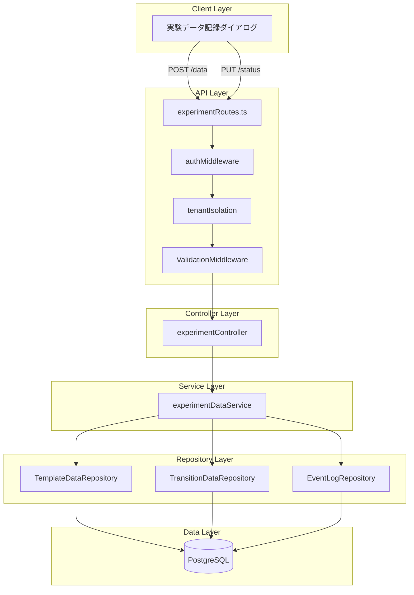
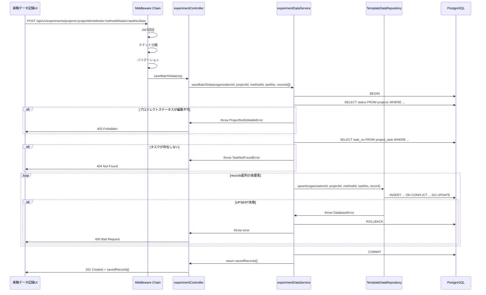
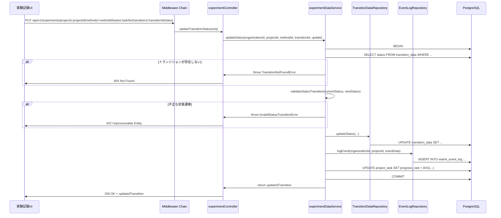
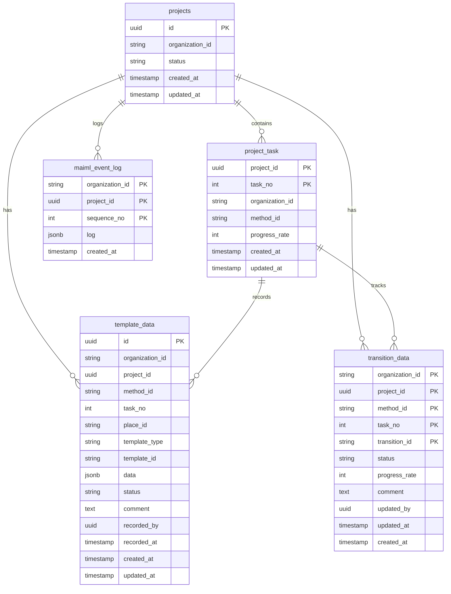

# Design Document: 実験データ保存API

## Overview

本機能は、実験作業者が実験データを効率的かつ安全に記録するためのバックエンドAPIを提供します。複数プレースの実験データ（Material、Condition、Result）を一括保存し、トランジションの進捗状況をリアルタイムで更新できます。

**Purpose**: 実験作業者がPetri Netワークフローに基づく実験データを記録し、実験の進行状況を管理する機能を提供します。All or Nothing方式のトランザクション保証により、データの整合性を確保します。

**Users**: 
- 実験作業者（Worker）: 実験データの記録とステータス更新
- 実験管理者（Manager）: 上記機能に加え、データ確認・承認
- システム管理者（Admin）: 全権限とクロステナント監査

**Impact**: 既存の実験管理システムに新しいデータ記録APIを追加します。トランジションステータス更新APIは既に実装済みですが、イベントログ記録機能を追加します。

### Goals

- 複数プレースの実験データを一括保存できるAPIを提供する
- トランザクション保証（All or Nothing）によりデータ整合性を確保する
- トランジションステータスの手動更新とイベント履歴記録を実現する
- マルチテナント分離とセキュリティ要件を満たす
- 既存の3層アーキテクチャ（Controller → Service → Repository）に統合する

### Non-Goals

- 自動進捗更新機能（autoProgressUpdate）は削除済みのためスコープ外
- 実験データの検索・集計API（別機能で実装）
- リアルタイム通知機能（将来検討）
- データのバージョン管理機能（Phase 2以降）

## Architecture

### Existing Architecture Analysis

本機能は既存の実験管理システムの拡張として実装します。

**現在のアーキテクチャパターン**:
- 3層アーキテクチャ: Controller → Service → Repository
- ミドルウェアチェーン: `auth → tenantIsolation → permissionCheck`
- トランザクション管理: Pool.connect() → BEGIN → 処理 → COMMIT/ROLLBACK
- バリデーション: express-validator + handleValidationErrors
- エラーハンドリング: カスタムエラークラス + 統一レスポンス形式

**既存の実装状況**:
- トランジションステータス更新APIは実装済み（`experimentRoutes.ts`, `experimentController.ts`, `experimentDataService.ts`）
- `TransitionDataRepository`が存在し、ステータス更新ロジックを提供
- maiml_event_logへのイベント記録はTODOコメントで未実装

**統合方針**:
- 実験データ一括保存APIを新規追加（新しいコントローラーメソッド、サービスメソッド、リポジトリ）
- トランジションステータス更新APIにイベントログ記録機能を追加
- 既存のルートファイル（`experimentRoutes.ts`）に新しいエンドポイントを追加
- 既存のミドルウェアチェーンとエラーハンドリングパターンを踏襲

### Architecture Pattern & Boundary Map



**Architecture Integration**:
- **選択パターン**: 3層アーキテクチャ（既存システムと一貫性を保つ）
- **ドメイン境界**: 実験データ記録と進捗管理を単一のサービスに集約
- **既存パターン維持**: ミドルウェアチェーン、トランザクション管理、エラーハンドリング
- **新規コンポーネント**: TemplateDataRepository（template_dataテーブル操作）、EventLogRepository（maiml_event_log操作）
- **Steering準拠**: マルチテナント分離、RBAC、All or Nothingトランザクション

### Technology Stack

| Layer | Choice / Version | Role in Feature | Notes |
|-------|------------------|-----------------|-------|
| Backend | Node.js 18+ / Express.js 4.18.3 | APIエンドポイント提供 | 既存システムと同じ |
| Language | TypeScript 5.x | 型安全な実装 | `any`型の使用禁止 |
| Database | PostgreSQL 18+ | データ永続化 | JSONB型、トランザクション |
| Query Builder | Kysely | 型安全なクエリ構築 | 既存リポジトリと同じ |
| Validation | express-validator 7.x | 入力バリデーション | 既存パターンを踏襲 |
| Authentication | JWT + Session Hybrid | 認証・認可 | 既存の認証システム |
| Logging | Winston + Daily Rotate | ログ記録 | 既存のログ基盤 |

## System Flows

### 実験データ一括保存フロー



**Key Decisions**:
- トランザクション内でプロジェクトステータスとタスク存在を確認し、レースコンディションを回避
- records配列の各要素を順次UPSERTし、1件でも失敗したら全体をロールバック
- UPSERTはPostgreSQLの`ON CONFLICT ... DO UPDATE`構文を使用し、原子性を保証

### トランジションステータス更新フロー



**Key Decisions**:
- ステータス遷移ルール（ALLOWED_TRANSITIONS）で妥当性を検証
- completed状態では進捗率を自動的に100%に設定
- maiml_event_logへのイベント記録をトランザクション内で実行（新規追加）
- タスク進捗率の再計算を自動実行

## Requirements Traceability

| Requirement | Summary | Components | Interfaces | Flows |
|-------------|---------|------------|------------|-------|
| 1 (REQ-1) | 実験データ一括保存 | experimentController.saveBatchData, experimentDataService.saveBatchData, TemplateDataRepository | Service, API | 実験データ一括保存フロー |
| 2 (REQ-2) | トランザクション管理 | experimentDataService (トランザクション処理) | - | 両フロー |
| 3 (REQ-3) | トランジションステータス更新 | experimentController.updateTransitionStatus, experimentDataService.updateStatus, TransitionDataRepository, EventLogRepository | Service, API | トランジションステータス更新フロー |
| 4 (REQ-4) | マルチテナント分離 | tenantIsolation middleware, すべてのRepository | - | 両フロー |
| 5 (REQ-5) | 入力バリデーション | express-validator chains, handleValidationErrors | - | 両フロー |
| 6 (REQ-6) | 認証と認可 | authMiddleware, permissionCheck | - | 両フロー |
| 7 (REQ-7) | エラーハンドリング | エラーハンドリングミドルウェア, カスタムエラークラス | - | 両フロー |
| 8 (REQ-8) | レスポンス形式 | Controller層のレスポンス生成 | API | 両フロー |
| 9 (REQ-9) | パフォーマンスと最適化 | PostgreSQLインデックス, Connection Pool | - | 両フロー |
| 10 (REQ-10) | 監査とロギング | EventLogRepository, Winston logger | Service | トランジションステータス更新フロー |

## Components and Interfaces

### Component Summary

| Component | Domain/Layer | Intent | Req Coverage | Key Dependencies | Contracts |
|-----------|--------------|--------|--------------|------------------|-----------|
| experimentRoutes | API/Router | ルート定義とバリデーション | 5, 6 | authMiddleware (P0), tenantIsolation (P0), express-validator (P0) | API |
| experimentController | Controller | リクエスト処理とレスポンス生成 | 1, 3, 7, 8 | experimentDataService (P0) | API |
| experimentDataService | Service | ビジネスロジックとトランザクション管理 | 1, 2, 3, 10 | TemplateDataRepository (P0), TransitionDataRepository (P0), EventLogRepository (P0) | Service |
| TemplateDataRepository | Repository | template_dataテーブルCRUD操作 | 1, 4, 9 | PostgreSQL Pool (P0) | Service |
| TransitionDataRepository | Repository | transition_dataテーブル更新 | 3, 4, 9 | PostgreSQL Pool (P0) | Service |
| EventLogRepository | Repository | maiml_event_logイベント記録 | 10, 4 | PostgreSQL Pool (P0) | Service |

### API Layer

#### experimentRoutes

| Field | Detail |
|-------|--------|
| Intent | 実験データAPIのルート定義とバリデーション |
| Requirements | 5, 6 |
| Owner | Backend Team |

**Responsibilities & Constraints**
- APIエンドポイントのルート定義
- ミドルウェアチェーンの適用（auth → tenantIsolation → validation）
- express-validatorによる入力バリデーション
- バリデーションエラーの統一処理

**Dependencies**
- Inbound: HTTPクライアント（フロントエンド）— APIリクエスト (P0)
- Outbound: experimentController — リクエスト処理委譲 (P0)
- Outbound: authMiddleware — JWT認証 (P0)
- Outbound: tenantIsolation — テナント分離 (P0)
- External: express-validator — 入力バリデーション (P0)

**Contracts**: API [x]

##### API Contract

**API 1: 実験データ一括保存**

| Method | Endpoint | Request | Response | Errors |
|--------|----------|---------|----------|--------|
| POST | /api/v1/experiments/projects/:projectId/methods/:methodId/tasks/:taskNo/data | SaveBatchDataRequest | SaveBatchDataResponse | 400, 403, 404, 500 |

**Request Schema**:
```typescript
interface SaveBatchDataRequest {
  records: TemplateDataRecord[];
}

interface TemplateDataRecord {
  placeId: string;
  templateType: 'material' | 'condition' | 'result';
  templateId: string;
  data: Record<string, unknown>; // JSONB
  status?: 'initial' | 'preparing' | 'ready' | 'running' | 'paused' | 'completed' | 'error';
  comment?: string; // 最大2000文字
}
```

**Response Schema (201 Created)**:
```typescript
interface SaveBatchDataResponse {
  success: true;
  data: {
    saved: number;
    records: TemplateDataDetail[];
  };
  meta: {
    timestamp: string; // ISO 8601
    requestId: string;
  };
}

interface TemplateDataDetail {
  id: string; // UUID
  projectId: string;
  methodId: string;
  taskNo: number;
  placeId: string;
  templateType: string;
  templateId: string;
  data: Record<string, unknown>;
  status: string;
  comment: string | null;
  recordedBy: string; // UUID
  recordedAt: string; // ISO 8601
  organizationId: string;
  createdAt: string;
  updatedAt: string;
}
```

**API 2: トランジションステータス更新**

| Method | Endpoint | Request | Response | Errors |
|--------|----------|---------|----------|--------|
| PUT | /api/v1/experiments/projects/:projectId/methods/:methodId/tasks/:taskNo/transitions/:transitionId/status | UpdateStatusRequest | UpdateStatusResponse | 400, 403, 404, 422, 500 |

**Request Schema**:
```typescript
interface UpdateStatusRequest {
  status: 'initial' | 'preparing' | 'ready' | 'running' | 'paused' | 'completed' | 'error';
  progressRate?: number; // 0-100
  comment?: string; // 最大2000文字
}
```

**Response Schema (200 OK)**:
```typescript
interface UpdateStatusResponse {
  success: true;
  data: {
    transitionId: string;
    taskNo: number;
    methodId: string;
    projectId: string;
    status: string;
    progressRate: number;
    comment: string | null;
    updatedBy: string; // UUID
    updatedAt: string; // ISO 8601
  };
  meta: {
    timestamp: string;
    requestId: string;
  };
}
```

**Implementation Notes**
- **Integration**: 既存の`experimentRoutes.ts`に新しいエンドポイントを追加
- **Validation**: records配列のカスタムバリデータ実装が必要（最小1件、最大50件を推奨）
- **Risks**: 大量のrecords配列（50件超）でパフォーマンス低下の可能性

### Controller Layer

#### experimentController

| Field | Detail |
|-------|--------|
| Intent | APIリクエスト処理とレスポンス生成 |
| Requirements | 1, 3, 7, 8 |

**Responsibilities & Constraints**
- リクエストパラメータの抽出と検証
- サービス層の呼び出し
- 成功レスポンスの生成（統一形式）
- エラーハンドリング（next()でミドルウェアに委譲）
- レスポンスステータスコードの設定

**Dependencies**
- Inbound: experimentRoutes — ルートからのリクエスト (P0)
- Outbound: experimentDataService — ビジネスロジック実行 (P0)

**Contracts**: Service [x]

##### Service Interface

```typescript
interface ExperimentController {
  saveBatchData(req: Request, res: Response, next: NextFunction): Promise<void>;
  updateTransitionStatus(req: Request, res: Response, next: NextFunction): Promise<void>;
}
```

**saveBatchDataメソッド**:
- Preconditions: リクエストがバリデーション済み、JWT認証済み、organizationId設定済み
- Postconditions: HTTPステータスコード201とsavedRecords[]を返す、またはエラーをnext()に委譲
- Invariants: レスポンス形式は統一形式に従う

**updateTransitionStatusメソッド**:
- Preconditions: リクエストがバリデーション済み、JWT認証済み
- Postconditions: HTTPステータスコード200と更新後のトランジション情報を返す
- Invariants: 既存実装を維持しつつイベントログ記録を追加

**Implementation Notes**
- **Integration**: 既存の`experimentController.ts`に`saveBatchData`メソッドを追加
- **Validation**: パスパラメータ（projectId, methodId, taskNo）とボディパラメータ（records）の検証
- **Risks**: records配列が空の場合のエラーハンドリング

### Service Layer

#### experimentDataService

| Field | Detail |
|-------|--------|
| Intent | 実験データ記録のビジネスロジックとトランザクション管理 |
| Requirements | 1, 2, 3, 10 |

**Responsibilities & Constraints**
- ビジネスロジックの実装（プロジェクトステータス確認、ステータス遷移検証）
- トランザクション管理（BEGIN, COMMIT, ROLLBACK）
- リポジトリ層の調整と呼び出し
- データ整合性の保証（All or Nothing）
- イベントログの記録

**Dependencies**
- Inbound: experimentController — コントローラーからの呼び出し (P0)
- Outbound: TemplateDataRepository — template_dataテーブル操作 (P0)
- Outbound: TransitionDataRepository — transition_dataテーブル操作 (P0)
- Outbound: EventLogRepository — maiml_event_logテーブル操作 (P0)
- Outbound: PostgreSQL Pool — データベース接続 (P0)

**Contracts**: Service [x]

##### Service Interface

```typescript
interface ExperimentDataService {
  saveBatchData(
    organizationId: string,
    projectId: string,
    methodId: string,
    taskNo: number,
    records: TemplateDataRecord[],
    recordedBy: string
  ): Promise<TemplateDataDetail[]>;

  updateStatus(
    organizationId: string,
    projectId: string,
    methodId: string,
    transitionId: string,
    update: TransitionDataUpdate
  ): Promise<TransitionData>;

  validateStatusTransition(fromStatus: Status, toStatus: Status): void;
}

interface TransitionDataUpdate {
  status: Status;
  progress_rate?: number;
  updated_by: string;
}

type Status = 'initial' | 'preparing' | 'ready' | 'running' | 'paused' | 'completed' | 'error';
```

**saveBatchDataメソッド**:
- Preconditions: organizationId, projectId, methodId, taskNo, records配列が有効
- Postconditions: すべてのrecordsがUPSERTされ、コミット済み、または全体がロールバック
- Invariants: トランザクション内で全操作を実行、プロジェクトステータスが編集可能

**updateStatusメソッド**:
- Preconditions: トランジションが存在、ステータス遷移が有効
- Postconditions: トランジションステータス更新、イベントログ記録、タスク進捗率再計算
- Invariants: ステータス遷移ルール（ALLOWED_TRANSITIONS）に従う

**Implementation Notes**
- **Integration**: 既存の`experimentDataService.ts`に`saveBatchData`メソッドを追加、`updateStatus`メソッドにイベントログ記録を追加
- **Validation**: プロジェクトステータス確認（draft/active/waiting_approval以外は403エラー）
- **Risks**: トランザクション実行中の長時間ロック、デッドロック発生の可能性

### Repository Layer

#### TemplateDataRepository

| Field | Detail |
|-------|--------|
| Intent | template_dataテーブルのCRUD操作 |
| Requirements | 1, 4, 9 |

**Responsibilities & Constraints**
- template_dataテーブルへのUPSERT操作
- マルチテナント分離（organization_idフィルタ必須）
- Parameterized Queriesの使用
- JSONB型の適切な処理

**Dependencies**
- Inbound: experimentDataService — サービス層からの呼び出し (P0)
- Outbound: PostgreSQL Pool — データベース接続 (P0)

**Contracts**: Service [x]

##### Service Interface

```typescript
interface TemplateDataRepository {
  upsert(
    organizationId: string,
    projectId: string,
    methodId: string,
    taskNo: number,
    record: TemplateDataRecord,
    recordedBy: string,
    client: PoolClient
  ): Promise<TemplateDataDetail>;

  findByTaskNo(
    organizationId: string,
    projectId: string,
    methodId: string,
    taskNo: number
  ): Promise<TemplateDataDetail[]>;
}
```

**upsertメソッド**:
- Preconditions: clientはトランザクション内、全パラメータが有効
- Postconditions: レコードがINSERTまたはUPDATEされ、RETURNING *で結果を返す
- Invariants: 一意キー(organization_id, project_id, method_id, task_no, place_id)でUPSERT

**Implementation Notes**
- **Integration**: 新規ファイル`backend/src/repositories/templateDataRepository.ts`を作成
- **Validation**: JSONB型のdata列は`JSON.stringify()`で変換、`$n::jsonb`でパラメータ化
- **Risks**: 大量UPSERT時のパフォーマンス低下

#### TransitionDataRepository

| Field | Detail |
|-------|--------|
| Intent | transition_dataテーブルの更新操作 |
| Requirements | 3, 4, 9 |

**Responsibilities & Constraints**
- トランジションステータスの更新
- マルチテナント分離
- Parameterized Queriesの使用

**Dependencies**
- Inbound: experimentDataService — サービス層からの呼び出し (P0)
- Outbound: PostgreSQL Pool — データベース接続 (P0)

**Contracts**: Service [x]

##### Service Interface

```typescript
interface TransitionDataRepository {
  updateStatus(
    organizationId: string,
    projectId: string,
    methodId: string,
    taskNo: number,
    transitionId: string,
    update: TransitionDataUpdate
  ): Promise<TransitionData>;

  findByTransitionId(
    organizationId: string,
    projectId: string,
    methodId: string,
    transitionId: string
  ): Promise<TransitionData | null>;
}
```

**Implementation Notes**
- **Integration**: 既存の`backend/src/repositories/transitionDataRepository.ts`を使用
- **Validation**: ステータス遷移ルールはサービス層で検証
- **Risks**: なし（既存実装を使用）

#### EventLogRepository

| Field | Detail |
|-------|--------|
| Intent | maiml_event_logテーブルへのイベント記録 |
| Requirements | 10, 4 |

**Responsibilities & Constraints**
- イベントログの記録
- sequence_noの自動採番（organization_id, project_id単位）
- JSONB形式でのログデータ保存
- マルチテナント分離

**Dependencies**
- Inbound: experimentDataService — サービス層からの呼び出し (P0)
- Outbound: PostgreSQL Pool — データベース接続 (P0)

**Contracts**: Service [x]

##### Service Interface

```typescript
interface EventLogRepository {
  logEvent(
    organizationId: string,
    projectId: string,
    eventData: EventLogData,
    client: PoolClient
  ): Promise<void>;
}

interface EventLogData {
  event_type: 'transition_status_update' | 'template_data_saved';
  method_id: string;
  task_no: number;
  transition_id?: string;
  place_id?: string;
  status?: string;
  progress_rate?: number;
  comment?: string | null;
  updated_by: string;
  timestamp: Date;
}
```

**logEventメソッド**:
- Preconditions: clientはトランザクション内、eventDataが有効
- Postconditions: maiml_event_logテーブルにイベントが記録される
- Invariants: sequence_noは(organization_id, project_id)単位で自動採番

**Implementation Notes**
- **Integration**: 新規ファイル`backend/src/repositories/eventLogRepository.ts`を作成
- **Validation**: eventDataをJSONB形式で保存（`jsonb_build_object`使用）
- **Risks**: sequence_noの採番で競合が発生する可能性（トランザクション内で実行するため問題なし）

## Data Models

### Domain Model

本機能は実験データ記録と進捗管理の2つのドメインを扱います。

**Aggregates and Transactional Boundaries**:
- **ExperimentDataAggregate**: template_dataテーブルを中心とした実験データの集約。トランザクション境界はタスク単位の一括保存。
- **TransitionProgressAggregate**: transition_dataとmaiml_event_logを含む進捗管理の集約。トランザクション境界はトランジション単位の更新。

**Entities**:
- TemplateData: 実験データのエンティティ（Material、Condition、Result）
- TransitionData: トランジションの状態エンティティ

**Value Objects**:
- Status: ステータス値（initial, preparing, ready, running, paused, completed, error）
- ProgressRate: 進捗率（0-100の整数）
- EventLogData: イベントログデータ（JSONB）

**Business Rules & Invariants**:
- プロジェクトステータスがdraft/active/waiting_approvalの場合のみ編集可能
- トランジションステータスはALLOWED_TRANSITIONSマトリクスに従う
- completed状態では進捗率は常に100%
- 一意キー(organization_id, project_id, method_id, task_no, place_id)は重複不可

### Logical Data Model



**Consistency & Integrity**:
- **Transaction boundaries**: 実験データ一括保存はrecords配列全体、ステータス更新はトランジション+イベントログ+タスク進捗再計算
- **Cascading rules**: プロジェクト削除時は関連するtemplate_data、transition_data、maiml_event_logもカスケード削除
- **Temporal aspects**: created_atは作成時刻、updated_atは更新時刻、recorded_atは記録時刻（template_data専用）

### Physical Data Model

**For PostgreSQL Databases**:

#### template_dataテーブル

```sql
CREATE TABLE template_data (
  id UUID PRIMARY KEY DEFAULT gen_random_uuid(),
  organization_id VARCHAR(255) NOT NULL,
  project_id UUID NOT NULL,
  method_id VARCHAR(255) NOT NULL,
  task_no INTEGER NOT NULL,
  place_id VARCHAR(255) NOT NULL,
  template_type VARCHAR(50) NOT NULL CHECK (template_type IN ('material', 'condition', 'result')),
  template_id VARCHAR(255) NOT NULL,
  data JSONB NOT NULL,
  status VARCHAR(50) CHECK (status IN ('initial', 'preparing', 'ready', 'running', 'paused', 'completed', 'error')),
  comment TEXT,
  recorded_by UUID NOT NULL,
  recorded_at TIMESTAMP NOT NULL DEFAULT CURRENT_TIMESTAMP,
  created_at TIMESTAMP NOT NULL DEFAULT CURRENT_TIMESTAMP,
  updated_at TIMESTAMP NOT NULL DEFAULT CURRENT_TIMESTAMP,
  CONSTRAINT template_data_unique_key UNIQUE (organization_id, project_id, method_id, task_no, place_id),
  FOREIGN KEY (organization_id, project_id) REFERENCES projects(organization_id, id) ON DELETE CASCADE,
  FOREIGN KEY (organization_id, project_id, method_id, task_no) REFERENCES project_task(organization_id, project_id, method_id, task_no) ON DELETE CASCADE
);

-- Indexes
CREATE INDEX idx_template_data_org_recorded ON template_data(organization_id, recorded_at);
CREATE INDEX idx_template_data_project_task ON template_data(project_id, task_no);
CREATE INDEX idx_template_data_data_gin ON template_data USING GIN (data); -- JSONB高速検索用
```

#### transition_dataテーブル（既存）

```sql
-- 既存テーブル定義（変更なし）
CREATE TABLE transition_data (
  organization_id VARCHAR(255) NOT NULL,
  project_id UUID NOT NULL,
  method_id VARCHAR(255) NOT NULL,
  task_no INTEGER NOT NULL,
  transition_id VARCHAR(255) NOT NULL,
  status VARCHAR(50) NOT NULL CHECK (status IN ('initial', 'preparing', 'ready', 'running', 'paused', 'completed', 'error')),
  progress_rate INTEGER NOT NULL DEFAULT 0 CHECK (progress_rate >= 0 AND progress_rate <= 100),
  comment TEXT,
  updated_by UUID NOT NULL,
  updated_at TIMESTAMP NOT NULL DEFAULT CURRENT_TIMESTAMP,
  created_at TIMESTAMP NOT NULL DEFAULT CURRENT_TIMESTAMP,
  PRIMARY KEY (organization_id, project_id, method_id, task_no, transition_id),
  FOREIGN KEY (organization_id, project_id, method_id, task_no) REFERENCES project_task(organization_id, project_id, method_id, task_no) ON DELETE CASCADE
);

-- Indexes
CREATE INDEX idx_transition_data_org_updated ON transition_data(organization_id, project_id, updated_at);
```

#### maiml_event_logテーブル（既存）

```sql
-- 既存テーブル定義（変更なし）
CREATE TABLE maiml_event_log (
  organization_id VARCHAR(255) NOT NULL,
  project_id UUID NOT NULL,
  sequence_no INTEGER NOT NULL,
  log JSONB NOT NULL,
  created_at TIMESTAMP NOT NULL DEFAULT CURRENT_TIMESTAMP,
  PRIMARY KEY (organization_id, project_id, sequence_no),
  FOREIGN KEY (organization_id, project_id) REFERENCES projects(organization_id, id) ON DELETE CASCADE
);

-- Indexes
CREATE INDEX idx_maiml_event_log_created ON maiml_event_log(organization_id, project_id, created_at);
CREATE INDEX idx_maiml_event_log_log_gin ON maiml_event_log USING GIN (log); -- JSONB高速検索用
```

**Index Strategy**:
- 一意キー制約をUPSERT時のCONFLICT検出に使用
- GINインデックスでJSONBカラムの高速検索を実現
- 時系列検索用にrecorded_at、updated_at、created_atにインデックス
- マルチテナント分離用にorganization_idを先頭に配置

**Partitioning Strategy**:
- 現時点ではパーティショニング不要
- 将来的にmaiml_event_logが肥大化した場合、月次パーティショニングを検討

### Data Contracts & Integration

**API Data Transfer**:
- リクエスト/レスポンスはJSON形式
- camelCaseキー名を使用
- ISO 8601形式のタイムスタンプ
- UUIDはハイフン付き文字列形式

**Event Schemas**:
- maiml_event_logのlog列はJSONB形式
- event_type: 'transition_status_update' | 'template_data_saved'
- タイムスタンプ、ユーザーID、変更内容を含む

**Cross-Service Data Management**:
- すべての操作を単一トランザクション内で実行（Saga不要）
- データ同期は不要（単一データベース）
- 整合性はトランザクション保証により確保

## Error Handling

### Error Strategy

本機能は統一されたエラーハンドリング戦略に従います。すべてのエラーはカスタムエラークラスで定義し、エラーハンドリングミドルウェアで統一レスポンス形式に変換します。

### Error Categories and Responses

**User Errors (4xx)**:

| Error Code | HTTP Status | Trigger | User Message | Recovery |
|------------|-------------|---------|--------------|----------|
| VALIDATION_ERROR | 400 | 入力バリデーション失敗 | 入力データが不正です。詳細を確認してください。 | フィールドエラー情報を表示 |
| AUTH_TOKEN_EXPIRED | 401 | JWT有効期限切れ | セッションが期限切れです。再ログインしてください。 | ログイン画面にリダイレクト |
| AUTH_TOKEN_INVALID | 401 | JWT不正 | 認証情報が無効です。再ログインしてください。 | ログイン画面にリダイレクト |
| PERMISSION_INSUFFICIENT | 403 | 権限不足 | この操作を実行する権限がありません。 | 権限説明を表示 |
| PROJECT_NOT_EDITABLE | 403 | プロジェクトステータス編集不可 | このプロジェクトは現在編集できません。 | ステータス確認を促す |
| RESOURCE_NOT_FOUND | 404 | タスク、トランジション不存在 | 指定されたリソースが見つかりません。 | リスト画面に戻る |
| INVALID_STATUS_TRANSITION | 422 | 不正なステータス遷移 | このステータス遷移は許可されていません。 | 許可される遷移を表示 |

**System Errors (5xx)**:

| Error Code | HTTP Status | Trigger | User Message | Recovery |
|------------|-------------|---------|--------------|----------|
| SYSTEM_DATABASE_ERROR | 500 | データベースエラー | システムエラーが発生しました。しばらくしてから再試行してください。 | リトライ促進 |
| SYSTEM_INTERNAL_ERROR | 500 | 予期しないエラー | 予期しないエラーが発生しました。管理者に連絡してください。 | サポート連絡先表示 |
| SYSTEM_TRANSACTION_ERROR | 500 | トランザクション失敗 | データ保存に失敗しました。再試行してください。 | リトライ促進 |

**Error Response Format**:

```typescript
interface ErrorResponse {
  success: false;
  error: {
    code: string;
    message: string;
    details?: Array<{
      field?: string;
      message: string;
      code: string;
      index?: number; // records配列のインデックス
    }>;
  };
  meta: {
    timestamp: string; // ISO 8601
    requestId: string;
  };
}
```

### Monitoring

**Error Tracking**:
- すべてのエラーをWinstonロガーでログファイルに記録
- エラーレベル: ERROR（500系）、WARN（400系）
- ログにスタックトレース、リクエストパス、ユーザーID、organization_idを含める
- 本番環境ではAWS CloudWatch Logsに送信

**Logging Strategy**:
```typescript
logger.error('Experiment data save failed', {
  error: error.message,
  stack: error.stack,
  organizationId,
  projectId,
  userId,
  requestPath: req.path,
  requestId,
});
```

**Health Monitoring**:
- データベース接続プールの状態監視
- エラー率の監視（5分間隔）
- レスポンスタイムの監視（P50, P95, P99）

## Testing Strategy

### Unit Tests

**experimentDataService.saveBatchData**:
- ✅ プロジェクトステータスがdraftの場合、正常に保存される
- ✅ プロジェクトステータスがarchivedの場合、ProjectNotEditableErrorがスローされる
- ✅ タスクが存在しない場合、TaskNotFoundErrorがスローされる
- ✅ records配列の1件でも失敗した場合、全体がロールバックされる
- ✅ すべてのrecordsが成功した場合、コミットされる

**experimentDataService.updateStatus**:
- ✅ 有効なステータス遷移の場合、正常に更新される
- ✅ 不正なステータス遷移の場合、InvalidStatusTransitionErrorがスローされる
- ✅ status='completed'の場合、progress_rateが自動的に100になる
- ✅ イベントログが正しく記録される
- ✅ タスク進捗率が正しく再計算される

**TemplateDataRepository.upsert**:
- ✅ 新規レコードの場合、INSERTされる
- ✅ 既存レコードの場合、UPDATEされる
- ✅ JSONB型のdataが正しく保存される
- ✅ organization_idフィルタが正しく適用される

**EventLogRepository.logEvent**:
- ✅ sequence_noが正しく自動採番される
- ✅ イベントデータがJSONB形式で保存される
- ✅ トランザクション内で実行される

### Integration Tests

**POST /api/v1/experiments/projects/:projectId/methods/:methodId/tasks/:taskNo/data**:
- ✅ 認証なしの場合、401エラーが返される
- ✅ 権限不足の場合、403エラーが返される
- ✅ バリデーションエラーの場合、400エラーが返される
- ✅ 正常な場合、201ステータスとsavedRecords[]が返される
- ✅ プロジェクトステータスがarchivedの場合、403エラーが返される

**PUT /api/v1/experiments/projects/:projectId/methods/:methodId/tasks/:taskNo/transitions/:transitionId/status**:
- ✅ 不正なステータス遷移の場合、422エラーが返される
- ✅ トランジションが存在しない場合、404エラーが返される
- ✅ 正常な場合、200ステータスと更新後のデータが返される
- ✅ イベントログが正しく記録される

**Transaction Tests**:
- ✅ records配列の途中で失敗した場合、すべてロールバックされる
- ✅ イベントログ記録が失敗した場合、ステータス更新もロールバックされる
- ✅ デッドロック発生時、適切にエラーハンドリングされる

### Performance Tests

**Load Testing**:
- ✅ 同時接続数50で10,000リクエスト/分を処理できる
- ✅ レスポンスタイムP95が500ms以下
- ✅ エラー率が1%以下

**Stress Testing**:
- ✅ records配列50件の一括保存が2秒以内に完了する
- ✅ 並行トランザクション100件でもデータ整合性が保たれる
- ✅ データベース接続プールが枯渇しない

## Security Considerations

**Authentication and Authorization**:
- すべてのエンドポイントでJWT認証を必須とする
- Worker以上の権限でアクセス可能
- セッション有効期限をロール別に設定（Worker: 12時間）

**Data Protection**:
- マルチテナント分離を厳格に適用（organization_idフィルタ必須）
- Parameterized QueriesでSQLインジェクション対策
- JSONB型のdata列は内容検証を実装
- コメント欄はXSS対策のためサニタイゼーション

**Audit Trail**:
- すべてのステータス更新をmaiml_event_logに記録
- recorded_by、updated_byで操作者を追跡
- タイムスタンプで操作時刻を記録
- 変更内容をJSONB形式で保存

## Performance & Scalability

**Target Metrics**:
- APIレスポンスタイム: P95 < 500ms
- データベースクエリ: P95 < 100ms
- スループット: 10,000リクエスト/分
- 同時接続数: 50

**Scaling Approaches**:
- Horizontal: ECS Fargateでコンテナ数を自動スケール
- Vertical: PostgreSQL Auroraで読み取りレプリカを追加
- Database: 接続プール最大20、アイドルタイムアウト2秒

**Caching Strategies**:
- プロジェクトステータスはキャッシュ不要（リアルタイム性重視）
- ALLOWED_TRANSITIONSマトリクスはメモリ内定数
- データベース接続プールで接続再利用

**Optimization Techniques**:
- GINインデックスでJSONB高速検索
- 一意キー制約でUPSERT高速化
- トランザクション内の操作を最小限に
- N+1クエリ回避（records配列は順次処理だが、トランザクション内で実行）


