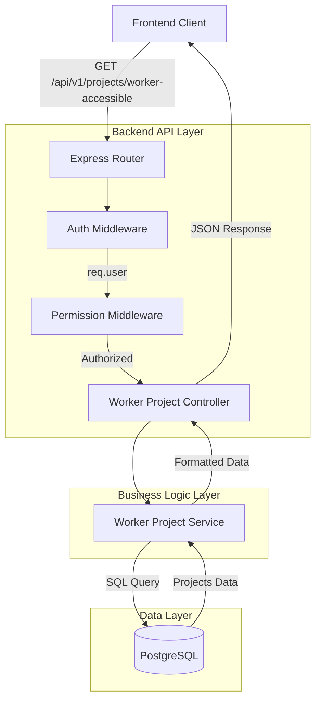
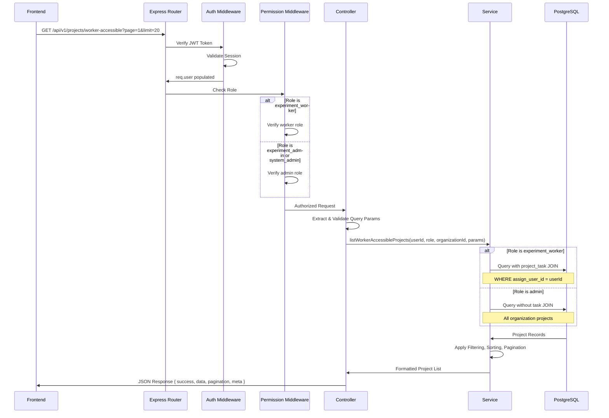

# Technical Design Document

**Feature**: `experiment-worker-project-list-api`  
**Created**: 2026-01-27T20:30:35+09:00  
**Status**: Design Generated

---

## Overview

本機能は、実験作業者画面のプロジェクト選択コンボボックス用のAPI（`GET /api/v1/projects/worker-accessible`）を提供します。実験作業者が実験作業を実施できるプロジェクトから作業対象を選択するために、ステータスが `pending`、`in_progress`、`review_waiting` のプロジェクト一覧を返却します。

**Purpose**: 実験作業者が自分の担当タスクを持つプロジェクトを効率的に選択できるようにする

**Users**: 
- 実験作業者（experiment_worker）: 自分に割り当てられたタスクがあるプロジェクトを選択
- 実験管理者（experiment_admin）: 所属組織内の全プロジェクトを閲覧
- システム管理者（system_admin）: システム管理目的で全プロジェクトを閲覧

**Impact**: 既存のプロジェクト管理APIシステムに新しいエンドポイントを追加（非破壊的変更）

### Goals

- 実験作業者が作業可能なプロジェクトのみを取得できるAPI提供
- ステータスフィルタ（pending, in_progress, review_waiting）による絞り込み
- ページネーション、ソート機能の提供
- 既存APIパターンとの一貫性維持
- マルチテナント分離とRBACの徹底

### Non-Goals

- プロジェクト編集機能（GET専用）
- タスク進捗情報の集計（シンプル化のため除外）
- 指示・問題情報の集計（シンプル化のため除外）
- リアルタイム更新通知（ポーリングで対応）

## Architecture

### Existing Architecture Analysis

既存のプロジェクト管理APIシステムは以下の構造を採用：

**レイヤードアーキテクチャ**:
- Routes層: HTTPリクエストのルーティング
- Middleware層: 認証・認可・テナント分離
- Controller層: リクエスト/レスポンス処理
- Service層: ビジネスロジック
- Repository層: データアクセス（Kysely Query Builder使用）

**既存パターン**:
- ミドルウェアチェーン: `auth → tenantIsolation → permissionCheck`
- 統一レスポンス形式: `{ success, data, pagination, meta }`
- マルチテナント分離: 全クエリに `organization_id` フィルタ必須

### Architecture Pattern & Boundary Map



**Architecture Integration**:
- **選択パターン**: レイヤードアーキテクチャ（既存パターン踏襲）
- **Domain/Feature Boundaries**: プロジェクト管理ドメイン内の新機能として統合
- **既存パターン保持**: ミドルウェアチェーン、統一レスポンス形式、マルチテナント分離
- **新規コンポーネント**: WorkerProjectController/Serviceの追加（既存Projectコントローラー/サービスと並列）
- **Steering Compliance**: セキュリティ規約、API設計ポリシー、バックエンド規約に準拠

### Technology Stack

| Layer | Choice / Version | Role in Feature | Notes |
|-------|------------------|-----------------|-------|
| Backend / Services | Node.js 18+, Express.js, TypeScript | APIエンドポイント実装 | 既存環境と同じ |
| Data / Storage | PostgreSQL, Kysely Query Builder | データ取得、フィルタリング | Parameterized Query使用 |
| Authentication | JWT + Session Hybrid | ユーザー認証・セッション管理 | 既存ミドルウェア使用 |
| Authorization | RBAC (Role-Based Access Control) | ロール別アクセス制御 | experiment_worker, experiment_admin, system_admin |

## System Flows

### API Request Flow



**Key Decisions**:
- ロール判定はサービス層で実施（ミドルウェアは認可のみ）
- experiment_workerの場合は必ずproject_taskテーブルとJOINして自分のタスクに限定
- ステータスフィルタは常に適用（pending, in_progress, review_waiting）

## Requirements Traceability

| Requirement | Summary | Components | Interfaces | Flows |
|-------------|---------|------------|------------|-------|
| 1 | アクセス可能なプロジェクト一覧の取得 | WorkerProjectService | Service Interface | API Request Flow |
| 2 | 日時情報の提供 | WorkerProjectService | Service Interface | - |
| 3 | フィルタリング機能 | WorkerProjectService | API Contract | - |
| 4 | ソート機能 | WorkerProjectService | API Contract | - |
| 5 | ページネーション | WorkerProjectService | API Contract | API Request Flow |
| 6 | 認証・認可 | AuthMiddleware, PermissionMiddleware | - | API Request Flow |
| 7 | マルチテナント分離 | AuthMiddleware, WorkerProjectService | - | API Request Flow |
| 8 | エラーハンドリング | ErrorHandler Middleware | - | - |
| 9 | レスポンス形式 | WorkerProjectController | API Contract | - |
| 10 | パフォーマンス | WorkerProjectService | - | - |

## Components and Interfaces

### Summary

| Component | Domain/Layer | Intent | Req Coverage | Key Dependencies (P0/P1) | Contracts |
|-----------|--------------|--------|--------------|--------------------------|-----------|
| WorkerProjectRouter | Routes | APIルーティング定義 | 1-10 | Express Router (P0) | API |
| AuthMiddleware | Middleware | JWT認証・セッション検証 | 6, 7 | JWT Library (P0) | - |
| PermissionMiddleware | Middleware | ロールベースアクセス制御 | 6 | AuthMiddleware (P0) | - |
| WorkerProjectController | Controller | リクエスト/レスポンス処理 | 1-10 | WorkerProjectService (P0), Express (P0) | API |
| WorkerProjectService | Service | ビジネスロジック・データ取得 | 1-5, 7, 10 | Kysely (P0), DB Connection (P0) | Service |
| ErrorHandlerMiddleware | Middleware | 統一エラーレスポンス | 8 | Logger (P1) | - |

### Backend / Routes Layer

#### WorkerProjectRouter

| Field | Detail |
|-------|--------|
| Intent | 実験作業者用プロジェクト一覧APIのルーティング定義 |
| Requirements | 1, 3, 4, 5, 6, 7 |

**Responsibilities & Constraints**
- HTTPリクエストをコントローラーにルーティング
- ミドルウェアチェーンの適用順序を保証
- エンドポイントパスの定義

**Dependencies**
- Inbound: Express Router (P0) — HTTPルーティング
- Outbound: WorkerProjectController (P0) — リクエスト処理
- Outbound: AuthMiddleware (P0) — 認証
- Outbound: PermissionMiddleware (P0) — 認可

**Contracts**: API [x]

##### API Contract

| Method | Endpoint | Request | Response | Errors |
|--------|----------|---------|----------|--------|
| GET | /api/v1/projects/worker-accessible | Query Params (page, limit, status, sort_by, order) | ProjectListResponse | 400, 401, 403, 500 |

**Request Query Parameters**:
```typescript
interface WorkerProjectListQuery {
  page?: number;           // ページ番号（1以上、デフォルト: 1）
  limit?: number;          // 1ページあたりの件数（1-100、デフォルト: 20）
  status?: 'pending' | 'in_progress' | 'review_waiting';  // ステータスフィルタ（オプション）
  sort_by?: 'create_at' | 'project_name' | 'update_at';   // ソート項目（デフォルト: create_at）
  order?: 'asc' | 'desc';  // ソート順（デフォルト: desc）
}
```

**Response Success (200 OK)**:
```typescript
interface ProjectListResponse {
  success: true;
  data: WorkerAccessibleProject[];
  pagination: {
    page: number;
    limit: number;
    totalItems: number;
    totalPages: number;
    hasNext: boolean;
    hasPrev: boolean;
  };
  meta: {
    timestamp: string;      // ISO 8601
    requestId: string;      // UUID
  };
}

interface WorkerAccessibleProject {
  projectId: string;        // UUID
  projectName: string;
  description: string;
  projectStatus: 'pending' | 'in_progress' | 'review_waiting';
  createdAt: string;        // ISO 8601
  updatedAt: string;        // ISO 8601
}
```

**Response Error (4xx, 5xx)**:
```typescript
interface ErrorResponse {
  success: false;
  error: {
    code: string;
    message: string;
    details?: Array<{
      field: string;
      message: string;
      code: string;
    }>;
  };
  meta: {
    timestamp: string;
    requestId: string;
  };
}
```

**Implementation Notes**
- ミドルウェアチェーン順序: `auth → permissionCheck(['experiment_worker', 'experiment_admin', 'system_admin']) → controller.listWorkerAccessible`
- クエリパラメータのバリデーションはコントローラー層で実施
- エラーはErrorHandlerMiddlewareで統一処理

### Backend / Middleware Layer

#### AuthMiddleware（既存）

既存のAuthMiddlewareを使用。JWTトークン検証とセッション管理を実施。

**Integration Notes**:
- `req.user` にユーザー情報を格納（userId, role, organizationId）
- セッション無効時は401エラー

#### PermissionMiddleware（既存）

既存のPermissionMiddlewareを使用。ロールベースアクセス制御を実施。

**Integration Notes**:
- 許可ロール: `['experiment_worker', 'experiment_admin', 'system_admin']`
- 権限不足時は403エラー

### Backend / Controller Layer

#### WorkerProjectController

| Field | Detail |
|-------|--------|
| Intent | APIリクエスト/レスポンスの処理とバリデーション |
| Requirements | 1, 3, 4, 5, 8, 9 |

**Responsibilities & Constraints**
- クエリパラメータのバリデーション
- サービス層の呼び出し
- 統一レスポンス形式への変換
- エラーハンドリング

**Dependencies**
- Inbound: WorkerProjectRouter (P0) — HTTPリクエスト
- Outbound: WorkerProjectService (P0) — ビジネスロジック実行
- External: Express Request/Response (P0) — HTTP処理

**Contracts**: Service [x] / API [x]

##### Service Interface

```typescript
interface WorkerProjectController {
  listWorkerAccessible(
    req: Request,
    res: Response,
    next: NextFunction
  ): Promise<void>;
}
```

**Preconditions**:
- `req.user` が AuthMiddleware により設定済み
- ユーザーのロールが許可リストに含まれる（PermissionMiddlewareで保証）

**Postconditions**:
- 統一レスポンス形式でJSONを返却
- エラー発生時は next(error) でエラーミドルウェアに委譲

**Invariants**:
- `req.user.organizationId` が常に存在（認証済みの前提）

**Implementation Notes**
- **Validation**: クエリパラメータを検証し、無効な値は400エラー
  - `page`: 1以上の整数
  - `limit`: 1-100の範囲
  - `status`: 'pending', 'in_progress', 'review_waiting' のいずれか
  - `sort_by`: 'create_at', 'project_name', 'update_at' のいずれか
  - `order`: 'asc' または 'desc'
- **Integration**: サービス層の結果を統一レスポンス形式に変換
- **Risks**: バリデーションエラー時の詳細メッセージが多言語化されていない（将来対応）

### Backend / Service Layer

#### WorkerProjectService

| Field | Detail |
|-------|--------|
| Intent | プロジェクト一覧取得のビジネスロジックとデータアクセス |
| Requirements | 1, 2, 3, 4, 5, 7, 10 |

**Responsibilities & Constraints**
- ロール別のアクセス制御ロジック（experiment_workerは自分のタスクのみ）
- ステータスフィルタの適用（pending, in_progress, review_waiting）
- ソート・ページネーションの実装
- マルチテナント分離（organization_id必須）
- パフォーマンス最適化（N+1問題回避）

**Dependencies**
- Inbound: WorkerProjectController (P0) — サービス呼び出し
- Outbound: Kysely Query Builder (P0) — SQL実行
- Outbound: Database Connection Pool (P0) — DB接続

**Contracts**: Service [x]

##### Service Interface

```typescript
interface WorkerProjectService {
  listWorkerAccessible(
    userId: string,
    role: UserRole,
    organizationId: string,
    params: ListWorkerProjectsParams
  ): Promise<WorkerProjectListResult>;
}

interface ListWorkerProjectsParams {
  page: number;
  limit: number;
  status?: ProjectStatus;
  sortBy: 'create_at' | 'project_name' | 'update_at';
  order: 'asc' | 'desc';
}

interface WorkerProjectListResult {
  items: WorkerAccessibleProject[];
  pagination: {
    page: number;
    limit: number;
    totalItems: number;
    totalPages: number;
    hasNext: boolean;
    hasPrev: boolean;
  };
}

type UserRole = 'experiment_worker' | 'experiment_admin' | 'system_admin';
type ProjectStatus = 'pending' | 'in_progress' | 'review_waiting';
```

**Preconditions**:
- `userId` と `organizationId` が有効なUUID形式
- `params` のバリデーション完了（コントローラー層で保証）

**Postconditions**:
- 返却されるプロジェクトは指定された `organizationId` に属する
- `experiment_worker` の場合、自分に割り当てられたタスクを持つプロジェクトのみ
- ステータスが `pending`, `in_progress`, `review_waiting` のプロジェクトのみ

**Invariants**:
- すべてのクエリに `organization_id` フィルタが含まれる
- `experiment_worker` の場合、`project_task` テーブルとのJOINが必須

**Implementation Notes**
- **Integration**: 
  - Kysely Query Builderを使用してParameterized Queryを生成
  - ロール判定: `if (role === 'experiment_worker')` でクエリ構築を分岐
  - experiment_worker: `INNER JOIN project_task` で自分のタスクに限定
  - 他のロール: 全プロジェクトを対象
- **Validation**: 
  - ステータスフィルタ: デフォルトで3つのステータス全て、指定時は指定されたもののみ
  - ソート: データベースレベルで実施（`ORDER BY ${sortBy} ${order}`）
  - ページネーション: `OFFSET` と `LIMIT` を使用
- **Risks**:
  - experiment_workerでのJOINパフォーマンス → `assign_user_id`, `project_id` のインデックス確認必須
  - 大量プロジェクトでのソート性能 → create_at, project_name, update_at にインデックス必要

## Data Models

### Logical Data Model

**プロジェクトエンティティ**:
- **project**: プロジェクト基本情報
- **project_task**: プロジェクトタスク（experiment_workerのフィルタリングに使用）

**Relationships**:
- project (1) ←→ (N) project_task
- project_task.project_id → project.project_id（外部キー）
- project_task.assign_user_id → organization_user.user_id（外部キー）

**Consistency & Integrity**:
- Transaction Boundaries: このAPIは読み取り専用（SELECT）のためトランザクション不要
- Referential Integrity: 外部キー制約により整合性を保証
- Temporal Aspects: created_at, updated_at でタイムスタンプ管理

### Physical Data Model

**For Relational Database (PostgreSQL)**:

**主要テーブル**:

```sql
-- projectテーブル（既存）
CREATE TABLE project (
  project_id UUID PRIMARY KEY,
  organization_id UUID NOT NULL,
  department_id UUID,
  project_name VARCHAR(255) NOT NULL,
  description TEXT,
  project_status VARCHAR(50) NOT NULL, -- 'pending', 'in_progress', 'review_waiting', etc.
  is_checked_out BOOLEAN DEFAULT FALSE,
  checked_out_by UUID,
  checked_out_at TIMESTAMP,
  create_user_id UUID NOT NULL,
  create_at TIMESTAMP NOT NULL DEFAULT NOW(),
  update_user_id UUID,
  update_at TIMESTAMP NOT NULL DEFAULT NOW(),
  UNIQUE(organization_id, project_name)
);

-- project_taskテーブル（既存）
CREATE TABLE project_task (
  task_id UUID PRIMARY KEY,
  project_id UUID NOT NULL,
  organization_id UUID NOT NULL,
  task_name VARCHAR(255) NOT NULL,
  task_status VARCHAR(50) NOT NULL,
  assign_user_id UUID,
  method_name VARCHAR(255),
  transition_name VARCHAR(255),
  create_at TIMESTAMP NOT NULL DEFAULT NOW(),
  update_at TIMESTAMP NOT NULL DEFAULT NOW(),
  completed_at TIMESTAMP,
  FOREIGN KEY (project_id) REFERENCES project(project_id),
  FOREIGN KEY (assign_user_id) REFERENCES organization_user(user_id)
);
```

**重要インデックス**:
```sql
-- マルチテナント分離用
CREATE INDEX idx_project_organization ON project(organization_id);

-- ステータスフィルタ用
CREATE INDEX idx_project_status ON project(project_status);

-- ソート用（複合インデックス）
CREATE INDEX idx_project_org_status_created ON project(organization_id, project_status, create_at DESC);

-- experiment_workerフィルタ用（複合インデックス）
CREATE INDEX idx_project_task_assign_project ON project_task(assign_user_id, project_id);
CREATE INDEX idx_project_task_organization ON project_task(organization_id);
```

### Data Contracts & Integration

**API Data Transfer**:
- Request: クエリパラメータ（URLエンコード）
- Response: JSON（application/json）
- Serialization: UTF-8エンコーディング
- Date Format: ISO 8601（YYYY-MM-DDTHH:mm:ss.sssZ）

**Validation Rules**:
- `projectName`: 1-255文字
- `description`: 0-1000文字
- `projectStatus`: Enumeration（'pending', 'in_progress', 'review_waiting'）
- `createdAt`, `updatedAt`: ISO 8601形式のタイムスタンプ

## Error Handling

### Error Strategy

各エラータイプに対して明確なHTTPステータスコードとエラーメッセージを返却します。

### Error Categories and Responses

**User Errors (4xx)**:

| Error Type | HTTP Status | Code | Message | Details |
|------------|-------------|------|---------|---------|
| Invalid Page | 400 | VALIDATION_ERROR | ページ番号は1以上の整数である必要があります | field: "page" |
| Invalid Limit | 400 | VALIDATION_ERROR | limitは1から100の範囲で指定してください | field: "limit" |
| Invalid Status | 400 | VALIDATION_ERROR | statusは'pending', 'in_progress', 'review_waiting'のいずれかを指定してください | field: "status" |
| Invalid Sort Field | 400 | VALIDATION_ERROR | sort_byは'create_at', 'project_name', 'update_at'のいずれかを指定してください | field: "sort_by" |
| Invalid Order | 400 | VALIDATION_ERROR | orderは'asc'または'desc'を指定してください | field: "order" |
| Missing Auth Token | 401 | AUTH_TOKEN_INVALID | 認証トークンが無効または期限切れです | - |
| Insufficient Permission | 403 | PERMISSION_INSUFFICIENT | この操作を実行する権限がありません | - |

**System Errors (5xx)**:

| Error Type | HTTP Status | Code | Message | Details |
|------------|-------------|------|---------|---------|
| Database Error | 500 | SYSTEM_DATABASE_ERROR | データベースエラーが発生しました | Log: スタックトレース記録 |
| Query Timeout | 500 | SYSTEM_ERROR | クエリがタイムアウトしました | Log: クエリ詳細記録 |
| Unknown Error | 500 | SYSTEM_ERROR | システムエラーが発生しました | Log: 詳細情報記録 |

### Monitoring

**Error Tracking**:
- すべてのエラーをWinstonでログ記録
- 5xxエラーは即座にアラート（CloudWatch Alarms）
- エラーログに含める情報: userId, organizationId, requestId, エラー詳細、スタックトレース

**Logging Strategy**:
```typescript
logger.error('Worker project list failed', {
  userId: req.user.userId,
  role: req.user.role,
  organizationId: req.user.organizationId,
  requestId: req.headers['x-request-id'],
  params: req.query,
  error: error.message,
  stack: error.stack
});
```

**Health Monitoring**:
- API Response Time: 95パーセンタイルが2秒以内を維持
- Error Rate: 5xxエラー率1%未満を目標
- Database Query Performance: EXPLAIN ANALYZEで定期確認

## Testing Strategy

### Unit Tests

**WorkerProjectService**:
1. `listWorkerAccessible` - experiment_workerロールで自分のタスクがあるプロジェクトのみ返却
2. `listWorkerAccessible` - experiment_adminロールで全プロジェクト返却
3. `listWorkerAccessible` - ステータスフィルタが正しく適用される
4. `listWorkerAccessible` - ソート機能が正しく動作する
5. `listWorkerAccessible` - ページネーションが正しく動作する

**WorkerProjectController**:
1. `listWorkerAccessible` - 無効なクエリパラメータで400エラー
2. `listWorkerAccessible` - 成功時に統一レスポンス形式を返却
3. `listWorkerAccessible` - サービス層エラー時に適切にハンドリング

### Integration Tests

**API統合テスト**:
1. GET /api/v1/projects/worker-accessible - 認証なしで401エラー
2. GET /api/v1/projects/worker-accessible - 権限なしロールで403エラー
3. GET /api/v1/projects/worker-accessible - experiment_workerで自分のプロジェクトのみ取得
4. GET /api/v1/projects/worker-accessible - statusフィルタでpendingのみ取得
5. GET /api/v1/projects/worker-accessible - ページネーションで正しい件数取得

**マルチテナント分離テスト**:
1. 異なる組織のプロジェクトが混在しないことを確認
2. experiment_workerが他ユーザーのタスクプロジェクトを取得できないことを確認

### Performance Tests

1. 1000プロジェクト、10000タスクのデータセットでレスポンスタイム2秒以内
2. 同時100リクエストで処理できることを確認
3. experiment_workerロールでのJOINクエリパフォーマンス確認
4. インデックス効果の検証（EXPLAIN ANALYZE）

## Security Considerations

### Authentication and Authorization

**認証フロー**:
1. クライアントがJWTトークンをAuthorizationヘッダーに含める
2. AuthMiddlewareがトークンとセッションを検証
3. 有効な場合、`req.user` にユーザー情報を格納
4. 無効な場合、401エラーを返却

**認可フロー**:
1. PermissionMiddlewareがユーザーのロールを確認
2. 許可ロール（experiment_worker, experiment_admin, system_admin）に含まれるか検証
3. 含まれない場合、403エラーを返却

**ロール別アクセス制御**:
- `experiment_worker`: 自分に割り当てられたタスクがあるプロジェクトのみ閲覧
- `experiment_admin`: 所属組織内の全プロジェクト閲覧
- `system_admin`: 全組織のプロジェクト閲覧（現在の組織コンテキストに限定）

### Data Protection

**マルチテナント分離**:
- すべてのDBクエリに `organization_id` フィルタ必須
- `req.user.organizationId` から組織IDを取得
- JOINを使用する場合、すべてのテーブルに `organization_id` フィルタを適用

**SQLインジェクション対策**:
- Kysely Query Builderを使用してParameterized Queryを自動生成
- ユーザー入力を直接SQL文字列に連結しない

### Compliance

- GDPR準拠: 個人情報は暗号化して保存（既存システムで対応済み）
- 監査ログ