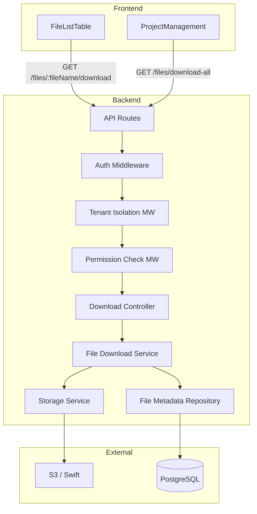
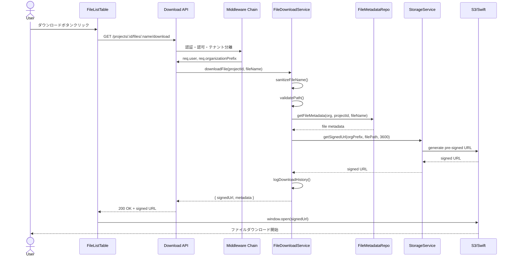
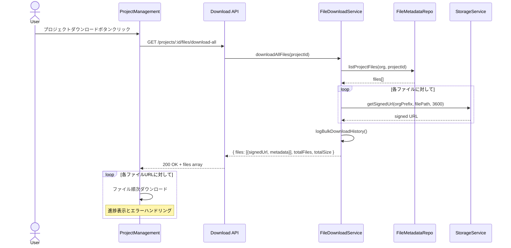

# 設計書: ファイルダウンロードAPI

## Overview

本機能は、mmdpfプロジェクト管理システムにS3/Swiftストレージ上のファイルをセキュアにダウンロードする機能を追加します。署名付きURL（Pre-signed URL）を生成し、マルチテナント分離を維持しながら、ユーザーがプロジェクトファイル（MAIML、アーカイブ、添付ファイル）に安全にアクセスできるようにします。

**Purpose**: 既存のプロジェクト管理画面に、単一ファイルおよびプロジェクト全体の一括ダウンロード機能を提供します。

**Users**: 実験管理者（Manager）とシステム管理者（System Admin）が、所属組織または割り当てられたプロジェクトのファイルをダウンロードします。実験作業者（Worker）は割り当てられたプロジェクトのファイルのみアクセス可能です。

**Impact**: 既存のストレージサービスとファイルメタデータテーブルを活用し、新規ライブラリ依存なしで実装可能な低リスクの拡張機能です。

### Goals

- S3/Swift上のファイルへの安全なアクセスを提供（署名付きURL）
- マルチテナント分離を維持（organization_prefix強制）
- 2種類のダウンロード方法をサポート（単一ファイル、プロジェクト一括）
- 既存のアーキテクチャパターンとセキュリティポリシーに準拠

### Non-Goals

- ZIPアーカイブの自動生成（クライアント側で個別ダウンロード）
- ファイルのストリーミング再生機能
- ファイルのバージョン管理機能（既存のarchiveフォルダ機能を使用）
- ファイルのプレビュー機能（既存のViewerを使用）

## Architecture

### Existing Architecture Analysis

**現在のアーキテクチャ**:
- レイヤードアーキテクチャ（Routes → Middleware → Controllers → Services → Repositories）
- JWT + Session Hybrid認証
- マルチテナント分離ミドルウェア（tenantIsolation）
- 既存のstorageService（S3/Swift抽象化）
- file_metadataテーブルでファイル情報管理

**統合ポイント**:
- 既存の認証・認可ミドルウェアチェーンを適用
- storageService.getSignedUrl()を使用（新規実装不要）
- file_metadataテーブルからメタデータ取得
- 既存のエラーハンドリングパターンを踏襲

### Architecture Pattern & Boundary Map

**選択パターン**: Layered Architecture（既存）

**統合方針**: 既存のレイヤードアーキテクチャに新規コンポーネントを追加し、既存のストレージサービスと認証ミドルウェアを再利用します。



**ドメイン境界**:
- **API Gateway層**: ルーティングと認証・認可
- **Application層**: ビジネスロジック（ファイルパス検証、署名付きURL生成）
- **Data層**: ファイルメタデータアクセス
- **Storage層**: S3/Swift操作（既存サービス）

**既存パターンの維持**:
- ミドルウェアチェーン: `auth → tenantIsolation → permissionCheck`
- エラーハンドリング: 統一されたエラークラスとミドルウェア
- レスポンス形式: `{ success, data/error, meta }`

### Technology Stack

| Layer | Choice / Version | Role in Feature | Notes |
|-------|------------------|-----------------|-------|
| Backend / Services | Express.js 4.18.3 | APIルーティングとミドルウェア | 既存 |
| Backend / Language | TypeScript | 型安全なコード実装 | 既存 |
| Backend / Storage | AWS SDK v3 (@aws-sdk/client-s3) | S3署名付きURL生成 | 既存storageService使用 |
| Backend / Database | Kysely + PostgreSQL | ファイルメタデータ取得 | 既存file_metadataテーブル使用 |
| Backend / Logging | Winston | ダウンロード履歴記録 | 既存 |
| Backend / Auth | JWT + express-session | 認証・セッション管理 | 既存ミドルウェア使用 |
| Frontend | Next.js 15 + React 18.2.0 | UI実装 | 既存 |
| Frontend / UI | Ant Design v6 | ボタン・メッセージ表示 | 既存 |
| Frontend / HTTP | Axios 1.9.0 | API通信 | 既存 |

**新規依存なし**: すべて既存ライブラリで実装可能。

## System Flows

### Flow 1: 単一ファイルダウンロード



**フロー決定事項**:
- ファイル名のサニタイゼーションは最初に実行（パストラバーサル対策）
- file_metadataテーブルとS3両方で存在確認
- 署名付きURL生成は既存storageServiceに委譲
- ダウンロード履歴はWinstonでログ記録

### Flow 2: プロジェクト一括ダウンロード



**フロー決定事項**:
- サーバー側では署名付きURLリストのみ生成（ZIP作成なし）
- クライアント側で順次ダウンロード（並列度は将来調整可能）
- 100件を超える場合はページネーション適用

## Requirements Traceability

| Requirement | Summary | Components | Interfaces | Flows |
|-------------|---------|------------|------------|-------|
| 1 | 署名付きURLの生成 | FileDownloadService, StorageService | Service Interface | Flow 1, 2 |
| 2 | ファイルパスの検証とセキュリティ | FileDownloadService | Service Interface | Flow 1, 2 |
| 3 | プロジェクトアクセス権限の確認 | PermissionCheck Middleware, FileDownloadService | Middleware, Service | Flow 1, 2 |
| 4 | ファイル種別の対応 | FileDownloadService, StorageService | Service Interface | Flow 1, 2 |
| 5 | ファイル存在確認 | FileDownloadService, FileMetadataRepository | Service, Repository | Flow 1, 2 |
| 6 | ダウンロード履歴の記録 | FileDownloadService | Service Interface | Flow 1, 2 |
| 7 | エラーハンドリングとレスポンス | FileDownloadController, ErrorHandler Middleware | API Contract | Flow 1, 2 |
| 8 | パフォーマンスとスケーラビリティ | FileDownloadService, StorageService | Service Interface | Flow 1, 2 |
| 9 | APIリクエストとレスポンス形式 | FileDownloadController | API Contract | Flow 1, 2 |
| 10 | フロントエンド連携とユーザビリティ | FileListTable, ProjectManagement | UI Components | Flow 1, 2 |
| 11 | マルチテナント対応とセキュリティ | TenantIsolation Middleware, FileDownloadService | Middleware, Service | Flow 1, 2 |
| 12 | プロジェクト一括ダウンロード | FileDownloadService, FileMetadataRepository | Service, Repository | Flow 2 |

## Components and Interfaces

### Components Summary

| Component | Domain/Layer | Intent | Req Coverage | Key Dependencies | Contracts |
|-----------|--------------|--------|--------------|------------------|-----------|
| FileDownloadController | API Gateway | HTTPリクエスト/レスポンス処理 | 7, 9 | FileDownloadService (P0) | API |
| FileDownloadService | Application | 署名付きURL生成とビジネスロジック | 1, 2, 4, 5, 6, 8, 11, 12 | StorageService (P0), FileMetadataRepository (P0) | Service |
| FileMetadataRepository | Data | ファイルメタデータCRUD | 5, 12 | Kysely/PostgreSQL (P0) | Service |
| FileListTable (UI) | Frontend | 単一ファイルダウンロードUI | 10 | Download API (P0) | - |
| ProjectManagement (UI) | Frontend | プロジェクト一括ダウンロードUI | 10, 12 | Download API (P0) | - |

### Backend Layer

#### FileDownloadController

| Field | Detail |
|-------|--------|
| Intent | API エンドポイントのルーティングとHTTP処理 |
| Requirements | 7, 9 |

**Responsibilities & Constraints**
- HTTPリクエストの受付とパラメータ抽出
- サービス層への処理委譲
- HTTPレスポンスの生成（成功/エラー）
- トランザクションスコープ: なし（ReadOnlyのため）

**Dependencies**
- Inbound: Express.js Router (P0)
- Outbound: FileDownloadService — ビジネスロジック実行 (P0)
- External: なし

**Contracts**: API [x]

##### API Contract

**エンドポイント1: 単一ファイルダウンロード**

| Method | Endpoint | Request | Response | Errors |
|--------|----------|---------|----------|--------|
| GET | `/api/v1/projects/:projectId/files/:fileName/download` | PathParams, Headers | DownloadFileResponse | 400, 401, 403, 404, 500 |

**リクエスト**:
```typescript
interface DownloadFileRequest {
  projectId: string;      // UUID
  fileName: string;       // URLエンコード済み
}

interface RequestHeaders {
  authorization: string;  // Bearer token
  'x-organization-id': string; // UUID
}
```

**レスポンス**:
```typescript
interface DownloadFileResponse {
  success: true;
  data: {
    signedUrl: string;
    fileName: string;
    filePath: string;
    fileSize: number;
    contentType: string;
    expiresAt: string;    // ISO 8601
    expiresInSeconds: number;
  };
  meta: {
    timestamp: string;
    requestId: string;
  };
}
```

**エンドポイント2: プロジェクト一括ダウンロード**

| Method | Endpoint | Request | Response | Errors |
|--------|----------|---------|----------|--------|
| GET | `/api/v1/projects/:projectId/files/download-all` | PathParams, QueryParams, Headers | DownloadAllFilesResponse | 400, 401, 403, 404, 500 |

**リクエスト**:
```typescript
interface DownloadAllFilesRequest {
  projectId: string;           // UUID
  page?: number;               // デフォルト: 1
  limit?: number;              // デフォルト: 100
}
```

**レスポンス**:
```typescript
interface DownloadAllFilesResponse {
  success: true;
  data: {
    projectId: string;
    projectName: string;
    files: Array<{
      signedUrl: string;
      fileName: string;
      filePath: string;
      fileSize: number;
      contentType: string;
      expiresAt: string;
    }>;
    totalFiles: number;
    totalSize: number;
    expiresInSeconds: number;
  };
  pagination: {
    page: number;
    limit: number;
    totalItems: number;
    totalPages: number;
    hasNext: boolean;
    hasPrev: boolean;
  };
  meta: {
    timestamp: string;
    requestId: string;
  };
}
```

**エラーレスポンス**:
```typescript
interface ErrorResponse {
  success: false;
  error: {
    code: string;
    message: string;
    details?: Array<{
      field: string;
      message: string;
      code: string;
    }>;
  };
  meta: {
    timestamp: string;
    requestId: string;
  };
}
```

**Implementation Notes**
- **Integration**: 既存のミドルウェアチェーン（auth → tenantIsolation → permissionCheck(['manager', 'admin'])）を適用
- **Validation**: path/queryパラメータのUUID形式検証、fileNameのサニタイゼーションはサービス層で実施
- **Risks**: なし（既存パターンの踏襲）

---

#### FileDownloadService

| Field | Detail |
|-------|--------|
| Intent | 署名付きURL生成とファイルアクセス制御のビジネスロジック |
| Requirements | 1, 2, 4, 5, 6, 8, 11, 12 |

**Responsibilities & Constraints**
- ファイル名のサニタイゼーション（パストラバーサル対策）
- ファイルパスの検証（organization_prefix強制）
- ファイル存在確認（file_metadata + S3）
- 署名付きURLの生成（storageService委譲）
- ダウンロード履歴のログ記録
- ドメイン境界: ファイルアクセス制御と署名付きURL生成
- トランザクションスコープ: ReadOnlyのためトランザクション不要

**Dependencies**
- Inbound: FileDownloadController — API処理 (P0)
- Outbound: FileMetadataRepository — メタデータ取得 (P0), StorageService — 署名付きURL生成 (P0)
- External: Winston — ログ記録 (P0)

**Contracts**: Service [x]

##### Service Interface

```typescript
interface FileDownloadService {
  /**
   * 単一ファイルのダウンロード用署名付きURLを生成
   * 
   * Preconditions:
   * - projectId, fileNameは非null
   * - userはプロジェクトへのアクセス権限を持つ
   * - organizationPrefixはミドルウェアで設定済み
   * 
   * Postconditions:
   * - 有効な署名付きURLを返却（有効期限: 1時間）
   * - ダウンロード履歴がログに記録される
   * 
   * Invariants:
   * - 返却されるファイルパスはorganization_prefixを含む
   * - 他組織のファイルへのアクセスは拒否される
   */
  downloadFile(
    organizationPrefix: string,
    projectId: string,
    fileName: string,
    userId: string
  ): Promise<Result<DownloadFileResult, DownloadError>>;

  /**
   * プロジェクト内全ファイルの署名付きURLリストを生成
   * 
   * Preconditions:
   * - projectIdは非null
   * - userはプロジェクトへのアクセス権限を持つ
   * - page, limitは正の整数（デフォルト: page=1, limit=100）
   * 
   * Postconditions:
   * - 全ファイルの署名付きURLリストを返却
   * - 総ファイル数と総サイズを計算
   * - 一括ダウンロード履歴がログに記録される
   * 
   * Invariants:
   * - 返却されるファイルパスはすべてorganization_prefixを含む
   * - 空のプロジェクトの場合、空の配列を返却
   */
  downloadAllFiles(
    organizationPrefix: string,
    projectId: string,
    userId: string,
    page?: number,
    limit?: number
  ): Promise<Result<DownloadAllFilesResult, DownloadError>>;
}

// Result型とError型
interface Result<T, E> {
  success: boolean;
  data?: T;
  error?: E;
}

interface DownloadFileResult {
  signedUrl: string;
  fileName: string;
  filePath: string;
  fileSize: number;
  contentType: string;
  expiresAt: Date;
  expiresInSeconds: number;
}

interface DownloadAllFilesResult {
  projectId: string;
  projectName: string;
  files: Array<{
    signedUrl: string;
    fileName: string;
    filePath: string;
    fileSize: number;
    contentType: string;
    expiresAt: Date;
  }>;
  totalFiles: number;
  totalSize: number;
  expiresInSeconds: number;
  pagination: {
    page: number;
    limit: number;
    totalItems: number;
    totalPages: number;
    hasNext: boolean;
    hasPrev: boolean;
  };
}

type DownloadError =
  | ValidationError
  | AuthorizationError
  | NotFoundError
  | StorageError;

interface ValidationError {
  code: 'VALIDATION_ERROR';
  message: string;
  field?: string;
}

interface AuthorizationError {
  code: 'PERMISSION_INSUFFICIENT';
  message: string;
}

interface NotFoundError {
  code: 'RESOURCE_NOT_FOUND';
  message: string;
}

interface StorageError {
  code: 'SYSTEM_S3_ERROR';
  message: string;
}
```

**Implementation Notes**
- **Integration**: storageService.getSignedUrl()を使用、file_metadataRepositoryでメタデータ取得
- **Validation**: 
  - `sanitizeFileName()`: `../` や `..\\` を除去
  - `isValidPath()`: 絶対パスや相対パス記号を検出
  - organization_prefixの強制適用確認
- **Risks**: パストラバーサル攻撃（ユニットテストで網羅的に検証）

---

#### FileMetadataRepository

| Field | Detail |
|-------|--------|
| Intent | file_metadataテーブルへのデータアクセス |
| Requirements | 5, 12 |

**Responsibilities & Constraints**
- ファイルメタデータのCRUD操作（本機能ではRead専用）
- マルチテナント分離の強制（organization_id必須）
- ドメイン境界: データアクセス層
- トランザクションスコープ: ReadOnlyのためトランザクション不要

**Dependencies**
- Inbound: FileDownloadService — メタデータ取得 (P0)
- Outbound: Kysely/PostgreSQL — DB接続 (P0)
- External: なし

**Contracts**: Service [x]

##### Service Interface

```typescript
interface FileMetadataRepository {
  /**
   * 単一ファイルのメタデータを取得
   * 
   * Preconditions:
   * - organizationId, projectId, fileNameは非null
   * 
   * Postconditions:
   * - ファイルメタデータを返却、または存在しない場合はnull
   * 
   * Invariants:
   * - 他組織のファイルメタデータは取得不可
   */
  getFileMetadata(
    organizationId: string,
    projectId: string,
    fileName: string
  ): Promise<FileMetadata | null>;

  /**
   * プロジェクト内の全ファイルメタデータを取得
   * 
   * Preconditions:
   * - organizationId, projectIdは非null
   * - page, limitは正の整数
   * 
   * Postconditions:
   * - プロジェクト内のファイルメタデータリストを返却
   * - ページネーションメタデータを含む
   * 
   * Invariants:
   * - 他組織のファイルメタデータは取得不可
   */
  listProjectFiles(
    organizationId: string,
    projectId: string,
    page: number,
    limit: number
  ): Promise<{
    files: FileMetadata[];
    totalCount: number;
  }>;
}

interface FileMetadata {
  fileId: string;
  fileName: string;
  filePath: string;
  fileSize: number;
  contentType: string;
  lastModified: Date;
  organizationId: string;
}
```

**Implementation Notes**
- **Integration**: Kyselyクエリビルダーを使用、Parameterized Queryで実装
- **Validation**: organization_idフィルタを全クエリに含める（必須）
- **Risks**: なし（既存パターンの踏襲）

---

### Frontend Layer

#### FileListTable (UI Component)

| Field | Detail |
|-------|--------|
| Intent | ファイル一覧表示と単一ファイルダウンロードUI |
| Requirements | 10 |

**Responsibilities**
- ファイル一覧の表示（テーブル形式）
- 各ファイル行にダウンロードボタンを表示
- ダウンロードAPIの呼び出し
- ローディング状態とエラーメッセージの表示

**Dependencies**
- Outbound: Download API — 単一ファイルダウンロード (P0)
- External: Ant Design Table, Button, message (P0)

**Implementation Notes**
- **Integration**: 既存のFileListTableコンポーネントにダウンロードボタンのクリックハンドラーを追加
- **UI Flow**: ボタンクリック → API呼び出し → 署名付きURL取得 → window.open() or <a>タグでダウンロード開始
- **Error Handling**: API エラー時は message.error() で表示

---

#### ProjectManagement (UI Component)

| Field | Detail |
|-------|--------|
| Intent | プロジェクト管理画面とプロジェクト一括ダウンロードUI |
| Requirements | 10, 12 |

**Responsibilities**
- ツールバーに「プロジェクトダウンロード」ボタンを表示
- 一括ダウンロードAPIの呼び出し
- 複数ファイルの順次ダウンロード処理
- 進捗表示とエラーハンドリング

**Dependencies**
- Outbound: Download API — プロジェクト一括ダウンロード (P0)
- External: Ant Design Button, message, Progress (P0)

**Implementation Notes**
- **Integration**: 既存のProjectManagementコンポーネントのツールバーにボタン追加
- **UI Flow**: 
  1. ボタンクリック → API呼び出し → 署名付きURLリスト取得
  2. 各URLに対して順次ダウンロード（for loopまたはPromise.allSettled）
  3. 進捗バー表示（`ダウンロード中: X / Y ファイル`）
  4. エラー発生時はエラーメッセージ表示（ファイル名を含める）
- **Error Handling**: 一部のファイルがダウンロード失敗しても継続し、最後にエラーサマリーを表示

---

## Data Models

### Domain Model

**Aggregates**:
- **Project**: プロジェクトの集約ルート
- **FileMetadata**: ファイルメタデータ（ProjectのValueObject）

**Entities**:
- Project（既存）
- FileMetadata（既存）

**Value Objects**:
- OrganizationPrefix: `org_{organization_id}` 形式の文字列
- FilePath: S3オブジェクトキー（organization_prefixを含む完全パス）
- SignedUrl: 署名付きURL（有効期限付き）

**Domain Events**: なし（ReadOnly操作のため）

**Business Rules**:
- ファイルパスは必ずorganization_prefixで始まる
- ユーザーは所属組織またはアクセス権限のあるプロジェクトのファイルのみダウンロード可能
- 署名付きURLの有効期限は1時間

### Logical Data Model

本機能は既存のfile_metadataテーブルをReadOnlyで使用するため、新規テーブル定義なし。

**file_metadataテーブル（既存・参照のみ）**:

| Column | Type | Constraints | Description |
|--------|------|-------------|-------------|
| organization_id | UUID | NOT NULL, PK | 組織ID（マルチテナント分離） |
| file_id | UUID | NOT NULL, PK | ファイルID |
| bucket_name | VARCHAR(255) | NULL | S3バケット名 |
| object_key | VARCHAR(1024) | NULL | S3オブジェクトキー |
| file_name | VARCHAR(255) | NULL | ファイル名 |
| file_type | VARCHAR(50) | NULL | ファイル種別（maiml, csv等） |
| file_size | BIGINT | NULL | ファイルサイズ（バイト） |
| content_type | VARCHAR(100) | NULL | MIMEタイプ |
| last_modified | TIMESTAMP | NULL | 最終更新日時 |

**インデックス（既存）**:
- PRIMARY KEY (organization_id, file_id)
- INDEX on (organization_id, file_name)

**クエリパターン**:
```sql
-- 単一ファイルメタデータ取得
SELECT * FROM file_metadata
WHERE organization_id = $1
  AND file_name = $2
LIMIT 1;

-- プロジェクト内ファイル一覧取得（ページネーション）
SELECT * FROM file_metadata
WHERE organization_id = $1
ORDER BY last_modified DESC
LIMIT $2 OFFSET $3;

-- 総件数取得
SELECT COUNT(*) FROM file_metadata
WHERE organization_id = $1;
```

## Error Handling

### Error Strategy

本機能では既存のエラーハンドリングパターンを踏襲し、統一されたエラーレスポンス形式とエラークラスを使用します。

### Error Categories and Responses

**User Errors (4xx)**:
- **400 Bad Request**: 
  - ファイル名にパストラバーサルパターン検出（`../`, `..\\`）
  - 無効なUUID形式（projectId）
  - 無効なページネーションパラメータ（page < 1, limit < 1 or > 100）
  - レスポンス: `{ code: 'VALIDATION_ERROR', message: '不正なファイル名です', details: [...] }`
  
- **401 Unauthorized**: 
  - JWTトークンが無効または期限切れ
  - セッションが存在しない
  - レスポンス: `{ code: 'AUTH_TOKEN_INVALID', message: '認証に失敗しました' }`
  
- **403 Forbidden**: 
  - ユーザーがプロジェクトへのアクセス権限を持たない
  - 他組織のファイルへのアクセス試行
  - レスポンス: `{ code: 'PERMISSION_INSUFFICIENT', message: 'アクセス権限がありません' }`
  
- **404 Not Found**: 
  - プロジェクトが存在しない
  - ファイルが存在しない（file_metadataに記録なし）
  - レスポンス: `{ code: 'RESOURCE_NOT_FOUND', message: 'ファイルが見つかりません' }`

**System Errors (5xx)**:
- **500 Internal Server Error**: 
  - S3/Swift接続エラー
  - データベース接続エラー
  - 署名付きURL生成失敗
  - レスポンス: `{ code: 'SYSTEM_S3_ERROR', message: 'ファイルダウンロードに失敗しました' }`
  - ログ: スタックトレースと詳細情報を記録

**Business Logic Errors (422)**:
- **422 Unprocessable Entity**: 
  - ファイルが論理削除済み
  - プロジェクトがアーカイブ済み
  - レスポンス: `{ code: 'BUSINESS_FILE_ARCHIVED', message: 'このファイルはアーカイブされています' }`

### Monitoring

**ログ記録**:
- Winstonを使用して全ダウンロード操作を記録
- ログレベル:
  - `info`: 正常なダウンロード操作
  - `warn`: 権限エラー、ファイル未検出
  - `error`: システムエラー、S3エラー

**ログ形式**:
```typescript
logger.info('File download', {
  userId: req.user.id,
  organizationId: req.organizationPrefix,
  projectId,
  fileName,
  signedUrlGenerated: true,
  expiresInSeconds: 3600,
  timestamp: new Date().toISOString()
});
```

**監査ログ**: Admin権限のダウンロード操作は`admin_audit_log`テーブルに記録（既存機能）

## Testing Strategy

### Unit Tests

**FileDownloadService**:
- `sanitizeFileName()`: パストラバーサルパターンの除去検証
  - `../file.txt` → `file.txt`
  - `..\\file.txt` → `file.txt`
  - `/etc/passwd` → エラー
- `isValidPath()`: パス検証ロジック
  - 相対パス検出: `../../file` → false
  - 絶対パス検出: `/root/file` → false
  - 正常なパス: `projects/proj1/file.txt` → true
- `downloadFile()`: storageService, repositoryのモック使用
  - 正常系: 署名付きURL生成成功
  - 異常系: ファイル未検出、権限エラー
- `downloadAllFiles()`: 複数ファイル処理とページネーション
  - 空のプロジェクト: 空配列返却
  - ページネーション: limit=10, page=2で11-20件目取得

**FileMetadataRepository**:
- `getFileMetadata()`: Kyselyモックでクエリ検証
  - organization_idフィルタが含まれることを確認
  - Parameterized Queryの使用確認
- `listProjectFiles()`: ページネーション動作確認
  - LIMIT/OFFSET句の正確性

### Integration Tests

**API Endpoint Tests**:
- `GET /projects/:projectId/files/:fileName/download`
  - 200 OK: 正常なダウンロードURL取得
  - 400 Bad Request: 無効なファイル名
  - 401 Unauthorized: 認証トークンなし
  - 403 Forbidden: 権限なし
  - 404 Not Found: ファイル未検出
  
- `GET /projects/:projectId/files/download-all`
  - 200 OK: ファイルリスト取得
  - 400 Bad Request: 無効なページネーションパラメータ
  - 空のプロジェクト: 空配列返却
  - ページネーション動作確認

**Middleware Chain Validation**:
- auth → tenantIsolation → permissionCheck の順序確認
- req.user, req.organizationPrefix の自動設定確認

**Database Integration**:
- file_metadataテーブルからの実データ取得
- マルチテナント分離の動作確認
- ページネーションの正確性

### Security Tests

**Path Traversal Prevention**:
- `../../../../../etc/passwd` → 400 Bad Request
- `..\\..\\windows\\system32\\` → 400 Bad Request
- URLエンコード攻撃: `%2e%2e%2f` → 400 Bad Request

**Cross-Tenant Access Prevention**:
- 他組織のorganization_prefixを含むリクエスト → 403 Forbidden
- organization_idヘッダーの改ざん試行 → 401/403

**JWT Token Validation**:
- 無効なトークン → 401 Unauthorized
- 期限切れトークン → 401 Unauthorized
- トークンなし → 401 Unauthorized

**Performance Tests** (オプション):
- 100件の一括ダウンロードリクエスト: 3秒以内
- 署名付きURL生成: 200ms以内
- 同時100リクエスト処理: 成功率99%以上

## Security Considerations

### マルチテナント分離

**organization_prefix強制**:
- すべてのS3パスに`org_{organization_id}`プレフィックスを含める
- storageService.getSignedUrl()内で自動適用
- クロステナントアクセスは物理的に不可能

**認証・認可**:
- JWT + Session Hybrid認証（既存）
- permissionCheck(['manager', 'admin', 'worker'])
- プロジェクトへのアクセス権限は既存のRBACシステムで管理

### Data Protection

**署名付きURLの有効期限**:
- デフォルト: 1時間（3600秒）
- 有効期限切れ後は自動的にアクセス不可
- URLの再取得が必要（セキュリティ向上）

**ログ記録と監査**:
- すべてのダウンロード操作をログ記録
- Admin権限の操作は`admin_audit_log`テーブルに永続化
- IPアドレス、User-Agent、タイムスタンプを記録

**パストラバーサル対策**:
- `sanitizeFileName()`: `../`, `..\\` の除去
- `isValidPath()`: 絶対パス、相対パスの検出
- ユニットテストで網羅的に検証

## Performance & Scalability

### Target Metrics

本機能のパフォーマンス目標（要件仕様より）:
- **署名付きURL生成**: 200ms以内
- **同時リクエスト処理**: 100 req/sec以上
- **タイムアウト**: 30秒

### Implementation Strategy

**署名付きURL生成の軽量性**:
- CPU負荷: 低（署名計算のみ）
- メモリ使用量: 最小（URLのみ返却）
- ネットワーク: S3への実際のアクセスなし

**S3操作の並列性**:
- I/O bound処理（CPU待機なし）
- 複数リクエストの並列処理が可能
- AWS SDK v3の非同期APIを活用

**ページネーション**:
- デフォルト: 100件/ページ
- 大量ファイル（1000件以上）の場合も安定動作
- クライアント側で順次ダウンロード（並列度調整可能）

**Caching Strategy** (将来実装)：
- ファイルメタデータのキャッシュ（Redis）
- 署名付きURLのキャッシュ（有効期限考慮）
- 現時点では未実装（必要に応じて追加）

### Scaling Approaches

**水平スケーリング**:
- ステートレス設計のため、ECSタスク数の増加で対応可能
- S3は自動スケーリング（制限なし）

**ボトルネック分析**:
- DB接続プール: 最大20接続（既存設定）
- file_metadataテーブルのインデックス: 既に最適化済み
- S3 API レート制限: 5500 req/sec（PUT）, 5500 req/sec（GET）→ 十分

---

**設計書完了日**: 2026-01-19T13:48:00+09:00
**次フェーズ**: タスク分解（/spec-tasks file-download-api）
