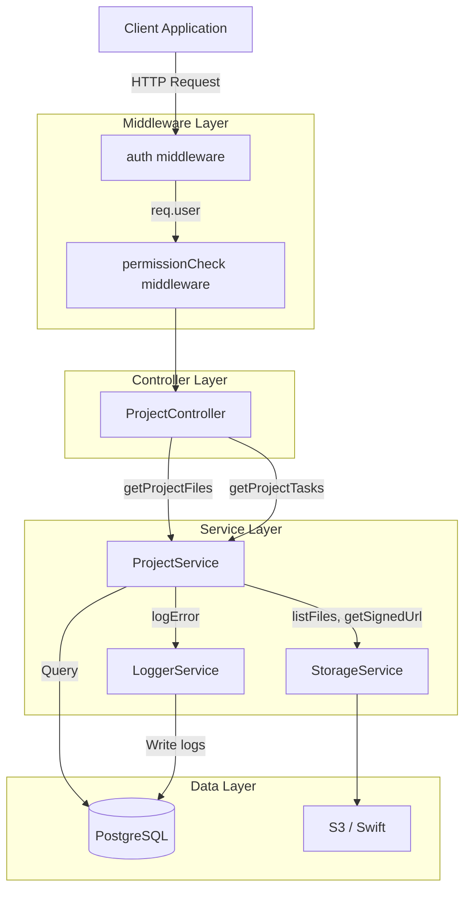
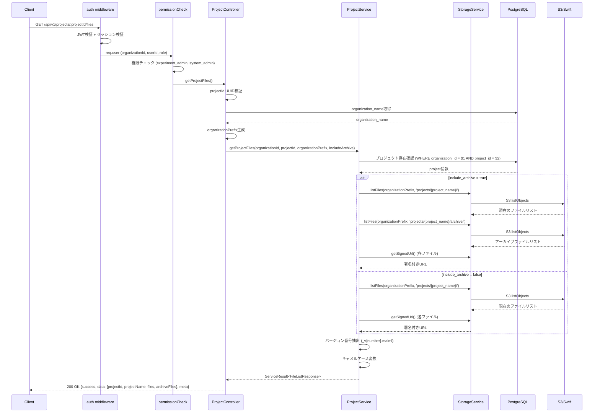
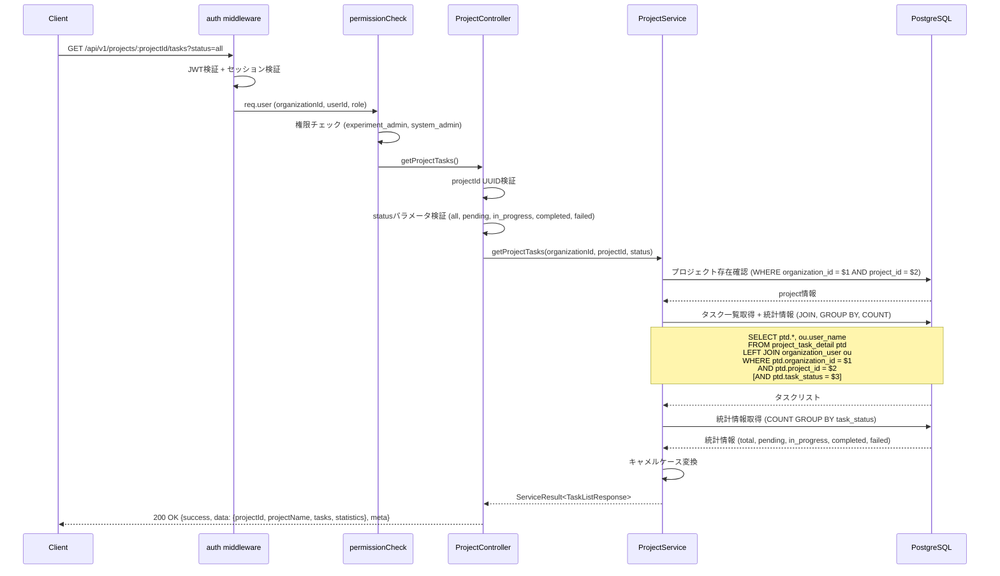

# Design Document: ファイル一覧取得API・タスク一覧取得API

## Overview

このfeatureは、実験管理者（Experiment Admin）がプロジェクト内のファイルとタスクを効率的に閲覧・管理できる機能を提供します。2つのRESTful APIエンドポイントを追加し、既存のプロジェクト管理機能を拡張します。

**Purpose**: プロジェクトに紐づくファイル（現在のファイルとアーカイブ）とタスク（ステータスでフィルタ可能）を取得するAPIを実装し、実験管理画面でのデータ表示を可能にします。

**Users**: 実験管理者（Experiment Admin）とシステム管理者（System Admin）が対象です。実験管理者は自組織のプロジェクトのみ、システム管理者は全組織のプロジェクトにアクセスできます。

**Impact**: 既存の`projectController.ts`と`projectService.ts`に2つの新規メソッドを追加します。既存のAPIには影響を与えません。

### Goals

- プロジェクトに紐づくファイル一覧を取得するAPIを実装する（現在のファイルとアーカイブファイル）
- プロジェクトに紐づくタスク一覧を取得するAPIを実装する（ステータスでフィルタ可能）
- ステータス別のタスク統計情報を提供する（total, pending, in_progress, completed, failed）
- マルチテナント分離を保証する（organization_idフィルタ必須）
- レスポンスタイム200ms以内を達成する
- 既存のAPI設計パターンとの一貫性を保つ

### Non-Goals

- ページネーション機能（将来の拡張として検討）
- ファイルのアップロード・削除機能（別APIで実装予定）
- タスクの作成・更新・削除機能（別APIで実装済み）
- リアルタイム更新機能（WebSocket）

## Architecture

### Existing Architecture Analysis

既存のプロジェクト管理APIは以下のレイヤードアーキテクチャを採用しています：

**現在のアーキテクチャパターン:**
- **Controller層**: リクエストハンドリング、バリデーション、レスポンス生成
- **Service層**: ビジネスロジック、データベースクエリ、外部サービス連携
- **Middleware**: 認証（auth）、権限チェック（permissionCheck）
- **External Services**: storageService（S3操作）、loggerService（ログ記録）

**既存のドメイン境界:**
- プロジェクト管理ドメイン: `projectController.ts`, `projectService.ts`
- ファイルストレージドメイン: `storageService.ts`
- 認証・認可ドメイン: `authMiddleware.ts`, `permissionCheck.ts`

**保持すべき既存パターン:**
- ServiceResult型による統一的なエラーハンドリング
- Parameterized Queriesによる SQLインジェクション対策
- organization_idフィルタによるマルチテナント分離
- キャメルケース変換によるレスポンス形式統一

### Architecture Pattern & Boundary Map



**Architecture Integration:**
- **選択パターン**: レイヤードアーキテクチャ（既存パターン踏襲）
- **Domain Boundaries**: プロジェクト管理ドメインに2つのメソッドを追加、ファイルストレージドメインは変更なし
- **既存パターン保持**: ServiceResult型、Parameterized Queries、organization_idフィルタ、キャメルケース変換
- **新規コンポーネント**: なし（既存のコンポーネントにメソッド追加）
- **Steering Compliance**: API設計ポリシー、バックエンド規約、セキュリティ規約に準拠

### Technology Stack

| Layer | Choice / Version | Role in Feature | Notes |
|-------|------------------|-----------------|-------|
| Backend / Services | Node.js 18+ | ランタイム環境 | 既存環境 |
| Backend / Framework | Express.js 4.18.3 | HTTPサーバー、ルーティング | 既存フレームワーク |
| Backend / Language | TypeScript | 型安全な実装 | 既存言語 |
| Data / Storage | PostgreSQL 18+ | タスク情報の永続化 | 既存データベース |
| Data / Object Storage | AWS S3 / OpenStack Swift | ファイルストレージ | 既存ストレージ |
| Infrastructure / Runtime | Docker | コンテナ化 | 既存インフラ |

## System Flows

### ファイル一覧取得フロー



**Key Decisions:**
- S3エラーは個別にtry-catchで処理し、エラー時は空配列を返す（グレースフル処理）
- organizationPrefixは`organization.organization_name`から動的に生成（スペース→アンダースコア変換）
- 署名付きURLのTTLは3600秒（1時間）

### タスク一覧取得フロー



**Key Decisions:**
- タスク統計はデータベース側で集計（GROUP BY + COUNT）してパフォーマンス最適化
- statusパラメータは`all`, `pending`, `in_progress`, `completed`, `failed`のみ許可
- ワーカー名はLEFT JOINで取得（存在しない場合はnull）

## Requirements Traceability

| Requirement | Summary | Components | Interfaces | Flows |
|-------------|---------|------------|------------|-------|
| 1, 5 | ファイル一覧・タスク一覧の認証・認可 | ProjectController, auth, permissionCheck | API Contract | 両フロー共通 |
| 2, 6 | ファイル一覧・タスク一覧のマルチテナント分離 | ProjectController, ProjectService | Service Interface | 両フロー共通 |
| 3 | ファイル一覧のデータ取得・フィルタリング | ProjectService, StorageService | Service Interface, S3 API | ファイル一覧取得フロー |
| 4 | ファイル一覧のレスポンス形式 | ProjectController | API Contract | ファイル一覧取得フロー |
| 7 | タスク一覧のデータ取得・フィルタリング | ProjectService | Service Interface, SQL Query | タスク一覧取得フロー |
| 8 | タスク一覧の統計情報 | ProjectService | Service Interface, SQL Query | タスク一覧取得フロー |
| 9 | タスク一覧のレスポンス形式 | ProjectController | API Contract | タスク一覧取得フロー |
| 10 | 共通エラーハンドリング | ProjectController, ProjectService | Error Response Contract | 両フロー共通 |
| 11 | 共通パフォーマンス | ProjectService, PostgreSQL | Database Indexes | 両フロー共通 |
| 12 | 共通セキュリティ | auth, permissionCheck, ProjectService | Middleware Chain | 両フロー共通 |

## Components and Interfaces

### Summary

| Component | Domain/Layer | Intent | Req Coverage | Key Dependencies (P0/P1) | Contracts |
|-----------|--------------|--------|--------------|--------------------------|-----------|
| ProjectController.getProjectFiles | Controller | ファイル一覧取得のHTTPリクエスト処理 | 1, 2, 3, 4, 10, 12 | ProjectService (P0), loggerService (P1) | API |
| ProjectController.getProjectTasks | Controller | タスク一覧取得のHTTPリクエスト処理 | 1, 5, 6, 7, 9, 10, 12 | ProjectService (P0), loggerService (P1) | API |
| ProjectService.getProjectFiles | Service | ファイル一覧のビジネスロジック | 2, 3, 11 | StorageService (P0), PostgreSQL (P0) | Service |
| ProjectService.getProjectTasks | Service | タスク一覧のビジネスロジック | 6, 7, 8, 11 | PostgreSQL (P0) | Service |

### Controller Layer

#### ProjectController.getProjectFiles

| Field | Detail |
|-------|--------|
| Intent | プロジェクトに紐づくファイル一覧を取得するHTTPリクエストを処理する |
| Requirements | 1, 2, 3, 4, 10, 12 |

**Responsibilities & Constraints**
- HTTPリクエストのバリデーション（projectId UUID形式）
- authMiddlewareから`req.user`を取得し、organizationIdを抽出
- クエリパラメータ`include_archive`の処理（デフォルト: false）
- Service層の呼び出しとエラーハンドリング
- 統一されたレスポンス形式（success, data, meta）の生成

**Dependencies**
- Inbound: authMiddleware — JWT検証、req.userに格納 (P0)
- Inbound: permissionCheck — 権限チェック (P0)
- Outbound: ProjectService.getProjectFiles — ビジネスロジック実行 (P0)
- Outbound: loggerService — エラーログ記録 (P1)
- External: PostgreSQL — organization_name取得 (P0)

**Contracts**: API [x]

##### API Contract

| Method | Endpoint | Request | Response | Errors |
|--------|----------|---------|----------|--------|
| GET | /api/v1/projects/:projectId/files | Query: `include_archive` (boolean, デフォルト: false) | 200: FileListResponse | 400 (VALIDATION_ERROR), 401 (AUTH_TOKEN_INVALID), 403 (PERMISSION_INSUFFICIENT), 404 (RESOURCE_NOT_FOUND), 500 (SYSTEM_ERROR) |

**Request:**
```typescript
interface FileListRequest {
  projectId: string; // URL parameter, UUID format
  include_archive?: boolean; // Query parameter, default: false
}
```

**Response (200 OK):**
```typescript
// フロントエンド・バックエンド共通型を使用
interface FileListResponse {
  success: true;
  data: {
    projectId: string;
    projectName: string;
    files: ProjectFile[]; // 既存のProjectFile型を使用
    archiveFiles: ProjectFile[]; // 既存のProjectFile型を使用
  };
  meta: {
    timestamp: string; // ISO 8601
    requestId: string; // UUID
  };
}

// 既存のProjectFile型（frontend/src/types/file.ts, backend/src/types/file.ts）
// APIレスポンスで使用するために以下のフィールドを追加する必要がある：
// - isArchive: boolean - アーカイブファイルかどうか
// - version: number | null - バージョン番号
// - signedUrl: string - 署名付きURL
// - createdAt: string - 作成日時（ISO 8601）
interface ProjectFile {
  id: string; // ファイルID
  name: string; // ファイル名
  path: string; // S3キー
  size: number; // バイト単位
  lastModified: string; // 最終更新日時（ISO 8601）
  type: string; // 拡張子
  isFolder?: boolean; // フォルダかどうか（オプション）
  fileCount?: number; // フォルダ内のファイル数（オプション）
  // 以下、APIレスポンス用に追加
  isArchive?: boolean; // アーカイブファイルかどうか
  version?: number | null; // バージョン番号
  signedUrl?: string; // 署名付きURL
  createdAt?: string; // 作成日時（ISO 8601）
}
```

**Error Response:**
```typescript
interface ErrorResponse {
  success: false;
  error: {
    code: string; // VALIDATION_ERROR, AUTH_TOKEN_INVALID, etc.
    message: string; // 日本語エラーメッセージ
    details?: Array<{
      field: string;
      message: string;
      code: string;
    }>;
  };
  meta: {
    timestamp: string;
    requestId: string;
  };
}
```

**Implementation Notes**
- Integration: `projectRoutes.ts`に新規ルート追加 (`GET /projects/:projectId/files`)
- Validation: projectIdのUUID形式検証、include_archiveのboolean変換
- Risks: S3エラー時のグレースフル処理が必須（空配列を返す）

---

#### ProjectController.getProjectTasks

| Field | Detail |
|-------|--------|
| Intent | プロジェクトに紐づくタスク一覧と統計情報を取得するHTTPリクエストを処理する |
| Requirements | 1, 5, 6, 7, 9, 10, 12 |

**Responsibilities & Constraints**
- HTTPリクエストのバリデーション（projectId UUID形式、statusパラメータ）
- authMiddlewareから`req.user`を取得し、organizationIdを抽出
- クエリパラメータ`status`の処理（デフォルト: all）
- Service層の呼び出しとエラーハンドリング
- 統一されたレスポンス形式（success, data, meta）の生成

**Dependencies**
- Inbound: authMiddleware — JWT検証、req.userに格納 (P0)
- Inbound: permissionCheck — 権限チェック (P0)
- Outbound: ProjectService.getProjectTasks — ビジネスロジック実行 (P0)
- Outbound: loggerService — エラーログ記録 (P1)

**Contracts**: API [x]

##### API Contract

| Method | Endpoint | Request | Response | Errors |
|--------|----------|---------|----------|--------|
| GET | /api/v1/projects/:projectId/tasks | Query: `status` (string, デフォルト: "all") | 200: TaskListResponse | 400 (VALIDATION_ERROR), 401 (AUTH_TOKEN_INVALID), 403 (PERMISSION_INSUFFICIENT), 404 (RESOURCE_NOT_FOUND), 500 (SYSTEM_ERROR) |

**Request:**
```typescript
interface TaskListRequest {
  projectId: string; // URL parameter, UUID format
  status?: 'all' | 'pending' | 'in_progress' | 'completed' | 'failed'; // Query parameter, default: 'all'
}
```

**Response (200 OK):**
```typescript
// フロントエンド・バックエンド共通型を使用
interface TaskListResponse {
  success: true;
  data: {
    projectId: string;
    projectName: string;
    tasks: Task[]; // 既存のTask型を使用
    statistics: TaskStatistics;
  };
  meta: {
    timestamp: string; // ISO 8601
    requestId: string; // UUID
  };
}

// 既存のTask型（frontend/src/types/project.ts, backend/src/types/project.ts）
// そのまま使用可能（追加フィールド不要）
interface Task {
  taskId: string;
  workerId: string;
  workerName: string;
  transitionId: string;
  transitionName: string;
  workStatus: TaskStatus;
  assignedAt: string;
  startedAt: string | null;
  completedAt: string | null;
  progress: number;
  errorMessage?: string;
}

// タスクステータス（既存型）
type TaskStatus = 
  | 'pending'
  | 'in_progress'
  | 'error'
  | 'review_waiting'
  | 'completed';

// タスク統計情報（新規定義が必要）
interface TaskStatistics {
  total: number;
  pending: number;
  inProgress: number;
  completed: number;
  failed: number;
}
```

**Implementation Notes**
- Integration: `projectRoutes.ts`に新規ルート追加 (`GET /projects/:projectId/tasks`)
- Validation: projectIdのUUID形式検証、statusの許可値検証（all, pending, in_progress, completed, failed）
- Risks: 大量タスク（10,000件以上）でのパフォーマンス問題（データベース側での集計で緩和）

### Service Layer

#### ProjectService.getProjectFiles

| Field | Detail |
|-------|--------|
| Intent | S3からファイル一覧を取得し、署名付きURLを生成してビジネスロジックを実行する |
| Requirements | 2, 3, 11 |

**Responsibilities & Constraints**
- プロジェクト存在確認（WHERE organization_id = $1 AND project_id = $2）
- S3から現在のファイルリストを取得（storageService経由）
- include_archive=trueの場合、アーカイブファイルも取得
- 各ファイルに対して署名付きURLを生成（TTL: 3600秒）
- バージョン番号の抽出（`_v{number}.maiml`パターン）
- キャメルケース変換（snake_case → camelCase）
- ServiceResult型でのエラーハンドリング

**Dependencies**
- Outbound: storageService.listFiles — S3ファイルリスト取得 (P0)
- Outbound: storageService.getSignedUrl — 署名付きURL生成 (P0)
- Outbound: PostgreSQL — プロジェクト情報取得 (P0)

**Contracts**: Service [x]

##### Service Interface

```typescript
interface ProjectService {
  /**
   * プロジェクトに紐づくファイル一覧を取得
   * 
   * @param organizationId - 組織ID（テナント分離）
   * @param projectId - プロジェクトID
   * @param organizationPrefix - 組織プレフィックス（S3パス生成用）
   * @param includeArchive - アーカイブファイルを含めるかどうか
   * @returns ファイル一覧とプロジェクト情報
   */
  getProjectFiles(
    organizationId: string,
    projectId: string,
    organizationPrefix: string,
    includeArchive: boolean
  ): Promise<ServiceResult<{
    projectId: string;
    projectName: string;
    files: FileInfo[];
    archiveFiles: FileInfo[];
  }>>;
}

interface ServiceResult<T> {
  success: boolean;
  data?: T;
  error?: {
    code: string;
    message: string;
    details?: any;
    originalError?: Error;
  };
}
```

**Preconditions:**
- `organizationId`はUUID形式
- `projectId`はUUID形式
- `organizationPrefix`は有効な組織プレフィックス（スペース→アンダースコア変換済み）

**Postconditions:**
- プロジェクトが存在する場合、ファイル一覧を返す
- プロジェクトが存在しない場合、`RESOURCE_NOT_FOUND`エラーを返す
- S3エラーが発生した場合、空配列を返す（グレースフル処理）

**Invariants:**
- すべてのファイルパスに`org_{organizationPrefix}`プレフィックスが含まれる
- 署名付きURLのTTLは3600秒

**Implementation Notes**
- Integration: `projectService.ts`に新規メソッド追加
- Validation: データベースクエリでParameterized Queriesを使用
- Risks: S3エラー時のグレースフル処理、organization_prefixの生成ロジック不整合

---

#### ProjectService.getProjectTasks

| Field | Detail |
|-------|--------|
| Intent | データベースからタスク一覧と統計情報を取得してビジネスロジックを実行する |
| Requirements | 6, 7, 8, 11 |

**Responsibilities & Constraints**
- プロジェクト存在確認（WHERE organization_id = $1 AND project_id = $2）
- タスク一覧取得（JOIN, WHERE, ORDER BY）
- ステータスでのフィルタリング（statusパラメータに応じてWHERE条件を追加）
- 統計情報の集計（GROUP BY + COUNT）
- ワーカー名の取得（LEFT JOIN organization_user）
- キャメルケース変換（snake_case → camelCase）
- ServiceResult型でのエラーハンドリング

**Dependencies**
- Outbound: PostgreSQL — タスク情報取得、統計情報集計 (P0)

**Contracts**: Service [x]

##### Service Interface

```typescript
interface ProjectService {
  /**
   * プロジェクトに紐づくタスク一覧と統計情報を取得
   * 
   * @param organizationId - 組織ID（テナント分離）
   * @param projectId - プロジェクトID
   * @param status - タスクステータスフィルタ
   * @returns タスク一覧、統計情報、プロジェクト情報
   */
  getProjectTasks(
    organizationId: string,
    projectId: string,
    status: 'all' | 'pending' | 'in_progress' | 'completed' | 'failed'
  ): Promise<ServiceResult<{
    projectId: string;
    projectName: string;
    tasks: TaskInfo[];
    statistics: TaskStatistics;
  }>>;
}
```

**Preconditions:**
- `organizationId`はUUID形式
- `projectId`はUUID形式
- `status`は許可された値（all, pending, in_progress, completed, failed）

**Postconditions:**
- プロジェクトが存在する場合、タスク一覧と統計情報を返す
- プロジェクトが存在しない場合、`RESOURCE_NOT_FOUND`エラーを返す
- タスクが0件の場合、空配列と統計情報（全て0）を返す

**Invariants:**
- すべてのクエリにorganization_idフィルタが含まれる
- 統計情報の合計値はtasks配列の長さ以下（ステータスフィルタが適用されている場合）

**Implementation Notes**
- Integration: `projectService.ts`に新規メソッド追加
- Validation: Parameterized Queriesを使用、statusパラメータに応じてWHERE条件を動的生成
- Risks: 大量タスク（10,000件以上）でのパフォーマンス問題、インデックスの存在確認が必要

## Data Models

### Logical Data Model

**使用テーブル:**
- `project`: プロジェクト基本情報
- `project_task_detail`: タスク詳細情報
- `organization`: 組織情報（organization_prefix生成用）
- `organization_user`: ユーザー情報（ワーカー名取得用）

**Entity Relationships:**
```
organization (1) ─── (N) project
project (1) ─── (N) project_task_detail
organization (1) ─── (N) organization_user
project_task_detail (N) ─── (1) organization_user [experiment_user_id]
```

**Consistency & Integrity:**
- トランザクション境界: 各APIリクエストはREAD ONLYのため、トランザクション不要
- Referential Integrity: 外部キー制約により保証される
- Temporal Aspects: created_at, updated_atはImmutable（READ ONLYのため）

### Physical Data Model

**使用テーブルの構造:**

#### project テーブル
```sql
CREATE TABLE project (
  organization_id UUID NOT NULL,
  project_id UUID NOT NULL,
  project_name VARCHAR(255) NOT NULL,
  description TEXT,
  department_cd VARCHAR(50),
  owner_user_id UUID NOT NULL,
  project_status INTEGER NOT NULL,
  checkout_status INTEGER NOT NULL,
  project_maiml_flg BOOLEAN NOT NULL DEFAULT FALSE,
  create_at TIMESTAMP NOT NULL,
  PRIMARY KEY (organization_id, project_id),
  FOREIGN KEY (organization_id) REFERENCES organization(organization_id),
  FOREIGN KEY (owner_user_id, organization_id) REFERENCES organization_user(user_id, organization_id)
);

CREATE INDEX idx_project_org_id ON project(organization_id);
CREATE INDEX idx_project_status ON project(organization_id, project_status);
```

#### project_task_detail テーブル
```sql
CREATE TABLE project_task_detail (
  organization_id UUID NOT NULL,
  project_id UUID NOT NULL,
  method_id VARCHAR(255) NOT NULL,
  task_no INTEGER NOT NULL,
  task_status INTEGER NOT NULL,
  experiment_start_at TIMESTAMP,
  experiment_end_at TIMESTAMP,
  experiment_user_id UUID,
  reviewed_at TIMESTAMP,
  review_user_id UUID,
  PRIMARY KEY (organization_id, project_id, method_id, task_no),
  FOREIGN KEY (organization_id, project_id) REFERENCES project(organization_id, project_id),
  FOREIGN KEY (experiment_user_id, organization_id) REFERENCES organization_user(user_id, organization_id)
);

CREATE INDEX idx_task_org_project ON project_task_detail(organization_id, project_id);
CREATE INDEX idx_task_status ON project_task_detail(organization_id, project_id, task_status);
```

#### organization テーブル
```sql
CREATE TABLE organization (
  organization_id UUID PRIMARY KEY,
  organization_name VARCHAR(255) NOT NULL UNIQUE,
  created_at TIMESTAMP NOT NULL
);
```

#### organization_user テーブル
```sql
CREATE TABLE organization_user (
  organization_id UUID NOT NULL,
  user_id UUID NOT NULL,
  user_name VARCHAR(255) NOT NULL,
  mail_address VARCHAR(255),
  PRIMARY KEY (organization_id, user_id),
  FOREIGN KEY (organization_id) REFERENCES organization(organization_id)
);

CREATE INDEX idx_user_org_id ON organization_user(organization_id);
```

**Indexing Strategy:**
- 既存のインデックスを活用: `idx_project_org_id`, `idx_task_org_project`, `idx_task_status`
- 複合インデックス: `(organization_id, project_id)` でマルチテナント分離とパフォーマンスを両立
- ステータスフィルタ用: `(organization_id, project_id, task_status)` で高速検索

**Sharding / Partitioning:**
- 現行設計では不要（テーブルサイズが10万行未満を想定）
- 将来的にタスク数が100万行を超える場合、`organization_id`によるパーティショニングを検討

**Storage Considerations:**
- S3パス形式: `org_{organization_prefix}/projects/{project_name}/[{file_name} | archive/{file_name}_v{version}.maiml]`
- organization_prefixは`organization.organization_name`から動的生成（スペース→アンダースコア変換）
- ファイルメタデータはS3オブジェクトから取得（size, lastModified）

## Error Handling

### Error Code Matrix

| Error Code | HTTP Status | Trigger Condition | User Message | Recovery Action |
|------------|-------------|-------------------|--------------|-----------------|
| VALIDATION_ERROR | 400 | projectId非UUID形式、status不正値 | 入力値が不正です | パラメータを修正して再試行 |
| AUTH_TOKEN_INVALID | 401 | JWT/セッション検証失敗 | 認証が必要です | 再ログイン |
| PERMISSION_INSUFFICIENT | 403 | 権限不足 | 権限が不足しています | 管理者に権限付与を依頼 |
| RESOURCE_NOT_FOUND | 404 | プロジェクトが存在しない | プロジェクトが見つかりません | プロジェクトIDを確認 |
| SYSTEM_S3_ERROR | 500 | S3アクセスエラー | ファイルの取得に失敗しました | 時間をおいて再試行 |
| SYSTEM_DATABASE_ERROR | 500 | データベースエラー | システムエラーが発生しました | 時間をおいて再試行 |

### Error Response Format

すべてのエラーレスポンスは以下の統一形式を使用：

```typescript
interface ErrorResponse {
  success: false;
  error: {
    code: string;
    message: string;
    details?: Array<{
      field: string;
      message: string;
      code: string;
    }>;
  };
  meta: {
    timestamp: string;
    requestId: string;
  };
}
```

### Graceful Degradation

- **S3エラー時**: ファイル一覧を空配列で返し、APIレスポンスは200 OKを維持
- **ワーカー名取得失敗**: ワーカー名をnullで返し、タスク一覧APIは正常動作を継続
- **統計情報集計失敗**: 統計情報を全て0で返し、タスク一覧は正常表示

## Security

### Authentication & Authorization

- **認証**: authMiddlewareがJWT + セッション検証を実施
- **認可**: permissionCheck(['experiment_admin', 'system_admin'])で権限チェック
- **テナント分離**: すべてのクエリに`WHERE organization_id = $1`を含める

### Input Validation

- **projectId**: UUID形式検証（正規表現: `/^[0-9a-f]{8}-[0-9a-f]{4}-[0-9a-f]{4}-[0-9a-f]{4}-[0-9a-f]{12}$/i`）
- **status**: 許可値リスト検証（all, pending, in_progress, completed, failed）
- **include_archive**: boolean変換（'true' → true, それ以外 → false）

### SQL Injection Prevention

- **Parameterized Queries**: すべてのクエリで`$1`, `$2`, ...プレースホルダーを使用
- **動的WHERE句**: statusパラメータに応じてWHERE条件を追加する場合も、Parameterized Queriesを使用

```typescript
// ✅ 正しい例
const query = status === 'all' 
  ? 'SELECT * FROM project_task_detail WHERE organization_id = $1 AND project_id = $2'
  : 'SELECT * FROM project_task_detail WHERE organization_id = $1 AND project_id = $2 AND task_status = $3';

// ❌ 悪い例（SQLインジェクション脆弱性）
const query = `SELECT * FROM project_task_detail WHERE organization_id = '${organizationId}' AND task_status = '${status}'`;
```

### Data Access Control

- **マルチテナント分離**: organization_idフィルタを必ず含める
- **クロステナントアクセス防止**: authMiddlewareが`req.user.organizationId`を設定
- **署名付きURL**: S3への直接アクセスを防ぐため、TTL付き署名付きURLを生成（3600秒）

## Performance

### Performance Targets

| Metric | Target | Measurement |
|--------|--------|-------------|
| API Response Time | < 200ms (P95) | ファイル数100件、タスク数1,000件の場合 |
| Database Query Time | < 50ms | タスク統計集計クエリ |
| S3 List Objects | < 100ms | ファイル数100件の場合 |
| Throughput | > 100 req/s | 同時アクセス50ユーザー |

### Optimization Strategies

**Database:**
- 既存インデックスを活用（`idx_project_org_id`, `idx_task_org_project`, `idx_task_status`）
- タスク統計はデータベース側で集計（GROUP BY + COUNT）
- LEFT JOINの最小化（必要な情報のみ結合）

**S3:**
- ファイル一覧取得を並列化（Promise.all）
- 署名付きURL生成をバッチ処理

**Caching:**
- 将来の拡張: プロジェクト情報のキャッシング（TTL: 5分）
- 現行実装では不要（READ ONLY APIのため、キャッシュ無効化の複雑さを回避）

### Monitoring

- **メトリクス収集**: レスポンスタイム、エラー率、スループット
- **ログ記録**: すべてのAPIリクエストをログに記録（requestId, organizationId, action, duration）
- **アラート**: レスポンスタイムが500msを超えた場合、エラー率が5%を超えた場合

## Testing Strategy

### Unit Tests

- **Controller層**: リクエストバリデーション、エラーハンドリング
- **Service層**: ビジネスロジック、データ変換（キャメルケース変換）
- **モック**: storageService, PostgreSQL接続

**テストケース例:**
```typescript
describe('ProjectController.getProjectFiles', () => {
  it('should return files when project exists', async () => {
    // Arrange: モック設定
    // Act: API呼び出し
    // Assert: 200 OK, ファイル一覧が返る
  });

  it('should return 404 when project not found', async () => {
    // Arrange: プロジェクト存在しないモック
    // Act: API呼び出し
    // Assert: 404 NOT FOUND
  });

  it('should return empty arrays when S3 error occurs', async () => {
    // Arrange: S3エラーモック
    // Act: API呼び出し
    // Assert: 200 OK, 空配列
  });
});
```

### Integration Tests

- **API統合テスト**: 実際のPostgreSQLとS3を使用
- **認証・認可**: authMiddleware, permissionCheckの動作確認
- **マルチテナント分離**: 異なる組織のデータが混在しないことを確認

**テストシナリオ例:**
```typescript
describe('File List API Integration', () => {
  it('should return files only for own organization', async () => {
    // Arrange: 2つの組織、各組織に1プロジェクト作成
    // Act: 組織Aのユーザーで組織Bのプロジェクトにアクセス
    // Assert: 404 NOT FOUND（クロステナントアクセス防止）
  });
});
```

### Performance Tests

- **負荷テスト**: Apache JMeter、k6などを使用
- **シナリオ**: 50同時ユーザー、100 req/s、10分間
- **測定**: レスポンスタイム（P50, P95, P99）、エラー率、スループット

## Migration & Rollout

### Deployment Strategy

- **Phase 1**: ステージング環境でのデプロイとテスト（1日）
- **Phase 2**: 本番環境への段階的ロールアウト（カナリアデプロイ、10% → 50% → 100%）
- **Phase 3**: モニタリングとパフォーマンスチューニング（1週間）

### Rollback Plan

- **トリガー条件**: エラー率5%超過、レスポンスタイム500ms超過
- **ロールバック手順**:
  1. 新規エンドポイントを無効化（ルート削除）
  2. 以前のバージョンにロールバック（Gitタグからデプロイ）
  3. ログとメトリクスを確認
- **データマイグレーション**: READ ONLY APIのため、ロールバック時のデータ不整合は発生しない

### Monitoring Post-Deployment

- **初日**: 15分ごとにメトリクス確認
- **1週間**: 1時間ごとにメトリクス確認
- **定常運用**: 日次でメトリクス確認

### Feature Flags

- 将来の拡張: Feature flagでAPIを有効/無効化（LaunchDarkly等）
- 現行実装では不要（シンプルなGET APIのため）

## Open Questions

1. **ページネーション**: 将来的にファイル数・タスク数が1,000件を超える場合、ページネーションが必要か？
   - **現在の方針**: 要件外、将来の拡張として検討
2. **キャッシング**: プロジェクト情報のキャッシングは必要か？
   - **現在の方針**: 不要（READ ONLY APIのため、キャッシュ無効化の複雑さを回避）
3. **リアルタイム更新**: WebSocketによるリアルタイム更新は必要か？
   - **現在の方針**: 要件外、将来の拡張として検討

## Appendix

### Type Definition Extensions

このfeatureでは、フロントエンドとバックエンドで共通の型定義を使用します。以下の型拡張が必要です：

#### 1. ProjectFile型の拡張

**既存の型定義（frontend/src/types/file.ts, backend/src/types/file.ts）:**
```typescript
interface ProjectFile {
  id: string;
  name: string;
  path: string;
  size: number;
  lastModified: string;
  type: string;
  isFolder?: boolean;
  fileCount?: number;
}
```

**拡張が必要なフィールド（オプショナル）:**
```typescript
interface ProjectFile {
  // 既存フィールド（変更なし）
  id: string;
  name: string;
  path: string;
  size: number;
  lastModified: string;
  type: string;
  isFolder?: boolean;
  fileCount?: number;
  
  // 新規追加フィールド（APIレスポンス用）
  isArchive?: boolean;        // アーカイブファイルかどうか
  version?: number | null;    // バージョン番号（_v{number}から抽出）
  signedUrl?: string;         // 署名付きURL（TTL: 3600秒）
  createdAt?: string;         // 作成日時（ISO 8601）
}
```

**実装方針:**
- 既存の`ProjectFile`型を拡張してオプショナルフィールドを追加
- フロントエンドとバックエンドで同じ型定義を共有
- バックエンドのService層で新規フィールドを設定

#### 2. Task型の使用

**既存の型定義（frontend/src/types/project.ts, backend/src/types/project.ts）:**
```typescript
interface Task {
  taskId: string;
  workerId: string;
  workerName: string;
  transitionId: string;
  transitionName: string;
  workStatus: TaskStatus;
  assignedAt: string;
  startedAt: string | null;
  completedAt: string | null;
  progress: number;
  errorMessage?: string;
}

type TaskStatus = 
  | 'pending'
  | 'in_progress'
  | 'error'
  | 'review_waiting'
  | 'completed';
```

**実装方針:**
- **拡張不要**: 既存の`Task`型をそのまま使用
- データベースの`project_task_detail`テーブルから取得したデータをマッピング
- `workStatus`はDB の`task_status`（数値）からTASK_STATUS_MAPで変換

#### 3. TaskStatistics型の新規作成

**新規型定義（frontend/src/types/project.ts, backend/src/types/project.ts に追加）:**
```typescript
/**
 * タスク統計情報
 */
interface TaskStatistics {
  total: number;        // 総タスク数
  pending: number;      // 実行待ちタスク数
  inProgress: number;   // 実行中タスク数
  completed: number;    // 完了タスク数
  failed: number;       // 異常終了タスク数
}
```

**実装方針:**
- フロントエンドとバックエンドの両方の`project.ts`に追加
- バックエンドのService層でデータベースから集計（GROUP BY + COUNT）
- APIレスポンスとして返却

#### 4. 型定義ファイルの配置

**バックエンド:**
- `backend/src/types/file.ts` - ProjectFile型の拡張
- `backend/src/types/project.ts` - TaskStatistics型の追加

**フロントエンド:**
- `frontend/src/types/file.ts` - ProjectFile型の拡張
- `frontend/src/types/project.ts` - TaskStatistics型の追加

**重要**: 型定義はフロントエンドとバックエンドで完全に同期させる必要があります。

### Related Documentation

- [API設計ポリシー](.clinerules/development/api.md)
- [バックエンド規約](.clinerules/development/backend.md)
- [セキュリティ規約](.clinerules/development/security.md)
- [S3構造定義](.clinerules/references/s3_structure.md)
- [データベース構造](docs/design/db/db_table_list.md)
- [研究ログ](research.md)
- [フロントエンド型定義](frontend/src/types/)
- [バックエンド型定義](backend/src/types/)

### Glossary

- **organization_prefix**: 組織プレフィックス（`organization.organization_name`から生成、スペース→アンダースコア変換）
- **署名付きURL**: S3オブジェクトへの一時的なアクセスを許可するURL（TTL: 3600秒）
- **Parameterized Queries**: SQLインジェクション対策のため、プレースホルダーを使用したクエリ
- **ServiceResult**: Service層の統一的なレスポンス型（success, data, error）
- **マルチテナント分離**: organization_idフィルタによるテナント間のデータ分離
