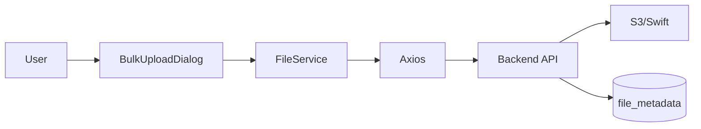

# File Upload Dialog - Technical Design

---
**Feature**: `file-upload-dialog`  
**Version**: 1.0.0  
**Status**: Design Complete  
**Last Updated**: 2026-01-19  
---

## 1. Overview

### 1.1 Purpose
BulkUploadDialog.tsxの既存UI実装にAPI統合を追加し、プロジェクトフォルダへのファイルアップロード機能を完成させる。3つのアップロードモード（単一/一括/フォルダ）をサポートし、リアルタイム進捗表示とエラーハンドリングを提供する。

### 1.2 Scope
**In Scope:**
- fileService.ts実装（API通信層）
- BulkUploadDialog.tsx修正（API呼び出し統合）
- リアルタイム進捗表示（Axios onUploadProgress）
- エラーハンドリング（APIエラーメッセージ表示）

**Out of Scope:**
- UI実装（既存完成済み）
- バックエンドAPI実装（既存完成済み）
- ファイルメタデータ記録（バックエンド自動処理）
- キャンセル/リトライ機能（将来実装）

## 2. Requirements Traceability

| Requirement | Summary | Components | Key Interfaces | Status |
|-------------|---------|-----------|----------------|--------|
| 2.1 | 単一ファイルアップロード | FileService, BulkUploadDialog | uploadFiles() | 設計完了 |
| 2.2 | 一括ファイルアップロード | FileService, BulkUploadDialog | uploadFiles() | 設計完了 |
| 2.3 | フォルダアップロード | FileService, BulkUploadDialog | uploadFiles() | 設計完了 |
| 2.4 | リアルタイム進捗表示 | FileService, BulkUploadDialog | onProgress callback | 設計完了 |
| 2.5 | エラーハンドリング | FileService, BulkUploadDialog | エラー型定義 | 設計完了 |

## 3. Architecture

### 3.1 Integration Pattern



**レイヤー責務:**
- **BulkUploadDialog**: UI状態管理、ユーザー操作、進捗表示
- **FileService**: API通信、FormData構築、進捗イベント処理
- **Backend API**: multipart解析、S3アップロード、DB記録

### 3.2 Data Flow

**アップロードフロー:**
```
1. User選択 → fileList状態更新
2. User「アップロード開始」クリック
3. BulkUploadDialog.handleUpload()
   ├─ FormData構築（uploadMode, targetFolder, files, ...）
   └─ fileService.uploadFiles() 呼び出し
4. FileService
   ├─ multipart/form-data送信
   ├─ onUploadProgress → BulkUploadDialog進捗更新
   └─ レスポンス受信 → 成功/失敗処理
5. BulkUploadDialog
   ├─ 成功: Alert表示、fileList クリア、モーダル維持
   └─ 失敗: エラーAlert表示、リトライ可能状態
```

## 4. Components & Interfaces

### 4.1 Component Summary

| Component | Domain | Intent | Requirements | Key Dependencies |
|-----------|--------|--------|--------------|------------------|
| FileService | API通信 | ファイルアップロードAPI統合 | 2.1-2.5 | Axios (P0) |
| BulkUploadDialog | UI | API呼び出し統合、進捗表示 | 2.1-2.5 | FileService (P0), Ant Design (P0) |

**Dependency Criticality:**
- P0 (Blocking): Axios, FileService, Ant Design
- P1 (High-risk): なし
- P2 (Informational): なし

### 4.2 FileService (New)

**Purpose**: プロジェクトファイルアップロードAPIの通信層を提供

**Service Interface:**

```typescript
// frontend/src/services/fileService.ts

export interface UploadFilesParams {
  projectId: string;
  uploadMode: 'single' | 'bulk' | 'folder';
  targetFolder: string;
  files: File[];
  batchName?: string;
  preserveFolderStructure?: boolean;
  onProgress?: (progress: UploadProgress) => void;
}

export interface UploadProgress {
  uploadedBytes: number;
  totalBytes: number;
  percentage: number;
  uploadedCount: number;
  totalCount: number;
}

export interface UploadResponse {
  success: boolean;
  data: {
    uploadMode: string;
    file?: UploadedFileInfo;
    files?: UploadedFileInfo[];
    summary?: {
      totalFiles: number;
      successfulFiles: number;
      failedFiles: number;
      totalSize: number;
    };
  };
}

export interface UploadedFileInfo {
  fileId: string;
  fileName: string;
  filePath: string;
  s3Key: string;
  fileSize: number;
  contentType: string;
  uploadedAt: string;
  status?: 'success' | 'failed';
  error?: string;
}

export async function uploadFiles(
  params: UploadFilesParams
): Promise<UploadResponse>;
```

**Implementation Notes:**
- FormDataにファイルとメタデータを追加
- `Content-Type: multipart/form-data`自動設定（Axios）
- onUploadProgressでリアルタイム進捗通知
- エラーはAxiosErrorから適切なメッセージ抽出
- timeout: 300秒（5分）

**Error Handling:**
- 400エラー: バリデーションエラーメッセージ表示
- 401エラー: ログイン画面へリダイレクト
- 403エラー: 権限不足メッセージ表示
- 404エラー: プロジェクト未発見メッセージ表示
- 500エラー: システムエラーメッセージ表示

### 4.3 BulkUploadDialog (Modified)

**Purpose**: API統合と進捗表示の実装

**Modifications:**

```typescript
// handleUpload関数の修正
const handleUpload = useCallback(async () => {
  if (fileList.length === 0) {
    message.warning('ファイルを選択してください');
    return;
  }

  setUploadState({
    isUploading: true,
    progress: 0,
    uploadedCount: 0,
    totalCount: fileList.length,
    error: null,
  });

  try {
    const files = fileList.map(f => f.originFileObj).filter((f): f is File => !!f);
    
    const response = await uploadFiles({
      projectId: currentProjectId, // プロップスまたはコンテキストから取得
      uploadMode,
      targetFolder: selectedFolderPathString,
      files,
      batchName: batchName || undefined,
      preserveFolderStructure: uploadMode !== 'single' && preserveFolderStructure,
      onProgress: (progress) => {
        setUploadState(prev => ({
          ...prev,
          progress: progress.percentage,
          uploadedCount: progress.uploadedCount,
        }));
      },
    });

    if (response.success) {
      message.success('アップロードが完了しました');
      
      if (onUploadComplete) {
        onUploadComplete({
          mode: uploadMode,
          fileCount: fileList.length,
          success: true,
        });
      }

      // 成功後の状態リセット（2秒後）
      setTimeout(() => {
        setFileList([]);
        setBatchName('');
        setUploadState({
          isUploading: false,
          progress: 100,
          uploadedCount: fileList.length,
          totalCount: fileList.length,
          error: null,
        });
      }, 2000);
    }
  } catch (error) {
    const errorMessage = extractErrorMessage(error);
    setUploadState(prev => ({
      ...prev,
      isUploading: false,
      error: errorMessage,
    }));
    message.error(errorMessage);
  }
}, [fileList, uploadMode, selectedFolderPathString, batchName, preserveFolderStructure, onUploadComplete]);
```

**Additional Props:**
```typescript
interface BulkUploadDialogProps {
  open: boolean;
  onClose: () => void;
  onUploadComplete?: (result: { mode: UploadMode; fileCount: number; success: boolean }) => void;
  preselectedFolder?: string;
  projectId: string; // 追加: 現在のプロジェクトID
}
```

**Implementation Notes:**
- `projectId`をプロップスで受け取る（親コンポーネントから渡す）
- エラーメッセージ抽出ヘルパー関数追加
- 成功時は2秒後に状態リセット（既存動作維持）
- Alert表示は既存UIコンポーネント利用

## 5. Error Handling

### 5.1 Error Types & Messages

| Error Code | HTTP Status | User Message | Action |
|-----------|-------------|--------------|--------|
| VALIDATION_ERROR | 400 | "ファイル情報が不正です" | リトライ可能 |
| VALIDATION_FILE_SIZE_EXCEEDED | 400 | "ファイルサイズが上限（100MB）を超えています" | ファイル選択やり直し |
| VALIDATION_FILE_COUNT_EXCEEDED | 400 | "ファイル数が上限（100件）を超えています" | ファイル削減 |
| AUTH_TOKEN_EXPIRED | 401 | "セッションが期限切れです。再ログインしてください" | ログイン画面へ |
| PERMISSION_INSUFFICIENT | 403 | "アップロード権限がありません" | 管理者に連絡 |
| RESOURCE_NOT_FOUND | 404 | "プロジェクトが見つかりません" | プロジェクト再選択 |
| SYSTEM_S3_ERROR | 500 | "ファイルストレージエラーが発生しました。しばらくしてから再試行してください" | リトライ推奨 |
| SYSTEM_DATABASE_ERROR | 500 | "システムエラーが発生しました。管理者に連絡してください" | 管理者に連絡 |
| NETWORK_ERROR | - | "ネットワークエラーが発生しました。接続を確認してください" | 接続確認後リトライ |
| TIMEOUT_ERROR | - | "アップロードがタイムアウトしました。ファイルサイズまたは接続を確認してください" | ファイル削減またはリトライ |

### 5.2 Error Message Extraction

```typescript
// frontend/src/utils/errorUtils.ts (既存または新規)

export function extractErrorMessage(error: unknown): string {
  if (axios.isAxiosError(error)) {
    // APIエラーレスポンス
    if (error.response?.data?.error?.message) {
      return error.response.data.error.message;
    }
    
    // HTTPステータスコード別デフォルトメッセージ
    switch (error.response?.status) {
      case 400:
        return 'ファイル情報が不正です';
      case 401:
        return 'セッションが期限切れです。再ログインしてください';
      case 403:
        return 'アップロード権限がありません';
      case 404:
        return 'プロジェクトが見つかりません';
      case 500:
        return 'システムエラーが発生しました';
      default:
        return 'アップロードに失敗しました';
    }
  }
  
  // ネットワークエラー
  if (error instanceof Error) {
    if (error.message.includes('timeout')) {
      return 'アップロードがタイムアウトしました';
    }
    if (error.message.includes('Network Error')) {
      return 'ネットワークエラーが発生しました';
    }
  }
  
  return 'アップロードに失敗しました';
}
```

## 6. Testing Strategy

### 6.1 Unit Tests

**FileService:**
- ✅ FormData構築が正しいこと
- ✅ onProgressコールバックが正しく呼ばれること
- ✅ エラーハンドリングが正しいこと
- ✅ timeout設定が有効なこと

**BulkUploadDialog:**
- ✅ API呼び出しが正しいパラメータで行われること
- ✅ 進捗状態が正しく更新されること
- ✅ 成功時のリセット処理が動作すること
- ✅ エラー時のメッセージ表示が正しいこと

### 6.2 Integration Tests

- ✅ 単一ファイルアップロード（モック応答）
- ✅ 一括ファイルアップロード（モック応答）
- ✅ フォルダアップロード（モック応答）
- ✅ 進捗表示の更新（モックprogress event）
- ✅ エラーハンドリング（各エラーコード）

### 6.3 Manual Testing Checklist

**基本機能:**
- [ ] 単一ファイルアップロード成功
- [ ] 一括ファイルアップロード（5件）成功
- [ ] フォルダアップロード（階層構造）成功
- [ ] 進捗バーがリアルタイム更新
- [ ] アップロード完了後にモーダルが維持される

**エラーケース:**
- [ ] ファイルサイズ超過（100MB超）でエラー表示
- [ ] ファイル数超過（100件超）でエラー表示
- [ ] 不正なファイル種別でエラー表示
- [ ] ネットワークエラー時の適切なメッセージ表示
- [ ] セッション期限切れ時の適切なメッセージ表示

**ブラウザ互換性:**
- [ ] Chrome最新版で動作確認
- [ ] Firefox最新版で動作確認
- [ ] Safari最新版で動作確認
- [ ] Edge最新版で動作確認

## 7. Performance Considerations

### 7.1 Upload Performance
- **並列アップロード**: 最大5ファイル同時（将来実装検討）
- **チャンク転送**: 10MB以上のファイル（将来実装検討）
- **圧縮**: クライアント側圧縮なし（S3側で最適化）

### 7.2 UI Performance
- **進捗更新**: スロットリング（100ms間隔）でUI更新
- **ファイルリスト表示**: 10件まで表示、それ以上は省略
- **メモリ管理**: アップロード完了後にFileList参照解放

## 8. Security Considerations

### 8.1 Frontend Security
- ✅ ファイルサイズ検証（100MB/ファイル）
- ✅ ファイル数検証（100ファイル）
- ✅ ファイル種別検証（ホワイトリスト）
- ✅ ファイル名サニタイゼーション
- ✅ JWTトークン自動付与（Axios interceptor）

### 8.2 API Security (Backend)
- ✅ JWT認証（authミドルウェア）
- ✅ organization_idフィルタ（tenantIsolationミドルウェア）
- ✅ 権限チェック（permissionCheckミドルウェア）
- ✅ ファイル内容検証
- ✅ S3パス検証（organization_prefix強制）

## 9. Database Schema Changes

### 9.1 Overview

現在のfile_metadataテーブル（Phase 0 + Phase 2統合版）には基本的なS3アクセスカラムが実装済みですが、**一括ファイルアップロード管理に必要なPhase 3カラムが未実装**です。

**必要性の根拠:**
- 一括アップロードのファイルグルーピング（upload_batch_id）
- アップロードモードの記録（upload_source: single/bulk/folder）
- 統計情報の取得やバッチ単位での操作

### 9.2 Phase 3: アップロード管理カラムの追加

**実装タイミング:** 今回のファイルアップロード機能実装と同時

#### 追加カラム（5カラム）

| カラム名 | 型 | デフォルト | 用途 |
|---------|-----|-----------|------|
| upload_batch_id | VARCHAR(255) | NULL | 一括アップロード時のバッチID（UUID） |
| upload_source | VARCHAR(50) | 'web_upload' | アップロード元（web_upload, bulk_upload, folder_upload, api_upload） |
| upload_method | VARCHAR(50) | 'single' | アップロード方法（single, multipart, resumable） |
| s3_storage_class | VARCHAR(50) | 'STANDARD' | S3ストレージクラス |
| s3_etag | VARCHAR(100) | NULL | S3 ETag（整合性チェック用） |

#### DDL変更

```sql
-- Phase 3: アップロード管理機能実装時の拡張
ALTER TABLE file_metadata
ADD COLUMN upload_batch_id VARCHAR(255),
ADD COLUMN upload_source VARCHAR(50) DEFAULT 'web_upload'
  CHECK (upload_source IN ('web_upload', 'bulk_upload', 'folder_upload', 'api_upload')),
ADD COLUMN upload_method VARCHAR(50) DEFAULT 'single'
  CHECK (upload_method IN ('single', 'multipart', 'resumable')),
ADD COLUMN s3_storage_class VARCHAR(50) DEFAULT 'STANDARD',
ADD COLUMN s3_etag VARCHAR(100);

-- インデックス作成（バッチ単位での操作用）
CREATE INDEX idx_file_metadata_upload_batch 
  ON file_metadata(upload_batch_id);

-- コメント追加
COMMENT ON COLUMN file_metadata.upload_batch_id IS '一括アップロード時のバッチID（UUID形式、バッチ単位でのファイル操作に使用）';
COMMENT ON COLUMN file_metadata.upload_source IS 'アップロード元（web_upload: Webダイアログ, bulk_upload: 一括アップロード, folder_upload: フォルダアップロード, api_upload: API直接）';
COMMENT ON COLUMN file_metadata.upload_method IS 'アップロード方法（single: 単一, multipart: マルチパート, resumable: 再開可能）';
COMMENT ON COLUMN file_metadata.s3_storage_class IS 'S3ストレージクラス（STANDARD, INTELLIGENT_TIERING, GLACIER等）';
COMMENT ON COLUMN file_metadata.s3_etag IS 'S3 ETag（MD5ハッシュ、整合性チェック用）';
```

### 9.3 バックエンドAPI実装への影響

#### アップロード処理での使用例

```typescript
// backend/src/controllers/fileController.ts

// 一括アップロード時のバッチID生成
const batchId = uploadMode !== 'single' ? uuidv4() : null;

for (const file of files) {
  await db.query(`
    INSERT INTO file_metadata (
      file_key,
      s3_bucket,
      organization_id,
      original_filename,
      file_size,
      file_type,
      uploaded_by,
      upload_batch_id,
      upload_source,
      upload_method,
      s3_etag
    ) VALUES ($1, $2, $3, $4, $5, $6, $7, $8, $9, $10, $11)
  `, [
    s3Key,
    bucket,
    organizationId,
    file.originalname,
    file.size,
    file.mimetype,
    userId,
    batchId, // 一括アップロード時のみ設定
    mapUploadMode(uploadMode), // 'bulk_upload' または 'folder_upload'
    'single', // 将来的にマルチパート対応時に変更
    s3Response.ETag
  ]);
}
```

#### バッチ単位での操作例

```typescript
// バッチ単位でのファイル一覧取得
const batchFiles = await db.query(`
  SELECT * FROM file_metadata
  WHERE upload_batch_id = $1 AND organization_id = $2
  ORDER BY created_at
`, [batchId, organizationId]);

// 統計情報の取得
const uploadStats = await db.query(`
  SELECT 
    upload_source,
    COUNT(*) as file_count,
    SUM(file_size) as total_size
  FROM file_metadata
  WHERE organization_id = $1
    AND created_at >= NOW() - INTERVAL '30 days'
  GROUP BY upload_source
`, [organizationId]);
```

### 9.4 マイグレーション手順

#### Step 1: DDLファイルの作成

新規ファイル: `docs/design/db/ddl/migrations/file_metadata_phase3_migration.sql`

```sql
-- ============================================================
-- file_metadata Phase 3 マイグレーション
-- ============================================================
-- 作成日: 2026-01-19
-- 目的: アップロード管理カラムの追加
-- 関連タスク: file-upload-dialog実装
-- ============================================================

-- Phase 3カラム追加
ALTER TABLE file_metadata
ADD COLUMN IF NOT EXISTS upload_batch_id VARCHAR(255),
ADD COLUMN IF NOT EXISTS upload_source VARCHAR(50) DEFAULT 'web_upload'
  CHECK (upload_source IN ('web_upload', 'bulk_upload', 'folder_upload', 'api_upload')),
ADD COLUMN IF NOT EXISTS upload_method VARCHAR(50) DEFAULT 'single'
  CHECK (upload_method IN ('single', 'multipart', 'resumable')),
ADD COLUMN IF NOT EXISTS s3_storage_class VARCHAR(50) DEFAULT 'STANDARD',
ADD COLUMN IF NOT EXISTS s3_etag VARCHAR(100);

-- インデックス作成
CREATE INDEX IF NOT EXISTS idx_file_metadata_upload_batch 
  ON file_metadata(upload_batch_id);

-- コメント追加
COMMENT ON COLUMN file_metadata.upload_batch_id IS '一括アップロード時のバッチID（UUID形式）';
COMMENT ON COLUMN file_metadata.upload_source IS 'アップロード元（web_upload, bulk_upload, folder_upload, api_upload）';
COMMENT ON COLUMN file_metadata.upload_method IS 'アップロード方法（single, multipart, resumable）';
COMMENT ON COLUMN file_metadata.s3_storage_class IS 'S3ストレージクラス';
COMMENT ON COLUMN file_metadata.s3_etag IS 'S3 ETag（整合性チェック用）';
```

#### Step 2: マイグレーション実行

```bash
# 開発環境
psql -U postgres -d mmdpf_dev -f docs/design/db/ddl/migrations/file_metadata_phase3_migration.sql

# 本番環境（慎重に実行）
psql -U $DB_USER -d $DB_NAME -f docs/design/db/ddl/migrations/file_metadata_phase3_migration.sql
```

#### Step 3: DDLファイルの更新

`docs/design/db/ddl/file_metadata.sql` のヘッダーコメントを更新：

```sql
-- 【カラム構成: 20カラム】
-- ■ Phase 0 (初期実装) - S3アクセス必須: 9カラム
-- ■ Phase 2 (統合完了) - 詳細検索機能: 6カラム
-- ■ Phase 3 (2026-01-19統合) - アップロード管理: 5カラム
```

### 9.5 ロールバック計画

問題が発生した場合のロールバックSQL:

```sql
-- Phase 3カラムの削除
ALTER TABLE file_metadata
DROP COLUMN IF EXISTS upload_batch_id,
DROP COLUMN IF EXISTS upload_source,
DROP COLUMN IF EXISTS upload_method,
DROP COLUMN IF EXISTS s3_storage_class,
DROP COLUMN IF EXISTS s3_etag;

-- インデックスの削除
DROP INDEX IF EXISTS idx_file_metadata_upload_batch;
```

### 9.6 テストデータ例

```sql
-- 一括アップロードのテストデータ
INSERT INTO file_metadata (
  file_key,
  s3_bucket,
  organization_id,
  original_filename,
  file_size,
  file_type,
  uploaded_by,
  upload_batch_id,
  upload_source,
  upload_method
) VALUES
  ('org_test/project/file1.maiml', 'mmdpf-files', '550e8400-e29b-41d4-a716-446655440000'::UUID, 
   'file1.maiml', 1024, 'application/xml', 'user_001', 
   'batch_001', 'bulk_upload', 'single'),
  ('org_test/project/file2.maiml', 'mmdpf-files', '550e8400-e29b-41d4-a716-446655440000'::UUID, 
   'file2.maiml', 2048, 'application/xml', 'user_001', 
   'batch_001', 'bulk_upload', 'single');
```

## 10. Deployment Notes

### 10.1 Frontend Changes
- **新規ファイル**: `frontend/src/services/fileService.ts`
- **修正ファイル**: `frontend/src/components/project/BulkUploadDialog.tsx`
- **新規ユーティリティ**: `frontend/src/utils/errorUtils.ts`（既存の場合は追加のみ）

### 9.2 Backward Compatibility
- **UI**: 既存UIは変更なし、モック処理のみ置き換え
- **Props**: `projectId`追加（必須）、他は既存維持
- **Breaking Changes**: なし

### 9.3 Rollback Plan
- FileService呼び出しをモック処理に戻す
- BulkUploadDialog.tsxを旧バージョンに戻す

## 10. Future Enhancements

### Phase 2 (優先度: 中)
- キャンセル機能（CancelToken）
- リトライ機能（失敗したファイルのみ）
- 並列アップロード（最大5ファイル同時）

### Phase 3 (優先度: 低)
- チャンク転送（10MB以上のファイル）
- レジューム機能（中断したアップロードの再開）
- ドラッグ&ドロップ改善（プレビュー表示）
- アップロード履歴保存

## 11. References

- [API仕様](../../design/api/api_project_management.md#27-ファイルアップロード) — バックエンドAPI詳細
- [Research Log](./research.md) — 技術調査とデザイン決定
- [Requirements](./requirements.md) — 機能要件
- [Ant Design Upload](https://ant.design/components/upload/) — UIコンポーネント仕様
- [Axios Documentation](https://axios-http.com/docs/intro) — HTTP通信ライブラリ

---

**Design Status**: ✅ Complete  
**Next Steps**: 実装開始（fileService.ts → BulkUploadDialog.tsx修正 → テスト）
