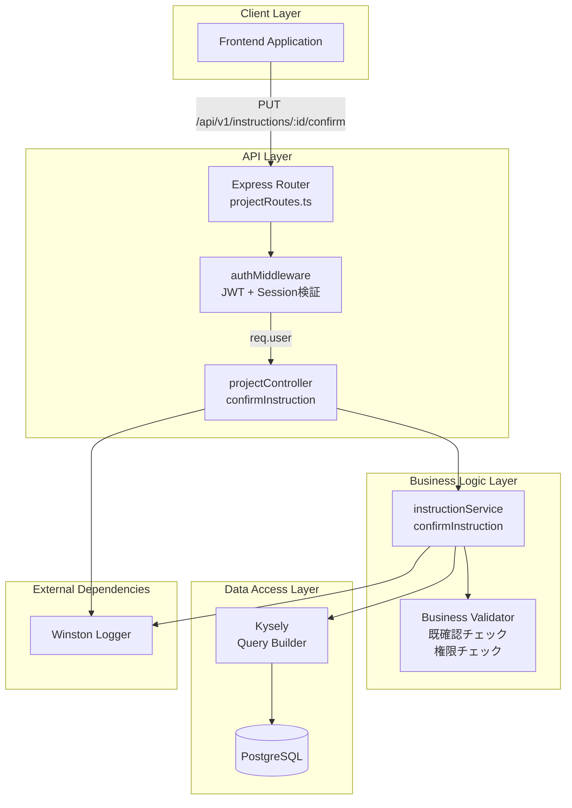
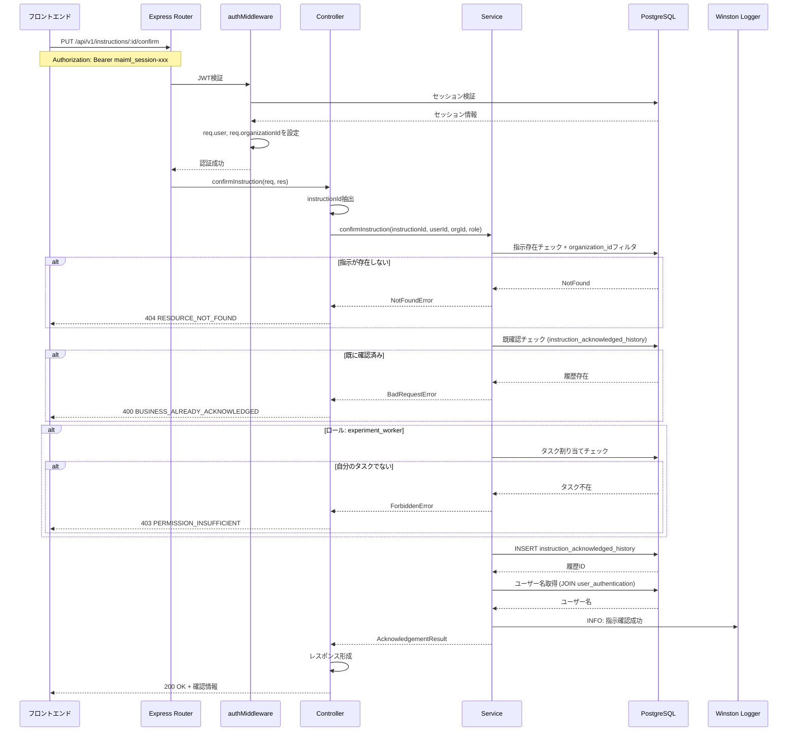
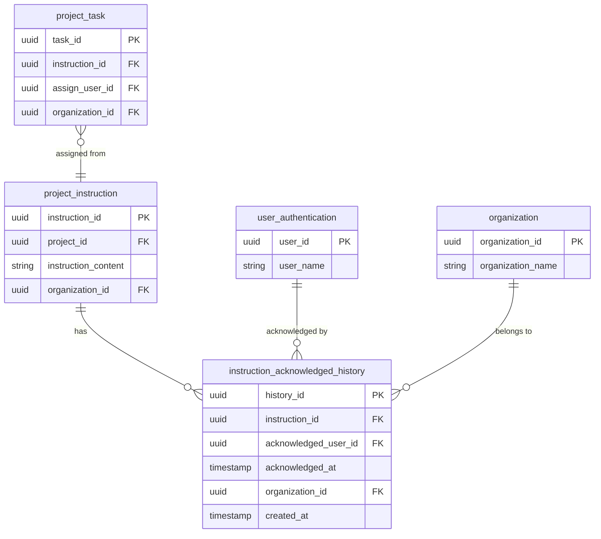

# 技術設計書: 指示確認完了API

## Overview

本機能は、実験作業者が実験管理者から受け取った指示を確認済みとしてマークするためのREST APIエンドポイントを提供します。この機能により、指示の伝達と確認のトレーサビリティが確保され、実験ワークフローにおけるコミュニケーションの透明性が向上します。

既存のプロジェクト管理APIを拡張する形で実装され、認証・認可、マルチテナント分離、統一レスポンス形式などの既存パターンを踏襲します。新たに`instruction_acknowledged_history`テーブルを導入し、指示確認の完全な監査証跡を記録します。

**対象ユーザー**: 実験作業者（experiment_worker）

**主要機能**: 
- 指示の確認済みマーキング
- 確認履歴の記録（監査証跡）
- マルチテナント分離

### Goals

- **トレーサビリティの確保**: 指示確認の完全な履歴を記録し、監査証跡を提供する
- **セキュリティの維持**: マルチテナント分離とロールベースアクセス制御を徹底する
- **既存パターンの踏襲**: アーキテクチャの一貫性を保ち、保守性を向上させる
- **パフォーマンス**: 500ms以内のレスポンス時間を達成する

**Success Criteria**:
- 全11要件の受入基準を満たす
- テストカバレッジ80%以上
- セキュリティ脆弱性ゼロ
- マルチテナント分離の完全性

### Non-Goals

- フロントエンド実装（バックエンドAPIのみ）
- 指示の一括確認機能（将来的な拡張）
- リアルタイム通知機能（別機能で実装予定）
- 指示確認の取り消し機能（要件外）

---

## Architecture

### Existing Architecture Analysis

本機能は既存のプロジェクト管理APIシステムを拡張します：

**既存アーキテクチャパターン**:
- レイヤードアーキテクチャ（Routes → Controller → Service → Database）
- JWT + Session Hybrid認証
- Express.jsミドルウェアチェーン
- Kyselyクエリビルダー（型安全なDB操作）

**既存ドメイン境界**:
- プロジェクト管理ドメイン（`backend/src/routes/projectRoutes.ts`）
- 指示管理は既存の`project_instruction`テーブルで管理
- ユーザー認証は`user_authentication`テーブルで管理

**統合ポイント**:
- `backend/src/routes/projectRoutes.ts` に新規ルート追加
- `backend/src/controllers/projectController.ts` に新規メソッド追加
- `backend/src/services/projectService.ts` または新規`instructionService.ts`に実装

**技術的制約**:
- すべてのDBクエリに`organization_id`フィルタ必須
- Parameterized Queriesの使用必須（SQLインジェクション対策）
- 統一レスポンス形式の遵守

### Architecture Pattern & Boundary Map



**アーキテクチャ統合**:
- **選択パターン**: レイヤードアーキテクチャ（既存システムと同一）
- **ドメイン境界**: プロジェクト管理ドメイン内の指示確認サブドメイン
- **既存パターン保持**: JWT認証、Kyselyクエリビルダー、統一レスポンス形式
- **新規コンポーネント根拠**: `instruction_acknowledged_history`テーブル（監査証跡要件）
- **ステアリング準拠**: マルチテナント分離、セキュリティファースト、型安全性

### Technology Stack

| Layer | Choice / Version | Role in Feature | Notes |
|-------|------------------|-----------------|-------|
| Backend | Express.js 4.18+ | ルーティング、ミドルウェア | 既存システムと同一 |
| Language | TypeScript 5.x | 型安全性、開発効率 | strictモード有効 |
| Database | PostgreSQL 13+ | データ永続化 | 既存システムと同一 |
| Query Builder | Kysely (最新) | 型安全なクエリ構築 | Parameterized Query自動生成 |
| Authentication | jsonwebtoken | JWT検証 | 既存システムと同一 |
| Logging | Winston | 構造化ログ | 既存システムと同一 |

**新規ライブラリ**: なし（既存スタックのみ使用）

**技術選定根拠**: 既存システムとの完全な互換性を維持し、学習コストを最小化。Kyselyは型安全性とSQLインジェクション対策を自動的に提供。詳細な技術評価は`research.md`の「技術スタック整合性」セクションを参照。

---

## System Flows

### Sequence: 指示確認フロー



**主要な決定**:
- **既確認チェック**: 履歴テーブルを検索し、重複確認を防止
- **権限チェック**: ロール別にビジネスロジック層で実装（`experiment_worker`は自タスクのみ）
- **トランザクション**: 単一INSERT操作のため不要、シンプルに保つ
- **エラーハンドリング**: 各ステップで適切なエラーを返却、ミドルウェアで統一処理

---

## Requirements Traceability

| Requirement | Summary | Components | Interfaces | Flows |
|-------------|---------|------------|------------|-------|
| 1 | APIエンドポイント実装 | Routes, Controller, Service | Service, API | 指示確認フロー |
| 2 | 認証と認可 | authMiddleware | - | 指示確認フロー |
| 3 | ビジネスロジック検証 | Service, Validator | Service | 指示確認フロー |
| 4 | マルチテナント分離 | Service, Database | - | 指示確認フロー |
| 5 | データベース更新処理 | Service, Database | - | 指示確認フロー |
| 6 | レスポンス形成 | Controller | API | 指示確認フロー |
| 7 | エラーハンドリング | Controller, Service | - | 指示確認フロー |
| 8 | 監査ログとロギング | Logger | - | 指示確認フロー |
| 9 | パフォーマンスと可用性 | Database (indexes), Service | - | - |
| 10 | 統合とテスト可能性 | All Layers | - | - |
| 11 | 実装ファイル構成 | All Components | - | - |

---

## Components and Interfaces

### Component Summary

| Component | Domain/Layer | Intent | Req Coverage | Key Dependencies (P0/P1) | Contracts |
|-----------|--------------|--------|--------------|--------------------------|-----------|
| confirmInstructionRoute | API/Routes | APIエンドポイント定義 | 1, 2 | authMiddleware (P0), Controller (P0) | API |
| authMiddleware | API/Middleware | JWT認証・セッション検証 | 2 | DB (P0), JWT library (P0) | - |
| projectController.confirmInstruction | API/Controller | リクエスト処理・レスポンス形成 | 1, 6, 7 | Service (P0), Logger (P1) | API |
| instructionService.confirmInstruction | Business/Service | ビジネスロジック実装 | 3, 4, 5, 8, 9 | DB (P0), Logger (P0), Validator (P0) | Service |
| instruction_acknowledged_history | Data/Table | 確認履歴の永続化 | 5, 8 | PostgreSQL (P0) | Data |

**注**: P0=ブロッキング依存、P1=高リスク依存

---

### API Layer

#### confirmInstructionRoute

| Field | Detail |
|-------|--------|
| Intent | 指示確認APIエンドポイントを定義し、認証ミドルウェアとコントローラーを接続 |
| Requirements | 1, 2 |

**Responsibilities & Constraints**
- HTTPルーティングの定義（`PUT /api/v1/instructions/:instructionId/confirm`）
- ミドルウェアチェーンの適用（authMiddleware）
- リクエストをコントローラーに委譲

**Dependencies**
- Inbound: HTTPクライアント — APIリクエスト受信 (P0)
- Outbound: authMiddleware — JWT認証・セッション検証 (P0)
- Outbound: projectController.confirmInstruction — ビジネスロジック実行 (P0)

**Contracts**: API [x]

##### API Contract

| Method | Endpoint | Request | Response | Errors |
|--------|----------|---------|----------|--------|
| PUT | /api/v1/instructions/:instructionId/confirm | - | InstructionAcknowledgement | 400, 401, 403, 404, 500 |

**Request Headers**:
```
Authorization: Bearer maiml_session-{sessionId}_{timestamp}
Content-Type: application/json
```

**Path Parameters**:
```typescript
interface ConfirmInstructionParams {
  instructionId: string;  // UUID形式
}
```

**Response (200 OK)**:
```typescript
{
  success: true,
  data: {
    instruction_id: string;           // UUID
    is_acknowledged: true;            // 常にtrue
    acknowledged_at: string;          // ISO8601形式
    acknowledged_user_id: string;     // UUID
    acknowledged_user_name: string;   // 表示名
  },
  meta: {
    timestamp: string;  // ISO8601形式
    requestId: string;  // UUID
  }
}
```

**Error Responses**:
- `400 VALIDATION_ERROR`: パラメータ不正
- `400 BUSINESS_ALREADY_ACKNOWLEDGED`: 既に確認済み
- `401 AUTH_TOKEN_INVALID`: 認証トークン無効
- `403 PERMISSION_INSUFFICIENT`: 権限不足
- `404 RESOURCE_NOT_FOUND`: 指示が存在しない
- `500 SYSTEM_DATABASE_ERROR`: データベースエラー

**Implementation Notes**
- Integration: `backend/src/routes/projectRoutes.ts`に追加
- Validation: パスパラメータのUUID形式検証
- Risks: ミドルウェアチェーンの順序を厳守（auth → controller）

---

#### authMiddleware

| Field | Detail |
|-------|--------|
| Intent | JWTトークンとセッションを検証し、ユーザー情報を抽出 |
| Requirements | 2 |

**Responsibilities & Constraints**
- JWTトークン（`maiml_session-{sessionId}_{timestamp}`）の検証
- セッション情報の取得とバリデーション
- `req.user`（userId, organizationId, role）と`req.organizationId`の設定
- 認証失敗時は401エラーを返却

**Dependencies**
- Inbound: Express Router — HTTPリクエスト (P0)
- Outbound: PostgreSQL (user_sessions) — セッション検証 (P0)
- External: jsonwebtoken — JWT検証 (P0)

**Contracts**: - (既存ミドルウェア、変更なし)

**Implementation Notes**
- Integration: 既存の`backend/src/middleware/auth.js`を使用
- Validation: トークン形式、セッション有効期限
- Risks: なし（既存実装済み）

---

#### projectController.confirmInstruction

| Field | Detail |
|-------|--------|
| Intent | APIリクエストを処理し、サービス層を呼び出してレスポンスを形成 |
| Requirements | 1, 6, 7 |

**Responsibilities & Constraints**
- パスパラメータ`instructionId`の抽出とバリデーション
- サービス層の呼び出し（`instructionService.confirmInstruction`）
- 統一レスポンス形式での結果返却
- エラーハンドリング（try-catch）
- ログ記録（INFO/ERRORレベル）

**Dependencies**
- Inbound: Express Router — HTTPリクエスト (P0)
- Outbound: instructionService.confirmInstruction — ビジネスロジック (P0)
- Outbound: Winston Logger — ログ記録 (P1)

**Contracts**: Service [x] / API [x]

##### Service Interface

```typescript
interface InstructionController {
  confirmInstruction(
    req: Request,
    res: Response,
    next: NextFunction
  ): Promise<void>;
}

interface Request {
  params: { instructionId: string };
  user: {
    userId: string;
    organizationId: string;
    role: 'system_admin' | 'experiment_admin' | 'experiment_worker';
  };
  headers: { 'x-request-id'?: string };
}
```

- **Preconditions**: `req.user`が設定されている（authMiddleware通過）
- **Postconditions**: 統一レスポンス形式でJSONを返却
- **Invariants**: エラーは必ずnext()でエラーハンドリングミドルウェアに委譲

**Implementation Notes**
- Integration: `backend/src/controllers/projectController.ts`に新規メソッド追加
- Validation: UUID形式のバリデーション（サービス層に委譲）
- Risks: なし（標準的なコントローラーパターン）

---

### Business Logic Layer

#### instructionService.confirmInstruction

| Field | Detail |
|-------|--------|
| Intent | 指示確認のビジネスロジックを実装し、データベース操作を調整 |
| Requirements | 3, 4, 5, 8, 9 |
| Owner / Reviewers | Backend Team |

**Responsibilities & Constraints**
- 指示の存在確認（`project_instruction`テーブル）
- 既確認チェック（`instruction_acknowledged_history`テーブル）
- ロール別権限チェック（`experiment_worker`は自タスクのみ）
- 確認履歴レコードの挿入
- ユーザー名の取得（`user_authentication`テーブルとJOIN）
- マルチテナント分離（すべてのクエリに`organization_id`フィルタ）
- ログ記録（成功時INFO、エラー時ERROR）

**Dependencies**
- Inbound: projectController — リクエスト処理 (P0)
- Outbound: PostgreSQL (Kysely) — データベース操作 (P0)
- Outbound: Winston Logger — ログ記録 (P0)
- External: project_instruction, project_task, user_authentication, instruction_acknowledged_history テーブル (P0)

**Contracts**: Service [x]

##### Service Interface

```typescript
interface InstructionService {
  confirmInstruction(
    instructionId: string,
    userId: string,
    organizationId: string,
    role: UserRole
  ): Promise<Result<InstructionAcknowledgement, ServiceError>>;
}

interface InstructionAcknowledgement {
  instruction_id: string;
  is_acknowledged: true;
  acknowledged_at: string;  // ISO8601
  acknowledged_user_id: string;
  acknowledged_user_name: string;
}

type UserRole = 'system_admin' | 'experiment_admin' | 'experiment_worker';

interface ServiceError {
  code: string;
  message: string;
  details?: any[];
}

type Result<T, E> = { success: true; data: T } | { success: false; error: E };
```

- **Preconditions**: 
  - `instructionId`, `userId`, `organizationId`はUUID形式
  - `role`は有効な列挙値
  - DBコネクションプールが利用可能
- **Postconditions**: 
  - 成功時は`instruction_acknowledged_history`テーブルに新規レコード挿入
  - 失敗時はロールバック不要（単一INSERT操作）
- **Invariants**: 
  - すべてのDBクエリに`organization_id`フィルタが含まれる
  - Parameterized Queriesを使用

**Implementation Notes**
- **Integration**: 
  - `backend/src/services/instructionService.ts`として新規ファイル作成
  - または`backend/src/services/projectService.ts`に追加
- **Validation**: 
  - UUID形式バリデーション
  - 指示存在確認後に既確認チェック
  - `experiment_worker`ロールの場合はタスク割り当てチェック
- **Risks**: 
  - N+1問題: ユーザー名取得時にJOINを使用してクエリ数を最小化
  - 同時実行競合: 既確認チェックで重複を防止（詳細は`research.md`参照）

---

### Data Access Layer

#### instruction_acknowledged_history テーブル

| Field | Detail |
|-------|--------|
| Intent | 指示確認の履歴を永続化し、監査証跡を提供 |
| Requirements | 5, 8 |

**Responsibilities & Constraints**
- 指示確認履歴の記録（誰が、いつ、どの指示を確認したか）
- マルチテナント分離（`organization_id`カラム必須）
- 外部キー制約による参照整合性の保証
- CASCADE DELETE（親指示削除時に履歴も削除）

**Dependencies**
- Inbound: instructionService — 履歴レコード挿入 (P0)
- Outbound: PostgreSQL — データ永続化 (P0)
- External: project_instruction, organization テーブル (P0)

**Contracts**: Data [x]

##### Data Model

**Physical Schema**:
```sql
CREATE TABLE instruction_acknowledged_history (
  history_id UUID PRIMARY KEY DEFAULT gen_random_uuid(),
  instruction_id UUID NOT NULL,
  acknowledged_user_id UUID NOT NULL,
  acknowledged_at TIMESTAMP WITH TIME ZONE NOT NULL DEFAULT NOW(),
  organization_id UUID NOT NULL,
  created_at TIMESTAMP WITH TIME ZONE DEFAULT NOW(),
  
  CONSTRAINT fk_instruction 
    FOREIGN KEY (instruction_id) 
    REFERENCES project_instruction(instruction_id) 
    ON DELETE CASCADE,
  
  CONSTRAINT fk_organization 
    FOREIGN KEY (organization_id) 
    REFERENCES organization(organization_id) 
    ON DELETE CASCADE
);

-- Indexes
CREATE INDEX idx_instruction_ack_history_instruction 
  ON instruction_acknowledged_history(instruction_id);
  
CREATE INDEX idx_instruction_ack_history_org 
  ON instruction_acknowledged_history(organization_id);
  
CREATE INDEX idx_instruction_ack_history_user 
  ON instruction_acknowledged_history(acknowledged_user_id);
```

**TypeScript Type Definition**:
```typescript
interface InstructionAcknowledgedHistory {
  history_id: string;
  instruction_id: string;
  acknowledged_user_id: string;
  acknowledged_at: string;  // ISO8601 timestamp
  organization_id: string;
  created_at: string;  // ISO8601 timestamp
}

interface NewInstructionAcknowledgedHistory {
  instruction_id: string;
  acknowledged_user_id: string;
  acknowledged_at: string;
  organization_id: string;
}
```

**Implementation Notes**
- **Integration**: 
  - DDLファイル: `backend/sql/ddl/instruction_acknowledged_history.sql`
  - マイグレーションスクリプトで実行
- **Validation**: 
  - NOT NULL制約でデータ整合性を保証
  - 外部キー制約で参照整合性を保証
- **Risks**: 
  - テーブル肥大化: インデックスで対応、将来的なアーカイブ化を検討

---

## Data Models

### Domain Model

**Aggregate Root**: Instruction (指示)

**Entities**:
- **Instruction**: 実験指示の基本情報（既存）
- **InstructionAcknowledgement**: 指示確認の履歴（新規）

**Value Objects**:
- **AcknowledgementTimestamp**: 確認日時（ISO8601形式）
- **UserId**: ユーザー識別子（UUID）
- **OrganizationId**: 組織識別子（UUID）

**Domain Events**:
- **InstructionAcknowledged**: 指示が確認された（監査ログ記録用）

**Business Rules & Invariants**:
1. 各指示は複数回確認可能（履歴として記録）
2. 確認は取り消し不可（監査証跡の要件）
3. `experiment_worker`は自分に割り当てられた指示のみ確認可能
4. 確認履歴は親指示削除時にカスケード削除

### Logical Data Model

**Structure Definition**:



**Cardinality**:
- 1つの指示（instruction）は0個以上の確認履歴を持つ（1:N）
- 1人のユーザーは0個以上の確認履歴を持つ（1:N）
- 1つの組織は0個以上の確認履歴を持つ（1:N）

**Natural Keys and Identifiers**:
- Primary Key: `history_id` (UUID, 自動生成)
- Foreign Keys: `instruction_id`, `organization_id`
- Business Key: `(instruction_id, acknowledged_user_id, acknowledged_at)`の組み合わせ

**Referential Integrity Rules**:
- `instruction_id` → `project_instruction.instruction_id` (CASCADE DELETE)
- `organization_id` → `organization.organization_id` (CASCADE DELETE)

**Consistency & Integrity**:
- **Transaction Boundaries**: 単一テーブルへのINSERT操作（トランザクション不要）
- **Cascading Rules**: 親指示削除時に確認履歴もカスケード削除
- **Temporal Aspects**: `acknowledged_at`と`created_at`で時系列を記録（監査証跡）

### Physical Data Model

**For PostgreSQL**:

**Table: instruction_acknowledged_history**

| Column | Data Type | Constraints | Description |
|--------|-----------|-------------|-------------|
| history_id | UUID | PRIMARY KEY, DEFAULT gen_random_uuid() | 履歴ID（自動生成） |
| instruction_id | UUID | NOT NULL, FOREIGN KEY | 指示ID |
| acknowledged_user_id | UUID | NOT NULL | 確認ユーザーID |
| acknowledged_at | TIMESTAMP WITH TIME ZONE | NOT NULL, DEFAULT NOW() | 確認日時 |
| organization_id | UUID | NOT NULL, FOREIGN KEY | 組織ID |
| created_at | TIMESTAMP WITH TIME ZONE | DEFAULT NOW() | レコード作成日時 |

**Indexes**:
```sql
-- パフォーマンス最適化
CREATE INDEX idx_instruction_ack_history_instruction 
  ON instruction_acknowledged_history(instruction_id);

-- マルチテナント分離
CREATE INDEX idx_instruction_ack_history_org 
  ON instruction_acknowledged_history(organization_id);

-- ユーザー別確認履歴検索
CREATE INDEX idx_instruction_ack_history_user 
  ON instruction_acknowledged_history(acknowledged_user_id);

-- 複合インデックス（既確認チェック用）
CREATE INDEX idx_instruction_ack_history_check 
  ON instruction_acknowledged_history(instruction_id, acknowledged_user_id, organization_id);
```

**Partitioning Strategy**: なし（テーブルサイズが大規模化した場合は将来的に日付ベースパーティショニングを検討）

### Data Contracts & Integration

**API Data Transfer**:

**Request**: なし（ボディなし）

**Response Schema**:
```typescript
interface InstructionAcknowledgementResponse {
  success: true;
  data: {
    instruction_id: string;
    is_acknowledged: true;
    acknowledged_at: string;  // ISO8601: "2026-01-30T15:00:00.000Z"
    acknowledged_user_id: string;
    acknowledged_user_name: string;
  };
  meta: {
    timestamp: string;  // ISO8601
    requestId: string;  // UUID
  };
}
```

**Error Response Schema**:
```typescript
interface ErrorResponse {
  success: false;
  error: {
    code: string;  // e.g., "BUSINESS_ALREADY_ACKNOWLEDGED"
    message: string;
    details?: any[];
  };
  meta: {
    timestamp: string;
    requestId: string;
  };
}
```

**Validation Rules**:
- `instructionId`: UUID v4形式（ハイフン付き）
- `acknowledged_at`: ISO8601形式のタイムスタンプ（UTCタイムゾーン）
- `acknowledged_user_name`: 非nullかつ空文字列でない

**Migration & Evolution**:
- バージョン管理: なし（単一エンドポイント、後方互換性維持）
- スキーマ変更: `instruction_acknowledged_history`テーブルへのカラム追加は可能（既存データへの影響なし）
- 将来的な拡張: 指示の一括確認API、確認取り消しAPI

---

## Cross-Cutting Concerns

### Security

#### Authentication & Authorization

**認証メカニズム**: JWT + Session Hybrid

- **トークン形式**: `maiml_session-{sessionId}_{timestamp}`
- **トークン配置**: HTTPヘッダー `Authorization: Bearer {token}`
- **セッション検証**: `user_sessions`テーブルで有効性確認
- **有効期限**: ロール別（admin: 48時間、manager: 24時間、worker: 12時間）

**認可ルール**:

| ロール | 権限 | 制約 |
|--------|------|------|
| system_admin | 所属組織内すべての指示を確認可能 | organization_idフィルタ必須 |
| experiment_admin | 所属組織内すべての指示を確認可能 | organization_idフィルタ必須 |
| experiment_worker | 自分に割り当てられた指示のみ確認可能 | タスク割り当てチェック必須 |

**実装**:
```typescript
// experiment_workerの場合のみタスク割り当てチェック
if (req.user.role === 'experiment_worker') {
  const task = await db
    .selectFrom('project_task')
    .where('instruction_id', '=', instructionId)
    .where('assign_user_id', '=', req.user.userId)
    .where('organization_id', '=', req.user.organizationId)
    .executeTakeFirst();
  
  if (!task) {
    throw new ForbiddenError('自分に割り当てられていない指示は確認できません');
  }
}
```

#### Data Protection

**マルチテナント分離**:
- すべてのDBクエリに`organization_id`フィルタを強制
- クロステナントアクセスを完全に防止
- `authMiddleware`で`req.organizationId`を自動設定

**入力検証**:
- パスパラメータ`instructionId`のUUID形式検証
- SQLインジェクション対策（Kysely Parameterized Query使用）
- XSS対策（レスポンスはJSON形式、エスケープ不要）

**機密情報の保護**:
- パスワード、トークンはログに出力しない
- エラーメッセージにスタックトレースを含めない（本番環境）
- データベース接続情報は環境変数で管理

#### Security Checklist

- [x] JWT認証の実装
- [x] セッション検証の実装
- [x] ロールベースアクセス制御
- [x] マルチテナント分離（organization_idフィルタ）
- [x] Parameterized Queriesの使用
- [x] 入力バリデーション
- [x] エラーメッセージの適切な制御
- [x] ログからの機密情報除外
- [x] HTTPS通信の強制（本番環境）

---

### Observability

#### Logging Strategy

**ログレベル**:
- **INFO**: 正常な指示確認（成功）
- **WARN**: ビジネスルール違反（既確認、権限不足）
- **ERROR**: システムエラー（DB接続失敗、予期しないエラー）

**ログフォーマット** (構造化ログ):
```json
{
  "timestamp": "2026-01-30T15:00:00.000Z",
  "level": "INFO",
  "message": "Instruction confirmed successfully",
  "context": {
    "instructionId": "550e8400-e29b-41d4-a716-446655440000",
    "userId": "660e8400-e29b-41d4-a716-446655440000",
    "organizationId": "770e8400-e29b-41d4-a716-446655440000",
    "role": "experiment_worker",
    "requestId": "req_abc123"
  },
  "duration": 245
}
```

**ログ保存先**:
- 開発環境: コンソール + ファイル（`backend/logs/app.log`）
- 本番環境: AWS CloudWatch Logs

**ログローテーション**:
- 日次ローテーション
- 最大14日間保持
- 圧縮保存

#### Monitoring & Metrics

**主要メトリクス**:
1. **レスポンス時間**: P50, P95, P99（目標: P95 < 500ms）
2. **エラー率**: 4xx, 5xxエラーの割合（目標: < 1%）
3. **スループット**: リクエスト数/分（ピーク時監視）
4. **データベースクエリ時間**: 各クエリの実行時間

**アラート条件**:
- エラー率 > 5%（5分間）
- P95レスポンス時間 > 1秒（5分間）
- データベース接続失敗（1回でもアラート）

#### Distributed Tracing

**トレース情報**:
- リクエストID（`x-request-id`ヘッダー）をすべてのログに含める
- データベースクエリにリクエストIDを関連付け
- エラー発生時のスタックトレース記録

---

### Testing Strategy

#### Test Pyramid

```
        /\
       /  \      E2E Tests (5%)
      /----\     - フロントエンドとの統合テスト
     /      \    
    /--------\   Integration Tests (25%)
   /          \  - APIエンドポイントテスト
  /------------\ - データベース統合テスト
 /--------------\
/________________\ Unit Tests (70%)
                   - サービス層ロジック
                   - コントローラー層
                   - バリデーター
```

#### Unit Tests

**対象**:
1. **instructionService.confirmInstruction**
   - 正常系: 指示確認成功
   - 異常系: 指示不存在、既確認、権限不足
   - エッジケース: 無効なUUID、null値

2. **projectController.confirmInstruction**
   - リクエストパラメータ抽出
   - レスポンス形成
   - エラーハンドリング

**モック戦略**:
- データベース（Kysely）をモック
- Winston Loggerをモック
- テストデータはファクトリーパターンで生成

**実装例**:
```typescript
// instructionService.test.ts
describe('instructionService.confirmInstruction', () => {
  it('正常系: 指示確認に成功する', async () => {
    // Arrange
    const mockInstruction = { instruction_id: 'uuid', organization_id: 'org-uuid' };
    dbMock.selectFrom.mockReturnValue(mockInstruction);
    dbMock.executeTakeFirst.mockReturnValue(null); // 未確認
    
    // Act
    const result = await instructionService.confirmInstruction(
      'uuid', 'user-uuid', 'org-uuid', 'experiment_worker'
    );
    
    // Assert
    expect(result.success).toBe(true);
    expect(result.data.instruction_id).toBe('uuid');
  });
  
  it('異常系: 既に確認済みの場合はエラー', async () => {
    // Arrange
    dbMock.executeTakeFirst.mockReturnValue({ history_id: 'history-uuid' });
    
    // Act & Assert
    await expect(
      instructionService.confirmInstruction('uuid', 'user-uuid', 'org-uuid', 'experiment_worker')
    ).rejects.toThrow('この指示は既に確認済みです');
  });
});
```

#### Integration Tests

**対象**:
1. **APIエンドポイント**
   - `PUT /api/v1/instructions/:instructionId/confirm`
   - 認証・認可の統合テスト
   - データベースとの統合テスト

2. **データベース操作**
   - トランザクション境界
   - 外部キー制約
   - インデックスの有効性

**テスト環境**:
- テスト用PostgreSQLコンテナ（Docker）
- テストデータの自動投入（`test_data_insert.sql`）
- テスト後のデータクリーンアップ

**実装例**:
```typescript
// instruction.integration.test.ts
describe('PUT /api/v1/instructions/:id/confirm', () => {
  beforeEach(async () => {
    await db.transaction().execute(async (trx) => {
      await trx.insertInto('project_instruction').values(testInstruction).execute();
      await trx.insertInto('project_task').values(testTask).execute();
    });
  });
  
  it('正常系: 指示確認に成功する', async () => {
    const response = await request(app)
      .put('/api/v1/instructions/uuid/confirm')
      .set('Authorization', `Bearer ${validToken}`)
      .expect(200);
    
    expect(response.body.success).toBe(true);
    expect(response.body.data.is_acknowledged).toBe(true);
  });
  
  it('異常系: 認証なしで401エラー', async () => {
    await request(app)
      .put('/api/v1/instructions/uuid/confirm')
      .expect(401);
  });
});
```

#### Test Coverage Goals

**目標値** (requirements.md Success Metricsより):
- **コードカバレッジ**: 80%以上
- **ブランチカバレッジ**: 70%以上
- **関数カバレッジ**: 90%以上

**測定ツール**: Jest (--coverage オプション)

**除外対象**:
- 型定義ファイル（`*.ts`インターフェースのみ）
- テストヘルパー
- マイグレーションスクリプト

---

## Deployment Considerations

### Environment Configuration

**環境変数**:
```bash
# データベース接続
DB_HOST=localhost
DB_PORT=5432
DB_NAME=maiml_db
DB_USER=postgres
DB_PASSWORD=<secret>

# 認証
JWT_SECRET=<secret>
SESSION_SECRET=<secret>

# ログ設定
LOG_LEVEL=info
LOG_FILE_PATH=./logs/app.log

# マルチテナント
ENABLE_TENANT_ISOLATION=true
```

**環境別設定**:
- **開発環境**: `.env.development`
- **本番環境**: AWS Secrets Manager

### Database Migration

**マイグレーションスクリプト**:
```bash
# backend/sql/migrations/20260130_add_instruction_acknowledged_history.sql
```

**実行手順**:
1. マイグレーションスクリプト作成
2. ステージング環境でテスト
3. 本番環境へのデプロイ（ダウンタイムなし）
4. ロールバックスクリプト準備

**ロールバック**:
```sql
-- 20260130_rollback_instruction_acknowledged_history.sql
DROP TABLE IF EXISTS instruction_acknowledged_history CASCADE;
```

### Deployment Pipeline

**ステージング環境**:
1. コードレビュー → マージ
2. 自動テスト実行（Jest）
3. Docker イメージビルド
4. ステージング環境へデプロイ
5. 統合テスト実行
6. 承認待ち

**本番環境**:
1. ステージング承認後
2. データベースマイグレーション実行
3. Blue-Green デプロイメント
4. ヘルスチェック確認
5. トラフィック切り替え
6. モニタリング（24時間）

### Rollback Plan

**ロールバック条件**:
- エラー率 > 10%（5分間継続）
- P95レスポンス時間 > 2秒（5分間継続）
- データベースエラー頻発

**ロールバック手順**:
1. トラフィックを旧バージョンに切り替え（Blue-Green）
2. 新バージョンのコンテナ停止
3. データベースマイグレーションのロールバック（必要な場合）
4. 原因調査・修正

---

## Risks and Mitigations

### Critical Risks (P0)

#### Risk 1: マルチテナント分離不備

**影響度**: 致命的  
**発生確率**: 低

**シナリオ**: `organization_id`フィルタ漏れによる他組織データへのアクセス

**緩和策**:
1. ✅ すべてのDBクエリに`organization_id`フィルタを強制（コーディング規約）
2. ✅ コードレビューでの厳密なチェック
3. ✅ 統合テストでクロステナントアクセスを検証
4. ✅ `authMiddleware`で`req.organizationId`を自動設定

**検知方法**:
- 統合テストでの異組織データアクセステスト
- 監査ログでの不正アクセス検知

---

#### Risk 2: データベース接続プール枯渇

**影響度**: 高  
**発生確率**: 低

**シナリオ**: 大量の同時リクエストによりDB接続プールが枯渇

**緩和策**:
1. ✅ 接続プールサイズの適切な設定（最大20接続）
2. ✅ 接続タイムアウトの設定（2秒）
3. ✅ スロットリング（レート制限）の実装
4. ✅ オートスケーリング設定（ECS Fargate）

**検知方法**:
- CloudWatchでDB接続数監視
- エラーログでの接続タイムアウト検知

---

### High Risks (P1)

#### Risk 3: 同時実行競合（重複確認）

**影響度**: 中  
**発生確率**: 低

**シナリオ**: 同一ユーザーが同じ指示を短時間に複数回確認

**緩和策**:
1. ✅ ビジネスロジックで既確認チェック（`instruction_acknowledged_history`検索）
2. ✅ 複合インデックスでクエリ最適化
3. ⚠️ データベースユニーク制約（将来的に検討）

**検知方法**:
- 監査ログでの重複確認試行検知
- アプリケーションログでの400エラー監視

---

#### Risk 4: パフォーマンス劣化

**影響度**: 中  
**発生確率**: 低

**シナリオ**: `instruction_acknowledged_history`テーブルの肥大化によるクエリ遅延

**緩和策**:
1. ✅ 適切なインデックス設計（4つのインデックス）
2. ✅ 定期的なVACUUM・ANALYZE実行
3. ⚠️ 古い履歴データのアーカイブ化（将来的に検討）
4. ✅ クエリのN+1問題回避（JOIN使用）

**検知方法**:
- CloudWatchでのレスポンス時間監視（P95 < 500ms）
- スロークエリログでの遅延クエリ検知

---

### Medium Risks (P2)

#### Risk 5: ログ肥大化

**影響度**: 低  
**発生確率**: 中

**シナリオ**: 大量のリクエストによるログファイルの肥大化

**緩和策**:
1. ✅ 日次ログローテーション
2. ✅ 最大14日間保持（自動削除）
3. ✅ ログレベルの適切な設定（INFOレベル）
4. ✅ CloudWatch Logsへの転送（本番環境）

---

## Supporting References

### Internal Documentation

- **requirements.md**: 要件定義書（全11要件、受入基準）
- **research.md**: 調査ログ（技術選定、既存システム分析、リスク評価）
- **api_project_management.md**: 既存API仕様書（Section 12: 指示確認完了API）
- **.clinerules/development/backend.md**: バックエンド規約（Kysely、レイヤードアーキテクチャ）
- **.clinerules/development/api.md**: API設計ポリシー（RESTful、レスポンス形式）
- **.clinerules/development/security.md**: セキュリティ規約（マルチテナント分離、認証・認可）

### External Documentation

- [Kysely Documentation](https://kysely.dev/) - TypeScript Query Builder公式ドキュメント
- [Express.js Guide](https://expressjs.com/en/guide/routing.html) - ルーティング、ミドルウェア
- [PostgreSQL Documentation](https://www.postgresql.org/docs/current/) - データベース、インデックス設計
- [JSON Web Tokens (JWT)](https://jwt.io/) - JWT仕様、ベストプラクティス
- [Winston Logger](https://github.com/winstonjs/winston) - 構造化ログ、トランスポート設定

### Key Decisions Log

| 決定事項 | 根拠 | 代替案（却下理由） |
|---------|------|------------------|
| 履歴テーブルの導入 | 監査証跡の要件、複数回確認履歴の記録 | `project_instruction`テーブルに`acknowledged_at`カラム追加（履歴管理不可） |
| Kyselyクエリビルダー使用 | 型安全性、SQLインジェクション対策、既存パターン踏襲 | 生SQL文字列（型安全性なし）、TypeORM（学習コスト高） |
| トランザクション不使用 | 単一INSERT操作のみ、複雑性を避ける | トランザクション使用（過剰な複雑性） |
| レイヤードアーキテクチャ | 既存システムとの一貫性、単一責任の原則 | CQRS（過剰設計）、マイクロサービス（スコープ外） |

---

## Appendices

### Glossary

| 用語 | 定義 |
|------|------|
| 指示（Instruction） | 実験管理者が実験作業者に対して発行する作業指示 |
| 確認（Acknowledgement） | 実験作業者が指示を確認済みとしてマークする行為 |
| 履歴（History） | 指示確認の監査証跡記録 |
| マルチテナント分離 | 組織間でデータを完全に分離し、クロステナントアクセスを防止 |
| Kysely | TypeScript用の型安全なSQLクエリビルダー |
| JWT | JSON Web Token、認証トークン形式 |

### Acronyms

- **API**: Application Programming Interface
- **CRUD**: Create, Read, Update, Delete
- **DB**: Database
- **DDL**: Data Definition Language
- **JWT**: JSON Web Token
- **UUID**: Universally Unique Identifier
- **REST**: Representational State Transfer
- **RBAC**: Role-Based Access Control
- **SQL**: Structured Query Language

---

## Change Log

| 日付 | バージョン | 変更内容 | 担当者 |
|------|-----------|----------|--------|
| 2026-01-30 | 1.0.0 | 初版作成（技術設計完了） | Cline |

---

**設計承認待ち**: このドキュメントはレビュー待ちです。承認後、`/spec-tasks instruction-confirmation-api`でタスク生成に進んでください。
