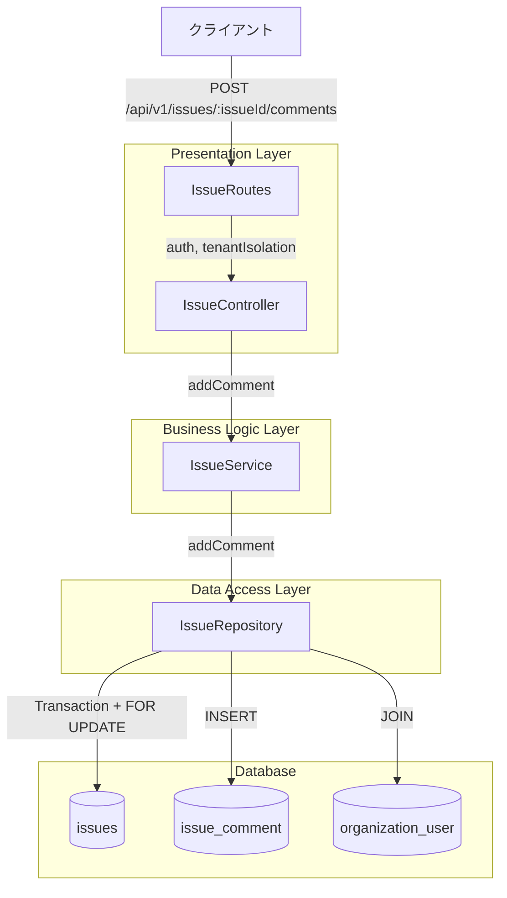
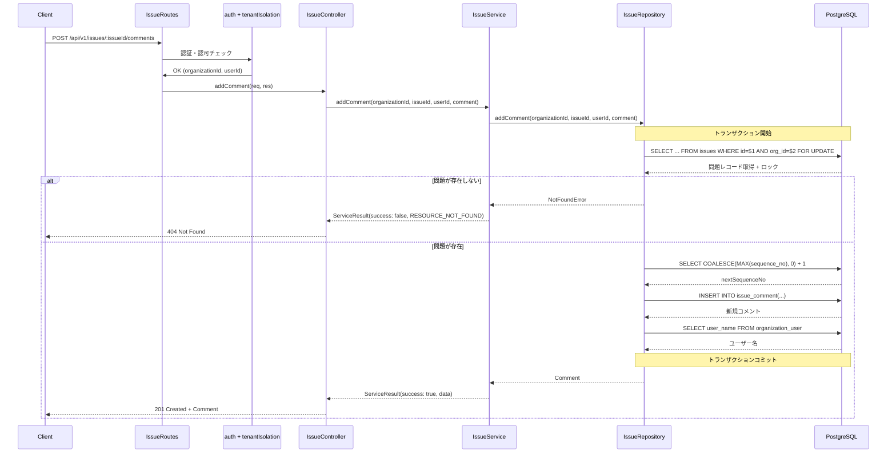
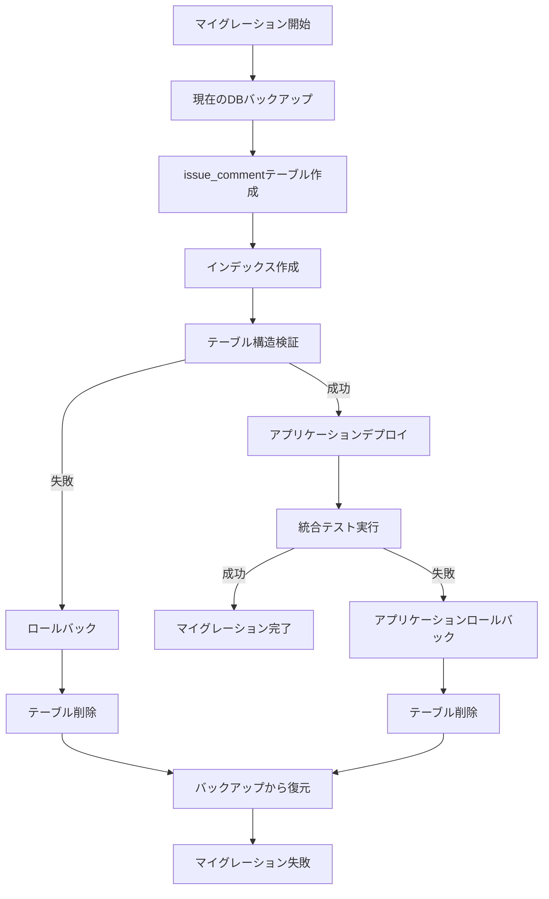

# 技術設計書: 問題コメント投稿API

---
**機能**: `issue-comment-post-api`  
**バージョン**: 1.0.0  
**作成日**: 2026-02-04  
**ステータス**: Design Phase
---

## Overview

**Purpose**: 実験作業中に発生した問題に対して、チームメンバー間でコミュニケーションを行うためのコメント投稿機能を提供します。

**Users**: 
- **実験作業者（Worker）**: 問題に対するコメントを投稿し、他のメンバーと情報を共有
- **実験管理者（Manager）**: 問題の解決に向けた指示や情報をコメントで提供
- **システム管理者（Admin）**: 全組織の問題コメントを閲覧・管理

**Impact**: 
既存の問題管理システムに対話機能を追加することで、問題の解決プロセスを効率化します。コメント履歴により、問題解決の経緯を追跡可能にします。

### Goals
- 問題に対するコメントの投稿機能を実装
- コメント投稿者と投稿日時を記録
- シーケンス番号によるコメントの順序管理
- マルチテナント分離を保証
- 既存の問題管理APIとの統合

### Non-Goals
- コメントの編集・削除機能（将来の拡張として検討）
- コメントへのリアクション機能（いいね、絵文字等）
- コメントの通知機能（別機能で実装）
- ファイル添付機能

## Architecture

### Existing Architecture Analysis

**現状**: 
- 問題管理API（issues）は実装済み（`POST /api/v1/issues`等）
- コメント投稿エンドポイントのルート・コントローラー層は実装済み（モック状態）
- サービス層の`addComment`メソッドはモック実装
- `issue_comment`テーブルは未作成

**統合方針**:
- 既存のIssueServiceクラスにコメント機能を追加
- ServiceResult形式の統一レスポンスを継承
- トランザクション管理パターンを踏襲
- organization_idによるマルチテナント分離を維持

**技術的制約**:
- PostgreSQLのACID特性を活用したトランザクション管理
- FOR UPDATEによる排他制御（シーケンス番号の一意性保証）
- Parameterized Queriesによるセキュリティ対策必須

### Architecture Pattern & Boundary Map



**Architecture Integration**:
- **Selected pattern**: Layered Architecture（既存パターン維持）
- **Domain boundaries**: Issue管理ドメイン内でのComment機能追加（境界変更なし）
- **Existing patterns preserved**: ServiceResult形式、トランザクション管理、マルチテナント分離
- **New components rationale**: issue_commentテーブルのみ新規追加（正規化と拡張性のため）
- **Steering compliance**: DRY原則、SOLID原則、セキュリティベストプラクティスを遵守

### Technology Stack

| Layer | Choice / Version | Role in Feature | Notes |
|-------|------------------|-----------------|-------|
| Backend / Services | Node.js 18+, TypeScript | ビジネスロジック実装 | 既存スタック |
| Backend Framework | Express.js | APIエンドポイント提供 | 既存スタック |
| Data / Storage | PostgreSQL 14+ | コメントデータ永続化 | 既存スタック |
| Authentication | JWT + express-session | 認証・認可 | 既存実装を利用 |
| Validation | express-validator | リクエストバリデーション | 既存パターン |
| Testing | Jest, Supertest | ユニット・統合テスト | 既存スタック |

## System Flows

### コメント投稿フロー



**フロー決定**:
- トランザクション内でFOR UPDATEを使用してデッドロックを回避
- ユーザー名は最後に取得（トランザクションスコープの最小化）
- エラー時は自動ロールバック

## Components and Interfaces

| Component | Domain/Layer | Intent | Req Coverage | Key Dependencies | Contracts |
|-----------|--------------|--------|--------------|------------------|-----------|
| IssueRoutes | Presentation | エンドポイント定義とバリデーション | REQ-001, REQ-002 | Express Router | API |
| IssueController | Presentation | リクエスト処理とレスポンス生成 | REQ-001, REQ-002, REQ-003 | IssueService | - |
| IssueService | Business Logic | コメント追加のビジネスロジック | REQ-001, REQ-002, REQ-004 | IssueRepository | Service |
| IssueRepository | Data Access | データベースアクセスと永続化 | REQ-001, REQ-002, REQ-005 | PostgreSQL | - |

### Business Logic Layer

#### IssueService.addComment

| Field | Detail |
|-------|--------|
| Intent | 問題に対するコメント追加のビジネスロジックを実行 |
| Requirements | REQ-001, REQ-002, REQ-004 |

**Responsibilities & Constraints**
- コメント内容のバリデーション（1-2000文字）
- 問題の存在確認
- マルチテナント分離の保証
- ServiceResult形式でのレスポンス返却

**Dependencies**
- Inbound: IssueController.addComment — Controller層からの呼び出し (P0)
- Outbound: IssueRepository.addComment — データアクセス層への委譲 (P0)

**Contracts**: Service [x]

##### Service Interface

```typescript
interface IssueService {
  /**
   * コメントを追加する（Controller層用）
   * @param organizationId 組織ID（マルチテナント分離）
   * @param issueId 問題ID
   * @param userId コメント投稿者のユーザーID
   * @param comment コメント内容（1-2000文字）
   * @returns ServiceResult<CommentResponse>
   */
  addComment(
    organizationId: string,
    issueId: string,
    userId: string,
    comment: string
  ): Promise<ServiceResult<CommentResponse>>;
}

interface CommentResponse {
  projectId: string;
  issueId: string;
  sequenceNo: number;
  comment: string;
  authorId: string;
  authorName: string;
  commentedAt: string;
}

interface ServiceResult<T> {
  success: boolean;
  data?: T;
  error?: {
    code: string;
    message: string;
    details?: any;
    originalError?: Error;
  };
}
```

**Preconditions**:
- organizationId, issueId, userId, commentは全て非null
- commentは1-2000文字の範囲内
- ユーザーはWorker以上の権限を持つ

**Postconditions**:
- コメントがissue_commentテーブルに追加される
- シーケンス番号が正しく採番される
- ユーザー名を含むレスポンスが返却される

**Invariants**:
- 同一問題内のシーケンス番号は一意かつ連続
- organization_idによるテナント分離を維持

**Implementation Notes**
- **Integration**: 既存のIssueServiceクラスのaddCommentメソッドをモックから実装版に置き換え
- **Validation**: コメント文字列長チェック（空文字、2000文字超過）
- **Risks**: 並行アクセス時のシーケンス番号競合（FOR UPDATEで対策）

### Data Access Layer

#### IssueRepository.addComment

| Field | Detail |
|-------|--------|
| Intent | コメントをデータベースに永続化 |
| Requirements | REQ-001, REQ-002, REQ-005 |

**Responsibilities & Constraints**
- トランザクション管理（BEGIN - COMMIT/ROLLBACK）
- FOR UPDATEによる排他制御
- シーケンス番号の自動採番
- ユーザー名の取得

**Dependencies**
- Inbound: IssueService.addComment — サービス層からの呼び出し (P0)
- Outbound: PostgreSQL — データベース (P0)

**Contracts**: Service [x]

##### Service Interface

```typescript
interface IssueRepository {
  /**
   * コメントを追加する
   * @param organizationId 組織ID（マルチテナント分離）
   * @param issueId 問題ID（UUID）
   * @param userId コメント投稿者のユーザーID（UUID）
   * @param comment コメント内容
   * @returns Comment（ユーザー名を含む）
   * @throws NotFoundError 問題が存在しない、または自組織に属さない場合
   */
  addComment(
    organizationId: string,
    issueId: string,
    userId: string,
    comment: string
  ): Promise<Comment>;
}

interface Comment {
  projectId: string;
  issueId: string;
  sequenceNo: number;
  comment: string;
  authorId: string;
  authorName: string;
  commentedAt: string;
}
```

**Implementation Notes**
- **Transaction**: BEGIN - FOR UPDATE - INSERT - COMMIT パターン
- **Lock Strategy**: SELECT ... FOR UPDATE on issues table
- **Sequence Generation**: COALESCE(MAX(sequence_no), 0) + 1
- **Error Recovery**: 自動ロールバック（PostgreSQLのACID特性）

## Data Models

### Physical Data Model

#### issue_comment テーブル

```sql
CREATE TABLE issue_comment (
    organization_id UUID NOT NULL,
    project_id UUID NOT NULL,
    issue_id UUID NOT NULL,
    sequence_no INTEGER NOT NULL,
    comment TEXT NOT NULL,
    author_id UUID NOT NULL,
    commented_at TIMESTAMP NOT NULL DEFAULT CURRENT_TIMESTAMP,
    create_user_id UUID NOT NULL,
    create_at TIMESTAMP NOT NULL DEFAULT CURRENT_TIMESTAMP,
    update_user_id UUID NOT NULL,
    update_at TIMESTAMP NOT NULL DEFAULT CURRENT_TIMESTAMP,
    
    -- 主キー（組織ID + 問題ID + シーケンス番号）
    PRIMARY KEY (organization_id, issue_id, sequence_no),
    
    -- 外部キー制約
    CONSTRAINT fk_issue_comment_organization 
        FOREIGN KEY (organization_id) 
        REFERENCES organization(organization_id) 
        ON DELETE CASCADE,
    
    CONSTRAINT fk_issue_comment_issue 
        FOREIGN KEY (issue_id) 
        REFERENCES issues(id) 
        ON DELETE CASCADE,
    
    CONSTRAINT fk_issue_comment_author 
        FOREIGN KEY (author_id) 
        REFERENCES organization_user(organization_user_id) 
        ON DELETE CASCADE,
    
    -- チェック制約
    CONSTRAINT chk_issue_comment_sequence_no 
        CHECK (sequence_no > 0),
    
    CONSTRAINT chk_issue_comment_comment_length 
        CHECK (LENGTH(comment) >= 1 AND LENGTH(comment) <= 2000)
);

-- インデックス
CREATE INDEX idx_issue_comment_issue_id 
    ON issue_comment(organization_id, issue_id, sequence_no);

CREATE INDEX idx_issue_comment_author 
    ON issue_comment(author_id);

CREATE INDEX idx_issue_comment_commented_at 
    ON issue_comment(commented_at DESC);
```

**Structure Definition**:
- **Primary Key**: (organization_id, issue_id, sequence_no) - マルチテナント分離と順序保証
- **Cardinality**: Issue 1 : N Comment
- **Attributes**:
  - `organization_id`: 組織ID（マルチテナント分離）
  - `project_id`: プロジェクトID（非正規化、パフォーマンス最適化）
  - `issue_id`: 問題ID
  - `sequence_no`: シーケンス番号（1から開始、連番）
  - `comment`: コメント内容（1-2000文字）
  - `author_id`: 投稿者のユーザーID
  - `commented_at`: 投稿日時
  - `create_user_id`, `create_at`, `update_user_id`, `update_at`: 監査証跡

**Consistency & Integrity**:
- **Transaction boundaries**: コメント登録は単一トランザクション内で完結
- **Cascading rules**: 
  - 問題削除時 → コメントも自動削除（CASCADE）
  - ユーザー削除時 → コメントも自動削除（CASCADE）
- **Temporal aspects**: commented_at で投稿時刻を記録、update_atで更新時刻を記録

**Indexes and Performance**:
- 複合インデックス `(organization_id, issue_id, sequence_no)`: コメント一覧取得の高速化
- インデックス `(author_id)`: ユーザー別コメント検索
- インデックス `(commented_at DESC)`: 時系列ソート

### Data Contracts & Integration

#### API Data Transfer

**Request Schema**:
```typescript
interface AddCommentRequest {
  comment: string; // 1-2000文字、必須
}
```

**Response Schema**:
```typescript
interface AddCommentResponse {
  success: true;
  data: {
    projectId: string;       // UUID
    issueId: string;         // UUID
    sequenceNo: number;      // 正の整数
    comment: string;         // 投稿されたコメント
    authorId: string;        // UUID
    authorName: string;      // 投稿者名
    commentedAt: string;     // ISO 8601形式
  };
  meta: {
    timestamp: string;       // ISO 8601形式
    requestId: string;       // UUID
  };
}
```

**Validation Rules**:
- `comment`: 必須、文字列型、1-2000文字
- `issueId` (パスパラメータ): UUID形式
- `organization_id` (リクエストヘッダー): UUID形式（ミドルウェアで自動設定）

## Error Handling

### Error Strategy

コメント投稿APIは以下のエラーカテゴリに従って統一的なエラーハンドリングを実装します。

### Error Categories and Responses

**User Errors (4xx)**:

| Error Code | HTTP Status | Condition | Response |
|-----------|-------------|-----------|----------|
| VALIDATION_REQUIRED_FIELD | 400 | commentが空または未指定 | `{ field: "comment", message: "commentは必須です" }` |
| VALIDATION_INVALID_FORMAT | 400 | issueIdがUUID形式でない | `{ field: "issueId", message: "UUID形式が必要です" }` |
| VALIDATION_STRING_LENGTH | 400 | commentが2000文字超過 | `{ field: "comment", message: "2000文字以内で入力してください" }` |
| AUTH_TOKEN_INVALID | 401 | JWTトークンが無効 | `認証が必要です` |
| PERMISSION_INSUFFICIENT | 403 | Worker権限未満 | `この操作を実行する権限がありません` |
| RESOURCE_NOT_FOUND | 404 | 問題が存在しない、または自組織に属さない | `問題が見つかりません、または自組織に属していません` |

**System Errors (5xx)**:

| Error Code | HTTP Status | Condition | Response |
|-----------|-------------|-----------|----------|
| SYSTEM_DATABASE_ERROR | 500 | データベース接続エラー | `データベースエラーが発生しました` |
| SYSTEM_ERROR | 500 | その他の予期しないエラー | `システムエラーが発生しました` |

**Error Response Format**:
```typescript
{
  success: false,
  error: {
    code: "VALIDATION_STRING_LENGTH",
    message: "commentは2000文字以内で入力してください",
    details: [
      {
        field: "comment",
        message: "2000文字以内で入力してください",
        code: "STRING_LENGTH_EXCEEDED"
      }
    ]
  },
  meta: {
    timestamp: "2026-02-04T14:30:00.000Z",
    requestId: "req_abc123"
  }
}
```

### Monitoring

**Error Tracking**:
- Winston構造化ログによる記録
- エラー発生時のコンテキスト情報（organizationId, userId, issueId, requestId）
- スタックトレースの記録（本番環境では非公開）

**Logging Strategy**:
```typescript
logError('Issue addComment error', error, {
  action: 'issue_addComment',
  organizationId: req.user?.organizationId,
  issueId: req.params.issueId,
  requestId,
});
```

**Health Monitoring**:
- エラー率のメトリクス収集
- レスポンスタイムの監視
- データベーストランザクション失敗率の追跡

## Testing Strategy

### Unit Tests

**IssueService.addComment**:
1. 正常系: 有効なコメントを追加し、ServiceResult(success: true)を返す
2. 異常系: 空のコメントでValidationErrorをスロー
3. 異常系: 2000文字超過のコメントでValidationErrorをスロー
4. 異常系: 存在しない問題IDでNotFoundErrorをスロー
5. 異常系: 他組織の問題IDでNotFoundErrorをスロー

**IssueRepository.addComment**:
1. 正常系: トランザクション内でコメントを挿入し、ユーザー名を取得
2. シーケンス番号: 既存コメントがない場合sequence_no=1
3. シーケンス番号: 既存コメントがある場合MAX(sequence_no)+1
4. ロック機能: FOR UPDATEによる排他制御を確認
5. ロールバック: エラー発生時のトランザクションロールバック

### Integration Tests

**POST /api/v1/issues/:issueId/comments**:
1. 正常系: Worker権限でコメント投稿成功（201 Created）
2. 正常系: Manager権限でコメント投稿成功（201 Created）
3. 認証: JWT無しで401 Unauthorized
4. 認可: Worker権限未満で403 Forbidden
5. バリデーション: 空のコメントで400 Bad Request
6. バリデーション: 2001文字のコメントで400 Bad Request
7. バリデーション: 不正なissueIdフォーマットで400 Bad Request
8. リソース: 存在しない問題IDで404 Not Found
9. テナント分離: 他組織の問題IDで404 Not Found
10. シーケンス: 複数コメント投稿でsequence_noが連番になることを確認

### Performance Tests

**並行書き込みテスト**:
1. 同一問題への10並行コメント投稿でデッドロックが発生しないことを確認
2. シーケンス番号の重複がないことを確認
3. レスポンスタイムが200ms以内であることを確認（P95）

**大量データテスト**:
1. 単一問題に対して1000件のコメント投稿が正常に完了することを確認
2. コメント一覧取得のレスポンスタイムが500ms以内であることを確認（インデックス効果の検証）

## Security Considerations

### Threat Modeling

**脅威シナリオ**:
1. **SQLインジェクション**: comment内容に悪意あるSQLコードを挿入
2. **XSS攻撃**: comment内容にJavaScriptコードを挿入
3. **クロステナントアクセス**: 他組織の問題にコメント投稿を試みる
4. **大量投稿攻撃**: 短時間に大量のコメントを投稿してシステムを圧迫

**Security Controls**:

| 脅威 | 対策 | 実装方法 |
|-----|------|---------|
| SQLインジェクション | Parameterized Queries | `$1`, `$2`プレースホルダー使用 |
| XSS攻撃 | 入力サニタイゼーション | フロントエンドでのエスケープ処理 |
| クロステナントアクセス | organization_idフィルタ | 全クエリにorganization_id条件追加 |
| 大量投稿攻撃 | レート制限 | API Gatewayレベルでの制限（将来実装） |

### Authentication and Authorization

**認証**:
- JWT + express-session ハイブリッド認証
- authミドルウェアで自動検証
- トークン有効期限: ロール別（Worker: 12時間、Manager: 24時間、Admin: 48時間）

**認可**:
- Worker以上の権限が必要（permissionCheckミドルウェア）
- organization_idによるテナント分離（tenantIsolationミドルウェア）

### Data Protection

**マルチテナント分離**:
- すべてのクエリにorganization_idフィルタを強制
- 外部キー制約によるデータ整合性保証
- トランザクション内でのテナント検証

**監査証跡**:
- すべてのコメントにcreate_user_id, create_atを記録
- 投稿者のauthor_idとcommented_atを記録
- CloudWatch Logsによるアクセスログ記録

## Migration Strategy

### データベースマイグレーション



**Phase 1: データベーススキーマ作成**
- issue_commentテーブル作成（マイグレーションスクリプト実行）
- インデックス作成
- 外部キー制約の設定
- 検証: テーブル構造の確認

**Phase 2: アプリケーションデプロイ**
- IssueService.addCommentの実装版デプロイ
- IssueRepository.addCommentの実装
- 統合テスト実行

**Rollback Triggers**:
- テーブル作成に失敗
- 外部キー制約エラー
- 統合テスト失敗

**Validation Checkpoints**:
1. テーブル作成後: `SELECT * FROM issue_comment LIMIT 1`
2. インデックス確認: `\d issue_comment`（PostgreSQL）
3. アプリケーションデプロイ後: ヘルスチェックエンドポイント確認
4. 統合テスト: コメント投稿の正常動作確認

## Supporting References

### SQL Implementation Example

**完全なトランザクション実装例**:
```sql
-- トランザクション開始
BEGIN;

-- 問題存在確認 + 排他ロック（デッドロック回避）
SELECT id, project_id 
FROM issues 
WHERE issue_id = $1 AND organization_id = $2 
FOR UPDATE;

-- 次のシーケンス番号を取得
SELECT COALESCE(MAX(sequence_no), 0) + 1 AS next_sequence_no
FROM issue_comment
WHERE issue_id = $1 AND organization_id = $2;

-- コメント登録
INSERT INTO issue_comment (
    organization_id,
    project_id,
    issue_id,
    sequence_no,
    comment,
    author_id,
    commented_at,
    create_user_id,
    create_at,
    update_user_id,
    update_at
) VALUES (
    $2,                    -- organization_id
    (SELECT project_id FROM issues WHERE issue_id = $1),
    $1,                    -- issue_id
    $3,                    -- sequence_no (計算済み)
    $4,                    -- comment
    $5,                    -- author_id (userId)
    NOW(),
    $5,                    -- create_user_id
    NOW(),
    $5,                    -- update_user_id
    NOW()
) RETURNING *;

-- ユー