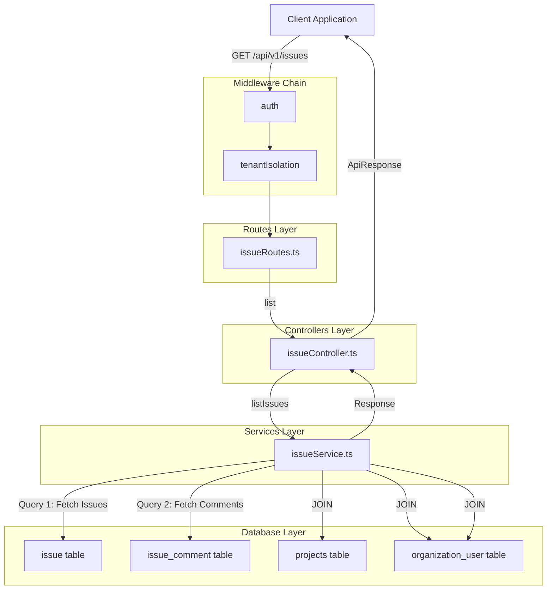

# Design Document: 問題一覧取得API

## Overview

本機能は、実験作業者画面における問題一覧取得APIのバックエンド実装を提供します。プロジェクト、メソッド、タスク、トランジション単位で発生した問題を取得し、関連するコメントを親子関係として含めて表示します。

**Purpose**: 実験作業者および実験管理者が、特定のプロジェクト・メソッド・タスク・トランジションに関連する問題とそのコメント履歴を効率的に確認できるようにすることで、問題の早期発見と解決を支援します。

**Users**: 
- **実験作業者（Worker）**: 自分が担当する実験で発生した問題を確認し、コメントのやり取りを追跡

**Impact**: 既存の問題管理システム（4エンドポイント実装済み）に問題一覧取得機能を追加することで、5エンドポイント中5エンドポイントが完全に実装され、問題管理機能が完成します。

### Goals

- プロジェクト・メソッド・タスク・トランジション単位での問題一覧取得を実現する
- 各問題に紐づくコメントを親子関係として効率的に取得する
- 問題対象種別（project/task/transition）に応じた柔軟なフィルタリングを提供する
- N+1問題を回避し、100件以下の問題を1秒以内に取得できるパフォーマンスを達成する
- マルチテナント分離を保証し、組織間のデータ漏洩を防止する
- 既存の問題管理APIと統一されたインターフェースを提供する

### Non-Goals

- ページネーション機能の実装（将来の拡張として検討）
- 問題のソート順序のカスタマイズ（created_at降順で固定）
- リアルタイム更新機能（WebSocket等）
- 問題の一括操作機能（一括削除、一括ステータス変更等）
- 高度な全文検索機能
- 問題報告API、コメント投稿API、問題詳細取得API、問題ステータス変更APIの実装（既に実装済み）

## Architecture

### Existing Architecture Analysis

本機能は既存の問題管理システムへの拡張として実装されます。

**Current Architecture Patterns**:
- レイヤードアーキテクチャ: Routes → Controllers → Services → Database
- ミドルウェアチェーン: auth → tenantIsolation
- 統一されたレスポンス形式: ApiResponse<T>型
- Parameterized Queriesによる安全なDB操作

**Existing Domain Boundaries**:
- 問題管理ドメイン（Issue Management）は既に確立
- issueRoutes.ts、issueController.ts、issueService.tsが存在
- 4つのエンドポイント（POST, POST comment, GET detail, PATCH status）が実装済み

**Integration Points**:
- 既存のミドルウェアチェーンを再利用
- 既存のエラーハンドリングパターンを踏襲
- 既存のデータベーステーブル（issue, issue_comment, projects, organization_user）を使用

**Technical Debt Addressed**:
- なし（既存実装は健全で、テスト103件すべてPASS）

### Architecture Pattern & Boundary Map

**Selected Pattern**: レイヤードアーキテクチャ（既存パターンの踏襲）

**Rationale**: 
- 既存の4エンドポイントと一貫性を保つ
- 保守性と可読性を維持
- 既存のテストフレームワークとの統合が容易



**Architecture Integration**:
- **Pattern**: 既存のレイヤードアーキテクチャを維持
- **Domain Boundaries**: 問題管理ドメイン内で完結（クロスドメイン依存なし）
- **Existing Patterns Preserved**: ミドルウェアチェーン、ApiResponse型、エラーハンドリング
- **New Components**: issueController.list()、issueService.listIssues()メソッドの追加のみ
- **Steering Compliance**: 既存のコーディング規約（.clinerules/）に完全準拠

### Technology Stack

| Layer | Choice / Version | Role in Feature | Notes |
|-------|------------------|-----------------|-------|
| Backend / API | Express.js 4.18.3 | ルーティングとミドルウェア処理 | 既存 |
| Backend / Language | Node.js 24+ / TypeScript | バックエンドロジック実装 | 既存 |
| Data / Storage | PostgreSQL 18+ | 問題・コメントデータの永続化 | 既存 |
| Authentication | JWT (jsonwebtoken) | API認証 | 既存ミドルウェア再利用 |
| Testing | Jest + Supertest | ユニット・統合テスト | 既存テストフレームワーク |
| Logging | Winston | 構造化ログ記録 | 既存 |

**Technology Alignment**: すべて既存の技術スタックを使用。新規依存関係の追加なし。

## Requirements Traceability

| Requirement | Summary | Components | Interfaces | Notes |
|-------------|---------|------------|------------|-------|
| 1 | 問題一覧の取得 | IssueService.listIssues, IssueController.list | GET /api/v1/issues | 2段階クエリでコメントも取得 |
| 2 | 問題対象種別に基づくフィルタリング | IssueService.listIssues | - | issue_targetによる条件分岐 |
| 3 | 入力パラメータのバリデーション | IssueController.list | - | express-validator使用 |
| 4 | 認証と認可 | auth, tenantIsolation, permissionCheck | - | 既存ミドルウェア再利用 |
| 5 | マルチテナント分離 | IssueService.listIssues | - | すべてのクエリでorganization_id |
| 6 | レスポンス形式の統一 | IssueController.list | ApiResponse<T> | 既存型を使用 |
| 7 | パフォーマンス | IssueService.listIssues | - | JOINクエリ、N+1問題回避 |
| 8 | エラーハンドリング | IssueController.list, errorHandler | - | 統一されたエラーレスポンス |
| 9 | セキュリティ | 全コンポーネント | - | Parameterized Queries |

## Components and Interfaces

### Summary Table

| Component | Domain/Layer | Intent | Req Coverage | Key Dependencies (P0/P1) | Contracts |
|-----------|--------------|--------|--------------|--------------------------|-----------|
| IssueRoutes.list | Routes | GET /api/v1/issuesのルート定義 | 4 | auth(P0), tenantIsolation(P0), permissionCheck(P0) | API |
| IssueController.list | Controllers | リクエスト検証とレスポンス変換 | 1, 3, 6, 8 | IssueService(P0), express-validator(P0) | API, Service |
| IssueService.listIssues | Services | ビジネスロジックとDB操作 | 1, 2, 5, 7 | PostgreSQL(P0) | Service |

### Backend / Routes Layer

#### IssueRoutes.list

| Field | Detail |
|-------|--------|
| Intent | GET /api/v1/issuesエンドポイントのルート定義とミドルウェアチェーン適用 |
| Requirements | 4 |

**Responsibilities & Constraints**:
- ミドルウェアチェーン（auth → tenantIsolation）の適用
- コントローラーメソッドへのリクエストルーティング

**Dependencies**:
- Inbound: Express Router (P0)
- Outbound: IssueController.list (P0)
- External: auth, tenantIsolation ミドルウェア (P0)

**Contracts**: API [x]

##### API Contract

| Method | Endpoint | Request | Response | Errors |
|--------|----------|---------|----------|--------|
| GET | /api/v1/issues | Query Parameters | IssueListResponse | 400, 401, 403, 500 |

**Query Parameters**:
```typescript
interface IssueListQuery {
  project_id: string;      // UUID形式（必須）
  method_id: string;       // 空文字列不可（必須）
  task_no: number;         // 正の整数（必須）
  transition_id: string;   // 空文字列不可（必須）
}
```

**Response**:
```typescript
interface IssueListResponse {
  success: true;
  data: IssueWithComments[];
  meta: {
    timestamp: string;
    requestId: string;
  };
}

interface IssueWithComments {
  id: string;
  issueType: string;
  targetType: 'project' | 'task' | 'transition';
  projectId: string;
  projectName: string;
  methodId: string;
  taskNo: number | null;
  transitionId: string | null;
  title: string;
  contents: string;
  status: 'unresolved' | 'resolved';
  reportedBy: string;
  reportedByName: string;
  reportedAt: string;
  completedBy: string | null;
  completedByName: string | null;
  completedAt: string | null;
  comments: IssueComment[];
}

interface IssueComment {
  sequenceNo: number;
  comment: string;
  authorId: string;
  authorName: string;
  commentedAt: string;
}
```

**Implementation Notes**:
- **Integration**: issueRoutes.tsに新規ルート定義を追加
- **Validation**: 
  - express-validatorのquery()でバリデーションルールを定義
  - handleValidationErrorsミドルウェア（backend/src/middleware/validationMiddleware.ts）でエラー処理
  - ミドルウェアチェーン: auth → tenantIsolation → [validation rules] → handleValidationErrors → controller
- **Risks**: なし（既存パターンの踏襲）

### Backend / Controllers Layer

#### IssueController.list

| Field | Detail |
|-------|--------|
| Intent | リクエスト検証、サービス層呼び出し、レスポンス変換 |
| Requirements | 1, 3, 6, 8 |

**Responsibilities & Constraints**:
- クエリパラメータのバリデーション
- IssueService.listIssuesの呼び出し
- 統一されたApiResponse形式へのレスポンス変換
- エラーハンドリング

**Dependencies**:
- Inbound: IssueRoutes (P0)
- Outbound: IssueService.listIssues (P0)
- External: express-validator (P0), Winston logger (P1)

**Contracts**: Service [x]

##### Service Interface

```typescript
class IssueController {
  async list(req: Request, res: Response, next: NextFunction): Promise<void>;
}
```

**Preconditions**:
- req.organizationIdが設定されている（tenantIsolationミドルウェアによる）
- req.userが設定されている（authミドルウェアによる）
- クエリパラメータがバリデーション済み

**Postconditions**:
- 成功時: 200 OK、ApiResponse<IssueWithComments[]>形式でレスポンス
- エラー時: 適切なHTTPステータスコードとエラーレスポンス

**Invariants**:
- レスポンスは必ずApiResponse<T>形式
- エラーは必ずnext()に渡される

**Implementation Notes**:
- **Integration**: issueController.tsに新規メソッドを追加
- **Validation**: 
  - バリデーションはルート層で実施済み（handleValidationErrorsミドルウェア）
  - コントローラー内でvalidationResult()を使用しない
  - バリデーションエラーは自動的に400レスポンスで返却される
- **Error Handling**:
  - サービス層のエラーはnext()に渡して統一的に処理
  - 成功時は200 OK、ApiResponse<IssueWithComments[]>形式でレスポンス
- **Risks**: なし（既存パターンの踏襲）

### Backend / Services Layer

#### IssueService.listIssues

| Field | Detail |
|-------|--------|
| Intent | 問題一覧とコメントのDB取得、データ結合 |
| Requirements | 1, 2, 5, 7 |

**Responsibilities & Constraints**:
- issue_targetに基づく動的フィルタリング
- 2段階クエリによる問題とコメントの取得
- N+1問題の回避
- マルチテナント分離の保証
- データの親子関係構築

**Dependencies**:
- Inbound: IssueController.list (P0)
- Outbound: PostgreSQL database (P0)
- External: pg Pool (P0)

**Contracts**: Service [x]

##### Service Interface

```typescript
interface IssueService {
  listIssues(
    organizationId: string,
    filters: IssueListFilters
  ): Promise<IssueWithComments[]>;
}

interface IssueListFilters {
  projectId: string;
  methodId: string;
  taskNo: number;
  transitionId: string;
  status?: string;
  issueType?: string;
}
```

**Preconditions**:
- organizationIdが有効なUUID
- filters.projectIdが有効なUUID
- filters.taskNoが正の整数

**Postconditions**:
- 問題一覧がcreated_at降順でソート
- 各問題のcommentsがsequence_no昇順でソート
- すべてのデータがorganization_idでフィルタ済み

**Invariants**:
- すべてのDBクエリでorganization_idフィルタ適用
- Parameterized Queriesの使用

**Implementation Notes**:
- **Integration**: issueService.tsに新規メソッドを追加
- **Validation**: 
  - Query 1: 問題一覧を取得（JOINでprojects, organization_user）
  - Query 2: コメントを一括取得（IN句使用、JOINでorganization_user）
  - アプリケーション層でissue_idをキーにコメントをグループ化
- **Risks**: 
  - 問題件数が増加した場合のメモリ使用量（現状100件以下で問題なし）
  - issue_target条件分岐の複雑性（十分なテストでカバー）

## Data Models

### Logical Data Model

本機能は既存のデータベーススキーマを使用し、新規テーブルの作成は不要です。

**使用するテーブル**:

1. **issue** (主テーブル)
   - organization_id, project_id, issue_id, method_id, task_no, transition_id
   - issue_target, issue_type, issue_title, issue_contents, status
   - issue_reporter_id, issue_report_at, issue_completer_id, issue_complate_at
   - create_at, update_at

2. **issue_comment** (コメントテーブル)
   - organization_id, project_id, issue_id, sequence_no
   - comment, author_id, commented_at
   - create_at, update_at

3. **projects** (JOIN用)
   - project_id, organization_id, project_name

4. **organization_user** (JOIN用 - ユーザー名取得)
   - user_id, organization_id, user_name

**Relationships**:
- issue.organization_id → 全テーブルのorganization_id (マルチテナント分離)
- issue.project_id → projects.project_id
- issue.issue_reporter_id → organization_user.user_id
- issue_comment.issue_id → issue.issue_id
- issue_comment.author_id → organization_user.user_id

**Indexes** (既存):
- issue (organization_id, project_id, status)
- issue (organization_id, create_at)
- issue_comment (organization_id, issue_id, sequence_no)

### Data Contracts & Integration

**Query 1: 問題一覧取得**

```sql
SELECT 
  i.issue_id AS id,
  i.issue_type,
  i.issue_target AS target_type,
  i.project_id,
  p.project_name,
  i.method_id,
  i.task_no,
  i.transition_id,
  i.issue_title AS title,
  i.issue_contents AS contents,
  i.status,
  i.issue_reporter_id AS reported_by,
  ou1.user_name AS reported_by_name,
  i.issue_report_at AS reported_at,
  i.issue_completer_id AS completed_by,
  ou2.user_name AS completed_by_name,
  i.issue_complate_at AS completed_at,
  i.create_at AS created_at
FROM issue i
JOIN projects p ON i.project_id = p.project_id AND p.organization_id = i.organization_id
JOIN organization_user ou1 ON i.issue_reporter_id = ou1.user_id AND ou1.organization_id = i.organization_id
LEFT JOIN organization_user ou2 ON i.issue_completer_id = ou2.user_id AND ou2.organization_id = i.organization_id
WHERE i.organization_id = $1
  AND i.project_id = $2
  AND i.method_id = $3
  AND (
    (i.issue_target = 'project')
    OR (i.issue_target = 'task' AND i.task_no = $4)
    OR (i.issue_target = 'transition' AND i.transition_id = $5)
  )
  AND ($6::text IS NULL OR i.status = $6)
  AND ($7::text IS NULL OR i.issue_type = $7)
ORDER BY i.create_at DESC;
```

**Query 2: コメント一括取得**

```sql
SELECT 
  ic.issue_id,
  ic.sequence_no,
  ic.comment,
  ic.author_id,
  ou.user_name AS author_name,
  ic.commented_at
FROM issue_comment ic
JOIN organization_user ou ON ic.author_id = ou.user_id AND ou.organization_id = ic.organization_id
WHERE ic.issue_id = ANY($1)
  AND ic.organization_id = $2
ORDER BY ic.issue_id, ic.sequence_no ASC;
```

**Data Flow**:
1. Query 1で問題一覧を取得（project名、reporter名含む）
2. 取得した問題のissue_idを配列化
3. Query 2でコメントを一括取得（author名含む）
4. アプリケーション層でissue_idをキーにコメントをグループ化
5. 各問題のcommentsプロパティにコメント配列を設定

## Error Handling

### Error Strategy

本機能は既存のエラーハンドリングパターンを踏襲し、統一されたエラーレスポンス形式を使用します。

### Error Categories and Responses

**User Errors (4xx)**:

| Error Code | HTTP Status | Trigger | Response Message | Client Action |
|-----------|-------------|---------|-----------------|---------------|
| VALIDATION_ERROR | 400 | クエリパラメータ不正 | Validation failed | パラメータを修正して再送信 |
| AUTH_TOKEN_EXPIRED | 401 | JWTトークン期限切れ | Authentication token expired | 再ログイン |
| PERMISSION_INSUFFICIENT | 403 | 権限不足 | Insufficient permissions | 権限を確認 |
| RESOURCE_NOT_FOUND | 404 | プロジェクト不存在 | Project not found | プロジェクトIDを確認 |

**System Errors (5xx)**:

| Error Code | HTTP Status | Trigger | Response Message | Logging |
|-----------|-------------|---------|-----------------|---------|
| DATABASE_ERROR | 500 | DBクエリ失敗 | Internal server error | Error + Stack Trace |
| INTERNAL_ERROR | 500 | その他の例外 | Internal server error | Error + Stack Trace |

**Error Response Format**:

```typescript
interface ErrorResponse {
  success: false;
  error: {
    code: string;
    message: string;
    details?: Array<{
      field: string;
      message: string;
      code: string;
    }>;
  };
  meta: {
    timestamp: string;
    requestId: string;
  };
}
```

**Implementation**:
- すべてのエラーは`next(error)`に渡され、errorHandlerミドルウェアで処理
- Winstonで構造化ログに記録（エラーレベル、スタックトレース、コンテキスト情報）
- エラーメッセージに機密情報（DBスキーマ、内部パス）を含めない

### Monitoring

**Error Tracking**:
- すべてのエラーをWinston構造化ログで記録
- ログレベル: error（4xx）、error（5xx）
- コンテキスト情報: userId, organizationId, requestId, クエリパラメータ

**Health Monitoring**:
- API応答時間の監視（目標: 1秒以内）
- エラー率の監視（目標: 1%以下）
- データベース接続プールの監視

## Testing Strategy

### Unit Tests

**IssueService.listIssues**:
- issue_targetが'project'の場合、project_idのみで一致判定
- issue_targetが'task'の場合、project_id + method_id + task_noで一致判定
- issue_targetが'transition'の場合、project_id + method_id + transition_idで一致判定
- オプショナルフィルタ（status, issue_type）が正しく適用される
- コメントが正しく親子関係として構築される
- organization_idフィルタが常に適用される
- created_at降順、sequence_no昇順のソートが正しく動作する

**IssueController.list**:
- バリデーションエラーが適切に処理される（400エラー）
- サービス層のエラーが適切に処理される（500エラー）
- 成功時にApiResponse形式でレスポンスが返される

### Integration Tests

**GET /api/v1/issues エンドポイント**:
- 認証なしでアクセスした場合、401エラーを返す
- Worker未満の権限でアクセスした場合、403エラーを返す
- 必須パラメータが欠けている場合、400エラーを返す
- 不正なUUID形式のproject_idの場合、400エラーを返す
- task_noが正の整数でない場合、400エラーを返す
- 存在しないプロジェクトの場合、空配列を返す（404ではない）
- 正常なリクエストの場合、問題一覧とコメントを返す
- 他組織のプロジェクトIDを指定した場合、空配列を返す
- statusフィルタが正しく動作する
- issue_typeフィルタが正しく動作する

### Performance Tests

**Response Time**:
- 問題10件、コメント50件の場合、500ms以内にレスポンス
- 問題100件、コメント500件の場合、1秒以内にレスポンス

**Database Query Optimization**:
- クエリ実行回数が2回のみ（問題一覧 + コメント一括取得）
- N+1問題が発生しないことを確認

**Memory Usage**:
- 問題100件、コメント500件の場合、メモリ使用量が100MB以下

### Test Coverage Target

- **Line Coverage**: 80%以上
- **Branch Coverage**: 75%以上
- **Critical Paths**: 100%（認証、マルチテナント分離、issue_target条件分岐）
