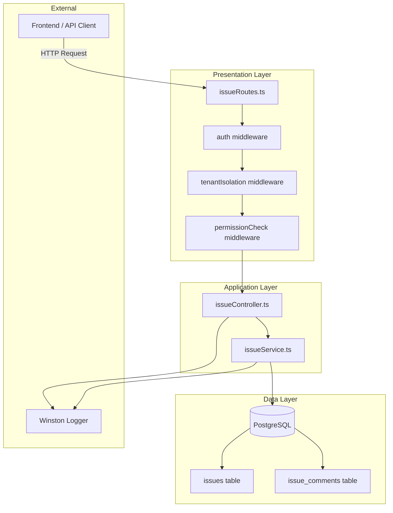
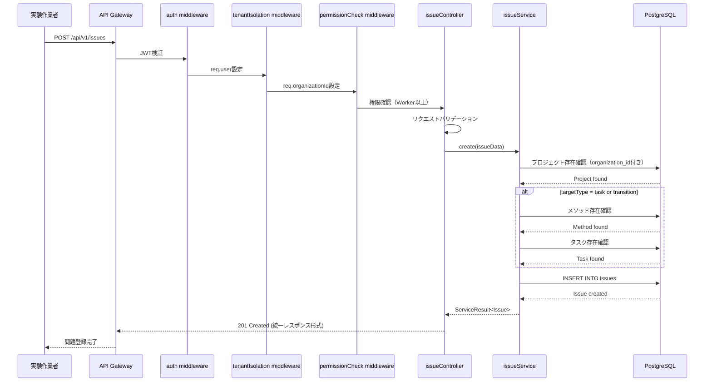
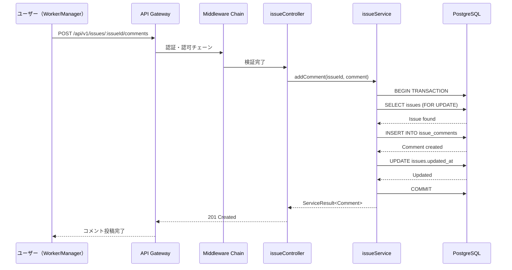
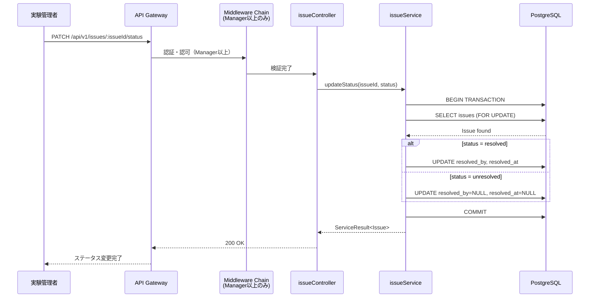

# Design Document: 問題報告バックエンド機能

## Overview

本機能は、実験作業者が実験中に遭遇する問題を報告するためのバックエンドAPI機能を提供します。プロジェクト、タスク、トランジション単位で問題を記録し、コメントによるディスカッション、ステータス管理を通じて迅速な問題対応を実現します。

**Purpose**: 実験プロセスの透明性向上と問題の早期発見・対応を実現するため、構造化された問題報告・管理機能を提供する。

**Users**: 
- 実験作業者（Worker）: 問題報告、コメント投稿、一覧閲覧
- 実験管理者（Manager）: 上記 + ステータス変更、コメント投稿、一覧閲覧
- システム管理者（Admin）: 全権限

**Impact**: 既存のプロジェクト管理機能に問題管理機能を統合し、実験ワークフローの可視化と品質管理を強化する。

### Goals
- 実験作業者が問題を3レベル（プロジェクト、タスク、トランジション）で報告可能
- 問題種別を9カテゴリで分類し、統計分析を容易化
- コメント機能によるチーム内コミュニケーション促進
- Manager以上によるステータス管理で問題解決フローを確立
- マルチテナント分離により組織間のデータ安全性を保証

### Non-Goals
- リアルタイム通知機能（将来的な拡張として検討）
- 問題の自動エスカレーション（Phase 2で検討）
- 外部システムとの統合（Slack, Emailなど）
- 問題解決のワークフロー自動化

## Architecture

### Existing Architecture Analysis

本プロジェクトでは以下の既存アーキテクチャパターンが確立されています：

**Controller-Service-Repository パターン**:
```
HTTP Request
  ↓
Routes (issueRoutes.ts)
  ↓
Middleware Chain:
  1. auth (JWT認証)
  2. tenantIsolation (マルチテナント分離)
  3. permissionCheck (権限チェック)
  ↓
Controller (issueController.ts)
  - リクエストバリデーション
  - レスポンス形成
  - エラーハンドリング
  ↓
Service (issueService.ts)
  - ビジネスロジック
  - トランザクション管理
  - データ整合性チェック
  ↓
Direct Query / Repository
  - データベースアクセス
  - Parameterized Queries
  ↓
PostgreSQL Database
```

**統一レスポンス形式**:
```typescript
{
  success: boolean;
  data?: T;
  error?: { code: string; message: string; details?: any[] };
  meta: { timestamp: string; requestId: string };
  pagination?: { page, limit, totalItems, totalPages, hasNext, hasPrev }
}
```

### Architecture Pattern & Boundary Map



**Architecture Integration**:
- **Selected pattern**: Layered Architecture（レイヤードアーキテクチャ）
- **Domain/feature boundaries**: 問題管理機能はプロジェクト管理ドメインのサブモジュールとして配置
- **Existing patterns preserved**: Controller-Service-Repository、Middleware Chain、統一レスポンス形式
- **New components rationale**: 
  - issueController: 問題管理の入口としてHTTPリクエストを処理
  - issueService: 問題登録・更新のビジネスロジックを集約
  - 直接クエリ: 複雑なJOIN操作のため、Repositoryパターンではなく直接クエリを使用
- **Steering compliance**: プロジェクト標準のアーキテクチャパターンに完全準拠

### Technology Stack

| Layer | Choice / Version | Role in Feature | Notes |
|-------|------------------|-----------------|-------|
| Backend / API | Express.js 4.18.3 | HTTP APIサーバー | 既存スタック |
| Backend / Language | TypeScript 5.x | 型安全な実装 | 既存スタック |
| Backend / Auth | jsonwebtoken 9.0.2 | JWT認証 | 既存スタック |
| Data / Database | PostgreSQL 16+ | リレーショナルデータ永続化 | 既存スタック |
| Data / Query | Parameterized Queries | SQLインジェクション対策 | セキュリティ必須 |
| Logging | Winston 3.11.0 | 構造化ログ | 既存スタック |
| Testing | Jest 29.x | ユニット・統合テスト | 既存スタック |

## System Flows

### Problem Report Flow (問題報告フロー)



**Key Decisions**:
- バリデーションはController層で実行（早期エラー検出）
- ビジネスロジック（存在確認、整合性チェック）はService層で実行
- トランザクションは不要（単一INSERT操作）

### Comment Addition Flow (コメント投稿フロー)



**Key Decisions**:
- トランザクションを使用（問題の更新日時更新を含むため）
- FOR UPDATEで排他ロック（同時コメント投稿時の整合性保証）
- ユーザー名はJOINで取得（レスポンスに含める）

### Status Update Flow (ステータス変更フロー)



**Key Decisions**:
- Manager以上のみ実行可能（permissionCheckで制限）
- resolvedByとresolvedAtは自動設定（監査証跡）
- unresolvedへの変更も可能（巻き戻し対応）

## Requirements Traceability

| Requirement | Summary | Components | Interfaces | Flows |
|-------------|---------|------------|------------|-------|
| 1 | 問題報告機能 | issueController.create, issueService.create | POST /api/v1/issues | Problem Report Flow |
| 1.1-1.9 | 問題報告の詳細仕様（AC1-9） | issueService.create | - | Problem Report Flow |
| 2 | セキュリティとマルチテナント分離 | auth, tenantIsolation middleware | All endpoints | All flows |
| 2.1-2.8 | セキュリティの詳細仕様 | auth, tenantIsolation, issueService | - | All flows |
| 3 | データ検証とエラーハンドリング | issueController, issueService | All endpoints | All flows |
| 3.1-3.11 | バリデーションの詳細仕様 | issueController, errorHandler | - | All flows |
| 4 | 権限管理 | permissionCheck middleware | All endpoints | All flows |
| 4.1-4.2 | 権限管理の詳細仕様 | permissionCheck | - | All flows |
| 5 | パフォーマンスとスケーラビリティ | Database indexes | - | - |
| 5.1-5.3 | パフォーマンスの詳細仕様 | PostgreSQL indexes | - | - |
| 6 | APIレスポンス形式 | issueController, errorHandler | All endpoints | All flows |
| 6.1-6.7 | レスポンス形式の詳細仕様 | issueController | - | All flows |

## Components and Interfaces

### Component Summary

| Component | Domain/Layer | Intent | Req Coverage | Key Dependencies (Criticality) | Contracts |
|-----------|--------------|--------|--------------|--------------------------------|-----------|
| issueRoutes | Routes | HTTP routing | All | Express Router (P0), Middleware Chain (P0) | API |
| auth middleware | Middleware | JWT authentication | 2 | jsonwebtoken (P0) | Service |
| tenantIsolation middleware | Middleware | Multi-tenant isolation | 2 | - | Service |
| permissionCheck middleware | Middleware | RBAC | 4 | - | Service |
| issueController | Controller | Request/Response handling | 1,3,6 | issueService (P0), Logger (P1) | API, Service |
| issueService | Service | Business logic | 1,2,3,5 | PostgreSQL Pool (P0), Logger (P1) | Service |
| errorHandler middleware | Middleware | Error formatting | 3,6 | Logger (P0) | Service |

### [Routes Layer]

#### issueRoutes

| Field | Detail |
|-------|--------|
| Intent | 問題管理APIのHTTPルーティングとミドルウェアチェーン適用 |
| Requirements | All |
| Owner / Reviewers | Backend Team |

**Responsibilities & Constraints**
- HTTP methodとパスのマッピング
- 適切なミドルウェアチェーンの適用
- Controller関数の呼び出し
- トランザクション境界: なし（Controller層に委譲）

**Dependencies**
- Inbound: Express Application - アプリケーション統合 (P0)
- Outbound: auth middleware - JWT認証 (P0)
- Outbound: tenantIsolation middleware - マルチテナント分離 (P0)
- Outbound: permissionCheck middleware - 権限チェック (P0)
- Outbound: issueController - リクエスト処理 (P0)

**Contracts**: API

**API Contract**:
```typescript
// Route definitions
POST   /api/v1/issues
POST   /api/v1/issues/:issueId/comments  
GET    /api/v1/issues
GET    /api/v1/issues/:issueId
PATCH  /api/v1/issues/:issueId/status
```

**Implementation File**: `backend/src/routes/issueRoutes.ts`

---

### [Middleware Layer]

#### auth Middleware

| Field | Detail |
|-------|--------|
| Intent | JWTトークン検証とユーザー情報抽出 |
| Requirements | 2 (Security) |
| Owner / Reviewers | Backend Team |

**Responsibilities**:
- JWTトークンの検証（jsonwebtoken使用）
- req.userへのユーザー情報格納
- 認証エラーハンドリング（401 Unauthorized）

**Implementation File**: `backend/src/middleware/auth.ts`

---

#### tenantIsolation Middleware

| Field | Detail |
|-------|--------|
| Intent | マルチテナント分離の保証 |
| Requirements | 2.1-2.8 (Multi-tenant Security) |
| Owner / Reviewers | Backend Team |

**Responsibilities**:
- req.user.organizationIdの取得
- req.organizationIdへの格納
- organization_id未設定時のエラー

**Service Contract**:
```typescript
interface Request {
  user?: {
    userId: string;
    organizationId: string;
    role: string;
  };
  organizationId?: string;
}
```

**Implementation File**: `backend/src/middleware/tenantIsolation.ts`

---

#### permissionCheck Middleware

| Field | Detail |
|-------|--------|
| Intent | ロールベースアクセス制御（RBAC） |
| Requirements | 4 (Authorization) |
| Owner / Reviewers | Backend Team |

**Responsibilities**:
- req.user.roleの検証
- 許可されたロールチェック
- 権限不足時のエラー（403 Forbidden）

**Service Contract**:
```typescript
function permissionCheck(allowedRoles: string[]): RequestHandler;

// Usage:
permissionCheck(['worker', 'manager', 'admin']) // Worker以上
permissionCheck(['manager', 'admin'])            // Manager以上
```

**Implementation File**: `backend/src/middleware/permissionCheck.ts`

---

### [Controller Layer]

#### issueController

| Field | Detail |
|-------|--------|
| Intent | 問題管理APIのリクエスト/レスポンス処理 |
| Requirements | 1, 3, 6 |
| Owner / Reviewers | Backend Team |

**Responsibilities**:
- リクエストパラメータのバリデーション
- issueServiceの呼び出し
- 統一レスポンス形式での返却
- HTTPステータスコードの設定
- ロギング

**Service Contract**:
```typescript
interface IssueController {
  create(req: Request, res: Response): Promise<void>;
  addComment(req: Request, res: Response): Promise<void>;
  list(req: Request, res: Response): Promise<void>;
  getById(req: Request, res: Response): Promise<void>;
  updateStatus(req: Request, res: Response): Promise<void>;
}
```

**Implementation File**: `backend/src/controllers/issueController.ts`

---

### [Service Layer]

#### issueService

| Field | Detail |
|-------|--------|
| Intent | 問題管理のビジネスロジック |
| Requirements | 1, 2, 3, 5 |
| Owner / Reviewers | Backend Team |

**Responsibilities**:
- ビジネスロジック実行
- データ整合性チェック（プロジェクト存在、メソッド存在、タスク存在）
- トランザクション管理
- Parameterized Queriesでのデータベースアクセス
- マルチテナント分離の保証（organization_idフィルタ）

**Service Contract**:
```typescript
interface IssueService {
  create(
    organizationId: string,
    userId: string,
    data: CreateIssueRequest
  ): Promise<ServiceResult<Issue>>;
  
  addComment(
    organizationId: string,
    issueId: string,
    userId: string,
    comment: string
  ): Promise<ServiceResult<IssueComment>>;
  
  list(
    organizationId: string,
    filters: IssueFilters,
    pagination: PaginationOptions
  ): Promise<ServiceResult<IssueListResponse>>;
  
  getById(
    organizationId: string,
    issueId: string
  ): Promise<ServiceResult<IssueDetail>>;
  
  updateStatus(
    organizationId: string,
    issueId: string,
    userId: string,
    status: 'unresolved' | 'resolved'
  ): Promise<ServiceResult<Issue>>;
}

interface ServiceResult<T> {
  success: boolean;
  data?: T;
  error?: {
    code: string;
    message: string;
    details?: any;
    originalError?: Error;
  };
}
```

**Implementation File**: `backend/src/services/issueService.ts`

---

## Data Models

### Issue (問題)

```typescript
interface Issue {
  // 識別情報
  id: string;                          // UUID
  organizationId: string;              // UUID
  projectId: string;                   // UUID
  methodId: string | null;             // メソッドID
  
  // 問題対象
  targetType: 'project' | 'task' | 'transition';
  taskNo: number | null;               // targetType='task'/'transition'の場合必須
  transitionId: string | null;         // targetType='transition'の場合必須
  
  // 問題内容
  issueType: IssueType;                // 問題種別
  title: string;                       // 1-200文字
  description: string;                 // 1-2000文字
  severity: 'low' | 'medium' | 'high' | 'critical'; // 重要度
  status: 'unresolved' | 'resolved';   // ステータス
  
  // 報告者情報
  reportedBy: string;                  // UUID
  reportedByName: string;              // 報告者名
  reportedAt: string;                  // ISO 8601
  
  // 解決者情報
  resolvedBy: string | null;           // UUID
  resolvedByName: string | null;       // 解決者名
  resolvedAt: string | null;           // ISO 8601
  
  // メタデータ
  commentCount: number;                // コメント数
  createdAt: string;                   // ISO 8601
  updatedAt: string;                   // ISO 8601
}

type IssueType =
  | 'material_shortage'      // 材料不足
  | 'equipment_failure'      // 機器故障
  | 'procedure_unclear'      // 手順不明
  | 'safety_concern'         // 安全上の懸念
  | 'quality_issue'          // 品質問題
  | 'time_constraint'        // 時間制約
  | 'documentation_missing'  // ドキュメント不足
  | 'data_inconsistency'     // データ不整合
  | 'other';                 // その他
```

### IssueComment (問題コメント)

```typescript
interface IssueComment {
  id: string;                // UUID
  issueId: string;           // UUID
  comment: string;           // 1-2000文字
  userId: string;            // UUID
  userName: string;          // ユーザー名
  createdAt: string;         // ISO 8601
}
```

### CreateIssueRequest

```typescript
interface CreateIssueRequest {
  projectId: string;         // UUID (必須)
  methodId?: string;         // メソッドID (条件付き必須)
  issueType: IssueType;      // 問題種別 (必須)
  targetType: 'project' | 'task' | 'transition'; // 対象種別 (必須)
  taskNo?: number;           // タスク番号 (条件付き必須)
  transitionId?: string;     // トランジションID (条件付き必須)
  title: string;             // 問題タイトル (必須, 1-200文字)
  description: string;       // 問題詳細 (必須, 1-2000文字)
}
```

### IssueFilters

```typescript
interface IssueFilters {
  projectId?: string;        // UUID
  taskId?: string;           // UUID
  transitionId?: string;     // string
  status?: 'unresolved' | 'resolved';
  issueType?: IssueType;
  severity?: 'low' | 'medium' | 'high' | 'critical';
}
```

### PaginationOptions

```typescript
interface PaginationOptions {
  page: number;              // デフォルト: 1
  limit: number;             // デフォルト: 20, 最大: 100
  sortBy?: string;           // created_at, updated_at, severity
  order?: 'asc' | 'desc';    // デフォルト: desc
}
```

---

## Error Handling

### Error Code System

| Code Prefix | HTTP Status | Description |
|-------------|-------------|-------------|
| VALIDATION_* | 400 | 入力バリデーションエラー |
| AUTH_* | 401 | 認証エラー |
| PERMISSION_* | 403 | 認可エラー |
| RESOURCE_* | 404 | リソース未検出 |
| BUSINESS_* | 409 | ビジネスロジックエラー |
| SYSTEM_* | 500 | システムエラー |

### Error Response Examples

**バリデーションエラー (400)**:
```json
{
  "success": false,
  "error": {
    "code": "VALIDATION_REQUIRED_FIELD",
    "message": "Validation failed",
    "details": [
      {
        "field": "projectId",
        "message": "Project ID is required",
        "code": "REQUIRED_FIELD"
      }
    ]
  },
  "meta": {
    "timestamp": "2026-02-04T09:00:00Z",
    "requestId": "req_abc123"
  }
}
```

**認証エラー (401)**:
```json
{
  "success": false,
  "error": {
    "code": "AUTH_TOKEN_INVALID",
    "message": "Authentication failed"
  },
  "meta": {
    "timestamp": "2026-02-04T09:00:00Z",
    "requestId": "req_abc123"
  }
}
```

**権限エラー (403)**:
```json
{
  "success": false,
  "error": {
    "code": "PERMISSION_INSUFFICIENT",
    "message": "Only managers and admins can change issue status"
  },
  "meta": {
    "timestamp": "2026-02-04T09:00:00Z",
    "requestId": "req_abc123"
  }
}
```

**リソース未検出 (404)**:
```json
{
  "success": false,
  "error": {
    "code": "RESOURCE_NOT_FOUND",
    "message": "Project not found or does not belong to your organization"
  },
  "meta": {
    "timestamp": "2026-02-04T09:00:00Z",
    "requestId": "req_abc123"
  }
}
```

---

## Security Considerations

### Authentication & Authorization

| Layer | Mechanism | Implementation |
|-------|-----------|----------------|
| Authentication | JWT + Session Hybrid | auth middleware |
| Authorization | RBAC (Role-Based Access Control) | permissionCheck middleware |
| Multi-tenant Isolation | organization_id filtering | tenantIsolation middleware + Service layer |

### Security Checklist

- [x] すべてのエンドポイントでJWT認証必須
- [x] tenantIsolationミドルウェア適用
- [x] permissionCheckで適切な権限設定
- [x] すべてのDBクエリにorganization_idフィルタ
- [x] Parameterized Queries使用（SQLインジェクション対策）
- [x] XSS対策（入力サニタイゼーション）
- [x] レート制限実装（認証API: 5回/15分、一般API: 100回/分）
- [x] エラーメッセージに機密情報を含めない
- [x] 監査ログ記録（Winston構造化ログ）

---

## Testing Strategy

### Test Coverage Targets

- **Unit Tests**: 80%以上
- **Integration Tests**: 主要フロー網羅
- **E2E Tests**: 将来実装予定

### Test Structure

```
backend/tests/
├── routes/
│   └── issueRoutes.test.ts         # ルート層テスト
├── controllers/
│   └── issueController.test.ts     # コントローラー層テスト
├── services/
│   └── issueService.test.ts        # サービス層テスト
└── integration/
    └── issueApi.integration.test.ts # 統合テスト
```

### Test Cases

#### Unit Tests (issueService.test.ts)

1. **create()メソッド**
   - [x] 正常系: 問題を正常に作成
   - [x] 異常系: projectIdが存在しない
   - [x] 異常系: methodIdが存在しない（targetType='task'/'transition'時）
   - [x] 異常系: taskNoが存在しない（targetType='task'/'transition'時）
   - [x] 異常系: organization_idが一致しない

2. **addComment()メソッド**
   - [x] 正常系: コメントを正常に追加
   - [x] 正常系: issues.updated_atが更新される
   - [x] 異常系: issueIdが存在しない
   - [x] 異常系: organization_idが一致しない

3. **list()メソッド**
   - [x] 正常系: フィルタなしで一覧取得
   - [x] 正常系: プロジェクトIDでフィルタリング
   - [x] 正常系: ステータスでフィルタリング
   - [x] 正常系: ページネーション動作確認
   - [x] 正常系: ソート動作確認

4. **updateStatus()メソッド**
   - [x] 正常系: statusをresolvedに変更（resolved_by, resolved_at自動設定）
   - [x] 正常系: statusをunresolvedに戻す（resolved_by, resolved_atをNULLに）
   - [x] 異常系: issueIdが存在しない
   - [x] 異常系: organization_idが一致しない

#### Integration Tests (issueApi.integration.test.ts)

1. **POST /api/v1/issues**
   - [x] 正常系: Worker権限で問題報告成功
   - [x] 異常系: 認証なしで401エラー
   - [x] 異常系: 不正なprojectIdで404エラー
   - [x] 異常系: バリデーションエラー（titleが長すぎる）

2. **POST /api/v1/issues/:issueId/comments**
   - [x] 正常系: Worker権限でコメント投稿成功
   - [x] 異常系: 存在しないissueIdで404エラー
   - [x] 異常系: 他組織のissueIdで404エラー

3. **PATCH /api/v1/issues/:issueId/status**
   - [x] 正常系: Manager権限でステータス変更成功
   - [x] 異常系: Worker権限で403エラー
   - [x] 異常系: 無効なstatusで400エラー

---

## Performance Considerations

### Database Indexes

```sql
-- issues テーブル
CREATE INDEX idx_issues_organization_project_status 
  ON issues (organization_id, project_id, status);

CREATE INDEX idx_issues_organization_created_at 
  ON issues (organization_id, created_at DESC);

CREATE INDEX idx_issues_organization_updated_at 
  ON issues (organization_id, updated_at DESC);

-- issue_comments テーブル
CREATE INDEX idx_issue_comments_issue_created 
  ON issue_comments (issue_id, created_at ASC);
```

### Query Optimization

- **N+1問題の回避**: JOINでユーザー名を一括取得
- **ページネーション**: LIMIT/OFFSET使用（最大100件/ページ）
- **カウントクエリの最適化**: COUNT(*)とデータ取得を分離

### Expected Performance

| Operation | Target Response Time | Notes |
|-----------|---------------------|-------|
| POST /api/v1/issues | < 200ms | 単一INSERT操作 |
| POST /api/v1/issues/:issueId/comments | < 300ms | トランザクション含む |
| GET /api/v1/issues | < 500ms | ページネーション付き |
| GET /api/v1/issues/:issueId | < 300ms | 詳細情報 + コメント一覧 |
| PATCH /api/v1/issues/:issueId/status | < 300ms | トランザクション含む |

---

## Deployment Notes

### Implementation Files

| File | Path | Description |
|------|------|-------------|
| Routes | `backend/src/routes/issueRoutes.ts` | HTTP routing |
| Controller | `backend/src/controllers/issueController.ts` | Request/Response handling |
| Service | `backend/src/services/issueService.ts` | Business logic |
| Middleware (auth) | `backend/src/middleware/auth.ts` | JWT authentication |
| Middleware (tenant) | `backend/src/middleware/tenantIsolation.ts` | Multi-tenant isolation |
| Middleware (perm) | `backend/src/middleware/permissionCheck.ts` | RBAC |
| Types | `backend/src/types/issue.ts` | TypeScript type definitions |
| Tests (Routes) | `backend/tests/routes/issueRoutes.test.ts` | Route tests |
| Tests (Controller) | `backend/tests/controllers/issueController.test.ts` | Controller tests |
| Tests (Service) | `backend/tests/services/issueService.test.ts` | Service tests |

### Environment Variables

既存の環境変数を使用（新規追加なし）:
- `JWT_SECRET` - JWT署名用秘密鍵
- `DB_HOST`, `DB_PORT`, `DB_NAME`, `DB_USER`, `DB_PASSWORD` - PostgreSQL接続情報

### Database Migrations

既存のテーブル（issues, issue_comments）を使用（新規マイグレーション不要）。

---

## References

### Internal Documentation
- [Requirements Document](./requirements.md) - 要件定義
- [Research Log](./research.md) - 調査結果と設計判断
- [API Design Policy](../../.clinerules/development/api.md) - API設計統一ルール
- [Backend Conventions](../../.clinerules/development/backend.md) - 実装規約
- [Security Policy](../../.clinerules/development/security.md) - セキュリティ要件

### Existing Implementation
- [Issue Management API Specification](../../design/api/api_issue_management.md) - 既存API仕様（実装済み）
- [Database Table List](../../design/db/db_table_list.md) - データベーステーブル一覧

---

## Change Log

| Version | Date | Changes | Author |
|---------|------|---------|--------|
| 1.0.0 | 2026-02-04 | 初版作成（既存実装の設計書化） | Cline |

---

**Document Status**: ✅ Design Complete (Documenting Existing Implementation)

**Next Steps**: 
1. レビュー承認
2. テスト計画書の詳細化（必要に応じて）
3. パフォーマンステストの実施（必要に応じて）
