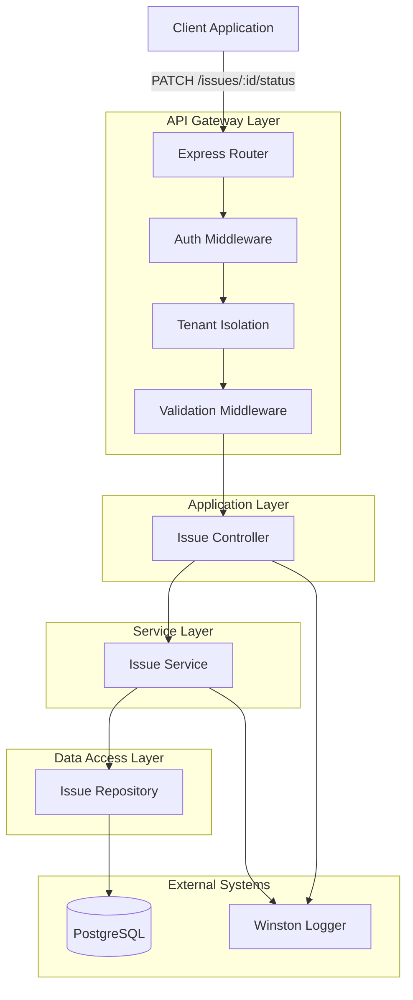
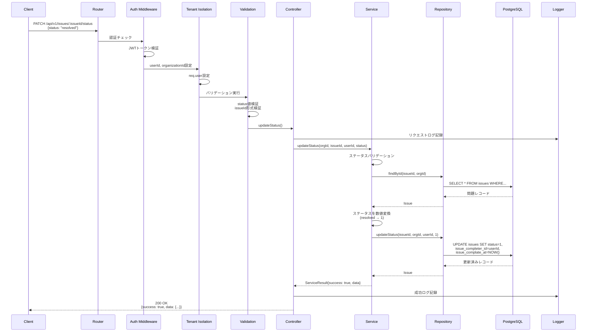
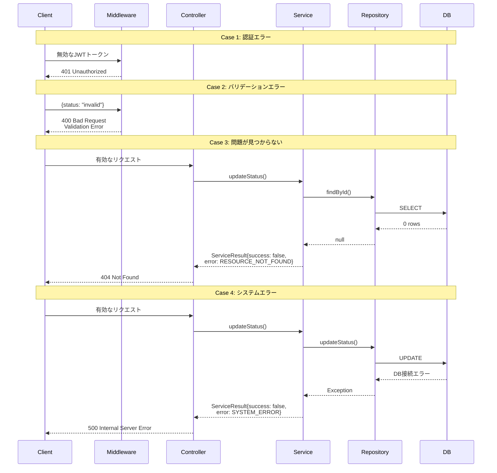

# Design Document: 問題ステータス変更API

## Overview

本機能は、実験管理システムにおける問題報告のステータスを「未解決（unresolved）」または「解決済（resolved）」に変更するRESTful APIエンドポイントを提供します。実験管理者（Manager）以上の権限を持つユーザーが、実験作業中に報告された問題の解決状況を管理できるようにします。

**Purpose**: 問題のライフサイクル管理を実現し、問題解決のトラッキングと監査証跡を提供することで、実験の品質管理と問題対応の透明性を向上させます。

**Users**: 実験管理者（Manager）およびシステム管理者（Admin）が、自組織内で報告された問題のステータスを変更する際に利用します。

**Impact**: 既存の問題管理APIエンドポイント群に新たなステータス変更機能を追加し、問題解決のワークフローを完結させます。マルチテナント分離、JWT認証、監査ログ記録などの既存セキュリティ機構と統合されます。

### Goals
- Manager以上の権限を持つユーザーによる問題ステータスの変更を可能にする
- ステータス変更時に解決者情報（ユーザーID、ユーザー名、解決日時）を記録する
- マルチテナント分離を保証し、組織間のデータ漏洩を防止する
- 統一されたRESTful APIレスポンス形式を維持する
- 監査証跡としてステータス変更履歴を記録する

### Non-Goals
- 問題の削除機能（将来のフェーズで検討）
- 問題の重要度（severity）変更機能（別エンドポイントで提供）
- ステータスの詳細なワークフロー定義（現状は2状態のみ: unresolved/resolved）
- 通知機能（ステータス変更時のメール/Slack通知は将来の拡張機能）
- コメント機能（別エンドポイント `/issues/:issueId/comments` で提供済み）

## Architecture

### Existing Architecture Analysis

本APIは既存の問題管理システムの一部として実装されており、以下の既存パターンを継承します：

**既存のアーキテクチャパターン**:
- レイヤードアーキテクチャ（Routes → Controller → Service → Repository）
- マルチテナント分離（すべてのDB操作で `organization_id` フィルタ必須）
- JWT認証 + セッション管理のハイブリッド認証
- 統一されたエラーレスポンス形式（`ServiceResult<T>` 型）

**統合ポイント**:
- 既存の `/api/v1/issues` ルートグループに追加
- 既存の `IssueController`、`IssueService`、`IssueRepository` を拡張
- 既存の認証・認可ミドルウェアチェーン（`authMiddleware` → `tenantIsolation`）を適用

### Architecture Pattern & Boundary Map



**Architecture Integration**:
- **Selected pattern**: レイヤードアーキテクチャ（既存システムと統一）
- **Domain/feature boundaries**: 
  - Routes層: HTTPリクエスト処理、ミドルウェアチェーン
  - Controller層: リクエスト/レスポンス変換、エラーハンドリング
  - Service層: ビジネスロジック、バリデーション
  - Repository層: データベース操作の抽象化
- **Existing patterns preserved**: マルチテナント分離、JWT認証、統一エラーレスポンス
- **New components rationale**: 既存コンポーネントの拡張のみ（新規コンポーネントなし）
- **Steering compliance**: プロジェクト全体の3層アーキテクチャパターンに準拠

### Technology Stack

| Layer | Choice / Version | Role in Feature | Notes |
|-------|------------------|-----------------|-------|
| Backend / API | Express.js 4.18.3 | HTTPルーティング、ミドルウェアチェーン | 既存システムと同一 |
| Backend / Language | TypeScript 5.x | 型安全な実装、インターフェース定義 | 厳密な型定義でany禁止 |
| Backend / Validation | express-validator 7.x | リクエストパラメータのバリデーション | 宣言的バリデーション |
| Data / Database | PostgreSQL 13+ | 問題データの永続化、トランザクション管理 | 既存DBスキーマ利用 |
| Data / ORM | pg (node-postgres) 8.x | SQLクエリ実行、コネクションプール管理 | Parameterized Queriesでセキュリティ確保 |
| Infrastructure / Auth | JWT (jsonwebtoken) 9.x | 認証トークン検証 | 既存認証機構を利用 |
| Infrastructure / Logging | Winston 3.x | 構造化ログ、監査証跡 | 既存ロギング機構を利用 |

## System Flows

### ステータス変更フロー（成功パス）



**Key Decisions**:
- ステータス変更は単一のUPDATE文で実行（トランザクション不要）
- 文字列ステータス（API層）を数値（DB層）に変換して保存
- resolved時にユーザーID・日時を自動設定、unresolved時にクリア

### エラーハンドリングフロー



## Requirements Traceability

| Requirement | Summary | Components | Interfaces | Flows |
|-------------|---------|------------|------------|-------|
| 1 | 問題ステータス変更機能 | IssueController.updateStatus, IssueService.updateStatus, IssueRepository.updateStatus | API Contract (PATCH), Service Interface | ステータス変更フロー |
| 2 | 認証と認可 | authMiddleware, tenantIsolation | Middleware Chain | 認証チェック、権限検証 |
| 3 | マルチテナント分離 | tenantIsolation, IssueRepository | DB Query (organization_id filter) | データ分離フロー |
| 4 | 入力バリデーション | express-validator, IssueService | Validation Rules | バリデーションフロー |
| 5 | エラーハンドリングとレスポンス形式 | IssueController, ServiceResult型 | API Contract (Error Response) | エラーハンドリングフロー |
| 6 | データ整合性とトランザクション管理 | IssueRepository | DB Transaction | UPDATE実行 |
| 7 | ログ記録と監査証跡 | Winston Logger, IssueController | Logging Interface | ログ記録 |
| 8 | パフォーマンスとスケーラビリティ | PostgreSQLインデックス | DB Indexes | クエリ最適化 |

## Components and Interfaces

### Component Summary

| Component | Domain/Layer | Intent | Req Coverage | Key Dependencies | Contracts |
|-----------|--------------|--------|--------------|------------------|-----------|
| IssueRouter | Routes | HTTPエンドポイント定義、ミドルウェアチェーン構成 | 2, 4 | authMiddleware (P0), tenantIsolation (P0), express-validator (P0) | API |
| IssueController | Controller | リクエスト/レスポンス処理、エラーハンドリング | 1, 5, 7 | IssueService (P0), Winston Logger (P1) | API |
| IssueService | Service | ビジネスロジック、ステータス変換 | 1, 4, 6 | IssueRepository (P0) | Service |
| IssueRepository | Repository | データベース操作、SQL実行 | 3, 6, 8 | PostgreSQL (P0) | Data Access |

### Application Layer

#### IssueController

| Field | Detail |
|-------|--------|
| Intent | HTTPリクエストを受け取り、ServiceResult型をHTTPレスポンスに変換する |
| Requirements | 1, 5, 7 |

**Responsibilities & Constraints**
- HTTPリクエスト/レスポンスの変換
- ServiceResult型のエラーコードをHTTPステータスコードにマッピング
- 構造化ログの記録（Winston）
- ビジネスロジックを含まない（Service層に委譲）

**Dependencies**
- Outbound: IssueService — ビジネスロジック実行 (P0)
- Outbound: Winston Logger — 構造化ログ記録 (P1)

**Contracts**: Service [x] / API [ ] / Event [ ] / Batch [ ] / State [ ]

##### Service Interface
```typescript
/**
 * 問題ステータス更新メソッド
 * Controller層からService層への呼び出しインターフェース
 */
interface IssueControllerMethods {
  updateStatus(req: Request, res: Response): Promise<void>;
}

/**
 * Requestオブジェクト拡張
 */
interface AuthenticatedRequest extends Request {
  user?: {
    userId: string;
    organizationId: string;
    role: string;
  };
  params: {
    issueId: string;
  };
  body: {
    status: IssueStatus;
  };
}
```

**Implementation Notes**
- **Integration**: express-validatorによるバリデーション後に実行
- **Validation**: ミドルウェアでバリデーション済み（Controller層では再検証不要）
- **Risks**: ServiceResult型のエラーコードとHTTPステータスコードのマッピングを正確に行う必要がある

### Service Layer

#### IssueService

| Field | Detail |
|-------|--------|
| Intent | 問題ステータス変更のビジネスロジックを実行し、結果をServiceResult型で返す |
| Requirements | 1, 4, 6 |

**Responsibilities & Constraints**
- ステータス値のバリデーション（'unresolved' | 'resolved'）
- 文字列ステータスから数値への変換（API層 → DB層）
- 問題の存在確認（NotFoundError処理）
- トランザクション境界の定義（現状は単一UPDATE）

**Dependencies**
- Outbound: IssueRepository — データアクセス層 (P0)

**Contracts**: Service [x] / API [ ] / Event [ ] / Batch [ ] / State [ ]

##### Service Interface
```typescript
/**
 * ServiceResult型定義（共通型）
 */
interface ServiceResult<T> {
  success: boolean;
  data?: T;
  error?: {
    code: string;
    message: string;
    details?: any;
    originalError?: Error;
  };
}

/**
 * IssueServiceインターフェース
 */
interface IssueServiceMethods {
  /**
   * 問題ステータスを更新する
   * 
   * @param organizationId - 組織ID（マルチテナント分離）
   * @param issueId - 問題ID
   * @param userId - 現在のユーザーID（解決者として記録）
   * @param status - 新しいステータス（'unresolved' | 'resolved'）
   * @returns ServiceResult<Issue> - 成功時は更新後の問題オブジェクト
   * @throws ValidationError - ステータス値が不正な場合
   * @throws NotFoundError - 問題が見つからない場合
   */
  updateStatus(
    organizationId: string,
    issueId: string,
    userId: string,
    status: IssueStatus
  ): Promise<ServiceResult<Issue>>;
}

/**
 * ステータス型定義
 */
type IssueStatus = 'unresolved' | 'resolved';
const ISSUE_STATUS_VALUES: readonly IssueStatus[] = ['unresolved', 'resolved'] as const;
```

- **Preconditions**: 
  - organizationId、issueId、userIdは空文字列ではない
  - statusは 'unresolved' または 'resolved'
- **Postconditions**: 
  - 成功時: ServiceResult.success = true、data に更新後のIssueオブジェクト
  - 失敗時: ServiceResult.success = false、error にエラー情報
- **Invariants**: 
  - ステータスはDB層で数値（0: unresolved, 1: resolved）として保存される
  - resolved時は issue_completer_id と issue_complate_at が設定される
  - unresolved時は issue_completer_id と issue_complate_at がNULLになる

**Implementation Notes**
- **Integration**: Repository層のfindByIdとupdateStatusメソッドを呼び出す
- **Validation**: ステータス値を ISSUE_STATUS_VALUES 配列でバリデーション
- **Risks**: 文字列→数値変換ロジック（convertStatusToNumber）の正確性が重要

### Data Access Layer

#### IssueRepository

| Field | Detail |
|-------|--------|
| Intent | issuesテーブルへのCRUD操作を提供し、マルチテナント分離を保証する |
| Requirements | 3, 6, 8 |

**Responsibilities & Constraints**
- PostgreSQLへのParameterized Queries実行
- すべてのクエリでorganization_idフィルタを必須とする
- UPDATE時にupdated_atを自動更新
- resolved/unresolved時の条件分岐処理

**Dependencies**
- External: PostgreSQL — データベース接続 (P0)
- External: pg (node-postgres) — コネクションプール (P0)

**Contracts**: Service [ ] / API [ ] / Event [ ] / Batch [ ] / State [x]

##### State Management
```typescript
/**
 * IssueRepositoryインターフェース
 */
interface IssueRepositoryMethods {
  /**
   * 問題IDで問題を検索する（マルチテナント分離）
   * 
   * @param issueId - 問題ID
   * @param organizationId - 組織ID
   * @returns Issue | null - 見つかった場合は問題オブジェクト、見つからない場合はnull
   */
  findById(issueId: string, organizationId: string): Promise<Issue | null>;

  /**
   * 問題ステータスを更新する
   * 
   * @param issueId - 問題ID
   * @param organizationId - 組織ID
   * @param userId - 解決者のユーザーID
   * @param statusNumber - ステータス数値（0: unresolved, 1: resolved）
   * @returns Issue | null - 更新後の問題オブジェクト
   */
  updateStatus(
    issueId: string,
    organizationId: string,
    userId: string,
    statusNumber: number
  ): Promise<Issue | null>;
}

/**
 * Issue型定義（データモデル）
 */
interface Issue {
  organizationId: string;
  projectId: string;
  issueId: string;
  methodId: string | null;
  issueTarget: number;  // 1: project, 2: task, 3: transition
  taskNo: number | null;
  transitionId: string | null;
  issueTitle: string;
  issueType: number;  // 1-5の問題タイプ
  issueContents: string;
  status: number;  // 0: unresolved, 1: resolved
  issueReporterId: string;
  issueReportAt: Date;
  issueCompleterId: string | null;
  issueComplateAt: Date | null;
  createUserId: string;
  createAt: Date;
  updateUserId: string;
  updateAt: Date;
}
```

- **State model**: issuesテーブルレコードを表現するIssue型
- **Persistence & consistency**: PostgreSQLトランザクション（単一UPDATE文で原子性保証）
- **Concurrency strategy**: 楽観的並行性制御（最後の書き込みが有効）、必要に応じてFOR UPDATE可能

**Implementation Notes**
- **Integration**: pg.Pool.query()でParameterized Queriesを実行
- **Validation**: SQLインジェクション対策としてプレースホルダー（$1, $2, ...）を使用
- **Risks**: issue_complate_atのtypoがDB側にあるため、そのまま使用

### Routes Layer

#### IssueRouter

| Field | Detail |
|-------|--------|
| Intent | HTTPエンドポイント `/api/v1/issues/:issueId/status` を定義し、ミドルウェアチェーンを構成する |
| Requirements | 2, 4 |

**Responsibilities & Constraints**
- HTTPメソッドとパスの定義（PATCH）
- ミドルウェアチェーンの構成（auth → tenantIsolation → validation → controller）
- バリデーションルールの宣言的定義

**Dependencies**
- Inbound: Client Application — HTTPリクエスト (P0)
- Outbound: authMiddleware — JWT認証 (P0)
- Outbound: tenantIsolation — テナント分離 (P0)
- Outbound: express-validator — リクエストバリデーション (P0)
- Outbound: IssueController — リクエスト処理 (P0)

**Contracts**: Service [ ] / API [x] / Event [ ] / Batch [ ] / State [ ]

##### API Contract
| Method | Endpoint | Request | Response | Errors |
|--------|----------|---------|----------|--------|
| PATCH | /api/v1/issues/:issueId/status | UpdateStatusRequest | UpdateStatusResponse | 400, 401, 403, 404, 500 |

**Request Schema**:
```typescript
/**
 * パスパラメータ
 */
interface PathParams {
  issueId: string;  // 問題ID（文字列形式）
}

/**
 * リクエストボディ
 */
interface UpdateStatusRequest {
  status: 'unresolved' | 'resolved';  // 新しいステータス
}
```

**Response Schema (Success - 200 OK)**:
```typescript
interface UpdateStatusResponse {
  success: true;
  data: {
    id: string;
    status: 'unresolved' | 'resolved';
    resolvedBy: string;        // ユーザーID（unresolvedの場合は空文字列）
    resolvedByName: string;    // ユーザー名（unresolvedの場合は空文字列）
    resolvedAt: string;        // ISO 8601形式（unresolvedの場合は空文字列）
    updatedAt: string;         // ISO 8601形式
  };
  meta: {
    timestamp: string;         // ISO 8601形式
    requestId: string;         // UUID形式
  };
}
```

**Response Schema (Error)**:
```typescript
interface ErrorResponse {
  success: false;
  error: {
    code: 'VALIDATION_ERROR' | 'RESOURCE_NOT_FOUND' | 'PERMISSION_INSUFFICIENT' | 'SYSTEM_ERROR';
    message: string;
    details?: ValidationErrorDetail[];
  };
  meta: {
    timestamp: string;
    requestId: string;
  };
}

interface ValidationErrorDetail {
  field: string;
  message: string;
  code: string;
}
```

**Validation Rules**:
- `issueId`: 必須、文字列形式（空文字列不可）
- `status`: 必須、'unresolved' または 'resolved' のいずれか

**Implementation Notes**
- **Integration**: Express.js Routerで `/api/v1/issues` 配下に定義
- **Validation**: express-validatorでバリデーションルールを宣言的に定義
- **Risks**: ⚠️ **権限チェックミドルウェアが未適用** — API設計書では「Manager以上の権限が必要」と定義されているが、現在の実装では `permissionCheck(['manager', 'admin'])` ミドルウェアが欠けている。Worker権限でもステータス変更が可能になっている。

## Data Models

### Domain Model

**Status State Machine**:
- 状態: `unresolved` ⇄ `resolved`
- 遷移: 双方向（unresolvedからresolvedへ、resolvedからunresolvedへ）
- 制約: Manager以上の権限が必要（設計上の要件）

**Aggregate Root**: `Issue` エンティティ
- トランザクション境界: 単一のIssueレコード
- ビジネスルール: ステータス変更時に解決者情報を記録/クリア
- ドメインイベント: なし（将来の拡張候補）

### Logical Data Model

**Structure Definition**:
- Entity: `Issue`（問題）
- Relationship: 
  - Issue → Organization (N:1)
  - Issue → Project (N:1)
  - Issue → User (reported_by) (N:1)
  - Issue → User (resolved_by) (N:0..1)
- Attributes:
  - `status`: ステータス（0: unresolved, 1: resolved）
  - `issue_completer_id`: 解決者のユーザーID（nullable）
  - `issue_complate_at`: 解決日時（nullable）
  - `update_user_id`: 更新者のユーザーID
  - `update_at`: 更新日時

**Consistency & Integrity**:
- Transaction boundaries: 単一のIssueレコード（単一UPDATE文）
- Cascading rules: なし
- Temporal aspects: `issue_complate_at`（解決日時）、`update_at`（更新日時）を記録

### Physical Data Model

**For Relational Databases (PostgreSQL)**:

**Table: `issues`**
```sql
CREATE TABLE issues (
  organization_id VARCHAR(50) NOT NULL,
  project_id UUID NOT NULL,
  issue_id VARCHAR(50) NOT NULL,
  method_id VARCHAR(50),
  issue_target INTEGER NOT NULL,  -- 1: project, 2: task, 3: transition
  task_no INTEGER,
  transition_id VARCHAR(50),
  issue_title VARCHAR(200) NOT NULL,
  issue_type INTEGER NOT NULL,    -- 1-5の問題タイプ
  issue_contents TEXT NOT NULL,
  status INTEGER NOT NULL DEFAULT 0,  -- 0: unresolved, 1: resolved
  issue_reporter_id VARCHAR(50) NOT NULL,
  issue_report_at TIMESTAMP NOT NULL,
  issue_completer_id VARCHAR(50),     -- NULLable
  issue_complate_at TIMESTAMP,        -- NULLable (注: typo "complate")
  create_user_id VARCHAR(50) NOT NULL,
  create_at TIMESTAMP NOT NULL DEFAULT CURRENT_TIMESTAMP,
  update_user_id VARCHAR(50) NOT NULL,
  update_at TIMESTAMP NOT NULL DEFAULT CURRENT_TIMESTAMP,
  
  PRIMARY KEY (organization_id, issue_id),
  FOREIGN KEY (organization_id, project_id) REFERENCES projects(organization_id, project_id),
  FOREIGN KEY (organization_id, issue_reporter_id) REFERENCES organization_user(organization_id, user_id),
  FOREIGN KEY (organization_id, issue_completer_id) REFERENCES organization_user(organization_id, user_id)
);
```

**Indexes**:
```sql
CREATE INDEX idx_issues_org_project ON issues(organization_id, project_id);
CREATE INDEX idx_issues_org_status ON issues(organization_id, status);
CREATE INDEX idx_issues_org_id ON issues(organization_id, issue_id);
```

**Data Contracts & Integration**:

**API Data Transfer**:
- Request: 文字列形式のステータス（'unresolved' | 'resolved'）
- Response: 文字列形式のステータス + 解決者情報
- Serialization: JSON
- Validation: express-validator + Service層のバリデーション

**Status Mapping**:
- API層 → DB層: `'unresolved'` → `0`, `'resolved'` → `1`
- DB層 → API層: `0` → `'unresolved'`, `1` → `'resolved'`

## Error Handling

### Error Strategy

各エラータイプに対する具体的なハンドリングパターンを定義します。

### Error Categories and Responses

**User Errors (4xx)**:

1. **400 Bad Request - Validation Error**
   - トリガー: 不正なステータス値（'unresolved' / 'resolved' 以外）
   - レスポンス:
     ```json
     {
       "success": false,
       "error": {
         "code": "VALIDATION_ERROR",
         "message": "Validation failed",
         "details": [
           {
             "field": "status",
             "message": "statusは\"unresolved\"または\"resolved\"である必要があります",
             "code": "INVALID_VALUE"
           }
         ]
       },
       "meta": {...}
     }
     ```
   - 回復方法: 正しいステータス値でリクエストを再送

2. **401 Unauthorized**
   - トリガー: JWTトークンが無効または欠落
   - レスポンス: `{ "success": false, "error": { "code": "AUTH_TOKEN_INVALID", "message": "認証が必要です" } }`
   - 回復方法: 再ログインして有効なトークンを取得

3. **403 Forbidden - Permission Insufficient**
   - トリガー: Worker権限のユーザーがステータス変更を試行（設計上の要件）
   - レスポンス: `{ "success": false, "error": { "code": "PERMISSION_INSUFFICIENT", "message": "Only managers and admins can change issue status" } }`
   - 回復方法: Manager以上の権限を持つユーザーでログイン
   - ⚠️ **現在の実装では403エラーは発生しない**（権限チェックミドルウェアが未適用のため）

4. **404 Not Found**
   - トリガー: 指定されたissueIdが存在しない、または他組織に属する
   - レスポンス: `{ "success": false, "error": { "code": "RESOURCE_NOT_FOUND", "message": "Issue not found or does not belong to your organization" } }`
   - 回復方法: 正しいissueIdを確認、問題一覧APIで存在確認

**System Errors (5xx)**:

1. **500 Internal Server Error**
   - トリガー: データベース接続エラー、予期しないシステムエラー
   - レスポンス: `{ "success": false, "error": { "code": "SYSTEM_ERROR", "message": "システムエラーが発生しました" } }`
   - ログ: Winston errorレベルでスタックトレースと共に記録
   - 回復方法: システム管理者に連絡、データベース接続を確認

### Monitoring

**Error Tracking**:
- Winston構造化ログで以下を記録:
  - `requestId`: リクエストのトレーサビリティ
  - `action`: 'issue_updateStatus'
  - `organizationId`: 組織ID
  - `issueId`: 問題ID
  - `userId`: ユーザーID
  - `errorCode`: エラーコード
  - `errorMessage`: エラーメッセージ
  - `stackTrace`: スタックトレース（500エラー時）

**Health Monitoring**:
- レスポンスタイム: P95で500ms以内を目標
- エラーレート: 5xx系エラーを監視
- データベース接続プール状態: 使用率を監視

## Testing Strategy

### Unit Tests

**IssueController.updateStatus**:
- ServiceResult.success = true の場合、200 OKレスポンスを返すこと
- ServiceResult.error.code = 'RESOURCE_NOT_FOUND' の場合、404レスポンスを返すこと
- ServiceResult.error.code = 'VALIDATION_ERROR' の場合、400レスポンスを返すこと
- Winstonロガーが正しく呼び出されること

**IssueService.updateStatus**:
- 'resolved'ステータスの場合、数値1に変換されること
- 'unresolved'ステータスの場合、数値0に変換されること
- 無効なステータス値の場合、ValidationErrorをthrowすること
- 問題が存在しない場合、NotFoundErrorをthrowすること

**IssueRepository.updateStatus**:
- resolved時にissue_completer_id、issue_complate_atが設定されること
- unresolved時にissue_completer_id、issue_complate_atがNULLになること
- organization_idフィルタが必ず含まれること
- Parameterized Queriesが使用されていること

### Integration Tests

**認証・認可フロー**:
- 有効なJWTトークンで認証が成功すること
- 無効なトークンで401エラーが返ること
- tenantIsolationミドルウェアでorganizationIdが設定されること

**ステータス変更フロー（end-to-end）**:
- 問題ステータスをunresolvedからresolvedに変更できること
- 問題ステータスをresolvedからunresolvedに変更できること
- 他組織の問題を変更しようとすると404エラーが返ること
- 存在しない問題IDで404エラーが返ること

**バリデーションエラー**:
- 無効なステータス値で400エラーが返ること
- 不正なissueId形式で400エラーが返ること

### E2E Tests (API Tests)

**正常系**:
- PATCH /api/v1/issues/:issueId/status で問題のステータスが変更されること
- レスポンスに正しいステータス、resolvedBy、resolvedAt情報が含まれること
- unresolvedに変更した場合、resolvedBy、resolvedByName、resolvedAtが空文字列になること

**異常系**:
- 認証なしで401エラーが返ること
- 無効なステータス値で400エラーが返ること
- 存在しない問題IDで404エラーが返ること
- 他組織の問題で404エラーが返ること

**パフォーマンス**:
- レスポンスタイムが500ms以内であること（P95）
- 同時リクエストに正しく応答すること

### Test Data Setup

**前提データ**:
- テスト用組織: `test_org_001`
- テスト用プロジェクト: `test_project_001`
- テスト用問題: `test_issue_001` (status: 0)
- テスト用ユーザー: Manager権限のユーザー

## Security Considerations

本機能は認証・認可・データ保護に関する固有の要件があります。

**Authentication**:
- JWT認証必須（authMiddleware適用）
- セッションベースのトークン管理

**Authorization**:
- **設計要件**: Manager以上の権限が必要
- **実装状況**: ⚠️ 権限チェックミドルウェア未適用（技術的負債）
- **推奨**: Routes定義に `permissionCheck(['manager', 'admin'])` を追加

**Data Protection**:
- マルチテナント分離: すべてのDBクエリで `organization_id` フィルタ必須
- SQLインジェクション対策: Parameterized Queries使用
- XSS対策: APIレスポンスは構造化JSON（エスケープ不要）

**Audit Trail**:
- ステータス変更履歴をWinstonログで記録
- 解決者情報（user_id、日時）をデータベースに記録

## Implementation Notes

**既存実装の状況**:
本APIは既に実装済みです。本設計書は既存実装を文書化したものです。

**既存ファイル**:
- Routes: `backend/src/routes/issueRoutes.ts`
- Controller: `backend/src/controllers/issueController.ts`
- Service: `backend/src/services/issueService.ts`
- Repository: `backend/src/repositories/issueRepository.ts`
- Types: `backend/src/types/issue.ts`
- Tests: `backend/tests/routes/issueRoutes.test.ts`、他

**技術的負債**:
1. **権限チェック不備**: Routes定義に `permissionCheck` ミドルウェアが欠けている
   - 影響: Worker権限でもステータス変更が可能
   - 優先度: 高（セキュリティ要件）
   - 対策: `permissionCheck(['manager', 'admin'])` を追加

2. **DB列名のtypo**: `issue_complate_at` (正: `issue_complete_at`)
   - 影響: なし（既存データと互換性を保つため修正しない）
   - 対策: 新規カラム追加時に注意

## References

- [問題管理API設計書](../../design/api/api_issue_management.md) - セクション5: 問題ステータス変更API
- [API設計ポリシー](../../.clinerules/development/api.md) - API設計の統一ルール
- [セキュリティ規約](../../.clinerules/development/security.md) - 認証・認可・マルチテナント分離
- [バックエンド規約](../../.clinerules/development/backend.md) - レイヤードアーキテクチャ
- [データベース構造](../../.clinerules/references/db_structure.md) - issuesテーブルスキーマ
