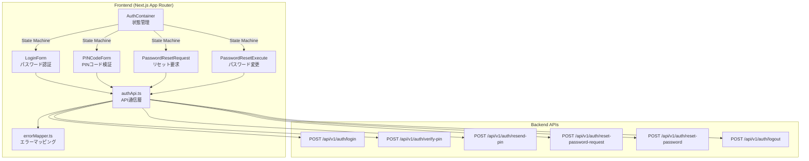
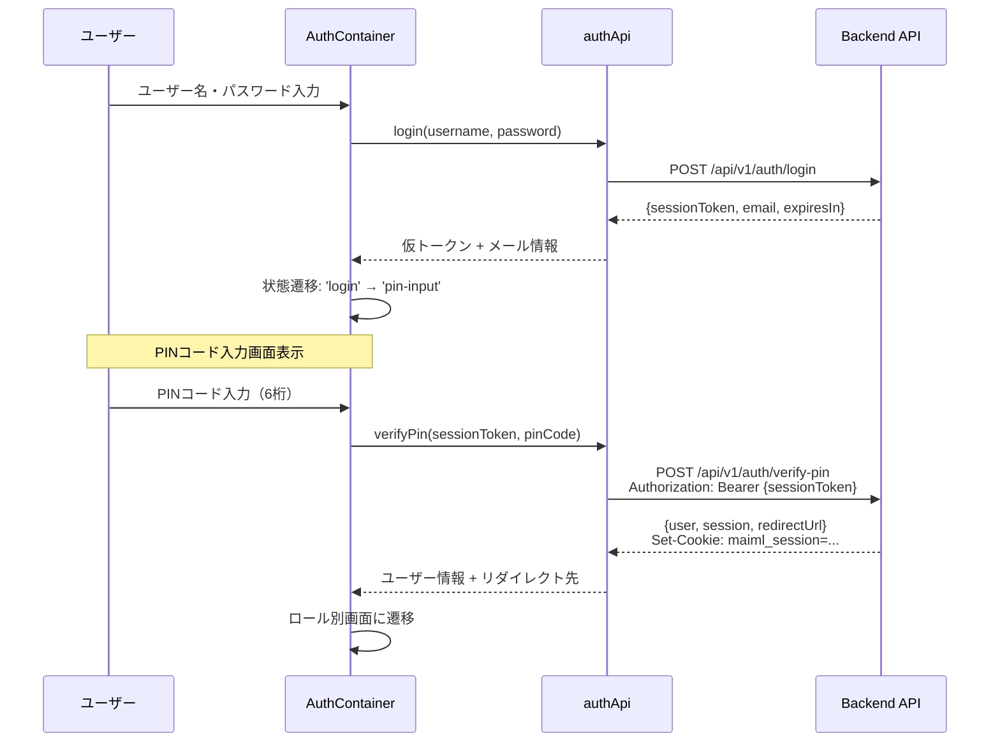
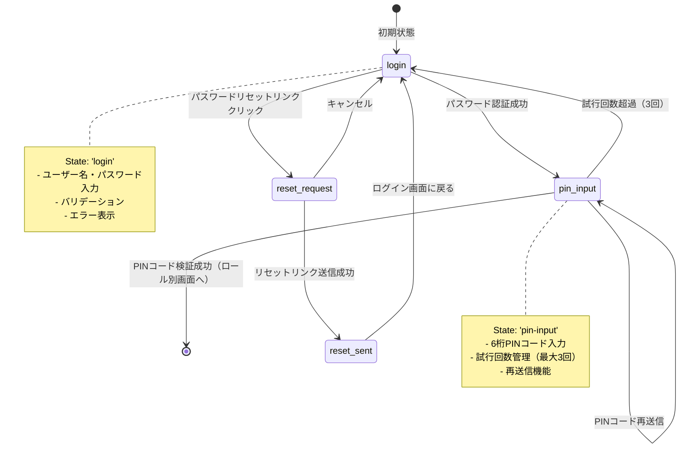

# ログイン画面 技術設計書

## Overview

mmdpfプロジェクトの二段階認証（パスワード + メールPINコード）を実装したログイン画面機能。既存のバックエンド認証API（docs/design/api/api_auth.md）と統合し、Next.js 15 + TypeScript + Ant Design v6でフロントエンド実装を行う。

**Users**: 全ロールのユーザー（provider, system_admin, data_admin, experiment_admin, experiment_worker, mi_engineer）

**Impact**: 既存のLoginPageコンポーネントを二段階認証対応に拡張。新規コンポーネント（PINコード入力画面、パスワードリセット画面）を追加。

### Goals
- 二段階認証（パスワード + メールPINコード）の実装
- ロール別画面遷移の実装
- セキュアなセッション管理（HTTPOnly Cookie + JWT）
- レスポンシブUIとアクセシビリティ対応

### Non-Goals
- ソーシャルログイン（Google, GitHub等）
- 生体認証（指紋、顔認証）
- 多要素認証アプリ連携（Google Authenticator等）
- セッション管理のサーバー側実装（バックエンドスコープ）

## Architecture

### 既存アーキテクチャ分析
- **既存実装**: 基本的なLoginPageコンポーネント（ユーザー名・パスワード入力のみ）
- **既存パターン**: React Hooks（useState）ベースの状態管理
- **デザインシステム**: Ant Design v6 + theme.useToken()パターン確立済み
- **APIパターン**: モックAPIファサードパターン（apiClient.ts）

### Architecture Pattern & Boundary Map



**Architecture Integration**:
- **選択パターン**: State Machine（ステートマシン）による単一ページ内状態遷移
- **境界**: 認証フロー状態を`AuthContainer`で一元管理、各フォームコンポーネントは疎結合
- **既存パターン保持**: React Hooksベース、Ant Designコンポーネント活用
- **新規コンポーネント**: 認証専用APIモジュール（authApi.ts）、エラーマッピング（errorMapper.ts）

### Technology Stack

| Layer | Choice / Version | Role in Feature | Notes |
|-------|------------------|-----------------|-------|
| Frontend Framework | Next.js 15+ | App Router、SSR、クライアントコンポーネント | 既存プロジェクト標準 |
| UI Library | Ant Design v6 | フォーム、ボタン、メッセージ表示 | デザイントークン使用必須 |
| 言語 | TypeScript 5+ | 型安全性、厳格な型チェック | strict mode、any禁止 |
| 状態管理 | React Hooks | useState、useEffect | 既存パターン踏襲 |
| HTTP Client | Fetch API | 認証API通信 | Next.js標準、追加ライブラリ不要 |
| バリデーション | Ant Design Form | クライアント側入力検証 | 既存パターン |

## System Flows

### 認証フローシーケンス図



### 状態遷移図



## Requirements Traceability

| Requirement | Summary | Components | Interfaces | Flows |
|-------------|---------|------------|------------|-------|
| 1 | ログイン画面表示 | AuthContainer, LoginForm | - | - |
| 2 | パスワード認証 | LoginForm, authApi | login() | 認証フロー |
| 3 | PINコード二段階認証 | PINCodeForm, authApi | verifyPin(), resendPin() | 認証フロー |
| 4 | ロール別画面遷移 | AuthContainer | - | 認証フロー |
| 5 | セッション管理 | authApi, ブラウザCookie | - | - |
| 6 | パスワードリセット | PasswordResetRequest, PasswordResetExecute, authApi | resetPasswordRequest(), resetPassword() | - |
| 7 | エラーハンドリング | errorMapper, すべてのフォーム | mapErrorToMessage() | - |
| 8 | セキュリティ対策 | 全コンポーネント | - | - |
| 9 | パフォーマンス | 全コンポーネント | - | - |

## Components and Interfaces

### Summary Table

| Component | Domain/Layer | Intent | Req Coverage | Key Dependencies | Contracts |
|-----------|--------------|--------|--------------|------------------|-----------|
| AuthContainer | UI/State | 認証フロー全体の状態管理とルーティング | 1, 2, 3, 4 | authApi (P0), Ant Design (P0) | State |
| LoginForm | UI/Presentation | ユーザー名・パスワード入力フォーム | 1, 2 | authApi (P0) | - |
| PINCodeForm | UI/Presentation | PINコード入力フォーム | 3 | authApi (P0) | - |
| PasswordResetRequest | UI/Presentation | パスワードリセット要求フォーム | 6 | authApi (P0) | - |
| PasswordResetExecute | UI/Presentation | パスワード変更実行フォーム | 6 | authApi (P0) | - |
| authApi | Service/API | バックエンド認証API通信 | 2, 3, 5, 6 | Fetch API (P0) | API |
| errorMapper | Utility | エラーコード→ユーザーメッセージ変換 | 7 | - | Service |

### UI / State Management

#### AuthContainer

| Field | Detail |
|-------|--------|
| Intent | 認証フロー全体の状態管理とコンポーネント切り替え |
| Requirements | 1, 2, 3, 4 |

**Responsibilities & Constraints**
- 認証フローの状態（'login', 'pin-input', 'reset-request', 'reset-sent'）を管理
- 状態に応じて適切なフォームコンポーネントを表示
- API通信結果に基づいて状態遷移を制御
- ロール別リダイレクトの実行

**Dependencies**
- Outbound: authApi — API通信 (P0)
- Outbound: Next.js Router — ページ遷移 (P0)
- Outbound: Ant Design — message通知 (P1)

**Contracts**: State [x]

##### State Management

```typescript
type AuthFlowState = 
  | 'login'           // ログイン画面
  | 'pin-input'       // PINコード入力画面
  | 'reset-request'   // パスワードリセット要求画面
  | 'reset-sent';     // リセットリンク送信完了画面

interface AuthContainerState {
  flowState: AuthFlowState;
  sessionToken: string | null;
  maskedEmail: string | null;
  pinExpiresIn: number | null;
  error: string | null;
  loading: boolean;
}
```

**Implementation Notes**
- **Integration**: app/page.tsxから呼び出される最上位コンポーネント
- **Validation**: 各フォームコンポーネントが個別にバリデーション実行
- **Risks**: 状態遷移ロジックが複雑化する可能性（テスト必須）

#### LoginForm

| Field | Detail |
|-------|--------|
| Intent | ユーザー名・パスワード入力フォームの表示と検証 |
| Requirements | 1, 2 |

**Responsibilities & Constraints**
- ユーザー名・パスワードの入力UI提供
- クライアント側バリデーション（空チェック）
- ローディング状態の表示
- エラーメッセージの表示

**Dependencies**
- Outbound: authApi.login() — パスワード認証 (P0)
- Inbound: AuthContainer — onSuccess, onError コールバック (P0)

**Implementation Notes**
- 既存のLoginPage.tsxを基本構造として活用
- Ant Design Formコンポーネントでバリデーション強化
- デザイントークン（theme.useToken()）を使用したスタイリング

#### PINCodeForm

| Field | Detail |
|-------|--------|
| Intent | 6桁PINコード入力フォームと再送信機能 |
| Requirements | 3 |

**Responsibilities & Constraints**
- 6桁数字入力UI（Input.OTPまたは複数Input）
- PINコード検証API呼び出し
- 再送信ボタンとカウントダウンタイマー表示
- 試行回数制限のUI反映

**Dependencies**
- Outbound: authApi.verifyPin() — PINコード検証 (P0)
- Outbound: authApi.resendPin() — PINコード再送信 (P0)
- Inbound: AuthContainer — sessionToken, onSuccess, onError (P0)

**Implementation Notes**
- Ant Design Input.OTPコンポーネント（v6で追加）を検討
- カウントダウンタイマーはuseEffectで実装
- 試行回数はAPIレスポンスのエラーで判定（フロントでは管理しない）

### Service / API Communication

#### authApi

| Field | Detail |
|-------|--------|
| Intent | バックエンド認証APIとの通信を一元管理 |
| Requirements | 2, 3, 5, 6 |

**Responsibilities & Constraints**
- 認証APIエンドポイントへのHTTPリクエスト送信
- リクエスト/レスポンスの型安全性確保
- エラーレスポンスのパース
- タイムアウト処理（30秒）

**Dependencies**
- Outbound: Fetch API — HTTP通信 (P0)
- Outbound: errorMapper — エラーメッセージ変換 (P1)
- External: Backend API (/api/v1/auth/*) — 認証処理 (P0)

**Contracts**: API [x] / Service [x]

##### API Contract

| Method | Endpoint | Request | Response | Errors |
|--------|----------|---------|----------|--------|
| POST | /api/v1/auth/login | LoginRequest | LoginResponse | 400, 401, 429, 500 |
| POST | /api/v1/auth/verify-pin | VerifyPINRequest | VerifyPINResponse | 400, 401, 429 |
| POST | /api/v1/auth/resend-pin | - (Bearer Token) | ResendPINResponse | 401, 429 |
| POST | /api/v1/auth/reset-password-request | ResetPasswordRequestRequest | MessageResponse | 400, 429 |
| POST | /api/v1/auth/reset-password | ResetPasswordRequest | MessageResponse | 400, 401 |
| POST | /api/v1/auth/logout | - (Bearer Token + Cookie) | MessageResponse | 401 |

##### Service Interface

```typescript
interface AuthApiService {
  // パスワード認証
  login(
    username: string,
    password: string,
    organizationId: string
  ): Promise<LoginResponse>;
  
  // PINコード検証
  verifyPin(
    sessionToken: string,
    pinCode: string,
    organizationId: string
  ): Promise<VerifyPINResponse>;
  
  // PINコード再送信
  resendPin(
    sessionToken: string,
    organizationId: string
  ): Promise<ResendPINResponse>;
  
  // パスワードリセット要求
  resetPasswordRequest(
    username: string,
    organizationId: string
  ): Promise<MessageResponse>;
  
  // パスワードリセット実行
  resetPassword(
    resetToken: string,
    newPassword: string
  ): Promise<MessageResponse>;
  
  // ログアウト
  logout(sessionToken: string, organizationId: string): Promise<MessageResponse>;
}
```

**Implementation Notes**
- **Integration**: 新規ファイル`utils/authApi.ts`として作成
- **Validation**: API仕様（api_auth.md）に基づくリクエスト/レスポンス型定義
- **Risks**: CORS設定、Cookie受け渡しの動作確認が必要

### Utility / Error Handling

#### errorMapper

| Field | Detail |
|-------|--------|
| Intent | APIエラーコードをユーザーフレンドリーなメッセージに変換 |
| Requirements | 7 |

**Contracts**: Service [x]

##### Service Interface

```typescript
interface ErrorMapperService {
  mapErrorToMessage(errorCode: string, defaultMessage?: string): string;
}
```

**エラーマッピングテーブル:**
```typescript
const ERROR_MESSAGE_MAP: Record<string, string> = {
  // 認証エラー
  'AUTH_INVALID_CREDENTIALS': 'ユーザー名またはパスワードが正しくありません',
  'AUTH_TOKEN_EXPIRED': 'セッションの有効期限が切れました。再度ログインしてください',
  'AUTH_TOKEN_INVALID': 'セッショントークンが無効です',
  'AUTH_PIN_INVALID': 'PINコードが正しくありません',
  'AUTH_PIN_EXPIRED': 'PINコードの有効期限が切れました。再送信してください',
  'AUTH_PIN_MAX_ATTEMPTS': 'PINコード入力試行回数の上限に達しました。最初からやり直してください',
  'AUTH_ACCOUNT_DISABLED': 'アカウントが無効化されています。管理者にお問い合わせください',
  'AUTH_RATE_LIMIT_EXCEEDED': 'ログイン試行回数が上限に達しました。しばらくしてから再度お試しください',
  'AUTH_RESEND_LIMIT_EXCEEDED': 'PINコード再送信回数が上限に達しました。しばらくしてから再度お試しください',
  
  // バリデーションエラー
  'VALIDATION_ERROR': '入力内容に誤りがあります',
  'REQUIRED_FIELD': '必須項目です',
  
  // システムエラー
  'SYSTEM_EMAIL_SEND_FAILED': 'メール送信に失敗しました。しばらくしてから再度お試しください',
  'SYSTEM_DATABASE_ERROR': 'システムエラーが発生しました。管理者にお問い合わせください',
};
```

**Implementation Notes**
- 新規ファイル`utils/errorMapper.ts`として作成
- 未定義のエラーコードは`defaultMessage`またはgenericメッセージを返す

## Data Models

### Domain Model

認証フローのドメインモデル:
- **User**: システムユーザー（ロール、組織、メールアドレス）
- **Session**: HTTPOnly Cookie（JWT形式、有効期限）
- **PINCode**: 一時的な二段階認証トークン（6桁、有効期限5分、最大試行3回）

### API Data Transfer

#### Request Types

```typescript
// POST /api/v1/auth/login
interface LoginRequest {
  username: string;
  password: string;
}

// POST /api/v1/auth/verify-pin
interface VerifyPINRequest {
  pinCode: string;
}

// POST /api/v1/auth/reset-password-request
interface ResetPasswordRequestRequest {
  username: string;
}

// POST /api/v1/auth/reset-password
interface ResetPasswordRequest {
  resetToken: string;
  newPassword: string;
}
```

#### Response Types

```typescript
// POST /api/v1/auth/login レスポンス
interface LoginResponse {
  sessionToken: string;
  message: string;
  email: string;        // マスキング済み（"use***@example.com"）
  expiresIn: number;    // 秒単位（300 = 5分）
}

// POST /api/v1/auth/verify-pin レスポンス
interface VerifyPINResponse {
  user: {
    id: string;
    username: string;
    email: string;
    role: UserRole;
    organizationId: string;
    organizationName: string;
    displayName: string;
  };
  session: {
    token: string;
    expiresAt: string;  // ISO 8601
  };
  redirectUrl: string;  // ロール別遷移先
}

// POST /api/v1/auth/resend-pin レスポンス
interface ResendPINResponse {
  message: string;
  email: string;
  expiresIn: number;
}

// 汎用メッセージレスポンス
interface MessageResponse {
  message: string;
}

// エラーレスポンス
interface ErrorResponse {
  success: false;
  error: {
    code: string;
    message: string;
    details?: Array<{
      field?: string;
      message: string;
      code?: string;
    }>;
  };
  meta: {
    timestamp: string;
    requestId: string;
  };
}
```

#### 型定義の配置

- 既存の`types/auth.ts`を拡張
- APIレスポンス型を追加
- UserRole型に`mi_engineer`を追加（現在未定義）

## Error Handling

### Error Strategy

エラーコードベースのハンドリング + HTTPステータスコードフォールバック

### Error Categories and Responses

**User Errors (4xx)**:
- **400 VALIDATION_ERROR**: フィールド単位のバリデーションエラーメッセージ表示
- **401 AUTH_INVALID_CREDENTIALS**: 「ユーザー名またはパスワードが正しくありません」
- **401 AUTH_PIN_INVALID**: 「PINコードが正しくありません」
- **401 AUTH_PIN_EXPIRED**: 「PINコードの有効期限が切れました。再送信してください」
- **429 AUTH_RATE_LIMIT_EXCEEDED**: 「ログイン試行回数が上限に達しました。15分後に再試行可能」

**System Errors (5xx)**:
- **500 SYSTEM_DATABASE_ERROR**: 「システムエラーが発生しました。しばらくしてから再度お試しください」
- **500 SYSTEM_EMAIL_SEND_FAILED**: 「メール送信に失敗しました」

**Network Errors**:
- **タイムアウト（30秒）**: 「通信がタイムアウトしました。インターネット接続を確認してください」
- **接続エラー**: 「サーバーに接続できませんでした。インターネット接続を確認してください」

### Monitoring

- Ant Design message/notificationコンポーネントでユーザーに表示
- コンソールログにエラー詳細を記録（開発環境のみ）
- 本番環境では外部エラー追跡サービスへの送信（将来実装）

## Testing Strategy

### Unit Tests
- errorMapper.ts: エラーコードマッピング
- authApi.ts: API通信のモック化テスト
- 各フォームコンポーネント: バリデーションロジック

### Integration Tests
- 認証フロー全体（login → pin-input → redirect）
- エラーケース（認証失敗、PINコード期限切れ、レート制限）
- パスワードリセットフロー

### E2E Tests
- ログイン成功シナリオ（各ロール）
- PINコード再送信
- パスワードリセット
- エラーハンドリング（ネットワークエラー、タイムアウト）

### Performance Tests
- 初回ページロード時間（目標: 2秒以内）
- API応答時間の測定

## Security Considerations

**重要**: このセクションはフロントエンド特有のセキュリティ対策を記載。バックエンドのセキュリティ実装は`docs/design/api/api_auth.md`および`.clinerules/development/security.md`を参照。

- **XSS対策**: React の自動エスケープ、DOMPurify不要（プレーンテキストのみ）
- **CSRF対策**: バックエンドが実装（フロントはトークン送信のみ）
- **入力サニタイゼーション**: trim()、Ant Design Formバリデーション
- **機密情報の保護**: パスワードはtype="password"、セッショントークンはHTTPOnly Cookie（JavaScript アクセス不可）
- **レート制限**: バックエンド実装、フロントはエラーメッセージ表示のみ
- **HTTPSのみ**: 本番環境ではHTTPSを強制（Next.js設定）

## Performance & Scalability

### Target Metrics
- 初回ページロード: 2秒以内
- APIレスポンス: 応答時間30秒でタイムアウト
- First Contentful Paint (FCP): 1.5秒以内
- Time to Interactive (TTI): 3秒以内

### Optimization Techniques
- Ant Designコンポーネントの遅延ロード不要（既に最適化済み）
- 画像最適化（ロゴ等をWebP形式、適切なサイズ）
- 不要な依存関係の排除（新規ライブラリ追加なし）

## Supporting References

### 型定義詳細

#### 完全な認証関連型定義（types/auth.ts拡張版）

```typescript
/**
 * ユーザーロール
 */
export type UserRole = 
  | 'provider'
  | 'system_admin'
  | 'data_admin'
  | 'experiment_admin'
  | 'experiment_worker'
  | 'mi_engineer';  // 追加

/**
 * 認証フロー状態
 */
export type AuthFlowState = 
  | 'login'
  | 'pin-input'
  | 'reset-request'
  | 'reset-sent';

/**
 * ロール別リダイレクトURLマッピング
 */
export const ROLE_REDIRECT_MAP: Record<UserRole, string> = {
  provider: '/provider',
  system_admin: '/system-admin',
  data_admin: '/data-admin',
  experiment_admin: '/experiment-admin',
  experiment_worker: '/experiment-worker',
  mi_engineer: '/mi-engineer',
};
```

### ファイル構成

新規作成ファイル:
- `frontend/src/components/auth/AuthContainer.tsx` - 認証フロー統合
- `frontend/src/components/auth/LoginForm.tsx` - ログインフォーム
- `frontend/src/components/auth/PINCodeForm.tsx` - PINコード入力フォーム
- `frontend/src/components/auth/PasswordResetRequest.tsx` - パスワードリセット要求
- `frontend/src/components/auth/PasswordResetExecute.tsx` - パスワード変更実行
- `frontend/src/utils/authApi.ts` - 認証API通信
- `frontend/src/utils/errorMapper.ts` - エラーマッピング

既存ファイル拡張:
- `frontend/src/types/auth.ts` - 型定義追加
- `frontend/src/app/page.tsx` - AuthContainerの使用

---

## Related Documents
- [要件定義書](requirements.md)
- [調査・設計判断記録](research.md)
- [認証API仕様書](../../design/api/api_auth.md)
- [認証DB設計書](../../design/db/db_auth.md)
- [UIポリシー](../../.clinerules/references/ui_policy.md)
- [フロントエンド規約](../../.clinerules/development/frontend.md)
- [セキュリティ規約](../../.clinerules/development/security.md)
