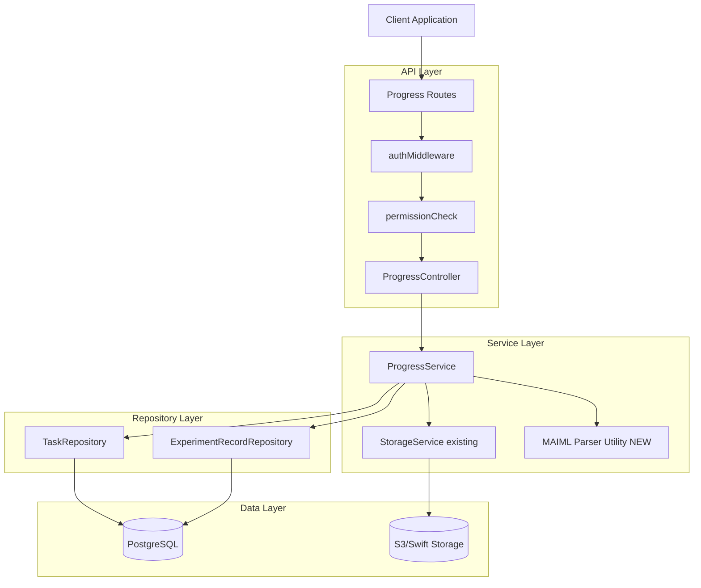
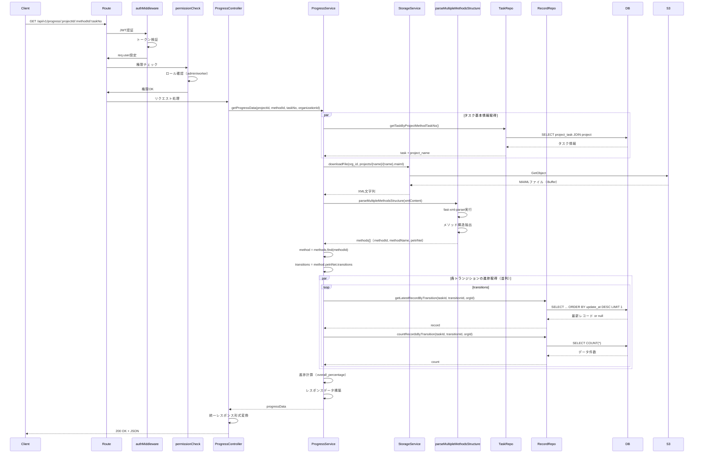
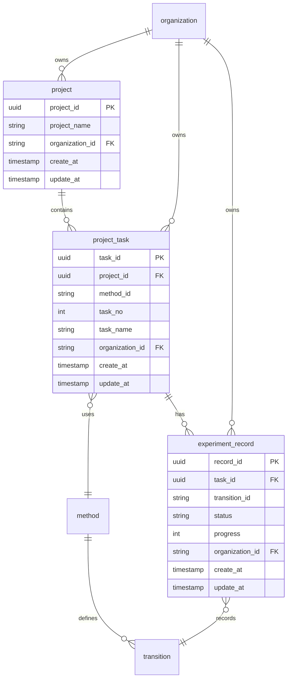
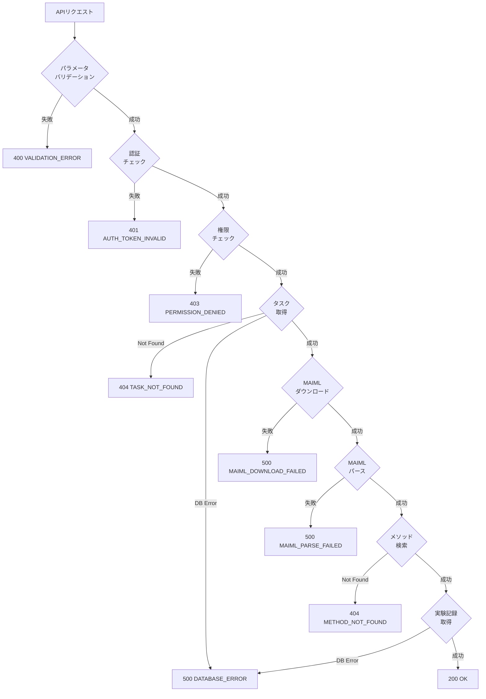

# Design Document: 進捗データ取得API

---
**Feature**: progress-data-retrieval-api  
**Version**: 1.0.0  
**Last Updated**: 2026-02-13  
**Status**: Design Phase
---

## Overview

本APIは、実験作業者画面における進捗データ取得機能を提供します。指定されたプロジェクト・メソッド・タスクに紐づくトランジションレベルの詳細な進捗情報を取得し、実験管理者および実験作業者が実験の現在の状態と完了度を正確に把握できるようにします。

**Purpose**: MAIMLファイルのPetri Net構造と実験記録データベースを統合し、トランジション単位の詳細な進捗情報を提供することで、実験管理者と実験作業者による効果的な進捗監視を実現する。

**Users**: 
- 実験管理者（experiment_admin）: チーム全体の進捗確認とタスク管理
- 実験作業者（experiment_worker）: 自身の作業進捗確認
- システム管理者（system_admin）: システム全体の監視

**Impact**: 既存の進捗確認画面に対して、トランジション単位の詳細進捗データ取得機能を追加することで、実験の進捗状況をより細かく把握できるようになります。

### Goals

- トランジション単位の進捗データ（status, progress, last_updated）を取得
- MAIMLファイルから動的にメソッド構造とトランジション情報を抽出
- 全体進捗率（overall_percentage）の自動計算
- マルチテナント分離とロールベースアクセス制御の実装
- パフォーマンス最適化（並列処理、効率的なDBクエリ）

### Non-Goals

- タスクステータスの更新機能（別APIで実装済み）
- 実験記録データの作成・編集機能（別APIで実装済み）
- リアルタイム通知機能（将来のPhaseで検討）
- 進捗データのキャッシュ機能（初期リリースでは不要、将来の最適化で検討）

## Architecture

### Existing Architecture Analysis

本機能は既存の進捗監視システムへの機能拡張として設計されています。

**既存のアーキテクチャパターン**:
- Controller-Service-Repository 3層アーキテクチャ
- ミドルウェアチェーン: `authMiddleware` → `permissionCheck` → Controller
- 統一レスポンス形式（success, data, meta）
- マルチテナント分離（organization_idによるデータ分離）

**統合ポイント**:
- `storageService`: MAIMLファイルのダウンロード（既存サービス再利用）
- `authMiddleware`: JWT認証とセッション検証（既存ミドルウェア再利用）
- データベーススキーマ: `project_task`, `experiment_record`, `project`テーブル（既存）

**技術的制約**:
- MAIMLパーサーは検証機能のみを提供（構造抽出機能は新規実装が必要）
- データベース接続は Kysely クエリビルダーを使用（既存パターン踏襲）
- すべてのDBクエリに`organization_id`フィルタが必須

### Architecture Pattern & Boundary Map

**選択されたパターン**: Controller-Service-Repository（既存パターン踏襲）

**理由**:
- コードの一貫性維持
- 既存チームの開発経験を活用
- テスト容易性の確保
- 関心の分離による保守性向上



**ドメイン境界**:
- **API境界**: ルート定義とミドルウェアチェーンで外部リクエストを制御
- **サービス境界**: ビジネスロジックとデータアクセスを分離
- **データ境界**: organization_idによるマルチテナント分離

**新規コンポーネントの理由**:
- `ProgressController`: 進捗データ取得専用のコントローラー
- `ProgressService`: MAIMLパース、DB取得、進捗計算を統合
- `parseMultipleMethodsStructure`: MAIML構造抽出ユーティリティ（新規実装）

### Technology Stack

| Layer | Choice / Version | Role in Feature | Notes |
|-------|------------------|-----------------|-------|
| Backend Framework | Express.js 4.18.3 | RESTful APIエンドポイント提供 | 既存 |
| Language | TypeScript 5.x | 型安全なコード実装 | 既存、any型禁止 |
| Database | PostgreSQL 18+ | タスク・実験記録データ管理 | 既存、Kyselyクエリビルダー使用 |
| ORM/Query Builder | Kysely | 型安全なSQLクエリ構築 | 既存パターン |
| Storage | S3/Swift | MAIMLファイルストレージ | 既存storageService使用 |
| XML Parser | fast-xml-parser | MAIML XMLパース | 既存、新規ユーティリティで活用 |
| Authentication | JWT + Session Hybrid | ユーザー認証・認可 | 既存authMiddleware |
| Logging | Winston | アプリケーションログ | 既存 |

**新規依存関係**: なし（既存の技術スタックを最大限活用）

## System Flows

### 進捗データ取得フロー



**フローレベルの決定事項**:
- **並列処理**: `Promise.all`を使用して複数トランジションのデータ取得を並列化（レスポンス時間短縮）
- **エラーハンドリング**: 各ステップで例外をキャッチし、適切なHTTPステータスコードとエラーメッセージを返却
- **タイムアウト**: データベース接続プール設定で制御（既存設定を使用）

## Requirements Traceability

| Requirement | Summary | Components | Interfaces | Flows |
|-------------|---------|------------|------------|-------|
| 1 | 進捗データ取得機能 | ProgressController, ProgressService, TaskRepository, ExperimentRecordRepository | API, Service | 進捗データ取得フロー |
| 2 | 認証と認可 | authMiddleware, permissionCheck | Middleware | 認証フロー |
| 3 | マルチテナントデータ分離 | すべてのRepository層 | Repository | - |
| 4 | MAIMLファイルとの連携 | parseMultipleMethodsStructure, StorageService | Utility, Service | 進捗データ取得フロー |
| 5 | データ取得とレスポンス生成 | ProgressService | Service | 進捗データ取得フロー |
| 6 | エラーハンドリング | ProgressController, ProgressService | API, Service | エラーレスポンスフロー |
| 7 | ログ記録と監査 | Winston Logger（全コンポーネント） | Logging | - |
| 8 | パフォーマンスと最適化 | ProgressService（Promise.all並列処理） | Service | 進捗データ取得フロー |
| 9 | データ整合性 | ProgressService（進捗計算ロジック） | Service | - |
| 10 | API仕様準拠 | ProgressController, Routes | API | - |

## Components and Interfaces

### Components Summary

| Component | Domain/Layer | Intent | Req Coverage | Key Dependencies (P0/P1) | Contracts |
|-----------|--------------|--------|--------------|--------------------------|-----------|
| ProgressController | API Layer | 進捗データ取得APIエンドポイント処理 | 1, 6, 10 | ProgressService (P0) | API |
| ProgressService | Service Layer | 進捗データ取得のビジネスロジック統合 | 1, 4, 5, 8, 9 | TaskRepository (P0), ExperimentRecordRepository (P0), StorageService (P0), parseMultipleMethodsStructure (P0) | Service |
| TaskRepository | Repository Layer | タスクデータアクセス | 1, 3 | Database (P0) | Repository |
| ExperimentRecordRepository | Repository Layer | 実験記録データアクセス | 1, 3, 5 | Database (P0) | Repository |
| parseMultipleMethodsStructure | Utility | MAIML構造抽出 | 4 | fast-xml-parser (P0) | Utility |
| progressRoutes | API Layer | ルート定義とミドルウェアチェーン | 2, 10 | authMiddleware (P0), permissionCheck (P0) | Route |

### API Layer

#### ProgressController

| Field | Detail |
|-------|--------|
| Intent | 進捗データ取得APIリクエストを処理し、統一レスポンス形式で返却 |
| Requirements | 1, 6, 10 |

**Responsibilities & Constraints**
- HTTPリクエストのバリデーション（projectId, methodId, taskNo）
- ProgressServiceの呼び出しとエラーハンドリング
- 統一レスポンス形式への変換（success, data, meta）
- HTTPステータスコードの設定（200, 400, 401, 403, 404, 500）
- トランザクション境界：なし（読み取り専用）

**Dependencies**
- Inbound: Express Router（API呼び出し）— リクエスト受信 (P0)
- Outbound: ProgressService — ビジネスロジック実行 (P0)
- Outbound: Winston Logger — ログ記録 (P1)

**Contracts**: API [✓] / Service [ ] / Event [ ] / Batch [ ] / State [ ]

##### API Contract

| Method | Endpoint | Request | Response | Errors |
|--------|----------|---------|----------|--------|
| GET | `/api/v1/progress/:projectId/:methodId/:taskNo` | Path: projectId (UUID), methodId (string), taskNo (integer) | ProgressDataResponse | 400, 401, 403, 404, 500 |

**Request Parameters**:
```typescript
interface ProgressRequestParams {
  projectId: string; // UUID形式
  methodId: string;  // MAIMLファイル内のmethod id
  taskNo: number;    // タスク連番
}
```

**Response Schema**:
```typescript
interface ProgressDataResponse {
  success: true;
  data: {
    project_id: string;
    project_name: string;
    method_id: string;
    method_name: string;
    task_no: number;
    task_name: string;
    transitions: TransitionProgress[];
    overall_progress: OverallProgress;
  };
  meta: {
    timestamp: string;      // ISO 8601
    requestId: string;
  };
}

interface TransitionProgress {
  transition_id: string;
  transition_name: string;
  status: 'not_started' | 'in_progress' | 'completed';
  progress: number;        // 0-100
  last_updated: string | null;  // ISO 8601 or null
  has_data: boolean;
  data_count: number;
}

interface OverallProgress {
  total_transitions: number;
  completed: number;
  in_progress: number;
  not_started: number;
  overall_percentage: number;  // 小数点第1位
}
```

**Error Response Schema**:
```typescript
interface ErrorResponse {
  success: false;
  error: {
    code: string;
    message: string;
    details?: string[];
  };
  meta: {
    timestamp: string;
    requestId: string;
  };
}
```

**Implementation Notes**
- **Integration**: authMiddleware → permissionCheck → controller.getProgressData
- **Validation**: UUID形式チェック（projectId）、整数チェック（taskNo）、文字列チェック（methodId）
- **Risks**: パラメータバリデーション漏れによる不正なリクエスト処理

#### progressRoutes

| Field | Detail |
|-------|--------|
| Intent | 進捗データ取得APIのルート定義とミドルウェアチェーン設定 |
| Requirements | 2, 10 |

**Responsibilities & Constraints**
- ルートパス定義：`/api/v1/progress/:projectId/:methodId/:taskNo`
- ミドルウェアチェーン適用：authMiddleware → permissionCheck → controller
- 許可ロール設定：experiment_admin, experiment_worker, system_admin

**Dependencies**
- Inbound: Express Application — ルート登録 (P0)
- Outbound: authMiddleware — JWT認証 (P0)
- Outbound: permissionCheck — 権限チェック (P0)
- Outbound: ProgressController — リクエスト処理 (P0)

**Contracts**: Route [✓]

**Implementation Notes**
```typescript
router.get(
  '/progress/:projectId/:methodId/:taskNo',
  authMiddleware,
  permissionCheck(['experiment_admin', 'experiment_worker', 'system_admin']),
  progressController.getProgressData
);
```

### Service Layer

#### ProgressService

| Field | Detail |
|-------|--------|
| Intent | 進捗データ取得のビジネスロジックを統合し、MAIMLパース、DB取得、進捗計算を実行 |
| Requirements | 1, 4, 5, 8, 9 |

**Responsibilities & Constraints**
- タスク基本情報の取得（TaskRepository経由）
- MAIMLファイルのダウンロードとパース（StorageService + parseMultipleMethodsStructure）
- 各トランジションの実験記録取得（ExperimentRecordRepository、並列処理）
- 全体進捗率の計算
- レスポンスデータの構築
- データ整合性の保証（ステータスと進捗率の対応）

**Dependencies**
- Inbound: ProgressController — サービス呼び出し (P0)
- Outbound: TaskRepository — タスクデータ取得 (P0)
- Outbound: ExperimentRecordRepository — 実験記録データ取得 (P0)
- Outbound: StorageService — MAIMLファイルダウンロード (P0)
- Outbound: parseMultipleMethodsStructure — MAIML構造抽出 (P0)
- Outbound: Winston Logger — ログ記録 (P1)

**Contracts**: Service [✓]

##### Service Interface

```typescript
interface ProgressService {
  getProgressData(
    projectId: string,
    methodId: string,
    taskNo: number,
    organizationId: string
  ): Promise<Result<ProgressData, ProgressServiceError>>;
}

interface ProgressData {
  project_id: string;
  project_name: string;
  method_id: string;
  method_name: string;
  task_no: number;
  task_name: string;
  transitions: TransitionProgress[];
  overall_progress: OverallProgress;
}

type ProgressServiceError =
  | { code: 'TASK_NOT_FOUND'; message: string }
  | { code: 'METHOD_NOT_FOUND'; message: string }
  | { code: 'MAIML_DOWNLOAD_FAILED'; message: string }
  | { code: 'MAIML_PARSE_FAILED'; message: string }
  | { code: 'DATABASE_ERROR'; message: string };
```

**Preconditions**:
- `projectId`は有効なUUID形式
- `methodId`は空でない文字列
- `taskNo`は正の整数
- `organizationId`は有効な組織ID

**Postconditions**:
- 成功時：完全なProgressDataオブジェクトを返却
- 失敗時：適切なエラーコードとメッセージを返却
- データ整合性：すべてのトランジションの進捗率は0-100の範囲

**Invariants**:
- overall_percentageは全トランジションの進捗率の平均値
- completedカウント + in_progressカウント + not_startedカウント = total_transitions
- ステータスがcompletedの場合、progressは100
- ステータスがnot_startedの場合、progressは0

**Implementation Notes**
- **Integration**: 
  - Promise.allで並列処理を実装（トランジションごとのデータ取得）
  - MAIMLファイルダウンロード失敗時は500エラー
  - メソッドが見つからない場合は404エラー
- **Validation**: 
  - タスク存在チェック（organization_idフィルタ必須）
  - メソッドID一致チェック
  - トランジションIDの有効性チェック
- **Risks**: 
  - 大規模MAIMLファイル（10MB超）のパース時間
  - トランジション数が多い（100+）場合の並列処理負荷
  - データベース接続プール枯渇

### Repository Layer

#### TaskRepository

| Field | Detail |
|-------|--------|
| Intent | project_taskテーブルへのデータアクセスを提供 |
| Requirements | 1, 3 |

**Responsibilities & Constraints**
- タスク基本情報の取得（projectテーブルとJOIN）
- organization_idによるデータ分離
- Kyselyクエリビルダーを使用した型安全なクエリ構築

**Dependencies**
- Inbound: ProgressService — データ取得依頼 (P0)
- Outbound: PostgreSQL Database — データストレージ (P0)

**Contracts**: Repository [✓]

**Implementation Notes**
```typescript
interface TaskRepository {
  getTaskByProjectMethodTaskNo(
    projectId: string,
    methodId: string,
    taskNo: number,
    organizationId: string
  ): Promise<TaskWithProject | null>;
}

interface TaskWithProject {
  task_id: string;
  task_name: string;
  project_id: string;
  project_name: string;
  method_id: string;
  task_no: number;
}

// クエリ例
db.selectFrom('project_task')
  .leftJoin('project', 'project_task.project_id', 'project.project_id')
  .where('project_task.project_id', '=', projectId)
  .where('project_task.method_id', '=', methodId)
  .where('project_task.task_no', '=', taskNo)
  .where('project_task.organization_id', '=', organizationId)  // 必須
  .select([
    'project_task.task_id',
    'project_task.task_name',
    'project_task.project_id',
    'project.project_name',
    'project_task.method_id',
    'project_task.task_no'
  ])
  .executeTakeFirst();
```

#### ExperimentRecordRepository

| Field | Detail |
|-------|--------|
| Intent | experiment_recordテーブルへのデータアクセスを提供 |
| Requirements | 1, 3, 5 |

**Responsibilities & Constraints**
- トランジションごとの最新実験記録取得
- トランジションごとのデータ件数取得
- organization_idによるデータ分離
- 効率的なクエリ実行（ORDER BY + LIMIT、COUNT集計）

**Dependencies**
- Inbound: ProgressService — データ取得依頼 (P0)
- Outbound: PostgreSQL Database — データストレージ (P0)

**Contracts**: Repository [✓]

**Implementation Notes**
```typescript
interface ExperimentRecordRepository {
  getLatestRecordByTransition(
    taskId: string,
    transitionId: string,
    organizationId: string
  ): Promise<ExperimentRecord | null>;
  
  countRecordsByTransition(
    taskId: string,
    transitionId: string,
    organizationId: string
  ): Promise<number>;
}

interface ExperimentRecord {
  record_id: string;
  status: 'not_started' | 'in_progress' | 'completed';
  progress: number;
  update_at: string;
}

// 最新レコード取得クエリ例
db.selectFrom('experiment_record')
  .where('task_id', '=', taskId)
  .where('transition_id', '=', transitionId)
  .where('organization_id', '=', organizationId)  // 必須
  .select(['record_id', 'status', 'progress', 'update_at'])
  .orderBy('update_at', 'desc')
  .limit(1)
  .executeTakeFirst();

// データ件数取得クエリ例
db.selectFrom('experiment_record')
  .where('task_id', '=', taskId)
  .where('transition_id', '=', transitionId)
  .where('organization_id', '=', organizationId)  // 必須
  .select(db.fn.count('record_id').as('count'))
  .executeTakeFirstOrThrow();
```

### Utility Layer

#### parseMultipleMethodsStructure

| Field | Detail |
|-------|--------|
| Intent | MAIMLファイルからメソッド構造とトランジション情報を抽出 |
| Requirements | 4 |

**Responsibilities & Constraints**
- fast-xml-parserを使用したXMLパース
- 複数メソッド対応（methods配列を返却）
- Petri Net構造の抽出（transitions配列）
- エラーハンドリング（XMLパースエラー、不正な構造）

**Dependencies**
- Inbound: ProgressService — 構造抽出依頼 (P0)
- Outbound: fast-xml-parser — XMLパース (P0)

**Contracts**: Utility [✓]

**Implementation Notes**
```typescript
interface ParsedMethod {
  methodId: string;
  methodName: string;
  petriNet: {
    transitions: PetriNetTransition[];
  };
}

interface PetriNetTransition {
  id: string;
  name: string;
}

function parseMultipleMethodsStructure(
  xmlContent: string
): Result<ParsedMethod[], ParseError> {
  // fast-xml-parserでパース
  // method要素を配列として扱う
  // petriNet > transitions を抽出
  // エラー時は適切なエラーを返却
}

// パースオプション
const parserOptions = {
  ignoreAttributes: false,
  attributeNamePrefix: '',
  allowBooleanAttributes: true,
  parseAttributeValue: true,
  trimValues: true,
  isArray: (name: string) => {
    return ['method', 'transition', 'place', 'arc'].includes(name);
  }
};
```

## Data Models

### Domain Model

本APIは既存のデータモデルを使用し、新規エンティティの追加は行いません。

**関連エンティティ**:
- **Task（タスク）**: 実験作業の単位、project_taskテーブルで管理
- **Experiment Record（実験記録）**: トランジションごとの実験データ、experiment_recordテーブルで管理
- **Project（プロジェクト）**: タスクの親エンティティ、projectテーブルで管理
- **Method（メソッド）**: MAIMLファイル内で定義される実験手法
- **Transition（トランジション）**: Petri Net内の処理ステップ、MAIMLファイルで定義

**集約ルート**: Task（project_taskテーブル）

**ビジネスルール**:
- タスクは必ず1つのプロジェクトと1つのメソッドに紐づく
- トランジションはメソッド内で一意
- 実験記録は必ずタスクとトランジションに紐づく
- organization_idによるマルチテナント分離が必須

### Logical Data Model

#### エンティティ関係



**カーディナリティ**:
- 1つのプロジェクトは複数のタスクを持つ（1:N）
- 1つのタスクは複数の実験記録を持つ（1:N）
- 1つのメソッドは複数のトランジションを定義（1:N）
- 1つのトランジションは複数の実験記録を持つ（1:N）

**参照整合性**:
- project_task.project_id → project.project_id（外部キー制約）
- experiment_record.task_id → project_task.task_id（外部キー制約）
- すべてのテーブルで organization_id による分離

### Physical Data Model

#### project_taskテーブル

| カラム名 | 型 | NULL | デフォルト | 説明 |
|---------|---|------|-----------|------|
| task_id | UUID | NOT NULL | - | 主キー |
| project_id | UUID | NOT NULL | - | プロジェクトID（外部キー） |
| method_id | VARCHAR(255) | NOT NULL | - | メソッドID（MAIMLファイル参照） |
| task_no | INTEGER | NOT NULL | - | タスク連番 |
| task_name | VARCHAR(255) | NOT NULL | - | タスク名 |
| organization_id | VARCHAR(255) | NOT NULL | - | 組織ID |
| create_at | TIMESTAMP | NOT NULL | CURRENT_TIMESTAMP | 作成日時 |
| update_at | TIMESTAMP | NOT NULL | CURRENT_TIMESTAMP | 更新日時 |

**インデックス**:
- PRIMARY KEY (task_id)
- INDEX idx_project_task_project (project_id, organization_id)
- INDEX idx_project_task_method (project_id, method_id, task_no, organization_id)

#### experiment_recordテーブル

| カラム名 | 型 | NULL | デフォルト | 説明 |
|---------|---|------|-----------|------|
| record_id | UUID | NOT NULL | - | 主キー |
| task_id | UUID | NOT NULL | - | タスクID（外部キー） |
| transition_id | VARCHAR(255) | NOT NULL | - | トランジションID |
| status | VARCHAR(50) | NULL | 'not_started' | ステータス |
| progress | INTEGER | NULL | 0 | 進捗率（0-100） |
| organization_id | VARCHAR(255) | NOT NULL | - | 組織ID |
| create_at | TIMESTAMP | NOT NULL | CURRENT_TIMESTAMP | 作成日時 |
| update_at | TIMESTAMP | NOT NULL | CURRENT_TIMESTAMP | 更新日時 |

**インデックス**:
- PRIMARY KEY (record_id)
- INDEX idx_experiment_record_task (task_id, organization_id)
- INDEX idx_experiment_record_transition (task_id, transition_id, organization_id)
- INDEX idx_experiment_record_update (task_id, transition_id, update_at DESC)

**パフォーマンス最適化**:
- 複合インデックス `idx_experiment_record_update` により、最新レコード取得クエリを高速化
- organization_id を含む複合インデックスでマルチテナント分離クエリを最適化

### Data Contracts & Integration

#### API Data Transfer

**Request**: URLパラメータのみ（GETメソッド）

**Response**: JSON形式、スネークケース命名規則

**バリデーション規則**:
- projectId: UUID v4形式
- methodId: 1-255文字の英数字とアンダースコア
- taskNo: 1以上の整数
- 全体進捗率: 0.0-100.0の範囲、小数点第1位

**シリアライゼーション形式**: JSON（Content-Type: application/json）

#### MAIML Data Contract

MAIMLファイルはXML形式で、以下の構造を持ちます：

```xml
<maiml>
  <methods>
    <method id="method1" name="合成実験">
      <petriNet>
        <transitions>
          <transition id="t1" name="材料準備" />
          <transition id="t2" name="反応実験" />
          <transition id="t3" name="結果測定" />
        </transitions>
      </petriNet>
    </method>
  </methods>
</maiml>
```

**データ抽出契約**:
- `method/@id` → ParsedMethod.methodId
- `method/@name` → ParsedMethod.methodName
- `transition/@id` → PetriNetTransition.id
- `transition/@name` → PetriNetTransition.name

## Error Handling

### Error Strategy

**階層的エラーハンドリング**:
1. **Utility Layer**: XMLパースエラー → `MAIML_PARSE_FAILED`
2. **Repository Layer**: DBエラー → `DATABASE_ERROR`
3. **Service Layer**: ビジネスロジックエラー → 具体的なエラーコード
4. **Controller Layer**: HTTP変換 → 適切なステータスコードとメッセージ

**エラー伝播**:
- 下位レイヤーから上位レイヤーへResult型で伝播
- 機密情報（DBスキーマ、スタックトレース）はクライアントに公開しない
- 詳細エラーはWinstonログに記録

### Error Categories and Responses

#### User Errors (4xx)

| Error Code | HTTP Status | Message | Cause | User Action |
|-----------|-------------|---------|-------|-------------|
| VALIDATION_ERROR | 400 | パラメータが不正です | UUID形式違反、整数型違反 | パラメータを修正して再試行 |
| AUTH_TOKEN_MISSING | 401 | 認証トークンが提供されていません | Authorizationヘッダーなし | ログインして再試行 |
| AUTH_TOKEN_INVALID | 401 | 認証トークンが無効です | JWT検証失敗 | 再ログイン |
| PERMISSION_DENIED | 403 | アクセス権限がありません | ロールが不適切 | 管理者に権限を依頼 |
| TASK_NOT_FOUND | 404 | タスクが見つかりません | タスクが存在しない、または異なる組織 | タスクIDを確認 |
| METHOD_NOT_FOUND | 404 | メソッドが見つかりません | MAIMLファイルに指定メソッドなし | メソッドIDを確認 |

#### System Errors (5xx)

| Error Code | HTTP Status | Message | Cause | Recovery |
|-----------|-------------|---------|-------|----------|
| MAIML_DOWNLOAD_FAILED | 500 | MAIMLファイルのダウンロードに失敗しました | S3/Swift接続エラー | リトライ、ストレージ状態確認 |
| MAIML_PARSE_FAILED | 500 | MAIMLファイルの解析に失敗しました | XML構文エラー | ファイル修復、管理者に連絡 |
| DATABASE_ERROR | 500 | データベースエラーが発生しました | DB接続エラー、クエリエラー | リトライ、DB状態確認 |
| SYSTEM_ERROR | 500 | システムエラーが発生しました | 予期しない例外 | 管理者に連絡 |

**エラーレスポンス例**:
```json
{
  "success": false,
  "error": {
    "code": "TASK_NOT_FOUND",
    "message": "タスクが見つかりません",
    "details": ["projectId: 550e8400-e29b-41d4-a716-446655440000"]
  },
  "meta": {
    "timestamp": "2026-02-13T20:00:00Z",
    "requestId": "req_abc123"
  }
}
```

### Error Handling Flow



### Monitoring

**ログレベル**:
- **ERROR**: 500エラー、予期しない例外
- **WARN**: 404エラー、リトライ可能なエラー
- **INFO**: 正常レスポンス、処理時間
- **DEBUG**: DBクエリ、MAIML構造解析詳細

**監視項目**:
- エラー率（5xx / 全リクエスト）
- レスポンスタイム（P50, P95, P99）
- 404エラー率（データ整合性の指標）
- DB接続プールの使用率
- MAIMLファイルダウンロード失敗率

**アラート条件**:
- 5xxエラー率が5%を超える
- P95レスポンスタイムが3秒を超える
- DB接続プールが80%を超える
- MAIMLダウンロード失敗が連続3回

## Testing Strategy

### Unit Tests

**ProgressController**:
- パラメータバリデーション（UUID形式、整数型、文字列型）
- ProgressService呼び出しの正常系・異常系
- エラーレスポンス形式の検証
- HTTPステータスコードの検証

**ProgressService**:
- 進捗計算ロジック（overall_percentage算出）
- ステータス判定ロジック（not_started/in_progress/completed）
- データ整合性チェック（Invariants検証）
- エラーハンドリング（各種エラーケース）
- 並列処理の正常動作確認

**TaskRepository**:
- タスク取得クエリの正常系・異常系
- organization_idフィルタの動作確認
- JOINクエリの結果検証

**ExperimentRecordRepository**:
- 最新レコード取得の正常系・異常系
- データ件数取得の正常系・異常系
- organization_idフィルタの動作確認

**parseMultipleMethodsStructure**:
- 正常なMAIMLファイルのパース
- 不正なXML構造のエラーハンドリング
- メソッドが存在しない場合のエラーハンドリング
- 複数メソッド対応の検証

**目標カバレッジ**: 70%以上（Requirement 7準拠）

### Integration Tests

**API統合テスト**:
- 認証ミドルウェアチェーンの動作確認
- 権限チェックの動作確認（各ロール）
- マルチテナント分離の検証（クロステナントアクセス防止）
- エンドツーエンドの正常系フロー
- 各種エラーケースのエンドツーエンドフロー

**データベース統合テスト**:
- トランザクション境界の確認（本APIは読み取り専用）
- 複数トランジションの並列取得の動作確認
- インデックス使用の検証（EXPLAIN ANALYZE）

**ストレージ統合テスト**:
- MAIMLファイルダウンロードの正常系・異常系
- 署名付きURL生成（将来実装時）
- S3/Swift両環境での動作確認

**テストシナリオ例**:
```typescript
describe('GET /api/v1/progress/:projectId/:methodId/:taskNo', () => {
  it('正常系: 進捗データを取得できる', async () => {
    // Given: 有効なタスクとトランジションデータが存在
    // When: APIをリクエスト
    // Then: 200 OKと完全なProgressDataを返却
  });

  it('異常系: タスクが存在しない場合は404を返す', async () => {
    // Given: 存在しないタスクID
    // When: APIをリクエスト
    // Then: 404 TASK_NOT_FOUNDを返却
  });

  it('異常系: 異なる組織のタスクにアクセスできない', async () => {
    // Given: 異なる組織のタスクID
    // When: APIをリクエスト
    // Then: 404 TASK_NOT_FOUNDを返却（存在しないとして扱う）
  });

  it('異常系: メソッドが見つからない場合は404を返す', async () => {
    // Given: 有効なタスクだが、MAIMLに存在しないメソッドID
    // When: APIをリクエスト
    // Then: 404 METHOD_NOT_FOUNDを返却
  });
});
```

### Performance Tests

**負荷テスト**:
- 同時リクエスト数: 100リクエスト/秒
- 目標レスポンスタイム: P95 < 1秒
- トランジション数: 10-100の範囲でテスト
- MAIMLファイルサイズ: 1KB-10MBの範囲でテスト

**ボトルネック検証**:
- DB接続プールの枯渇確認
- 並列処理の効率確認（Promise.all）
- MAIMLパースのパフォーマンス確認

**ストレステスト**:
- 長時間稼働テスト（24時間）
- メモリリーク確認
- データベース接続リーク確認

## Security Considerations

### マルチテナント分離

**必須チェック**:
- すべてのDBクエリに organization_id フィルタを含める
- クロステナントアクセスを厳禁（System Admin以外）
- 異なる組織のタスクIDが指定された場合は404を返却（存在しないとして扱う）

**コードレビューチェックリスト**:
- [ ] TaskRepository のクエリに organization_id フィルタがある
- [ ] ExperimentRecordRepository のクエリに organization_id フィルタがある
- [ ] organization_id は req.user から取得している
- [ ] organization_id のバリデーションを実施している

### データ保護

- 実験記録データは機密情報として扱う
- エラーメッセージに機密情報（内部パス、DBスキーマ）を含めない
- スタックトレースはクライアントに公開しない（ログのみ）
- 署名付きURL使用時は有効期限を適切に設定（1時間推奨）

### 認証・認可

- JWT + Session Hybrid認証を使用
- 許可ロール: experiment_admin, experiment_worker, system_admin
- セッション有効期限を検証
- 無効なトークンは即座に拒否

## Performance & Scalability

### ターゲットメトリクス

| メトリクス | 目標値 | 測定方法 |
|----------|--------|---------|
| レスポンスタイム（P50） | < 500ms | APM |
| レスポンスタイム（P95） | < 1s | APM |
| レスポンスタイム（P99） | < 3s | APM |
| スループット | 100 req/s | 負荷テスト |
| エラー率 | < 1% | ログ集計 |
| DB接続プール使用率 | < 80% | PostgreSQL監視 |

### スケーリングアプローチ

**水平スケーリング**:
- アプリケーションサーバーのインスタンス数を増加
- ロードバランサーで負荷分散
- ステートレス設計により容易にスケール

**垂直スケーリング**:
- データベースのスペック向上（CPU、メモリ）
- 接続プール数の調整

### 最適化技術

**クエリ最適化**:
- 複合インデックスの活用
- 必要なカラムのみSELECT
- JOIN回数の最小化

**並列処理**:
- Promise.allによるトランジションデータ取得の並列化
- データベース接続プールで並列クエリをサポート

**キャッシュ戦略（将来実装）**:
- MAIMLファイルのメモリキャッシュ（TTL: 5分）
- 進捗データのキャッシュ（TTL: 30秒、実験作業者画面リフレッシュ頻度に合わせる）
- Redis使用を検討

## Supporting References

### 内部ドキュメント

- [API進捗監視仕様書](../../../docs/design/api/api_progress_monitoring.md) - 詳細なAPI仕様
- [セキュリティ規約](../../../.clinerules/development/security.md) - マルチテナント分離の詳細
- [バックエンド規約](../../../.clinerules/development/backend.md) - アーキテクチャパターン
- [データベース構造](../../../.clinerules/references/db_structure.md) - テーブル定義
- [Research Log](./research.md) - 技術調査と設計決定の背景

### 技術リファレンス

- [Express.js Documentation](https://expressjs.com/) - フレームワーク公式ドキュメント
- [Kysely Documentation](https://kysely.dev/) - クエリビルダー公式ドキュメント
- [fast-xml-parser Documentation](https://github.com/NaturalIntelligence/fast-xml-parser) - XMLパーサー公式ドキュメント
- [PostgreSQL Performance Tips](https://wiki.postgresql.org/wiki/Performance_Optimization) - パフォーマンス最適化
