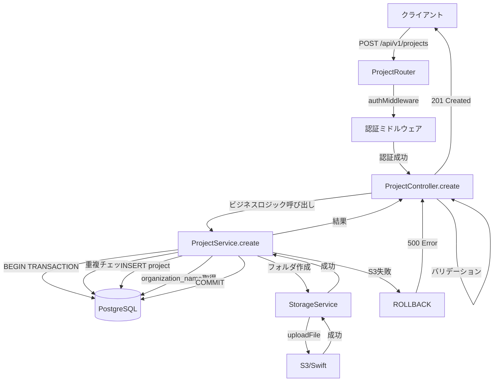
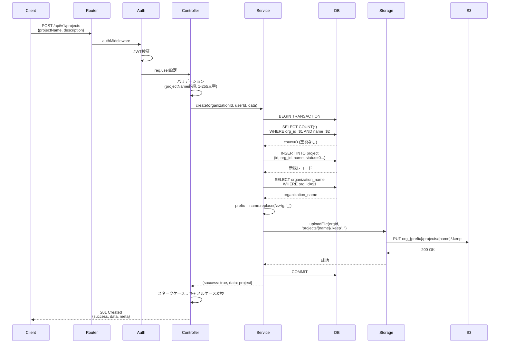
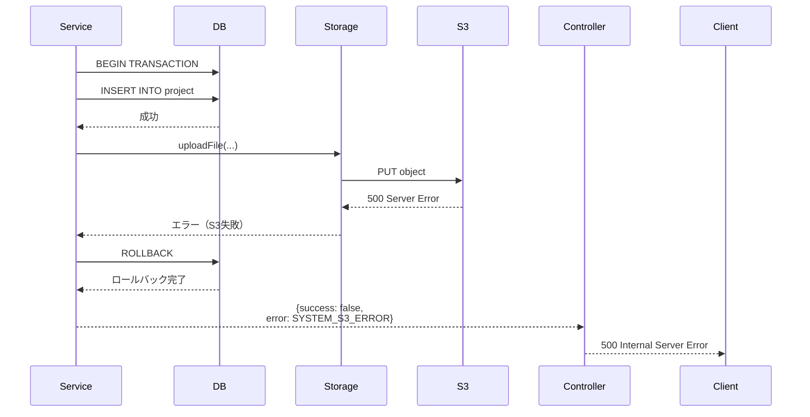

# Design Document: プロジェクト作成API

## Overview

**Purpose**: プロジェクト管理画面において、実験管理者（Experiment Admin）が新しいプロジェクトを作成できる機能を提供します。本APIは、データベースへのプロジェクト登録とS3上のプロジェクトフォルダ作成を統合的に処理し、マルチテナント分離とデータ整合性を保証します。

**Users**: 
- **実験管理者（Experiment Admin）**: プロジェクト計画の開始、実験ワークフローの管理
- **データ管理者（Data Admin）**: 組織全体のプロジェクト管理
- **System Admin**: 全組織のプロジェクト管理

**Impact**: 既存のGET /api/v1/projects（プロジェクト一覧取得）に対応する作成機能を追加します。データベース（projectテーブル）とS3ストレージの両方に変更を加えます。

### Goals

- プロジェクト情報のデータベース登録（UUID、名前、説明、ステータス等）
- S3上のプロジェクトフォルダ自動作成（`org_{org_prefix}/projects/{name}/`）
- データベースとS3の一貫性保証（トランザクション管理）
- マルチテナント分離の維持（organization_id必須フィルタ）
- 入力バリデーションとエラーハンドリング
- 目標レスポンスタイム300ms以内

### Non-Goals

- プロジェクト編集・削除機能（別APIで実装）
- プロジェクトメンバー管理（将来の拡張）
- プロジェクトテンプレート機能（Phase 2以降）
- 一括プロジェクト作成（現時点では不要）

---

## Architecture

### Existing Architecture Analysis

本機能は既存のプロジェクト管理システムを拡張します。

**現在の構成**:
- **Controller-Service-Router 3層アーキテクチャ**: 既に確立済み
- **ProjectController**: GET /api/v1/projectsを実装済み
- **ProjectService**: list()メソッドでプロジェクト一覧取得を実装
- **ProjectRoutes**: authMiddleware適用済み

**既存パターンとの統合**:
- 同じProjectController、ProjectService、ProjectRoutesを拡張
- 既存のServiceResult<T>型とエラーハンドリングパターンを踏襲
- storageService（S3/Swift統合）を活用

### Architecture Pattern & Boundary Map



**Architecture Integration**:
- **選択パターン**: Controller-Service-Router（既存）
- **Domain/Feature Boundaries**: 
  - Router層: ルーティング、認証、基本バリデーション
  - Controller層: リクエスト処理、詳細バリデーション、レスポンス生成
  - Service層: ビジネスロジック、トランザクション管理、データ操作
  - Storage Service: S3/Swift抽象化、マルチテナント分離
- **既存パターン**: ServiceResult<T>、統一エラーレスポンス、キャメルケース変換
- **新規追加**: トランザクション管理（BEGIN/COMMIT/ROLLBACK）
- **Steering Compliance**: レイヤードアーキテクチャ、Parameterized Queries、マルチテナント分離

### Technology Stack

| Layer | Choice / Version | Role in Feature | Notes |
|-------|------------------|-----------------|-------|
| Backend Framework | Express.js 4.18+ | HTTPリクエスト処理、ルーティング | 既存 |
| Language | TypeScript 4.9+ | 型安全な実装 | 既存 |
| Database | PostgreSQL 13+ | プロジェクトデータ永続化、トランザクション管理 | 既存、ACID特性を活用 |
| Storage | AWS S3 / OpenStack Swift | プロジェクトフォルダ作成 | 既存storageService使用 |
| Validation | express-validator | 入力バリデーション | 既存パターン |
| UUID | uuid v4 | プロジェクトID生成、requestId生成 | 既存 |
| Database Client | pg (node-postgres) | PostgreSQL接続プール | 既存 |
| AWS SDK | @aws-sdk/client-s3 v3 | S3操作 | 既存storageService経由 |

---

## System Flows

### プロジェクト作成フロー（成功ケース）



### エラーハンドリングフロー（S3失敗時）



**Key Decisions**:
- トランザクション内でS3操作を実行し、失敗時は即座にロールバック
- 重複チェックはトランザクション内で実施（レースコンディション対策）
- organization_nameクエリはトランザクション内（データ一貫性）

---

## Requirements Traceability

| Requirement | Summary | Components | Interfaces | Flows |
|-------------|---------|------------|------------|-------|
| 1.1, 1.2 | プロジェクト作成機能 | ProjectService.create | ServiceInterface, DBQuery | 成功ケース |
| 1.3, 1.4, 1.5 | S3フォルダ作成とロールバック | ProjectService.create, StorageService | StorageInterface | 成功/エラーケース |
| 2.1-2.6 | 入力バリデーション | ProjectController.create | ValidationRules | - |
| 3.1-3.5 | 認証・認可 | authMiddleware, ProjectController | AuthInterface | 成功ケース |
| 4.1-4.5 | マルチテナント分離 | 全コンポーネント | - | 全フロー |
| 5.1-5.5 | データ整合性とトランザクション | ProjectService.create | TransactionInterface | 成功/エラーケース |
| 6.1-6.6 | デフォルト値とビジネスルール | ProjectService.create | - | 成功ケース |
| 7.1-7.7 | エラーハンドリング | ProjectController.create | ErrorResponse | エラーケース |
| 8.1-8.5 | S3統合 | StorageService | StorageInterface | 成功/エラーケース |
| 9.1-9.6 | レスポンス生成 | ProjectController.create | APIResponse | 成功ケース |
| 10.1-10.5 | パフォーマンス | 全コンポーネント | - | 全フロー |

---

## Components and Interfaces

### コンポーネント概要

| Component | Domain/Layer | Intent | Req Coverage | Key Dependencies (Criticality) | Contracts |
|-----------|--------------|--------|--------------|-------------------------------|-----------|
| ProjectRouter | API層 | ルーティング、認証適用 | 3.1 | authMiddleware (P0), express-validator (P0) | API |
| ProjectController.create | Controller層 | リクエスト処理、バリデーション、レスポンス | 2.1-2.6, 7.1-7.7, 9.1-9.6 | ProjectService (P0) | Service, API |
| ProjectService.create | Service層 | ビジネスロジック、トランザクション管理 | 1.1-1.5, 5.1-5.5, 6.1-6.6 | PostgreSQL (P0), StorageService (P0) | Service, DB |
| StorageService | Infrastructure層 | S3/Swift統合、マルチテナント分離 | 8.1-8.5 | S3Client (P0) | Service |

---

### API層

#### ProjectRouter

| Field | Detail |
|-------|--------|
| Intent | プロジェクト作成エンドポイントの定義とミドルウェア適用 |
| Requirements | 3.1 |

**Responsibilities & Constraints**
- POST /api/v1/projectsエンドポイントの定義
- authMiddleware適用（JWT認証）
- express-validatorによる基本バリデーション適用

**Dependencies**
- Inbound: HTTPリクエスト（クライアント） - ルーティング対象 (P0)
- Outbound: ProjectController.create - 処理委譲 (P0)
- External: express-validator - 入力バリデーション (P0)

**Contracts**: API [x]

##### API Contract

| Method | Endpoint | Request | Response | Errors |
|--------|----------|---------|----------|--------|
| POST | /api/v1/projects | CreateProjectRequest | ProjectResponse | 400, 401, 403, 409, 500 |

**CreateProjectRequest**:
```typescript
interface CreateProjectRequest {
  projectName: string;      // 必須, 1-255文字
  description?: string;     // オプション, 最大1000文字
}
```

**ProjectResponse (201 Created)**:
```typescript
interface ProjectResponse {
  success: true;
  data: {
    organizationId: string;
    projectId: string;
    projectName: string;
    description: string | null;
    departmentId: string | null;
    ownerUserId: string;
    projectStatus: number;
    projectStatusName: string;
    projectMaimlFlg: boolean;
    checkoutStatus: number;
    checkoutStatusName: string;
    createAt: string;  // ISO 8601
  };
  meta: {
    timestamp: string;
    requestId: string;
  };
}
```

**ErrorResponse (4xx, 5xx)**:
```typescript
interface ErrorResponse {
  success: false;
  error: {
    code: string;
    message: string;
    details?: Array<{
      field: string;
      message: string;
      code: string;
    }>;
  };
  meta: {
    timestamp: string;
    requestId: string;
  };
}
```

**Implementation Notes**
- Integration: authMiddlewareで認証、express-validatorで基本バリデーション
- Validation: projectName必須、1-255文字、descriptionオプション最大1000文字
- Risks: なし（既存パターンの拡張）

---

### Controller層

#### ProjectController.create

| Field | Detail |
|-------|--------|
| Intent | リクエスト処理、詳細バリデーション、Service層呼び出し、レスポンス生成 |
| Requirements | 2.1-2.6, 7.1-7.7, 9.1-9.6 |

**Responsibilities & Constraints**
- リクエストボディからprojectName、descriptionを抽出
- 詳細バリデーション（文字数、形式、必須チェック）
- req.userからorganizationId、userId、departmentIdを取得
- ProjectService.createメソッド呼び出し
- ServiceResultからHTTPレスポンスへの変換
- エラーハンドリングとログ記録

**Dependencies**
- Inbound: ProjectRouter - HTTPリクエスト (P0)
- Outbound: ProjectService.create - ビジネスロジック (P0)
- External: uuid - requestId生成 (P0), logger - エラーログ (P1)

**Contracts**: Service [x] / API [x]

##### Service Interface
```typescript
interface ProjectControllerService {
  create(req: Request, res: Response): Promise<void>;
}
```

**Preconditions**:
- req.userが設定されている（authMiddlewareで保証）
- req.bodyにprojectNameが含まれる

**Postconditions**:
- 成功時: 201 Createdと作成されたプロジェクト情報を返却
- 失敗時: 適切なHTTPステータスコードとエラー情報を返却

**Invariants**:
- レスポンスは必ず統一されたJSON形式（success, data/error, meta）

**Implementation Notes**
- Integration: 既存のProjectController.listと同じファイルに実装
- Validation: projectName必須（1-255文字）、description任意（最大1000文字）、制御文字チェック
- Risks: 複雑なバリデーションロジックによるコード増加（対策: バリデーション関数を分離）

---

### Service層

#### ProjectService.create

| Field | Detail |
|-------|--------|
| Intent | プロジェクト作成のビジネスロジックとトランザクション管理 |
| Requirements | 1.1-1.5, 5.1-5.5, 6.1-6.6, 8.1-8.5 |

**Responsibilities & Constraints**
- トランザクション制御（BEGIN/COMMIT/ROLLBACK）
- プロジェクト名重複チェック（同一organization_id内）
- プロジェクトレコードINSERT（デフォルト値設定）
- organization_name取得とプレフィックス生成
- S3フォルダ作成（StorageService経由）
- スネークケース→キャメルケース変換
- エラーハンドリングとロールバック

**Dependencies**
- Inbound: ProjectController.create - リクエスト処理 (P0)
- Outbound: PostgreSQL - データ永続化 (P0), StorageService - S3操作 (P0)
- External: uuid - projectId生成 (P0), getPool - DB接続 (P0)

**Contracts**: Service [x]

##### Service Interface
```typescript
interface ProjectService {
  create(
    organizationId: string,
    userId: string,
    departmentId: string | null,
    data: CreateProjectData
  ): Promise<ServiceResult<Project>>;
}

interface CreateProjectData {
  projectName: string;
  description?: string;
}

interface ServiceResult<T> {
  success: boolean;
  data?: T;
  error?: {
    code: string;
    message: string;
    originalError?: Error;
  };
}

interface Project {
  organizationId: string;
  projectId: string;
  projectName: string;
  description: string | null;
  departmentId: string | null;
  ownerUserId: string;
  projectStatus: number;
  projectStatusName: string;
  projectMaimlFlg: boolean;
  checkoutStatus: number;
  checkoutStatusName: string;
  createAt: string;
}
```

**Preconditions**:
- organizationIdはUUID v4形式
- userIdはUUID v4形式
- projectNameは1-255文字
- descriptionは最大1000文字（オプション）

**Postconditions**:
- 成功時: projectテーブルに新規レコード作成、S3にフォルダ作成
- 失敗時: トランザクションロールバック、エラー情報返却

**Invariants**:
- トランザクション内の処理は全て成功するか、全て失敗する（ACID特性）
- organization_idフィルタが全てのクエリに適用される

**Implementation Notes**
- Integration: 
  - PostgreSQL接続プール（getPool()）を使用
  - storageService.uploadFileでS3フォルダ作成
  - トランザクション処理フロー:
    1. BEGIN TRANSACTION
    2. 重複チェックSELECT（Parameterized Query）
    3. プロジェクトINSERT（Parameterized Query）
    4. organization_name取得SELECT
    5. storageService.uploadFile（`projects/{name}/.keep`）
    6. S3成功 → COMMIT、S3失敗 → ROLLBACK

- Validation:
  - プロジェクト名重複: SELECT COUNT(*) WHERE organization_id=$1 AND project_name=$2
  - COUNT > 0の場合は409エラー

- Risks:
  - **Risk 1**: S3エラー時のロールバック遅延
    - Mitigation: S3操作タイムアウト3秒、トランザクション保持時間監視
  - **Risk 2**: 並行リクエストによる重複
    - Mitigation: UNIQUE制約（organization_id, project_name）併用
  - **Risk 3**: organization_name取得のパフォーマンス
    - Mitigation: 主キー検索で高速、キャッシュは将来検討

---

### Infrastructure層

#### StorageService

| Field | Detail |
|-------|--------|
| Intent | S3/Swift統合とマルチテナント分離 |
| Requirements | 8.1-8.5 |

**Responsibilities & Constraints**
- マルチテナント対応キー生成（`org_{organizationId}/{filePath}`）
- S3/Swift両対応（環境変数で切り替え）
- uploadFile、downloadFile、deleteFile等のメソッド提供
- エラーハンドリング

**Dependencies**
- Inbound: ProjectService.create - S3操作要求 (P0)
- Outbound: S3/Swift - ストレージ操作 (P0)
- External: @aws-sdk/client-s3 - S3操作 (P0)

**Contracts**: Service [x]

##### Service Interface
```typescript
interface StorageService {
  uploadFile(
    organizationId: string,
    filePath: string,
    fileContent: Buffer | Readable | string,
    options?: UploadOptions
  ): Promise<string>;
  
  fileExists(
    organizationId: string,
    filePath: string
  ): Promise<boolean>;
}

interface UploadOptions {
  contentType?: string;
  metadata?: Record<string, string>;
}
```

**Preconditions**:
- organizationIdは有効なUUID v4
- filePathは相対パス（先頭/なし）

**Postconditions**:
- uploadFile成功時: S3/Swiftにファイル作成、キーを返却
- uploadFile失敗時: エラーをthrow

**Invariants**:
- 全てのファイルパスに`org_{organizationId}`プレフィックスが自動付与される

**Implementation Notes**
- Integration: 既存実装を使用（変更なし）
- 使用方法: `storageService.uploadFile(organizationId, 'projects/{name}/.keep', '')`
- Risks: S3の一時的な利用不可（Mitigation: リトライロジック、監視アラート）

---

## Data Models

### Domain Model

**Aggregate Root**: Project

**Entities**:
- **Project**: プロジェクトの基本情報とステータス

**Value Objects**:
- **ProjectName**: 1-255文字の文字列、同一組織内でユニーク
- **Description**: 最大1000文字の任意文字列

**Domain Events**:
- **ProjectCreated**: プロジェクト作成時に発行（将来の拡張）

**Business Rules & Invariants**:
- プロジェクト名は同一組織内でユニーク
- プロジェクトステータスは0（計画中）から開始
- チェックアウトステータスは0（チェックイン中）から開始
- owner_user_idは作成者のユーザーIDに設定
- department_idは作成者の部門ID（未設定の場合NULL）

**Transactional Boundaries**:
- プロジェクト作成は単一トランザクション
- S3フォルダ作成失敗時はロールバック

---

### Logical Data Model

**Structure Definition**:

```
project (テーブル)
├── project_id (UUID, PK)
├── organization_id (UUID, FK → organization.organization_id)
├── project_name (VARCHAR(255))
├── description (TEXT, NULL)
├── department_id (UUID, FK → department.department_id, NULL)
├── owner_user_id (UUID, FK → user_authentication.user_id)
├── project_status (INTEGER, FK → code_master)
├── checkout_status (INTEGER, FK → code_master)
├── project_maiml_flg (BOOLEAN)
└── create_at (TIMESTAMP)
```

**Relationships & Cardinality**:
- project.organization_id → organization.organization_id (N:1, 必須)
- project.owner_user_id → user_authentication.user_id (N:1, 必須)
- project.department_id → department.department_id (N:1, 任意)
- project.project_status → code_master (N:1, 必須)
- project.checkout_status → code_master (N:1, 必須)

**Referential Integrity Rules**:
- organization_id: DELETE RESTRICT（組織削除時はプロジェクトが存在すると削除不可）
- owner_user_id: DELETE RESTRICT（ユーザー削除時はプロジェクトが存在すると削除不可）
- department_id: DELETE SET NULL（部門削除時はNULLに設定）

---

### Physical Data Model

#### projectテーブル（既存）

**Table Definition**:
```sql
CREATE TABLE project (
  project_id UUID PRIMARY KEY,
  organization_id UUID NOT NULL,
  project_name VARCHAR(255) NOT NULL,
  description TEXT,
  department_id UUID,
  owner_user_id UUID NOT NULL,
  project_status INTEGER NOT NULL,
  checkout_status INTEGER NOT NULL,
  project_maiml_flg BOOLEAN NOT NULL DEFAULT false,
  create_at TIMESTAMP NOT NULL DEFAULT CURRENT_TIMESTAMP,
  
  CONSTRAINT fk_project_organization 
    FOREIGN KEY (organization_id) 
    REFERENCES organization(organization_id),
  
  CONSTRAINT fk_project_owner 
    FOREIGN KEY (owner_user_id) 
    REFERENCES user_authentication(user_id),
  
  CONSTRAINT fk_project_department 
    FOREIGN KEY (department_id) 
    REFERENCES department(department_id) 
    ON DELETE SET NULL,
  
  CONSTRAINT unique_project_name_per_org 
    UNIQUE (organization_id, project_name)
);
```

**Primary/Foreign Keys**:
- PK: project_id (UUID)
- FK: organization_id, owner_user_id, department_id

**Indexes** (既存):
```sql
CREATE INDEX idx_project_organization_id ON project(organization_id);
CREATE INDEX idx_project_owner_user_id ON project(owner_user_id);
CREATE INDEX idx_project_create_at ON project(create_at);
CREATE UNIQUE INDEX idx_unique_project_name_per_org 
  ON project(organization_id, project_name);
```

**Performance Optimizations**:
- organization_idインデックス: 組織フィルタ高速化
- UNIQUE制約インデックス: 重複チェック高速化、レースコンディション防止

---

### Data Contracts & Integration

#### Request Schema
```typescript
interface CreateProjectRequestSchema {
  projectName: string;      // 1-255文字、必須
  description?: string;     // 最大1000文字、任意
}
```

**Validation Rules**:
- projectName: required, string, min 1, max 255, no control characters
- description: optional, string, max 1000

**Serialization Format**: JSON（application/json）

#### Response Schema
```typescript
interface CreateProjectResponseSchema {
  success: boolean;
  data: {
    organizationId: string;     // UUID v4
    projectId: string;          // UUID v4
    projectName: string;
    description: string | null;
    departmentId: string | null;  // UUID v4
    ownerUserId: string;        // UUID v4
    projectStatus: number;
    projectStatusName: string;
    projectMaimlFlg: boolean;
    checkoutStatus: number;
    checkoutStatusName: string;
    createAt: string;           // ISO 8601
  };
  meta: {
    timestamp: string;          // ISO 8601
    requestId: string;          // UUID v4
  };
}
```

**Schema Versioning Strategy**: APIバージョニング（/api/v1/）で管理

**Backward/Forward Compatibility**:
- レスポンスに新しいフィールド追加は互換性あり
- 既存フィールドの削除・型変更は破壊的変更（バージョンアップ必要）

---

## Error Handling

### Error Strategy

**Error Categories**:

1. **User Errors (4xx)**:
   - **400 Bad Request**: バリデーションエラー
     - VALIDATION_REQUIRED_FIELD: 必須フィールド未入力
     - VALIDATION_STRING_LENGTH: 文字数制限違反
     - VALIDATION_INVALID_FORMAT: 形式エラー
   - **401 Unauthorized**: 認証エラー
     - AUTH_TOKEN_INVALID: トークン無効
     - AUTH_TOKEN_EXPIRED: トークン期限切れ
   - **403 Forbidden**: 権限エラー
     - PERMISSION_INSUFFICIENT: 権限不足（Worker等）
   - **409 Conflict**: ビジネスルール違反
     - BUSINESS_DUPLICATE_PROJECT_NAME: プロジェクト名重複

2. **System Errors (5xx)**:
   - **500 Internal Server Error**: システムエラー
     - SYSTEM_DATABASE_ERROR: データベースエラー
     - SYSTEM_S3_ERROR: S3エラー
     - SYSTEM_ERROR: 予期しないエラー

**Error Response Format**:
```typescript
interface ErrorResponse {
  success: false;
  error: {
    code: string;              // エラーコード
    message: string;           // ユーザー向けメッセージ
    details?: Array<{          // バリデーションエラー詳細（任意）
      field: string;           // エラーフィールド名
      message: string;         // フィールドエラーメッセージ
      code: string;            // フィールドエラーコード
    }>;
  };
  meta: {
    timestamp: string;         // ISO 8601
    requestId: string;         // UUID v4（トレーシング用）
  };
}
```

### Error Categories and Responses

**User Errors (4xx)**:

| HTTP Status | Error Code | Message | Recovery Action |
|-------------|-----------|---------|-----------------|
| 400 | VALIDATION_REQUIRED_FIELD | projectNameは必須です | projectNameを入力 |
| 400 | VALIDATION_STRING_LENGTH | projectNameは1〜255文字である必要があります | 文字数を調整 |
| 400 | VALIDATION_STRING_TOO_LONG | descriptionは最大1000文字です | 文字数を削減 |
| 400 | VALIDATION_INVALID_FORMAT | projectNameに不正な文字が含まれています | 制御文字を削除 |
| 401 | AUTH_TOKEN_INVALID | 認証トークンが無効です | 再ログイン |
| 401 | AUTH_TOKEN_EXPIRED | 認証トークンの有効期限が切れています | 再ログイン |
| 403 | PERMISSION_INSUFFICIENT | この操作を実行する権限がありません | 管理者に権限付与を依頼 |
| 409 | BUSINESS_DUPLICATE_PROJECT_NAME | 同じプロジェクト名が既に存在します | 別のプロジェクト名を使用 |

**System Errors (5xx)**:

| HTTP Status | Error Code | Message | Internal Action |
|-------------|-----------|---------|-----------------|
| 500 | SYSTEM_DATABASE_ERROR | データベースエラーが発生しました | ログ記録、アラート通知 |
| 500 | SYSTEM_S3_ERROR | ストレージエラーが発生しました | ログ記録、アラート通知、ロールバック |
| 500 | SYSTEM_ERROR | システムエラーが発生しました | ログ記録、スタックトレース |

### Monitoring

**Error Tracking**:
- エラーコードごとの発生件数（CloudWatch Metrics）
- エラー率の監視（目標: < 1%）
- S3エラー率の個別監視（目標: < 0.5%）

**Logging**:
```typescript
{
  level: 'error',
  message: 'Project creation failed',
  requestId: 'uuid-v4',
  userId: 'uuid-v4',
  organizationId: 'uuid-v4',
  projectName: 'sample_project',
  errorCode: 'SYSTEM_S3_ERROR',
  errorMessage: 'S3 upload failed',
  stackTrace: '...',
  timestamp: '2026-01-15T08:00:00Z'
}
```

---

## Testing Strategy

### Unit Tests

**ProjectController.create**:
- ✅ バリデーション成功ケース（正常なprojectName、description）
- ✅ バリデーションエラー（projectName未入力、255文字超、制御文字含む）
- ✅ Service層成功時の201レスポンス生成
- ✅ Service層エラー時の適切なHTTPステータスコード変換
- ✅ エラーログ記録の検証

**ProjectService.create**:
- ✅ プロジェクト作成成功フロー（DB INSERT + S3フォルダ作成）
- ✅ プロジェクト名重複チェック（409エラー）
- ✅ トランザクションコミット成功
- ✅ S3エラー時のロールバック
- ✅ organization_name取得とプレフィックス生成
- ✅ デフォルト値設定（status=0、checkout_status=0、project_maiml_flg=false）
- ✅ スネークケース→キャメルケース変換

### Integration Tests

**POST /api/v1/projects エンドポイント**:
- ✅ 認証成功 → プロジェクト作成成功（201）
- ✅ 認証失敗 → 401エラー
- ✅ Worker権限 → 403エラー
- ✅ プロジェクト名重複 → 409エラー
- ✅ バリデーションエラー → 400エラー
- ✅ データベース登録とS3フォルダ作成の確認
- ✅ S3エラー時のデータベースロールバック確認

### E2E Tests

**プロジェクト作成フロー**:
- ✅ ログイン → プロジェクト作成画面 → フォーム入力 → 作成成功 → プロジェクト一覧表示
- ✅ プロジェクト作成後、S3にフォルダが存在することを確認
- ✅ プロジェクト一覧APIでnewProjectが取得できることを確認

### Performance Tests

**負荷テスト**:
- ✅ 目標レスポンスタイム300ms以内（並行1リクエスト）
- ✅ 最大許容レスポンスタイム1000ms以内（並行10リクエスト）
- ✅ トランザクション保持時間5秒以内
- ✅ 並行リクエスト時のプロジェクト名重複防止

**ストレステスト**:
- ✅ 100並行リクエスト時のエラー率 < 1%
- ✅ データベース接続プール枯渇の検証（最大20接続）

---

## Performance & Scalability

### Target Metrics

| Metric | Target | Acceptable | Measurement |
|--------|--------|-----------|-------------|
| Response Time (P50) | < 200ms | < 300ms | CloudWatch Logs Insights |
| Response Time (P95) | < 300ms | < 500ms | CloudWatch Logs Insights |
| Response Time (P99) | < 500ms | < 1000ms | CloudWatch Logs Insights |
| Transaction Duration | < 3秒 | < 5秒 | PostgreSQL ログ |
| Error Rate | < 0.5% | < 1% | CloudWatch Metrics |

### Scaling Approach

**Horizontal Scaling**:
- ECSタスク数の自動スケーリング（CPU使用率 > 70%）
- ターゲット: 10〜50タスク

**Vertical Scaling**:
- 現時点では不要（CPU: 0.5vCPU、Memory: 1GBで十分）

### Caching Strategy

**現時点では不要**（将来検討）:
- organization情報のRedisキャッシュ
- code_master（ステータス名）のメモリキャッシュ

### Optimization Techniques

**Database**:
- Parameterized Queries（SQLインジェクション対策、クエリキャッシュ）
- インデックス活用（organization_id、unique_project_name_per_org）
- 接続プール管理（最大20接続）

**S3**:
- storageService経由の統一アクセス
- タイムアウト設定（3秒）
- リトライロジック（将来実装）

**Application**:
- 非同期処理（Promise.all不要、順次処理で十分）
- 早期リターン（バリデーションエラー時）

---

## 実装ファイル一覧

### 新規作成ファイル
なし（すべて既存ファイルへの追加）

### 変更ファイル

**Router層**:
- `backend/src/routes/projectRoutes.ts`
  - POST /api/v1/projectsエンドポイント追加
  - express-validatorルール追加

**Controller層**:
- `backend/src/controllers/projectController.ts`
  - createメソッド追加
  - バリデーション処理
  - レスポンス生成

**Service層**:
- `backend/src/services/projectService.ts`
  - createメソッド追加
  - トランザクション管理
  - S3統合

**Infrastructure層**:
- `backend/src/services/storageService.ts`
  - 変更なし（既存実装を使用）

---

## 参考資料

### 内部ドキュメント
- [API仕様書](../../../design/api/api_project_management.md) - セクション2.3
- [要件書](./requirements.md) - 全10要件
- [調査ログ](./research.md) - 設計決定の詳細

### 技術資料
- [PostgreSQL Transactions](https://www.postgresql.org/docs/current/tutorial-transactions.html)
- [AWS SDK for JavaScript v3 - S3](https://docs.aws.amazon.com/AWSJavaScriptSDK/v3/latest/clients/client-s3/)
- [Express.js Guide](https://expressjs.com/en/guide/routing.html)
- [TypeScript Handbook](https://www.typescriptlang.org/docs/handbook/intro.html)

---

## 変更履歴

| Version | Date | Description | Author |
|---------|------|-------------|--------|
| 1.0.0 | 2026-01-15 | 初版作成 | Cline (AI) |
