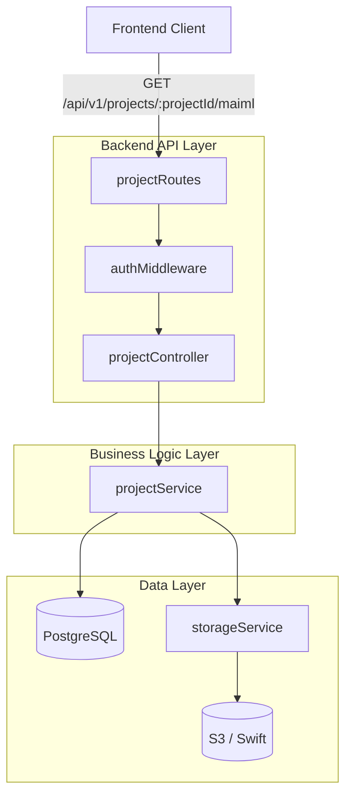
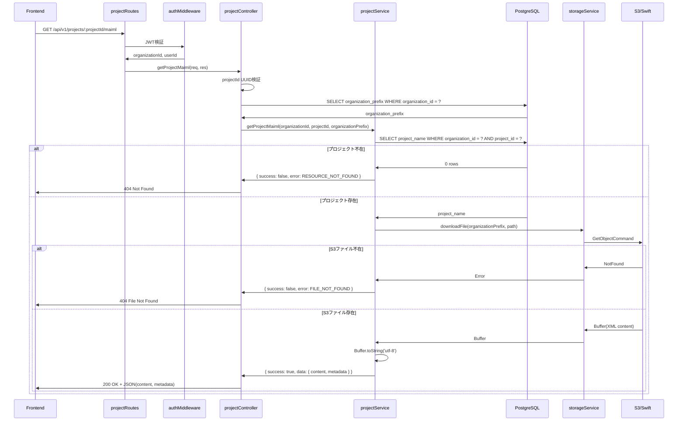

# Design Document: プロジェクトMAIMLファイル取得API

## Overview

本APIは、実験作業者が指示確認タブでプロジェクトの実験フロー図を表示するために、プロジェクトの最新MAIMLファイルをS3から取得する機能を提供します。既存のプロジェクト管理APIを拡張し、`GET /api/v1/projects/:projectId/maiml`エンドポイントを追加します。

**Purpose**: プロジェクトに関連付けられたMAIMLファイル（XML形式）をセキュアに取得し、フロントエンドで実験フロー図を表示できるようにする

**Users**: 実験作業者、実験管理者、システム管理者がプロジェクトのMAIMLファイルにアクセス可能

**Impact**: 既存のプロジェクト管理APIに新しいエンドポイントを追加（破壊的変更なし）

### Goals
- プロジェクトの最新MAIMLファイルをXML形式で取得
- マルチテナント分離を徹底（organization_idフィルタ必須）
- 既存のプロジェクトAPI実装パターンに準拠
- 適切な認証・認可・エラーハンドリング
- 5秒以内のレスポンスタイム（10MB以下のファイル）

### Non-Goals
- フォーマットファイルの取得（別APIで対応）
- アーカイブ版ファイルの取得（別APIで対応）
- MAIMLファイルの編集・更新機能
- ファイル内容のパース・変換処理

## Architecture

### Existing Architecture Analysis

本機能は既存のプロジェクト管理APIを拡張するため、以下の既存アーキテクチャを活用します：

- **レイヤードアーキテクチャ**: Routes → Controllers → Services → Database/Storage の階層構造
- **認証・認可**: authMiddleware による JWT認証
- **マルチテナント分離**: organization_id フィルタによるデータ分離
- **ストレージサービス**: storageService による S3/Swift 統一インターフェース

### Architecture Pattern & Boundary Map



**Architecture Integration**:
- **Selected pattern**: RESTful API Extension（既存projectRoutesに追加）
- **Domain boundaries**: プロジェクト管理ドメイン内でのファイルリソース取得
- **Existing patterns preserved**: レイヤードアーキテクチャ、ServiceResult型、Parameterized Queries
- **New components rationale**: 既存コンポーネントの拡張のみ（新規作成なし）
- **Steering compliance**: マルチテナント分離、認証・認可、エラーハンドリングの統一

### Technology Stack

| Layer | Choice / Version | Role in Feature | Notes |
|-------|------------------|-----------------|-------|
| Backend / Services | Node.js 18+ + Express.js 4.18.3 + TypeScript | APIエンドポイント実装 | 既存スタック |
| Data / Storage | PostgreSQL 18+ | プロジェクト情報・組織情報の取得 | organization_id フィルタ必須 |
| Data / Storage | AWS S3 / OpenStack Swift | MAIMLファイルストレージ | storageService 経由でアクセス |
| Backend / Libraries | uuid v9+ | requestId生成 | 既存使用中 |
| Backend / Libraries | @aws-sdk/client-s3 | S3操作 | storageService内で使用 |

## System Flows

### Sequence: MAIMLファイル取得フロー



**Key Decisions**:
- プロジェクト存在確認を先に実行（不要なS3アクセスを回避）
- organization_id フィルタを全DBクエリに適用（マルチテナント分離）
- S3エラーは404（FILE_NOT_FOUND）として返却（グレースフル処理）
- BufferをUTF-8文字列に変換してJSON内に格納

## Requirements Traceability

| Requirement | Summary | Components | Interfaces | Flows |
|-------------|---------|------------|------------|-------|
| 1 | プロジェクトMAIMLファイル取得 | ProjectController, ProjectService, StorageService | Service, API | MAIMLファイル取得フロー |
| 2 | 認証と認可 | authMiddleware | Middleware | 全フロー |
| 3 | マルチテナント分離 | ProjectService（DBクエリ）, StorageService | Service | 全フロー |
| 4 | エラーハンドリング | ProjectController, ProjectService | Service, API | 全フロー |
| 5 | レスポンス形式 | ProjectController | API | 全フロー |
| 6 | パフォーマンス | StorageService | Service | MAIMLファイル取得フロー |
| 7 | ロギングと監査 | ProjectController, ProjectService | - | 全フロー |
| 8 | 入力バリデーション | projectRoutes（express-validator）, ProjectController | API | 全フロー |

## Components and Interfaces

**Component Summary**:

| Component | Domain/Layer | Intent | Req Coverage | Key Dependencies | Contracts |
|-----------|--------------|--------|--------------|------------------|-----------|
| projectRoutes | API/Routes | エンドポイント定義とバリデーション | 8 | authMiddleware (P0) | API |
| projectController.getProjectMaiml | API/Controllers | リクエスト処理とレスポンス構築 | 1, 2, 4, 5, 7 | ProjectService (P0) | API, Service |
| projectService.getProjectMaiml | Business/Services | ビジネスロジックとオーケストレーション | 1, 3, 4, 6, 7 | PostgreSQL (P0), StorageService (P0) | Service |
| authMiddleware | API/Middleware | JWT認証とユーザー情報取得 | 2 | - | Middleware |
| storageService.downloadFile | Infrastructure/Services | S3ファイル取得 | 3, 6 | S3 SDK (P0) | Service |

### API / Routes

#### projectRoutes

| Field | Detail |
|-------|--------|
| Intent | 新しいMAIML取得エンドポイントを定義し、リクエストバリデーションを実施 |
| Requirements | 8 |

**Responsibilities & Constraints**
- エンドポイント`GET /api/v1/projects/:projectId/maiml`の定義
- パスパラメータ`:projectId`のUUID形式バリデーション
- 認証ミドルウェアの適用

**Dependencies**
- Inbound: Frontend Client (P0)
- Outbound: projectController.getProjectMaiml — リクエスト処理委譲 (P0)
- External: express-validator — バリデーション (P0)

**Contracts**: API ☑

##### API Contract

| Method | Endpoint | Request | Response | Errors |
|--------|----------|---------|----------|--------|
| GET | /api/v1/projects/:projectId/maiml | Path: projectId (UUID) | 200: MAIMLFileResponse | 400, 401, 403, 404, 500 |

**Request Parameters**:
```typescript
interface RequestParams {
  projectId: string; // UUID形式必須
}
```

**Success Response (200 OK)**:
```typescript
interface MAIMLFileResponse {
  success: true;
  data: {
    file_id: string;           // S3キー
    project_id: string;        // UUID
    project_name: string;      // プロジェクト名
    file_name: string;         // {project_name}.maiml
    file_path: string;         // S3相対パス
    file_size: number;         // バイト数
    content: string;           // XML文字列
    content_type: 'application/xml';
    loaded_at: string;         // ISO8601
  };
  meta: {
    timestamp: string;         // ISO8601
    requestId: string;         // UUID
  };
}
```

**Error Response**:
```typescript
interface ErrorResponse {
  success: false;
  error: {
    code: string;              // エラーコード
    message: string;           // 日本語メッセージ
    details?: Array<{          // バリデーションエラー詳細
      field: string;
      message: string;
      code: string;
    }>;
  };
  meta: {
    timestamp: string;
    requestId: string;
  };
}
```

**Error Codes**:
- `VALIDATION_INVALID_FORMAT`: projectIdがUUID形式でない（400）
- `AUTH_TOKEN_INVALID`: 認証トークンが無効（401）
- `PERMISSION_INSUFFICIENT`: 権限不足（403）
- `NOT_FOUND`: プロジェクトが存在しない（404）
- `FILE_NOT_FOUND`: MAIMLファイルが存在しない（404）
- `INTERNAL_ERROR`: システムエラー（500）

**Implementation Notes**
- Integration: 既存のprojectRoutes.tsに追加（静的ルート優先配置）
- Validation: express-validatorのparam()でUUID検証
- Risks: なし（既存パターンの踏襲）

### API / Controllers

#### projectController.getProjectMaiml

| Field | Detail |
|-------|--------|
| Intent | MAIMLファイル取得リクエストを処理し、Service層を呼び出してレスポンスを構築 |
| Requirements | 1, 2, 4, 5, 7 |

**Responsibilities & Constraints**
- リクエスト認証状態の検証（req.user存在確認）
- projectIdのUUID形式検証
- organization_prefixの取得（DBクエリ）
- Service層呼び出しとエラーハンドリング
- HTTPステータスコードマッピング
- レスポンス形式の統一

**Dependencies**
- Inbound: projectRoutes (P0)
- Outbound: ProjectService.getProjectMaiml — ビジネスロジック実行 (P0)
- External: PostgreSQL — organization_prefix取得 (P0), uuid — requestId生成 (P0), logger — ロギング (P1)

**Contracts**: Service ☑

##### Service Interface

```typescript
async function getProjectMaiml(
  req: Request,
  res: Response
): Promise<void>;
```

**Preconditions**:
- req.user が存在する（authMiddleware適用済み）
- projectId がパスパラメータに含まれる

**Postconditions**:
- 成功時: 200 OK + MAIMLFileResponse
- 失敗時: 適切なHTTPステータスコード + ErrorResponse

**Invariants**:
- requestId は必ず生成される
- timestamp は ISO8601形式
- success フィールドは true または false

**Implementation Notes**
- Integration: 既存のprojectController.tsに追加（既存パターン踏襲）
- Validation: UUID正規表現 `/^[0-9a-f]{8}-[0-9a-f]{4}-[0-9a-f]{4}-[0-9a-f]{4}-[0-9a-f]{12}$/i`
- Risks: organization_prefix取得失敗時は500エラー

### Business / Services

#### projectService.getProjectMaiml

| Field | Detail |
|-------|--------|
| Intent | プロジェクト存在確認、S3からMAIMLファイル取得、レスポンスデータ構築 |
| Requirements | 1, 3, 4, 6, 7 |

**Responsibilities & Constraints**
- プロジェクト存在確認（organization_idフィルタ必須）
- プロジェクト名の取得
- S3パス構築（`projects/${projectName}/${projectName}.maiml`）
- storageService経由でファイル取得
- BufferをUTF-8文字列に変換
- ServiceResult型でラップして返却
- エラー時の適切なエラーコード設定

**Dependencies**
- Inbound: projectController (P0)
- Outbound: PostgreSQL — プロジェクト情報取得 (P0), StorageService.downloadFile — ファイル取得 (P0)
- External: logger — ロギング (P1)

**Contracts**: Service ☑

##### Service Interface

```typescript
interface ProjectService {
  getProjectMaiml(
    organizationId: string,
    projectId: string,
    organizationPrefix: string
  ): Promise<ServiceResult<MAIMLFileData>>;
}

interface ServiceResult<T> {
  success: boolean;
  data?: T;
  error?: {
    code: string;
    message: string;
    details?: any;
    originalError?: Error;
  };
}

interface MAIMLFileData {
  file_id: string;
  project_id: string;
  project_name: string;
  file_name: string;
  file_path: string;
  file_size: number;
  content: string;
  content_type: 'application/xml';
  loaded_at: string;
}
```

**Preconditions**:
- organizationId, projectId, organizationPrefix が有効な文字列
- データベース接続が確立済み

**Postconditions**:
- 成功時: ServiceResult.success = true, data にMAIMLFileData
- 失敗時: ServiceResult.success = false, error にエラー情報

**Invariants**:
- すべてのDBクエリに organization_id フィルタを含める
- Parameterized Queries を使用（SQLインジェクション対策）

**Implementation Notes**
- Integration: 既存のprojectService.tsに追加（getProjectFiles実装を参考）
- Validation: S3ファイル不在時は FILE_NOT_FOUND エラー
- Risks: 大容量ファイル（10MB超）はメモリ消費増加の可能性

### Infrastructure / Services

#### storageService.downloadFile

| Field | Detail |
|-------|--------|
| Intent | S3/SwiftからファイルをBuffer形式で取得 |
| Requirements | 3, 6 |

**Responsibilities & Constraints**
- マルチテナント対応キー生成（`org_{organizationPrefix}/{filePath}`）
- S3 GetObjectCommand実行
- StreamをBufferに変換
- エラー時の適切な例外スロー

**Dependencies**
- Inbound: ProjectService (P0)
- Outbound: S3/Swift — ファイルストレージ (P0)
- External: @aws-sdk/client-s3 — S3操作 (P0)

**Contracts**: Service ☑

##### Service Interface

```typescript
interface StorageService {
  downloadFile(
    organizationId: string,
    filePath: string
  ): Promise<Buffer>;
}
```

**Preconditions**:
- organizationId が有効な文字列
- filePath が有効な相対パス

**Postconditions**:
- 成功時: Buffer（ファイル内容）を返却
- 失敗時: Error を throw

**Invariants**:
- organization_id プレフィックスが自動付与される
- S3キーは `{organizationId}/{filePath}` 形式

**Implementation Notes**
- Integration: 既存実装をそのまま使用（変更なし）
- Validation: S3ファイル不在時は NotFound エラーを throw
- Risks: タイムアウト設定（10秒）が必要

## Error Handling

### Error Strategy

すべてのエラーは以下の戦略で処理します：

1. **Controller層**: HTTPステータスコードマッピング、統一レスポンス形式
2. **Service層**: ServiceResult型でエラー情報をラップ
3. **Storage層**: 例外を throw（Service層でキャッチ）
4. **ロギング**: すべてのエラーをwinstonで記録（機密情報除外）

### Error Categories and Responses

**User Errors (4xx)**:
- **400 Bad Request**: 
  - `VALIDATION_INVALID_FORMAT`: projectIdがUUID形式でない
  - バリデーションエラー詳細を details配列に含める
- **401 Unauthorized**:
  - `AUTH_TOKEN_INVALID`: JWT認証失敗
  - 認証ガイダンスをメッセージに含める
- **403 Forbidden**:
  - `PERMISSION_INSUFFICIENT`: ロール権限不足（experiment_worker, experiment_admin, system_admin 以外）
- **404 Not Found**:
  - `NOT_FOUND`: プロジェクトが存在しない
  - `FILE_NOT_FOUND`: MAIMLファイルがS3に存在しない

**System Errors (5xx)**:
- **500 Internal Server Error**:
  - `INTERNAL_ERROR`: データベースエラー、S3接続エラー、その他システムエラー
  - 詳細はログに記録し、ユーザーには汎用メッセージのみ返却

### Monitoring

- **エラーログ**: winston でerrorレベルでログ記録
- **ログ項目**: action, organizationId, projectId, errorCode, message, stack, requestId, timestamp
- **機密情報**: 認証トークン、パスワードはログに含めない
- **メトリクス**: エラー発生率、レスポンスタイム（将来的に実装）

## Testing Strategy

### Unit Tests
- projectController.getProjectMaiml(): 認証チェック、バリデーション、エラーハンドリング
- projectService.getProjectMaiml(): プロジェクト存在確認、S3パス構築、Buffer→文字列変換
- バリデーションロジック: UUID形式検証

### Integration Tests
- 正常系: 有効なprojectIdでMAIMLファイル取得（200 OK）
- 異常系: 存在しないprojectIdでアクセス（404 NOT_FOUND）
- 異常系: 他組織のprojectIdでアクセス（404 NOT_FOUND）
- 異常系: 認証なしでアクセス（401 AUTH_TOKEN_INVALID）
- 異常系: 権限不足ユーザーでアクセス（403 PERMISSION_INSUFFICIENT）
- 異常系: S3にファイルが存在しない場合（404 FILE_NOT_FOUND）
- 異常系: 無効なUUID形式でアクセス（400 VALIDATION_INVALID_FORMAT）

### Performance Tests
- 100リクエスト/秒の負荷テスト（同時接続数確認）
- 大容量ファイル（10MB）の取得テスト（レスポンスタイム検証）
- タイムアウトテスト（10秒でタイムアウトすることを確認）

## Security Considerations

### Threat Modeling
- **脅威1: 他組織のMAIMLファイルへの不正アクセス**
  - 対策: organization_id フィルタを全DBクエリに適用、storageServiceでプレフィックス強制
- **脅威2: SQLインジェクション攻撃**
  - 対策: Parameterized Queries必須、express-validatorでバリデーション
- **脅威3: 認証トークン漏洩**
  - 対策: HTTPSのみ許可、ログに認証情報を含めない

### Authentication and Authorization
- **JWT認証**: authMiddleware で全リクエストを検証
- **ロールベース認可**: experiment_worker, experiment_admin, system_admin のみアクセス可能
- **マルチテナント分離**: organization_id フィルタで実現

### Data Protection
- **転送中の暗号化**: HTTPS必須
- **保存時の暗号化**: S3サーバーサイド暗号化（既存設定）
- **機密情報**: ログやレスポンスに認証トークンを含めない

## Performance & Scalability

### Target Metrics
- **レスポンスタイム**: 10MB以下のファイルで5秒以内
- **スループット**: 100リクエスト/秒をサポート
- **可用性**: 99.9%（既存APIと同等）

### Scaling Approaches
- **水平スケーリング**: ECSタスク数を増やしてスケール
- **データベース接続プール**: 既存設定（最大20接続）を使用
- **S3接続**: AWS SDKの自動リトライ機構を活用

### Caching Strategies
- **現時点**: キャッシングなし（シンプルな実装を優先）
- **将来的**: Redisによるキャッシング（頻繁にアクセスされるMAIMLファイル）

## Supporting References

### TypeScript Type Definitions

```typescript
// backend/src/types/maiml.ts (新規作成)

/**
 * MAIMLファイル取得APIレスポンス型
 */
export interface MAIMLFileData {
  file_id: string;           // S3キー（org_prefix含む）
  project_id: string;        // プロジェクトID（UUID）
  project_name: string;      // プロジェクト名
  file_name: string;         // ファイル名（{project_name}.maiml）
  file_path: string;         // S3相対パス
  file_size: number;         // ファイルサイズ（バイト）
  content: string;           // XML内容（UTF-8文字列）
  content_type: 'application/xml';
  loaded_at: string;         // 読み込み日時（ISO8601）
}

/**
 * Service層レスポンス型
 */
export interface ServiceResult<T> {
  success: boolean;
  data?: T;
  error?: {
    code: string;
    message: string;
    details?: any;
    originalError?: Error;
  };
}
```

### Error Code Reference

| Code | HTTP Status | Message | Cause |
|------|-------------|---------|-------|
| VALIDATION_INVALID_FORMAT | 400 | projectIdはUUID形式である必要があります | UUID形式検証失敗 |
| VALIDATION_REQUIRED_FIELD | 400 | projectIdは必須です | パスパラメータ欠如 |
| AUTH_TOKEN_INVALID | 401 | 認証が必要です | JWT認証失敗 |
| PERMISSION_INSUFFICIENT | 403 | 権限が不足しています | ロール権限不足 |
| NOT_FOUND | 404 | プロジェクトが見つかりません | プロジェクト不在 |
| FILE_NOT_FOUND | 404 | MAIMLファイルが見つかりません | S3ファイル不在 |
| INTERNAL_ERROR | 500 | システムエラーが発生しました | DB/S3エラー |
| SYSTEM_DATABASE_ERROR | 500 | データベースエラーが発生しました | PostgreSQLエラー |
