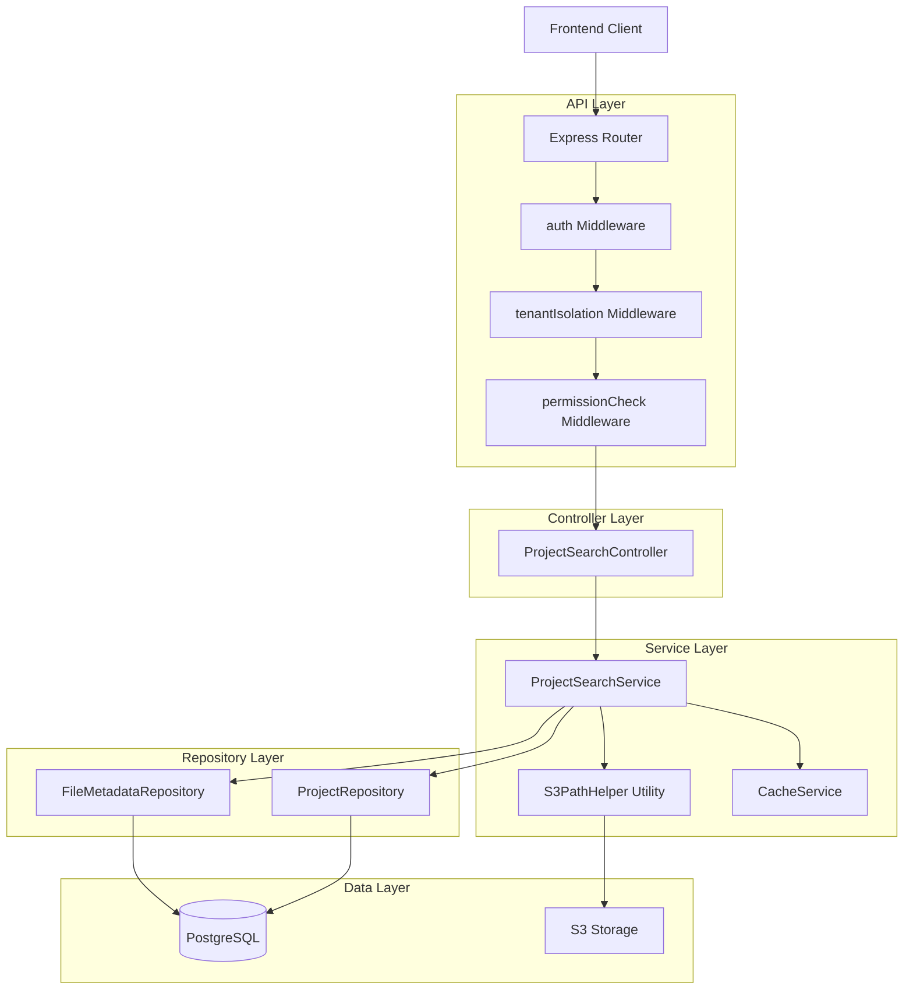
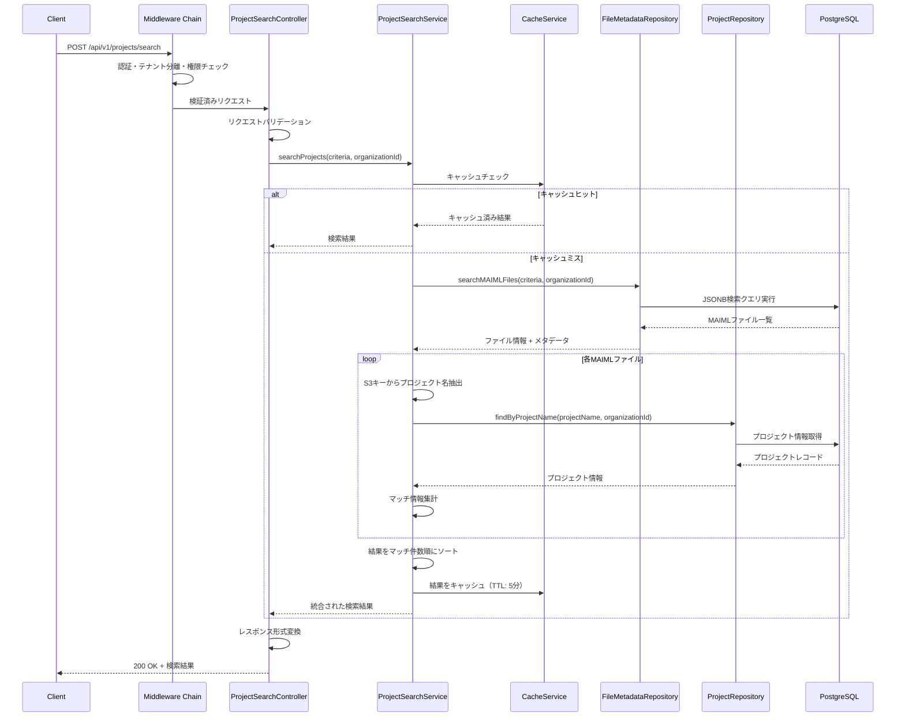
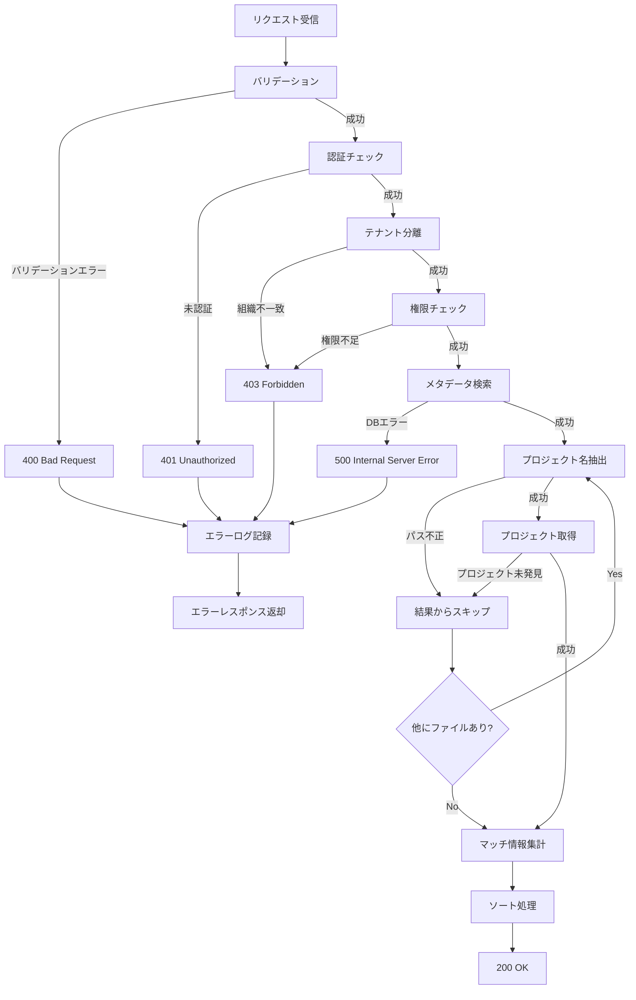
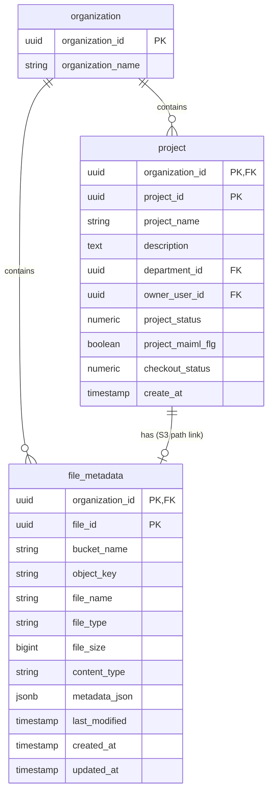

# プロジェクト詳細検索（MAIMLメタデータ検索統合版）API 設計書

## Overview

**Purpose**: プロジェクト管理画面において、MAIMLファイルのメタデータを複数条件で検索し、該当するプロジェクトを効率的に発見する機能を提供する。Document情報、測定データ、ファイル構造、MaiML属性などから目的のプロジェクトを検索できる。

**Users**: 実験管理者（Experiment Admin）、データ管理者（Data Admin）、システム管理者（System Admin）が主な利用者。実験作業者（Experiment Worker）は割り当てられたプロジェクトのみ検索可能。

**Impact**: 既存のプロジェクト管理APIに新しい検索エンドポイント（`POST /api/v1/projects/search`）を追加する。file_metadataテーブルとprojectテーブルを結合した複雑なクエリを実行する。

### Goals
- MAIMLメタデータの複数条件（1〜5件）での高速検索
- 検索結果としてプロジェクト情報とマッチしたファイル情報を統合して返却
- レスポンスタイム目標達成（単一条件500ms以内、5条件2秒以内）
- マルチテナント分離とセキュリティ要件の遵守

### Non-Goals
- アーカイブファイルの検索（将来拡張として検討）
- OR条件のサポート（将来拡張として検討）
- リアルタイム全文検索（Elasticsearchへの移行は将来検討）
- ファジー検索・ワイルドカード検索（将来拡張として検討）

## Architecture

### Existing Architecture Analysis

本機能は既存のプロジェクト管理API（api_project_management.md）を拡張する形で実装する。

**既存パターンの継承**:
- Layered Architecture（Controller → Service → Repository）
- JWT + Session Hybrid認証
- マルチテナント分離（tenantIsolationミドルウェア）
- Parameterized Queries によるSQLインジェクション対策

**新規追加要素**:
- MAIMLメタデータ検索Service
- file_metadataテーブルとのJOIN処理
- S3パス解析ロジック

### Architecture Pattern & Boundary Map



**Architecture Integration**:
- **Selected pattern**: Layered Architecture - 既存APIとの一貫性維持
- **Domain boundaries**: 
  - Controller: リクエスト/レスポンス処理、バリデーション
  - Service: ビジネスロジック、検索条件の組み立て、結果の集計
  - Repository: データアクセス、SQL実行
  - Utility: S3パス解析、キャッシュ管理
- **Existing patterns preserved**: 
  - ミドルウェアチェーン（auth → tenantIsolation → permissionCheck）
  - 統一されたエラーハンドリング
  - APIレスポンス形式
- **Steering compliance**: マルチテナント分離、セキュリティファーストの原則

### Technology Stack

| Layer | Choice / Version | Role in Feature | Notes |
|-------|------------------|-----------------|-------|
| Backend | Node.js 18+ / Express.js 4.18.3 / TypeScript | APIエンドポイント実装 | 既存スタック |
| Data | PostgreSQL 14+ | メタデータ検索（JSONB + GIN index） | 既存インフラ |
| Data | AWS S3 | MAIMLファイルストレージ | 既存インフラ |
| Authentication | jsonwebtoken / express-session | JWT + Session Hybrid認証 | 既存認証方式 |
| Validation | express-validator | リクエストバリデーション | 既存ライブラリ |
| Cache | node-cache | 検索結果キャッシング | 既存ライブラリ |

**Rationale**: 既存の技術スタックを最大限活用し、新規ライブラリの導入を避けることで、学習コストと保守負担を最小化。PostgreSQLのJSONB型とGINインデックスは既存のfile_metadataテーブルで実装済みのため、追加の設定不要。

## System Flows

### 検索フロー（プライマリフロー）



**Key Decisions**:
- キャッシュをService層で実装（検索条件をキーとして使用）
- プロジェクト情報取得は並列化せず順次実行（データ整合性優先）
- マッチ情報集計はService層で実装（Repository層は単純なデータ取得に専念）

### エラーハンドリングフロー



## Requirements Traceability

| Requirement | Summary | Components | Interfaces | Flows |
|-------------|---------|------------|------------|-------|
| 1 | 複数条件での検索 | ProjectSearchService, FileMetadataRepository | Service Interface, API Contract | 検索フロー |
| 2 | MAIMLファイルとプロジェクトの統合 | ProjectSearchService, ProjectRepository | Service Interface | 検索フロー |
| 3 | マッチ情報の集計と表示 | ProjectSearchService | Service Interface | 検索フロー |
| 4 | マルチテナント分離 | tenantIsolation Middleware, All Repositories | Middleware | 全フロー |
| 5 | 検索条件のバリデーション | ProjectSearchController, ValidationService | API Contract | 検索フロー |
| 6 | パフォーマンス要件達成 | CacheService, FileMetadataRepository | - | 検索フロー |
| 7 | エラーハンドリング | ErrorHandler Middleware | - | エラーフロー |
| 8 | S3パス補正 | S3PathHelper | Utility Interface | 検索フロー |

## Components and Interfaces

### 概要

| Component | Domain/Layer | Intent | Req Coverage | Key Dependencies (P0/P1) | Contracts |
|-----------|--------------|--------|--------------|--------------------------|-----------|
| ProjectSearchController | API/Controller | 検索リクエスト処理とレスポンス生成 | 1, 5, 7 | ProjectSearchService (P0) | API |
| ProjectSearchService | Business/Service | 検索ロジック実装とデータ統合 | 1, 2, 3, 6, 8 | FileMetadataRepository (P0), ProjectRepository (P0), S3PathHelper (P0), CacheService (P1) | Service |
| FileMetadataRepository | Data/Repository | file_metadataテーブルへのアクセス | 1, 4 | PostgreSQL (P0) | - |
| ProjectRepository | Data/Repository | projectテーブルへのアクセス | 2, 4 | PostgreSQL (P0) | - |
| S3PathHelper | Utility | S3パス解析と補正 | 8 | - | Utility |
| CacheService | Infrastructure | 検索結果のキャッシング | 6 | node-cache (P0) | - |

### API Layer

#### ProjectSearchController

| Field | Detail |
|-------|--------|
| Intent | 検索APIエンドポイントの処理とバリデーション |
| Requirements | 1, 5, 7 |

**Responsibilities & Constraints**
- HTTPリクエストの受信とレスポンスの返却
- リクエストボディのバリデーション（検索条件の形式、件数、属性名）
- エラーハンドリングとログ記録
- 統一されたAPIレスポンス形式への変換

**Dependencies**
- Inbound: Express Router — HTTPリクエスト受信 (P0)
- Outbound: ProjectSearchService — ビジネスロジック実行 (P0)
- Outbound: ValidationService — バリデーション処理 (P0)

**Contracts**: API [x]

##### API Contract

| Method | Endpoint | Request | Response | Errors |
|--------|----------|---------|----------|--------|
| POST | /api/v1/projects/search | SearchRequest | ProjectSearchResponse | 400, 401, 403, 500 |

**SearchRequest**:
```typescript
interface SearchRequest {
  criteria: SearchCriterion[];
}

interface SearchCriterion {
  attribute: AllowedAttribute;
  value: string; // 1-255文字
}

type AllowedAttribute =
  | 'document.uuid'
  | 'document.name'
  | 'document.description'
  | 'measurement_value'
  | 'units'
  | 'section_type'
  | 'id'
  | 'ref'
  | 'key'
  | 'element'
  | 'value';
```

**ProjectSearchResponse**:
```typescript
interface ProjectSearchResponse {
  success: true;
  data: SearchResult[];
  pagination: {
    totalItems: number;
    totalPages: number;
    currentPage: number;
    pageSize: number;
  };
  meta: {
    timestamp: string; // ISO 8601
    requestId: string;
  };
}

interface SearchResult {
  project: ProjectInfo;
  maimlFile: MAIMLFileInfo;
}

interface ProjectInfo {
  organizationId: string; // UUID
  projectId: string; // UUID
  projectName: string;
  description: string | null;
  departmentId: string | null; // UUID
  ownerUserId: string; // UUID
  projectStatus: number; // 0-5
  projectStatusName: string | null;
  projectMaimlFlg: boolean;
  checkoutStatus: number; // 0-1
  checkoutStatusName: string | null;
  createAt: string; // ISO 8601
}

interface MAIMLFileInfo {
  maimlFileName: string;
  key: string;
  s3FolderPath: string;
  matchCount: number;
  matchedAttributes: MatchedAttribute[];
  metadata: FileMetadata;
}

interface MatchedAttribute {
  attribute: string;
  criterionNumber: number;
  matchCount: number;
  matchedValues: string[]; // 最大5件
}

interface FileMetadata {
  fileSize: number;
  lastModified: string; // ISO 8601
  contentType: string;
}
```

**Error Response**:
```typescript
interface ErrorResponse {
  success: false;
  error: {
    code: ErrorCode;
    message: string;
    details?: ValidationError[];
  };
  meta: {
    timestamp: string;
    requestId: string;
  };
}

type ErrorCode =
  | 'VALIDATION_ERROR'
  | 'VALIDATION_TOO_MANY_CRITERIA'
  | 'AUTH_TOKEN_EXPIRED'
  | 'AUTH_TOKEN_INVALID'
  | 'PERMISSION_INSUFFICIENT'
  | 'SYSTEM_DATABASE_ERROR'
  | 'SYSTEM_S3_ERROR';

interface ValidationError {
  field: string;
  message: string;
  code: string;
}
```

**Implementation Notes**
- Integration: ミドルウェアチェーン（auth → tenantIsolation → permissionCheck）を適用
- Validation: 検索条件数（1〜5件）、属性名ホワイトリスト、値の長さ（1〜255文字）を検証
- Risks: 大量の検索リクエストによるDB負荷 → レート制限の実装を検討

### Business Layer

#### ProjectSearchService

| Field | Detail |
|-------|--------|
| Intent | MAIMLメタデータ検索とプロジェクト情報の統合 |
| Requirements | 1, 2, 3, 6, 8 |

**Responsibilities & Constraints**
- 検索条件をJSONBクエリに変換
- file_metadataテーブルからMAIMLファイルを検索
- S3キーからプロジェクト名を抽出
- projectテーブルからプロジェクト情報を取得
- マッチ情報を集計（属性ごとのマッチ件数、マッチした値）
- 検索結果をマッチ件数順にソート
- キャッシングによるパフォーマンス最適化

**Dependencies**
- Inbound: ProjectSearchController — 検索実行 (P0)
- Outbound: FileMetadataRepository — メタデータ検索 (P0)
- Outbound: ProjectRepository — プロジェクト情報取得 (P0)
- Outbound: S3PathHelper — パス解析 (P0)
- Outbound: CacheService — 結果キャッシング (P1)

**Contracts**: Service [x]

##### Service Interface

```typescript
interface ProjectSearchService {
  searchProjects(
    criteria: SearchCriterion[],
    organizationId: string
  ): Promise<Result<SearchResult[], SearchError>>;
}

interface SearchCriterion {
  attribute: string;
  value: string;
}

interface SearchResult {
  project: ProjectInfo;
  maimlFile: MAIMLFileInfo;
}

type SearchError =
  | { type: 'ValidationError'; message: string; details?: any[] }
  | { type: 'DatabaseError'; message: string; originalError?: any }
  | { type: 'S3Error'; message: string };
```

**Preconditions**:
- `criteria` 配列は1〜5件の要素を含む
- 各 `criterion.attribute` は許可された属性名である
- `organizationId` は有効なUUID形式である

**Postconditions**:
- 検索結果はマッチ件数の降順でソートされる
- 各検索結果はプロジェクト情報とMAIMLファイル情報を含む
- 検索結果は最大100件に制限される
- 検索結果はキャッシュされる（TTL: 5分）

**Invariants**:
- すべての検索結果は同一組織（organizationId）に属する
- プロジェクトが見つからないMAIMLファイルは結果から除外される
- S3パスが不正なファイルは結果から除外される

**Implementation Notes**
- Integration: FileMetadataRepositoryとProjectRepositoryを順次呼び出し（並列化は将来の最適化として検討）
- Validation: S3パス解析失敗時はログ記録してスキップ、プロジェクト未発見時もスキップ
- Risks: 大量のMAIMLファイルがマッチした場合のループ処理時間 → 最大100件制限で緩和

### Data Layer

#### FileMetadataRepository

| Field | Detail |
|-------|--------|
| Intent | file_metadataテーブルへのJSONB検索クエリ実行 |
| Requirements | 1, 4 |

**Responsibilities & Constraints**
- JSONB `@>` 演算子を使用した包含検索
- 複数検索条件のAND結合
- organization_idによるテナント分離
- アーカイブファイルの除外（object_key LIKE '%/archive/%'）
- file_type = 'maiml' でのフィルタリング

**Dependencies**
- Inbound: ProjectSearchService — メタデータ検索 (P0)
- External: PostgreSQL — データベース (P0)

**Implementation Notes**
- Integration: Parameterized Queriesを使用してSQLインジェクション対策
- Validation: organization_idの必須チェック、検索条件の形式検証
- Risks: GINインデックスが正しく設定されていない場合のパフォーマンス低下 → DDL確認とインデックス作成

#### ProjectRepository

| Field | Detail |
|-------|--------|
| Intent | projectテーブルからプロジェクト情報を取得 |
| Requirements | 2, 4 |

**Responsibilities & Constraints**
- project_nameとorganization_idでプロジェクトを検索
- project_statusとcheckout_statusの名称をcode_masterから取得
- 論理削除されたプロジェクト（deleted_at IS NOT NULL）を除外

**Dependencies**
- Inbound: ProjectSearchService — プロジェクト情報取得 (P0)
- External: PostgreSQL — データベース (P0)

**Implementation Notes**
- Integration: 既存のProjectRepositoryを拡張または新規メソッド追加
- Validation: organization_idとproject_nameの必須チェック

### Utility Layer

#### S3PathHelper

| Field | Detail |
|-------|--------|
| Intent | S3パスの解析と補正 |
| Requirements | 8 |

**Responsibilities & Constraints**
- S3オブジェクトキーからプロジェクト名を抽出
- S3パスの補正（バケット名、organization_prefix）
- 不正なパス形式の検出とエラー返却

**Dependencies**
- Inbound: ProjectSearchService — パス解析 (P0)

**Contracts**: Utility [x]

##### Utility Interface

```typescript
interface S3PathHelper {
  extractProjectName(s3Key: string): string | null;
  correctS3Path(
    s3Key: string,
    organizationPrefix: string,
    defaultBucket: string
  ): string;
  isArchiveFile(s3Key: string): boolean;
}
```

**Implementation Notes**
- Integration: 正規表現 `/^projects\/([^\/]+)\/\1\.maiml$/` でプロジェクト名を抽出
- Validation: パスが期待される形式でない場合はnullを返す
- Risks: プロジェクト名に特殊文字が含まれる場合の処理 → プロジェクト名の命名規則を確認

## Data Models

### Domain Model

**Aggregates**:
- **Project Aggregate**: プロジェクト情報を中心とした集約
  - Project (Root Entity)
  - ProjectTask
  - ProjectTaskDetail
- **File Metadata Aggregate**: ファイルメタデータを中心とした集約
  - FileMetadata (Root Entity)

**Entities**:
- Project: プロジェクトの基本情報
- FileMetadata: MAIMLファイルのメタデータ

**Value Objects**:
- ProjectStatus: プロジェクトステータス（0〜5）
- CheckoutStatus: チェックアウトステータス（0〜1）
- SearchCriterion: 検索条件（attribute + value）

**Business Rules & Invariants**:
- プロジェクトは必ず1つの組織に属する
- MAIMLファイルは必ず1つのプロジェクトに属する（S3パス構造で保証）
- アーカイブファイルは検索対象外
- 検索条件は最大5件まで

### Logical Data Model

#### Entity Relationships



**Consistency & Integrity**:
- Transaction boundaries: 検索処理は読み取り専用（トランザクション不要）
- Referential integrity: organization_idによる外部キー制約
- Temporal aspects: file_metadata.last_modified でファイル更新を追跡

### Physical Data Model

#### file_metadata テーブル

**現在の状態**: Phase 0（9カラム - S3アクセス必須のみ）

**Table Definition (Phase 0 - 現状)**:
```sql
CREATE TABLE IF NOT EXISTS file_metadata (
    file_key VARCHAR(500) PRIMARY KEY,
    s3_bucket VARCHAR(100) NOT NULL,
    organization_id UUID NOT NULL,
    original_filename VARCHAR(255) NOT NULL,
    file_size BIGINT NOT NULL,
    file_type VARCHAR(100),
    uploaded_by VARCHAR(100) NOT NULL,
    created_at TIMESTAMP WITH TIME ZONE DEFAULT CURRENT_TIMESTAMP,
    updated_at TIMESTAMP WITH TIME ZONE DEFAULT CURRENT_TIMESTAMP
);
```

**Phase 2 拡張カラム（本機能で追加）**:

本API実装にあたり、詳細検索機能に必要な以下6カラムを追加します。

#### 追加カラム詳細

1. **custom_metadata** (JSONB)
   - MAIMLファイルから解析したメタデータを格納
   - document情報、measurement情報、section情報、attributes情報
   - GINインデックスで高速検索を実現
   
2. **tags** (JSONB)
   - 検索タグの配列形式で格納
   - ユーザーが手動で付与するタグ
   - GINインデックスで高速検索

3. **search_keywords** (TEXT[])
   - 自動生成された検索キーワード配列
   - MAIML解析時に抽出
   - GINインデックスで全文検索補助

4. **description** (TEXT)
   - ユーザーが入力するファイル説明文

5. **file_hash** (VARCHAR(64))
   - SHA-256ハッシュ値（重複検出用）

6. **parent_folder_path** (VARCHAR(500))
   - 親フォルダパス（フォルダ階層管理用）

#### Phase 2 DDL（マイグレーションスクリプト）

```sql
-- Phase 2: 詳細検索機能実装時の拡張
ALTER TABLE file_metadata
ADD COLUMN custom_metadata JSONB DEFAULT '{}'::jsonb,
ADD COLUMN tags JSONB DEFAULT '[]'::jsonb,
ADD COLUMN search_keywords TEXT[],
ADD COLUMN description TEXT,
ADD COLUMN file_hash VARCHAR(64),
ADD COLUMN parent_folder_path VARCHAR(500);

-- コメント追加
COMMENT ON COLUMN file_metadata.custom_metadata IS 'カスタムメタデータ（MAIML解析結果、検索対象）';
COMMENT ON COLUMN file_metadata.tags IS '検索タグ（配列形式、ユーザー手動付与）';
COMMENT ON COLUMN file_metadata.search_keywords IS '検索キーワード（自動生成、全文検索補助）';
COMMENT ON COLUMN file_metadata.description IS 'ファイル説明（ユーザー入力）';
COMMENT ON COLUMN file_metadata.file_hash IS 'SHA-256ハッシュ（重複検出用）';
COMMENT ON COLUMN file_metadata.parent_folder_path IS '親フォルダパス（階層管理用）';
```

**Indexes（検索性能向上に必須）**:
```sql
-- GINインデックス（JSONB検索用）
CREATE INDEX idx_file_metadata_json 
ON file_metadata USING GIN (metadata_json);

-- 組織とファイルタイプの複合インデックス
CREATE INDEX idx_file_metadata_org_type 
ON file_metadata (organization_id, file_type);

-- オブジェクトキーのインデックス
CREATE INDEX idx_file_metadata_object_key 
ON file_metadata (object_key);
```

**metadata_json Structure**:
```json
{
  "document": {
    "uuid": "doc-uuid-001",
    "name": "実験A",
    "description": "材料合成実験"
  },
  "measurements": [
    {
      "measurement_value": "25.5",
      "units": "℃"
    }
  ],
  "sections": [
    {
      "section_type": "Material"
    }
  ],
  "attributes": {
    "id": ["material_001", "condition_001"],
    "ref": ["ref_001", "ref_002"],
    "key": ["temp", "pressure"],
    "elements": ["Material", "Condition", "Result"],
    "values": ["value1", "value2"]
  }
}
```

#### project テーブル

既存のDDL定義を使用（変更なし）。api_project_management.md の「3.1 使用するテーブル」を参照。

### Data Contracts & Integration

#### JSONB検索クエリ例

```sql
-- 単一条件検索
SELECT 
  file_id,
  file_name,
  object_key,
  bucket_name,
  file_size,
  last_modified,
  metadata_json
FROM file_metadata
WHERE organization_id = $1
  AND file_type = 'maiml'
  AND object_key NOT LIKE '%/archive/%'
  AND metadata_json @> '{"document": {"name": "実験A"}}'::jsonb
ORDER BY last_modified DESC
LIMIT 100;

-- 複数条件検索（AND結合）
SELECT 
  file_id,
  file_name,
  object_key,
  bucket_name,
  file_size,
  last_modified,
  metadata_json
FROM file_metadata
WHERE organization_id = $1
  AND file_type = 'maiml'
  AND object_key NOT LIKE '%/archive/%'
  AND metadata_json @> '{"document": {"name": "実験A"}}'::jsonb
  AND metadata_json @> '{"measurements": [{"units": "℃"}]}'::jsonb
  AND metadata_json @> '{"measurements": [{"measurement_value": "25.5"}]}'::jsonb
ORDER BY last_modified DESC
LIMIT 100;
```

#### プロジェクト情報取得クエリ例

```sql
SELECT 
  p.organization_id,
  p.project_id,
  p.project_name,
  p.description,
  p.department_id,
  p.owner_user_id,
  p.project_status,
  p.project_maiml_flg,
  p.checkout_status,
  p.create_at,
  ps.code_name AS project_status_name,
  cs.code_name AS checkout_status_name
FROM project p
LEFT JOIN code_master ps 
  ON ps.code_type = 'project_status' 
  AND ps.code_value = p.project_status::text
LEFT JOIN code_master cs 
  ON cs.code_type = 'checkout_status' 
  AND cs.code_value = p.checkout_status::text
WHERE p.organization_id = $1
  AND p.project_name = $2
  AND p.deleted_at IS NULL;
```

## Error Handling

### Error Taxonomy

| Error Type | HTTP Status | Error Code | Description | Recovery Strategy |
|------------|-------------|------------|-------------|-------------------|
| Validation Error | 400 | VALIDATION_ERROR | リクエストパラメータが不正 | クライアント側で修正して再送 |
| Too Many Criteria | 400 | VALIDATION_TOO_MANY_CRITERIA | 検索条件が6件以上 | 検索条件を5件以下に減らす |
| Authentication Error | 401 | AUTH_TOKEN_EXPIRED | JWTトークンの有効期限切れ | ログインし直してトークン再取得 |
| Authentication Error | 401 | AUTH_TOKEN_INVALID | JWTトークンが不正 | ログインし直してトークン再取得 |
| Authorization Error | 403 | PERMISSION_INSUFFICIENT | アクセス権限不足 | 適切な権限を持つユーザーで再試行 |
| Database Error | 500 | SYSTEM_DATABASE_ERROR | データベース接続・クエリエラー | リトライ、管理者に連絡 |
| S3 Error | 500 | SYSTEM_S3_ERROR | S3アクセスエラー | リトライ、管理者に連絡 |

### Error Handling Strategy

**Graceful Degradation**:
- S3パス解析失敗時: ログ記録してスキップ、他のファイルの処理を継続
- プロジェクト未発見時: ログ記録してスキップ、他のファイルの処理を継続
- 部分的な検索結果でも返却可能な場合は返却

**Logging**:
- すべてのエラーをWinstonでログ記録
- エラーレベル: error, warn, info
- コンテキスト情報を含める（organizationId, userId, requestId）

**User-Friendly Messages**:
- 技術的詳細は隠し、ユーザーに分かりやすいメッセージを表示
- スタックトレースはログのみ、レスポンスには含めない

## Security

### Security Requirements

| Requirement | Implementation | Verification |
|-------------|----------------|--------------|
| JWT + Session認証 | authミドルウェア適用 | 認証テスト |
| マルチテナント分離 | organization_idフィルタ必須 | テナント分離テスト |
| SQLインジェクション対策 | Parameterized Queries | セキュリティテスト |
| XSS対策 | 入力値のサニタイゼーション | セキュリティテスト |
| レート制限 | 将来実装（100req/min） | パフォーマンステスト |

### Security Checklist

- [x] JWT認証の実施（authミドルウェア）
- [x] organization_idフィルタの適用（必須）
- [x] テナント分離（tenantIsolationミドルウェア）
- [x] 権限チェック（permissionCheckミドルウェア）
- [x] Parameterized Queryの使用
- [x] 入力値のサニタイゼーション（検索条件、属性名）
- [x] クロステナントアクセスの防止
- [x] S3パスのバリデーション
- [x] エラーメッセージに機密情報を含めない
- [ ] レート制限（将来実装）

## Testing Strategy

### Unit Tests

**Target Coverage**: 70%以上

**Test Targets**:
- ProjectSearchService: 検索ロジック、マッチ情報集計、ソート
- S3PathHelper: プロジェクト名抽出、パス補正、アーカイブ判定
- ValidationService: 検索条件バリデーション

**Test Cases**:
```typescript
describe('ProjectSearchService', () => {
  describe('searchProjects', () => {
    test('単一条件で検索できる', async () => {
      // Arrange
      const criteria = [{ attribute: 'document.name', value: '実験A' }];
      
      // Act
      const result = await service.searchProjects(criteria, orgId);
      
      // Assert
      expect(result.length).toBeGreaterThan(0);
      expect(result[0].project.projectName).toBe('sample_project');
    });
    
    test('複数条件(AND)で検索できる', async () => {
      // 実装
    });
    
    test('マッチ件数順にソートされる', async () => {
      // 実装
    });
    
    test('プロジェクトが見つからない場合はスキップ', async () => {
      // 実装
    });
  });
});
```

### Integration Tests

**Test Scenarios**:
- E2Eフロー: リクエスト送信 → 認証 → 検索 → レスポンス返却
- マルチテナント分離: 他組織のデータが結果に含まれないことを確認
- エラーハンドリング: 各種エラーケースでの適切なレスポンス

**Test Cases**:
```typescript
describe('POST /api/v1/projects/search', () => {
  test('認証済みユーザーが検索できる', async () => {
    // 実装
  });
  
  test('未認証ユーザーは401エラー', async () => {
    // 実装
  });
  
  test('他組織のデータは結果に含まれない', async () => {
    // 実装
  });
});
```

### Performance Tests

**Performance Goals**:
- 単一条件: 500ms以内
- 2〜3条件: 1秒以内
- 4〜5条件: 2秒以内
- 最大許容: 5秒

**Load Tests**:
- 同時100リクエストでの安定動作
- キャッシュ効果の検証

## Deployment

### Deployment Steps

#### Phase 1: データベースマイグレーション（最優先）

**実行ファイル**: `docs/design/db/ddl/file_metadata_phase2_migration.sql`

**実行手順**:

1. **事前確認**:
```bash
# PostgreSQLに接続
psql -h <host> -U <user> -d <database>

# 既存カラムを確認
SELECT column_name, data_type, is_nullable
FROM information_schema.columns
WHERE table_name = 'file_metadata'
ORDER BY ordinal_position;

# 期待される結果: Phase 0の9カラムのみ存在
```

2. **マイグレーション実行**:
```bash
# マイグレーションスクリプトを実行
psql -h <host> -U <user> -d <database> -f docs/design/db/ddl/file_metadata_phase2_migration.sql

# 成功ログ例:
# BEGIN
# ALTER TABLE
# ALTER TABLE
# ...
# CREATE INDEX
# CREATE INDEX
# ...
# COMMIT
```

3. **実行後確認**:
```sql
-- 追加されたカラムを確認
SELECT column_name, data_type, is_nullable, column_default
FROM information_schema.columns
WHERE table_name = 'file_metadata'
  AND column_name IN (
    'custom_metadata', 
    'tags', 
    'search_keywords', 
    'description', 
    'file_hash', 
    'parent_folder_path'
  )
ORDER BY ordinal_position;

-- 期待される結果: 6カラムが追加されていること

-- インデックスを確認
SELECT indexname, indexdef
FROM pg_indexes
WHERE tablename = 'file_metadata'
  AND (
    indexname LIKE '%custom_metadata%'
    OR indexname LIKE '%tags%'
    OR indexname LIKE '%search_keywords%'
    OR indexname LIKE '%file_hash%'
    OR indexname LIKE '%parent_folder%'
  )
ORDER BY indexname;

-- 期待される結果: 5個のインデックスが作成されていること
```

4. **ロールバック準備**:
```sql
-- 問題が発生した場合のロールバック手順
-- （マイグレーションスクリプト内にコメントで記載済み）
```

#### Phase 2: バックエンドコード実装

**実装対象**:
- `backend/src/controllers/projectSearchController.ts`
- `backend/src/services/projectSearchService.ts`
- `backend/src/repositories/fileMetadataRepository.ts`
- `backend/src/repositories/projectRepository.ts`
- `backend/src/utils/s3PathHelper.ts`
- `backend/src/routes/projectSearchRoutes.ts`

**実装完了チェックリスト**:
- [ ] ProjectSearchController実装
- [ ] ProjectSearchService実装
- [ ] FileMetadataRepository拡張（JSONB検索メソッド追加）
- [ ] ProjectRepository拡張（project_name検索メソッド追加）
- [ ] S3PathHelper実装
- [ ] ルート定義追加
- [ ] ミドルウェアチェーン適用
- [ ] バリデーションルール実装
- [ ] エラーハンドリング実装
- [ ] ユニットテスト作成
- [ ] 統合テスト作成

#### Phase 3: デプロイ

1. **コード デプロイ**:
```bash
# バックエンドビルド
cd backend
npm run build

# Dockerイメージビルド
docker build -t mmdpf-backend:project-search .

# ECSにデプロイ
# （デプロイスクリプト実行）
./scripts/deployment/deploy-backend-hotfix.sh
```

2. **環境変数確認**:
```bash
# 必要な環境変数が設定されているか確認
# - DB_HOST
# - DB_PORT
# - DB_NAME
# - DB_USER
# - DB_PASSWORD
# - AWS_S3_BUCKET (または SWIFT_CONTAINER)
# - JWT_SECRET
# - SESSION_SECRET
```

3. **動作確認**:
```bash
# ヘルスチェック
curl http://localhost:3001/api/health

# 検索API動作確認（認証トークン必要）
curl -X POST http://localhost:3001/api/v1/projects/search \
  -H "Authorization: Bearer <token>" \
  -H "X-Organization-Id: <org_id>" \
  -H "Content-Type: application/json" \
  -d '{
    "criteria": [
      {"attribute": "document.name", "value": "実験A"}
    ]
  }'
```

4. **モニタリング設定**:
   - CloudWatch Logsでエラーログ監視
   - レスポンスタイムのメトリクス設定
   - アラート設定（エラー率5%超、P95レスポンス5秒超）

### Rollback Plan

**Rollback Trigger**:
- エラー率が5%を超える
- レスポンスタイムが目標の2倍を超える
- 重大なバグの発見

**Rollback Procedure**:
1. 前のECSタスク定義にロールバック
2. ログを確認して原因調査
3. 修正後、再デプロイ

### Monitoring & Alerts

**Key Metrics**:
- API成功率（目標: 99%以上）
- 平均レスポンスタイム（目標: 1秒以内）
- P95レスポンスタイム（目標: 2秒以内）
- キャッシュヒット率（目標: 60%以上）
- エラー率（目標: 1%未満）

**Alerts**:
- エラー率が5%を超えた場合
- P95レスポンスタイムが5秒を超えた場合
- データベース接続エラー

## Future Enhancements

### Phase 2 候補機能

1. **アーカイブファイルの検索**:
   - S3パスフィルタを調整してアーカイブファイルも検索対象に含める
   - バージョン情報を結果に含める

2. **OR条件のサポート**:
   - 検索条件のAND/OR組み合わせを許可
   - クエリビルダーの拡張

3. **範囲検索**:
   - 数値範囲（例: measurement_value が 20〜30）
   - 日付範囲（例: last_modified が過去1ヶ月以内）

4. **ファジー検索**:
   - 類似文字列検索（レーベンシュタイン距離）
   - PostgreSQLのpg_trgm拡張を使用

5. **Elasticsearch移行**:
   - 大量データ対応
   - より高度な全文検索機能

6. **検索履歴の保存**:
   - ユーザーごとの検索履歴
   - よく使う検索条件の保存

## References

- [要件書](requirements.md) - 機能要件とユーザーストーリー
- [リサーチ文書](research.md) - 設計判断の根拠と調査結果
- [プロジェクト管理API仕様](../../design/api/api_project_management.md) - 既存API設計パターン
- [API設計ポリシー](../../../.clinerules/development/api.md) - API設計の統一規約
- [バックエンド規約](../../../.clinerules/development/backend.md) - 実装ガイドライン
- [セキュリティ規約](../../../.clinerules/development/security.md) - セキュリティ要件
- [S3構造定義](../../../.clinerules/references/s3_structure.md) - S3フォルダ構成
- [データベース構造](../../../.clinerules/references/db_structure.md) - file_metadataテーブル定義

---

**Document Status**: Design Complete  
**Next Phase**: Implementation  
**Last Updated**: 2026-01-19
