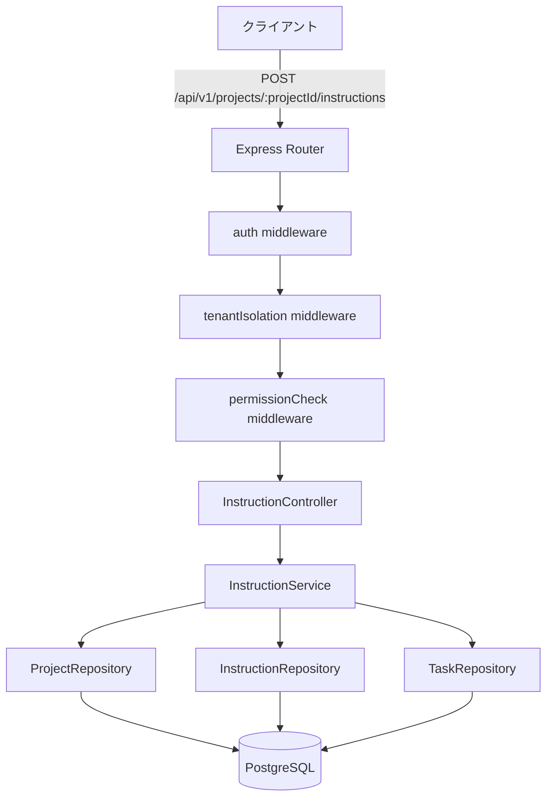
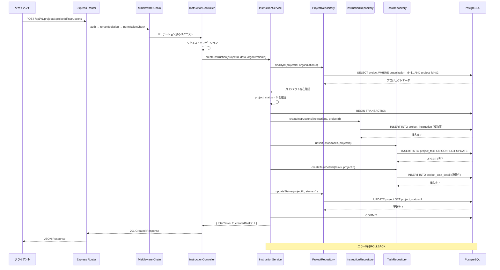
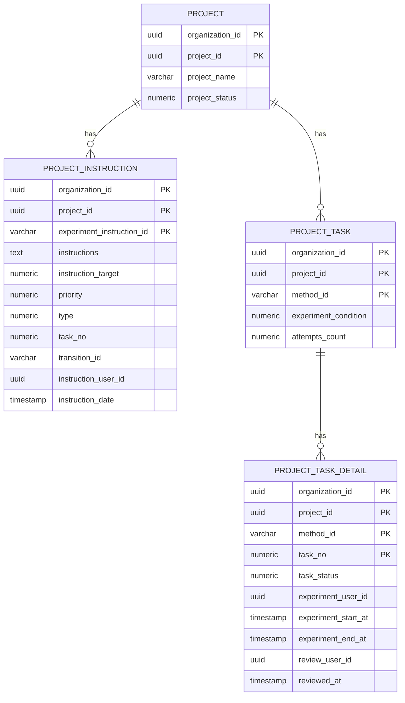

# 設計書: 指示送信（タスク作成）API実装

## Overview

本機能は、実験管理者が実験プロジェクトに対して作業指示を送信し、タスクを作成するためのバックエンドAPIを提供します。プロジェクト計画段階から実行段階への遷移を実現し、4つのデータベーステーブル（project、project_instruction、project_task、project_task_detail）に対するトランザクション管理を行います。

**Purpose**: プロジェクトから実験タスクへの遷移を管理し、実験作業者への明確な指示伝達を実現する

**Users**: 実験管理者（Experiment Admin）が本APIを使用してタスクと指示を作成し、実験作業者（Experiment Worker）に割り当てます

**Impact**: プロジェクトステータスが「プロジェクト計画中(0)」から「タスク実行待ち(1)」に遷移し、実験作業者がタスクを開始できる状態になります

### Goals

- プロジェクトに対する作業指示の一括作成
- メソッドごとのタスク管理体系の確立
- 試行回数に応じたタスク詳細レコードの自動生成
- 4テーブルへのトランザクション一貫性の保証
- プロジェクトステータスの自動遷移

### Non-Goals

- タスクの更新・削除機能（将来実装）
- タスクの並び替え・優先順位変更（将来実装）
- 実験作業者へのリアルタイム通知（別機能）
- タスクの進捗追跡機能（別API）

## Architecture

### Existing Architecture Analysis

本機能は既存のプロジェクト管理APIの拡張として実装されます。

**既存パターンの保持:**
- Layered Architecture (Routes → Controller → Service → Repository)
- Kysely Query Builder によるDB操作
- JWT + Session Hybrid 認証
- マルチテナント分離（organization_id必須）

**既存ドメイン境界:**
- プロジェクト管理ドメイン内に配置
- 既存のprojectテーブル、新規のinstruction/taskテーブルと統合

**統合ポイント:**
- POST /api/v1/projects（プロジェクト作成）の次のステップ
- GET /api/v1/projects/:projectId（詳細取得）で作成結果を確認

### Architecture Pattern & Boundary Map



**Architecture Integration:**
- **選択パターン**: Layered Architecture（既存パターンを踏襲）
- **ドメイン境界**: プロジェクト管理ドメイン内の新規サブモジュール
- **既存パターン保持**: ミドルウェアチェーン、リポジトリパターン、トランザクション管理
- **新規コンポーネント理由**: 
  - InstructionController: 指示送信リクエストの専用ハンドリング
  - InstructionService: 4テーブルへのトランザクション管理
  - InstructionRepository: project_instructionテーブル専用操作
- **Steering準拠**: バックエンド規約、API設計ポリシー、セキュリティ規約に完全準拠

### Technology Stack

| Layer | Choice / Version | Role in Feature | Notes |
|-------|------------------|-----------------|-------|
| Backend | Express.js 4.18.3 | HTTPルーティング、ミドルウェア | 既存 |
| Language | TypeScript 4.x | 型安全な実装 | 既存 |
| Data | PostgreSQL 18+ | データ永続化 | 既存 |
| Query Builder | Kysely | 型安全なDB操作 | 既存、Parameterized Query自動生成 |
| Authentication | jsonwebtoken | JWT認証 | 既存 |
| Session | express-session | セッション管理 | 既存 |
| Logging | Winston | 構造化ログ | 既存 |
| Validation | Manual + Express | リクエストバリデーション | 既存パターン |

**新規依存関係**: なし（すべて既存スタックを使用）

## System Flows

### シーケンス図: 指示送信フロー



**Key Decisions:**
- トランザクション境界: Service層で管理、4テーブルへの操作を単一トランザクションで実行
- エラー時のロールバック: いずれかのDB操作が失敗した場合、全てロールバック
- プロジェクトステータス確認: トランザクション開始前に実施（早期失敗）

## Requirements Traceability

| Requirement | Summary | Components | Interfaces | Flows |
|-------------|---------|------------|------------|-------|
| 1 | 指示送信エンドポイント提供 | InstructionController, Router | POST /api/v1/projects/:projectId/instructions | Main Sequence |
| 2 | 認証と認可の実施 | auth, tenantIsolation, permissionCheck | Middleware Chain | Authentication Flow |
| 3 | マルチテナント分離 | tenantIsolation, All Repositories | organization_id filter | All DB Operations |
| 4 | リクエストバリデーション | InstructionController | Validation Logic | Validation Flow |
| 5 | プロジェクト状態検証 | InstructionService, ProjectRepository | findById, status check | Status Verification |
| 6 | トランザクション管理 | InstructionService, Kysely | transaction() | Transaction Flow |
| 7 | project_instructionへの登録 | InstructionRepository | createInstructions | Instruction Insert |
| 8 | project_taskへの登録 | TaskRepository | upsertTasks | Task Upsert |
| 9 | project_task_detailへの登録 | TaskRepository | createTaskDetails | Task Detail Insert |
| 10 | プロジェクトステータス更新 | ProjectRepository | updateStatus | Status Update |
| 11 | レスポンス生成 | InstructionController | Response Format | Response Flow |
| 12 | エラーハンドリング | errorHandler middleware | Error Response | Error Flow |
| 13 | セキュリティ保護 | All Layers | Parameterized Query, Input Sanitization | Security Flow |
| 14 | パフォーマンス要件 | InstructionService | Bulk Insert, Transaction Optimization | Performance Flow |
| 15 | ロギングと監査 | Winston logger | Structured Logging | Logging Flow |

## Components and Interfaces

### Component Summary

| Component | Domain/Layer | Intent | Req Coverage | Key Dependencies | Contracts |
|-----------|--------------|--------|--------------|------------------|-----------|
| InstructionController | API/Controller | リクエスト処理・バリデーション | 1, 4, 11 | InstructionService (P0) | API |
| InstructionService | Business/Service | トランザクション管理・ビジネスロジック | 5, 6, 7, 8, 9, 10, 14 | ProjectRepo (P0), InstRepo (P0), TaskRepo (P0) | Service |
| ProjectRepository | Data/Repository | projectテーブル操作 | 5, 10 | Kysely DB (P0) | Service |
| InstructionRepository | Data/Repository | project_instructionテーブル操作 | 7 | Kysely DB (P0) | Service |
| TaskRepository | Data/Repository | project_task, project_task_detailテーブル操作 | 8, 9 | Kysely DB (P0) | Service |
| auth middleware | Infrastructure/Middleware | JWT認証 | 2 | JWT Service (P0) | - |
| tenantIsolation middleware | Infrastructure/Middleware | テナント分離 | 3 | Session Store (P0) | - |
| permissionCheck middleware | Infrastructure/Middleware | 権限チェック | 2 | Role Permission DB (P0) | - |

### API Layer

#### InstructionController

| Field | Detail |
|-------|--------|
| Intent | 指示送信APIのリクエスト/レスポンス処理とバリデーション |
| Requirements | 1, 4, 11 |

**Responsibilities & Constraints**
- HTTPリクエストの受信とパラメータ抽出
- リクエストボディのバリデーション（形式、型、必須チェック）
- サービス層への処理委譲
- HTTPレスポンスの生成（201 Created）
- エラーの適切な伝播

**Dependencies**
- Inbound: Express Router - ルーティング (P0)
- Outbound: InstructionService - ビジネスロジック実行 (P0)
- Outbound: Logger - ログ記録 (P1)

**Contracts**: API [x] / Service [ ]

##### API Contract

| Method | Endpoint | Request | Response | Errors |
|--------|----------|---------|----------|--------|
| POST | /api/v1/projects/:projectId/instructions | CreateInstructionRequest | CreateInstructionResponse | 400, 401, 403, 404, 409, 500 |

**Request Headers:**
```typescript
{
  Authorization: string;        // "Bearer {jwt_token}"
  X-Organization-Id: string;   // UUID
}
```

**Request Path Parameters:**
```typescript
{
  projectId: string;  // UUID
}
```

**Request Body:**
```typescript
interface CreateInstructionRequest {
  tasks: TaskInput[];
  instructions: InstructionInput[];
}

interface TaskInput {
  methodId: string;              // 255文字以内
  experimentCondition: 0 | 1;    // 0: 全て同一条件, 1: 実験ごとに変更
  trialCount?: number;           // 1〜999、省略時は1
}

interface InstructionInput {
  content: string;               // 1〜1000文字
  priority: 0 | 1 | 2 | 3;      // 0: 低, 1: 通常, 2: 中, 3: 高
  type: 0 | 1 | 2 | 3 | 4;      // 0: 一般, 1: セットアップ, 2: 測定, 3: 安全, 4: 清掃
  targetType: 0 | 1 | 2;         // 0: ファイル全体, 1: タスク, 2: トランジション
  transitionId: string | null;   // targetType=2の場合必須
  taskNumber: number | null;     // targetType=1の場合必須（1以上）
}
```

**Response (201 Created):**
```typescript
interface CreateInstructionResponse {
  success: true;
  data: {
    summary: {
      totalTasks: number;
      createdTasks: number;
    };
  };
  meta: {
    timestamp: string;  // ISO 8601
    requestId: string;
  };
}
```

**Implementation Notes**
- Integration: Express Routerで `/api/v1/projects/:projectId/instructions` にマウント
- Validation: 
  - projectId: UUID形式チェック
  - tasks配列: 最低1件、最大100件
  - instructions配列: 最低1件
  - 各フィールドの型・範囲チェック
- Risks: 
  - 大量タスク登録時のタイムアウト（タスク数上限100件で対応）
  - バリデーションエラーメッセージの明確化（details配列で詳細提供）

### Business Layer

#### InstructionService

| Field | Detail |
|-------|--------|
| Intent | 指示送信のビジネスロジックとトランザクション管理 |
| Requirements | 5, 6, 7, 8, 9, 10, 14 |

**Responsibilities & Constraints**
- プロジェクト存在・ステータス確認（project_status = 0のみ許可）
- 4テーブルへの操作を単一トランザクションで実行
- UUID生成（experiment_instruction_id）
- task_noの連番生成（trialCount分）
- エラー時の適切なロールバック
- トランザクション境界: BEGIN 〜 COMMIT/ROLLBACK

**Dependencies**
- Inbound: InstructionController - API層からの呼び出し (P0)
- Outbound: ProjectRepository - プロジェクト操作 (P0)
- Outbound: InstructionRepository - 指示操作 (P0)
- Outbound: TaskRepository - タスク操作 (P0)
- Outbound: Kysely Transaction - トランザクション管理 (P0)

**Contracts**: Service [x]

##### Service Interface

```typescript
interface InstructionService {
  /**
   * 指示とタスクを作成
   * 
   * @param projectId - プロジェクトID
   * @param data - 指示とタスクのデータ
   * @param organizationId - 組織ID
   * @returns 作成サマリー
   * @throws NotFoundError - プロジェクトが存在しない
   * @throws BusinessLogicError - プロジェクトステータスが不正
   * @throws DatabaseError - DB操作失敗
   */
  createInstruction(
    projectId: string,
    data: CreateInstructionInput,
    organizationId: string
  ): Promise<InstructionCreationSummary>;
}

interface CreateInstructionInput {
  tasks: TaskInput[];
  instructions: InstructionInput[];
}

interface InstructionCreationSummary {
  totalTasks: number;
  createdTasks: number;
}
```

- **Preconditions**: 
  - projectIdが存在する
  - project_status = 0（プロジェクト計画中）
  - organization_idがセッション情報と一致
- **Postconditions**: 
  - 4テーブルへの登録完了
  - project_status = 1（タスク実行待ち）
  - トランザクションがコミットされている
- **Invariants**: 
  - すべてのテーブルでorganization_idが一致
  - project_task_detailのレコード数 = Σ(各タスクのtrialCount)

**Implementation Notes**
- Integration: Kyselyの`transaction()`メソッドを使用
- Validation: 
  - プロジェクト存在確認（findById）
  - project_status = 0 確認
  - トランザクション内での整合性チェック
- Risks: 
  - トランザクションタイムアウト → タイムアウト設定（30秒）
  - 大量レコード挿入時のパフォーマンス → 一括INSERT使用
  - 競合更新 → 楽観的ロック、READ COMMITTED分離レベル

### Data Layer

#### ProjectRepository

| Field | Detail |
|-------|--------|
| Intent | projectテーブルへのDB操作 |
| Requirements | 5, 10 |

**Responsibilities & Constraints**
- プロジェクトの存在確認
- プロジェクトステータスの更新
- organization_idフィルタの必須適用

**Dependencies**
- Inbound: InstructionService - サービス層からの呼び出し (P0)
- Outbound: Kysely DB Connection - DB操作 (P0)

**Contracts**: Service [x]

##### Service Interface

```typescript
interface ProjectRepository {
  findById(
    projectId: string,
    organizationId: string
  ): Promise<Project | null>;

  updateStatus(
    projectId: string,
    status: number,
    organizationId: string,
    trx?: Transaction
  ): Promise<void>;
}

interface Project {
  organization_id: string;
  project_id: string;
  project_name: string;
  project_status: number;
  // ... other fields
}
```

**Implementation Notes**
- Integration: Kyselyのクエリビルダー使用（単一テーブル操作）
- Validation: organization_idフィルタを全クエリに適用
- Risks: なし（既存パターンの標準実装）

#### InstructionRepository

| Field | Detail |
|-------|--------|
| Intent | project_instructionテーブルへのDB操作 |
| Requirements | 7 |

**Responsibilities & Constraints**
- 指示レコードの一括挿入
- UUID生成（experiment_instruction_id）
- organization_idフィルタの必須適用

**Dependencies**
- Inbound: InstructionService - サービス層からの呼び出し (P0)
- Outbound: Kysely DB Connection - DB操作 (P0)
- External: uuid package - UUID生成 (P0)

**Contracts**: Service [x]

##### Service Interface

```typescript
interface InstructionRepository {
  createInstructions(
    instructions: InstructionInput[],
    projectId: string,
    organizationId: string,
    userId: string,
    trx: Transaction
  ): Promise<void>;
}
```

**Implementation Notes**
- Integration: Kyselyの一括INSERTを使用
- Validation: 
  - UUID v4生成（uuidパッケージ）
  - instruction_date = 現在日時
  - instruction_target, priority, typeは数値型で格納
- Risks: なし（標準的なINSERT操作）

#### TaskRepository

| Field | Detail |
|-------|--------|
| Intent | project_task, project_task_detailテーブルへのDB操作 |
| Requirements | 8, 9 |

**Responsibilities & Constraints**
- project_taskのUPSERT（method_id単位）
- project_task_detailの一括挿入（試行回数分）
- task_noの連番生成
- organization_idフィルタの必須適用

**Dependencies**
- Inbound: InstructionService - サービス層からの呼び出し (P0)
- Outbound: Kysely DB Connection - DB操作 (P0)

**Contracts**: Service [x]

##### Service Interface

```typescript
interface TaskRepository {
  upsertTasks(
    tasks: TaskInput[],
    projectId: string,
    organizationId: string,
    trx: Transaction
  ): Promise<void>;

  createTaskDetails(
    tasks: TaskInput[],
    projectId: string,
    organizationId: string,
    trx: Transaction
  ): Promise<void>;
}
```

**Implementation Notes**
- Integration: 
  - UPSERT: `INSERT ... ON CONFLICT (...) DO UPDATE`
  - 一括INSERT: Kysely の values() に配列を渡す
- Validation: 
  - task_no連番生成（1から開始）
  - task_status = 0固定
  - trialCountのデフォルト値 = 1
- Risks: 
  - 大量レコード挿入時のパフォーマンス → バルクINSERTで対応
  - task_no重複 → トランザクション内で一貫性保証

## Data Models

### Domain Model

本機能は以下のドメイン概念を扱います：

- **Project**: 実験プロジェクト（既存エンティティ）
- **Instruction**: プロジェクトに対する作業指示（新規）
- **Task**: メソッド単位のタスク管理（新規）
- **TaskDetail**: 試行回数分のタスク詳細（新規）

**集約ルート**: Project  
**トランザクション境界**: Project + 関連するInstruction + Task + TaskDetail

**ビジネスルール:**
- プロジェクトステータスが「計画中(0)」の場合のみ指示送信可能
- 指示送信後、プロジェクトステータスは「タスク実行待ち(1)」に遷移
- タスクは必ず1件以上必要
- 指示は必ず1件以上必要
- TaskDetailのレコード数 = Σ(各タスクのtrialCount)

### Logical Data Model

**Entity Relationships:**



**Cardinality:**
- 1 Project → N Instructions（1プロジェクトに複数の指示）
- 1 Project → N Tasks（1プロジェクトに複数のタスク）
- 1 Task → N TaskDetails（1タスクに複数の試行）

**Referential Integrity:**
- project_instruction.project_id → project.project_id（外部キー）
- project_task.project_id → project.project_id（外部キー）
- project_task_detail.(project_id, method_id) → project_task.(project_id, method_id)（外部キー）

**すべての外部キーにorganization_idを含める**

### Physical Data Model

**For PostgreSQL:**

使用するテーブル構造（既存DDLに基づく）:

```sql
-- project テーブル（既存、更新のみ）
-- 主キー: (organization_id, project_id)
-- 更新対象: project_status カラム

-- project_instruction テーブル（新規レコード作成）
CREATE TABLE project_instruction (
    organization_id UUID NOT NULL,
    project_id UUID NOT NULL,
    experiment_instruction_id VARCHAR(255) NOT NULL,
    instruction_target NUMERIC(2,0),
    priority NUMERIC(2,0),
    type NUMERIC(2,0),
    task_no NUMERIC(3,0),
    transition_id VARCHAR(255),
    instructions TEXT,
    instruction_user_id UUID,
    instruction_date TIMESTAMP,
    PRIMARY KEY (organization_id, project_id, experiment_instruction_id),
    FOREIGN KEY (organization_id, project_id) 
        REFERENCES project(organization_id, project_id)
);

-- project_task テーブル（UPSERT）
CREATE TABLE project_task (
    organization_id UUID NOT NULL,
    project_id UUID NOT NULL,
    method_id VARCHAR(255) NOT NULL,
    experiment_condition NUMERIC(2,0),
    attempts_count NUMERIC(3,0),
    PRIMARY KEY (organization_id, project_id, method_id),
    FOREIGN KEY (organization_id, project_id) 
        REFERENCES project(organization_id, project_id)
);

-- project_task_detail テーブル（新規レコード作成）
CREATE TABLE project_task_detail (
    organization_id UUID NOT NULL,
    project_id UUID NOT NULL,
    method_id VARCHAR(255) NOT NULL,
    task_no NUMERIC(3,0) NOT NULL,
    task_status NUMERIC(2,0),
    experiment_start_at TIMESTAMP,
    experiment_end_at TIMESTAMP,
    experiment_user_id UUID,
    reviewed_at TIMESTAMP,
    review_user_id UUID,
    PRIMARY KEY (organization_id, project_id, method_id, task_no),
    FOREIGN KEY (organization_id, project_id, method_id) 
        REFERENCES project_task(organization_id, project_id, method_id)
);
```

**Indexes:**
既存インデックスで対応可能（追加インデックス不要）:
- project: (organization_id, project_id), project_status
- project_instruction: (organization_id, project_id, experiment_instruction_id)
- project_task: (organization_id, project_id, method_id)
- project_task_detail: (organization_id, project_id, method_id, task_no), task_status

**Transaction Isolation:**
- レベル: READ COMMITTED（デフォルト）
- 理由: 競合更新の防止、パフォーマンスとのバランス

### Data Contracts & Integration

**トランザクション内での操作順序:**
1. project_instructionへのINSERT（複数件）
2. project_taskへのUPSERT（複数件）
3. project_task_detailへのINSERT（複数件）
4. projectのproject_statusをUPDATE

**いずれかの操作が失敗した場合、全てロールバック**

## Error Handling

### Error Strategy

本APIは階層的なエラーハンドリング戦略を採用します：

1. **Controller層**: リクエストバリデーション → ValidationError
2. **Service層**: ビジネスロジックエラー → BusinessLogicError
3. **Repository層**: DB操作エラー → DatabaseError
4. **Middleware層**: 統一されたエラーレスポンス生成

### Error Categories and Responses

**User Errors (4xx):**

- **400 Bad Request (ValidationError)**
  - 原因: 必須フィールド不足、型不正、範囲外の値
  - 対応: details配列で詳細なフィールドエラーを返却
  - 例: `tasks配列が空`, `experimentCondition が 0 または 1 以外`

- **401 Unauthorized (AuthenticationError)**
  - 原因: JWT無効、セッション期限切れ
  - 対応: 再ログインを促す

- **403 Forbidden (AuthorizationError)**
  - 原因: 権限不足（Manager以上が必要）、他組織のプロジェクト
  - 対応: アクセス権限がないことを通知

- **404 Not Found (NotFoundError)**
  - 原因: プロジェクトが存在しない
  - 対応: プロジェクトIDを確認するよう促す

- **409 Conflict (BusinessLogicError)**
  - 原因: project_status != 0（既にタスク作成済み）
  - 対応: プロジェクトステータスを確認するよう促す

**System Errors (5xx):**

- **500 Internal Server Error (DatabaseError)**
  - 原因: DB接続失敗、トランザクションエラー
  - 対応: システム管理者に通知、リトライ可能

## Testing Strategy

### Test Coverage Goals

- **Unit Tests**: 80% coverage
  - Service層のビジネスロジック
  - Repository層のDB操作
  - Validation logic
- **Integration Tests**: 主要フロー100%
  - トランザクション全体
  - エラーケース
- **E2E Tests**: 将来実装予定

### Key Test Scenarios

**正常系:**
1. 認証済みManagerによる指示送信（最小構成）
2. 複数タスク・複数指示の一括作成
3. trialCount省略時のデフォルト値（1）
4. プロジェクトステータスの自動遷移確認

**異常系:**
1. 未認証ユーザーによるアクセス（401）
2. 権限不足ユーザー（Worker）によるアクセス（403）
3. 存在しないprojectId（404）
4. project_status != 0（409）
5. tasks配列が空（400）
6. instructions配列が空（400）
7. experimentCondition が範囲外（400）
8. トランザクション中のエラー（500、ロールバック確認）

## Security Considerations

本機能は既存のセキュリティ機構を全て適用します：

- **認証**: JWT + Session Hybrid（auth middleware）
- **認可**: Manager以上必須（permissionCheck middleware）
- **テナント分離**: organization_id必須（tenantIsolation middleware）
- **SQLインジェクション対策**: Parameterized Query（Kysely自動生成）
- **入力検証**: バリデーション層で厳密にチェック
- **監査ログ**: 全API呼び出しをWinstonでログ記録

追加のセキュリティ対策は不要（既存機構で十分）。

## Performance Considerations

### Response Time Target

- **通常時**: < 1000ms（10件以下のタスク）
- **大量タスク**: < 3000ms（100件）

### Optimization Strategies

1. **一括INSERT**: project_task_detailの複数行INSERT
2. **トランザクション最適化**: 最小範囲に限定
3. **インデックス活用**: 既存インデックスで対応可能
4. **タスク数上限**: 100件（パフォーマンス保証のため）

### Monitoring

- レスポンスタイム: CloudWatch Metricsで監視
- トランザクション時間: ログで追跡
- エラー率: 閾値5%でアラート

## Deployment & Migration

### Deployment Plan

**Phase 1: バックエンド実装**
- InstructionController, Service, Repository実装
- ユニットテスト実装
- ルーティング追加

**Phase 2: 統合テスト**
- トランザクション動作確認
- エラーケース検証
- パフォーマンステスト

**Phase 3: 本番デプロイ**
- ECSサービス更新
- ログ監視
- ロールバック準備

### Rollback Plan

1. 前バージョンのECSタスク定義に戻す
2. データベースは変更なし（新規エンドポイントのため）
3. 既存APIへの影響なし

### Migration Notes

- **データベース変更**: なし（既存テーブルを使用）
- **API互換性**: 新規エンドポイントのため既存APIへの影響なし
- **フロントエンド連携**: 新規APIエンドポイント追加のみ

## Open Questions & Risks

### Open Questions

現時点でなし（要件書で明確化済み）

### Risks & Mitigation

| Risk | Impact | Likelihood | Mitigation |
|------|--------|------------|------------|
| トランザクションタイムアウト | High | Low | タイムアウト30秒、タスク数上限100件 |
| 大量レコード挿入のパフォーマンス | Medium | Medium | 一括INSERT、パフォーマンステスト実施 |
| project_statusの競合更新 | Medium | Low | READ COMMITTED分離レベル、トランザクション内で更新 |
| 割り当てユーザー検証漏れ | High | Low | サービス層で厳密に検証（将来実装時） |

## References

- [既存API仕様](../../design/api/api_project_management.md#24-指示送信タスク作成)
- [研究ログ](research.md)
- [要件定義](requirements.md)
- [バックエンド規約](../../../.clinerules/development/backend.md)
- [API設計ポリシー](../../../.clinerules/development/api.md)
- [セキュリティ規約](../../../.clinerules/development/security.md)

## Change History

| Version | Date | Changes | Author |
|---------|------|---------|--------|
| 1.0.0 | 2026-01-15 | 初版作成（Light Discovery完了、設計書生成） | System |
