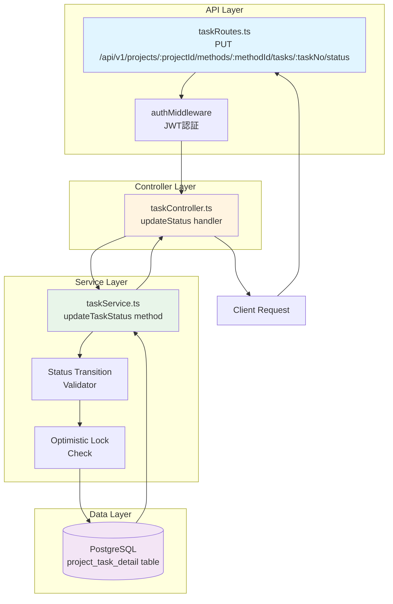
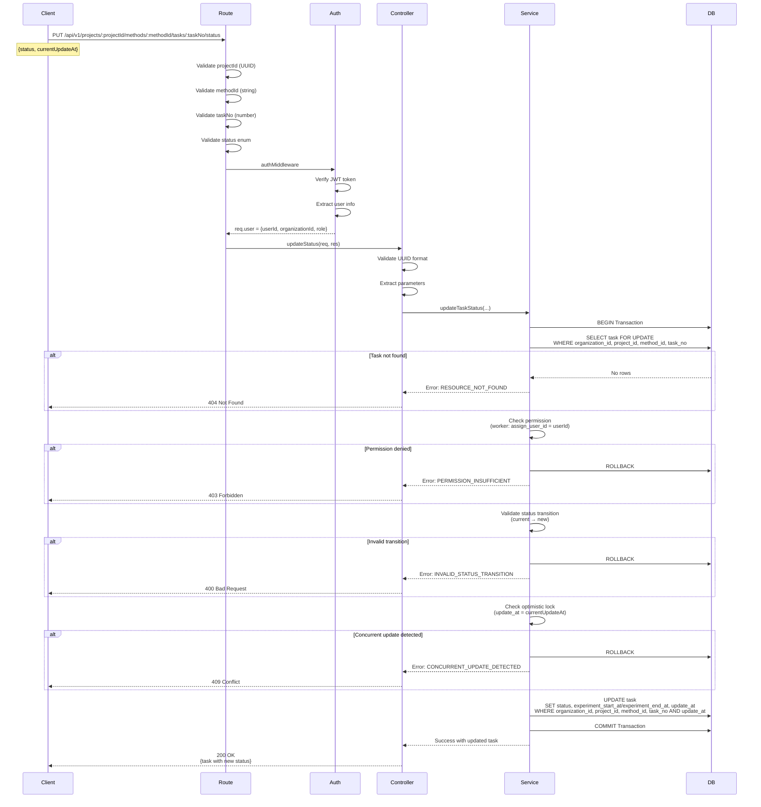

# タスクステータス更新API 技術設計書

---
**プロジェクト**: mmdpf (マルチモーダルデータプラットフォーム)  
**機能**: task-status-update-api  
**バージョン**: 1.0.0  
**作成日**: 2026-01-28  
**言語**: 日本語
---

## Overview

**Purpose**: 実験作業者が実験タスクのステータスを更新するためのREST APIエンドポイントを提供します。これにより、実験ワークフローの進捗管理と状態遷移の整合性を保証します。

**Users**: 
- **実験作業者（experiment_worker）**: 自分に割り当てられたタスクのステータスを更新
- **実験管理者（experiment_admin）**: 自分が所有者となっているプロジェクトのすべてのタスクのステータスを更新・管理
- **システム管理者（system_admin）**: システム全体のタスクを管理

**Impact**: 既存のプロジェクト管理APIに新しいエンドポイント `PUT /api/v1/projects/:projectId/methods/:methodId/tasks/:taskNo/status` を追加します。これは既存のproject management APIファミリーの一部として機能し、同じ認証・認可パターンに従います。

### Goals

- タスクステータスの安全な更新（有効な状態遷移のみ許可）
- 楽観的ロックによる同時更新の検出と防止
- ロールベースのアクセス制御（experiment_workerは自分のタスクのみ）
- マルチテナント分離の維持
- 既存APIパターンとの一貫性

### Non-Goals

- タスクの作成・削除機能（別APIで実装済み）
- タスクへのコメント機能（将来の拡張として検討）
- 一括ステータス更新（現時点では1件ずつの更新のみ）
- 通知機能との統合（将来の拡張として検討）

## Architecture

### Existing Architecture Analysis

既存のプロジェクト管理APIは以下のレイヤードアーキテクチャを採用しています：

**現在のパターン**:
- **Route層**: Express.jsルーター、バリデーション（express-validator）、ミドルウェアチェーン
- **Controller層**: リクエスト/レスポンス処理、認証チェック、エラーハンドリング
- **Service層**: ビジネスロジック、トランザクション管理、ServiceResult<T>パターン
- **Repository層**: データベース接続、SQL実行（PostgreSQL pool）

**保持する既存パターン**:
- ミドルウェアチェーン: `authMiddleware` → controller handler
- エラーコード命名: `CATEGORY_SPECIFIC_ERROR`
- ServiceResult型: `{ success: boolean, data?: T, error?: {...} }`
- トランザクション管理: `pool.connect()` + `BEGIN/COMMIT/ROLLBACK`

**技術的制約**:
- 既存のproject_task_detailテーブルスキーマを使用
- 複合主キー（organization_id, project_id, method_id, task_no）による識別
- 既存の認証システム（JWT + Session Hybrid）を利用
- マルチテナント分離（organization_id必須）を維持

### Architecture Pattern & Boundary Map



**Architecture Integration**:
- **Selected pattern**: Layered Architecture（既存パターン）
- **Domain boundaries**: プロジェクト管理ドメイン内の既存APIファミリーに統合
- **New components**: taskRoutes.ts（新規）、taskController.ts（新規）、taskService.ts（新規）
- **Rationale**: 既存のprojectRoutes/projectControllerと同じパターンに従い、一貫性を保つ
- **Steering compliance**: RESTful API設計原則、マルチテナント分離、セキュリティポリシーに準拠

### Technology Stack

| Layer | Choice / Version | Role in Feature | Notes |
|-------|------------------|-----------------|-------|
| Backend Framework | Express.js 4.18.3 | APIエンドポイント提供 | 既存システムと同一 |
| Language | TypeScript 5.x | 型安全な実装 | 既存システムと同一 |
| Validation | express-validator | リクエストバリデーション | 既存パターンに従う |
| Database | PostgreSQL 18+ | タスクデータ永続化 | project_task_detailテーブル使用 |
| Authentication | JWT + Session | 認証・認可 | authMiddleware利用 |
| Logging | Winston | エラーログ記録 | logError util使用 |

## System Flows

### Status Update Flow



**Flow-level decisions**:
- **Optimistic locking**: update_atを使用して同時更新を検出。更新失敗時は409 Conflictを返し、クライアントはリトライを行う
- **Transaction scope**: SELECT FOR UPDATE → validation → UPDATEまでをトランザクション内で実行
- **Permission check timing**: トランザクション内でチェックし、失敗時は即座にROLLBACK

## Requirements Traceability

| Requirement | Summary | Components | Interfaces | Flows |
|-------------|---------|------------|------------|-------|
| 1.1 | タスクステータス更新機能 | taskRoutes, taskController, taskService | PUT /api/v1/projects/:projectId/methods/:methodId/tasks/:taskNo/status | Status Update Flow |
| 1.2 | 有効なステータス遷移の検証 | taskService (validateTransition) | Service Interface | Status Update Flow - Validation step |
| 1.3 | 楽観的ロック制御 | taskService (optimistic lock check) | Service Interface | Status Update Flow - Lock check step |
| 1.4 | ロールベース権限制御 | taskService (permission check) | Service Interface | Status Update Flow - Permission step |
| 2.1 | 統一レスポンス形式 | taskController | API Contract | All responses |
| 2.2 | エラーハンドリング | taskController, taskService | Error Contracts | Error scenarios |
| 3.1 | マルチテナント分離 | taskService (organization_id filter) | Database queries | All DB operations |
| 3.2 | 監査ログ記録 | taskController (logError) | Logging | Error cases |

## Components and Interfaces

### Quick Reference

| Component | Domain/Layer | Intent | Req Coverage | Key Dependencies | Contracts |
|-----------|--------------|--------|--------------|------------------|-----------|
| taskRoutes | API Layer | ルート定義、バリデーション | 1.1, 2.1 | express-validator (P0) | API |
| taskController | Controller Layer | リクエスト処理、レスポンス生成 | 1.1, 2.1, 2.2, 3.2 | taskService (P0), logger (P0) | API |
| taskService | Service Layer | ビジネスロジック、状態遷移検証 | 1.1, 1.2, 1.3, 1.4, 3.1 | PostgreSQL pool (P0) | Service |

### API Layer

#### taskRoutes

| Field | Detail |
|-------|--------|
| Intent | タスクステータス更新エンドポイントのルート定義とバリデーション |
| Requirements | 1.1, 2.1 |
| Owner | Backend Team |

**Responsibilities & Constraints**
- エンドポイント `/api/v1/projects/:projectId/methods/:methodId/tasks/:taskNo/status` の定義
- リクエストパラメータのバリデーション（express-validator）
- 認証ミドルウェア（authMiddleware）の適用
- コントローラーへのルーティング

**Dependencies**
- Inbound: HTTP Client → API requests (P0)
- Outbound: taskController.updateStatus → request handling (P0)
- External: express-validator → validation (P0)

**Contracts**: API [x]

##### API Contract

| Method | Endpoint | Request | Response | Errors |
|--------|----------|---------|----------|--------|
| PUT | /api/v1/projects/:projectId/methods/:methodId/tasks/:taskNo/status | UpdateStatusRequest | TaskStatusResponse | 400, 401, 403, 404, 409, 500 |

**Request Schema**:
```typescript
// Path Parameters
{
  projectId: string;  // UUID format required
  methodId: string;   // Method ID (e.g., "method1")
  taskNo: number;     // Task number (1-based index)
}

// Request Body
{
  status: 'pending' | 'in_progress' | 'completed' | 'forced_terminated';
  currentUpdateAt: string;  // ISO8601 timestamp for optimistic locking
  comment?: string;  // Optional comment (max 500 chars)
}

// Headers (required)
{
  Authorization: string;  // Bearer {jwt_token}
  Content-Type: 'application/json';
}
```

**Response Schema (200 OK)**:
```json
{
  "success": true,
  "data": {
    "taskId": "uuid",
    "taskStatus": "in_progress",
    "assignUserId": "uuid",
    "assignUserName": "Worker Name",
    "startedAt": "2026-01-28T08:00:00Z",
    "completedAt": null,
    "updateAt": "2026-01-28T08:30:00Z",
    "projectId": "uuid",
    "projectName": "Project Name",
    "methodId": "method1",
    "taskNo": 1
  },
  "meta": {
    "timestamp": "2026-01-28T08:30:00Z",
    "requestId": "req_abc123"
  }
}
```

**Error Responses**:

| Status | Error Code | Description | Example Message |
|--------|-----------|-------------|-----------------|
| 400 | VALIDATION_INVALID_FORMAT | projectIdがUUID形式でない、またはtaskNoが数値でない | projectIdはUUID形式、taskNoは数値である必要があります |
| 400 | VALIDATION_INVALID_STATUS | statusが不正な値 | statusはpending, in_progress, completed, forced_terminatedのいずれかです |
| 400 | VALIDATION_REQUIRED_FIELD | 必須フィールドが欠落 | currentUpdateAtは必須です |
| 400 | INVALID_STATUS_TRANSITION | 不正な状態遷移 | pending から completed への遷移は許可されていません |
| 401 | AUTH_TOKEN_INVALID | 認証トークンが無効 | 認証が必要です |
| 403 | PERMISSION_INSUFFICIENT | 権限不足 | このタスクを更新する権限がありません |
| 404 | RESOURCE_NOT_FOUND | タスクが存在しない | タスクが見つかりません |
| 409 | CONCURRENT_UPDATE_DETECTED | 同時更新が検出された | タスクが他のユーザーによって更新されました |
| 500 | SYSTEM_DATABASE_ERROR | データベースエラー | システムエラーが発生しました |

**Implementation Notes**
- express-validatorでパラメータバリデーション実施
- authMiddlewareを適用してJWT認証を実施
- バリデーションエラーは400で即座に返却

### Controller Layer

#### taskController

| Field | Detail |
|-------|--------|
| Intent | タスクステータス更新リクエストの処理とレスポンス生成 |
| Requirements | 1.1, 2.1, 2.2, 3.2 |

**Responsibilities & Constraints**
- リクエストパラメータの抽出と初期バリデーション
- サービス層の呼び出し
- 統一レスポンス形式への変換
- エラーハンドリングとロギング
- HTTPステータスコードのマッピング

**Dependencies**
- Inbound: taskRoutes → request routing (P0)
- Outbound: taskService.updateTaskStatus → business logic (P0)
- External: logger.logError → error logging (P0)

**Contracts**: Service [x]

##### Service Interface

```typescript
/**
 * タスクステータス更新ハンドラー
 */
async function updateStatus(req: Request, res: Response): Promise<void> {
  const requestId = uuidv4();
  
  try {
    // 1. 認証チェック
    if (!req.user) {
      return res.status(401).json({...});
    }
    
    // 2. パラメータ抽出
    const { projectId, methodId, taskNo } = req.params;
    const { status, currentUpdateAt, comment } = req.body;
    const { organizationId, userId, role } = req.user;
    
    // 3. UUID形式バリデーション（projectId）
    const uuidRegex = /^[0-9a-f]{8}-[0-9a-f]{4}-[0-9a-f]{4}-[0-9a-f]{4}-[0-9a-f]{12}$/i;
    if (!uuidRegex.test(projectId)) {
      return res.status(400).json({...});
    }
    
    // 4. taskNo数値バリデーション
    const taskNoNum = parseInt(taskNo, 10);
    if (isNaN(taskNoNum) || taskNoNum < 1) {
      return res.status(400).json({...});
    }
    
    // 5. サービス層呼び出し
    const result = await taskService.updateTaskStatus(
      organizationId,
      projectId,
      methodId,
      taskNoNum,
      userId,
      role,
      status,
      currentUpdateAt,
      comment
    );
    
    // 5. エラーハンドリング
    if (!result.success) {
      const statusCode = mapErrorCodeToStatus(result.error.code);
      return res.status(statusCode).json({...});
    }
    
    // 6. 成功レスポンス
    res.status(200).json({
      success: true,
      data: result.data,
      meta: { timestamp, requestId }
    });
    
  } catch (error) {
    logError('Task updateStatus error', error as Error, {
      organizationId,
      projectId,
      methodId,
      taskNo: taskNoNum
    });
    res.status(500).json({...});
  }
}
```

**Implementation Notes**
- エラーコードからHTTPステータスへのマッピング関数を実装
- すべてのエラーをlogErrorでロギング
- requestIdをuuidv4()で生成してトレーシング可能にする

### Service Layer

#### taskService

| Field | Detail |
|-------|--------|
| Intent | タスクステータス更新のビジネスロジックと状態遷移検証 |
| Requirements | 1.1, 1.2, 1.3, 1.4, 3.1 |

**Responsibilities & Constraints**
- ステータス遷移の妥当性検証
- 楽観的ロック制御（update_at比較）
- ロールベース権限チェック
- マルチテナント分離（organization_id必須）
- トランザクション管理
- データベース更新とタイムスタンプ管理

**Dependencies**
- Inbound: taskController → request handling (P0)
- Outbound: PostgreSQL pool → data persistence (P0)

**Contracts**: Service [x] / State [x]

##### Service Interface

```typescript
interface TaskService {
  updateTaskStatus(
    organizationId: string,
    projectId: string,
    methodId: string,
    taskNo: number,
    userId: string,
    role: string,
    newStatus: TaskStatus,
    currentUpdateAt: string,
    comment?: string
  ): Promise<ServiceResult<TaskStatusResponse>>;
}

type TaskStatus = 'pending' | 'in_progress' | 'completed' | 'forced_terminated';

interface TaskStatusResponse {
  organizationId: string;
  projectId: string;
  projectName: string;
  methodId: string;
  taskNo: number;
  taskStatus: TaskStatus;
  experimentUserId: string | null;
  experimentUserName: string | null;
  experimentStartAt: string | null;
  experimentEndAt: string | null;
  updateAt: string;
}

interface ServiceResult<T> {
  success: boolean;
  data?: T;
  error?: {
    code: string;
    message: string;
    details?: any;
    originalError?: Error;
  };
}
```

**Preconditions**:
- organizationId, projectId, methodId, taskNo, userId, roleが有効な値である
- currentUpdateAtがISO8601形式のタイムスタンプである
- newStatusが許可された値のいずれかである

**Postconditions**:
- タスクのtask_statusが更新される
- update_atが現在時刻に更新される
- status=in_progressの場合、experiment_start_atがnullなら現在時刻が設定される
- status=completed/forced_terminatedの場合、experiment_end_atが現在時刻に設定される
- トランザクションがコミットまたはロールバックされる

**Invariants**:
- タスクは必ず単一の組織に属する
- 状態遷移は定義されたルールに従う
- experiment_workerは自分のタスクのみ更新可能

##### State Management

**State model**:
```typescript
enum TaskStatusEnum {
  PENDING = 0,           // 未着手
  IN_PROGRESS = 1,       // 作業中
  FAILED = 2,            // 失敗（未使用）
  COMPLETED = 3,         // 完了
  FORCED_TERMINATED = 4  // 強制終了
}

// Valid transitions
const VALID_TRANSITIONS: Map<TaskStatusEnum, TaskStatusEnum[]> = new Map([
  [TaskStatusEnum.PENDING, [TaskStatusEnum.IN_PROGRESS]],
  [TaskStatusEnum.IN_PROGRESS, [TaskStatusEnum.COMPLETED, TaskStatusEnum.FORCED_TERMINATED]],
  [TaskStatusEnum.COMPLETED, []],  // 終了状態
  [TaskStatusEnum.FORCED_TERMINATED, []]  // 終了状態
]);
```

**Persistence & consistency**:
- PostgreSQLトランザクション内で更新
- SELECT FOR UPDATEで行レベルロック取得
- COMMIT前にすべてのバリデーションを実施

**Concurrency strategy**:
- 楽観的ロック（Optimistic Locking）
- update_at列を使用してバージョン管理
- 更新時にWHERE句で現在のupdate_atを指定
- 0行更新の場合は409 Conflictエラー

**Implementation Notes**

**Integration**:
- PostgreSQL connection poolを使用
- トランザクション内でSELECT FOR UPDATE → validation → UPDATEを実施

**Validation**:
```typescript
// Status transition validation
function validateTransition(
  currentStatus: TaskStatusEnum,
  newStatus: TaskStatusEnum
): boolean {
  const validNextStatuses = VALID_TRANSITIONS.get(currentStatus) || [];
  return validNextStatuses.includes(newStatus);
}

// Permission check
function checkPermission(
  role: string,
  experimentUserId: string | null,
  userId: string
): boolean {
  if (role === 'system_admin' || role === 'experiment_admin') {
    return true;  // Admin can update any task
  }
  if (role === 'experiment_worker') {
    return experimentUserId === userId;  // Worker can only update own tasks
  }
  return false;
}
```

**Optimistic Lock Implementation**:
```typescript
// UPDATE with optimistic lock check
const updateQuery = `
  UPDATE project_task_detail
  SET 
    task_status = $1,
    experiment_start_at = CASE 
      WHEN $1 = 1 AND experiment_start_at IS NULL THEN NOW()
      ELSE experiment_start_at
    END,
    experiment_end_at = CASE 
      WHEN $1 IN (3, 4) THEN NOW()
      ELSE experiment_end_at
    END,
    update_at = NOW()
  WHERE organization_id = $2
    AND project_id = $3
    AND method_id = $4
    AND task_no = $5
    AND update_at = $6
  RETURNING *
`;

const result = await client.query(updateQuery, [
  newStatusValue,
  organizationId,
  projectId,
  methodId,
  taskNo,
  currentUpdateAt
]);

if (result.rowCount === 0) {
  // Concurrent update detected or task not found
  throw new ConcurrentUpdateError();
}
```

**Risks**:
- 高頻度更新時の楽観的ロック競合 → リトライロジックをクライアント側で実装する必要がある
- トランザクション内処理時間の増加 → SELECT FOR UPDATEの保持時間を最小化

## Data Models

### Domain Model

**Aggregate**: Task（タスク集約）

**Entities**:
- Task: 実験タスクのコアエンティティ
  - Identity: 複合キー (organization_id, project_id, method_id, task_no)
  - Attributes: task_status, experiment_user_id, experiment_start_at, experiment_end_at, update_at
  - Behavior: updateStatus(), validateTransition()

**Value Objects**:
- TaskStatus: 'pending' | 'in_progress' | 'completed' | 'forced_terminated'

**Domain Events** (将来の拡張):
- TaskStatusChanged: ステータス変更時に発火（現時点では未実装）

**Business Rules & Invariants**:
1. タスクは必ず単一の組織に属する（organization_id）
2. タスクは必ず単一のプロジェクトに属する（project_id）
3. ステータス遷移は定義されたルールに従う
4. experiment_workerは自分に割り当てられたタスクのみ更新可能
5. 完了・強制終了状態からの遷移は不可

### Logical Data Model

**Entity**: project_task_detail

**Structure Definition**:
```
project_task_detail (既存テーブル - 変更なし)
├── organization_id (UUID, PK, FK → organization, NOT NULL)
├── project_id (UUID, PK, FK → project, NOT NULL)
├── method_id (VARCHAR, PK, FK → project_task, NOT NULL)
├── task_no (NUMERIC, PK, NOT NULL)
├── task_status (INTEGER, NOT NULL)  ← 更新対象
│   └── Values: 0=pending, 1=in_progress, 2=failed, 3=completed, 4=forced_terminated(新規)
├── experiment_start_at (TIMESTAMP, NULL OK)  ← in_progress時に自動設定
├── experiment_end_at (TIMESTAMP, NULL OK)  ← completed/forced_terminated時に自動設定
├── experiment_user_id (UUID, FK → organization_user, NULL OK)
├── reviewed_at (TIMESTAMP, NULL OK)
├── review_user_id (UUID, FK → organization_user, NULL OK)
├── update_at (TIMESTAMP, NOT NULL)  ← 楽観的ロックに使用
└── ... (その他のカラムは変更なし)
```

**Cardinality**:
- organization 1 : N project_task_detail
- project 1 : N project_task_detail
- project_task 1 : N project_task_detail
- organization_user 0..1 : N project_task_detail (experiment_user_id)

**Referential Integrity**:
- (organization_id, project_id) → project(organization_id, project_id) ON DELETE RESTRICT
- (organization_id, project_id, method_id) → project_task(organization_id, project_id, method_id) ON DELETE RESTRICT
- experiment_user_id → organization_user(user_id) ON DELETE SET NULL

**Temporal Aspects**:
- update_at: 更新時に自動更新（楽観的ロックのバージョン管理）
- experiment_start_at: 作業開始時刻（in_progress遷移時に1度だけ設定）
- experiment_end_at: 完了時刻（completed/forced_terminated遷移時に設定）

### Physical Data Model

**Table**: project_task_detail (既存 - 変更なし)

**Indexes** (既存):
```sql
-- Primary Key (複合キー)
CREATE UNIQUE INDEX project_task_detail_pkey ON project_task_detail (
  organization_id, project_id, method_id, task_no
);

-- Foreign Keys
CREATE INDEX idx_project_task_detail_organization ON project_task_detail (organization_id);
CREATE INDEX idx_project_task_detail_project ON project_task_detail (organization_id, project_id);
CREATE INDEX idx_project_task_detail_task ON project_task_detail (organization_id, project_id, method_id);
CREATE INDEX idx_project_task_detail_experiment_user ON project_task_detail (experiment_user_id);

-- Query optimization (既存想定)
CREATE INDEX idx_project_task_detail_status ON project_task_detail (task_status);
```

**No schema changes required** - 既存のproject_task_detailテーブル構造をそのまま使用します。task_status列に新しい値 `4 (forced_terminated)` を追加するだけです。

### Data Contracts & Integration

**API Data Transfer**:
```typescript
// Request DTO
interface UpdateTaskStatusRequest {
  status: 'pending' | 'in_progress' | 'completed' | 'forced_terminated';
  currentUpdateAt: string;  // ISO8601 timestamp
  comment?: string;  // Optional, max 500 chars
}

// Response DTO
interface TaskStatusResponse {
  organizationId: string;
  projectId: string;
  projectName: string;
  methodId: string;
  taskNo: number;
  taskStatus: 'pending' | 'in_progress' | 'completed' | 'forced_terminated';
  experimentUserId: string | null;
  experimentUserName: string | null;
  experimentStartAt: string | null;
  experimentEndAt: string | null;
  updateAt: string;
}
```

**Validation rules**:
- taskId: UUID v4 format
- status: Enum validation
- currentUpdateAt: ISO8601 timestamp format
- comment: Optional, max length 500 characters

**Serialization format**: JSON (application/json)

**Cross-Service Data Management**:
- 現時点では単一サービス内で完結
- 将来、通知サービスとの統合時はイベント駆動パターンを検討

## Error Handling

### Error Strategy

**エラーカテゴリ別の処理方針**:

1. **Validation Errors** → コントローラーで即座に400返却
2. **Business Logic Errors** → サービス層で検証し、適切なエラーコードで返却
3. **Concurrency Errors** → 409 Conflictで返却、クライアントはリトライ
4. **System Errors** → 500で返却、詳細をログに記録

### Error Categories and Responses

#### User Errors (4xx)

| Error Code | HTTP Status | Scenario | User Action |
|-----------|-------------|----------|-------------|
| VALIDATION_INVALID_FORMAT | 400 | projectIdがUUID形式でない、またはtaskNoが数値でない | 正しいUUID形式とtaskNo数値で再試行 |
| VALIDATION_INVALID_STATUS | 400 | statusが不正な値 | 許可された値(pending, in_progress, completed, forced_terminated)を使用 |
| VALIDATION_REQUIRED_FIELD | 400 | 必須フィールド欠落 | currentUpdateAtを含めて再送信 |
| INVALID_STATUS_TRANSITION | 400 | 不正な状態遷移 | 有効な遷移パス（pending→in_progress, in_progress→completed/forced_terminated）を確認 |
| AUTH_TOKEN_INVALID | 401 | JWTトークンが無効または期限切れ | 再ログインしてトークンを更新 |
| PERMISSION_INSUFFICIENT | 403 | 権限不足 | 自分に割り当てられたタスクのみ更新可能（workerの場合） |
| RESOURCE_NOT_FOUND | 404 | タスクが存在しない、または別組織のタスク | projectId, methodId, taskNoを確認、または組織IDを確認 |
| CONCURRENT_UPDATE_DETECTED | 409 | 他のユーザーによる同時更新 | 最新のupdate_atを取得して再試行 |

#### System Errors (5xx)

| Error Code | HTTP Status | Scenario | Recovery Action |
|-----------|-------------|----------|-----------------|
| SYSTEM_DATABASE_ERROR | 500 | データベース接続失敗、クエリエラー | システム管理者に連絡、ログ確認 |

### Monitoring

**Error Tracking**:
- すべてのエラーをWinstonでログ記録
- エラーログには以下を含める：
  - requestId（トレーシング用）
  - organizationId、userId、taskId
  - エラーコード、メッセージ
  - スタックトレース（500エラーのみ）

**Health Monitoring**:
- API レスポンスタイム監視（目標: 95%tile < 200ms）
- エラー率監視（目標: < 1%）
- 409 Conflict発生率監視（楽観的ロック競合の頻度確認）

**Logging Example**:
```typescript
logError('Task updateStatus error', error as Error, {
  action: 'task_updateStatus',
  organizationId: req.user?.organizationId,
  projectId: req.params.projectId,
  methodId: req.params.methodId,
  taskNo: req.params.taskNo,
  userId: req.user?.userId,
  requestId,
  errorCode: result.error?.code,
});
```

## Testing Strategy

### Unit Tests

**taskService.updateTaskStatus**:
1. 有効な状態遷移（pending→in_progress）が成功する
2. 無効な状態遷移（pending→completed）が拒否される
3. experiment_workerが他人のタスクを更新しようとすると403エラー
4. 楽観的ロック：update_atが異なる場合に409エラー
5. 存在しない複合キー（projectId, methodId, taskNo）で404エラー

**taskController.updateStatus**:
1. 認証失敗時に401エラー
2. UUID形式バリデーション失敗時に400エラー
3. サービスエラーが適切なHTTPステータスにマッピングされる
4. 成功時に200とデータが返却される

### Integration Tests

**エンドツーエンドフロー**:
1. **正常系**: pending → in_progress → completedの完全な遷移フロー
2. **権限チェック**: experiment_workerが自分のタスクのみ更新可能
3. **マルチテナント分離**: 異なる組織のタスクにアクセスできない
4. **楽観的ロック**: 同時更新時に片方が409を受け取る
5. **トランザクション整合性**: エラー時にROLLBACKされてデータが変更されない

### Performance Tests

1. **レスポンスタイム**: 単一更新で50ms以下（95%tile）
2. **並行更新**: 10並行リクエストで5秒以内にすべて完了
3. **楽観的ロック競合率**: 100並行更新で競合率 < 5%
4. **データベース接続**: プール枯渇しないこと（最大20接続）

## Security Considerations

### Authentication & Authorization

**認証**:
- すべてのリクエストでJWTトークン検証（authMiddleware）
- トークン有効期限チェック（expired tokenは401）
- セッション検証（session hybrid方式）

**認可**:
- **system_admin**: すべてのタスク更新可能
- **experiment_admin**: 組織内のすべてのタスク更新可能
- **experiment_worker**: 自分に割り当てられたタスクのみ更新可能（experiment_user_id = userId）

### Data Protection

**マルチテナント分離**:
- すべてのクエリに `WHERE organization_id = $1` を必須化
- クロステナントアクセスの完全防止
- URLパラメータの複合キー（projectId, methodId, taskNo）と組織IDでフィルタ

**SQLインジェクション対策**:
- Parameterized Queriesを使用（$1, $2, ... プレースホルダー）
- 文字列連結でのSQL構築を禁止

**監査ログ**:
- すべてのステータス更新をログに記録
- who（userId）、what（taskId、status変更）、when（timestamp）を記録

### Input Validation

**バリデーション層**:
1. **Route層**: express-validatorでスキーマバリデーション
2. **Controller層**: UUID形式チェック、型チェック
3. **Service層**: ビジネスルールバリデーション（状態遷移、権限）

**サニタイゼーション**:
- comment フィールドはXSS対策のため、HTMLタグを許可しない
- 最大長500文字でトランケート

## Performance & Scalability

### Target Metrics

| Metric | Target | Measurement |
|--------|--------|-------------|
| API Response Time (P50) | < 50ms | Application Performance Monitoring |
| API Response Time (P95) | < 200ms | Application Performance Monitoring |
| Throughput | > 100 req/s | Load testing |
| Error Rate | < 1% | Error logging aggregation |
| Concurrent Updates | 50 tasks/s | Database monitoring |

### Optimization Strategies

**Database Optimization**:
- 既存インデックス（task_id PK、organization_id、project_id）を活用
- SELECT FOR UPDATEは必要最小限の行のみロック
- トランザクション時間を最小化（検証→更新→コミット）

**Caching**:
- 現時点ではキャッシュ不要（常に最新データが必要）
- 将来的に高頻度アクセス時はRedisキャッシュを検討

**Scaling Approach**:
- 水平スケーリング可能（ステートレスAPI）
- データベースは既存のPostgreSQLプール（最大20接続）を使用
- 将来的にトラフィック増加時はread replicaを検討

### Concurrency Handling

**楽観的ロックによる制御**:
- update_atを使用したバージョン管理
- 競合時は409 Conflictを返し、クライアント側でリトライ
- 予想される競合率: < 5%（実験タスクは頻繁に更新されないため）

**トランザクション分離レベル**:
- PostgreSQLデフォルト（READ COMMITTED）を使用
- SELECT FOR UPDATEで行レベルロック取得

## Supporting References

### Status Transition State Machine

```typescript
/**
 * タスクステータス遷移の詳細仕様
 */
enum TaskStatusEnum {
  PENDING = 0,           // 未着手
  IN_PROGRESS = 1,       // 作業中
  FAILED = 2,            // 失敗（現時点では未使用）
  COMPLETED = 3,         // 完了
  FORCED_TERMINATED = 4  // 強制終了（新規追加）
}

/**
 * 許可されたステータス遷移マップ
 * 
 * @description
 * - PENDING: 作業開始時にIN_PROGRESSに遷移
 * - IN_PROGRESS: 正常完了時はCOMPLETED、異常終了時はFORCED_TERMINATEDに遷移
 * - COMPLETED, FORCED_TERMINATED: 終了状態、これ以上の遷移は不可
 * - FAILED: 現時点では使用しないが、将来の拡張のため予約
 */
const VALID_TRANSITIONS: Map<TaskStatusEnum, TaskStatusEnum[]> = new Map([
  [TaskStatusEnum.PENDING, [TaskStatusEnum.IN_PROGRESS]],
  [TaskStatusEnum.IN_PROGRESS, [TaskStatusEnum.COMPLETED, TaskStatusEnum.FORCED_TERMINATED]],
  [TaskStatusEnum.COMPLETED, []],
  [TaskStatusEnum.FORCED_TERMINATED, []],
  [TaskStatusEnum.FAILED, []]  // 将来の拡張用
]);
```

### Error Code to HTTP Status Mapping

```typescript
/**
 * エラーコードからHTTPステータスコードへのマッピング
 */
function mapErrorCodeToStatus(errorCode: string): number {
  const mapping: Record<string, number> = {
    // 4xx Client Errors
    'VALIDATION_INVALID_FORMAT': 400,
    'VALIDATION_INVALID_STATUS': 400,
    'VALIDATION_REQUIRED_FIELD': 400,
    'INVALID_STATUS_TRANSITION': 400,
    'AUTH_TOKEN_INVALID': 401,
    'PERMISSION_INSUFFICIENT': 403,
    'RESOURCE_NOT_FOUND': 404,
    'CONCURRENT_UPDATE_DETECTED': 409,
    
    // 5xx Server Errors
    'SYSTEM_DATABASE_ERROR': 500,
  };
  
  return mapping[errorCode] || 500;
}
```

### Database Query Examples

```sql
-- タスク情報取得（排他ロック付き）
SELECT 
  ptd.organization_id,
  ptd.project_id,
  p.project_name,
  ptd.method_id,
  ptd.task_no,
  ptd.task_status,
  ptd.experiment_user_id,
  ou.user_name as experiment_user_name,
  ptd.experiment_start_at,
  ptd.experiment_end_at,
  ptd.update_at
FROM project_task_detail ptd
LEFT JOIN project p 
  ON p.project_id = ptd.project_id 
  AND p.organization_id = ptd.organization_id
LEFT JOIN organization_user ou
  ON ou.user_id = ptd.experiment_user_id
  AND ou.organization_id = ptd.organization_id
WHERE ptd.organization_id = $1
  AND ptd.project_id = $2
  AND ptd.method_id = $3
  AND ptd.task_no = $4
FOR UPDATE;

-- ステータス更新（楽観的ロック）
UPDATE project_task_detail
SET 
  task_status = $1,
  experiment_start_at = CASE 
    WHEN $1 = 1 AND experiment_start_at IS NULL THEN NOW()
    ELSE experiment_start_at
  END,
  experiment_end_at = CASE 
    WHEN $1 IN (3, 4) THEN NOW()
    ELSE experiment_end_at
  END,
  update_at = NOW()
WHERE organization_id = $2
  AND project_id = $3
  AND method_id = $4
  AND task_no = $5
```

---

**設計完了日**: 2026-01-28  
**承認待ち**: 設計レビュー承認後、実装タスク生成へ進む
