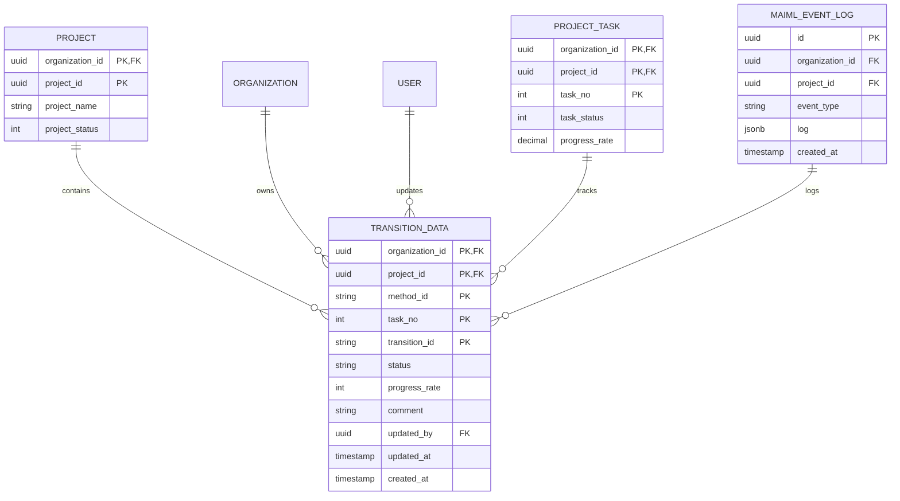
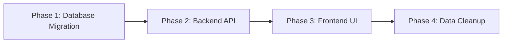

# Technical Design: トランジション状態更新機能

## メタデータ
- **仕様ID**: transition-status-update
- **バージョン**: 1.0.0
- **作成日**: 2026-02-03
- **最終更新**: 2026-02-03
- **ステータス**: Draft
- **言語**: ja

---

## 1. Overview

### 1.1. Purpose

実験作業者が実験記録におけるトランジションの実行状態（初期状態、準備状態、準備完了状態、動作状態、休止状態、終状態、異常終了状態）を明示的に管理できる機能を提供する。現在のシステムでは、トランジションの実行記録は保存されるが、ステータスフィールドが存在せず、作業の進行状況を明確に表現できない問題を解決する。

### 1.2. Goals

#### Primary Goals
1. **状態管理の可視化**: 作業者が各トランジションの作業状況を一目で把握できる
2. **ワークフロー改善**: 作業の進捗状況を明確にすることで、チーム間の連携を促進
3. **データ品質向上**: ステータス情報により、未完了作業の識別が容易になる

#### Secondary Goals
- 既存機能への影響を最小化（後方互換性の維持）
- 将来的なステータス履歴管理への拡張性確保
- 実装とメンテナンスのコストを最小化

### 1.3. Non-Goals

- ステータス変更履歴の詳細な記録（監査ログで代替）
- バルク更新機能（複数トランジションの一括ステータス変更）
- 自動ステータス遷移（ユーザーが手動で変更）
- ワークフロー承認機能（別機能として将来検討）

---

## 2. Architecture Pattern & Boundary Map

### 2.1. Architectural Style

**Pattern**: RESTful API with State Machine

本機能は既存のRESTful APIパターンを拡張し、トランジションのステータス管理を実装する。ステータス遷移ロジックをバックエンドで制御することで、データ整合性を保証する。

```
┌─────────────────────────────────────────────────────────────┐
│                     Frontend (React)                        │
│  ┌─────────────────────────────────────────────────────┐   │
│  │  DataRecordDialog Component                         │   │
│  │  - Status selection UI (Radio.Group)                │   │
│  │  - Status display (Badge)                           │   │
│  └─────────────────┬───────────────────────────────────┘   │
└────────────────────┼───────────────────────────────────────┘
                     │ HTTP/REST
                     │ POST/PATCH /api/v1/projects/:id/experiments/records
┌────────────────────┼───────────────────────────────────────┐
│                    ▼  Backend (Node.js + Express)          │
│  ┌─────────────────────────────────────────────────────┐   │
│  │  API Layer (Routes + Controllers)                   │   │
│  │  - Request validation                               │   │
│  │  - Authentication & Authorization                   │   │
│  └─────────────────┬───────────────────────────────────┘   │
│                    │                                        │
│  ┌─────────────────▼───────────────────────────────────┐   │
│  │  Service Layer                                      │   │
│  │  - Status transition validation                     │   │
│  │  - Business logic                                   │   │
│  └─────────────────┬───────────────────────────────────┘   │
│                    │                                        │
│  ┌─────────────────▼───────────────────────────────────┐   │
│  │  Repository Layer (Kysely)                          │   │
│  │  - Database operations                              │   │
│  │  - Query building                                   │   │
│  └─────────────────┬───────────────────────────────────┘   │
└────────────────────┼───────────────────────────────────────┘
                     │
┌────────────────────▼───────────────────────────────────────┐
│              Database (PostgreSQL)                         │
│  ┌─────────────────────────────────────────────────────┐   │
│  │  transition_data table                              │   │
│  │  + status column (VARCHAR(20))                      │   │
│  │  + CHECK constraint                                 │   │
│  └─────────────────────────────────────────────────────┘   │
└─────────────────────────────────────────────────────────────┘
```

### 2.2. Boundary Definitions

#### Module Boundaries

| Boundary | Responsibility | Interface |
|----------|---------------|-----------|
| **Frontend UI** | ユーザー操作、状態表示 | React Components, Ant Design |
| **API Layer** | HTTPリクエスト処理、認証 | RESTful endpoints |
| **Service Layer** | ビジネスロジック、状態遷移検証 | TypeScript classes/functions |
| **Repository Layer** | データアクセス、クエリ実行 | Kysely query builder |
| **Database** | データ永続化、整合性制約 | PostgreSQL tables |

#### Integration Points

1. **Frontend ↔ Backend API**
   - Protocol: HTTP/REST
   - Format: JSON
   - Authentication: JWT + Session

2. **Backend ↔ Database**
   - Protocol: PostgreSQL wire protocol
   - Query Builder: Kysely
   - Connection Pool: pg

3. **Existing Systems**
   - Experiment Record System（既存）
   - Audit Log System（既存）
   - Project Management System（既存）

### 2.3. State Machine Design

#### Status States

```
                    ┌─────────┐
                    │ initial │ (初期状態)
                    └────┬────┘
                         │
            ┌────────────┼────────────┐
            │            │            │
            ▼            ▼            ▼
       ┌─────────┐  ┌──────────┐  ┌───────────┐
       │preparing│  │completed │  │   error   │
       └────┬────┘  └──────────┘  └───────────┘
            │       (終状態)      (異常終了状態)
            │
            ├─────────────────────────┐
            │                         │
            ▼                         ▼
       ┌────────┐                ┌───────────┐
       │ ready  │                │ completed │
       └───┬────┘                └───────────┘
           │                     (終状態)
           ├──────────┬──────────┐
           │          │          │
           ▼          ▼          ▼
       ┌─────────┐ ┌───────────┐ ┌───────┐
       │ ready   │ │  running  │ │ error │
       │(自己)   │ └─────┬─────┘ └───────┘
       └─────────┘       │
                         │
                    ┌────┴────┐
                    │         │
                    ▼         ▼
               ┌────────┐ ┌───────────┐
               │ paused │ │ completed │
               └───┬────┘ └───────────┘
                   │      (終状態)
                   │
              ┌────┼────┬─────────┐
              │    │    │         │
              ▼    ▼    ▼         ▼
          ┌─────────┐ ┌───────────┐ ┌───────┐
          │ running │ │ completed │ │ error │
          └─────────┘ └───────────┘ └───────┘
                      (終状態)    (異常終了状態)
```

#### Status Definitions

| Status | 論理名 | 説明 | Transition From | Transition To |
|--------|-------|------|-----------------|---------------|
| `initial` | 初期状態 | トランジションが作成された初期状態 | - | preparing, completed, error |
| `preparing` | 準備状態 | 実験の準備を行っている状態 | initial | ready, completed, error |
| `ready` | 準備完了状態 | 実験の準備が完了し実行可能な状態 | preparing | ready, running, completed, error |
| `running` | 動作状態 | 実験を実行中の状態 | ready | paused, completed, error |
| `paused` | 休止状態 | 実験が一時停止されている状態 | running | running, completed, error |
| `completed` | 終状態 | 実験が正常に完了した最終状態 | initial, preparing, ready, running, paused | (変更不可) |
| `error` | 異常終了状態 | 実験がエラーで終了した最終状態 | initial, preparing, ready, running, paused | (変更不可) |

#### Transition Rules

```typescript
type StatusTransition = {
  from: Status;
  to: Status;
  allowed: boolean;
  reason?: string;
};

const ALLOWED_TRANSITIONS: Record<Status, Status[]> = {
  initial: ['preparing', 'completed', 'error'],
  preparing: ['ready', 'completed', 'error'],
  ready: ['ready', 'running', 'completed', 'error'],
  running: ['paused', 'completed', 'error'],
  paused: ['running', 'completed', 'error'],
  completed: [], // 最終状態（変更不可）
  error: [] // 最終状態（変更不可）
};
```

---

## 3. Technology Stack & Alignment

### 3.1. Technology Choices

#### Backend Technologies

| Component | Technology | Version | Rationale |
|-----------|-----------|---------|-----------|
| **Runtime** | Node.js | 24.0.0+ | 既存システムと統一 |
| **Framework** | Express.js | 4.18.3+ | 既存APIフレームワーク |
| **Language** | TypeScript | 5.x | 型安全性の確保 |
| **Query Builder** | Kysely | Latest | 既存データアクセス層と統一 |
| **Validation** | express-validator | Latest | 入力検証の標準化 |
| **Database** | PostgreSQL | 18+ | 既存データベース |

#### Frontend Technologies

| Component | Technology | Version | Rationale |
|-----------|-----------|---------|-----------|
| **Framework** | React | 18.2.0 | 既存UIフレームワーク |
| **Next.js** | 15+ | 既存ルーティング |
| **UI Library** | Ant Design | 6.x | デザインシステム統一 |
| **HTTP Client** | Axios | Latest | 既存API通信ライブラリ |
| **Language** | TypeScript | 5.x | 型安全性の確保 |

### 3.2. Alignment with Existing Patterns

#### Code Organization

```
backend/src/
├── routes/
│   └── projectRoutes.ts          # 既存ルートに追加
├── controllers/
│   └── projectController.ts      # 既存コントローラーに追加
├── services/
│   └── transitionDataService.ts # 新規作成
├── repositories/
│   └── transitionDataRepository.ts # 新規作成
└── types/
    └── transitionData.ts       # 型定義追加

frontend/src/
├── components/
│   └── experiment_worker/
│       └── DataRecordDialog.tsx  # 既存コンポーネント修正
├── services/
│   └── transitionDataService.ts # API通信ロジック追加
└── types/
    └── transitionData.ts       # 型定義追加
```

#### Naming Conventions

- **Database**: snake_case（transition_data, status）
- **TypeScript**: camelCase（transitionData, status）
- **API**: kebab-case（/transitions/status）
- **Types**: PascalCase（TransitionData, Status）

### 3.3. Dependencies

#### New Dependencies
なし（既存ライブラリのみ使用）

#### Existing Dependencies
- Kysely（データベースクエリ）
- express-validator（バリデーション）
- Ant Design（UIコンポーネント）

---

## 4. Components & Interface Contracts

### 4.1. Database Schema

#### Migration Script

**File**: `backend/migrations/20260203_verify_transition_data_status.sql`

```sql
-- transition_dataテーブルは既にstatusカラムを持っているため、
-- 既存データの状態確認とインデックス追加のみ実行

-- インデックス追加（ステータスによるフィルタリング性能向上）
CREATE INDEX IF NOT EXISTS idx_transition_data_status 
ON transition_data(organization_id, project_id, status);

-- 既存インデックスの確認
CREATE INDEX IF NOT EXISTS idx_transition_data_updated_at 
ON transition_data(organization_id, project_id, updated_at DESC);

-- コメント追加（念のため再設定）
COMMENT ON COLUMN transition_data.status IS 
'トランジションの実行状態: initial(初期状態), preparing(準備状態), ready(準備完了状態), running(動作状態), paused(休止状態), completed(終状態), error(異常終了状態)';
```

#### Schema Definition

```typescript
// backend/src/types/transitionData.ts

export type Status = 'initial' | 'preparing' | 'ready' | 'running' | 'paused' | 'completed' | 'error';

export interface TransitionData {
  organization_id: string;
  project_id: string;
  method_id: string;
  task_no: number;
  transition_id: string;
  status: Status;
  progress_rate: number; // 0-100
  comment: string | null;
  updated_by: string;
  updated_at: Date;
  created_at: Date;
}

export interface NewTransitionData {
  organization_id: string;
  project_id: string;
  method_id: string;
  task_no: number;
  transition_id: string;
  status?: Status; // オプショナル（デフォルト: 'initial'）
  progress_rate?: number; // オプショナル（デフォルト: 0）
  comment?: string;
  updated_by: string;
}

export interface TransitionDataUpdate {
  status: Status;
  progress_rate?: number;
  comment?: string;
  updated_by: string;
}
```

### 4.2. API Interfaces

#### 4.2.1. Create Experiment Record (Modified)

**Endpoint**: `POST /api/v1/projects/:projectId/experiments/records`

**Request**:
```typescript
interface CreateExperimentRecordRequest {
  experiment_name: string;
  method_id: string;
  transition_id: string;
  status?: Status; // 新規追加（オプショナル、デフォルト: 'initial'）
  data?: any; // 実験データ
}
```

**Response**:
```typescript
interface CreateExperimentRecordResponse {
  success: boolean;
  data: {
    id: number;
    project_id: number;
    experiment_name: string;
    method_id: string;
    transition_id: string;
    status: Status;
    executed_at: Date;
    executed_by: number;
  };
  meta: {
    timestamp: string;
    requestId: string;
  };
}
```

**Status Codes**:
- `200 OK`: 成功
- `400 Bad Request`: バリデーションエラー
- `401 Unauthorized`: 認証エラー
- `403 Forbidden`: 権限不足
- `404 Not Found`: プロジェクトが見つからない
- `500 Internal Server Error`: サーバーエラー

#### 4.2.2. Update Transition Status (New)

**Endpoint**: `PATCH /api/v1/projects/:projectId/transitions/:transitionId/status`

**Request**:
```typescript
interface UpdateTransitionStatusRequest {
  status: Status; // 必須
  comment?: string; // オプショナル（最大2000文字）
}
```

**Response**:
```typescript
interface UpdateTransitionStatusResponse {
  success: boolean;
  data: {
    transition_id: string;
    method_id: string;
    task_no: number;
    status: Status;
    progress_rate: number;
    updated_at: string;
    updated_by: string;
  };
  meta: {
    timestamp: string;
    requestId: string;
  };
}
```

**Status Codes**:
- `200 OK`: 成功
- `400 Bad Request`: バリデーションエラー（不正なステータス値、コメント長超過）
- `401 Unauthorized`: 認証エラー
- `403 Forbidden`: 権限不足またはプロジェクトステータスが編集不可
- `404 Not Found`: トランジションが見つからない
- `422 Unprocessable Entity`: ステータス遷移ルール違反
- `500 Internal Server Error`: サーバーエラー

**Validation Rules**:
1. `status`: 必須、`initial`, `preparing`, `ready`, `running`, `paused`, `completed`, `error` のいずれか
2. `comment`: オプショナル、0〜2000文字
3. ステータス遷移ルールの検証（completed, error → 他ステータスへの変更は不可）

---

## 5. Requirements Traceability

| Requirement | Summary | Components | Interfaces | Notes |
|-------------|---------|------------|------------|-------|
| 1 | トランジションステータス更新 | TransitionDataService, TransitionStatusController | PATCH /transitions/:id/status | 手動ステータス更新機能 |
| 2 | ステータス値の管理 | Status型定義、バリデーション | TypeScript enum, DB CHECK制約 | 7つの標準ステータス値（initial, preparing, ready, running, paused, completed, error） |
| 3 | 進捗率の自動制御 | TransitionDataService | ビジネスロジック層 | completed時に100%自動設定 |
| 4 | コメント機能 | UpdateTransitionStatusRequest | API Request Schema | 2000文字制限 |
| 5 | プロジェクトステータス検証 | ProjectValidationMiddleware | Service Layer | active状態のみ編集可能 |
| 6 | トランジション存在確認 | TransitionDataRepository | Database Query | organization_idフィルタ必須 |
| 7 | タスク進捗率の再計算 | TaskProgressService | Service Layer | トランジション更新時に自動計算 |
| 8 | マルチテナント分離 | TenantIsolationMiddleware | すべてのAPI/DB層 | organization_id必須フィルタ |
| 9 | 認証と認可 | AuthMiddleware, PermissionCheck | Middleware Chain | JWT + RBAC |
| 10 | バリデーション | express-validator | Middleware Layer | 全入力値の検証 |
| 11 | エラーハンドリング | ErrorHandlerMiddleware | Middleware Layer | 統一エラー形式 |
| 12 | レスポンス形式 | ApiResponse<T>型 | すべてのAPI | 統一レスポンス構造 |
| 13 | トランザクション管理 | TransitionDataService | Service Layer | ACID特性保証 |
| 14 | パフォーマンス | Database Indexing | PostgreSQL | 1秒以内のレスポンス |
| 15 | データ整合性 | Database Constraints | PostgreSQL | 外部キー、CHECK制約 |
| 16 | 監査ログ | Winston Logger | Logging Layer | 構造化ログ出力 |
| 17 | イベントログ記録 | EventLogService | Service Layer | maiml_event_logテーブル |

---

## 6. Data Models

### 6.1. Domain Model

**Aggregate**: Transition Execution

```typescript
// ドメインモデル
class TransitionExecution {
  id: TransitionId;
  projectId: ProjectId;
  methodId: MethodId;
  transitionId: TransitionId;
  status: TransitionStatus; // Value Object
  progressRate: number; // 0-100
  comment: string | null;
  executedBy: UserId;
  executedAt: DateTime;
  updatedBy: UserId;
  updatedAt: DateTime;

  // ドメインロジック
  canTransitionTo(newStatus: TransitionStatus): boolean {
    return this.status.canTransitionTo(newStatus);
  }

  updateStatus(newStatus: TransitionStatus, comment?: string): void {
    if (!this.canTransitionTo(newStatus)) {
      throw new InvalidStatusTransitionError();
    }
    this.status = newStatus;
    if (newStatus.isCompleted()) {
      this.progressRate = 100;
    }
    this.comment = comment || null;
    this.updatedAt = DateTime.now();
  }
}

// Value Object
class TransitionStatus {
  private constructor(private value: StatusValue) {}

  static INITIAL = new TransitionStatus('initial');
  static PREPARING = new TransitionStatus('preparing');
  static READY = new TransitionStatus('ready');
  static RUNNING = new TransitionStatus('running');
  static PAUSED = new TransitionStatus('paused');
  static COMPLETED = new TransitionStatus('completed');
  static ERROR = new TransitionStatus('error');

  canTransitionTo(target: TransitionStatus): boolean {
    const transitions = ALLOWED_TRANSITIONS[this.value];
    return transitions.includes(target.value);
  }

  isCompleted(): boolean {
    return this.value === 'completed';
  }
}
```

**Invariants**:
1. ステータスは定義された値のみ（initial, preparing, ready, running, paused, completed, error）
2. completed, error ステータスへの遷移後は変更不可
3. 進捗率は0〜100の範囲内
4. completed ステータスの場合は進捗率は必ず100

### 6.2. Logical Data Model

#### Entity Relationships



#### Referential Integrity

- `transition_data.organization_id, project_id` → `project(organization_id, project_id)` (ON DELETE CASCADE)
- `transition_data.organization_id, updated_by` → `organization_user(organization_id, user_id)` (ON DELETE RESTRICT)

### 6.3. Physical Data Model

#### Table: transition_data (from API spec)

```sql
CREATE TABLE transition_data (
    organization_id UUID NOT NULL,
    project_id UUID NOT NULL,
    method_id VARCHAR(100) NOT NULL,
    task_no INTEGER NOT NULL,
    transition_id VARCHAR(100) NOT NULL,
    status VARCHAR(20) NOT NULL DEFAULT 'initial'
        CHECK (status IN ('initial', 'preparing', 'ready', 'running', 'paused', 'completed', 'error')),
    progress_rate INTEGER NOT NULL DEFAULT 0
        CHECK (progress_rate >= 0 AND progress_rate <= 100),
    comment TEXT,
    updated_by UUID NOT NULL,
    updated_at TIMESTAMP NOT NULL DEFAULT CURRENT_TIMESTAMP,
    created_at TIMESTAMP NOT NULL DEFAULT CURRENT_TIMESTAMP,
    PRIMARY KEY (organization_id, project_id, method_id, task_no, transition_id),
    FOREIGN KEY (organization_id, project_id) REFERENCES project(organization_id, project_id) ON DELETE CASCADE,
    FOREIGN KEY (organization_id, updated_by) REFERENCES organization_user(organization_id, user_id) ON DELETE RESTRICT
);

-- Performance Indexes
CREATE INDEX idx_transition_data_status 
    ON transition_data(organization_id, project_id, status);

CREATE INDEX idx_transition_data_updated_at 
    ON transition_data(organization_id, project_id, updated_at DESC);

-- Comments
COMMENT ON TABLE transition_data IS 'トランジションの実行状態とメタデータを管理するテーブル';
COMMENT ON COLUMN transition_data.status IS 'トランジションの実行状態: initial(初期), preparing(準備中), ready(準備完了), running(実行中), paused(一時停止), completed(完了), error(エラー)';
COMMENT ON COLUMN transition_data.progress_rate IS '進捗率: 0-100の整数値。completedの場合は自動的に100に設定される';
COMMENT ON COLUMN transition_data.comment IS 'ステータス更新時のコメント: 最大2000文字';
```

#### Table: maiml_event_log (for audit trail)

```sql
-- イベントログテーブル（既存）にトランジションステータス更新イベントを記録
-- event_type: 'transition_status_update'
-- log (JSONB): {
--   "method_id": "string",
--   "task_no": number,
--   "transition_id": "string",
--   "previous_status": "string",
--   "new_status": "string",
--   "progress_rate": number,
--   "comment": "string",
--   "updated_by": "uuid",
--   "timestamp": "ISO 8601 string"
-- }
```

---

## 7. Error Handling

### 7.1. Error Strategy

**Fail Fast + Graceful Degradation**

1. **入力検証**: リクエスト受信直後にバリデーション（express-validator）
2. **ビジネスロジック検証**: Service層でドメインルール検証
3. **データベース制約**: PostgreSQL CHECK制約で最終防御
4. **エラーログ**: すべてのエラーをWinstonで記録

### 7.2. Error Categories

#### User Errors (4xx)

| Error Code | HTTP Status | Scenario | User Action |
|-----------|-------------|----------|-------------|
| `VALIDATION_ERROR` | 400 | 不正な入力値 | 入力値を修正して再送信 |
| `VALIDATION_REQUIRED_FIELD` | 400 | 必須フィールド欠如 | 必須フィールドを追加 |
| `VALIDATION_INVALID_STATUS` | 400 | 不正なステータス値 | 許可されたステータス値を使用 |
| `AUTH_TOKEN_EXPIRED` | 401 | トークン期限切れ | 再ログイン |
| `PERMISSION_INSUFFICIENT` | 403 | 権限不足 | 管理者に権限付与を依頼 |
| `RESOURCE_NOT_FOUND` | 404 | リソース未発見 | 正しいIDを指定 |
| `BUSINESS_STATUS_INVALID` | 422 | ステータス遷移ルール違反 | 許可された遷移のみ実行 |
| `BUSINESS_PROJECT_ARCHIVED` | 422 | アーカイブ済みプロジェクト | プロジェクトを再アクティブ化 |

#### System Errors (5xx)

| Error Code | HTTP Status | Scenario | Recovery Action |
|-----------|-------------|----------|-----------------|
| `SYSTEM_DATABASE_ERROR` | 500 | DB接続エラー | 自動リトライ、管理者通知 |
| `SYSTEM_TRANSACTION_ERROR` | 500 | トランザクション失敗 | ロールバック、再試行 |
| `SYSTEM_S3_ERROR` | 500 | S3接続エラー | グレースフルデグラデーション |

### 7.3. Error Response Format

```typescript
interface ErrorResponse {
  success: false;
  error: {
    code: string;
    message: string;
    details?: Array<{
      field: string;
      message: string;
      code: string;
    }>;
  };
  meta: {
    timestamp: string;
    requestId: string;
  };
}
```

**Example**:
```json
{
  "success": false,
  "error": {
    "code": "VALIDATION_ERROR",
    "message": "Validation failed",
    "details": [
      {
        "field": "status",
        "message": "Status must be one of: initial, preparing, ready, running, paused, completed, error",
        "code": "INVALID_ENUM_VALUE"
      }
    ]
  },
  "meta": {
    "timestamp": "2026-02-03T14:30:00.000Z",
    "requestId": "req_xyz789"
  }
}
```

---

## 8. Testing Strategy

### 8.1. Unit Tests

**Target**: Service層、Repository層、バリデーション層

#### TransitionDataService Tests
- ✅ `updateStatus()`: 正常なステータス更新
- ✅ `updateStatus()`: 不正なステータス遷移のエラー処理
- ✅ `updateStatus()`: completedステータス時の進捗率自動設定
- ✅ `validateStatusTransition()`: 許可された遷移の検証
- ✅ `validateStatusTransition()`: 禁止された遷移の拒否

#### TransitionDataRepository Tests
- ✅ `findByTransitionId()`: organization_idフィルタの適用確認
- ✅ `updateStatus()`: Parameterized Queryの使用確認
- ✅ `updateStatus()`: トランザクション管理の確認

#### Validation Middleware Tests
- ✅ ステータス値の検証（許可された値のみ）
- ✅ コメント長の検証（2000文字以内）
- ✅ 進捗率の検証（0〜100の範囲）

### 8.2. Integration Tests

**Target**: API Layer + Service Layer + Database Layer

#### API Integration Tests
- ✅ `PATCH /transitions/:id/status`: 正常系（ステータス更新成功）
- ✅ `PATCH /transitions/:id/status`: 異常系（存在しないトランジション）
- ✅ `PATCH /transitions/:id/status`: 異常系（不正なステータス遷移）
- ✅ `PATCH /transitions/:id/status`: 認証エラー（トークンなし）
- ✅ `PATCH /transitions/:id/status`: 権限エラー（worker以外）
- ✅ トランザクション整合性（ロールバック確認）

### 8.3. E2E Tests

**Target**: Frontend + Backend + Database

#### User Workflow Tests
- ✅ 作業者がステータスを「準備状態」に変更
- ✅ 作業者がステータスを「準備完了状態」→「動作状態」に変更
- ✅ 作業者がステータスを「休止状態」に変更してコメント追加
- ✅ 作業者がステータスを「終状態」に変更（進捗率100%確認）
- ✅ エラー発生時に「異常終了状態」に変更
- ✅ 最終状態（completed/error）からの変更が拒否される
- ✅ 管理者が進捗一覧でステータスを確認
- ✅ アーカイブ済みプロジェクトでステータス変更が拒否される

### 8.4. Performance Tests

**Target**: API Response Time, Database Query Performance

#### Performance Goals
- ✅ ステータス更新API: 平均200ms以下、P95 500ms以下
- ✅ 並行10ユーザー: エラー率0%、スループット低下20%以内
- ✅ タスク進捗率再計算: 100トランジション/タスクで1秒以内

#### Load Testing Scenarios
- 同時10ユーザーがステータス更新
- 1000トランジションを持つプロジェクトでの進捗率計算
- organization_id インデックスの効果測定

---

## 9. Security Considerations

### 9.1. Authentication & Authorization

**Authentication**: JWT + Session Hybrid
- すべてのAPIリクエストでJWTトークン検証
- セッションの有効期限確認

**Authorization**: RBAC (Role-Based Access Control)
- `worker`, `manager`, `admin` ロールのみアクセス可能
- 作業者は自分に割り当てられたタスクのトランジションのみ更新可能

### 9.2. Data Protection

**Multitenancy Isolation** (P0):
- すべてのクエリに `organization_id` フィルタ必須
- テナント間のデータ漏洩を防止

**Input Sanitization** (P0):
- SQLインジェクション対策: Parameterized Queries
- XSS対策: コメントフィールドのHTMLエスケープ
- コマンドインジェクション対策: 入力値のホワイトリスト検証

**Audit Trail** (P1):
- すべてのステータス変更を `maiml_event_log` に記録
- 変更者、変更日時、変更前後の値を記録

### 9.3. Rate Limiting

- 認証API: 15分間に5回まで
- ステータス更新API: 1分間に50回まで
- 一般API: 1分間に100回まで

---

## 10. Performance & Scalability

### 10.1. Target Metrics

| Metric | Target | Measurement |
|--------|--------|-------------|
| API Response Time | P95 < 500ms | New Relic APM |
| Database Query Time | P95 < 100ms | PostgreSQL slow query log |
| Throughput | 50 TPS | Load testing |
| Error Rate | < 0.1% | Application logs |

### 10.2. Optimization Techniques

**Database Indexing**:
- `transition_data (organization_id, project_id, status)`: ステータスフィルタリング
- `transition_data (organization_id, project_id, updated_at)`: ソート性能向上

**Query Optimization**:
- N+1問題の回避: タスク進捗率計算で一括クエリ使用
- 不要なデータ取得の回避: SELECT句で必要なカラムのみ指定

**Connection Pooling**:
- PostgreSQL接続プール: 最大20接続
- アイドルタイムアウト: 30秒

---

## 11. Migration Strategy

### 11.1. Deployment Phases



#### Phase 1: Database Migration
1. `transition_data` テーブルに `status` 列を追加（DEFAULT 'initial'）
2. インデックス作成
3. 既存データのマイグレーション（executed_at が設定されているものは 'completed'）

#### Phase 2: Backend API
1. ステータス更新APIエンドポイント追加
2. バリデーション・ビジネスロジック実装
3. 統合テスト実行

#### Phase 3: Frontend UI
1. DataRecordDialog にステータス選択UI追加
2. Badge/Tag でステータス表示
3. E2Eテスト実行

#### Phase 4: Data Cleanup
1. 既存データの検証
2. ステータス整合性チェック
3. 監視ダッシュボード設定

### 11.2. Rollback Strategy

**Rollback Triggers**:
- エラー率が1%を超える
- P95レスポンスタイムが1秒を超える
- データ整合性の問題が発生

**Rollback Steps**:
1. Backend API を前バージョンにロールバック
2. Frontend を前バージョンにロールバック
3. Database Migration をロールバック（status列削除）
4. データの整合性を検証

---

## 12. Open Questions

### Q1: ステータス変更通知
**Question**: ステータスが変更されたときに、実験管理者に通知を送信すべきか？

**Status**: Deferred（Phase 2で検討）

**Rationale**: 初期実装では通知機能は含めず、UIでのステータス確認のみをサポート

### Q2: ステータス変更権限の詳細化
**Question**: 作業者が他の作業者のトランジションステータスを変更できるようにすべきか？

**Status**: Out of Scope

**Rationale**: 初期実装では、作業者は自分に割り当てられたタスクのみ変更可能

---

## 13. References

### Internal Documentation
- [API Specification](../../../design/api/api_experiment_data.md) - Transition Status Update API
- [Requirements Document](requirements.md) - 全要件定義
- [Research Log](research.md) - 調査結果と設計判断
- [Backend Coding Standards](../../../.clinerules/development/backend.md)
- [API Design Policy](../../../.clinerules/development/api.md)
- [Security Guidelines](../../../.clinerules/development/security.md)

### External Resources
- [PostgreSQL Documentation](https://www.postgresql.org/docs/current/) - Database constraints
- [Express Validator](https://express-validator.github.io/docs/) - Input validation
- [Ant Design Components](https://ant.design/components/) - UI components

---

## 14. Approval & Sign-off

### Design Reviewers
- [ ] Backend Lead: Architecture & Implementation feasibility
- [ ] Frontend Lead: UI/UX integration
- [ ] QA Lead: Testing strategy & coverage
- [ ] Security Lead: Security considerations
- [ ] Product Owner: Business requirements alignment

### Approval Date
- **Submitted**: 2026-02-03
- **Approved**: (Pending)

---

## 15. Revision History

| Version | Date | Changes | Author |
|---------|------|---------|--------|
| 1.0.0 | 2026-02-03 | 初版作成 | Cline |

---

**End of Design Document**
