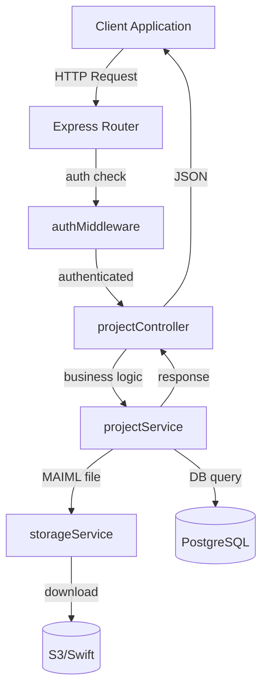
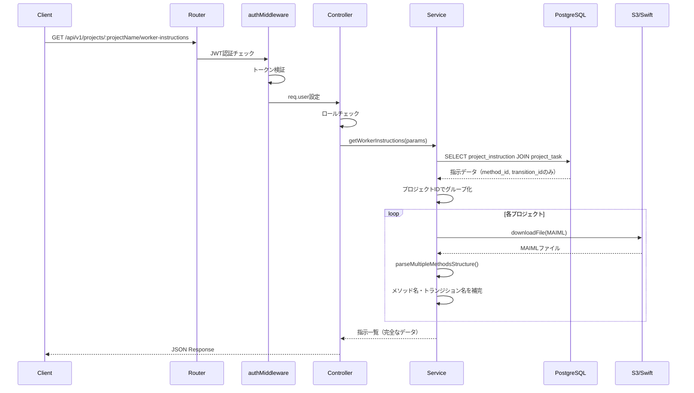

# Design Document: Worker Instructions API

---
**Purpose**: 実験作業者が自分に割り当てられた指示を効率的に確認できるAPIエンドポイントの技術設計

**Feature Type**: Extension - 既存プロジェクト管理APIへの新規エンドポイント追加

---

## Overview

本機能は、実験作業者が自分に割り当てられた実験指示を確認するためのバックエンドAPIを提供します。既存のプロジェクト管理APIシステムに新規エンドポイント`GET /api/v1/projects/:projectName/worker-instructions`を追加します。

**Users**: 実験作業者（experiment_worker）、実験管理者（experiment_admin）、システム管理者（system_admin）

**Impact**: 
- 実験作業者が効率的に作業指示を確認可能
- 複数条件によるフィルタリング機能
- マルチテナント分離の保証

### Goals

- 実験作業者が自分に割り当てられた指示一覧を取得できる
- 複数のフィルタリング条件で指示を絞り込める
- マルチテナント分離とセキュリティを保証する
- 5秒以内にレスポンスを返却する（パフォーマンス要件）

### Non-Goals

- 指示の作成・更新・削除機能（別APIで実装）
- ページネーション機能（将来の拡張候補）
- リアルタイム通知機能
- 指示の承認ワークフロー

---

## Architecture

### Existing Architecture Analysis

本機能は既存のプロジェクト管理APIシステムの一部として実装されます。

**現在のアーキテクチャパターン**:
- レイヤードアーキテクチャ（Routes → Middleware → Controller → Service → Repository）
- 認証: JWT + Session Hybrid
- データベース: PostgreSQL + Kysely（TypeScript Query Builder）
- ストレージ: AWS S3 / OpenStack Swift
- マルチテナント分離: organization_id必須フィルタリング

**既存の制約**:
- すべてのDBクエリにorganization_idフィルタが必須
- 実験作業者は自分に割り当てられたタスクのみアクセス可能
- MAIMLファイルからメソッド名・トランジション名を動的に取得

### Architecture Pattern & Boundary Map



**Architecture Integration**:
- **Selected pattern**: レイヤードアーキテクチャ（既存パターンを継承）
- **Domain/feature boundaries**: プロジェクト管理ドメインに属する新規エンドポイント
- **Existing patterns preserved**: 認証・認可、テナント分離、エラーハンドリング
- **New components rationale**: 新規コントローラーメソッド・サービスメソッドのみ追加（既存構造を維持）
- **Steering compliance**: バックエンド規約、API設計ポリシー、セキュリティ規約に準拠

### Technology Stack

| Layer | Choice / Version | Role in Feature | Notes |
|-------|------------------|-----------------|-------|
| Runtime | Node.js 18+ | サーバー実行環境 | 既存 |
| Framework | Express.js 4.18.3 | HTTPルーティング | 既存 |
| Language | TypeScript | 型安全な開発 | 既存 |
| Database | PostgreSQL 18+ | 指示データの永続化 | 既存 |
| Query Builder | Kysely | 型安全なクエリ構築 | 既存 |
| Authentication | jsonwebtoken | JWT検証 | 既存 |
| Storage | AWS S3 / Swift | MAIMLファイル取得 | 既存 |
| Logging | Winston | アプリケーションログ | 既存 |

---

## System Flows

### 指示一覧取得フロー



**Key Decisions**:
- 実験作業者の場合はproject_taskテーブルとJOINしてassign_user_idでフィルタリング
- N+1問題を回避するため、プロジェクトごとにMAIMLファイルを1回だけ取得
- パース結果をメモリにキャッシュしてループ内で再利用

---

## Requirements Traceability

| Requirement | Summary | Components | Interfaces | Flows |
|-------------|---------|------------|------------|-------|
| 1 | 指示一覧取得機能 | projectController, projectService | Service Interface, API Contract | 指示一覧取得フロー |
| 2 | フィルタリング機能 | projectService | Service Interface | 指示一覧取得フロー |
| 3 | 認証と認可 | authMiddleware, projectController | Service Interface | 指示一覧取得フロー |
| 4 | マルチテナント分離 | projectService | Service Interface | - |
| 5 | エラーハンドリング | projectController, errorHandler | API Contract | - |
| 6 | レスポンス形式 | projectController | API Contract | - |
| 7 | パフォーマンス | projectService | Service Interface | 指示一覧取得フロー |
| 8 | 監査とロギング | projectController, projectService | - | - |

---

## Components and Interfaces

### Component Summary

| Component | Domain/Layer | Intent | Req Coverage | Key Dependencies (P0/P1) | Contracts |
|-----------|--------------|--------|--------------|--------------------------|-----------|
| authMiddleware | Middleware | JWT認証とセッション検証 | 3 | JwtService (P0) | Middleware |
| projectController | Controller | リクエスト処理とレスポンス生成 | 1,2,3,5,6,8 | projectService (P0) | API, Service |
| projectService | Service | ビジネスロジックとDB操作 | 1,2,4,7,8 | Kysely (P0), storageService (P0) | Service |
| storageService | Service | S3/Swiftからのファイル取得 | - | AWS SDK / Swift Client (P0) | Service |

---

### Middleware Layer

#### authMiddleware

| Field | Detail |
|-------|--------|
| Intent | JWT認証とセッション検証を実施し、req.userにユーザー情報を格納 |
| Requirements | 3 |
| Owner / Reviewers | Backend Team |

**Responsibilities & Constraints**
- Authorizationヘッダーからトークン抽出
- JWTトークンの検証
- req.userへのペイロード格納（userId, organizationId, role, sessionId）
- 認証失敗時は401エラー返却

**Dependencies**
- Inbound: Express Router (P0)
- Outbound: JwtService - トークン検証 (P0)

**Contracts**: Middleware [x]

##### Middleware Interface
```typescript
export async function authMiddleware(
  req: Request,
  res: Response,
  next: NextFunction
): Promise<void>
```

**Preconditions**: Authorizationヘッダーにトークンが含まれている

**Postconditions**: 
- 認証成功時: req.userにJwtPayloadを格納してnext()を呼び出す
- 認証失敗時: 401エラーレスポンスを返却

**Implementation Notes**
- **Integration**: Express middleware pipelineに統合済み
- **Validation**: JwtServiceでトークンの署名と有効期限を検証
- **Risks**: なし（既存実装を使用）

---

### Controller Layer

#### projectController

| Field | Detail |
|-------|--------|
| Intent | 指示一覧取得リクエストを処理し、統一されたレスポンス形式で返却 |
| Requirements | 1,2,3,5,6,8 |
| Owner / Reviewers | Backend Team |

**Responsibilities & Constraints**
- リクエストパラメータのバリデーション
- ユーザーロールのチェック（実験作業者/管理者）
- projectServiceの呼び出し
- 統一されたレスポンス形式でのJSON返却
- エラーハンドリング

**Dependencies**
- Inbound: Express Router (P0)
- Outbound: projectService - ビジネスロジック実行 (P0)

**Contracts**: Service [x] / API [x]

##### Service Interface
```typescript
interface ProjectController {
  getWorkerInstructions(
    req: Request,
    res: Response,
    next: NextFunction
  ): Promise<void>;
}
```

**Preconditions**:
- req.userにJwtPayloadが格納されている（authMiddleware通過後）
- req.params.projectNameが有効な文字列

**Postconditions**:
- 成功時: 200 OKと指示一覧を返却
- エラー時: 適切なHTTPステータスコードとエラーメッセージを返却

##### API Contract

| Method | Endpoint | Request | Response | Errors |
|--------|----------|---------|----------|--------|
| GET | /api/v1/projects/:projectName/worker-instructions | PathParam: projectName, QueryParams: projectId, methodId, taskNo, instructionTarget, isAcknowledged | ApiResponse\<Instruction[]\> | 400, 401, 403, 500 |

**Request Parameters**:
```typescript
interface WorkerInstructionsRequest {
  // Path Parameters
  projectName: string;
  
  // Query Parameters (optional)
  projectId?: string;        // UUID
  methodId?: string;         // string
  taskNo?: number;           // integer
  instructionTarget?: 'task' | 'transition';
  isAcknowledged?: boolean;
}
```

**Response Schema**:
```typescript
interface ApiResponse<T> {
  success: boolean;
  data?: T;
  error?: {
    code: string;
    message: string;
    details?: any[];
  };
  meta: {
    timestamp: string;
    requestId: string;
  };
}

interface Instruction {
  instruction_id: string;
  project_id: string;
  project_name: string;
  method_id: string;
  method_name: string;
  task_no: number;
  transition_id: string;
  transition_name: string;
  instruction_target: 'task' | 'transition';
  instruction_content: string;
  priority: 'low' | 'medium' | 'high';
  type: 'normal' | 'urgent';
  is_acknowledged: boolean;
  acknowledged_at: string | null;
  acknowledged_user_id: string | null;
  created_at: string;
  created_by: string;
  created_by_name: string;
}
```

**Implementation Notes**
- **Integration**: 
  - authMiddlewareによる認証チェック後に実行
  - req.user.roleで実験作業者/管理者を判定
  - 実験作業者の場合はreq.user.userIdをサービス層に渡す
- **Validation**: 
  - projectNameの存在チェック
  - クエリパラメータの型検証（express-validator使用）
- **Risks**: なし（既存パターンを踏襲）

---

### Service Layer

#### projectService

| Field | Detail |
|-------|--------|
| Intent | 指示一覧の取得、フィルタリング、MAIMLファイルからのメタデータ補完 |
| Requirements | 1,2,4,7,8 |
| Owner / Reviewers | Backend Team |

**Responsibilities & Constraints**
- データベースから指示データを取得
- マルチテナント分離（organization_idフィルタ必須）
- 実験作業者の場合はassign_user_idでフィルタリング
- プロジェクトごとにMAIMLファイルを取得してパース
- メソッド名・トランジション名の補完
- N+1問題の回避（バッチ処理）

**Dependencies**
- Inbound: projectController (P0)
- Outbound: Kysely - データベースクエリ (P0)
- Outbound: storageService - MAIMLファイル取得 (P0)
- Outbound: MAIMLParser - parseMultipleMethodsStructure (P0)
- External: PostgreSQL Database (P0)
- External: S3/Swift Storage (P0)

**Contracts**: Service [x]

##### Service Interface
```typescript
interface ProjectService {
  getWorkerInstructions(params: GetWorkerInstructionsParams): Promise<Result<Instruction[], ServiceError>>;
}

interface GetWorkerInstructionsParams {
  projectName: string;
  organizationId: string;
  userRole: string;
  userId: string;
  filters?: {
    projectId?: string;
    methodId?: string;
    taskNo?: number;
    instructionTarget?: 'task' | 'transition';
    isAcknowledged?: boolean;
  };
}

interface Result<T, E> {
  success: boolean;
  data?: T;
  error?: E;
}

interface ServiceError {
  code: string;
  message: string;
  details?: any;
}
```

**Preconditions**:
- organizationIdが有効なUUID
- userRoleが 'experiment_worker', 'experiment_admin', 'system_admin' のいずれか
- projectNameが存在するプロジェクト名

**Postconditions**:
- 成功時: 指示一覧（メソッド名・トランジション名を含む）を返却
- 失敗時: エラーコードとメッセージを返却

**Invariants**:
- すべてのDBクエリにorganization_idフィルタが含まれる
- 実験作業者の場合はassign_user_idフィルタが含まれる
- 返却される指示は作成日時の降順

**Implementation Notes**
- **Integration**: 
  - Kyselyを使用してParameterized Queriesを構築
  - storageServiceを使用してMAIMLファイルを取得
  - parseMultipleMethodsStructure()でメソッド情報を抽出
  
- **Validation**: 
  - organization_idの存在チェック
  - プロジェクト名の存在チェック
  - フィルタパラメータの型検証
  
- **Risks**:
  - MAIMLファイルパースのパフォーマンス問題 → プロジェクトごとにグループ化してバッチ処理で軽減
  - 大量データによるメモリ不足 → 将来的にページネーション実装を検討

**Database Query Logic**:
```typescript
// 1. 基本クエリ構築
let query = db
  .selectFrom('project_instruction')
  .innerJoin('project', 'project_instruction.project_id', 'project.project_id')
  .leftJoin('organization_user as creator', 'project_instruction.create_user_id', 'creator.user_id')
  .leftJoin('user_authentication', 'creator.user_id', 'user_authentication.user_id')
  .where('project_instruction.organization_id', '=', organizationId);

// 2. 実験作業者の場合は自分が担当するタスクに紐づく指示のみ
if (userRole === 'experiment_worker') {
  query = query
    .innerJoin('project_task', 'project_instruction.instruction_id', 'project_task.instruction_id')
    .where('project_task.assign_user_id', '=', userId)
    .where('project_task.organization_id', '=', organizationId);
}

// 3. フィルタリング条件の追加
if (filters.projectId) {
  query = query.where('project_instruction.project_id', '=', filters.projectId);
}
// ... 他のフィルタ条件

// 4. ソート
query = query.orderBy('project_instruction.create_at', 'desc');

// 5. 実行
const instructions = await query.selectAll().execute();

// 6. MAIMLファイルからメソッド名・トランジション名を取得（バッチ処理）
const projectGroups = groupBy(instructions, 'project_id');
for (const [projectId, projectInstructions] of Object.entries(projectGroups)) {
  const project = await getProjectById(projectId);
  const maimlContent = await storageService.downloadFile(
    organizationPrefix,
    `projects/${project.project_name}/${project.project_name}.maiml`
  );
  const methods = await parseMultipleMethodsStructure(maimlContent);
  
  // パース結果を各指示に補完
  for (const instruction of projectInstructions) {
    const method = methods.find(m => m.methodId === instruction.method_id);
    instruction.method_name = method?.methodName || '';
    
    const transition = method?.transitions?.find(t => t.transitionId === instruction.transition_id);
    instruction.transition_name = transition?.transitionName || '';
  }
}
```

---

### Storage Layer

#### storageService

| Field | Detail |
|-------|--------|
| Intent | S3/SwiftからMAIMLファイルを取得 |
| Requirements | - |
| Owner / Reviewers | Backend Team |

**Responsibilities & Constraints**
- S3/Swiftからファイルをダウンロード
- organization_prefixの検証
- エラーハンドリング

**Dependencies**
- Inbound: projectService (P0)
- External: AWS S3 / OpenStack Swift (P0)

**Contracts**: Service [x]

##### Service Interface
```typescript
interface StorageService {
  downloadFile(
    organizationPrefix: string,
    filePath: string
  ): Promise<Buffer>;
}
```

**Implementation Notes**
- **Integration**: 既存実装を使用
- **Validation**: organization_prefixの存在チェック
- **Risks**: なし

---

## Data Models

### Domain Model

本機能では既存のドメインモデルを使用し、新規エンティティは追加しません。

**使用するエンティティ**:
- **Instruction（指示）**: 実験管理者から実験作業者への作業指示
- **Project（プロジェクト）**: 実験プロジェクト
- **Task（タスク）**: プロジェクト内の作業単位
- **User（ユーザー）**: システム利用者

**Business Rules & Invariants**:
- 指示は必ずプロジェクトに紐づく
- 実験作業者は自分に割り当てられたタスクに紐づく指示のみ閲覧可能
- 組織内のデータのみアクセス可能（マルチテナント分離）

### Logical Data Model

**Structure Definition**:

```
project_instruction (指示)
├── instruction_id (PK, UUID)
├── organization_id (FK → organization, NOT NULL)
├── project_id (FK → project, NOT NULL)
├── method_id (string, NOT NULL)
├── task_no (integer, NULL)
├── transition_id (UUID, NOT NULL)
├── instruction_target ('task' | 'transition', NOT NULL)
├── instruction_content (text, NOT NULL)
├── priority ('low' | 'medium' | 'high', NOT NULL)
├── type ('normal' | 'urgent', NOT NULL)
├── is_acknowledged (boolean, DEFAULT false)
├── acknowledged_at (timestamp, NULL)
├── acknowledged_user_id (FK → organization_user, NULL)
├── create_at (timestamp, NOT NULL)
├── create_user_id (FK → organization_user, NOT NULL)
└── update_at (timestamp, NOT NULL)

project_task (タスク)
├── task_id (PK, UUID)
├── organization_id (FK → organization, NOT NULL)
├── project_id (FK → project, NOT NULL)
├── instruction_id (FK → project_instruction, NULL)
├── method_id (string, NOT NULL)
├── task_no (integer, NOT NULL)
├── assign_user_id (FK → organization_user, NOT NULL)
└── ...

project (プロジェクト)
├── project_id (PK, UUID)
├── organization_id (FK → organization, NOT NULL)
├── project_name (string, UNIQUE within org, NOT NULL)
└── ...
```

**Consistency & Integrity**:
- **Transaction boundaries**: 本機能は読み取り専用のため、トランザクションは不要
- **Referential integrity**: 外部キー制約により参照整合性を保証
- **Temporal aspects**: create_at、update_atで変更履歴を記録

### Physical Data Model

本機能は既存テーブルを使用し、新規テーブルは追加しません。

**Indexes**:
- `project_instruction.organization_id` - マルチテナント分離用
- `project_instruction.project_id` - プロジェクトフィルタ用
- `project_instruction.create_at` - ソート用
- `project_task.assign_user_id` - 実験作業者フィルタ用
- `project_task.instruction_id` - JOIN用

---

## Error Handling

### Error Strategy

統一されたエラーレスポンス形式を使用し、適切なHTTPステータスコードを返却します。

### Error Categories and Responses

**User Errors (4xx)**:
- `400 Bad Request`: バリデーションエラー
  - 例: projectNameが空、クエリパラメータの型不正
  - 対応: フィールドごとのエラー詳細を返却
  
- `401 Unauthorized`: 認証エラー
  - 例: トークンが無効、有効期限切れ
  - 対応: 再ログインを促すメッセージ
  
- `403 Forbidden`: 権限エラー
  - 例: 実験作業者が他人の指示にアクセス
  - 対応: 権限不足メッセージ

**System Errors (5xx)**:
- `500 Internal Server Error`: システムエラー
  - 例: データベース接続エラー、S3アクセスエラー
  - 対応: エラーログ記録、ユーザーには汎用メッセージ

**Error Response Format**:
```typescript
{
  success: false,
  error: {
    code: "VALIDATION_ERROR",
    message: "Validation failed",
    details: [
      {
        field: "projectName",
        message: "Project name is required",
        code: "REQUIRED_FIELD"
      }
    ]
  },
  meta: {
    timestamp: "2026-02-02T11:00:00.000Z",
    requestId: "req_abc123"
  }
}
```

### Monitoring

- **Error tracking**: すべてのエラーをWinstonでログ記録
- **Logging**: エラーレベル（error, warn, info）を使い分け
- **Health monitoring**: エンドポイントのレスポンス時間とエラー率を監視

---

## Testing Strategy

### Unit Tests

**projectController**:
- ロールチェックロジック（実験作業者/管理者の分岐）
- バリデーションエラーのハンドリング
- レスポンス形式の検証
- エラーケースのハンドリング

**projectService**:
- DBクエリ構築ロジック（organization_idフィルタ）
- 実験作業者向けフィルタリング（assign_user_id）
- MAIMLファイルパース処理
- N+1問題回避のバッチ処理ロジック
- エラーハンドリング

### Integration Tests

**API Integration**:
- 認証ミドルウェアとの統合
- 実験作業者が自分の指示のみ取得できることを確認
- 実験管理者が全指示を取得できることを確認
- フィルタリング条件の動作確認
- マルチテナント分離の検証（他組織のデータにアクセスできないこと）

**Database Integration**:
- JOINクエリの正確性
- organization_idフィルタの動作
- ソート順の検証

**Storage Integration**:
- MAIMLファイル取得の成功
- ファイルが存在しない場合のエラーハンドリング

### Performance Tests

**Load Testing**:
- 100件の指示を5秒以内に取得できること
- 複数プロジェクトにまたがる指示取得のパフォーマンス
- MAIMLファイルパースのパフォーマンス

**Stress Testing**:
- 1000件の指示データでのレスポンス時間測定
- メモリ使用量の監視

---

## Security Considerations

### Authentication and Authorization

- **JWT認証**: authMiddlewareで全リクエストを検証
- **ロールベース認可**: 実験作業者は自分のタスクに紐づく指示のみアクセス可能
- **トークン有効期限**: JWTトークンの有効期限を検証

### Data Protection

- **マルチテナント分離**: すべてのDBクエリにorganization_idフィルタ必須
- **データ暗号化**: HTTPS通信、DB接続はTLS
- **SQLインジェクション対策**: Parameterized Queries使用（Kysely）

### Audit Logging

- すべてのAPIリクエストをログ記録（userId, organizationId, パラメータ）
- レスポンスステータスと処理時間を記録
- エラー発生時はスタックトレースを記録

---

## Performance & Scalability

### Target Metrics

- **Response Time**: 5秒以内（100件の指示）
- **Throughput**: 100 req/min
- **Concurrent Users**: 50ユーザー同時アクセス

### Scaling Approaches

- **Horizontal Scaling**: ECSでコンテナ数を増やす
- **Database Optimization**: インデックスの適切な使用
- **Caching Strategy**: 将来的にRedisでMAIMLパース結果をキャッシュ

### Optimization Techniques

- **N+1問題回避**: プロジェクトごとにMAIMLファイルをバッチ処理
- **Efficient Queries**: 必要最小限のカラムのみSELECT
- **Connection Pooling**: データベース接続プールの使用

---

## Supporting References

本設計書は自己完結しており、追加の参照資料は不要です。詳細な調査記録は`research.md`を参照してください。