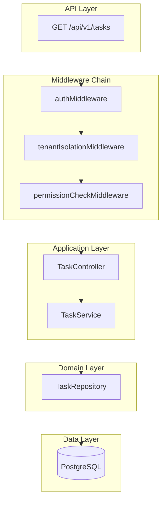
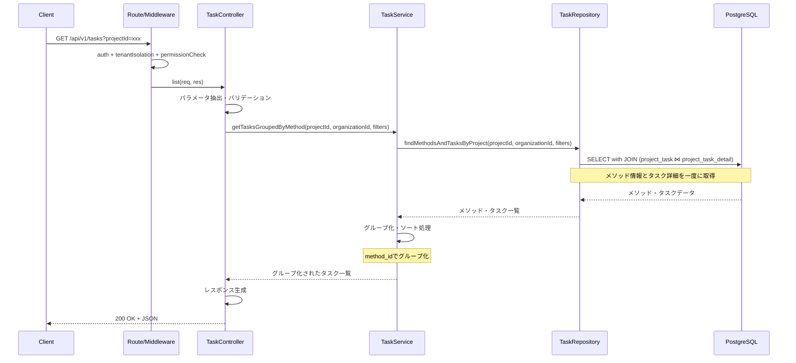
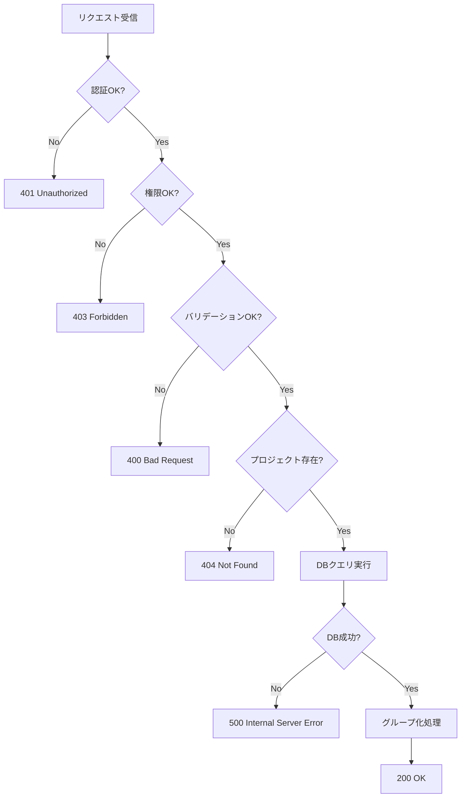

# Design Document: Worker Task List API

---
**Feature**: worker-task-list-api  
**Version**: 1.0  
**Last Updated**: 2026-01-29  
**Status**: Design Phase
---

## Overview

**Purpose**: このAPIは、実験管理者および実験作業者がプロジェクト内の全タスク状況を一覧で確認できる機能を提供します。メソッド（project_taskテーブル）単位でグループ化されたタスク（project_task_detailテーブル）情報により、進捗管理と作業割り当ての状況を効率的に把握できます。

**Users**: 
- **実験管理者（experiment_admin）**: プロジェクト全体の進捗管理、タスク割り当て状況の確認
- **実験作業者（experiment_worker）**: 自分に割り当てられたタスクの確認、進捗状況の把握
- **システム管理者（system_admin）**: 全組織のタスク状況の監視

**Impact**: 既存のRESTful APIに新しいエンドポイントを追加し、既存のデータベーステーブル（project_task、project_task_detail、organization_user、user_authentication）を活用してタスク一覧機能を実装します。メソッド情報はproject_taskから、タスク詳細情報はproject_task_detailから取得します。

### Goals

- プロジェクト内の全タスク（project_task_detail）をメソッド（project_task）単位でグループ化して取得
- 柔軟なフィルタリング（メソッドID、ステータス、担当者ID）とソート機能の提供
- 100タスク以内で2秒以内のレスポンスタイム達成
- マルチテナント分離の徹底によるセキュリティ確保
- 既存APIパターンとの一貫性維持

### Non-Goals

- ページング機能（将来の拡張で対応）
- リアルタイム更新（WebSocket/SSE）
- メソッド・タスクの作成・更新・削除機能（別APIで提供）
- タスク詳細情報の完全な取得（別APIで提供）
- MAIMLファイルからのメソッド情報取得（DBから取得）

## Architecture

### Existing Architecture Analysis

**現在のアーキテクチャ**:
- Layered Architecture（Route → Controller → Service → Repository）
- Express.js + TypeScript
- ミドルウェアチェーン: auth → tenantIsolation → permissionCheck
- Kysely + 外部SQLファイルによるDB操作

**統合ポイント**:
- 既存のtaskRoutes.tsにエンドポイント追加
- 既存のauthMiddleware、permissionCheckMiddlewareを使用
- project_taskとproject_task_detailテーブルを使用

### Architecture Pattern & Boundary Map



**Architecture Integration**:
- **Pattern**: Layered Architecture（既存パターンを踏襲）
- **Domain Boundaries**: 
  - Route層: HTTPリクエスト処理
  - Controller層: パラメータ抽出、バリデーション、レスポンス生成
  - Service層: ビジネスロジック、データ変換、グループ化
  - Repository層: データベースアクセス
- **Existing Patterns**: ミドルウェアチェーン、統一レスポンス形式、Parameterized Queries
- **New Components**: TaskService（グループ化ロジック）

### Technology Stack

| Layer | Choice / Version | Role in Feature | Notes |
|-------|------------------|-----------------|-------|
| Backend Framework | Express.js 4.18.3 | APIエンドポイント提供 | 既存 |
| Language | TypeScript 5.x | 型安全な実装 | 既存 |
| Database | PostgreSQL 18+ | メソッド・タスクデータ永続化 | 既存 |
| Query Builder | Kysely | 型安全なSQL構築 | 既存 |
| Validation | express-validator | リクエストバリデーション | 既存 |

## System Flows

### Task List Retrieval Flow



### Error Handling Flow



## Requirements Traceability

| Requirement | Summary | Components | Interfaces | Flows |
|-------------|---------|------------|------------|-------|
| 1 | タスク一覧取得 | TaskController, TaskService, TaskRepository | TaskService.getTasksGroupedByMethod | Task List Retrieval |
| 2 | タスクフィルタリング | TaskService, TaskRepository | TaskRepository.findByProject | Task List Retrieval |
| 3 | タスクソート | TaskService | TaskService.sortTasks | Task List Retrieval |
| 4 | メソッドグループ化 | TaskService, TaskRepository | TaskRepository.findMethodsAndTasksByProject | Task List Retrieval |
| 5 | マルチテナント分離 | tenantIsolationMiddleware, TaskRepository | TaskRepository.findByProject | Task List Retrieval |
| 6 | 認証と認可 | authMiddleware, permissionCheckMiddleware | - | Task List Retrieval |
| 7 | バリデーション | TaskController | TaskController.validateListRequest | Task List Retrieval |
| 8 | エラーハンドリング | TaskController, errorHandlerMiddleware | - | Error Handling |
| 9 | レスポンス形式 | TaskController | - | Task List Retrieval |
| 10 | パフォーマンス | TaskService, CacheService | CacheService.get/set | Task List Retrieval |
| 11 | データ整合性 | TaskService | TaskService.validateDataConsistency | Task List Retrieval |

## Components and Interfaces

### Component Summary

| Component | Domain/Layer | Intent | Req Coverage | Key Dependencies | Contracts |
|-----------|--------------|--------|--------------|------------------|-----------|
| TaskController | API/Controller | HTTPリクエスト処理 | 1,7,8,9 | TaskService (P0) | API |
| TaskService | Application/Service | ビジネスロジック、グループ化 | 1,2,3,4,10,11 | TaskRepository (P0) | Service |
| TaskRepository | Data/Repository | データベースアクセス | 1,2,5 | Database (P0) | Service |

### Application Layer

#### TaskController

| Field | Detail |
|-------|--------|
| Intent | HTTPリクエストの受付、パラメータ抽出、バリデーション、レスポンス生成 |
| Requirements | 1, 7, 8, 9 |

**Responsibilities & Constraints**
- HTTPリクエストパラメータの抽出とバリデーション
- 統一レスポンス形式でのJSON生成
- エラーハンドリングとHTTPステータスコード設定
- トランザクション境界: なし（読み取り専用）

**Dependencies**
- Inbound: Express Route (P0)
- Outbound: TaskService.getTasksGroupedByMethod (P0)

**Contracts**: API [x] / Service [ ] / Event [ ] / State [ ]

##### API Contract

| Method | Endpoint | Request | Response | Errors |
|--------|----------|---------|----------|--------|
| GET | /api/v1/tasks | TaskListQuery | TaskListResponse | 400, 401, 403, 404, 500 |

**Request Parameters**:
```typescript
interface TaskListQuery {
  projectId: string;          // 必須、UUID形式
  methodId?: string;          // オプション、UUID形式
  status?: TaskStatus;        // オプション、enum
  assignUserId?: string;      // オプション、UUID形式
  sortBy?: TaskSortField;     // オプション、enum
  order?: 'asc' | 'desc';     // オプション
}

type TaskStatus = 'not_started' | 'started' | 'in_progress' | 'completed' | 'forced_terminated';
type TaskSortField = 'task_no' | 'created_at' | 'updated_at' | 'status';
```

**Response Format**:
```typescript
interface TaskListResponse {
  success: true;
  data: MethodGroup[];
  meta: {
    timestamp: string;
    requestId: string;
  };
}

interface MethodGroup {
  method_id: string;
  method_name: string;
  experiment_order: number;
  tasks: TaskSummary[];
}

interface TaskSummary {
  task_id: string;
  task_no: number;
  task_status: TaskStatus;
  assign_user_id: string | null;
  assign_user_name: string | null;
  progress_rate: number;
  created_at: string;
  updated_at: string;
}
```

**Error Responses**:
- `400`: バリデーションエラー（projectId形式不正、status不正値、sortBy不正値）
- `401`: 認証エラー（トークン未提供、トークン無効）
- `404`: プロジェクト不存在
- `500`: システムエラー（DB接続エラー、MAIMLファイル読み込み失敗）

**Implementation Notes**
- express-validatorによる入力バリデーション
- エラー時は統一されたエラーレスポンス形式を使用
- requestIdは`req.headers['x-request-id']`から取得またはuuid生成

#### TaskService

| Field | Detail |
|-------|--------|
| Intent | タスク一覧の取得、メソッド単位のグループ化、フィルタリング・ソート処理 |
| Requirements | 1, 2, 3, 4, 10, 11 |

**Responsibilities & Constraints**
- タスクデータ（project_task_detail）とメソッド情報（project_task）のマージ
- メソッド単位でのタスクグループ化
- ソート・フィルタリングロジックの適用
- データ整合性の検証
- トランザクション境界: なし（読み取り専用）

**Dependencies**
- Inbound: TaskController (P0)
- Outbound: TaskRepository.findMethodsAndTasksByProject (P0)

**Contracts**: Service [x]

##### Service Interface

```typescript
interface TaskService {
  /**
   * プロジェクト内のタスクをメソッド単位でグループ化して取得
   * @param projectId プロジェクトID
   * @param organizationId 組織ID
   * @param filters フィルタ条件
   * @returns メソッド単位にグループ化されたタスク一覧
   * @throws ProjectNotFoundError プロジェクトが存在しない
   * @throws MAIMLParseError MAIMLファイルの解析に失敗
   * @throws DatabaseError データベースエラー
   */
  getTasksGroupedByMethod(
    projectId: string,
    organizationId: string,
    filters: TaskFilters
  ): Promise<MethodGroup[]>;
}

interface TaskFilters {
  methodId?: string;
  status?: TaskStatus;
  assignUserId?: string;
  sortBy?: TaskSortField;
  order?: 'asc' | 'desc';
}
```

**Preconditions**:
- projectIdとorganizationIdは有効なUUID
- filtersは既にバリデーション済み

**Postconditions**:
- 返却されるMethodGroupはexperiment_order順にソート済み
- 各MethodGroup内のtasksは指定されたソート順または task_detail_no昇順
- 存在しないメソッドIDを持つタスクは除外され、警告ログに記録

**Implementation Notes**
- 空のメソッド（タスクなし）もMethodGroupに含める
- データ不整合時は警告ログを出力するがエラーにはしない

### Data Layer

#### TaskRepository

| Field | Detail |
|-------|--------|
| Intent | データベースからのタスクデータ取得 |
| Requirements | 1, 2, 5 |

**Responsibilities & Constraints**
- 外部SQLファイルを使用した複雑なJOINクエリの実行
- Parameterized Queriesによる安全なクエリ実行
- organization_idフィルタの強制適用
- トランザクション境界: なし（読み取り専用）

**Dependencies**
- Inbound: TaskService (P0)
- Outbound: PostgreSQL Database (P0), SQL Loader (P0)

**Contracts**: Service [x]

##### Service Interface

```typescript
interface TaskRepository {
  /**
   * プロジェクト内のメソッドとタスク詳細を取得
   * @param projectId プロジェクトID
   * @param organizationId 組織ID（マルチテナント分離）
   * @param filters フィルタ条件
   * @returns メソッドとタスク詳細（担当者情報を含む）
   */
  findMethodsAndTasksByProject(
    projectId: string,
    organizationId: string,
    filters: TaskFilters
  ): Promise<MethodTaskRecord[]>;
}

interface MethodTaskRecord {
  // メソッド情報（project_task）
  method_id: string;
  method_name: string;
  experiment_order: number;
  
  // タスク詳細情報（project_task_detail）
  task_detail_id: string;
  task_detail_no: number;
  task_status: TaskStatus;
  assign_user_id: string | null;
  assign_user_name: string | null;
  progress_rate: number;
  created_at: Date;
  updated_at: Date;
}
```

**Preconditions**:
- projectIdとorganizationIdは非null
- filters内の値は型安全

**Postconditions**:
- 返却されるタスクはすべて指定されたorganization_idに属する
- JOINによりassign_user_nameが解決されている（nullの場合あり）

**Invariants**:
- すべてのクエリに organization_id フィルタが適用される
- JOINするすべてのテーブルで organization_id フィルタが適用される

**Implementation Notes**
- 外部SQLファイル: `backend/src/sql/queries/tasks/listMethodsAndTasksByProject.sql`
- Parameterized QueryでSQLインジェクション対策
- 動的なWHERE句、ORDER BY句の構築
- N+1問題を回避するためのLEFT JOIN使用
- project_task（メソッド）とproject_task_detail（タスク詳細）をJOIN
- transition_data（トランジションデータ）をJOINしてprogress_rateを計算
- AVG集約関数を使用するためGROUP BY句で全非集約カラムを指定
- トランジションデータがない場合はCOALESCEで0%を返す


## Data Models

### Logical Data Model

**使用する既存テーブル**:

1. **project_task** - メソッド情報
   - task_id (PK)
   - project_id (FK)
   - organization_id (FK) ← マルチテナント分離
   - method_name
   - experiment_order
   - created_at
   - updated_at

2. **project_task_detail** - タスク詳細情報
   - task_detail_id (PK)
   - task_id (FK) ← project_task.task_id
   - organization_id (FK) ← マルチテナント分離
   - task_detail_no
   - task_status
   - assign_user_id (FK, nullable)
   - created_at
   - updated_at

3. **transition_data** - トランジションデータ（進捗情報）
   - transition_data_id (PK)
   - task_detail_id (FK) ← project_task_detail.task_detail_id
   - organization_id (FK) ← マルチテナント分離
   - progress_rate (進捗率: 0-100)
   - created_at
   - updated_at
   - **注**: タスクの進捗率は、このテーブルのprogress_rateの平均値として計算される

4. **organization_user** - 組織ユーザー関連
   - user_id (PK)
   - organization_id (PK)

5. **user_authentication** - ユーザー認証情報
   - user_id (PK)
   - user_name

**リレーションシップ**:
```
project_task_detail.task_id → project_task.task_id
transition_data.task_detail_id → project_task_detail.task_detail_id
project_task_detail.assign_user_id → organization_user.user_id
organization_user.user_id → user_authentication.user_id
project_task.organization_id = project_task_detail.organization_id = transition_data.organization_id = organization_user.organization_id (必須)
```

### Physical Data Model

**SQLクエリ構造** (`backend/src/sql/queries/tasks/listMethodsAndTasksByProject.sql`):

```sql
SELECT 
  -- メソッド情報（project_task）
  pt.task_id AS method_id,
  pt.method_name,
  pt.experiment_order,
  
  -- タスク詳細情報（project_task_detail）
  ptd.task_detail_id,
  ptd.task_detail_no,
  ptd.task_status,
  ptd.assign_user_id,
  ptd.created_at,
  ptd.updated_at,
  
  -- 進捗率（transition_dataテーブルから平均値を計算）
  COALESCE(AVG(td.progress_rate), 0) AS progress_rate,
  
  -- 担当者名
  ua.user_name AS assign_user_name
FROM project_task pt
LEFT JOIN project_task_detail ptd
  ON pt.task_id = ptd.task_id
  AND pt.organization_id = ptd.organization_id  -- マルチテナント分離
LEFT JOIN transition_data td
  ON ptd.task_detail_id = td.task_detail_id
  AND ptd.organization_id = td.organization_id  -- マルチテナント分離
LEFT JOIN organization_user ou 
  ON ptd.assign_user_id = ou.user_id 
  AND ptd.organization_id = ou.organization_id  -- マルチテナント分離
LEFT JOIN user_authentication ua 
  ON ou.user_id = ua.user_id
WHERE pt.project_id = $1
  AND pt.organization_id = $2  -- マルチテナント分離（必須）
  -- 動的フィルタ条件（methodId, status, assignUserId）
GROUP BY 
  pt.task_id,
  pt.method_name,
  pt.experiment_order,
  ptd.task_detail_id,
  ptd.task_detail_no,
  ptd.task_status,
  ptd.assign_user_id,
  ptd.created_at,
  ptd.updated_at,
  ua.user_name
ORDER BY 
  pt.experiment_order ASC,  -- メソッドの実験順序
  -- 動的ソート条件（sortBy, order）
  ptd.task_detail_no ASC  -- デフォルト: タスク詳細番号昇順
```

**SQLクエリの説明**:
- `transition_data`テーブルをLEFT JOINして、各タスクに紐づく進捗情報を取得
- `AVG(td.progress_rate)`で各タスクのトランジションデータの進捗率を平均化
- `COALESCE(..., 0)`でトランジションデータがない場合は0%として扱う
- GROUP BY句で集約関数（AVG）を使用するため、全ての非集約カラムをGROUP BYに含める

**インデックス要件** (既存インデックスの確認):
- `project_task(project_id, organization_id)`
- `project_task(task_id)`
- `project_task_detail(task_id, organization_id)`
- `project_task_detail(task_status)`
- `project_task_detail(assign_user_id)`
- `transition_data(task_detail_id, organization_id)` - 新規追加推奨

## Error Handling

### Error Strategy

**エラーカテゴリと処理方針**:

1. **User Errors (4xx)**: クライアント側で修正可能なエラー
   - バリデーションエラー → 詳細なフィールドレベルエラー情報を返却
   - 認証エラー → 認証方法のガイダンス提供
   - 権限エラー → 必要な権限の明示

2. **System Errors (5xx)**: サーバー側の問題
   - データベース接続エラー → リトライ処理、エラーログ記録
   - MAIMLファイル読み込み失敗 → エラーログ記録、代替処理なし
   - タイムアウト → タイムアウト設定値の調整検討

3. **Business Logic Errors (422)**: ビジネスルール違反
   - データ整合性エラー（MAIMLとDB不一致） → 警告ログのみ、処理継続

### Error Categories and Responses

| Error Code | HTTP Status | Category | Message Example | Recovery Action |
|------------|-------------|----------|-----------------|-----------------|
| VALIDATION_ERROR | 400 | User | "projectId must be a valid UUID" | リクエストパラメータを修正 |
| INVALID_STATUS | 400 | User | "status must be one of: not_started, started, in_progress, completed, forced_terminated" | 有効なステータス値を使用 |
| AUTH_TOKEN_MISSING | 401 | User | "Authorization header is required" | Authorizationヘッダーを追加 |
| AUTH_TOKEN_INVALID | 401 | User | "Invalid or expired token" | 新しいトークンを取得 |
| PROJECT_NOT_FOUND | 404 | User | "Project not found" | 正しいprojectIdを指定 |
| DATABASE_ERROR | 500 | System | "Database connection failed" | 管理者に連絡、システムログ確認 |
| MAIML_PARSE_ERROR | 500 | System | "Failed to parse MAIML file" | 管理者に連絡、MAIMLファイル確認 |
| INTERNAL_SERVER_ERROR | 500 | System | "An unexpected error occurred" | 管理者に連絡、エラーログ確認 |

### Monitoring

**ログ出力**:
- **INFO**: API呼び出し（projectId、フィルタ条件、レスポンスタイム）
- **WARN**: データ整合性問題（MAIMLに存在しないmethod_id）、キャッシュミス
- **ERROR**: データベースエラー、MAIMLファイル読み込みエラー、予期しない例外

**メトリクス**:
- API呼び出し回数（成功/失敗）
- レスポンスタイム（p50, p95, p99）
- キャッシュヒット率
- エラー発生率（カテゴリ別）

## Testing Strategy

### Unit Tests

1. **TaskController.validateListRequest**
   - 有効なパラメータでバリデーション成功
   - projectId形式不正でバリデーション失敗
   - status不正値でバリデーション失敗
   - sortBy不正値でバリデーション失敗

2. **TaskService.getTasksGroupedByMethod**
   - タスク詳細が正しくメソッド単位でグループ化される
   - 空のメソッド（タスク詳細なし）も含まれる
   - ソート条件が正しく適用される

3. **TaskRepository.findMethodsAndTasksByProject**
   - 正しいSQLクエリが生成される（project_task ⋈ project_task_detail）
   - フィルタ条件が正しくWHERE句に反映される
   - organization_idフィルタが必ず含まれる（全テーブルで）

### Integration Tests

1. **API統合テスト: 正常系**
   - 認証トークン付きでGET /api/v1/tasks?projectId=xxx
   - 200 OK + メソッド単位にグループ化されたタスク一覧
   - レスポンス形式が仕様通り

2. **API統合テスト: フィルタリング**
   - methodIdフィルタでタスクが絞り込まれる
   - statusフィルタで指定ステータスのみ返却される
   - assignUserIdフィルタで担当者のタスクのみ返却される

3. **API統合テスト: ソート**
   - sortBy=task_no&order=ascで正しくソートされる
   - sortBy=created_at&order=descで正しくソートされる

4. **API統合テスト: エラーケース**
   - 認証トークンなしで401エラー
   - 権限不足で403エラー
   - プロジェクト不存在で404エラー

5. **マルチテナント分離テスト**
   - 異なる組織のprojectIdで404エラー
   - 他組織のタスクが含まれないことを確認

### Performance Tests

1. **レスポンスタイム測定**
   - 10タスクで0.5秒以内
   - 50タスクで1秒以内
   - 100タスクで2秒以内

2. **キャッシュ効果測定**
   - 初回アクセス vs 2回目以降のレスポンスタイム比較
   - キャッシュヒット率が80%以上

3. **同時アクセステスト**
   - 10同時リクエストで正常に処理
   - エラー率が5%未満

## Optional Sections

### Performance & Scalability

**Target Metrics**:
- レスポンスタイム: 100タスク以内で2秒以内（p95）
- スループット: 100 req/sec（単一サーバー）
- キャッシュヒット率: 80%以上

**Optimization Techniques**:
1. **Database Query Optimization**
   - 必要なカラムのみSELECT（SELECT *を避ける）
   - LEFT JOINの順序最適化（project_task → project_task_detail → organization_user → user_authentication）
   - インデックスの活用（task_id、organization_id、task_status、assign_user_id）
   - experiment_orderによる事前ソート

2. **Future Scalability**
   - ページング機能の追加（将来）
   - 読み取りレプリカの活用（将来）
   - クエリ結果のキャッシング検討（将来）

### Security Considerations

**マルチテナント分離**:
- すべてのDBクエリにorganization_idフィルタ必須
- JOINするすべてのテーブルでorganization_idフィルタ必須
- クロステナントアクセスの厳格な防止

**SQLインジェクション対策**:
- Parameterized Queriesの徹底使用
- 動的SQL生成時の厳密なバリデーション

**認証・認可**:
- JWTトークンによる認証
- ロールベースアクセス制御（experiment_admin、experiment_worker、system_admin）
- ミドルウェアチェーンの適用

**監査ログ**:
- APIアクセスログ（ユーザーID、組織ID、プロジェクトID、タイムスタンプ）
- エラーログ（詳細なエラー情報、スタ