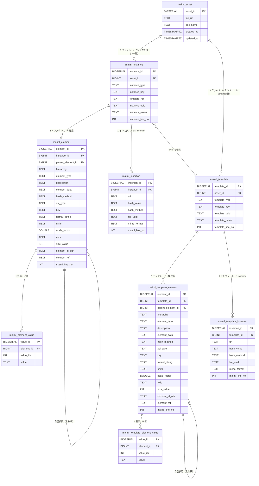

# DB テーブル設計書（maiml2Excel ベース）

> 基準資料: `maiml2Excel/処理解析レポート.md`  
> 方針: maiml2Excel の出力項目のみをベースに設計する（現行実装は参照しない）  
> 作成日: 2026-03-11

---

## 1. テーブル全体構成

```
maiml_asset（MaiML ファイル代表メタ）
    │
    ├── maiml_instance（result / material / condition インスタンス）  ← data 層
    │         │
    │         ├── maiml_element（行データ: property/content/uncertainty/insertion/暗号化）
    │         │         │
    │         │         └── maiml_element_value（複数 <value> を展開）
    │         │
    │         └── maiml_insertion（外部ファイル参照: uri/hash/uuid/format）
    │
    └── maiml_template（テンプレート定義）                            ← protocol 層
              │
              ├── maiml_template_element（テンプレート行データ）
              │         │
              │         └── maiml_template_element_value（複数 <value> を展開）
              │
              └── maiml_template_insertion（テンプレートの外部ファイル参照）
```

### テーブル役割一覧

| テーブル名 | 役割 | maiml2Excel 対応単位 | 対応層 |
|-----------|------|-------------------|----|
| `maiml_asset` | MaiML ファイル 1 件の代表メタ | 1 ファイル = 1 レコード | — |
| `maiml_instance` | result/material/condition インスタンス | instances.xlsx 1 シート = 1 レコード | data 層 |
| `maiml_element` | 汎用データ行（property/content/uncertainty/insertion 系） | instances.xlsx 1 行 = 1 レコード（value を除く） | data 層 |
| `maiml_element_value` | `<value>` 子要素の展開（複数 value 対応） | 1 value = 1 レコード | data 層 |
| `maiml_insertion` | 外部ファイル参照（正規化） | insertion 1 件 = 1 レコード | data 層 |
| `maiml_template` | テンプレート定義（protocol 層） | templates.xlsx 1 シート = 1 レコード | protocol 層 |
| `maiml_template_element` | テンプレートの汎用データ行 | templates.xlsx 1 行 = 1 レコード | protocol 層 |
| `maiml_template_element_value` | テンプレートの `<value>` 展開 | 1 value = 1 レコード | protocol 層 |
| `maiml_template_insertion` | テンプレートの外部ファイル参照（正規化） | insertion 1 件 = 1 レコード | protocol 層 |

---

## 2. ER 図



---

## 3. DDL

### 3.1 maiml_asset

```sql
-- MaiML ファイルの代表メタ情報
-- 1 ファイル = 1 レコード（全インスタンス・全要素を取り込む方針）
CREATE TABLE maiml_asset (
  asset_id    BIGSERIAL    PRIMARY KEY,
  file_uri    TEXT         NOT NULL,          -- ファイルの URI / パス
  doc_name    TEXT,                           -- <document>/<name> テキスト（NULL 可）
  created_at  TIMESTAMPTZ  NOT NULL DEFAULT now(),
  updated_at  TIMESTAMPTZ  NOT NULL DEFAULT now()
);

CREATE INDEX ix_maiml_asset_uri ON maiml_asset(file_uri);
```

**格納値:**

| カラム | 取得元 | 例 |
|--------|--------|---|
| `file_uri` | 公開時に指定するファイルパス | `projects/sample/sample.maiml` |
| `doc_name` | `/maiml/document/name` テキスト | `juyoSampleProtocol_1` |

> **取り込み方針:** 全インスタンス（result/material/condition）・全要素（全 key）を取り込む。  
> フィルタリングは DB 検索時（クエリの WHERE 句）で行う。

---

### 3.2 maiml_instance

```sql
-- MaiML の result / material / condition インスタンス
-- maiml2Excel の 1 シート = 1 レコード
CREATE TABLE maiml_instance (
  instance_id      BIGSERIAL  PRIMARY KEY,
  asset_id         BIGINT     NOT NULL REFERENCES maiml_asset(asset_id) ON DELETE CASCADE,
  instance_type    TEXT       NOT NULL
                     CHECK (instance_type IN ('result', 'material', 'condition')),
  instance_key     TEXT       NOT NULL,  -- @id 属性（インスタンス識別子）
  template_ref     TEXT,                 -- @ref 属性（参照先テンプレート ID）
  instance_uuid    TEXT,                 -- <uuid> 子要素テキスト
  instance_name    TEXT,                 -- <name> 子要素テキスト
  instance_line_no INT                   -- XML 元行番号
);

CREATE INDEX ix_maiml_instance_asset    ON maiml_instance(asset_id);
CREATE INDEX ix_maiml_instance_type     ON maiml_instance(instance_type);
CREATE INDEX ix_maiml_instance_key      ON maiml_instance(instance_key);
CREATE INDEX ix_maiml_instance_template ON maiml_instance(template_ref);
```

**格納値（test.maiml 例）:**

| instance_type | instance_key | template_ref | instance_uuid | instance_name |
|---------------|-------------|-------------|--------------|--------------|
| material | juyosample_MT_ver1-2_instance | juyosample_MT_ver1-2 | 3ffa7ec0-... | Grid |
| condition | juyosample_CT_ver1-2_instance | juyosample_CT_ver1-2 | 6fb79bdc-... | SEMConditionTemplate |
| result | juyosample_RT_ver1-1_instance | juyosample_RT_ver1-1 | b2aa1099-... | SEMResults |

---

### 3.3 maiml_element

```sql
-- 汎用データ行（property / content / uncertainty および insertion の親行）
-- maiml2Excel の 1 Excel 行 = 1 レコード（value 行を除く）
-- 自己参照（parent_element_id）で入れ子構造を表現
CREATE TABLE maiml_element (
  element_id        BIGSERIAL  PRIMARY KEY,
  instance_id       BIGINT     NOT NULL REFERENCES maiml_instance(instance_id) ON DELETE CASCADE,
  parent_element_id BIGINT     REFERENCES maiml_element(element_id) ON DELETE CASCADE,
                               -- NULL = トップレベル要素（インスタンス直下）
  hierarchy         TEXT       NOT NULL,
                               -- maiml2Excel B列: "1", "1-2", "1-2-3" 形式
  element_type      TEXT       NOT NULL,
                               -- maiml2Excel C列:
                               -- 'property' / 'content' / 'uncertainty'
                               -- / 'insertion' / 'uri' / 'hash' / 'uuid' / 'format'
                               -- / 'childUri' / 'childHash' / 'childUuid' / 'EncryptedData'
  description       TEXT,      -- maiml2Excel D列: <description> テキスト
  element_data      TEXT,      -- maiml2Excel E列: insertion系・暗号化データ値
  hash_method       TEXT,      -- insertion/hash 行のみ: <hash method="..."> 属性値
  xsi_type          TEXT,      -- maiml2Excel F列: @xsi:type 属性
  key               TEXT,      -- maiml2Excel G列: @key 属性（NS プレフィックス付き）
  format_string     TEXT,      -- maiml2Excel H列: @formatString 属性
  units             TEXT,      -- maiml2Excel I列: @units 属性
  scale_factor      DOUBLE PRECISION,  -- maiml2Excel J列: @scaleFactor 属性
  axis              TEXT,      -- maiml2Excel K列: @axis 属性
  size_value        INT,       -- maiml2Excel L列: @size 属性
  element_id_attr   TEXT,      -- maiml2Excel M列: @id 属性（要素自身の ID）
  element_ref       TEXT,      -- maiml2Excel N列: @ref 属性
  maiml_line_no     INT        -- maiml2Excel A列: XML 元行番号
);

CREATE INDEX ix_maiml_element_instance   ON maiml_element(instance_id);
CREATE INDEX ix_maiml_element_parent     ON maiml_element(parent_element_id);
CREATE INDEX ix_maiml_element_type       ON maiml_element(element_type);
CREATE INDEX ix_maiml_element_key        ON maiml_element(key);
CREATE INDEX ix_maiml_element_hierarchy  ON maiml_element(instance_id, hierarchy);
```

**格納値（test.maiml の result インスタンス例）:**

| hierarchy | element_type | element_data | xsi_type | key | maiml_line_no |
|-----------|-------------|-------------|---------|-----|--------------|
| 1 | insertion | — | — | — | 115 |
| 1-1 | uri | Axoneme-56.008.tif | — | — | 116 |
| 1-2 | hash | 419b91246fc1... | — | — | 117 |
| 1-3 | format | image/tiff | — | — | 119 |
| 2 | property | — | shortType | tiff:BitsPerSample | 122 |
| 3 | content | — | intType | tiff:StripByteCounts | 124 |
| 4 | property | — | intType | tiff:ImageWidth | 140 |
| 4-1 | property | — | shortType | tiff:PlanarConfiguration | 142 |
| 4-2 | property | — | intType | tiff:ImageLength | 145 |
| 5 | property | — | shortType | tiff:Compression | 148 |

---

### 3.4 maiml_element_value

```sql
-- <value> 子要素の展開テーブル
-- 1 要素に複数 <value> がある場合（例: tiff:StripByteCounts の 256 個の値）を
-- 複数行として保持する
-- maiml2Excel O列のデータに対応（複数行展開）
CREATE TABLE maiml_element_value (
  value_id    BIGSERIAL  PRIMARY KEY,
  element_id  BIGINT     NOT NULL REFERENCES maiml_element(element_id) ON DELETE CASCADE,
  value_idx   INT        NOT NULL DEFAULT 0,
              -- 複数 value のインデックス（0-origin）
              -- 単一 value の場合も 0 を格納
  value       TEXT                -- maiml2Excel O列: <value> テキスト
);

CREATE INDEX ix_maiml_element_value_element ON maiml_element_value(element_id);
CREATE UNIQUE INDEX ux_maiml_element_value  ON maiml_element_value(element_id, value_idx);
```

**格納値（tiff:StripByteCounts の例）:**

```
element_id=N（content, key='tiff:StripByteCounts'）に対して:

value_id | element_id | value_idx | value
---------|-----------|-----------|------
1        | N          | 0         | 8192
2        | N          | 1         | 8192
3        | N          | 2         | 8192
...      | N          | 255       | 8192
（256 行）
```

---

### 3.5 maiml_insertion

```sql
-- 外部ファイル参照（<insertion> 要素）を 1 レコードとして正規化したテーブル
-- maiml_element の uri/hash/uuid/format 行を結合した正規化形式
-- （maiml_element と二重管理になるが、ファイル参照の検索・管理を容易にするため設ける）
CREATE TABLE maiml_insertion (
  insertion_id  BIGSERIAL  PRIMARY KEY,
  instance_id   BIGINT     NOT NULL REFERENCES maiml_instance(instance_id) ON DELETE CASCADE,
  uri           TEXT       NOT NULL,   -- <uri> テキスト（ファイルパス/URI）
  hash_value    TEXT,                  -- <hash> テキスト（ハッシュ値）
  hash_method   TEXT,                  -- <hash method="..."> 属性（'SHA-256' 等）
  file_uuid     TEXT,                  -- <uuid> テキスト
  mime_format   TEXT,                  -- <format> テキスト（'image/tiff' 等）
  maiml_line_no INT                    -- <insertion> タグの XML 行番号
);

CREATE INDEX ix_maiml_insertion_instance ON maiml_insertion(instance_id);
CREATE INDEX ix_maiml_insertion_uri      ON maiml_insertion(uri);
```

**格納値（test.maiml 例）:**

| instance_id | uri | hash_value | hash_method | file_uuid | mime_format |
|------------|-----|-----------|------------|----------|------------|
| N（result） | Axoneme-56.008.tif | 419b91246fc1... | SHA-256 | — | image/tiff |

---

---

### 3.6 maiml_template

```sql
-- テンプレート定義（protocol 層: /maiml/protocol/results 配下）
-- maimltoxlwithtemplate.py の templates.xlsx の 1 シート = 1 レコード
-- maiml_instance.template_ref が参照するテンプレートの実体
CREATE TABLE maiml_template (
  template_id      BIGSERIAL  PRIMARY KEY,
  asset_id         BIGINT     NOT NULL REFERENCES maiml_asset(asset_id) ON DELETE CASCADE,
  template_type    TEXT       NOT NULL
                     CHECK (template_type IN ('result', 'material', 'condition')),
  template_key     TEXT       NOT NULL,  -- @id 属性（テンプレート識別子）
  template_uuid    TEXT,                 -- <uuid> 子要素テキスト
  template_name    TEXT,                 -- <name> 子要素テキスト
  template_line_no INT                   -- XML 元行番号
);

CREATE INDEX ix_maiml_template_asset ON maiml_template(asset_id);
CREATE INDEX ix_maiml_template_type  ON maiml_template(template_type);
CREATE INDEX ix_maiml_template_key   ON maiml_template(template_key);
```

**インスタンスとの参照関係:**

```sql
-- インスタンス → テンプレートの参照を解決するクエリ例
SELECT
  i.instance_key,
  i.template_ref,
  t.template_key,
  t.template_name
FROM maiml_instance i
JOIN maiml_template t
  ON t.asset_id   = i.asset_id      -- 同一ファイル内
 AND t.template_key = i.template_ref -- @ref = @id で紐付け
WHERE i.asset_id = :asset_id;
```

**格納値（test.maiml 例）:**

| template_type | template_key | template_uuid | template_name |
|---------------|-------------|--------------|--------------|
| material | juyosample_MT_ver1-2 | ... | GridTemplate |
| condition | juyosample_CT_ver1-2 | ... | SEMCondition |
| result | juyosample_RT_ver1-1 | ... | SEMResultTemplate |

---

### 3.7 maiml_template_element

```sql
-- テンプレートの汎用データ行（maiml_element のテンプレート版）
-- カラム構成は maiml_element と同一
CREATE TABLE maiml_template_element (
  element_id        BIGSERIAL  PRIMARY KEY,
  template_id       BIGINT     NOT NULL REFERENCES maiml_template(template_id) ON DELETE CASCADE,
  parent_element_id BIGINT     REFERENCES maiml_template_element(element_id) ON DELETE CASCADE,
  hierarchy         TEXT       NOT NULL,
  element_type      TEXT       NOT NULL,
  description       TEXT,
  element_data      TEXT,
  hash_method       TEXT,
  xsi_type          TEXT,
  key               TEXT,
  format_string     TEXT,
  units             TEXT,
  scale_factor      DOUBLE PRECISION,
  axis              TEXT,
  size_value        INT,
  element_id_attr   TEXT,
  element_ref       TEXT,
  maiml_line_no     INT
);

CREATE INDEX ix_maiml_tmpl_element_template  ON maiml_template_element(template_id);
CREATE INDEX ix_maiml_tmpl_element_parent    ON maiml_template_element(parent_element_id);
CREATE INDEX ix_maiml_tmpl_element_type      ON maiml_template_element(element_type);
CREATE INDEX ix_maiml_tmpl_element_key       ON maiml_template_element(key);
CREATE INDEX ix_maiml_tmpl_element_hierarchy ON maiml_template_element(template_id, hierarchy);
```

---

### 3.8 maiml_template_element_value

```sql
-- テンプレートの <value> 展開テーブル（maiml_element_value のテンプレート版）
CREATE TABLE maiml_template_element_value (
  value_id    BIGSERIAL  PRIMARY KEY,
  element_id  BIGINT     NOT NULL REFERENCES maiml_template_element(element_id) ON DELETE CASCADE,
  value_idx   INT        NOT NULL DEFAULT 0,
  value       TEXT
);

CREATE INDEX ix_maiml_tmpl_element_value_element ON maiml_template_element_value(element_id);
CREATE UNIQUE INDEX ux_maiml_tmpl_element_value   ON maiml_template_element_value(element_id, value_idx);
```

---

### 3.9 maiml_template_insertion

```sql
-- テンプレートの外部ファイル参照（maiml_insertion のテンプレート版）
CREATE TABLE maiml_template_insertion (
  insertion_id  BIGSERIAL  PRIMARY KEY,
  template_id   BIGINT     NOT NULL REFERENCES maiml_template(template_id) ON DELETE CASCADE,
  uri           TEXT       NOT NULL,
  hash_value    TEXT,
  hash_method   TEXT,
  file_uuid     TEXT,
  mime_format   TEXT,
  maiml_line_no INT
);

CREATE INDEX ix_maiml_tmpl_insertion_template ON maiml_template_insertion(template_id);
CREATE INDEX ix_maiml_tmpl_insertion_uri      ON maiml_template_insertion(uri);
```

---

## 4. カラム詳細対応表（maiml2Excel 全列 ↔ テーブル・カラム）

| maiml2Excel 出力 | 参照元 | テーブル | カラム | 型 |
|----------------|--------|---------|------|---|
| シート名（インスタンス種別） | XML パス | `maiml_instance` | `instance_type` | TEXT |
| シート名（インスタンス ID） | `@id` | `maiml_instance` | `instance_key` | TEXT |
| インスタンス `@ref` | `@ref` | `maiml_instance` | `template_ref` | TEXT |
| インスタンス `<uuid>` | `<uuid>` テキスト | `maiml_instance` | `instance_uuid` | TEXT |
| インスタンス `<name>` | `<name>` テキスト | `maiml_instance` | `instance_name` | TEXT |
| インスタンス行番号 | `sourceline` | `maiml_instance` | `instance_line_no` | INT |
| A列: MaiML file lineNo | `sourceline` | `maiml_element` | `maiml_line_no` | INT |
| B列: hierarchy | 処理付与 | `maiml_element` | `hierarchy` | TEXT |
| C列: element | タグ名 | `maiml_element` | `element_type` | TEXT |
| D列: description | `<description>` | `maiml_element` | `description` | TEXT |
| E列: element data（uri） | `<uri>` テキスト | `maiml_element` / `maiml_insertion` | `element_data` / `uri` | TEXT |
| E列: element data（hash 値） | `<hash>` テキスト | `maiml_element` / `maiml_insertion` | `element_data` / `hash_value` | TEXT |
| E列: element data（hash method） | `<hash method>` | `maiml_element` / `maiml_insertion` | `hash_method` | TEXT |
| E列: element data（uuid） | `<uuid>` テキスト | `maiml_element` / `maiml_insertion` | `element_data` / `file_uuid` | TEXT |
| E列: element data（format） | `<format>` テキスト | `maiml_element` / `maiml_insertion` | `element_data` / `mime_format` | TEXT |
| E列: element data（暗号化） | `childUri` 等 | `maiml_element` | `element_data` | TEXT |
| F列: @xsi:type | `@xsi:type` 属性 | `maiml_element` | `xsi_type` | TEXT |
| G列: @key | `@key` 属性 | `maiml_element` | `key` | TEXT |
| H列: @formatString | `@formatString` 属性 | `maiml_element` | `format_string` | TEXT |
| I列: @units | `@units` 属性 | `maiml_element` | `units` | TEXT |
| J列: @scaleFactor | `@scaleFactor` 属性 | `maiml_element` | `scale_factor` | DOUBLE |
| K列: @axis | `@axis` 属性 | `maiml_element` | `axis` | TEXT |
| L列: @size | `@size` 属性 | `maiml_element` | `size_value` | INT |
| M列: @id | `@id` 属性 | `maiml_element` | `element_id_attr` | TEXT |
| N列: @ref | `@ref` 属性 | `maiml_element` | `element_ref` | TEXT |
| O列: value（単一） | `<value>` テキスト | `maiml_element_value` | `value` (value_idx=0) | TEXT |
| O列: value（複数展開） | `<value>` テキスト × N | `maiml_element_value` | `value` (value_idx=0〜N-1) | TEXT |

---

## 5. テーブル設計の考え方

### 5.1 正規化の方針

**maiml_element と maiml_insertion の二重管理について**

`maiml_element` には insertion の子行（uri/hash/uuid/format）が個別行として格納される。
`maiml_insertion` はこれらを 1 レコードに集約した正規化テーブルであり、ファイル参照の検索に使う。

```
maiml_element（生データ層）:
  hierarchy=1    element_type=insertion  → insertion の親行
  hierarchy=1-1  element_type=uri        → uri 値
  hierarchy=1-2  element_type=hash       → hash 値
  hierarchy=1-3  element_type=format     → format 値

maiml_insertion（正規化層）:
  uri=xxx  hash_value=yyy  mime_format=zzz → 1 レコードで管理
```

### 5.2 複数 value の設計

`<value>` が 1 要素で 256 個など大量にある場合（`tiff:StripByteCounts` 等）は
`maiml_element_value` に 1 行ずつ格納する。  
検索時は `element_id` で JOIN し、`value_idx` 順でソートすると元の順序を再現できる。

### 5.3 入れ子構造の表現

`maiml_element.parent_element_id` による自己参照 + `hierarchy` 文字列の二重管理：
- **parent_element_id**: 親子関係の JOIN に使用
- **hierarchy**: maiml2Excel の階層番号をそのまま保持し、表示・ソートに使用

### 5.4 element_type の値一覧

| element_type 値 | 分類 | 説明 |
|----------------|------|------|
| `property` | 汎用コンテナ | データプロパティ |
| `content` | 汎用コンテナ | データコンテンツ（数値配列が多い） |
| `uncertainty` | 汎用コンテナ | 不確実性データ |
| `insertion` | 外部参照（親） | 外部ファイル参照の親要素 |
| `uri` | 外部参照 | ファイルパス/URI |
| `hash` | 外部参照 | ハッシュ値 |
| `uuid` | 外部参照 | ファイル UUID |
| `format` | 外部参照 | MIME タイプ |
| `childUri` | 暗号化 | 暗号化された子 URI |
| `childHash` | 暗号化 | 暗号化された子ハッシュ |
| `childUuid` | 暗号化 | 暗号化された子 UUID |
| `EncryptedData` | 暗号化 | 暗号化データ本体 |

---

## 6. 検索クエリ例

### 6.1 特定アセットの全インスタンス一覧

```sql
SELECT
  i.instance_type,
  i.instance_key,
  i.template_ref,
  i.instance_name
FROM maiml_instance i
WHERE i.asset_id = :asset_id
ORDER BY i.instance_type, i.instance_key;
```

### 6.2 特定キーの値を検索（例: tiff:ImageWidth）

```sql
SELECT
  i.instance_type,
  i.instance_key,
  e.hierarchy,
  e.xsi_type,
  e.key,
  v.value
FROM maiml_instance i
JOIN maiml_element e  ON e.instance_id = i.instance_id
JOIN maiml_element_value v ON v.element_id = e.element_id
WHERE i.asset_id = :asset_id
  AND e.key = 'tiff:ImageWidth'
ORDER BY i.instance_key, v.value_idx;
```

### 6.3 特定インスタンスの全プロパティ（階層順）

```sql
SELECT
  e.hierarchy,
  e.element_type,
  e.xsi_type,
  e.key,
  e.units,
  e.description,
  v.value_idx,
  v.value
FROM maiml_element e
LEFT JOIN maiml_element_value v ON v.element_id = e.element_id
WHERE e.instance_id = :instance_id
ORDER BY e.hierarchy, v.value_idx;
```

### 6.4 外部ファイル参照（insertion）一覧

```sql
SELECT
  i.instance_key,
  ins.uri,
  ins.hash_value,
  ins.hash_method,
  ins.mime_format
FROM maiml_instance i
JOIN maiml_insertion ins ON ins.instance_id = i.instance_id
WHERE i.asset_id = :asset_id;
```

### 6.5 条件・材料インスタンスのキー値検索

```sql
-- key='semVendor:Note' の条件インスタンスを検索
SELECT
  i.instance_key,
  i.template_ref,
  e.key,
  v.value
FROM maiml_instance i
JOIN maiml_element e ON e.instance_id = i.instance_id
JOIN maiml_element_value v ON v.element_id = e.element_id
WHERE i.asset_id = :asset_id
  AND i.instance_type = 'condition'
  AND e.key = 'semVendor:Note';
```
