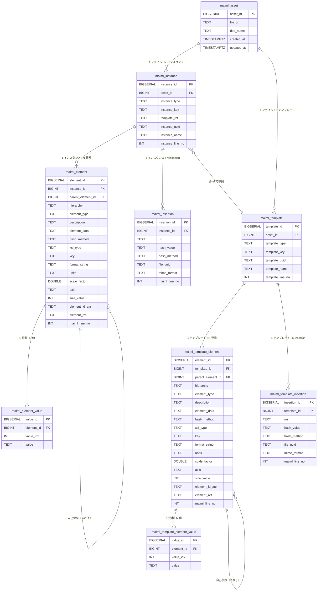

# MaiML OpenData Pipeline DB 設計書

> 作成日: 2026-03-11  
> ステータス: **暫定**（テーブル構成は確定。スキーマ命名規則は未確定 → [pending.md](./pending.md) 参照）  
> 基準資料: `docs/20260311_0857_maiml2Excel_DB設計検討/`

---

## 1. スキーマ方針

公開データを格納するテーブルは、**組織（organization）ごとに専用の PostgreSQL スキーマ**を作成し、そのスキーマ内に配置する。

```
PostgreSQL
└── <組織スキーマ>   ← 組織ごとに作成（命名規則は pending.md 参照）
    ├── maiml_asset
    ├── maiml_instance
    ├── maiml_element
    ├── maiml_element_value
    ├── maiml_insertion
    ├── maiml_template
    ├── maiml_template_element
    ├── maiml_template_element_value
    └── maiml_template_insertion
```

**スキーマ作成タイミング:** 組織作成時に自動作成。スキーマが存在しない場合は公開操作時にエラー。

---

## 2. テーブル全体構成

```
maiml_asset（MaiML ファイル代表メタ）
    │
    ├── maiml_instance（result / material / condition インスタンス）  ← data 層
    │         │
    │         ├── maiml_element（行データ: property/content/uncertainty/insertion 系）
    │         │         │
    │         │         └── maiml_element_value（複数 <value> を展開）
    │         │
    │         └── maiml_insertion（外部ファイル参照の正規化）
    │
    └── maiml_template（テンプレート定義）                            ← protocol 層
              │
              ├── maiml_template_element（テンプレート行データ）
              │         │
              │         └── maiml_template_element_value（複数 <value> を展開）
              │
              └── maiml_template_insertion（テンプレートの外部ファイル参照）
```

### テーブル役割一覧

| テーブル名 | 役割 | maiml2Excel 対応単位 |
|-----------|------|-------------------|
| `maiml_asset` | MaiML ファイル 1 件の代表メタ | 1 ファイル = 1 レコード |
| `maiml_instance` | result/material/condition インスタンス | instances.xlsx 1 シート = 1 レコード |
| `maiml_element` | 汎用データ行（property/content/uncertainty/insertion 系） | instances.xlsx 1 行 = 1 レコード（value 除く） |
| `maiml_element_value` | `<value>` 子要素の展開（複数 value 対応） | 1 value = 1 レコード |
| `maiml_insertion` | 外部ファイル参照（正規化） | insertion 1 件 = 1 レコード |
| `maiml_template` | テンプレート定義（protocol 層） | templates.xlsx 1 シート = 1 レコード |
| `maiml_template_element` | テンプレートの汎用データ行 | templates.xlsx 1 行 = 1 レコード |
| `maiml_template_element_value` | テンプレートの `<value>` 展開 | 1 value = 1 レコード |
| `maiml_template_insertion` | テンプレートの外部ファイル参照（正規化） | insertion 1 件 = 1 レコード |

---

## 3. ER 図



---

## 4. DDL

### 4.1 maiml_asset

```sql
CREATE TABLE maiml_asset (
  asset_id    BIGSERIAL    PRIMARY KEY,
  file_uri    TEXT         NOT NULL,
  doc_name    TEXT,
  created_at  TIMESTAMPTZ  NOT NULL DEFAULT now(),
  updated_at  TIMESTAMPTZ  NOT NULL DEFAULT now()
);
CREATE INDEX ix_maiml_asset_uri ON maiml_asset(file_uri);
```

| カラム | 取得元 | 例 |
|--------|--------|---|
| `file_uri` | 公開時に指定するファイルパス | `projects/sample/sample.maiml` |
| `doc_name` | `/maiml/document/name` テキスト | `juyoSampleProtocol_1` |

> **取り込み方針:** 全インスタンス（result/material/condition）・全要素を取り込む。フィルタリングは DB 検索時のクエリで行う。

---

### 4.2 maiml_instance

```sql
CREATE TABLE maiml_instance (
  instance_id      BIGSERIAL  PRIMARY KEY,
  asset_id         BIGINT     NOT NULL REFERENCES maiml_asset(asset_id) ON DELETE CASCADE,
  instance_type    TEXT       NOT NULL
                     CHECK (instance_type IN ('result', 'material', 'condition')),
  instance_key     TEXT       NOT NULL,
  template_ref     TEXT,
  instance_uuid    TEXT,
  instance_name    TEXT,
  instance_line_no INT
);
CREATE INDEX ix_maiml_instance_asset    ON maiml_instance(asset_id);
CREATE INDEX ix_maiml_instance_type     ON maiml_instance(instance_type);
CREATE INDEX ix_maiml_instance_key      ON maiml_instance(instance_key);
CREATE INDEX ix_maiml_instance_template ON maiml_instance(template_ref);
```

---

### 4.3 maiml_element

```sql
CREATE TABLE maiml_element (
  element_id        BIGSERIAL  PRIMARY KEY,
  instance_id       BIGINT     NOT NULL REFERENCES maiml_instance(instance_id) ON DELETE CASCADE,
  parent_element_id BIGINT     REFERENCES maiml_element(element_id) ON DELETE CASCADE,
  hierarchy         TEXT       NOT NULL,
  element_type      TEXT       NOT NULL,
  description       TEXT,
  element_data      TEXT,
  hash_method       TEXT,
  xsi_type          TEXT,
  key               TEXT,
  format_string     TEXT,
  units             TEXT,
  scale_factor      DOUBLE PRECISION,
  axis              TEXT,
  size_value        INT,
  element_id_attr   TEXT,
  element_ref       TEXT,
  maiml_line_no     INT
);
CREATE INDEX ix_maiml_element_instance   ON maiml_element(instance_id);
CREATE INDEX ix_maiml_element_parent     ON maiml_element(parent_element_id);
CREATE INDEX ix_maiml_element_type       ON maiml_element(element_type);
CREATE INDEX ix_maiml_element_key        ON maiml_element(key);
CREATE INDEX ix_maiml_element_hierarchy  ON maiml_element(instance_id, hierarchy);
```

**element_type の値一覧:**

| 値 | 分類 | 説明 |
|----|------|------|
| `property` | 汎用コンテナ | データプロパティ |
| `content` | 汎用コンテナ | データコンテンツ（数値配列が多い） |
| `uncertainty` | 汎用コンテナ | 不確実性データ |
| `insertion` | 外部参照（親） | 外部ファイル参照の親要素 |
| `uri` | 外部参照 | ファイルパス/URI |
| `hash` | 外部参照 | ハッシュ値 |
| `uuid` | 外部参照 | ファイル UUID |
| `format` | 外部参照 | MIME タイプ |
| `childUri` | 暗号化 | 暗号化された子 URI |
| `childHash` | 暗号化 | 暗号化された子ハッシュ |
| `childUuid` | 暗号化 | 暗号化された子 UUID |
| `EncryptedData` | 暗号化 | 暗号化データ本体 |

---

### 4.4 maiml_element_value

```sql
CREATE TABLE maiml_element_value (
  value_id    BIGSERIAL  PRIMARY KEY,
  element_id  BIGINT     NOT NULL REFERENCES maiml_element(element_id) ON DELETE CASCADE,
  value_idx   INT        NOT NULL DEFAULT 0,
  value       TEXT
);
CREATE INDEX ix_maiml_element_value_element ON maiml_element_value(element_id);
CREATE UNIQUE INDEX ux_maiml_element_value  ON maiml_element_value(element_id, value_idx);
```

> 1 要素に複数 `<value>` がある場合（例: `tiff:StripByteCounts` の 256 個）は複数行として保持。`value_idx`（0-origin）で区別。

---

### 4.5 maiml_insertion

```sql
CREATE TABLE maiml_insertion (
  insertion_id  BIGSERIAL  PRIMARY KEY,
  instance_id   BIGINT     NOT NULL REFERENCES maiml_instance(instance_id) ON DELETE CASCADE,
  uri           TEXT       NOT NULL,
  hash_value    TEXT,
  hash_method   TEXT,
  file_uuid     TEXT,
  mime_format   TEXT,
  maiml_line_no INT
);
CREATE INDEX ix_maiml_insertion_instance ON maiml_insertion(instance_id);
CREATE INDEX ix_maiml_insertion_uri      ON maiml_insertion(uri);
```

> `maiml_element` の uri/hash/uuid/format 行を 1 レコードに集約した正規化テーブル。ファイル参照の検索に使う。

---

### 4.6 maiml_template

```sql
CREATE TABLE maiml_template (
  template_id      BIGSERIAL  PRIMARY KEY,
  asset_id         BIGINT     NOT NULL REFERENCES maiml_asset(asset_id) ON DELETE CASCADE,
  template_type    TEXT       NOT NULL
                     CHECK (template_type IN ('result', 'material', 'condition')),
  template_key     TEXT       NOT NULL,
  template_uuid    TEXT,
  template_name    TEXT,
  template_line_no INT
);
CREATE INDEX ix_maiml_template_asset ON maiml_template(asset_id);
CREATE INDEX ix_maiml_template_type  ON maiml_template(template_type);
CREATE INDEX ix_maiml_template_key   ON maiml_template(template_key);
```

---

### 4.7 maiml_template_element

```sql
CREATE TABLE maiml_template_element (
  element_id        BIGSERIAL  PRIMARY KEY,
  template_id       BIGINT     NOT NULL REFERENCES maiml_template(template_id) ON DELETE CASCADE,
  parent_element_id BIGINT     REFERENCES maiml_template_element(element_id) ON DELETE CASCADE,
  hierarchy         TEXT       NOT NULL,
  element_type      TEXT       NOT NULL,
  description       TEXT,
  element_data      TEXT,
  hash_method       TEXT,
  xsi_type          TEXT,
  key               TEXT,
  format_string     TEXT,
  units             TEXT,
  scale_factor      DOUBLE PRECISION,
  axis              TEXT,
  size_value        INT,
  element_id_attr   TEXT,
  element_ref       TEXT,
  maiml_line_no     INT
);
CREATE INDEX ix_maiml_tmpl_element_template  ON maiml_template_element(template_id);
CREATE INDEX ix_maiml_tmpl_element_parent    ON maiml_template_element(parent_element_id);
CREATE INDEX ix_maiml_tmpl_element_type      ON maiml_template_element(element_type);
CREATE INDEX ix_maiml_tmpl_element_key       ON maiml_template_element(key);
CREATE INDEX ix_maiml_tmpl_element_hierarchy ON maiml_template_element(template_id, hierarchy);
```

---

### 4.8 maiml_template_element_value

```sql
CREATE TABLE maiml_template_element_value (
  value_id    BIGSERIAL  PRIMARY KEY,
  element_id  BIGINT     NOT NULL REFERENCES maiml_template_element(element_id) ON DELETE CASCADE,
  value_idx   INT        NOT NULL DEFAULT 0,
  value       TEXT
);
CREATE INDEX ix_maiml_tmpl_element_value_element ON maiml_template_element_value(element_id);
CREATE UNIQUE INDEX ux_maiml_tmpl_element_value   ON maiml_template_element_value(element_id, value_idx);
```

---

### 4.9 maiml_template_insertion

```sql
CREATE TABLE maiml_template_insertion (
  insertion_id  BIGSERIAL  PRIMARY KEY,
  template_id   BIGINT     NOT NULL REFERENCES maiml_template(template_id) ON DELETE CASCADE,
  uri           TEXT       NOT NULL,
  hash_value    TEXT,
  hash_method   TEXT,
  file_uuid     TEXT,
  mime_format   TEXT,
  maiml_line_no INT
);
CREATE INDEX ix_maiml_tmpl_insertion_template ON maiml_template_insertion(template_id);
CREATE INDEX ix_maiml_tmpl_insertion_uri      ON maiml_template_insertion(uri);
```

---

## 5. カラムマッピング（maiml2Excel 列 ↔ DB カラム）

| maiml2Excel 列 | DB テーブル | DB カラム | 型 |
|--------------|-----------|----------|---|
| シート名（種別） | `maiml_instance` | `instance_type` | TEXT |
| シート名（ID） | `maiml_instance` | `instance_key` | TEXT |
| インスタンス `@ref` | `maiml_instance` | `template_ref` | TEXT |
| インスタンス `<uuid>` | `maiml_instance` | `instance_uuid` | TEXT |
| インスタンス `<name>` | `maiml_instance` | `instance_name` | TEXT |
| インスタンス行番号 | `maiml_instance` | `instance_line_no` | INT |
| A: MaiML file lineNo | `maiml_element` | `maiml_line_no` | INT |
| B: hierarchy | `maiml_element` | `hierarchy` | TEXT |
| C: element | `maiml_element` | `element_type` | TEXT |
| D: description | `maiml_element` | `description` | TEXT |
| E: element data | `maiml_element` / `maiml_insertion` | `element_data` / `uri` 等 | TEXT |
| F: @xsi:type | `maiml_element` | `xsi_type` | TEXT |
| G: @key | `maiml_element` | `key` | TEXT |
| H: @formatString | `maiml_element` | `format_string` | TEXT |
| I: @units | `maiml_element` | `units` | TEXT |
| J: @scaleFactor | `maiml_element` | `scale_factor` | DOUBLE |
| K: @axis | `maiml_element` | `axis` | TEXT |
| L: @size | `maiml_element` | `size_value` | INT |
| M: @id | `maiml_element` | `element_id_attr` | TEXT |
| N: @ref | `maiml_element` | `element_ref` | TEXT |
| O: value（単一） | `maiml_element_value` | `value`（value_idx=0） | TEXT |
| O: value（複数展開） | `maiml_element_value` | `value`（value_idx=0〜N-1） | TEXT |

> テンプレート側（`maiml_template_*`）のカラム構成は `maiml_element` 側と同一。

---

## 6. 検索クエリ例

### 6.1 特定アセットの全インスタンス一覧

```sql
SELECT instance_type, instance_key, template_ref, instance_name
FROM maiml_instance
WHERE asset_id = :asset_id
ORDER BY instance_type, instance_key;
```

### 6.2 特定キーの値を検索

```sql
SELECT i.instance_type, i.instance_key, e.hierarchy, e.xsi_type, e.key, v.value
FROM maiml_instance i
JOIN maiml_element e ON e.instance_id = i.instance_id
JOIN maiml_element_value v ON v.element_id = e.element_id
WHERE i.asset_id = :asset_id AND e.key = 'tiff:ImageWidth'
ORDER BY i.instance_key, v.value_idx;
```

### 6.3 外部ファイル参照（insertion）一覧

```sql
SELECT i.instance_key, ins.uri, ins.hash_value, ins.hash_method, ins.mime_format
FROM maiml_instance i
JOIN maiml_insertion ins ON ins.instance_id = i.instance_id
WHERE i.asset_id = :asset_id;
```

---

## 7. 未確定事項

| 項目 | 内容 |
|------|------|
| **スキーマ命名規則** | `org_<uuid>` / `maiml_<uuid>` / `pub_<uuid>` のいずれか（[pending.md](./pending.md) 参照） |
| **inline series の扱い** | 大量 value のチャンク分割保存方針（[pending.md](./pending.md) 参照） |
| **store_raw_series** | 生データ保存テーブルの要否（[pending.md](./pending.md) 参照） |
