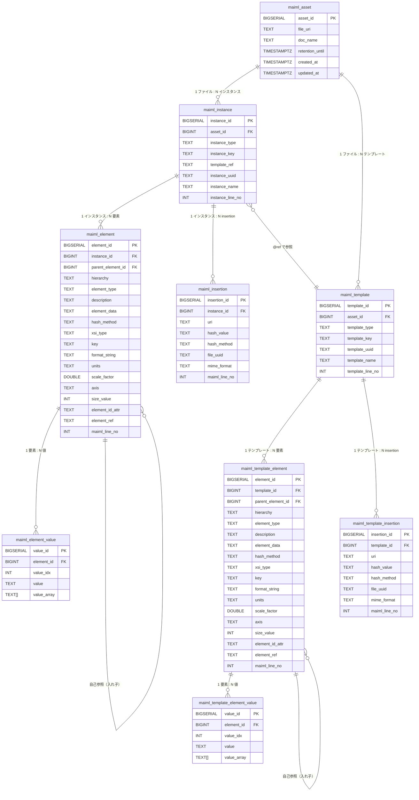

# MaiML OpenData Pipeline DB 設計書

> 作成日: 2026-03-11  
> 最終更新: 2026-03-12  
> ステータス: **確定**（全項目確定済み）
> 基準資料: `docs/MaiML_OpenData_Pipeline/DB検討/`

---

## 1. スキーマ方針

公開データを格納するテーブルは、**組織（organization）ごとに専用の PostgreSQL スキーマ**を作成し、そのスキーマ内に配置する。

```
PostgreSQL
└── {organization_id のハイフンを _ に変換}   ← 組織ごとに作成
    例: 550e8400_e29b_41d4_a716_446655440000
    ├── maiml_asset
    ├── maiml_instance
    ├── maiml_element
    ├── maiml_element_value
    ├── maiml_insertion
    ├── maiml_template
    ├── maiml_template_element
    ├── maiml_template_element_value
    └── maiml_template_insertion
```

### スキーマ命名規則

| 項目 | 内容 |
|------|------|
| **スキーマ名** | `organization_id` の `-` を `_` に変換した文字列 |
| **プレフィックス** | なし |
| **例** | `organization_id = 550e8400-e29b-41d4-a716-446655440000` → `550e8400_e29b_41d4_a716_446655440000` |
| **スキーマ COMMENT** | `organization.organization_cd` の値を設定（識別用） |
| **スキーマ作成タイミング** | 組織作成時（`POST /api/v1/provider/organization`）に自動作成 |

```sql
-- スキーマ作成 DDL イメージ
CREATE SCHEMA IF NOT EXISTS "550e8400_e29b_41d4_a716_446655440000";
COMMENT ON SCHEMA "550e8400_e29b_41d4_a716_446655440000" IS 'org_code_001';
```

```typescript
// TypeScript 変換関数
const toSchemaName = (organizationId: string): string =>
  organizationId.replace(/-/g, '_');
```

**スキーマが存在しない場合は公開操作時にエラー。**

---

## 2. テーブル全体構成

```
maiml_asset（MaiML ファイル代表メタ）
    │
    ├── maiml_instance（result / material / condition インスタンス）  ← data 層
    │         │
    │         ├── maiml_element（行データ: property/content/uncertainty/insertion 系）
    │         │         │
    │         │         └── maiml_element_value（複数 <value> を展開）
    │         │
    │         └── maiml_insertion（外部ファイル参照の正規化）
    │
    └── maiml_template（テンプレート定義）                            ← protocol 層
              │
              ├── maiml_template_element（テンプレート行データ）
              │         │
              │         └── maiml_template_element_value（複数 <value> を展開）
              │
              └── maiml_template_insertion（テンプレートの外部ファイル参照）
```

### テーブル役割一覧

| テーブル名 | 役割 | maiml2Excel 対応単位 |
|-----------|------|-------------------|
| `maiml_asset` | MaiML ファイル 1 件の代表メタ | 1 ファイル = 1 レコード |
| `maiml_instance` | result/material/condition インスタンス | instances.xlsx 1 シート = 1 レコード |
| `maiml_element` | 汎用データ行（property/content/uncertainty/insertion 系） | instances.xlsx 1 行 = 1 レコード（value 除く） |
| `maiml_element_value` | `<value>` 子要素の展開（複数 value 対応） | 1 value = 1 レコード |
| `maiml_insertion` | 外部ファイル参照（正規化） | insertion 1 件 = 1 レコード |
| `maiml_template` | テンプレート定義（protocol 層） | templates.xlsx 1 シート = 1 レコード |
| `maiml_template_element` | テンプレートの汎用データ行 | templates.xlsx 1 行 = 1 レコード |
| `maiml_template_element_value` | テンプレートの `<value>` 展開 | 1 value = 1 レコード |
| `maiml_template_insertion` | テンプレートの外部ファイル参照（正規化） | insertion 1 件 = 1 レコード |

---

## 3. ER 図



---

## 4. DDL

### 4.1 maiml_asset

```sql
CREATE TABLE maiml_asset (
  asset_id         BIGSERIAL    PRIMARY KEY,
  file_uri         TEXT         NOT NULL,
  doc_name         TEXT,
  retention_until  TIMESTAMPTZ  NOT NULL,  -- 公開期限。期限到来でスケジュール非公開の対象になる
  created_at       TIMESTAMPTZ  NOT NULL DEFAULT now(),
  updated_at       TIMESTAMPTZ  NOT NULL DEFAULT now()
);
CREATE INDEX ix_maiml_asset_uri             ON maiml_asset(file_uri);
CREATE INDEX ix_maiml_asset_retention_until ON maiml_asset(retention_until);
```

| カラム | 取得元 | 例 |
|--------|--------|---|
| `file_uri` | 公開時に指定するファイルパス | `projects/sample/sample.maiml` |
| `doc_name` | `/maiml/document/name` テキスト | `juyoSampleProtocol_1` |
| `retention_until` | 公開 Worker が組織設定・環境変数から自動決定（`spec.md` セクション4.3参照） | `2027-03-12 00:00:00+00` |

> **取り込み方針:** 全インスタンス（result/material/condition）・全要素を取り込む。フィルタリングは DB 検索時のクエリで行う。

> **期限管理:** `retention_until` は `NOT NULL`。公開 Worker が `organization.default_retention_days`（組織設定）または環境変数 `RETENTION_DAYS_DEFAULT`（デフォルト: 365日）を使って `now() + N日` で算出して設定する。スケジュール非公開 Worker は毎日0時に `retention_until <= now()` のレコードを一括非公開する。

---

### 4.2 maiml_instance

```sql
CREATE TABLE maiml_instance (
  instance_id      BIGSERIAL  PRIMARY KEY,
  asset_id         BIGINT     NOT NULL REFERENCES maiml_asset(asset_id) ON DELETE CASCADE,
  instance_type    TEXT       NOT NULL
                     CHECK (instance_type IN ('result', 'material', 'condition')),
  instance_key     TEXT       NOT NULL,
  template_ref     TEXT,
  instance_uuid    TEXT,
  instance_name    TEXT,
  instance_line_no INT
);
CREATE INDEX ix_maiml_instance_asset    ON maiml_instance(asset_id);
CREATE INDEX ix_maiml_instance_type     ON maiml_instance(instance_type);
CREATE INDEX ix_maiml_instance_key      ON maiml_instance(instance_key);
CREATE INDEX ix_maiml_instance_template ON maiml_instance(template_ref);
```

---

### 4.3 maiml_element

```sql
CREATE TABLE maiml_element (
  element_id        BIGSERIAL  PRIMARY KEY,
  instance_id       BIGINT     NOT NULL REFERENCES maiml_instance(instance_id) ON DELETE CASCADE,
  parent_element_id BIGINT     REFERENCES maiml_element(element_id) ON DELETE CASCADE,
  hierarchy         TEXT       NOT NULL,
  element_type      TEXT       NOT NULL,
  description       TEXT,
  element_data      TEXT,
  hash_method       TEXT,
  xsi_type          TEXT,
  key               TEXT,
  format_string     TEXT,
  units             TEXT,
  scale_factor      DOUBLE PRECISION,
  axis              TEXT,
  size_value        INT,
  element_id_attr   TEXT,
  element_ref       TEXT,
  maiml_line_no     INT
);
CREATE INDEX ix_maiml_element_instance   ON maiml_element(instance_id);
CREATE INDEX ix_maiml_element_parent     ON maiml_element(parent_element_id);
CREATE INDEX ix_maiml_element_type       ON maiml_element(element_type);
CREATE INDEX ix_maiml_element_key        ON maiml_element(key);
CREATE INDEX ix_maiml_element_hierarchy  ON maiml_element(instance_id, hierarchy);
```

**element_type の値一覧:**

| 値 | 分類 | 説明 |
|----|------|------|
| `property` | 汎用コンテナ | データプロパティ |
| `content` | 汎用コンテナ | データコンテンツ（数値配列が多い） |
| `uncertainty` | 汎用コンテナ | 不確実性データ |
| `insertion` | 外部参照（親） | 外部ファイル参照の親要素 |
| `uri` | 外部参照 | ファイルパス/URI |
| `hash` | 外部参照 | ハッシュ値 |
| `uuid` | 外部参照 | ファイル UUID |
| `format` | 外部参照 | MIME タイプ |
| `childUri` | 暗号化 | 暗号化された子 URI |
| `childHash` | 暗号化 | 暗号化された子ハッシュ |
| `childUuid` | 暗号化 | 暗号化された子 UUID |
| `EncryptedData` | 暗号化 | 暗号化データ本体 |

---

### 4.4 maiml_element_value

```sql
CREATE TABLE maiml_element_value (
  value_id     BIGSERIAL  PRIMARY KEY,
  element_id   BIGINT     NOT NULL REFERENCES maiml_element(element_id) ON DELETE CASCADE,
  value_idx    INT        NOT NULL DEFAULT 0,
  value        TEXT,
  value_array  TEXT[]
);
CREATE INDEX ix_maiml_element_value_element ON maiml_element_value(element_id);
CREATE UNIQUE INDEX ux_maiml_element_value  ON maiml_element_value(element_id, value_idx);
```

| カラム | 説明 |
|--------|------|
| `value` | 単一テキスト値。スペース区切りの複数値を持たない場合に使用。`value_array` が NULL でない場合は NULL |
| `value_array` | `<value>` のテキストをスペース区切りで分割した配列。例: `"1.0 2.0 3.0"` → `ARRAY['1.0','2.0','3.0']`。単一値の場合は NULL |

> **登録方針:** `<value>` テキストをスペース区切りで分割した結果が **2 要素以上** の場合は `value_array` に格納し `value` は NULL にする。**1 要素**の場合は `value` に格納し `value_array` は NULL にする。これにより、取得側は `COALESCE(value_array[1], value)` で統一的にアクセスできる。

> 1 要素に複数 `<value>` タグがある場合（例: `tiff:StripByteCounts` の 256 個）は複数行として保持。`value_idx`（0-origin）で区別。

---

### 4.5 maiml_insertion

```sql
CREATE TABLE maiml_insertion (
  insertion_id  BIGSERIAL  PRIMARY KEY,
  instance_id   BIGINT     NOT NULL REFERENCES maiml_instance(instance_id) ON DELETE CASCADE,
  uri           TEXT       NOT NULL,
  hash_value    TEXT,
  hash_method   TEXT,
  file_uuid     TEXT,
  mime_format   TEXT,
  maiml_line_no INT
);
CREATE INDEX ix_maiml_insertion_instance ON maiml_insertion(instance_id);
CREATE INDEX ix_maiml_insertion_uri      ON maiml_insertion(uri);
```

> `maiml_element` の uri/hash/uuid/format 行を 1 レコードに集約した正規化テーブル。ファイル参照の検索に使う。

---

### 4.6 maiml_template

```sql
CREATE TABLE maiml_template (
  template_id      BIGSERIAL  PRIMARY KEY,
  asset_id         BIGINT     NOT NULL REFERENCES maiml_asset(asset_id) ON DELETE CASCADE,
  template_type    TEXT       NOT NULL
                     CHECK (template_type IN ('result', 'material', 'condition')),
  template_key     TEXT       NOT NULL,
  template_uuid    TEXT,
  template_name    TEXT,
  template_line_no INT
);
CREATE INDEX ix_maiml_template_asset ON maiml_template(asset_id);
CREATE INDEX ix_maiml_template_type  ON maiml_template(template_type);
CREATE INDEX ix_maiml_template_key   ON maiml_template(template_key);
```

---

### 4.7 maiml_template_element

```sql
CREATE TABLE maiml_template_element (
  element_id        BIGSERIAL  PRIMARY KEY,
  template_id       BIGINT     NOT NULL REFERENCES maiml_template(template_id) ON DELETE CASCADE,
  parent_element_id BIGINT     REFERENCES maiml_template_element(element_id) ON DELETE CASCADE,
  hierarchy         TEXT       NOT NULL,
  element_type      TEXT       NOT NULL,
  description       TEXT,
  element_data      TEXT,
  hash_method       TEXT,
  xsi_type          TEXT,
  key               TEXT,
  format_string     TEXT,
  units             TEXT,
  scale_factor      DOUBLE PRECISION,
  axis              TEXT,
  size_value        INT,
  element_id_attr   TEXT,
  element_ref       TEXT,
  maiml_line_no     INT
);
CREATE INDEX ix_maiml_tmpl_element_template  ON maiml_template_element(template_id);
CREATE INDEX ix_maiml_tmpl_element_parent    ON maiml_template_element(parent_element_id);
CREATE INDEX ix_maiml_tmpl_element_type      ON maiml_template_element(element_type);
CREATE INDEX ix_maiml_tmpl_element_key       ON maiml_template_element(key);
CREATE INDEX ix_maiml_tmpl_element_hierarchy ON maiml_template_element(template_id, hierarchy);
```

---

### 4.8 maiml_template_element_value

```sql
CREATE TABLE maiml_template_element_value (
  value_id     BIGSERIAL  PRIMARY KEY,
  element_id   BIGINT     NOT NULL REFERENCES maiml_template_element(element_id) ON DELETE CASCADE,
  value_idx    INT        NOT NULL DEFAULT 0,
  value        TEXT,
  value_array  TEXT[]
);
CREATE INDEX ix_maiml_tmpl_element_value_element ON maiml_template_element_value(element_id);
CREATE UNIQUE INDEX ux_maiml_tmpl_element_value   ON maiml_template_element_value(element_id, value_idx);
```

> **登録方針:** `maiml_element_value` と同一。`<value>` テキストをスペース区切りで分割した結果が 2 要素以上の場合は `value_array` に格納し `value` は NULL、1 要素の場合は `value` に格納し `value_array` は NULL にする。

---

### 4.9 maiml_template_insertion

```sql
CREATE TABLE maiml_template_insertion (
  insertion_id  BIGSERIAL  PRIMARY KEY,
  template_id   BIGINT     NOT NULL REFERENCES maiml_template(template_id) ON DELETE CASCADE,
  uri           TEXT       NOT NULL,
  hash_value    TEXT,
  hash_method   TEXT,
  file_uuid     TEXT,
  mime_format   TEXT,
  maiml_line_no INT
);
CREATE INDEX ix_maiml_tmpl_insertion_template ON maiml_template_insertion(template_id);
CREATE INDEX ix_maiml_tmpl_insertion_uri      ON maiml_template_insertion(uri);
```

---

## 5. カラムマッピング（maiml2Excel 列 ↔ DB カラム）

| maiml2Excel 列 | DB テーブル | DB カラム | 型 |
|--------------|-----------|----------|---|
| シート名（種別） | `maiml_instance` | `instance_type` | TEXT |
| シート名（ID） | `maiml_instance` | `instance_key` | TEXT |
| インスタンス `@ref` | `maiml_instance` | `template_ref` | TEXT |
| インスタンス `<uuid>` | `maiml_instance` | `instance_uuid` | TEXT |
| インスタンス `<name>` | `maiml_instance` | `instance_name` | TEXT |
| インスタンス行番号 | `maiml_instance` | `instance_line_no` | INT |
| A: MaiML file lineNo | `maiml_element` | `maiml_line_no` | INT |
| B: hierarchy | `maiml_element` | `hierarchy` | TEXT |
| C: element | `maiml_element` | `element_type` | TEXT |
| D: description | `maiml_element` | `description` | TEXT |
| E: element data | `maiml_element` / `maiml_insertion` | `element_data` / `uri` 等 | TEXT |
| F: @xsi:type | `maiml_element` | `xsi_type` | TEXT |
| G: @key | `maiml_element` | `key` | TEXT |
| H: @formatString | `maiml_element` | `format_string` | TEXT |
| I: @units | `maiml_element` | `units` | TEXT |
| J: @scaleFactor | `maiml_element` | `scale_factor` | DOUBLE |
| K: @axis | `maiml_element` | `axis` | TEXT |
| L: @size | `maiml_element` | `size_value` | INT |
| M: @id | `maiml_element` | `element_id_attr` | TEXT |
| N: @ref | `maiml_element` | `element_ref` | TEXT |
| O: value（単一） | `maiml_element_value` | `value`（value_idx=0） | TEXT |
| O: value（複数展開） | `maiml_element_value` | `value`（value_idx=0〜N-1） | TEXT |

> テンプレート側（`maiml_template_*`）のカラム構成は `maiml_element` 側と同一。

---

## 6. 検索クエリ例

### 6.1 特定アセットの全インスタンス一覧

```sql
SELECT instance_type, instance_key, template_ref, instance_name
FROM maiml_instance
WHERE asset_id = :asset_id
ORDER BY instance_type, instance_key;
```

### 6.2 特定キーの値を検索

```sql
SELECT i.instance_type, i.instance_key, e.hierarchy, e.xsi_type, e.key, v.value
FROM maiml_instance i
JOIN maiml_element e ON e.instance_id = i.instance_id
JOIN maiml_element_value v ON v.element_id = e.element_id
WHERE i.asset_id = :asset_id AND e.key = 'tiff:ImageWidth'
ORDER BY i.instance_key, v.value_idx;
```

### 6.3 外部ファイル参照（insertion）一覧

```sql
SELECT i.instance_key, ins.uri, ins.hash_value, ins.hash_method, ins.mime_format
FROM maiml_instance i
JOIN maiml_insertion ins ON ins.instance_id = i.instance_id
WHERE i.asset_id = :asset_id;
```

---

## 7. eventLog テーブル設計 ⚠️ PENDING

> ⚠️ **このセクションは未確定（PENDING）です。**  
> `concept:instance` の参照先解決方法について情報不足により設計が中断されています。  
> 詳細は [pending.md](./pending.md) セクション4を参照。実装前に確定させること。

### 7.1 概要

MaiML の `/maiml/eventLog` 配下の階層構造を以下のテーブルに保存する（設計案）。

```
maiml_asset（1ファイル）
    └── maiml_event_log（eventLog 要素）
              └── maiml_log（log 要素、@ref=method）
                        └── maiml_trace（trace 要素、@ref=program）
                                  └── maiml_event（event 要素、@ref=instruction）
                                            └── maiml_event_instance_ref（concept:instance 複数対応）
```

### 7.2 DDL

```sql
-- eventLog 代表メタ（maiml_asset と 1:1）
CREATE TABLE maiml_event_log (
  event_log_id   BIGSERIAL  PRIMARY KEY,
  asset_id       BIGINT     NOT NULL REFERENCES maiml_asset(asset_id) ON DELETE CASCADE,
  event_log_key  TEXT,          -- @id 属性
  event_log_uuid TEXT,          -- <uuid> テキスト
  event_log_name TEXT,          -- <name> テキスト
  description    TEXT,
  annotation     TEXT,
  maiml_line_no  INT
);
CREATE INDEX ix_maiml_event_log_asset ON maiml_event_log(asset_id);

-- log 要素（eventLog 1つにつき複数可）
CREATE TABLE maiml_log (
  log_id        BIGSERIAL  PRIMARY KEY,
  event_log_id  BIGINT     NOT NULL REFERENCES maiml_event_log(event_log_id) ON DELETE CASCADE,
  log_key       TEXT,          -- @id 属性
  method_ref    TEXT,          -- @ref 属性（protocol/method の @id を参照）
  log_uuid      TEXT,
  log_name      TEXT,
  description   TEXT,
  annotation    TEXT,
  maiml_line_no INT
);
CREATE INDEX ix_maiml_log_event_log ON maiml_log(event_log_id);

-- trace 要素（log 1つにつき複数可）
CREATE TABLE maiml_trace (
  trace_id      BIGSERIAL  PRIMARY KEY,
  log_id        BIGINT     NOT NULL REFERENCES maiml_log(log_id) ON DELETE CASCADE,
  trace_key     TEXT,          -- @id 属性
  program_ref   TEXT,          -- @ref 属性（protocol/method/program の @id を参照）
  trace_uuid    TEXT,
  trace_name    TEXT,
  description   TEXT,
  annotation    TEXT,
  maiml_line_no INT
);
CREATE INDEX ix_maiml_trace_log ON maiml_trace(log_id);

-- event 要素（trace 1つにつき複数可）
CREATE TABLE maiml_event (
  event_id            BIGSERIAL    PRIMARY KEY,
  trace_id            BIGINT       NOT NULL REFERENCES maiml_trace(trace_id) ON DELETE CASCADE,
  event_key           TEXT,            -- @id 属性
  instruction_ref     TEXT,            -- @ref 属性（instruction の @id を参照）
  event_uuid          TEXT,
  event_name          TEXT,
  description         TEXT,
  annotation          TEXT,
  lifecycle_transition TEXT,           -- property[@key='lifecycle:transition'] の <value>
  event_timestamp     TIMESTAMPTZ,     -- property[@key='time:timestamp'] の <value>（ISO8601→変換）
  maiml_line_no       INT
);
CREATE INDEX ix_maiml_event_trace       ON maiml_event(trace_id);
CREATE INDEX ix_maiml_event_instruction ON maiml_event(instruction_ref);
CREATE INDEX ix_maiml_event_timestamp   ON maiml_event(event_timestamp);

-- concept:instance 参照（event 1つにつき複数可）
CREATE TABLE maiml_event_instance_ref (
  ref_id       BIGSERIAL  PRIMARY KEY,
  event_id     BIGINT     NOT NULL REFERENCES maiml_event(event_id) ON DELETE CASCADE,
  ref_idx      INT        NOT NULL DEFAULT 0,  -- 同一 key の複数 property の順序
  result_uuid  TEXT       NOT NULL,             -- property[@key='concept:instance'] の <value>
  description  TEXT                             -- property の <description>
);
CREATE INDEX ix_maiml_event_instance_ref_event ON maiml_event_instance_ref(event_id);
CREATE INDEX ix_maiml_event_instance_ref_uuid  ON maiml_event_instance_ref(result_uuid);
```

### 7.3 カラムマッピング

| MaiML 要素 | DB テーブル | DB カラム |
|-----------|-----------|---------|
| `eventLog/@id` | `maiml_event_log` | `event_log_key` |
| `eventLog/uuid` | `maiml_event_log` | `event_log_uuid` |
| `eventLog/name` | `maiml_event_log` | `event_log_name` |
| `log/@id` | `maiml_log` | `log_key` |
| `log/@ref` | `maiml_log` | `method_ref` |
| `log/uuid` | `maiml_log` | `log_uuid` |
| `trace/@id` | `maiml_trace` | `trace_key` |
| `trace/@ref` | `maiml_trace` | `program_ref` |
| `trace/uuid` | `maiml_trace` | `trace_uuid` |
| `event/@id` | `maiml_event` | `event_key` |
| `event/@ref` | `maiml_event` | `instruction_ref` |
| `event/uuid` | `maiml_event` | `event_uuid` |
| `event/property[@key='lifecycle:transition']/value` | `maiml_event` | `lifecycle_transition` |
| `event/property[@key='time:timestamp']/value` | `maiml_event` | `event_timestamp` |
| `event/property[@key='concept:instance']/value` | `maiml_event_instance_ref` | `result_uuid` |

### 7.4 テーブル全体構成（更新後）

```
maiml_asset
    ├── maiml_instance / maiml_element / ... （data 層）
    ├── maiml_template / maiml_template_element / ... （protocol 層）
    └── maiml_event_log                             （eventLog 層）
              └── maiml_log
                        └── maiml_trace
                                  └── maiml_event
                                            └── maiml_event_instance_ref
```

---

## 8. 既存テーブルへの変更

### 8.1 organization テーブル（public スキーマ）

公開期限の組織単位設定を保持するため、既存の `organization` テーブルにカラムを追加する。

```sql
-- マイグレーション
ALTER TABLE organization
  ADD COLUMN IF NOT EXISTS default_retention_days INT;  -- NULL = 環境変数 RETENTION_DAYS_DEFAULT を使用
```

| カラム | 型 | 説明 |
|--------|-----|------|
| `default_retention_days` | `INT` | 公開時のデフォルト保持日数（日数）。NULL の場合は環境変数 `RETENTION_DAYS_DEFAULT` を使用 |

**期限決定ロジック（再掲・`spec.md` セクション4.3参照）:**

| 優先順位 | 条件 | 期限の設定値 |
|---------|------|------------|
| 1 | `organization.default_retention_days` が NOT NULL | `now() + organization.default_retention_days 日` |
| 2 | NULL | `now() + 環境変数 RETENTION_DAYS_DEFAULT 日`（デフォルト: 365） |

---

## 9. `maiml_publish_job.asset_id` FK なし運用

`maiml_publish_job` テーブルは `public` スキーマに存在し、全組織共通で使用する。
一方、`maiml_asset` テーブルは各組織専用スキーマ（例: `550e8400_e29b_41d4_a716_446655440000`）に存在する。

**PostgreSQL の FK 制約はスキーマ間では機能しない**ため、`maiml_publish_job.asset_id` は FK なしの `BIGINT` とする。

| 項目 | 内容 |
|------|------|
| **カラム型** | `BIGINT`（FK 制約なし） |
| **NULL 許容** | `NULL` 可（公開ジョブは完了後に更新、非公開ジョブは登録時に設定） |
| **整合性管理** | アプリケーション側（Worker）が責任を持つ |

**アプリケーション側の管理方針:**
- 非公開 Worker は `maiml_asset` を DELETE する前に `asset_id` の存在を確認する
- `maiml_asset` 削除後も `maiml_publish_job` のレコードは残す（履歴目的）
- 参照先 `maiml_asset` が削除済みの場合、`asset_id` は孤立した値となる（これは正常動作）

```sql
-- maiml_publish_job.asset_id は FK なし
-- spec.md セクション10 の DDL 参照
asset_id  BIGINT,  -- FK なし（異なるスキーマのため制約不可）
                   -- 参照整合性はアプリケーション側で管理
```

---

## 10. 確定済み事項（旧・未確定事項）

すべての事項が 2026-03-12 に確定しました。詳細は [pending.md](./pending.md) を参照。

| 項目 | 確定内容 |
|------|---------|
| **スキーマ命名規則** | `organization_id` の `-` を `_` に変換した文字列（プレフィックスなし）。セクション1参照 |
| **inline series の扱い** | `value_array TEXT[]` カラムで対応（セクション4.4参照）。別テーブル不要 |
| **store_raw_series** | 実装しない（DB 構成変更により不要と確定） |
| **公開設定 UI** | 実装しない（絞り込み等の要件なし） |
