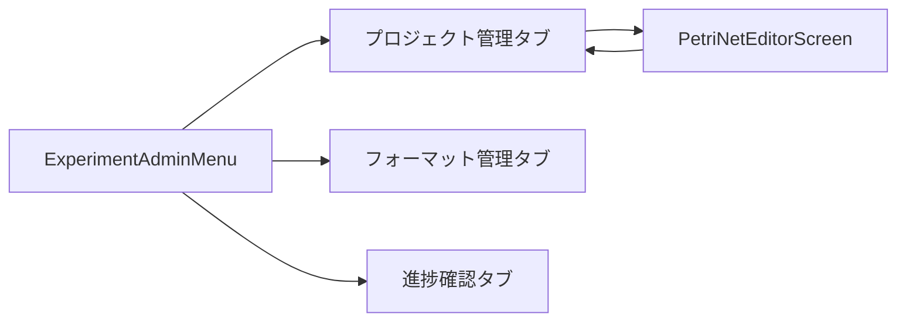

# ExperimentAdminMenu - 実験管理者メニュー

## 1. 概要

### 1.1 コンポーネントの目的
実験管理者用のメインメニュー画面。プロジェクト管理、フォーマット管理、進捗確認の3つの機能へのアクセスを提供し、MAIML編集画面への遷移も管理します。

### 1.2 使用場面
- 実験管理者（experiment_admin）がログイン後にアクセスする初期画面
- 各機能画面への入り口として機能
- プロジェクト編集時にMAIML編集画面へ遷移

### 1.3 アクセス権限
- **必須ロール**: experiment_admin
- **認証**: JWT + Session Hybrid認証

---

## 2. 画面構成

### 2.1 レイアウト構造

```
┌─────────────────────────────────────────┐
│ Header (64px)                           │ ← 共通ヘッダー
├─────────────────────────────────────────┤
│ SubHeader (76px)                        │ ← タブ付きサブヘッダー
│ [プロジェクト管理] [フォーマット管理] [進捗確認] │
├─────────────────────────────────────────┤
│                                         │
│ Content Area                            │ ← 選択タブの内容
│ (動的に切り替わる)                      │
│                                         │
│                                         │
└─────────────────────────────────────────┘
```

**高さ計算:**
- Header: 64px
- SubHeader: 76px
- Total Header Height: 140px
- Content Area: `calc(100vh - 140px)`

### 2.2 主要UI要素

#### 2.2.1 Header（共通コンポーネント）
- ロゴ
- ユーザー情報
- ログアウトボタン

#### 2.2.2 SubHeader（タブ付き）
- タイトル: "実験管理"
- タブ項目（3つ）:
  1. **プロジェクト管理** - アイコン: `<FolderAddOutlined />`
  2. **フォーマット管理** - アイコン: `<FileTextOutlined />`
  3. **進捗確認** - アイコン: `<LineChartOutlined />`
- メニュー切り替えドロップダウン（他のロールメニューへの切り替え）

#### 2.2.3 Content Area（タブ別）
| タブ | 表示内容 | 表示方式 |
|------|----------|----------|
| プロジェクト管理 | `<ProjectManagement />` | 全幅表示 |
| フォーマット管理 | `<FormatManagement />` | 全幅表示 |
| 進捗確認 | `<ProgressMonitoring />` | 全幅表示 |

### 2.3 画面遷移



**遷移条件:**
- タブクリック: タブ間の切り替え
- プロジェクト編集ボタン: MAIML編集画面へ遷移
- 編集画面の閉じるボタン: メニュー画面に戻る

---

## 3. 機能仕様

### 3.1 初期表示

#### 3.1.1 デフォルト表示
- 初期タブ: **プロジェクト管理**（key: '1'）
- ユーザー情報をHeaderに表示
- 多言語対応（日本語/英語）

#### 3.1.2 レイアウト設定
```typescript
// 全幅表示タブ（'1', '2', '3'）
const isFullWidthTab = currentTab === '1' || currentTab === '2' || currentTab === '3';

// Content Areaのスタイル
{
  marginTop: TOTAL_HEADER_HEIGHT, // 140px
  padding: isFullWidthTab ? 0 : token.paddingLG,
  height: isFullWidthTab ? `calc(100vh - 140px)` : 'auto',
  overflow: isFullWidthTab ? 'hidden' : 'auto',
}
```

### 3.2 タブ切り替え機能

#### 3.2.1 タブ定義
```typescript
const tabItems = [
  {
    key: '1',
    label: t('menu.experiment_admin.tabs.projectManagement') || 'プロジェクト管理',
    icon: <FolderAddOutlined />,
  },
  {
    key: '2',
    label: t('menu.experiment_admin.tabs.formatManagement') || 'フォーマット管理',
    icon: <FileTextOutlined />,
  },
  {
    key: '3',
    label: t('menu.experiment_admin.tabs.progressMonitoring') || '進捗確認',
    icon: <LineChartOutlined />,
  },
];
```

#### 3.2.2 タブ切り替えハンドラー
```typescript
const handleTabChange = (key: string) => {
  setCurrentTab(key);
};
```

**動作:**
- SubHeaderのタブクリックで`handleTabChange`が呼ばれる
- `currentTab`ステートが更新される
- Content Areaが対応するコンポーネントに切り替わる

### 3.3 MAIML編集画面への遷移

#### 3.3.1 編集画面表示ハンドラー
```typescript
const handleEditProject = (params: ProjectEditParams) => {
  console.log('✏️ [ExperimentAdminMenu] Edit project:', params);
  setEditorProjectParams(params);
  setShowEditor(true);
};
```

**引数（ProjectEditParams）:**
- `projectId`: string - プロジェクトID
- `projectName`: string - プロジェクト名
- `projectOverview`: string - プロジェクト概要

#### 3.3.2 編集画面を閉じるハンドラー
```typescript
const handleCloseEditor = () => {
  console.log('🔙 [ExperimentAdminMenu] Close editor');
  setShowEditor(false);
  setEditorProjectParams(null);
};
```

**動作:**
- `showEditor`をfalseに設定
- `editorProjectParams`をnullにリセット
- メニュー画面に戻る

#### 3.3.3 条件分岐レンダリング
```typescript
if (showEditor && editorProjectParams) {
  return (
    <PetriNetEditorScreen
      projectId={editorProjectParams.projectId}
      projectName={editorProjectParams.projectName}
      projectOverview={editorProjectParams.projectOverview}
      onClose={handleCloseEditor}
    />
  );
}
```

### 3.4 メニュー切り替え機能

#### 3.4.1 メニュー切り替えハンドラー
```typescript
const handleMenuChange = (menuType: MenuType) => {
  if (onMenuChange) {
    onMenuChange(menuType);
  }
};
```

**MenuType定義（推定）:**
- `provider` - プロバイダメニュー
- `system_admin` - システム管理メニュー
- `data_admin` - データ管理メニュー
- `experiment_admin` - 実験管理メニュー（現在のメニュー）
- `experiment_worker` - 実験作業メニュー

---

## 4. データ仕様

### 4.1 Props定義

```typescript
interface ExperimentAdminMenuProps {
  user: User;                           // ログインユーザー情報
  onLogout: () => void;                 // ログアウトコールバック
  onNavigate: (path: string) => void;   // ナビゲーションコールバック
  onMenuChange?: (menuType: MenuType) => void; // メニュー切り替えコールバック
}
```

### 4.2 State定義

```typescript
const [currentTab, setCurrentTab] = useState('1');  // 現在のタブ（デフォルト: '1'）
const [showEditor, setShowEditor] = useState(false); // エディタ表示フラグ
const [editorProjectParams, setEditorProjectParams] = useState<ProjectEditParams | null>(null); // エディタパラメータ
```

### 4.3 User型定義（推定）

```typescript
interface User {
  id: string;
  username: string;
  role: string;
  organizationId: string;
  // その他のフィールド...
}
```

### 4.4 ProjectEditParams型定義

```typescript
interface ProjectEditParams {
  projectId: string;      // プロジェクトID
  projectName: string;    // プロジェクト名
  projectOverview: string; // プロジェクト概要
}
```

---

## 5. API連携

### 5.1 直接使用するAPI
このコンポーネント自体はAPIを直接呼び出しません。

### 5.2 子コンポーネントが使用するAPI

このメニューコンポーネントは、以下の子コンポーネントを含み、それぞれが独自のAPIを使用します。詳細は各コンポーネントの仕様書を参照してください。

#### 5.2.1 ProjectManagement

**主要API:**
- GET `/api/v1/projects` - プロジェクト一覧取得 ✅
- POST `/api/v1/projects` - プロジェクト作成 ✅
- GET `/api/v1/projects/:projectId` - プロジェクト詳細取得 ✅
- GET `/api/v1/projects/:projectId/files` - ファイル一覧取得 🔴
- POST `/api/v1/projects/:projectId/download` - 一括ダウンロード 🔴
- POST `/api/v1/projects/:projectId/reload` - プロジェクトリロード 🔴
- PATCH `/api/v1/projects/:projectId` - プロジェクト更新 🔴
- PATCH `/api/v1/projects/:projectId/checkout-status` - チェックアウト状態切替 🔴
- POST `/api/v1/projects/:projectId/instructions` - 指示送信 🔴
- DELETE `/api/v1/projects/:projectId` - プロジェクト削除 🔴

**共通API:**
- ファイルアップロード（context=project）
- ファイルダウンロード

**詳細:** [ProjectManagement.md](../01_project_management/ProjectManagement.md#5-api連携)

#### 5.2.2 FormatManagement

**主要API:**
- GET `/api/v1/formats` - フォーマット一覧取得 ✅
- GET `/api/v1/formats/:formatId` - フォーマット詳細取得 🔴
- POST `/api/v1/formats` - フォーマット作成 🔴
- GET `/api/v1/formats/:formatId/files` - ファイル一覧取得 🔴
- POST `/api/v1/formats/:formatId/files` - ファイル作成 🔴
- POST `/api/v1/formats/:formatId/folders` - フォルダ作成 🔴
- PATCH `/api/v1/formats/:formatId` - フォーマット更新 🔴
- DELETE `/api/v1/formats/:formatId/files/:fileId` - ファイル削除 🔴
- DELETE `/api/v1/formats/:formatId` - フォーマット削除 🔴

**共通API:**
- ファイルアップロード（context=format）
- ファイルダウンロード
- MAIMLファイル読み込み

**詳細:** [FormatManagement.md](../02_format_management/FormatManagement.md#5-api連携)

#### 5.2.3 ProgressMonitoring

**主要API:**
- GET `/api/v1/projects` - プロジェクト一覧取得（進捗情報含む） ✅
- GET `/api/v1/projects/:projectId/progress` - 進捗詳細取得 🔴
- GET `/api/v1/projects/:projectId/tasks/progress` - タスク進捗一覧取得 🔴
- POST `/api/v1/projects/:projectId/progress/report` - 進捗レポート生成 🔴

**詳細:** [ProgressMonitoring.md](../03_progress_monitoring/ProgressMonitoring.md#5-api連携)

**凡例:**
- ✅ = 実装済み
- 🔴 = 未実装

---

## 6. エラーハンドリング

### 6.1 エラーケース

| エラーケース | 原因 | 対処方法 |
|-------------|------|----------|
| ユーザー情報が不正 | 認証エラー | ログイン画面にリダイレクト |
| 子コンポーネントでエラー | APIエラー等 | 各子コンポーネントでハンドリング |
| メニュー切り替え失敗 | onMenuChange未定義 | コンソールにエラーログ出力 |

### 6.2 エラーメッセージ

このコンポーネントは直接エラーメッセージを表示しません。エラーは子コンポーネントで処理されます。

---

## 7. UI/UXポリシー準拠

### 7.1 Ant Designコンポーネント使用

| 用途 | コンポーネント | Props |
|------|---------------|-------|
| レイアウト | Layout | - |
| コンテンツエリア | Layout.Content | style設定 |
| カード表示 | Card | （未使用のタブで使用） |
| テキスト | Typography.Title, Text | level, type |
| テーマ | theme.useToken() | デザイントークン取得 |

### 7.2 デザイントークン使用

```typescript
const { token } = theme.useToken();

// 使用例
backgroundColor: token.colorBgLayout  // 背景色
padding: token.paddingLG              // パディング（大）
marginBottom: token.marginLG          // マージン（大）
```

### 7.3 レスポンシブ対応

#### 7.3.1 全幅表示
タブ '1', '2', '3' は全幅表示で、ビューポートに合わせて自動調整されます。

```typescript
height: `calc(100vh - 140px)`  // ビューポート高さから固定ヘッダー分を引く
overflow: 'hidden'             // 子コンポーネントでスクロール管理
```

#### 7.3.2 レスポンシブブレークポイント
- モバイル（xs: 480px以下）: SubHeaderが折りたたまれる可能性
- タブレット（sm: 576px以上）: タブが横並び表示
- デスクトップ（lg: 992px以上）: 全ての要素が最適表示

### 7.4 アクセシビリティ

- タブはキーボード操作可能（Ant Design標準）
- アイコンと文字ラベルの併用
- 適切なARIA属性（Ant Design自動付与）

---

## 8. 実装ファイル

### 8.1 ファイルパス
```
frontend/src/components/menus/ExperimentAdminMenu.tsx
```

### 8.2 依存コンポーネント

| コンポーネント | パス | 用途 |
|---------------|------|------|
| Header | ../common/Header | 共通ヘッダー |
| SubHeader | ../common/SubHeader | タブ付きサブヘッダー |
| ProjectManagement | ../project/ProjectManagement | プロジェクト管理 |
| FormatManagement | ../project/FormatManagement | フォーマット管理 |
| ProgressMonitoring | ../progress/ProgressMonitoring | 進捗確認 |
| PetriNetEditorScreen | ../viewer/PetriNetEditorScreen | MAIML編集画面 |

### 8.3 依存ライブラリ
- antd: Layout, Card, Typography, theme
- @ant-design/icons: LineChartOutlined, FileTextOutlined, FolderAddOutlined
- React: useState

---

## 9. 多言語対応

### 9.1 翻訳キー

```typescript
// メニュータイトル
t('menu.experiment_admin.title') // "実験管理"

// タブラベル
t('menu.experiment_admin.tabs.projectManagement')  // "プロジェクト管理"
t('menu.experiment_admin.tabs.formatManagement')   // "フォーマット管理"
t('menu.experiment_admin.tabs.progressMonitoring') // "進捗確認"

// コンテンツ
t('content.notImplemented') // "コンテンツエリア（未実装）"
```

### 9.2 言語切り替え
`useLanguage()` フックを使用してコンテキストから現在の言語を取得します。

---

## 10. パフォーマンス最適化

### 10.1 遅延ロード
現在は実装されていませんが、将来的に検討可能：
```typescript
const ProjectManagement = lazy(() => import('../project/ProjectManagement'));
const FormatManagement = lazy(() => import('../project/FormatManagement'));
const ProgressMonitoring = lazy(() => import('../progress/ProgressMonitoring'));
```

### 10.2 メモ化
タブ切り替え時の不要な再レンダリングを防ぐため、`useMemo`の使用を検討可能。

---

## 11. テスト観点

### 11.1 単体テスト
- [ ] 初期表示時、タブ '1' が選択されている
- [ ] タブクリック時、正しくタブが切り替わる
- [ ] handleEditProject呼び出し時、エディタが表示される
- [ ] handleCloseEditor呼び出し時、メニュー画面に戻る
- [ ] onMenuChange が正しく呼び出される

### 11.2 統合テスト
- [ ] 各タブの子コンポーネントが正しく表示される
- [ ] プロジェクト編集からMAIML編集画面への遷移
- [ ] MAIML編集画面からメニュー画面への戻り

### 11.3 E2Eテスト
- [ ] ログイン後、実験管理メニューが表示される
- [ ] タブ切り替えが正常に動作する
- [ ] プロジェクト編集フローが完了する

---

## 12. 既知の課題・TODO

### 12.1 既知の課題
- なし

### 12.2 将来の改善案
- [ ] タブの遅延ロード実装
- [ ] タブ履歴の保持（ブラウザバック対応）
- [ ] タブ間のデータ共有最適化
- [ ] パフォーマンスモニタリング

---

## 13. 変更履歴

| 日付 | バージョン | 変更内容 | 担当者 |
|------|-----------|---------|--------|
| 2026-01-21 | 1.0.0 | 初版作成 | Cline |

---

## 14. 関連ドキュメント

- [SubHeader仕様](../../common/SubHeader.md)
- [ProjectManagement仕様](../01_project_management/ProjectManagement.md)
- [FormatManagement仕様](../02_format_management/FormatManagement.md)
- [ProgressMonitoring仕様](../03_progress_monitoring/ProgressMonitoring.md)
- [PetriNetEditorScreen仕様](../04_maiml_editor/PetriNetEditorScreen.md)
- [UIポリシー](.clinerules/references/ui_policy.md)
