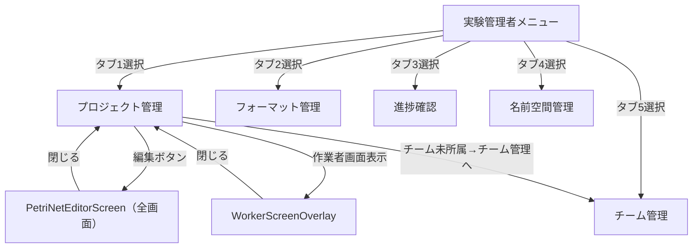

# 実験管理者メニュー画面

## メタデータ
- **画面名**: 実験管理者メニュー画面
- **物理名**: ExperimentAdminMenu.tsx
- **ファイルパス**: `frontend/src/components/menus/ExperimentAdminMenu.tsx`
- **利用権限**: 実験管理者（experiment_admin）
- **作成日**: 2026-03-11
- **最終更新日**: 2026-08-20
- **担当者**: Development Team
- **バージョン**: 2.1.0

---

## 1. 概要

### 1.1 コンポーネントの目的
実験管理者（Experiment Admin）のメイン画面として、プロジェクト管理・フォーマット管理・進捗確認・名前空間管理・チーム管理の5つの主要機能へのアクセスを提供します。サブヘッダーに埋め込まれたタブでメニューを切り替え、各機能の画面を表示します。

全タブのコンポーネントを `display:none` で常時マウントすることで、タブ切り替え時に state（フィルタ・選択状態等）が失われないようにしています。

### 1.2 使用場面
- 実験管理者ロールでログインした際のメイン画面
- プロジェクトのCRUD操作・フォーマット管理・進捗確認・名前空間管理・チーム管理を行う際に使用
- 実験管理者の全ての主要業務の入口となる画面

### 1.3 アクセス権限
- **必須ロール**: Experiment Admin（実験管理者）
- **認証**: JWT + Session Hybrid認証
- **権限**: `getPermissionsFromToken()` で取得した権限情報を SubHeader に渡す

---

## 2. 画面構成

### 2.1 レイアウト構造

```
┌─────────────────────────────────────────────────────────────┐
│ Header (64px)                                               │
│ - ロゴ、ユーザー情報、ログアウトボタン                        │
├─────────────────────────────────────────────────────────────┤
│ SubHeader with Tabs (76px)                                  │
│ - タイトル: 実験管理                                         │
│ - タブ: [プロジェクト管理] [フォーマット管理] [進捗確認]     │
│          [名前空間管理] [チーム管理]                        │
├─────────────────────────────────────────────────────────────┤
│ Content (calc(100vh - 140px), overflow: hidden)             │
│                                                             │
│ （全タブが display:none で常時マウント、選択タブのみ表示）   │
│                                                             │
│ - タブ1: ProjectManagement (display:block/none)            │
│ - タブ2: FormatManagement  (display:block/none)            │
│ - タブ3: ProgressMonitoring (display:block/none)           │
│ - タブ4: UncertaintyManagement (display:block/none)        │
│ - タブ5: TeamManagementPanel (display:block/none)          │
│                                                             │
└─────────────────────────────────────────────────────────────┘

┌─────────────────────────────────────────────────────────────┐
│ WorkerScreenOverlay (条件付き表示)                          │
│ - プロジェクト管理タブから呼び出し                           │
│ - 作業者画面のプレビュー表示                                 │
└─────────────────────────────────────────────────────────────┘

┌─────────────────────────────────────────────────────────────┐
│ PetriNetEditorScreen (showEditor === true 時に全画面表示)   │
│ - プロジェクト管理タブの編集ボタンから呼び出し               │
│ - 通常の Layout / SubHeader を完全に置き換えて表示           │
└─────────────────────────────────────────────────────────────┘
```

### 2.2 主要UI要素

#### 2.2.1 Header (64px)
- 共通ヘッダーコンポーネント（`Header`）
- Props: `user`, `onLogout`

#### 2.2.2 SubHeader (76px)
- タイトル: 「実験管理」（`t('menu.experiment_admin.title')`）
- タブUI（5タブ）
  - タブ1: `'プロジェクト管理'`（アイコン: `FolderAddOutlined`）
  - タブ2: `'フォーマット管理'`（アイコン: `FileTextOutlined`）
  - タブ3: `'進捗確認'`（アイコン: `LineChartOutlined`）
  - タブ4: `'名前空間管理'`（アイコン: `ExperimentOutlined`）
  - タブ5: `'チーム管理'`（アイコン: `TeamOutlined`）
- メニュー切り替えボタン（`currentMenu="experiment_admin"`）
- Props: `title`, `tabs`, `activeTabKey`, `onTabChange`, `currentMenu`, `onMenuChange`, `userPermissions`

#### 2.2.3 Content領域（全タブ常時マウント方式）

Content 自体は `overflow: hidden` / `height: calc(100vh - 140px)` で固定。
各タブはそれぞれ `<div style={{ display: currentTab === 'N' ? 'block' : 'none', height: '100%', ... }}>` でラップし、**全タブを常時マウント**する。

| タブ | key | コンポーネント | overflow |
|------|-----|--------------|---------|
| プロジェクト管理 | `'1'` | `ProjectManagement` | `hidden` |
| フォーマット管理 | `'2'` | `FormatManagement` | `hidden` |
| 進捗確認 | `'3'` | `ProgressMonitoring` | `hidden` |
| 名前空間管理 | `'4'` | `UncertaintyManagement` | `hidden` |
| チーム管理 | `'5'` | `TeamManagementPanel` | `hidden` + `background: #fff` |

#### 2.2.4 オーバーレイ・モーダル
- **WorkerScreenOverlay**: 作業者画面のプレビュー（条件付き表示）
- **PetriNetEditorScreen**: MAIML編集画面（`showEditor === true` 時に通常レイアウトを置き換えて全画面表示）

### 2.3 画面遷移



---

## 3. 機能仕様

### 3.1 タブ切り替え

```typescript
const handleTabChange = (key: string) => {
  setCurrentTab(key);
};
```

- `display:none` 方式を採用しているため、タブ切り替え時にコンポーネントはアンマウントされない
- 各子コンポーネントの state（フィルタ・選択状態等）が維持される

### 3.2 メニュー変更

```typescript
const handleMenuChange = (menuType: MenuType) => {
  if (onMenuChange) {
    onMenuChange(menuType);
  }
};
```

SubHeader のメニュー切り替えボタンクリック → 親コンポーネントの `onMenuChange` コールバックを呼び出し → 他のメニュー画面に遷移。

### 3.3 MAIML編集画面表示

```typescript
const handleEditProject = (params: MaimlEditorParams) => {
  console.log('✏️ [ExperimentAdminMenu] Edit project:', params);
  setEditorProjectParams(params);
  setShowEditor(true);
};
```

- `ProjectManagement` の `onEdit` コールバックから呼び出される
- `showEditor === true` かつ `editorProjectParams !== null` の場合、通常 Layout の代わりに `PetriNetEditorScreen` を全画面表示

### 3.4 MAIML編集画面を閉じる

```typescript
const handleCloseEditor = () => {
  console.log('🔙 [ExperimentAdminMenu] Close editor');
  setShowEditor(false);
  setEditorProjectParams(null);
};
```

- `PetriNetEditorScreen` の閉じるボタンクリック → `showEditor = false`、`editorProjectParams = null` → 通常の管理画面に復帰

### 3.5 作業者画面オーバーレイ表示

```typescript
const handleOpenWorkerScreen = (projectId: string, projectName: string) => {
  setWorkerOverlayProjectId(projectId);
  setWorkerOverlayProjectName(projectName);
  setWorkerOverlayOpen(true);
};
```

- `ProjectManagement` の `onOpenWorkerScreen` コールバックから呼び出される

### 3.6 作業者画面オーバーレイを閉じる

```typescript
const handleCloseWorkerScreen = () => {
  setWorkerOverlayOpen(false);
};
```

### 3.7 チーム管理タブへのナビゲーション

`ProjectManagement` に `onNavigateToTeamManagement={() => setCurrentTab('5')}` を渡す。
プロジェクト管理画面でチーム未所属の場合に「チーム管理へ」ボタンが表示され、クリックでタブ5に自動切り替え。

### 3.8 権限情報の取得

```typescript
const permissions = getPermissionsFromToken();
```

- コンポーネントのレンダリング時に `getPermissionsFromToken()` を呼び出し
- SubHeader に `userPermissions={permissions}` として渡す
- SubHeader でのメニュー表示制御に使用

---

## 4. データ仕様

### 4.1 Props定義

```typescript
interface ExperimentAdminMenuProps {
  user: User;
  onLogout: () => void;
  onNavigate: (path: string) => void;
  onMenuChange?: (menuType: MenuType) => void;
}
```

| Prop名 | 型 | 必須 | 説明 |
|--------|---|------|------|
| `user` | `User` | ✅ | ログイン中のユーザー情報 |
| `onLogout` | `() => void` | ✅ | ログアウト時のコールバック関数 |
| `onNavigate` | `(path: string) => void` | ✅ | 画面遷移時のコールバック関数 |
| `onMenuChange` | `(menuType: MenuType) => void` | - | メニュー変更時のコールバック関数（オプショナル）|

### 4.2 State定義

| State名 | 型 | 初期値 | 説明 |
|---------|---|--------|------|
| `currentTab` | `string` | `'1'` | 現在選択されているタブのkey |
| `showEditor` | `boolean` | `false` | MAIML編集画面の表示/非表示フラグ |
| `editorProjectParams` | `MaimlEditorParams \| null` | `null` | 編集対象のプロジェクト情報 |
| `workerOverlayOpen` | `boolean` | `false` | 作業者画面オーバーレイの表示/非表示フラグ |
| `workerOverlayProjectId` | `string \| undefined` | `undefined` | 作業者画面で表示するプロジェクトのID |
| `workerOverlayProjectName` | `string \| undefined` | `undefined` | 作業者画面で表示するプロジェクトの名前 |

### 4.3 定数

```typescript
const HEADER_HEIGHT = 64;
const SUBHEADER_HEIGHT = 76;
const TOTAL_HEADER_HEIGHT = HEADER_HEIGHT + SUBHEADER_HEIGHT; // 140
```

### 4.4 タブ定義

```typescript
const tabItems = [
  { key: '1', label: t('menu.experiment_admin.tabs.projectManagement'),   icon: <FolderAddOutlined /> },
  { key: '2', label: t('menu.experiment_admin.tabs.formatManagement'),     icon: <FileTextOutlined /> },
  { key: '3', label: t('menu.experiment_admin.tabs.progressMonitoring'),   icon: <LineChartOutlined /> },
  { key: '4', label: t('menu.experiment_admin.tabs.namespaceManagement'),  icon: <ExperimentOutlined /> },
  { key: '5', label: 'チーム管理',                                          icon: <TeamOutlined /> },
];
```

> ⚠️ タブ5の「チーム管理」はi18nキー未設定（ハードコード）

### 4.5 Context・Hooks

```typescript
const { t } = useLanguage();         // 多言語対応
const { token } = theme.useToken();  // テーマトークン
const permissions = getPermissionsFromToken(); // 権限情報
```

---

## 5. API連携

このコンポーネント自体はAPIを直接呼び出しません。
各子コンポーネントが個別にAPIを呼び出します。

**権限情報の取得:**
```typescript
import { getPermissionsFromToken } from '@/utils/jwtUtils';
const permissions = getPermissionsFromToken();
```
- localStorage（userInfo）に保存されたJWTトークンから権限情報を抽出
- SubHeaderに渡してメニュー表示制御に使用

---

## 6. エラーハンドリング

| エラーケース | 対処方法 |
|-------------|---------|
| 権限情報の取得失敗 | デフォルト値で動作（SubHeaderのメニュー表示制御に影響）|
| 子コンポーネントのエラー | 各子コンポーネント内でハンドリング（親には伝播しない）|

---

## 7. 実装ファイル

### 7.1 メインファイル
- **パス**: `frontend/src/components/menus/ExperimentAdminMenu.tsx`
- **行数**: 221行
- **エクスポート**: `default function ExperimentAdminMenu`

### 7.2 関連ファイル
- **型定義**: `frontend/src/types/auth.ts`（User, MenuType）/ `frontend/src/types/maimlEditor.ts`（MaimlEditorParams）
- **ユーティリティ**: `frontend/src/utils/jwtUtils.ts`（getPermissionsFromToken）
- **Context**: `frontend/src/contexts/LanguageContext.tsx`（useLanguage）

### 7.3 依存コンポーネント

**共通コンポーネント:**
- `<Header />` - ヘッダー（ロゴ、ユーザー情報、ログアウト）
- `<SubHeader />` - サブヘッダー（タイトル、タブUI、メニュー切り替え）

**子コンポーネント（タブコンテンツ）:**

| コンポーネント | パス | タブ | 主なProps |
|-------------|------|-----|---------|
| `ProjectManagement` | `../project/ProjectManagement` | タブ1 | `onEdit`, `onOpenWorkerScreen`, `user`, `onNavigateToTeamManagement` |
| `FormatManagement` | `../format/FormatManagement` | タブ2 | `user` |
| `ProgressMonitoring` | `../progress/ProgressMonitoring` | タブ3 | なし |
| `UncertaintyManagement` | `../uncertainty/UncertaintyManagement` | タブ4 | `user` |
| `TeamManagementPanel` | `../team/TeamManagementPanel` | タブ5 | なし |

**オーバーレイ・全画面コンポーネント:**
- `<PetriNetEditorScreen />` - MAIML編集画面（全画面表示）
  - Props: `params`, `onClose`
  - パス: `../editorv2/PetriNetEditorScreen`
- `<WorkerScreenOverlay />` - 作業者画面オーバーレイ
  - Props: `open`, `onClose`, `user`, `fixedProjectId`, `fixedProjectName`
  - パス: `../project/WorkerScreenOverlay`

**Ant Design コンポーネント:**
- `Layout`, `Layout.Content`, `theme`

**アイコン（@ant-design/icons）:**
- `FolderAddOutlined` - プロジェクト管理タブ
- `FileTextOutlined` - フォーマット管理タブ
- `LineChartOutlined` - 進捗確認タブ
- `ExperimentOutlined` - 名前空間管理タブ
- `TeamOutlined` - チーム管理タブ

---

## 8. 補足事項

### 8.1 display:none による常時マウント戦略
全タブのコンポーネントが常時 DOM にマウントされます。
- **メリット**: タブ切り替え時に各コンポーネントの state（フィルタ・検索クエリ・選択状態）が維持される
- **デメリット**: 初回レンダリング時に全タブのコンポーネントが初期化される
- `ProjectManagement` や `FormatManagement` はマウント時にAPIを自動呼び出しするため、画面表示時に全タブのデータが取得される

### 8.2 PetriNetEditorScreen の全画面表示
`showEditor === true` 時は通常の `Layout` を完全に置き換えて `PetriNetEditorScreen` を返す（条件付きreturn）。
WorkerScreenOverlay はその間も `<Layout>` 内に存在しないため、エディタ表示中は作業者画面は開けない。

### 8.3 多言語対応（i18nキー）
- SubHeader タイトル: `t('menu.experiment_admin.title')`
- タブ1: `t('menu.experiment_admin.tabs.projectManagement')`
- タブ2: `t('menu.experiment_admin.tabs.formatManagement')`
- タブ3: `t('menu.experiment_admin.tabs.progressMonitoring')`
- タブ4: `t('menu.experiment_admin.tabs.namespaceManagement')`
- タブ5: ハードコード `'チーム管理'`（i18nキー未設定）

### 8.4 コンソールログ
- エディタ表示時: `✏️ [ExperimentAdminMenu] Edit project:` + params
- エディタ閉じる時: `🔙 [ExperimentAdminMenu] Close editor`

---

## 9. 変更履歴

| バージョン | 日付 | 変更内容 |
|-----------|------|---------|
| 2.1.0 | 2026-08-20 | タブ6（鍵管理）を削除（暗号化・署名機能は廃止）、5タブ構成に修正 |
| 2.0.0 | 2026-08-20 | 実装ベースで全面改訂（6タブ対応・display:none常時マウント方式・ProjectManagement Props追加・チーム管理タブへのナビゲーション追加）|
| 1.0.0 | 2026-03-11 | 初版作成 |
