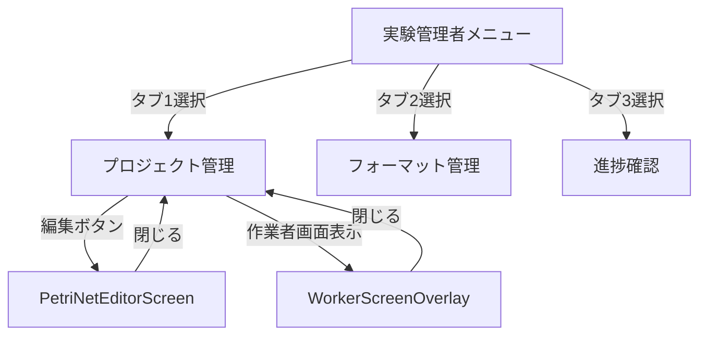

# 実験管理者メニュー画面

## 1. 概要

### 1.1 コンポーネントの目的
実験管理者（Experiment Admin）のメイン画面として、プロジェクト管理、フォーマット管理、進捗確認の3つの主要機能へのアクセスを提供します。サブヘッダーに埋め込まれたタブでメニューを切り替え、各機能の画面を表示します。

### 1.2 使用場面
- 実験管理者ロールでログインした際のメイン画面
- プロジェクトのCRUD操作、フォーマット管理、進捗確認を行う際に使用
- 実験管理者の全ての主要業務の入口となる画面

### 1.3 アクセス権限
- **必須ロール**: Experiment Admin（実験管理者）
- **認証**: JWT + Session Hybrid認証
- **権限**: localStorageから取得した権限情報をSubHeaderに渡す

---

## 2. 画面構成

### 2.1 レイアウト構造

```
┌─────────────────────────────────────────────────────────────┐
│ Header (64px)                                               │
│ - ロゴ、ユーザー情報、ログアウトボタン                        │
├─────────────────────────────────────────────────────────────┤
│ SubHeader with Tabs (76px)                                  │
│ - タイトル: 実験管理                                         │
│ - タブ: [プロジェクト管理] [フォーマット管理] [進捗確認]     │
├─────────────────────────────────────────────────────────────┤
│ Content (calc(100vh - 140px))                               │
│                                                             │
│ ┌─────────────────────────────────────────────────────────┐ │
│ │ タブコンテンツ (全幅表示 or カード表示)                   │ │
│ │                                                           │ │
│ │ - タブ1: ProjectManagement (全幅)                        │ │
│ │ - タブ2: FormatManagement (全幅)                         │ │
│ │ - タブ3: ProgressMonitoring (全幅)                       │ │
│ │ - その他: カード内に「未実装」表示                         │ │
│ │                                                           │ │
│ └─────────────────────────────────────────────────────────┘ │
│                                                             │
└─────────────────────────────────────────────────────────────┘

┌─────────────────────────────────────────────────────────────┐
│ WorkerScreenOverlay (条件付き表示)                          │
│ - プロジェクト管理から呼び出し                               │
│ - 作業者画面のプレビュー表示                                 │
└─────────────────────────────────────────────────────────────┘

┌─────────────────────────────────────────────────────────────┐
│ PetriNetEditorScreen (条件付き表示)                         │
│ - プロジェクト管理から呼び出し                               │
│ - MAIML編集画面（全画面表示）                                │
└─────────────────────────────────────────────────────────────┘
```

### 2.2 主要UI要素

#### 2.2.1 Header (64px)
- 共通ヘッダーコンポーネント（Header）
- Props: user, onLogout

#### 2.2.2 SubHeader (76px)
- タイトル: 「実験管理」（多言語対応）
- タブUI（Ant Design Tabs）
  - タブ1: 「プロジェクト管理」（アイコン: FolderAddOutlined）
  - タブ2: 「フォーマット管理」（アイコン: FileTextOutlined）
  - タブ3: 「進捗確認」（アイコン: LineChartOutlined）
- メニュー切り替えボタン（currentMenu: "experiment_admin"）
- Props: title, tabs, activeTabKey, onTabChange, currentMenu, onMenuChange, userPermissions

#### 2.2.3 Content領域
- **タブ1（プロジェクト管理）**
  - 全幅表示（padding: 0）
  - height: calc(100vh - 140px)
  - overflow: hidden
  - コンポーネント: ProjectManagement

- **タブ2（フォーマット管理）**
  - 全幅表示（padding: 0）
  - height: calc(100vh - 140px)
  - overflow: hidden
  - コンポーネント: FormatManagement

- **タブ3（進捗確認）**
  - 全幅表示（padding: 0）
  - height: calc(100vh - 140px)
  - overflow: auto
  - コンポーネント: ProgressMonitoring

- **その他のタブ**
  - カード表示（maxWidth: 1200px, margin: 0 auto）
  - padding: token.paddingLG
  - 「未実装」メッセージ表示

#### 2.2.4 オーバーレイ・モーダル
- **WorkerScreenOverlay**: 作業者画面のプレビュー（条件付き表示）
- **PetriNetEditorScreen**: MAIML編集画面（条件付き全画面表示）

### 2.3 画面遷移



---

## 3. 機能仕様

### 3.1 タブ切り替え

#### 3.1.1 処理フロー
```typescript
const handleTabChange = (key: string) => {
  setCurrentTab(key);
};
```

#### 3.1.2 UI動作
- ユーザー操作: サブヘッダーのタブをクリック
- 画面変化: Content領域が選択したタブのコンテンツに切り替わる
- アニメーション: なし（即座に切り替わる）

#### 3.1.3 条件分岐
- タブ '1', '2', '3': 全幅表示（padding: 0, overflow設定あり）
- その他のタブ: カード表示（maxWidth: 1200px, padding: token.paddingLG）

### 3.2 メニュー変更

#### 3.2.1 処理フロー
```typescript
const handleMenuChange = (menuType: MenuType) => {
  if (onMenuChange) {
    onMenuChange(menuType);
  }
};
```

#### 3.2.2 UI動作
- ユーザー操作: SubHeaderのメニュー切り替えボタンをクリック
- 画面変化: 親コンポーネントのonMenuChangeコールバックが呼び出される
- 完了後: 他のメニュー画面に遷移

### 3.3 MAIML編集画面表示

#### 3.3.1 処理フロー
```typescript
const handleEditProject = (params: MaimlEditorParams) => {
  console.log('✏️ [ExperimentAdminMenu] Edit project:', params);
  setEditorProjectParams(params);
  setShowEditor(true);
};
```

#### 3.3.2 UI動作
- ユーザー操作: ProjectManagementの編集ボタンをクリック
- 画面変化: 通常の管理画面が非表示になり、PetriNetEditorScreenが全画面表示される
- パラメータ: MaimlEditorParams（projectId, projectName, organization_id等）

### 3.4 MAIML編集画面を閉じる

#### 3.4.1 処理フロー
```typescript
const handleCloseEditor = () => {
  console.log('🔙 [ExperimentAdminMenu] Close editor');
  setShowEditor(false);
  setEditorProjectParams(null);
};
```

#### 3.4.2 UI動作
- ユーザー操作: PetriNetEditorScreenの閉じるボタンをクリック
- 画面変化: 編集画面が閉じ、通常の管理画面（プロジェクト管理タブ）に戻る
- State: editorProjectParamsがnullにリセットされる

### 3.5 作業者画面オーバーレイ表示

#### 3.5.1 処理フロー
```typescript
const handleOpenWorkerScreen = (projectId: string, projectName: string) => {
  setWorkerOverlayProjectId(projectId);
  setWorkerOverlayProjectName(projectName);
  setWorkerOverlayOpen(true);
};
```

#### 3.5.2 UI動作
- ユーザー操作: ProjectManagementの作業者画面表示ボタンをクリック
- 画面変化: WorkerScreenOverlayが前面に表示される
- パラメータ: projectId, projectName

### 3.6 作業者画面オーバーレイを閉じる

#### 3.6.1 処理フロー
```typescript
const handleCloseWorkerScreen = () => {
  setWorkerOverlayOpen(false);
};
```

#### 3.6.2 UI動作
- ユーザー操作: WorkerScreenOverlayの閉じるボタンをクリック
- 画面変化: オーバーレイが閉じ、通常の管理画面に戻る
- State: workerOverlayOpenがfalseになる

### 3.7 権限情報の取得

#### 3.7.1 処理フロー
```typescript
// localStorageからpermissionsを取得（userInfo経由）
const permissions = getPermissionsFromToken();
```

#### 3.7.2 UI動作
- タイミング: コンポーネントのレンダリング時
- 処理内容: localStorageから権限情報を取得し、SubHeaderに渡す
- 用途: SubHeaderでのメニュー表示制御

---

## 4. データ仕様

### 4.1 Props定義

```typescript
interface ExperimentAdminMenuProps {
  user: User;
  onLogout: () => void;
  onNavigate: (path: string) => void;
  onMenuChange?: (menuType: MenuType) => void;
}
```

**Props説明:**
| Prop名 | 型 | 必須 | 説明 |
|--------|---|------|------|
| user | User | ✅ | ログイン中のユーザー情報 |
| onLogout | () => void | ✅ | ログアウト時のコールバック関数 |
| onNavigate | (path: string) => void | ✅ | 画面遷移時のコールバック関数 |
| onMenuChange | (menuType: MenuType) => void | - | メニュー変更時のコールバック関数（オプショナル） |

### 4.2 State定義

```typescript
// タブ管理
const [currentTab, setCurrentTab] = useState('1');

// エディタ表示用のステート
const [showEditor, setShowEditor] = useState(false);
const [editorProjectParams, setEditorProjectParams] = useState<MaimlEditorParams | null>(null);

// 作業者画面オーバーレイのステート
const [workerOverlayOpen, setWorkerOverlayOpen] = useState(false);
const [workerOverlayProjectId, setWorkerOverlayProjectId] = useState<string | undefined>(undefined);
const [workerOverlayProjectName, setWorkerOverlayProjectName] = useState<string | undefined>(undefined);
```

**State説明:**
| State名 | 型 | 初期値 | 説明 |
|---------|---|--------|------|
| currentTab | string | '1' | 現在選択されているタブのkey（'1': プロジェクト管理、'2': フォーマット管理、'3': 進捗確認） |
| showEditor | boolean | false | MAIML編集画面の表示/非表示フラグ |
| editorProjectParams | MaimlEditorParams \| null | null | 編集対象のプロジェクト情報 |
| workerOverlayOpen | boolean | false | 作業者画面オーバーレイの表示/非表示フラグ |
| workerOverlayProjectId | string \| undefined | undefined | 作業者画面で表示するプロジェクトのID |
| workerOverlayProjectName | string \| undefined | undefined | 作業者画面で表示するプロジェクトの名前 |

### 4.3 Context・Hooks

```typescript
// 多言語対応
const { t } = useLanguage();

// テーマトークン取得
const { token } = theme.useToken();

// 権限情報取得
const permissions = getPermissionsFromToken();
```

### 4.4 その他の型定義

```typescript
// タブアイテムの構造
interface TabItem {
  key: string;
  label: string;
  icon: React.ReactNode;
}

const tabItems: TabItem[] = [
  {
    key: '1',
    label: t('menu.experiment_admin.tabs.projectManagement') || 'プロジェクト管理',
    icon: <FolderAddOutlined />,
  },
  {
    key: '2',
    label: t('menu.experiment_admin.tabs.formatManagement') || 'フォーマット管理',
    icon: <FileTextOutlined />,
  },
  {
    key: '3',
    label: t('menu.experiment_admin.tabs.progressMonitoring') || '進捗確認',
    icon: <LineChartOutlined />,
  },
];
```

**定数:**
| 定数名 | 値 | 説明 |
|--------|---|------|
| HEADER_HEIGHT | 64 | ヘッダーの高さ（px） |
| SUBHEADER_HEIGHT | 76 | サブヘッダーの高さ（px） |
| TOTAL_HEADER_HEIGHT | 140 | ヘッダー + サブヘッダーの合計高さ（px） |

---

## 5. API連携

### 5.1 使用するAPI一覧

このコンポーネント自体はAPIを直接呼び出しません。
各子コンポーネント（ProjectManagement, FormatManagement, ProgressMonitoring）が個別にAPIを呼び出します。

### 5.2 権限情報の取得

```typescript
import { getPermissionsFromToken } from '@/utils/jwtUtils';

// localStorageからpermissionsを取得（userInfo経由）
const permissions = getPermissionsFromToken();
```

**取得元:**
- localStorage（userInfo）に保存されたJWTトークンから権限情報を抽出

**用途:**
- SubHeaderコンポーネントに渡し、メニュー表示制御に使用

---

## 6. エラーハンドリング

### 6.1 エラーケース一覧

| エラーケース | 対処方法 |
|-------------|----------|
| 権限情報の取得失敗 | SubHeaderでのメニュー表示制御に影響。デフォルト値で動作。 |
| 子コンポーネントのエラー | 各子コンポーネント内でハンドリング（親には伝播しない） |
| 未実装のタブを選択 | 「未実装」メッセージを表示（エラーではなく正常動作） |

### 6.2 エラー処理コード

このコンポーネント自体には明示的なエラーハンドリングコードはありません。
各子コンポーネント（ProjectManagement, FormatManagement, ProgressMonitoring, PetriNetEditorScreen, WorkerScreenOverlay）が個別にエラーハンドリングを実装しています。

---

## 7. 実装ファイル

### 7.1 ファイルパス
- **メインファイル**: `frontend/src/components/menus/ExperimentAdminMenu.tsx`

### 7.2 関連ファイル
- **型定義**: 
  - `frontend/src/types/auth.ts` (User, MenuType)
  - `frontend/src/types/maimlEditor.ts` (MaimlEditorParams)
- **ユーティリティ**: 
  - `frontend/src/utils/jwtUtils.ts` (getPermissionsFromToken)
- **Context**: 
  - `frontend/src/contexts/LanguageContext.tsx` (useLanguage)

### 7.3 依存コンポーネント

**共通コンポーネント:**
- `<Header />` - ヘッダー（ロゴ、ユーザー情報、ログアウト）
  - Props: user, onLogout
- `<SubHeader />` - サブヘッダー（タイトル、タブUI、メニュー切り替え）
  - Props: title, tabs, activeTabKey, onTabChange, currentMenu, onMenuChange, userPermissions

**子コンポーネント（タブコンテンツ）:**
- `<ProjectManagement />` - プロジェクト管理画面
  - Props: onEdit, onOpenWorkerScreen
  - パス: `frontend/src/components/project/ProjectManagement.tsx`
- `<FormatManagement />` - フォーマット管理画面
  - Props: user
  - パス: `frontend/src/components/format/FormatManagement.tsx`
- `<ProgressMonitoring />` - 進捗確認画面
  - Props: なし
  - パス: `frontend/src/components/progress/ProgressMonitoring.tsx`

**オーバーレイ・モーダル:**
- `<PetriNetEditorScreen />` - MAIML編集画面（全画面表示）
  - Props: params, onClose
  - パス: `frontend/src/components/editorv2/PetriNetEditorScreen.tsx`
- `<WorkerScreenOverlay />` - 作業者画面オーバーレイ
  - Props: open, onClose, user, fixedProjectId, fixedProjectName
  - パス: `frontend/src/components/project/WorkerScreenOverlay.tsx`

**Ant Designコンポーネント:**
- Layout, Layout.Content
- Card
- Typography (Title, Text)
- theme

**アイコン:**
- FolderAddOutlined - プロジェクト管理タブ
- FileTextOutlined - フォーマット管理タブ
- LineChartOutlined - 進捗確認タブ

---

## 8. 変更履歴

| 日付 | 変更内容 | 担当者 |
|------|----------|--------|
| 2026-03-11 | 実装ベースで仕様書を再作成 | Cline |
| - | Phase 6でエディタ表示機能を追加（showEditor, editorProjectParams, handleEditProject, handleCloseEditor） | - |
| - | 作業者画面オーバーレイ機能を追加（workerOverlayOpen, workerOverlayProjectId, workerOverlayProjectName, handleOpenWorkerScreen, handleCloseWorkerScreen） | - |

---

## 9. 補足情報

### 9.1 レイアウトの特徴
- **全幅表示タブ（'1', '2', '3'）**: 
  - padding: 0
  - height: calc(100vh - 140px)
  - overflow制御あり（hidden or auto）
  - 画面全体を使用してコンテンツを表示

- **カード表示タブ（その他）**: 
  - maxWidth: 1200px
  - margin: 0 auto（中央寄せ）
  - padding: token.paddingLG
  - カード内に「未実装」メッセージを表示

### 9.2 条件付き全画面表示
- **showEditor === true の場合**: 
  - 通常の管理画面（Layout, Header, SubHeader, Content）を非表示
  - PetriNetEditorScreenを全画面表示
  - 閉じるボタンで通常画面に復帰

### 9.3 多言語対応
- SubHeaderのタイトル: `t('menu.experiment_admin.title')`
- タブラベル: 
  - `t('menu.experiment_admin.tabs.projectManagement')`
  - `t('menu.experiment_admin.tabs.formatManagement')`
  - `t('menu.experiment_admin.tabs.progressMonitoring')`
- 未実装メッセージ: `t('content.notImplemented')`

### 9.4 権限管理
- getPermissionsFromToken()でlocalStorageから権限情報を取得
- SubHeaderに渡すことで、メニュー表示制御に使用
- 実験管理者ロールの権限情報が前提

### 9.5 コンソールログ
- エディタ表示時: `✏️ [ExperimentAdminMenu] Edit project:` + params
- エディタ閉じる時: `🔙 [ExperimentAdminMenu] Close editor`
- デバッグ用に絵文字付きログを出力
