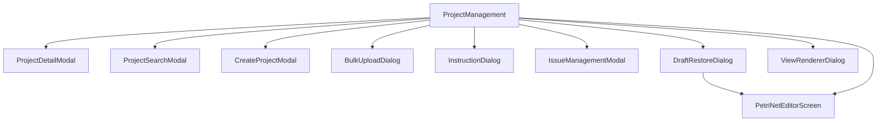

# ProjectManagement - プロジェクト管理メイン画面

## 1. 概要

### 1.1 コンポーネントの目的
プロジェクト管理のメイン画面。プロジェクト一覧の閲覧、フィルタリング、ソート、ファイル管理、タスク結果確認などの包括的なプロジェクト管理機能を提供します。

### 1.2 使用場面
- 実験管理者が実験管理メニューの「プロジェクト管理」タブを選択した際に表示
- プロジェクトの作成、編集、閲覧、ファイル管理を行う中心的な画面
- MAIML編集画面への入り口

### 1.3 アクセス権限
- **必須ロール**: experiment_admin
- **認証**: JWT + Session Hybrid認証

---

## 2. 画面構成

### 2.1 レイアウト構造

```
┌─────────────────────────────────────────────────────┐
│ ツールバー (検索・フィルタ・アクションボタン)        │
├──────────────┬──────────────────────────────────────┤
│ プロジェクト │ 右側: 詳細ビュー                     │
│ 一覧ツリー   │ ┌──────────────────────────────────┐ │
│ (35%幅)     │ │ プロジェクト情報ヘッダー          │ │
│              │ ├──────────────────────────────────┤ │
│              │ │ ファイル操作ツールバー            │ │
│              │ ├──────────────────────────────────┤ │
│              │ │ タブ [ファイル管理] [タスク結果] │ │
│              │ │ ┌────────────────────────────┐   │ │
│              │ │ │ タブコンテンツ            │   │ │
│              │ │ │ (動的に切り替わる)        │   │ │
│              │ │ └────────────────────────────┘   │ │
│              │ └──────────────────────────────────┘ │
└──────────────┴──────────────────────────────────────┘
```

### 2.2 主要UI要素

#### 2.2.1 ツールバー
**左側: 検索・フィルタエリア**
- 所有者絞込（Select）: "自分のみ" / "全てのプロジェクト"
- 部門絞込（Select）: 全部門 + 動的な部門リスト
- プロジェクトステータス絞込（Select）: 全て / 計画中 / 実行待ち / 実行中 / レビュー待ち / 完了 / エラー
- チェックアウトステータス絞込（Select）: 全て / チェックイン済み / チェックアウト中
- 検索バー（Input）: 全項目対象の全文検索
- 詳細検索ボタン（Button）

**右側: アクションボタン**
- 新規プロジェクト作成（Button - 緑色）
- アップロード（Button - 緑色）
- リロード（Button - 青色）

#### 2.2.2 プロジェクト一覧ツリー（左側35%）
- `<ProjectFolderTree />` コンポーネント
- プロジェクトをカード形式で表示
- ソート機能付きヘッダー
- 選択状態のハイライト表示

#### 2.2.3 詳細ビュー（右側）

**プロジェクト未選択時:**
- 中央に案内メッセージ表示
- "プロジェクトを選択してください"

**プロジェクト選択時:**

**A. プロジェクト情報ヘッダー**
- プロジェクト名（Title level 5）
- ステータスタグ（Tag）
- チェックアウトステータスタグ（Tag - オレンジ）
- プロジェクト概要（Text secondary）

**B. ファイル操作ツールバー**
- プロジェクト一括ダウンロード（Button）
- 編集（Button）
- チェックイン/チェックアウト切替（Button - 状態により色変更）
- 問題確認（Button - 黄色）
- 指示送信（Button）
- 公開（Button - 情報色）

**C. タブコンテンツ**
- **ファイル管理タブ**: `<FileListTable />` コンポーネント
- **タスク結果タブ**: 統計カード + `<TaskResultsTable />` コンポーネント

### 2.3 画面遷移



---

## 3. 機能仕様

### 3.1 プロジェクト一覧の取得と表示

#### 3.1.1 API連携
```typescript
const { data, isLoading, error, refetch } = useApi<ApiResponse<ProjectListResponse>>(
  fetchProjects,
  []
);
```

**使用API:** ✅
- GET `/api/v1/projects` - プロジェクト一覧取得

**詳細:** [プロジェクト管理API仕様書](../../api/api_project_management.md#31-プロジェクト一覧取得-)

#### 3.1.2 データ構造
```typescript
interface Project {
  id: string;
  name: string;
  folderName: string;
  description: string;
  createdAt: string;
  updatedAt: string;
  status: 'planning' | 'pending' | 'in_progress' | 'review_waiting' | 'completed' | 'error';
  fileCount: number;
  totalSize: number;
  owner: string;
  department: string;
  departmentName?: string;
  members: string[];
  tags: string[];
  isCheckedOut: boolean;
  checkedOutBy: string | null;
  checkedOutAt: string | null;
  tasks?: Task[];
}
```

### 3.2 フィルタリング機能

#### 3.2.1 フィルタ項目
| フィルタ | State | オプション |
|---------|-------|-----------|
| 所有者 | ownerFilter | my_only, all |
| 部門 | departmentFilter | all + 動的な部門リスト |
| プロジェクトステータス | projectStatusFilter | all, planning, pending, in_progress, review_waiting, completed, error |
| チェックアウトステータス | checkoutFilter | all, checked_in, checked_out |
| 検索クエリ | searchQuery | 全項目対象の文字列 |

#### 3.2.2 フィルタリングロジック
```typescript
const filteredProjects = useMemo(() => {
  return projects.filter((project) => {
    // 検索クエリでフィルタリング（表示名も含む）
    const matchesSearch = searchQuery === '' || 
      project.id.toLowerCase().includes(searchQuery.toLowerCase()) ||
      project.name.toLowerCase().includes(searchQuery.toLowerCase()) ||
      // ... その他の項目
    
    // チェックアウト状態でフィルタリング
    let matchesCheckout = true;
    if (checkoutFilter === 'checked_out') {
      matchesCheckout = project.isCheckedOut === true;
    } else if (checkoutFilter === 'checked_in') {
      matchesCheckout = project.isCheckedOut === false;
    }
    
    // プロジェクトステータスでフィルタリング
    let matchesProjectStatus = projectStatusFilter === 'all' || 
      project.status === projectStatusFilter;
    
    // 部門でフィルタリング
    let matchesDepartment = departmentFilter === 'all' || 
      project.department === departmentFilter;
    
    return matchesSearch && matchesCheckout && matchesProjectStatus && matchesDepartment;
  });
}, [projects, searchQuery, checkoutFilter, projectStatusFilter, departmentFilter]);
```

### 3.3 ソート機能

#### 3.3.1 ソート項目
- `name` - プロジェクト名（文字列順）
- `status` - ステータス（定義された順序）
- `createdAt` - 作成日時（日時順）

#### 3.3.2 ソート順序
- `asc` - 昇順
- `desc` - 降順（デフォルト）

#### 3.3.3 ソート動作
```typescript
const handleSortChange = useCallback((newSortBy) => {
  if (sortBy === newSortBy) {
    // 同じ項目をクリック → 順序を反転
    setSortOrder(sortOrder === 'asc' ? 'desc' : 'asc');
  } else {
    // 異なる項目をクリック → 新しい項目で降順
    setSortBy(newSortBy);
    setSortOrder('desc');
  }
}, [sortBy, sortOrder]);
```

### 3.4 プロジェクトファイル管理

#### 3.4.1 ファイル一覧取得
```typescript
useEffect(() => {
  const loadProjectFiles = async () => {
    if (!selectedProjectId) return;
    
    const response = await fetchProjectFiles(selectedProjectId);
    if (response.success && response.data?.files) {
      setProjectFilesData(prev => ({
        ...prev,
        [selectedProjectId]: {
          root: response.data.files || [],
          archive: response.data.archiveFiles || [],
        }
      }));
    }
  };
  loadProjectFiles();
}, [selectedProjectId]);
```

**使用API:** 🔴
- GET `/api/v1/projects/:projectId/files` - プロジェクトファイル一覧取得 🔴

**優先度:** ⭐⭐⭐ 高

**詳細:** [プロジェクト管理API仕様書](../../api/api_project_management.md#34-ファイル一覧取得-)（セクション5.2.3参照）

#### 3.4.2 フォルダ構造
- **root**: ルートフォルダのファイル
- **archive**: アーカイブフォルダのファイル（バージョン履歴）

#### 3.4.3 フォルダナビゲーション
```typescript
const projectFiles = useMemo(() => {
  if (currentFolder === 'root') {
    // ルートフォルダ表示 + archiveフォルダエントリ
    const rootFiles = projectData.root || [];
    const archiveFiles = projectData.archive || [];
    
    if (archiveFiles.length > 0) {
      const archiveFolder = {
        id: 'archive',
        name: 'archive',
        type: 'folder',
        isFolder: true,
        fileCount: archiveFiles.length,
      };
      return [...rootFiles, archiveFolder];
    }
    return rootFiles;
  } else if (currentFolder === 'archive') {
    // archiveフォルダ内表示 + 戻るボタン
    const backButton = {
      id: 'back',
      name: '↑ 戻る',
      type: 'folder',
      isFolder: true,
    };
    return [backButton, ...projectData.archive];
  }
}, [selectedProjectId, currentFolder, projectData]);
```

### 3.5 MAIML編集画面への遷移

#### 3.5.1 編集ボタンクリック時のフロー
```typescript
const handleEditButtonClick = useCallback(() => {
  if (!selectedProject) {
    message.warning('プロジェクトを選択してください');
    return;
  }

  // 1. Draftチェック
  const draftKey = `petri-net-draft-${selectedProject.id}`;
  const draftData = localStorage.getItem(draftKey);
  
  if (draftData) {
    // 2. Draft存在 → 復元確認ダイアログ表示
    try {
      const draft = JSON.parse(draftData);
      const info = {
        savedAt: draft.savedAt,
        methodCount: draft.methods?.length || 0,
        nodeCount: draft.nodes?.length || 0
      };
      setDraftInfo(info);
      setDraftRestoreDialogOpen(true);
      return;
    } catch (error) {
      console.error('Draft parse error:', error);
    }
  }

  // 3. Draftなし → 直接エディタへ
  const params: ProjectEditParams = {
    projectId: selectedProject.id,
    projectName: selectedProject.name,
    projectOverview: selectedProject.description
  };
  onEdit?.(params);
}, [selectedProject, onEdit]);
```

#### 3.5.2 Draft復元の選択
**オプション1: Draft復元**
```typescript
const handleRestoreDraft = useCallback(() => {
  setDraftRestoreDialogOpen(false);
  onEdit?.(params);  // Draftを保持したまま開く
}, [selectedProject, onEdit]);
```

**オプション2: 新規作成/既存ファイル**
```typescript
const handleCreateNewOrExisting = useCallback(() => {
  setDraftRestoreDialogOpen(false);
  // Draftを削除してから開く
  localStorage.removeItem(draftKey);
  onEdit?.(params);
}, [selectedProject, onEdit]);
```

### 3.6 チェックイン/チェックアウト機能

#### 3.6.1 ステータス切り替え
```typescript
const handleToggleCheckout = useCallback(async () => {
  if (!selectedProject) return;

  try {
    const endpoint = selectedProject.isCheckedOut
      ? `/api/v1/projects/${selectedProject.id}/checkin`
      : `/api/v1/projects/${selectedProject.id}/checkout`;

    const response = await fetch(endpoint, {
      method: 'POST',
      headers: {
        'Content-Type': 'application/json',
        'Authorization': `Bearer ${sessionToken}`,
        'X-Organization-Id': organizationId,
      },
      credentials: 'include',
    });

    if (!response.ok) {
      throw new Error('チェックイン/チェックアウトに失敗しました');
    }

    const result = await response.json();
    
    // プロジェクトのチェックアウトステータスを更新
    setProjects((prev) =>
      prev.map((project) => {
        if (project.id === selectedProject.id) {
          return {
            ...project,
            isCheckedOut: result.data.is_checked_out,
            checkedOutBy: result.data.checked_out_by,
            checkedOutAt: result.data.checked_out_at,
          };
        }
        return project;
      })
    );

    const actionText = result.data.is_checked_out ? 'チェックアウト' : 'チェックイン';
    message.success(`プロジェクトを${actionText}しました`);
  } catch (error) {
    message.error(error.message || 'チェックイン/チェックアウトに失敗しました');
  }
}, [selectedProject]);
```

**使用API:** ✅
- POST `/api/v1/projects/:projectId/checkout` - チェックアウト ✅
- POST `/api/v1/projects/:projectId/checkin` - チェックイン ✅

**優先度:** ⭐⭐⭐ 高

**詳細:** [プロジェクト管理API仕様書](../../api/api_project_management.md#33-チェックアウト-)

### 3.7 プロジェクト一括ダウンロード

#### 3.7.1 ダウンロードフロー
```typescript
const handleProjectDownload = useCallback(async () => {
  if (!selectedProject) return;

  try {
    setIsDownloading(true);
    setDownloadProgress({ current: 0, total: 0 });

    // 1. ファイル/フォルダダウンロードAPI呼び出し（共通API）
    const response = await fetch('/api/v1/files/download', {
      method: 'POST',
      headers: {
        'Content-Type': 'application/json',
        'Authorization': `Bearer ${sessionToken}`,
        'X-Organization-Id': organizationId,
      },
      credentials: 'include',
      body: JSON.stringify({
        context: 'project',
        project_id: selectedProject.id,
        paths: [selectedProject.folderName], // プロジェクトフォルダ全体
        include_archive: true,
        format: 'zip'
      }),
    });

    if (!response.ok) {
      throw new Error('ダウンロード要求に失敗しました');
    }

    const result = await response.json();
    
    if (result.data.download_type === 'direct') {
      // 2. 署名付きURLを取得してダウンロード
      const signedUrl = result.data.signed_url;
      const link = document.createElement('a');
      link.href = signedUrl;
      link.download = `${selectedProject.name}.zip`;
      document.body.appendChild(link);
      link.click();
      document.body.removeChild(link);
      
      message.success(`プロジェクト「${selectedProject.name}」をダウンロードしました`);
    } else if (result.data.download_type === 'async') {
      // 3. 非同期ダウンロード（大容量の場合）
      const jobId = result.data.job_id;
      message.info('ダウンロードの準備中です...');
      
      // ジョブステータスのポーリング（実装省略）
      // GET /api/v1/download-jobs/:jobId でステータス確認
    }
  } catch (error) {
    message.error('プロジェクトのダウンロードに失敗しました');
  } finally {
    setIsDownloading(false);
  }
}, [selectedProject]);
```

**使用API:** ✅
- POST `/api/v1/files/download` - ファイル/フォルダダウンロード ✅

**優先度:** ⭐⭐⭐ 高

**詳細:** [共通API仕様書](../../api/api_common.md#2-ファイルダウンロード-)

### 3.8 プロジェクトリロード

#### 3.8.1 リロードフロー
```typescript
const handleProjectReload = useCallback(async () => {
  if (!selectedProject) return;

  try {
    setIsReloadingProject(true);
    
    // 1. リロードAPI呼び出し
    const response = await fetch(`/api/v1/projects/${selectedProject.id}/reload`, {
      method: 'POST',
      headers: { 'Content-Type': 'application/json' },
      credentials: 'include',
      signal: AbortSignal.timeout(30000), // 30秒タイムアウト
    });

    if (!response.ok) {
      // エラーハンドリング（ステータスコード別）
      // 400, 401, 403, 404, 409, 500, 502, 503
      return;
    }

    // 2. 成功レスポンスのパース
    const result = await response.json();
    const summary = result.data?.summary || {};
    
    // 3. サマリーメッセージ生成
    const summaryParts = [];
    if (summary.filesAdded > 0) summaryParts.push(`追加: ${summary.filesAdded}件`);
    if (summary.filesUpdated > 0) summaryParts.push(`更新: ${summary.filesUpdated}件`);
    if (summary.filesDeleted > 0) summaryParts.push(`削除: ${summary.filesDeleted}件`);
    
    const summaryText = summaryParts.length > 0 
      ? ` (${summaryParts.join(', ')})`
      : '';
    
    message.success(`プロジェクトのリロードが完了しました${summaryText}`);
    
    // 4. ファイル一覧を再取得
    const filesResponse = await fetchProjectFiles(selectedProject.id);
    if (filesResponse.success && filesResponse.data.files) {
      setProjectFilesData(prev => ({
        ...prev,
        [selectedProject.id]: {
          root: filesResponse.data.files,
          archive: filesResponse.data.archiveFiles || [],
        }
      }));
    }
  } catch (error) {
    // エラーハンドリング（タイムアウト、ネットワークエラー等）
  } finally {
    setIsReloadingProject(false);
  }
}, [selectedProject]);
```

**使用API:**
- POST /api/v1/projects/:projectId/reload - プロジェクトリロード

### 3.9 タスク結果管理

#### 3.9.1 タスク統計の計算
```typescript
const taskStats = useMemo(() => {
  const stats = {
    total: taskResults.length,
    pending: 0,
    in_progress: 0,
    error: 0,
    review_waiting: 0,
    completed: 0,
  };

  taskResults.forEach((result) => {
    switch (result.workStatus) {
      case 'pending': stats.pending++; break;
      case 'in_progress': stats.in_progress++; break;
      case 'error': stats.error++; break;
      case 'review_waiting': stats.review_waiting++; break;
      case 'completed': stats.completed++; break;
    }
  });

  return stats;
}, [taskResults]);
```

#### 3.9.2 統計カード表示
- 総タスク数（グレー）
- 実行待ち（セカンダリー）
- 実行中（プライマリー青）
- 異常終了（エラー赤）
- レビュー待ち（警告黄）
- 完了（成功緑）

### 3.10 複数ダイアログ管理

#### 3.10.1 ダイアログ構造
```typescript
interface OpenDialog {
  id: string;
  contentType: 'file' | 'subnet';
  file?: FileData;
  subnetData?: { /* ... */ };
  zIndex: number;
  position: { x: number; y: number };
}
```

#### 3.10.2 ダイアログ操作
```typescript
// ファイル表示ダイアログを開く
const handleViewFile = useCallback((file: FileData) => {
  // 上限チェック（5個まで）
  if (openDialogs.length >= 5) {
    message.warning('同時に開けるダイアログは5個までです');
    return;
  }

  const id = `${file.id}-${Date.now()}`;
  const offset = openDialogs.length * 30;  // カスケード配置
  
  const newDialog: OpenDialog = {
    id,
    contentType: 'file',
    file,
    zIndex: nextZIndex,
    position: { x: 100 + offset, y: 100 + offset }
  };
  
  setOpenDialogs(prev => [...prev, newDialog]);
  setNextZIndex(prev => prev + 1);
}, [openDialogs, nextZIndex]);

// ダイアログを閉じる
const handleCloseDialog = useCallback((id: string) => {
  setOpenDialogs(prev => prev.filter(d => d.id !== id));
}, []);

// ダイアログをフォーカス（最前面に）
const handleFocusDialog = useCallback((id: string) => {
  setOpenDialogs(prev => 
    prev.map(d => 
      d.id === id ? { ...d, zIndex: nextZIndex } : d
    )
  );
  setNextZIndex(prev => prev + 1);
}, [nextZIndex]);
```

---

## 4. データ仕様

### 4.1 Props定義

```typescript
interface ProjectManagementProps {
  onEdit?: (params: ProjectEditParams) => void;
}

interface ProjectEditParams {
  projectId: string;
  projectName: string;
  projectOverview?: string;
}
```

### 4.2 State定義

```typescript
// プロジェクトデータ
const [projects, setProjects] = useState<Project[]>([]);
const [selectedProjectId, setSelectedProjectId] = useState<string | null>(null);

// フィルタ・ソート
const [searchQuery, setSearchQuery] = useState('');
const [ownerFilter, setOwnerFilter] = useState<string>('my_only');
const [checkoutFilter, setCheckoutFilter] = useState<string>('all');
const [projectStatusFilter, setProjectStatusFilter] = useState<string>('all');
const [departmentFilter, setDepartmentFilter] = useState<string>('all');
const [sortBy, setSortBy] = useState<'name' | 'status' | 'createdAt'>('createdAt');
const [sortOrder, setSortOrder] = useState<'asc' | 'desc'>('desc');

// ファイル管理
const [currentFolder, setCurrentFolder] = useState<string>('root');
const [projectFilesData, setProjectFilesData] = useState<Record<string, ProjectFilesData>>({});

// モーダル・ダイアログ
const [modalOpen, setModalOpen] = useState(false);
const [searchModalOpen, setSearchModalOpen] = useState(false);
const [uploadDialogOpen, setUploadDialogOpen] = useState(false);
const [instructionDialogOpen, setInstructionDialogOpen] = useState(false);
const [createModalOpen, setCreateModalOpen] = useState(false);
const [issueManagementModalOpen, setIssueManagementModalOpen] = useState(false);
const [draftRestoreDialogOpen, setDraftRestoreDialogOpen] = useState(false);

// Draft情報
const [draftInfo, setDraftInfo] = useState<{
  savedAt: string;
  methodCount: number;
  nodeCount: number;
} | null>(null);

// タブ
const [currentTab, setCurrentTab] = useState<'file_management' | 'task_results'>('file_management');

// フローティングダイアログ
const [openDialogs, setOpenDialogs] = useState<OpenDialog[]>([]);
const [nextZIndex, setNextZIndex] = useState(1000);

// ダウンロード・リロード状態
const [isDownloading, setIsDownloading] = useState(false);
const [downloadProgress, setDownloadProgress] = useState({ current: 0, total: 0 });
const [isReloadingProject, setIsReloadingProject] = useState(false);

// フォルダツリー
const [expandedFolders, setExpandedFolders] = useState<Set<string>>(new Set(['folder_active']));
```

### 4.3 FileData型定義

```typescript
interface FileData {
  id: string;
  name: string;
  path: string;
  size: number;
  lastModified: string;
  type: string;
  isFolder?: boolean;
  fileCount?: number;
  signedUrl?: string;
}
```

### 4.4 ProjectFilesData型定義

```typescript
interface ProjectFilesData {
  root: FileData[];
  archive: FileData[];
}
```

---

## 5. API連携

### 5.1 使用するAPI一覧

| # | API名 | メソッド | エンドポイント | 状態 | 優先度 | 説明 |
|---|------|---------|---------------|------|--------|------|
| 1 | プロジェクト一覧取得 | GET | `/api/v1/projects` | ✅ 実装済み | - | プロジェクト一覧を取得 |
| 2 | プロジェクト作成 | POST | `/api/v1/projects` | ✅ 実装済み | - | 新規プロジェクトを作成 |
| 3 | チェックアウト | POST | `/api/v1/projects/:projectId/checkout` | ✅ 実装済み | - | プロジェクトをチェックアウト |
| 4 | チェックイン | POST | `/api/v1/projects/:projectId/checkin` | ✅ 実装済み | - | プロジェクトをチェックイン |
| 5 | プロジェクトリロード | POST | `/api/v1/projects/:projectId/reload` | ✅ 実装済み | - | S3からファイル情報を再取得して同期 |
| 6 | ファイル一覧取得 | GET | `/api/v1/projects/:projectId/files` | 🔴 未実装 | ⭐⭐⭐ 高 | プロジェクトのファイル一覧を取得 |
| 7 | タスク一覧取得 | GET | `/api/v1/projects/:projectId/tasks` | 🔴 未実装 | ⭐⭐⭐ 高 | プロジェクトのタスク一覧を取得 |
| 8 | 指示送信 | POST | `/api/v1/projects/:projectId/instructions` | 🔴 未実装 | ⭐⭐ 中 | ワーカーへの作業指示を送信 |
| 9 | 指示一覧取得 | GET | `/api/v1/projects/:projectId/instructions` | 🔴 未実装 | ⭐⭐ 中 | プロジェクトの指示一覧を取得 |
| 10 | プロジェクト詳細検索 | POST | `/api/v1/projects/search` | 🔴 未実装 | ⭐⭐ 中 | 高度な検索条件でプロジェクトを検索 |
| 11 | プロジェクト公開 | POST | `/api/v1/projects/:projectId/publish` | 🔴 未実装 | ⭐ 低 | プロジェクトを公開 |

**共通API:**
- [ファイルアップロード](../../api/api_common.md#1-ファイルアップロード-) - context=project
- [ファイルダウンロード](../../api/api_common.md#2-ファイルダウンロード-) - 個別ファイル用

**詳細**: [プロジェクト管理API仕様書](../../api/api_project_management.md) を参照

### 5.2 リクエスト/レスポンス例

#### 5.2.1 プロジェクト一覧取得 ✅

**Request:**
```http
GET /api/v1/projects?page=1&limit=20
Authorization: Bearer maiml_session-{sessionId}_{timestamp}
X-Organization-Id: {organization_id}
```

**Response (200 OK):**
```json
{
  "success": true,
  "data": {
    "projects": [
      {
        "project_id": "550e8400-e29b-41d4-a716-446655440000",
        "project_name": "Sample Project",
        "project_folder_name": "sample_project",
        "description": "プロジェクトの説明",
        "project_status": "in_progress",
        "is_checked_out": false,
        "checked_out_by": null,
        "checked_out_at": null,
        "file_count": 15,
        "total_size": 10485760,
        "owner_id": "user-uuid",
        "owner_name": "山田太郎",
        "department_id": "dept-uuid",
        "department_name": "研究開発部",
        "created_at": "2026-01-15T10:00:00Z",
        "updated_at": "2026-01-20T15:30:00Z"
      }
    ]
  },
  "pagination": {
    "page": 1,
    "limit": 20,
    "totalItems": 150,
    "totalPages": 8,
    "hasNext": true,
    "hasPrev": false
  },
  "meta": {
    "timestamp": "2026-01-21T16:00:00Z",
    "requestId": "req_abc123"
  }
}
```

#### 5.2.2 プロジェクト作成 ✅

**Request:**
```http
POST /api/v1/projects
Authorization: Bearer maiml_session-{sessionId}_{timestamp}
X-Organization-Id: {organization_id}
Content-Type: application/json

{
  "project_name": "New Project",
  "description": "新規プロジェクトの説明",
  "department_id": "dept-uuid",
  "tags": ["実験", "分析"]
}
```

**Response (201 Created):**
```json
{
  "success": true,
  "data": {
    "project_id": "550e8400-e29b-41d4-a716-446655440000",
    "project_name": "New Project",
    "project_folder_name": "New_Project",
    "description": "新規プロジェクトの説明",
    "project_status": "created",
    "is_checked_out": false,
    "file_count": 0,
    "total_size": 0,
    "owner_id": "user-uuid",
    "department_id": "dept-uuid",
    "created_at": "2026-01-21T16:00:00Z",
    "updated_at": "2026-01-21T16:00:00Z"
  },
  "meta": {
    "timestamp": "2026-01-21T16:00:00Z",
    "requestId": "req_abc123"
  }
}
```

#### 5.2.3 ファイル一覧取得 🔴

**Request:**
```http
GET /api/v1/projects/550e8400-e29b-41d4-a716-446655440000/files?folder=root
Authorization: Bearer maiml_session-{sessionId}_{timestamp}
X-Organization-Id: {organization_id}
```

**Response (200 OK):**
```json
{
  "success": true,
  "data": {
    "files": [
      {
        "file_id": "file-uuid-1",
        "file_name": "sample.maiml",
        "file_path": "org_maiml_lab_001/projects/Sample_Project/sample.maiml",
        "file_size": 12345,
        "file_type": "maiml",
        "is_archive": false,
        "version": null,
        "created_at": "2026-01-15T10:00:00Z",
        "updated_at": "2026-01-20T15:30:00Z"
      }
    ]
  },
  "meta": {
    "timestamp": "2026-01-21T16:00:00Z",
    "requestId": "req_abc123"
  }
}
```

#### 5.2.4 プロジェクトリロード 🔴

**Request:**
```http
POST /api/v1/projects/550e8400-e29b-41d4-a716-446655440000/reload
Authorization: Bearer maiml_session-{sessionId}_{timestamp}
X-Organization-Id: {organization_id}
```

**Response (200 OK):**
```json
{
  "success": true,
  "data": {
    "summary": {
      "filesAdded": 3,
      "filesUpdated": 2,
      "filesDeleted": 1,
      "totalFiles": 20
    },
    "details": {
      "added": [
        {
          "file_name": "new_file1.maiml",
          "file_path": "org_maiml_lab_001/projects/Sample_Project/new_file1.maiml",
          "file_size": 5000
        }
      ],
      "updated": [
        {
          "file_name": "existing_file.maiml",
          "file_path": "org_maiml_lab_001/projects/Sample_Project/existing_file.maiml",
          "old_size": 10000,
          "new_size": 12000
        }
      ],
      "deleted": [
        {
          "file_name": "old_file.maiml",
          "file_path": "org_maiml_lab_001/projects/Sample_Project/old_file.maiml"
        }
      ]
    }
  },
  "meta": {
    "timestamp": "2026-01-21T16:00:00Z",
    "requestId": "req_abc123"
  }
}
```

#### 5.2.5 指示送信 🔴

**Request:**
```http
POST /api/v1/projects/550e8400-e29b-41d4-a716-446655440000/instructions
Authorization: Bearer maiml_session-{sessionId}_{timestamp}
X-Organization-Id: {organization_id}
Content-Type: application/json

{
  "instruction_title": "サンプル分析の実施",
  "instruction_content": "以下の手順で分析を実施してください",
  "assigned_worker_ids": ["worker-uuid-1", "worker-uuid-2"],
  "due_date": "2026-01-25T23:59:59Z",
  "priority": "high",
  "tasks": [
    {
      "task_name": "タスク1",
      "description": "タスク1の説明",
      "estimated_duration": 120
    }
  ]
}
```

**Response (201 Created):**
```json
{
  "success": true,
  "data": {
    "instruction_id": "instruction-uuid",
    "instruction_title": "サンプル分析の実施",
    "project_id": "550e8400-e29b-41d4-a716-446655440000",
    "assigned_worker_ids": ["worker-uuid-1", "worker-uuid-2"],
    "status": "pending",
    "created_at": "2026-01-21T16:00:00Z"
  },
  "meta": {
    "timestamp": "2026-01-21T16:00:00Z",
    "requestId": "req_abc123"
  }
}
```

---

## 6. エラーハンドリング

### 6.1 エラーレスポンス形式

```json
{
  "success": false,
  "error": {
    "code": "ERROR_CODE",
    "message": "エラーメッセージ",
    "details": [
      {
        "field": "fieldName",
        "message": "詳細メッセージ",
        "code": "FIELD_ERROR_CODE"
      }
    ]
  },
  "meta": {
    "timestamp": "2026-01-21T16:00:00Z",
    "requestId": "req_abc123"
  }
}
```

### 6.2 共通エラーコード

| コード | HTTPステータス | 説明 | 対処方法 |
|-------|---------------|------|----------|
| `AUTH_TOKEN_INVALID` | 401 | 認証トークンが無効 | 再ログインを促す |
| `AUTH_TOKEN_EXPIRED` | 401 | 認証トークンの有効期限切れ | 再ログインを促す |
| `PERMISSION_INSUFFICIENT` | 403 | 権限不足 | エラーメッセージを表示 |
| `RESOURCE_NOT_FOUND` | 404 | リソースが見つからない | リストを再取得 |
| `VALIDATION_ERROR` | 400 | バリデーションエラー | 詳細メッセージを表示 |
| `BUSINESS_DUPLICATE_PROJECT_NAME` | 409 | プロジェクト名が重複 | 別の名前を入力させる |
| `SYSTEM_DATABASE_ERROR` | 500 | データベースエラー | 再試行を促す |
| `SYSTEM_STORAGE_ERROR` | 500 | ストレージエラー | 再試行を促す |

### 6.3 エラーケース別の処理

| エラーケース | HTTPステータス | エラーコード | 対処方法 |
|-------------|---------------|-------------|----------|
| プロジェクト一覧取得失敗 | 500 | `SYSTEM_DATABASE_ERROR` | message.error表示 + 空配列設定 + 再試行ボタン |
| ファイル一覧取得失敗 | 404 | `RESOURCE_NOT_FOUND` | message.error表示 + プロジェクトリストを再取得 |
| プロジェクト作成失敗（重複） | 409 | `BUSINESS_DUPLICATE_PROJECT_NAME` | message.error表示 + 別の名前を入力させる |
| ダウンロード失敗 | 403, 500 | `PERMISSION_INSUFFICIENT`, `SYSTEM_STORAGE_ERROR` | message.error表示 + ダウンロード中止 |
| リロードタイムアウト | 504 | - | message.error表示 + 再試行を促す |
| リロード中のチェックアウト競合 | 409 | `BUSINESS_PROJECT_CHECKED_OUT` | message.warning表示 + チェックイン後に再試行 |
| ダイアログ上限超過 | - | - | message.warning表示 + 開かない |
| プロジェクト未選択で操作 | - | - | message.warning表示 |

### 6.4 リロードエラーの詳細ハンドリング

| HTTPステータス | エラーコード | 説明 | UI表示 |
|---------------|-------------|------|--------|
| 400 | `VALIDATION_INVALID_PROJECT_ID` | 不正なプロジェクトID | 「プロジェクトIDが無効です」 |
| 401 | `AUTH_TOKEN_INVALID` | 認証エラー | 「認証が無効です。再ログインしてください」 |
| 403 | `PERMISSION_INSUFFICIENT` | 権限不足 | 「このプロジェクトへのアクセス権限がありません」 |
| 404 | `RESOURCE_NOT_FOUND` | プロジェクトが存在しない | 「プロジェクトが見つかりません」 |
| 409 | `BUSINESS_PROJECT_CHECKED_OUT` | チェックアウト中 | 「プロジェクトがチェックアウト中です。チェックイン後に再試行してください」 |
| 500 | `SYSTEM_STORAGE_ERROR` | S3接続エラー | 「ストレージサーバーとの通信に失敗しました」 |
| 502 | `SYSTEM_EXTERNAL_SERVICE_ERROR` | 外部サービスエラー | 「外部サービスとの通信に失敗しました」 |
| 503 | `SYSTEM_SERVICE_UNAVAILABLE` | サービス一時停止 | 「サービスが一時的に利用できません。しばらくしてから再試行してください」 |
| 504 | - | タイムアウト | 「処理がタイムアウトしました。プロジェクトが大きい場合、時間がかかることがあります」 |
