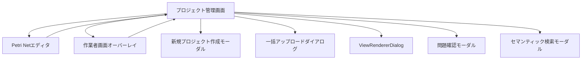

# プロジェクト管理画面 UI仕様書

## 1. 概要

### 1.1 コンポーネントの目的
プロジェクト管理画面は、実験管理者がMAIMLプロジェクトを一元的に管理するためのメイン画面です。プロジェクトの作成、ファイル管理、タスク登録、指示管理、進捗確認、編集、チェックアウト/チェックイン、公開などの機能を提供します。

### 1.2 使用場面
- 実験管理者メニューの「プロジェクト管理」タブ選択時に表示
- ログイン後のデフォルト表示画面（実験管理者ロール）
- プロジェクト一覧の閲覧・検索・フィルタリング
- 選択したプロジェクトの詳細情報表示・操作

### 1.3 アクセス権限
- **必須ロール**: Experiment Admin（実験管理者）
- **認証**: JWT + Session Hybrid認証
- **組織分離**: マルチテナント（organizationId）

---

## 2. 画面構成

### 2.1 レイアウト構造

```
┌─────────────────────────────────────────────────────────────────┐
│ ツールバー                                                       │
│ [フィルタ群] [検索] [新規作成] [アップロード] [リロード] [検索] │
├──────────────────┬──────────────────────────────────────────────┤
│                  │ プロジェクト情報ヘッダー                     │
│                  │ [プロジェクト名] [ステータス] [チェックアウト状態]│
│                  ├──────────────────────────────────────────────┤
│ プロジェクト     │ ファイル操作ツールバー                       │
│ 一覧ツリー       │ [ZIP DL] [編集] [チェックイン] [問題] [公開]│
│                  ├──────────────────────────────────────────────┤
│ (35%幅)          │ タブコンテンツ (65%幅)                       │
│                  │                                              │
│ - プロジェクトA  │ [Tab: ファイル管理 | タスク登録 | 指示一覧 | 進捗確認]│
│   ├ 概要         │                                              │
│   ├ ステータス   │ ┌──────────────────────────────────────────┐│
│   └ 更新日時     │ │ FileListTable / TaskRegistrationTab /     ││
│ - プロジェクトB  │ │ InstructionRegistrationTab /              ││
│ - プロジェクトC  │ │ TaskResultsTable                          ││
│                  │ └──────────────────────────────────────────┘│
└──────────────────┴──────────────────────────────────────────────┘
```

### 2.2 主要UI要素

#### 2.2.1 ツールバー（上部）
- **所有者フィルタ**（Select）: `my_only`（自分のみ）/ `all`（全て）
- **部門フィルタ**（Select）: 全部門 / 各部門コード
- **プロジェクトステータスフィルタ**（Select）: 全て / 計画中 / 実行待ち / 実行中 / レビュー待ち / 完了 / 異常終了
- **チェックアウトステータスフィルタ**（Select）: 全て / チェックイン済み / チェックアウト中
- **検索バー**（Input + SearchOutlined）: プロジェクト名、フォルダ名、説明、所有者、部門、タグで検索
- **新規作成ボタン**（Button + PlusOutlined）: 新規プロジェクト作成モーダルを開く
- **アップロードボタン**（Button + UploadOutlined）: 一括アップロードダイアログを開く
- **リロードボタン**（Button + ReloadOutlined）: プロジェクト一覧・選択中のタブデータを最新化
- **トランジション検索ボタン**（Button + SearchOutlined）: セマンティック検索モーダルを開く

#### 2.2.2 左側パネル（プロジェクト一覧）
- **ProjectFolderTree**: プロジェクト一覧をツリー表示
  - ソート機能（名前/ステータス/作成日時、昇順/降順）
  - プロジェクト選択
  - フォルダ展開/折りたたみ

#### 2.2.3 右側パネル - プロジェクト情報ヘッダー
- **プロジェクト名**（Title level 5）
- **ステータスタグ**（Tag）: プロジェクトステータス（計画中/実行待ち/実行中/レビュー待ち/完了/異常終了）
- **チェックアウト状態タグ**（Tag）: チェックアウト中表示
- **概要**（Text）: プロジェクトの説明

#### 2.2.4 右側パネル - ファイル操作ツールバー
- **ZIPダウンロードボタン**（Button + DownloadOutlined）: プロジェクト全体をZIPでダウンロード
- **編集ボタン**（Button + EditOutlined）: Petri Netエディタを開く（Draft復元確認あり）
- **チェックイン/チェックアウトボタン**（Button + FileTextOutlined）: 状態切り替え
- **問題確認ボタン**（Button + ExclamationCircleOutlined）: 問題管理モーダルを開く
- **公開ボタン**（Button）: MAIMLファイルをOpenDataとして公開
  - 詳細: [ui_maiml_publish_dialog.md](./ui_maiml_publish_dialog.md) / [ui_maiml_unpublish_dialog.md](./ui_maiml_unpublish_dialog.md) を参照

#### 2.2.5 右側パネル - タブコンテンツ
**Tab 1: ファイル管理**
- **FileListTable**: プロジェクトのファイル一覧（root + archiveフォルダ）
  - ファイル/フォルダクリック → ViewRendererDialogで表示

**Tab 2: タスク登録**
- **TaskRegistrationTab**: タスクの新規登録・一覧表示
  - チェックアウト中はロック（編集不可）

**Tab 3: 指示一覧**
- **InstructionRegistrationTab**: 指示の新規作成・編集・送信
  - チェックアウト中はロック（編集不可）
  - 指示送信後にプロジェクト一覧を再取得（ステータス更新を反映）

**Tab 4: 進捗確認**
- **統計カード**: 総タスク数、実行待ち、実行中、異常終了、レビュー待ち、完了
- **作業確認ボタン**: 作業者画面オーバーレイを開く（チェックアウト中のみ有効）
- **タスク確認完了ボタン**: レビュー待ちタスクを完了に更新
- **TaskResultsTable**: タスク結果一覧

### 2.3 モーダル・ダイアログ

- **CreateProjectModal**: 新規プロジェクト作成
- **BulkUploadDialog**: ファイル一括アップロード
- **ViewRendererDialog**: ファイル表示（複数同時表示可能、最大5個）
- **DraftRestoreDialog**: Draft復元確認
- **IssueManagementModal**: 問題確認・管理
- **TransitionSetSearchModal**: セマンティック検索

### 2.4 画面遷移



---

## 3. 機能仕様

### 3.1 プロジェクト一覧取得・表示

#### 3.1.1 処理フロー
```typescript
// useApiフックでプロジェクト一覧を取得
const {
  data: projectsData,
  error: projectsError,
  refetch: refetchProjects
} = useApi<ApiResponse<ProjectListResponse>>(
  async () => await getProjects(),
  []
);

// projectsDataが取得できたらstateを更新
useEffect(() => {
  if (projectsData?.success && projectsData.data) {
    const projectsList = Array.isArray(projectsData.data) 
      ? projectsData.data 
      : ((projectsData.data as ProjectListResponse)?.projects || []);
    setProjects(projectsList);
  }
}, [projectsData, projectsError]);
```

#### 3.1.2 UI動作
- マウント時に自動でAPI呼び出し
- データ取得中はローディング表示
- 取得成功: プロジェクト一覧を表示
- 取得失敗: エラーメッセージ表示

### 3.2 フィルタリング・検索・ソート

#### 3.2.1 フィルタリング処理
```typescript
const filteredProjects = useMemo(() => {
  return projects.filter((project) => {
    // 検索クエリでフィルタリング（ID、名前、説明、所有者、部門、ステータス、タグ）
    const matchesSearch = searchQuery === '' ||
      project.id.toLowerCase().includes(searchQuery.toLowerCase()) ||
      project.name.toLowerCase().includes(searchQuery.toLowerCase()) ||
      // ... その他のフィールド

    // チェックアウト状態でフィルタリング
    let matchesCheckout = true;
    if (checkoutFilter === 'checked_out') {
      matchesCheckout = project.isCheckedOut === true;
    } else if (checkoutFilter === 'checked_in') {
      matchesCheckout = project.isCheckedOut === false;
    }

    // プロジェクトステータスでフィルタリング
    let matchesProjectStatus = true;
    if (projectStatusFilter !== 'all') {
      matchesProjectStatus = project.status === parseInt(projectStatusFilter, 10);
    }

    // 部門でフィルタリング
    let matchesDepartment = true;
    if (departmentFilter !== 'all') {
      matchesDepartment = project.department === departmentFilter;
    }

    return matchesSearch && matchesCheckout && matchesProjectStatus && matchesDepartment;
  });
}, [projects, searchQuery, checkoutFilter, projectStatusFilter, departmentFilter]);
```

#### 3.2.2 ソート処理
```typescript
const sortedProjects = useMemo(() => {
  const sorted = [...filteredProjects];
  sorted.sort((a, b) => {
    let comparison = 0;
    if (sortBy === 'name') {
      comparison = a.name.localeCompare(b.name);
    } else if (sortBy === 'status') {
      comparison = a.status - b.status;
    } else if (sortBy === 'createdAt') {
      comparison = new Date(a.createdAt).getTime() - new Date(b.createdAt).getTime();
    }
    return sortOrder === 'asc' ? comparison : -comparison;
  });
  return sorted;
}, [filteredProjects, sortBy, sortOrder]);
```

### 3.3 プロジェクト選択

#### 3.3.1 処理フロー
```typescript
const handleProjectSelect = useCallback(async (projectId: string) => {
  setSelectedProjectId(projectId);
  setCurrentFolder('root'); // プロジェクト切り替え時はルートフォルダを表示
  
  // 選択したプロジェクトのMAIMLを読み込み
  const project = projects.find(p => p.id === projectId);
  if (project) {
    try {
      await loadMaiml(project.name);
    } catch (error) {
      console.error('❌ [ProjectManagement] MAIML読み込み失敗:', error);
    }
  }
}, [projects, loadMaiml]);
```

#### 3.3.2 UI動作
- プロジェクト選択時にハイライト表示
- MAIMLデータをContextに読み込み
- 右側パネルにプロジェクト詳細を表示
- currentFolderを'root'にリセット

### 3.4 タブ切り替え

#### 3.4.1 処理フロー
```typescript
<Tabs
  activeKey={currentTab}
  onChange={async (key) => {
    const newTab = key as 'file_management' | 'task_results';
    setCurrentTab(newTab);
    
    if (!selectedProjectId || !selectedProject) return;
    
    try {
      setIsLoadingTabData(true);
      
      if (newTab === 'file_management') {
        const fileResponse = await getProjectFiles(selectedProject.name, true);
        setProjectFilesData(prev => ({
          ...prev,
          [selectedProjectId]: {
            root: fileResponse.files || [],
            archive: fileResponse.archiveFiles || [],
          }
        }));
      } else if (newTab === 'task_results') {
        const taskResponse = await getProjectTasks(selectedProject.name, 'all');
        setProjectTasksData(prev => ({
          ...prev,
          [selectedProjectId]: {
            tasks: taskResponse.tasks || [],
            statistics: taskResponse.statistics || {},
          }
        }));
      }
    } catch (error) {
      message.error('データの取得に失敗しました');
    } finally {
      setIsLoadingTabData(false);
    }
  }}
  items={[...]}
/>
```

#### 3.4.2 UI動作
- タブクリック時に最新データを取得
- ローディング表示中は操作不可
- データ取得完了後にタブコンテンツを表示

### 3.5 チェックアウト/チェックイン

#### 3.5.1 処理フロー
```typescript
const handleToggleCheckout = useCallback(async () => {
  if (!selectedProject) return;

  try {
    if (isProjectCheckedOut) {
      // チェックイン処理
      await checkinProject(selectedProject.name);
      await refetchProjects();
      message.success(`プロジェクト「${selectedProject.name}」をチェックインしました`);
    } else {
      // チェックアウト処理
      await checkoutProject(selectedProject.name);
      await refetchProjects();
      message.success(`プロジェクト「${selectedProject.name}」をチェックアウトしました`);
    }
  } catch (error) {
    // エラーコード別のメッセージ表示
    if (error instanceof AxiosError && error.response?.data) {
      const errorCode = error.response.data.error?.code || 'UNKNOWN_ERROR';
      switch (errorCode) {
        case 'TASK_IN_PROGRESS':
          message.error('実行中のタスクが存在するため、チェックインできません');
          break;
        case 'CHECKOUT_NO_MAIML_FILE':
          message.error('MAIMLファイルが存在しません。先にプロジェクトを編集してMAIMLファイルを作成してください。');
          break;
        // ... その他のエラーケース
      }
    } else {
      message.error('チェックイン/チェックアウト処理中にエラーが発生しました');
    }
  }
}, [selectedProject, isProjectCheckedOut, refetchProjects]);
```

#### 3.5.2 チェックアウト前提条件
- MAIMLファイルが存在する
- プロジェクトステータスが「タスク実行待ち」
- タスクが登録されている
- 未送信の指示が存在しない

#### 3.5.3 チェックイン前提条件
- 実行中のタスクが存在しない

### 3.6 編集（Petri Netエディタ起動）

#### 3.6.1 処理フロー
```typescript
const handleEditButtonClick = useCallback(() => {
  if (!selectedProject) {
    message.warning('プロジェクトを選択してください');
    return;
  }

  // Draft復元確認は初期表示時のみ。編集ボタンは常に直接エディタへ遷移
  const userInfo = getUserInfo();
  const orgId = userInfo?.organizationId ?? '';
  const sourceS3Key = `${orgId}/projects/${selectedProject.name}/${selectedProject.name}.maiml`;
  const params: MaimlEditorParams = {
    editMode: 'project',
    editingFileName: `${selectedProject.name}.maiml`,
    originalFileName: selectedProject.name,
    sourceS3Key,
    displayTitle: selectedProject.name,
    displaySubtitle: selectedProject.description || undefined,
    documentId: selectedProject.id,
    description: selectedProject.description || undefined,
  };
  onEdit?.(params);
}, [selectedProject, onEdit]);
```

#### 3.6.2 Draft復元確認（初期表示時）
- **画面マウント時**かつ**プロジェクト未選択時**のみ、バックエンドDraft確認を実行
- `GET /api/v1/maiml/drafts` でDraft一覧を取得し、存在する場合はDraftRestoreDialogを表示
- ユーザーが「**復元する**」を選択 → 対象プロジェクトを自動選択してエディタへ遷移（`openDraftManagerOnStart: true`）
- ユーザーが「**復元しない**」を選択 → `DELETE /api/v1/maiml/draft/:draftKey` でDraftを削除、プロジェクト選択をクリア
- 編集画面から戻った場合（sessionStorageにprojectIdが残っている場合）はDraftチェックをスキップ

```typescript
// 初期表示時のDraft確認（プロジェクト未選択時のみ）
useEffect(() => {
  if (selectedProjectId) return; // プロジェクト選択済みならスキップ

  const checkDraftOnMount = async () => {
    try {
      const drafts = await fetchDrafts();
      if (Array.isArray(drafts) && drafts.length > 0) {
        setDraftToRestore(drafts[0]);
        setHasBackendDraft(true);
        setDraftRestoreDialogOpen(true);
      }
    } catch {
      // 取得失敗は無視
    }
  };
  checkDraftOnMount();
}, []);
```

### 3.7 プロジェクトリロード

#### 3.7.1 処理フロー
```typescript
const handleProjectReload = useCallback(async () => {
  try {
    setIsReloadingProject(true);
    
    // 1. プロジェクト一覧を最新化
    await refetchProjects();
    
    // プロジェクトが選択されていない場合はここで終了
    if (!selectedProject) {
      message.success('プロジェクト一覧を更新しました');
      return;
    }
    
    // 2. プロジェクト選択を復元
    const currentProjectId = selectedProject.id;
    const currentProjectName = selectedProject.name;
    setSelectedProjectId(currentProjectId);
    
    // 3. MAIMLデータを最新化
    await reloadMaiml();
    
    // 4. 選択中のタブに応じてデータを最新化
    if (currentTab === 'file_management') {
      const fileResponse = await getProjectFiles(currentProjectName, true);
      setProjectFilesData(prev => ({
        ...prev,
        [currentProjectId]: {
          root: fileResponse.files || [],
          archive: fileResponse.archiveFiles || [],
        }
      }));
    } else if (currentTab === 'task_results') {
      const taskResponse = await getProjectTasks(currentProjectName, 'all');
      setProjectTasksData(prev => ({
        ...prev,
        [currentProjectId]: {
          tasks: taskResponse.tasks || [],
          statistics: taskResponse.statistics || {},
        }
      }));
    }
    
    message.success('プロジェクトの最新情報を読み込みました');
  } catch (error) {
    message.error('プロジェクトの最新情報の取得に失敗しました');
  } finally {
    setIsReloadingProject(false);
  }
}, [selectedProject, currentTab, refetchProjects, reloadMaiml]);
```

#### 3.7.2 リロード対象
- プロジェクト一覧
- 選択中のプロジェクトのMAIML
- 選択中のタブのデータ（ファイル一覧 or タスク一覧）

### 3.8 ZIPダウンロード

#### 3.8.1 処理フロー
```typescript
const handleProjectDownload = useCallback(async () => {
  if (!selectedProject) {
    message.warning('プロジェクトを選択してください');
    return;
  }

  try {
    setIsDownloading(true);
    const folderPath = `projects/${selectedProject.name}`;
    await downloadFolderAsZip(folderPath);
    message.success(`プロジェクト「${selectedProject.name}」をZIPファイルでダウンロードしました`);
  } catch (error) {
    message.error('プロジェクトのダウンロードに失敗しました');
  } finally {
    setIsDownloading(false);
  }
}, [selectedProject]);
```

### 3.9 公開・非公開処理

公開/非公開ボタンはファイル操作ツールバー内に配置される。  
ボタンの表示ラベル・活性状態はポーリング中のジョブステータスによって動的に変化する。

#### 3.9.1 ボタン表示状態

| 条件 | ボタンラベル | ボタン種別 | 活性状態 |
|------|------------|----------|--------|
| 公開中でも非公開中でもない（未公開 or `done`/`error`） | 公開する | `type="default"` | 有効 |
| `status = 'pending'` または `'running'`（公開ジョブ処理中） | 公開処理中… | `type="default"` | disabled |
| `status = 'done'` かつ `asset_id` あり（公開済み） | 非公開にする | `type="default" danger` | 有効 |
| `status = 'pending'` または `'running'`（非公開ジョブ処理中） | 非公開処理中… | `type="default"` | disabled |
| プロジェクト未選択 | 公開する | `type="default"` | disabled |

#### 3.9.2 ボタン押下時の処理

**「公開する」ボタン押下時:**
1. `MaimlPublishDialog` を開く
2. ダイアログで「公開する」を押すと `POST /api/v1/projects/:projectName/publish` を呼び出す
3. 202 Accepted を受け取ったら `usePublishStatusPoller.start()` でポーリング開始
4. ポーリング完了（`status = 'done'`）でボタン状態を「非公開にする」に切り替え
5. ポーリング完了（`status = 'error'`）で `message.error()` を表示

**「非公開にする」ボタン押下時:**
1. `MaimlUnpublishDialog` を開く
2. ダイアログで「非公開にする」を押すと `POST /api/v1/projects/:projectName/unpublish` を呼び出す
3. 202 Accepted を受け取ったら `usePublishStatusPoller.start()` でポーリング開始
4. ポーリング完了（`status = 'done'`）でボタン状態を「公開する」に切り替え

#### 3.9.3 ポーリング仕様（usePublishStatusPoller）

- **ポーリング間隔**: 3秒
- **タイムアウト**: 5分（5分経過後に最後のステータスを取得して `onComplete` を呼ぶ）
- **停止条件**: `status` が `pending` / `running` 以外（`done` / `error` / `null`）
- **コンポーネントアンマウント時**: 自動クリーンアップ（`useEffect` でタイマーをクリア）
- **多重起動防止**: `isPollingRef.current` フラグで多重呼び出しをブロック

#### 3.9.4 初期ステータス取得

プロジェクト選択時に `GET /api/v1/projects/:projectName/publish-status` を呼び出し、  
ボタン状態・ポーリング継続有無を初期化する。

| `status` の値 | ボタン初期状態 | ポーリング開始 |
|-------------|-------------|-------------|
| `null`（ジョブ履歴なし） | 公開する（有効） | しない |
| `pending` / `running` | 処理中…（disabled） | する（`start()` 呼び出し） |
| `done` かつ `job_type = 'publish'` | 非公開にする（有効） | しない |
| `done` かつ `job_type = 'unpublish'` | 公開する（有効） | しない |
| `error` | 公開する（有効） | しない |

#### 3.9.5 関連ダイアログ

- 公開確認ダイアログ仕様: [ui_maiml_publish_dialog.md](./ui_maiml_publish_dialog.md)
- 非公開確認ダイアログ仕様: [ui_maiml_unpublish_dialog.md](./ui_maiml_unpublish_dialog.md)

#### 3.9.6 State定義（公開関連）

```typescript
// 公開ダイアログ表示状態
const [publishDialogOpen, setPublishDialogOpen] = useState(false);
// 非公開ダイアログ表示状態
const [unpublishDialogOpen, setUnpublishDialogOpen] = useState(false);
// 公開ジョブの最新ステータス（null=未取得、status=nullは未公開）
const [publishStatus, setPublishStatus] = useState<PublishStatusResponse | null>(null);
```

#### 3.9.7 API

| 操作 | API | 仕様書 |
|------|-----|--------|
| 公開ジョブ投入 | `POST /api/v1/projects/:projectName/publish` | [api_maiml_opendata.md](../../../api/api_maiml_opendata.md) |
| 非公開ジョブ投入 | `POST /api/v1/projects/:projectName/unpublish` | [api_maiml_opendata.md](../../../api/api_maiml_opendata.md) |
| 公開ステータス取得 | `GET /api/v1/projects/:projectName/publish-status` | [api_maiml_opendata.md](../../../api/api_maiml_opendata.md) |

### 3.10 複数ダイアログ管理

#### 3.10.1 ダイアログを開く
```typescript
const handleViewFile = useCallback((file: ProjectFile) => {
  // 上限チェック（5個まで）
  if (openDialogs.length >= 5) {
    message.warning('同時に開けるダイアログは5個までです');
    return;
  }

  const id = `${file.id}-${Date.now()}`;
  const offset = openDialogs.length * 30;  // カスケード配置

  // Context の maimlContent を渡す（API 二重取得を防ぐ）
  let passedFileContent: string | null | undefined = undefined;
  if (
    file.type === 'maiml' &&
    currentFolder === 'root' &&
    selectedProject &&
    maimlContent !== undefined
  ) {
    passedFileContent = maimlContent;
  }

  const newDialog: OpenDialog = {
    id,
    contentType: 'file',
    file,
    fileContent: passedFileContent,
    zIndex: nextZIndex,
    position: { x: 100 + offset, y: 100 + offset }
  };
  
  setOpenDialogs(prev => [...prev, newDialog]);
  setNextZIndex(prev => prev + 1);
}, [openDialogs, nextZIndex, currentFolder, selectedProject, maimlContent]);
```

#### 3.10.2 ダイアログを閉じる
```typescript
const handleCloseDialog = useCallback((id: string) => {
  setOpenDialogs(prev => prev.filter(d => d.id !== id));
}, []);
```

#### 3.10.3 ダイアログをフォーカス
```typescript
const handleFocusDialog = useCallback((id: string) => {
  setOpenDialogs(prev => 
    prev.map(d => 
      d.id === id 
        ? { ...d, zIndex: nextZIndex }
        : d
    )
  );
  setNextZIndex(prev => prev + 1);
}, [nextZIndex]);
```

### 3.11 指示送信後のプロジェクト一覧再取得

#### 3.11.1 処理フロー
```typescript
const handleInstructionsSubmit = useCallback(async (instructions: InstructionData[]) => {
  try {
    // プロジェクト一覧を再取得してステータス更新を反映
    await refetchProjects();
  } catch (error) {
    console.error('❌ プロジェクト一覧の再取得に失敗:', error);
    // エラーメッセージは表示しない（指示送信自体は成功しているため）
  }
}, [refetchProjects]);
```

#### 3.11.2 目的
- 指示送信後にプロジェクトステータスが「タスク実行待ち」→「タスク実行中」に変わる
- プロジェクト一覧を再取得してステータス表示を最新化

---

## 4. データ仕様

### 4.1 Props定義

```typescript
interface ProjectManagementInnerProps {
  /** Petri Netエディタを開くコールバック */
  onEdit?: (params: MaimlEditorParams) => void;
  /** 作業者画面を開くコールバック（プロジェクトID・プロジェクト名を渡す） */
  onOpenWorkerScreen?: (projectId: string, projectName: string) => void;
}

interface ProjectManagementProps {
  /** Petri Netエディタを開くコールバック */
  onEdit?: (params: MaimlEditorParams) => void;
  /** 作業者画面を開くコールバック（プロジェクトID・プロジェクト名を渡す） */
  onOpenWorkerScreen?: (projectId: string, projectName: string) => void;
}
```

**Props説明:**
| Prop名 | 型 | 必須 | 説明 |
|--------|---|------|------|
| onEdit | `(params: MaimlEditorParams) => void` | - | Petri Netエディタを開くコールバック。編集ボタンクリック時に呼び出される |
| onOpenWorkerScreen | `(projectId: string, projectName: string) => void` | - | 作業者画面オーバーレイを開くコールバック |

### 4.2 State定義

```typescript
// プロジェクト一覧
const [projects, setProjects] = useState<Project[]>([]);

// フィルタ・検索
const [searchQuery, setSearchQuery] = useState('');
const [ownerFilter, setOwnerFilter] = useState<string>('my_only'); // my_only, all
const [checkoutFilter, setCheckoutFilter] = useState<string>('all'); // all, checked_in, checked_out
const [projectStatusFilter, setProjectStatusFilter] = useState<string>('all'); // all, 0-5
const [departmentFilter, setDepartmentFilter] = useState<string>('all');

// ソート
const [sortBy, setSortBy] = useState<'name' | 'status' | 'createdAt'>('createdAt');
const [sortOrder, setSortOrder] = useState<'asc' | 'desc'>('desc');

// プロジェクト選択（編集画面から戻った際に sessionStorage から復元）
const [selectedProjectId, setSelectedProjectId] = useState<string | null>(() => {
  if (typeof window !== 'undefined') {
    return sessionStorage.getItem('projectManagement_selectedProjectId') ?? null;
  }
  return null;
});

// フォルダ・タブ
const [currentFolder, setCurrentFolder] = useState<string>('root');
const [currentTab, setCurrentTab] = useState<'file_management' | 'task_results' | 'task_registration' | 'instruction_registration'>('file_management');
const [expandedFolders, setExpandedFolders] = useState<Set<string>>(new Set(['folder_active']));

// モーダル・ダイアログ
const [uploadDialogOpen, setUploadDialogOpen] = useState(false);
const [createModalOpen, setCreateModalOpen] = useState(false);
const [issueManagementModalOpen, setIssueManagementModalOpen] = useState(false);
const [semanticSearchModalOpen, setSemanticSearchModalOpen] = useState(false);
const [draftRestoreDialogOpen, setDraftRestoreDialogOpen] = useState(false);

// Draft情報（バックエンドDraft復元用）
const [hasBackendDraft, setHasBackendDraft] = useState(false);        // バックエンドDraftが存在するか
const [draftToRestore, setDraftToRestore] = useState<Draft | null>(null); // 復元対象のDraftオブジェクト

// プロジェクトデータキャッシュ
const [projectFilesData, setProjectFilesData] = useState<Record<string, ProjectFilesData>>({});
const [projectTasksData, setProjectTasksData] = useState<Record<string, { tasks: Task[]; statistics: unknown }>>({});

// ローディング状態
const [isLoadingTabData, setIsLoadingTabData] = useState(false);
const [isDownloading, setIsDownloading] = useState(false);
const [isReloadingProject, setIsReloadingProject] = useState(false);

// 複数ダイアログ管理
const [openDialogs, setOpenDialogs] = useState<OpenDialog[]>([]);
const [nextZIndex, setNextZIndex] = useState(1000);
```

**State説明:**
| State名 | 型 | 初期値 | 説明 |
|---------|---|--------|------|
| projects | `Project[]` | `[]` | プロジェクト一覧 |
| searchQuery | `string` | `''` | 検索クエリ |
| ownerFilter | `string` | `'my_only'` | 所有者フィルタ |
| checkoutFilter | `string` | `'all'` | チェックアウト状態フィルタ |
| projectStatusFilter | `string` | `'all'` | プロジェクトステータスフィルタ |
| departmentFilter | `string` | `'all'` | 部門フィルタ |
| sortBy | `'name' \| 'status' \| 'createdAt'` | `'createdAt'` | ソート項目 |
| sortOrder | `'asc' \| 'desc'` | `'desc'` | ソート順序 |
| selectedProjectId | `string \| null` | `null` | 選択中のプロジェクトID |
| currentFolder | `string` | `'root'` | 現在表示中のフォルダ（root/archive） |
| currentTab | 4つのタブキー | `'file_management'` | 選択中のタブ |
| expandedFolders | `Set<string>` | `new Set(['folder_active'])` | 展開中のフォルダ一覧 |
| projectFilesData | `Record<string, ProjectFilesData>` | `{}` | プロジェクトごとのファイル一覧キャッシュ |
| projectTasksData | `Record<string, ...>` | `{}` | プロジェクトごとのタスク一覧キャッシュ |
| openDialogs | `OpenDialog[]` | `[]` | 開いているダイアログ一覧（最大5個） |
| nextZIndex | `number` | `1000` | 次のダイアログのz-index |

### 4.3 Context連携

```typescript
// LanguageContext
const { t } = useLanguage();

// ProjectMaimlContext
const { 
  loadMaiml,        // MAIML読み込み
  reloadMaiml,      // MAIML再読み込み
  maimlRoot,        // MAIMLルート要素
  maimlContent,     // MAIML文字列
  isLoading: isMaimlLoading  // ローディング状態
} = useProjectMaiml();
```

### 4.4 その他の型定義

```typescript
/**
 * プロジェクトファイルデータ
 */
interface ProjectFilesData {
  root: ProjectFile[];
  archive: ProjectFile[];
}

/**
 * 開いているダイアログの情報
 */
interface OpenDialog {
  id: string;
  contentType: 'file' | 'subnet';
  file?: ProjectFile;
  fileContent?: string | null;  // Contextから渡す場合に使用
  subnetData?: {
    transitionName: string;
    maimlData: string;
    templateMap: Record<string, { element: Element }>;
    petriNetData: {
      places: Array<{ id: string; data: { label?: string; stereotype?: string; template?: { id: string }; templateId?: string; } }>;
      arcs: Array<{ id: string; source: string; target: string; }>;
    };
  };
  zIndex: number;
  position: { x: number; y: number };
}
```

---

## 5. API連携

### 5.1 使用するAPI一覧

| # | API名 | メソッド | エンドポイント | 状態 | 説明 |
|---|------|---------|---------------|------|------|
| 1 | getProjects | GET | `/api/v1/provider/projects` | ✅ 実装済み | プロジェクト一覧取得 |
| 2 | getProjectFiles | GET | `/api/v1/provider/projects/:projectName/files` | ✅ 実装済み | プロジェクトのファイル一覧取得 |
| 3 | getProjectTasks | GET | `/api/v1/experiment-admin/projects/:projectName/tasks` | ✅ 実装済み | プロジェクトのタスク一覧取得 |
| 4 | createProject | POST | `/api/v1/provider/projects` | ✅ 実装済み | 新規プロジェクト作成 |
| 5 | checkoutProject | POST | `/api/v1/experiment-admin/projects/:projectName/checkout` | ✅ 実装済み | プロジェクトチェックアウト |
| 6 | checkinProject | POST | `/api/v1/experiment-admin/projects/:projectName/checkin` | ✅ 実装済み | プロジェクトチェックイン |
| 7 | completeReviewTasks | POST | `/api/v1/experiment-admin/projects/:projectName/tasks/complete-review` | ✅ 実装済み | レビュー待ちタスクを完了に更新 |
| 8 | publishProject | POST | `/api/v1/experiment-admin/projects/:projectName/publish` | ✅ 実装済み | プロジェクト公開 |
| 9 | downloadFolderAsZip | GET | `/api/v1/files/download-zip` | ✅ 実装済み | フォルダをZIPでダウンロード |
| 10 | fetchDrafts | GET | `/api/v1/maiml/drafts` | ✅ 実装済み | Draft一覧取得（初期表示時のDraft確認に使用） |
| 11 | deleteDraft | DELETE | `/api/v1/maiml/draft/:draftKey` | ✅ 実装済み | Draft削除（「復元しない」選択時に使用） |

### 5.2 API呼び出し例

#### 5.2.1 プロジェクト一覧取得

```typescript
const {
  data: projectsData,
  error: projectsError,
  refetch: refetchProjects
} = useApi<ApiResponse<ProjectListResponse>>(
  async () => await getProjects(),
  []
);
```

**Response (200 OK):**
```json
{
  "success": true,
  "data": {
    "projects": [
      {
        "id": "project-uuid",
        "name": "project-001",
        "folderName": "project-001",
        "description": "プロジェクト説明",
        "owner": "user-01",
        "department": "dept-001",
        "departmentName": "研究開発部",
        "status": 1,
        "statusName": "タスク実行待ち",
        "isCheckedOut": false,
        "tags": ["tag1", "tag2"],
        "createdAt": "2026-03-01T10:00:00Z",
        "updatedAt": "2026-03-11T08:00:00Z"
      }
    ]
  }
}
```

#### 5.2.2 チェックアウト

```typescript
await checkoutProject(projectName);
```

**Request:**
```
POST /api/v1/experiment-admin/projects/{projectName}/checkout
```

**Response (200 OK):**
```json
{
  "success": true,
  "data": {
    "message": "プロジェクトをチェックアウトしました"
  }
}
```

**Error Response (400 Bad Request):**
```json
{
  "success": false,
  "error": {
    "code": "CHECKOUT_NO_MAIML_FILE",
    "message": "MAIMLファイルが存在しません",
    "details": {}
  }
}
```

#### 5.2.3 プロジェクト公開

```typescript
const request: MaimlPublishRequest = {
  template_only: false,
  store_raw_series: true,
  retention: null,
  keep_raw_on_unpublish: false,
};
await publishProject(projectName, request);
```

**Request:**
```json
{
  "template_only": false,
  "store_raw_series": true,
  "retention": null,
  "keep_raw_on_unpublish": false
}
```

**Response (202 Accepted):**
```json
{
  "success": true,
  "data": {
    "message": "公開処理を受け付けました"
  }
}
```

---

## 6. エラーハンドリング

### 6.1 エラーケース一覧

| エラーケース | HTTPステータス | エラーコード | 対処方法 |
|-------------|---------------|-------------|----------|
| プロジェクト一覧取得失敗 | 500 | - | message.error('プロジェクト一覧の取得に失敗しました') |
| ファイル一覧取得失敗 | 500 | - | message.error('ファイル一覧の取得に失敗しました') |
| タスク一覧取得失敗 | 500 | - | message.error('データの取得に失敗しました') |
| チェックアウト失敗: MAIMLファイルなし | 400 | `CHECKOUT_NO_MAIML_FILE` | message.error('MAIMLファイルが存在しません。先にプロジェクトを編集してMAIMLファイルを作成してください。') |
| チェックアウト失敗: ステータス不正 | 400 | `CHECKOUT_INVALID_STATUS` | message.error('プロジェクトステータスがタスク実行待ちではありません') |
| チェックアウト失敗: タスク未登録 | 400 | `CHECKOUT_NO_TASKS` | message.error('タスクが登録されていません。先にタスク登録タブからタスクを登録してください。') |
| チェックアウト失敗: 未送信の指示あり | 400 | `CHECKOUT_UNSENT_INSTRUCTIONS` | message.error('未送信の指示が存在します。先に指示送信タブから指示を送信してください。') |
| チェックアウト失敗: 既にチェックアウト中 | 409 | `PROJECT_ALREADY_CHECKED_OUT` | message.warning('このプロジェクトは既に{ユーザー名}によってチェックアウトされています。') |
| チェックイン失敗: 実行中タスクあり | 400 | `TASK_IN_PROGRESS` | message.error('実行中のタスクが存在するため、チェックインできません') |
| プロジェクト作成失敗 | 400/500 | - | message.error(エラーメッセージ) |
| プロジェクトダウンロード失敗 | 500 | - | message.error('プロジェクトのダウンロードに失敗しました') |
| 公開処理失敗 | 400/500 | - | message.error(エラーメッセージ) |
| ダイアログ上限超過 | - | - | message.warning('同時に開けるダイアログは5個までです') |

### 6.2 エラー処理コード

#### 6.2.1 チェックアウト/チェックインエラー

```typescript
try {
  if (isProjectCheckedOut) {
    await checkinProject(selectedProject.name);
  } else {
    await checkoutProject(selectedProject.name);
  }
  await refetchProjects();
  message.success('処理が完了しました');
} catch (error) {
  if (error instanceof AxiosError && error.response?.data) {
    const errorData = error.response.data;
    const errorCode = errorData.error?.code || 'UNKNOWN_ERROR';
    const errorMessage = errorData.error?.message || 'チェックイン/チェックアウトに失敗しました';
    const errorDetails = errorData.error?.details;
    
    switch (errorCode) {
      case 'TASK_IN_PROGRESS':
        message.error('実行中のタスクが存在するため、チェックインできません');
        break;
      case 'CHECKOUT_NO_MAIML_FILE':
        message.error('MAIMLファイルが存在しません。先にプロジェクトを編集してMAIMLファイルを作成してください。');
        break;
      // ... その他のエラーコード
      default:
        message.error(errorMessage);
    }
  } else {
    message.error('チェックイン/チェックアウト処理中にエラーが発生しました');
  }
}
```

#### 6.2.2 API取得エラー

```typescript
useEffect(() => {
  if (projectsError) {
    console.error('❌ [ProjectManagement] API error:', projectsError);
    message.error('プロジェクト一覧の取得に失敗しました');
    return;
  }
  // ...
}, [projectsData, projectsError]);
```

---

## 7. 実装ファイル

### 7.1 メインファイル
- **パス**: `frontend/src/components/project/ProjectManagement.tsx`
- **行数**: 約1,300行
- **エクスポート**: `ProjectManagement`（default export）

### 7.2 関連ファイル

#### 7.2.1 型定義
- `frontend/src/types/project.ts` - Project, Task型
- `frontend/src/types/file.ts` - ProjectFile型
- `frontend/src/types/maimlEditor.ts` - MaimlEditorParams型
- `frontend/src/types/instructionRegistration.ts` - InstructionData型

#### 7.2.2 APIサービス
- `frontend/src/services/projectApiService.ts` - プロジェクト関連API
- `frontend/src/services/fileAccessService.ts` - ファイルダウンロードAPI

#### 7.2.3 ユーティリティ
- `frontend/src/utils/sessionStorageHelper.ts` - getUserInfo()

#### 7.2.4 Context
- `frontend/src/contexts/LanguageContext.tsx` - 多言語対応
- `frontend/src/contexts/ProjectMaimlContext.tsx` - MAIML読み込み・管理

#### 7.2.5 カスタムフック
- `frontend/src/hooks/useApi.ts` - API呼び出し

### 7.3 子コンポーネント

| コンポーネント名 | パス | 説明 |
|----------------|------|------|
| ProjectFolderTree | `./ProjectFolderTree` | プロジェクト一覧ツリー |
| FileListTable | `./FileListTable` | ファイル一覧テーブル |
| TaskResultsTable | `./TaskResultsTable` | タスク結果一覧テーブル |
| BulkUploadDialog | `./BulkUploadDialog` | 一括アップロードダイアログ |
| TaskRegistrationTab | `./TaskRegistrationTab` | タスク登録タブ |
| InstructionRegistrationTab | `./InstructionRegistrationTab` | 指示一覧タブ |
| CreateProjectModal | `./CreateProjectModal` | 新規プロジェクト作成モーダル |
| ViewRendererDialog | `@/components/viewer/ViewRendererDialog` | ファイル表示ダイアログ（複数同時表示可能） |
| DraftRestoreDialog | `../viewer/DraftRestoreDialog` | Draft復元確認ダイアログ |
| IssueManagementModal | `../ExperimentWorker/IssueManagementModal` | 問題確認・管理モーダル |
| TransitionSetSearchModal | `@/components/TransitionSetSearch/TransitionSetSearchModal` | セマンティック検索モーダル |

### 7.4 依存ライブラリ
- React 18.2.0
- Ant Design v6 (Card, Input, Button, Select, Space, Tag, Tabs, Typography, Flex, theme, message)
- @ant-design/icons (各種アイコン)

---

## 8. 変更履歴

| 日付 | 変更内容 | 担当者 |
|------|----------|--------|
| 2026-03-25 | Draft復元フロー変更・sessionStorage保持対応 | Cline |
| | - 3.6 編集ボタン: Draft復元確認を削除、常に直接エディタへ遷移 | |
| | - 3.6.2 新規追加: 初期表示時のDraft確認（バックエンドDraftのみ） | |
| | - State: selectedProjectId の初期値を sessionStorage から復元するよう変更 | |
| | - State: draftInfo を hasBackendDraft / draftToRestore に変更 | |
| | - API一覧: fetchDrafts / deleteDraft を追加（#10, #11） | |
| 2026-03-11 | 実装ベースで仕様書を再作成（約1,300行の実装を完全に反映） | Cline |

---

## 9. 補足事項

### 9.1 パフォーマンス最適化
- **useMemo**: filteredProjects, sortedProjects, departments, projectFiles, taskResults, taskStats, selectedProject, isProjectCheckedOut
- **useCallback**: 全イベントハンドラー（handleProjectSelect, handleToggleCheckout, handleEditButtonClick等）
- **データキャッシュ**: projectFilesData, projectTasksData で選択プロジェクトごとにデータをキャッシュ

### 9.2 Context統合
- **ProjectMaimlProvider**: ProjectManagement全体をラップしてMAIML管理機能を提供
- **useProjectMaiml**: loadMaiml(), reloadMaiml(), maimlRoot, maimlContent, isLoading

### 9.3 複数ダイアログ管理
- 最大5個まで同時表示可能
- カスケード配置（30pxずつオフセット）
- z-index自動管理（フォーカス時に最前面に移動）
- Context の maimlContent を渡すことでAPI二重取得を防止

### 9.4 プロジェクトステータス
| status | statusName | 説明 |
|--------|-----------|------|
| 0 | プロジェクト計画中 | 初期状態 |
| 1 | タスク実行待ち | チェックアウト可能 |
| 2 | タスク実行中 | チェックアウト中 |
| 3 | 承認待ち | レビュー待ちタスクあり |
| 4 | プロジェクト完了 | 全タスク完了 |
| 5 | タスク異常終了 | エラー発生 |

### 9.5 タブ別のデータ取得タイミング
- **マウント時**: プロジェクト一覧のみ取得
- **プロジェクト選択時**: MAIMLを読み込み
- **タブ切り替え時**: 該当タブのデータを最新取得
- **リロードボタン**: プロジェクト一覧 + 選択中のタブデータ + MAIMLを最新化

### 9.6 チェックアウト/チェックインのワークフロー

**チェックアウトまでの流れ:**
1. プロジェクト作成（ステータス: 0 計画中）
2. 編集ボタンでPetri Netエディタ起動 → MAIMLファイル保存
3. タスク登録タブでタスクを登録
4. 指示一覧タブで指示を作成・送信（ステータス: 1 実行待ちに変更）
5. チェックアウトボタンをクリック（ステータス: 2 実行中に変更）

**チェックイン:**
- 全タスクが完了またはレビュー待ちになったらチェックイン可能
- チェックイン後、ステータスが 3 レビュー待ち または 4 完了に変更

### 9.7 リロード処理の詳細
プロジェクト未選択時とプロジェクト選択時で動作が異なります：

**プロジェクト未選択時:**
- プロジェクト一覧のみ再取得
- メッセージ: 「プロジェクト一覧を更新しました」

**プロジェクト選択時:**
1. プロジェクト一覧を最新化
2. プロジェクト選択を復元（selectedProjectId）
3. MAIMLデータを最新化（reloadMaiml）
4. 選択中のタブのデータを最新化
   - ファイル管理タブ: getProjectFiles()
   - 進捗確認タブ: getProjectTasks()
5. メッセージ: 「プロジェクトの最新情報を読み込みました」
