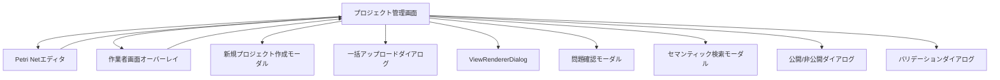

# プロジェクト管理画面 UI仕様書

## メタデータ
- **画面名**: プロジェクト管理画面
- **物理名**: ProjectManagement.tsx
- **ファイルパス**: `frontend/src/components/project/ProjectManagement.tsx`
- **利用権限**: 実験管理者（experiment_admin）
- **作成日**: 2026-01-21
- **最終更新日**: 2026-08-20
- **担当者**: Development Team
- **バージョン**: 3.0.0

---

## 1. 概要

### 1.1 コンポーネントの目的
プロジェクト管理画面は、実験管理者がMAIMLプロジェクトを一元的に管理するためのメイン画面です。プロジェクトの作成・削除・名前変更・ファイル管理・タスク登録・指示管理・実験指示・評価登録・進捗確認・編集・チェックアウト/チェックイン・公開などの機能を提供します。

### 1.2 使用場面
- 実験管理者メニューの「プロジェクト管理」タブ選択時に表示
- ログイン後のデフォルト表示画面（実験管理者ロール）
- プロジェクト一覧の閲覧・検索・フィルタリング
- 選択したプロジェクトの詳細情報表示・操作

### 1.3 アクセス権限
- **必須ロール**: Experiment Admin（実験管理者）
- **認証**: JWT + Session Hybrid認証
- **組織分離**: マルチテナント（organizationId）

---

## 2. 画面構成

### 2.1 レイアウト構造

```
┌──────────────────────────────────────────────────────────────────────────┐
│ ツールバー                                                                 │
│ [所有者] [組織グループ] [プロジェクトステータス] [チェックアウト] [検索]    │
│                                        [新規作成] [リロード] [トランジション検索] │
├─────────────────────┬────────────────────────────────────────────────────┤
│                     │ プロジェクト情報ヘッダー                             │
│                     │ [プロジェクト名] [ステータスTag] [チェックアウトTag] [警告アイコン] │
│                     │ [説明]                                               │
│ プロジェクト         ├────────────────────────────────────────────────────┤
│ 一覧ツリー          │ ファイル操作ツールバー                               │
│                     │ [ZIP DL] [アップロード] [編集] [削除] [チェックイン/アウト] │
│ (20%幅、min:280px)  │ [問題確認] [公開/非公開] [プロジェクト完了] [名前変更] │
│                     │ [バリデーション確認]                                   │
│ - プロジェクトA     ├────────────────────────────────────────────────────┤
│ - プロジェクトB     │ タブコンテンツ                                       │
│ - プロジェクトC     │                                                      │
│                     │ [ファイル管理|タスク登録|プロジェクト指示|実験指示|評価登録] │
│                     │ ┌────────────────────────────────────────────────┐  │
│                     │ │ (各タブコンポーネント)                           │  │
│                     │ └────────────────────────────────────────────────┘  │
└─────────────────────┴────────────────────────────────────────────────────┘
```

### 2.2 主要UI要素

#### 2.2.1 ツールバー（上部）

**左側 - フィルタ・検索:**
- **所有者フィルタ**（Select, width:150）: `my_only`（自分のみ）/ `all`（全て）
- **組織グループフィルタ**（Select, width:180）: `visibleGroups` が1件以上ある場合のみ表示。全て / 各グループ名
  - `data-testid="group-filter"`
- **プロジェクトステータスフィルタ**（Select, width:200）: 全て / プロジェクト計画中(0) / タスク実行待ち(1) / タスク実行中(2) / 承認待ち(3) / プロジェクト完了(4) / タスク異常終了(5)
  - `data-testid="project-status-filter"`
- **チェックアウトステータスフィルタ**（Select, width:150）: 全て / チェックイン済み / チェックアウト中
  - `data-testid="checkout-status-filter"`
- **検索バー**（Input + SearchOutlined, width:250）: プロジェクト名・説明・オーナー名で検索
  - `data-testid="project-search-input"`

**右側 - アクションボタン:**
- **新規作成ボタン**（Button + PlusOutlined, `colorSuccess`）: 新規プロジェクト作成モーダルを開く
  - `data-testid="create-project-button"`
- **リロードボタン**（Button + ReloadOutlined）: プロジェクト一覧・選択中のタブデータを最新化
- **トランジション検索ボタン**（Button + SearchOutlined）: セマンティック検索モーダルを開く

#### 2.2.2 左側パネル（プロジェクト一覧）

幅: 20%（min:280px, max:380px）

**チーム未所属の場合（`isUnassignedToTeam === true`）:**
- `TeamOutlined` アイコン
- チーム未所属メッセージ
- 「チーム管理へ」ボタン（`onNavigateToTeamManagement` が存在する場合）

**通常表示:**
- **ProjectFolderTree**: プロジェクト一覧をツリー表示
  - ソート機能（名前/ステータス/作成日時、昇順/降順）
  - プロジェクト選択
  - フォルダ展開/折りたたみ

#### 2.2.3 右側パネル - プロジェクト情報ヘッダー

プロジェクト選択時のみ表示。

- **プロジェクト名**（Title level 5）
- **ステータスタグ**（Tag）: 色分けあり（default/blue/cyan/purple/success/error）
- **チェックアウト状態タグ**（Tag, orange）: `data-testid="checkout-status-tag"`
- **バリデーション警告アイコン**（WarningOutlined）: `savedValidationRow.errors > 0` → 赤、`warnings > 0` → 黄。Tooltip付き
- **概要**（Text, secondary）: プロジェクトの説明

#### 2.2.4 右側パネル - ファイル操作ツールバー

| ボタン | アイコン | disabled 条件 |
|--------|---------|--------------|
| ZIPダウンロード | `DownloadOutlined` | プロジェクト未選択 or ファイルなし |
| アップロード | `UploadOutlined`（`colorSuccess`）| チェックアウト中 or status=4 or status=5 or isEditable=false |
| 編集 | `EditOutlined` | チェックアウト中 or status=4 or status=5 or isEditable=false |
| 削除 | `DeleteOutlined`（danger）| チェックアウト中 or status=4 or status=5 or isEditable=false |
| チェックイン/チェックアウト | `FileTextOutlined` | status=completed or status=error or isEditable=false |
| 問題確認 | `ExclamationCircleOutlined`（`colorWarning`）| — |
| 公開 / 非公開 | — | 公開: status=3か4以外またはpolling中。非公開: polling中 |
| プロジェクト完了 | — | `allTasksCompleted !== true` or isEditable=false |
| 名前変更 | `EditOutlined` | チェックアウト中 or status=4 or status=5 or isEditable=false |
| バリデーション確認 | `SafetyCertificateOutlined` | プロジェクト未選択 |

- `data-testid="project-download-button"`, `data-testid="checkout-checkin-button"`
- `data-testid="maiml-toolbar-publish-button"`, `data-testid="maiml-toolbar-unpublish-button"`

#### 2.2.5 右側パネル - タブコンテンツ

**Tab 1: ファイル管理**（`key: 'file_management'`）
- **FileListTable**: プロジェクトのファイル一覧
  - ファイル/フォルダクリック → ViewRendererDialogで表示
  - タブ切り替え時にファイル一覧を最新取得

**Tab 2: タスク登録**（`key: 'task_registration'`）
- **TaskRegistrationTab**: タスクの新規登録・一覧表示
  - `maimlHasErrors` prop あり

**Tab 3: プロジェクト指示**（`key: 'project_instruction'`）
- **InstructionRegistrationTab**: プロジェクト指示の一覧表示・編集・送信

**Tab 4: 実験指示**（`key: 'task_results'`）
- **ExperimentInstructionTab**: 実験指示・タスク進捗管理
  - このタブで全タスク完了状態（`allTasksCompleted`）を管理
  - `data-testid` なし

**Tab 5: 評価登録**（`key: 'evaluation_registration'`）
- **EvaluationRegistrationTab**: 評価の登録・管理

### 2.3 モーダル・ダイアログ一覧

| コンポーネント | 開くトリガー | 状態変数 |
|-------------|-----------|---------|
| `CreateProjectModal` | 新規作成ボタン | `createModalOpen` |
| `BulkUploadDialog` | アップロードボタン | `uploadDialogOpen` |
| `ViewRendererDialog` | ファイルクリック（最大5個同時） | `openDialogs[]` |
| `DraftRestoreDialog` | マウント時Draft自動検出 | `draftRestoreDialogOpen` |
| `IssueManagementModal` | 問題確認ボタン | `issueManagementModalOpen` |
| `MaimlPublishDialog` | 公開ボタン | `publishDialogOpen` |
| `MaimlUnpublishDialog` | 非公開ボタン | `unpublishDialogOpen` |
| `RenameProjectModal` | 名前変更ボタン | `renameModalOpen` |
| `MaimlValidationModal` | バリデーション確認ボタン | `validationDialogOpen` |
| `ProjectCompletionDialog` | プロジェクト完了ボタン | `completionDialogOpen` |
| `TransitionSetSearchModal` | トランジション検索ボタン | `semanticSearchModalOpen` |

### 2.4 画面遷移



---

## 3. 機能仕様

### 3.1 プロジェクト一覧取得・表示

#### 3.1.1 処理フロー
```typescript
const {
  data: projectsData,
  error: projectsError,
  refetch: refetchProjects
} = useApi<ApiResponse<ProjectListResponse>>(
  async () => await getProjects(),
  []
);

useEffect(() => {
  if (projectsData?.success && projectsData.data) {
    const projectsList = Array.isArray(projectsData.data)
      ? projectsData.data
      : ((projectsData.data as ProjectListResponse)?.projects || []);
    setProjects(projectsList);
  }
}, [projectsData, projectsError]);
```

#### 3.1.2 UI動作
- マウント時に自動でAPI呼び出し
- 取得成功: プロジェクト一覧を表示
- 取得失敗: エラーメッセージ表示（`t('project.fetchListFailed')`）

### 3.2 フィルタリング・検索・ソート

#### 3.2.1 フィルタリング処理

フィルタリング条件:
1. **検索クエリ**: プロジェクト名・説明・オーナー名の部分一致（ID・ステータス名・グループ名は対象外）
2. **チェックアウトフィルタ**: `all` / `checked_out` / `checked_in`
3. **プロジェクトステータスフィルタ**: `all` / 数値（0〜5）
4. **組織グループフィルタ**: `all` / `organizationGroupCd`

#### 3.2.2 ソート処理

- `sortBy`: `'name' | 'status' | 'createdAt'`（デフォルト: `'createdAt'`）
- `sortOrder`: `'asc' | 'desc'`（デフォルト: `'desc'`）
- 同じ項目クリック → 順序反転。異なる項目クリック → 降順で新項目適用

### 3.3 プロジェクト選択

#### 3.3.1 処理フロー
1. `setSelectedProjectId(projectId)` でプロジェクトID設定
2. `setCurrentFolder('root')` でルートフォルダにリセット
3. `loadMaiml(projectId)` でMAIMLをContextに読み込み
4. `currentTab === 'file_management'` なら `getProjectFiles(projectId, true)` を呼び出し

#### 3.3.2 UI動作
- プロジェクト選択時にハイライト表示
- MAIMLデータをContextに読み込み
- 右側パネルにプロジェクト詳細を表示
- sessionStorage に選択IDを保存（編集画面から戻った際に復元）

### 3.4 タブ切り替え

タブキー: `'file_management' | 'task_registration' | 'project_instruction' | 'task_results' | 'evaluation_registration'`

- **ファイル管理タブ切り替え時**: `getProjectFiles(projectId, true)` で最新取得
- **その他タブ**: コンポーネント内部で `isActive` prop を監視して自動更新するため不要

### 3.5 チェックアウト/チェックイン

#### 3.5.1 エラーコード一覧

| エラーコード | メッセージ |
|------------|---------|
| `TASK_IN_PROGRESS` | 実行中のタスクが存在するため、チェックインできません |
| `CHECKOUT_NO_MAIML_FILE` | MAIMLファイルが存在しません |
| `CHECKOUT_INVALID_STATUS` | プロジェクトステータスがタスク実行待ちではありません |
| `CHECKOUT_NO_TASKS` | タスクが登録されていません |
| `CHECKOUT_UNSENT_INSTRUCTIONS` | 未送信の指示が存在します |
| `PROJECT_ALREADY_CHECKED_OUT` | 既に{ユーザー名}によってチェックアウトされています（warning） |
| `RESOURCE_NOT_FOUND` | プロジェクトが見つかりません |

#### 3.5.2 チェックアウト前提条件
- MAIMLファイルが存在する
- プロジェクトステータスが「タスク実行待ち」（status=1）
- タスクが登録されている
- 未送信の指示が存在しない

#### 3.5.3 チェックイン前提条件
- 実行中のタスクが存在しない

### 3.6 編集（Petri Netエディタ起動）

#### 3.6.1 処理フロー
「編集」ボタン押下時は常に直接エディタへ遷移（Draft確認なし）。
- `maimlFileKey` が存在する場合はそれを `sourceS3Key` として使用
- なければ命名規則 `{orgId}/projects/{name}/{name}.maiml` から推定

#### 3.6.2 Draft復元確認（初期表示時のみ）
- **マウント時**かつ**プロジェクト未選択時**のみ `GET /api/v1/maiml/drafts` でDraft一覧確認
- Draft存在 → `DraftRestoreDialog` を表示
  - 「復元する」→ 対象プロジェクトを自動選択してエディタへ（`openDraftManagerOnStart: true`）
  - 「復元しない」→ 同一 `projectId` のDraft全削除、選択クリア

### 3.7 プロジェクトリロード

#### 3.7.1 処理フロー

**プロジェクト未選択時:**
1. プロジェクト一覧のみ再取得
2. `t('projectManagement.listReloadSuccess')` を表示

**プロジェクト選択時:**
1. プロジェクト一覧を最新化
2. プロジェクト選択を復元（`selectedProjectId`）
3. MAIMLデータを最新化（`reloadMaiml()`）
4. ファイル管理タブのみデータ再取得（その他タブはコンポーネント内部で自動更新）
5. `t('projectManagement.reloadSuccess')` を表示

### 3.8 ZIPダウンロード

`downloadFolderAsZip('projects/{projectName}')` を呼び出す。
`data-testid="project-download-button"`

### 3.9 プロジェクト削除

`deleteProject(projectId)` を呼び出し、確認ダイアログ表示あり。
削除後: プロジェクト一覧再取得 + 選択解除

### 3.10 公開・非公開処理

詳細: [ui_maiml_publish_dialog.md](./ui_maiml_publish_dialog.md) / [ui_maiml_unpublish_dialog.md](./ui_maiml_unpublish_dialog.md) を参照

#### 3.10.1 ボタン表示状態

| 条件 | ボタン | 活性状態 |
|------|--------|---------|
| 未公開（null/done/error）かつ status=3か4 | 「公開する」`type="primary"` | 有効 |
| 未公開かつ status≠3,4 | 「公開する」`type="primary"` | **disabled** |
| 公開ジョブ処理中（pending/running）| 「公開処理中…」 | disabled |
| 公開済み（`job_type=publish` && `status=done` && `asset_id` あり）| 「非公開にする」danger | 有効 |

`data-testid="maiml-toolbar-publish-button"` / `data-testid="maiml-toolbar-unpublish-button"`

#### 3.10.2 ポーリング仕様（usePublishStatusPoller）

- **ポーリング間隔**: 3秒
- **タイムアウト**: 5分
- **停止条件**: `status` が `pending`/`running` 以外
- **完了時**: `handleProjectReload()` を呼び出して全データを最新化

### 3.11 プロジェクト名変更

`RenameProjectModal` で変更後:
1. `projects` state を楽観的更新（`name`/`folderName`）
2. ファイル管理タブのファイル一覧を再取得（パスが変わるため）
3. `reloadMaiml()` を呼び出し

### 3.12 MAIMLバリデーション機能

#### 3.12.1 自動取得
プロジェクト選択時に `GET /api/v1/maiml/analysis-result?fileKey=xxx` でDB保存済み結果を自動取得。
`resolvedMaimlFileKey`: `maimlFileKey` あればそれ、なければ命名規則から推定。

#### 3.12.2 バリデーションダイアログ（MaimlValidationModal）

「バリデーション確認」ボタン押下で開く。
- 最終バリデーション情報（`is_valid` / `analysis_timestamp`）
- 再バリデーション実行（`validateMaiml()` → DB保存 → 結果再取得）
- エラー・警告の色分け: エラーあり→赤、警告のみ→黄、問題なし→緑

#### 3.12.3 警告アイコン（ヘッダー）

プロジェクトヘッダーのプロジェクト名横に表示。
- `savedValidationRow.errors > 0` → 🔴（`colorError`）
- `savedValidationRow.warnings > 0` のみ → 🟡（`colorWarning`）

#### 3.12.4 maimlHasErrors

`TaskRegistrationTab` に `maimlHasErrors` prop として渡す。

### 3.13 複数ダイアログ管理（ViewRendererDialog）

- 最大5個まで同時表示可能
- カスケード配置（30pxずつオフセット）
- z-index自動管理（フォーカス時に最前面に移動）
- Context の `maimlContent` を渡すことでAPI二重取得を防止

---

## 4. データ仕様

### 4.1 Props定義

```typescript
interface ProjectManagementInnerProps {
  onEdit?: (params: MaimlEditorParams) => void;
  onOpenWorkerScreen?: (projectId: string, projectName: string) => void;
  user?: User;
  onNavigateToTeamManagement?: () => void;
}

interface ProjectManagementProps {
  onEdit?: (params: MaimlEditorParams) => void;
  onOpenWorkerScreen?: (projectId: string, projectName: string) => void;
  user?: User;
  onNavigateToTeamManagement?: () => void;
}
```

| Prop名 | 型 | 説明 |
|--------|---|------|
| `onEdit` | `(params: MaimlEditorParams) => void` | Petri Netエディタを開くコールバック |
| `onOpenWorkerScreen` | `(projectId, projectName) => void` | 作業者画面オーバーレイを開くコールバック |
| `user` | `User?` | ログイン中ユーザー情報（チーム未所属判定に使用）|
| `onNavigateToTeamManagement` | `() => void` | チーム管理タブへ遷移するコールバック |

### 4.2 State定義

| State名 | 型 | 初期値 | 説明 |
|---------|---|--------|------|
| `projects` | `Project[]` | `[]` | プロジェクト一覧 |
| `searchQuery` | `string` | sessionStorage復元 or `''` | 検索クエリ |
| `ownerFilter` | `string` | sessionStorage復元 or `'my_only'` | 所有者フィルタ |
| `groupFilter` | `string` | `'all'` | 組織グループフィルタ |
| `visibleGroups` | `Array<{cd,name,isActive}>` | `[]` | 閲覧可能グループ一覧 |
| `checkoutFilter` | `string` | sessionStorage復元 or `'all'` | チェックアウトフィルタ |
| `projectStatusFilter` | `string` | sessionStorage復元 or `'all'` | ステータスフィルタ |
| `selectedProjectId` | `string \| null` | sessionStorage復元 or `null` | 選択中のプロジェクトID |
| `sortBy` | `'name' \| 'status' \| 'createdAt'` | sessionStorage復元 or `'createdAt'` | ソート項目 |
| `sortOrder` | `'asc' \| 'desc'` | sessionStorage復元 or `'desc'` | ソート順序 |
| `currentFolder` | `string` | `'root'` | 現在表示中のフォルダ |
| `currentTab` | 5タブキー | `'file_management'` | 選択中のタブ |
| `expandedFolders` | `Set<string>` | `new Set(['folder_active'])` | 展開中フォルダ |
| `uploadDialogOpen` | `boolean` | `false` | アップロードダイアログ |
| `createModalOpen` | `boolean` | `false` | 新規作成モーダル |
| `issueManagementModalOpen` | `boolean` | `false` | 問題確認モーダル |
| `semanticSearchModalOpen` | `boolean` | `false` | セマンティック検索モーダル |
| `draftRestoreDialogOpen` | `boolean` | `false` | Draft復元ダイアログ |
| `hasBackendDraft` | `boolean` | `false` | バックエンドDraft存在フラグ |
| `draftToRestore` | `Draft \| null` | `null` | 復元対象Draft |
| `projectFilesData` | `Record<string, ProjectFilesData>` | `{}` | ファイル一覧キャッシュ |
| `projectTasksData` | `Record<string, ...>` | `{}` | タスク一覧キャッシュ（現在未使用） |
| `isLoadingTabData` | `boolean` | `false` | タブデータロード中 |
| `isDownloading` | `boolean` | `false` | ZIPダウンロード中 |
| `isReloadingProject` | `boolean` | `false` | リロード中 |
| `openDialogs` | `OpenDialog[]` | `[]` | 開いているダイアログ（最大5個）|
| `nextZIndex` | `number` | `1000` | 次のダイアログのz-index |
| `publishStatus` | `PublishStatusResponse \| null` | `null` | 公開ジョブ状態 |
| `publishStatusLoading` | `boolean` | `false` | 公開状態取得中 |
| `publishDialogOpen` | `boolean` | `false` | 公開ダイアログ |
| `unpublishDialogOpen` | `boolean` | `false` | 非公開ダイアログ |
| `completionDialogOpen` | `boolean` | `false` | プロジェクト完了ダイアログ |
| `allTasksCompleted` | `boolean` | `false` | 全タスク完了状態（ExperimentInstructionTabから受け取る）|
| `isPolling` | `boolean` | `false` | ポーリング中フラグ |
| `renameModalOpen` | `boolean` | `false` | 名前変更モーダル |
| `isValidating` | `boolean` | `false` | バリデーション実行中 |
| `savedValidationRow` | `MaimlAnalysisResultRow \| null` | `null` | DB保存済みバリデーション結果 |
| `validationDialogOpen` | `boolean` | `false` | バリデーションダイアログ |

### 4.3 Context連携

```typescript
// LanguageContext
const { t } = useLanguage();

// ProjectMaimlContext
const {
  loadMaiml,       // MAIML読み込み
  reloadMaiml,     // MAIML再読み込み
  maimlRoot,       // MAIMLルート要素
  maimlContent,    // MAIML文字列
  isLoading: isMaimlLoading
} = useProjectMaiml();
```

`ProjectManagement` は `ProjectMaimlProvider` でラップされており、内部実装は `ProjectManagementInner` として分離されている。

### 4.4 型定義

```typescript
interface ProjectFilesData {
  root: ProjectFile[];
  subFolderFiles: Record<string, ProjectFile[]>;
}

interface OpenDialog {
  id: string;
  contentType: 'file' | 'subnet';
  file?: ProjectFile;
  fileContent?: string | null;
  subnetData?: { ... };
  zIndex: number;
  position: { x: number; y: number };
}
```

---

## 5. API連携

### 5.1 使用するAPI一覧

| # | 関数名 | メソッド | エンドポイント | 説明 |
|---|--------|---------|---------------|------|
| 1 | `getProjects` | GET | `/api/v1/provider/projects` | プロジェクト一覧取得 |
| 2 | `getProjectFiles` | GET | `/api/v1/provider/projects/:id/files` | ファイル一覧取得（archive含む）|
| 3 | `getProjectTasks` | GET | `/api/v1/experiment-admin/projects/:id/tasks` | タスク一覧取得 |
| 4 | `createProject` | POST | `/api/v1/provider/projects` | 新規プロジェクト作成 |
| 5 | `checkoutProject` | POST | `/api/v1/experiment-admin/projects/:id/checkout` | チェックアウト |
| 6 | `checkinProject` | POST | `/api/v1/experiment-admin/projects/:id/checkin` | チェックイン |
| 7 | `deleteProject` | DELETE | `/api/v1/provider/projects/:id` | プロジェクト削除 |
| 8 | `downloadFolderAsZip` | GET | `/api/v1/files/download-zip` | ZIPダウンロード |
| 9 | `fetchDrafts` | GET | `/api/v1/maiml/drafts` | Draft一覧取得 |
| 10 | `deleteDraft` | DELETE | `/api/v1/maiml/draft/:draftKey` | Draft削除 |
| 11 | `getPublishStatus` | GET | `/api/v1/projects/:id/publish-status` | 公開ステータス取得 |
| 12 | `validateMaiml` | POST | `/api/v1/maiml/validate` | MAIMLバリデーション |
| 13 | `getAnalysisResult` | GET | `/api/v1/maiml/analysis-result` | DB保存済みバリデーション結果取得 |
| 14 | `getProjectMaiml` | GET | `/api/v1/provider/projects/:id/maiml` | MAIMLコンテンツ取得（アップロード後バリデーション用）|
| 15 | `deleteFileByKey` | DELETE | `/api/v1/files/delete` | ファイル削除 |
| 16 | `deleteFolderByPath` | DELETE | `/api/v1/files/folder` | フォルダ削除 |
| 17 | `getVisibleOrganizationGroups` | GET | `/api/v1/organization-groups/visible` | 閲覧可能グループ取得 |

---

## 6. エラーハンドリング

| エラーケース | 対処方法 |
|-------------|---------|
| プロジェクト一覧取得失敗 | `t('project.fetchListFailed')` |
| ファイル一覧取得失敗 | `t('formatManagement.messages.file_list_load_failed')` |
| タブデータ取得失敗 | `t('project.dataFetchFailed')` |
| チェックアウト/イン各種エラー | エラーコード別メッセージ（i18n）|
| プロジェクト削除失敗 | `mapErrorToMessage(errorCode)` |
| ファイル削除失敗 | `mapErrorToMessage(errorCode)` |
| ZIPダウンロード失敗 | `t('project.downloadFailed')` |
| 公開処理失敗 | `status.error_message` or `t('project.processingFailed')` |
| バリデーション失敗 | `t('project.validationFailed')` |
| ダイアログ上限超過 | `t('project.maxDialogsWarning')`（warning）|

---

## 7. 実装ファイル

### 7.1 メインファイル
- **パス**: `frontend/src/components/project/ProjectManagement.tsx`
- **行数**: 約2,577行
- **エクスポート**: `ProjectManagement`（default export）、Provider付きラッパー

### 7.2 子コンポーネント

| コンポーネント名 | パス | 説明 |
|----------------|------|------|
| `ProjectFolderTree` | `./ProjectFolderTree` | プロジェクト一覧ツリー |
| `FileListTable` | `./FileListTable` | ファイル一覧テーブル |
| `TaskRegistrationTab` | `./TaskRegistrationTab` | タスク登録タブ |
| `InstructionRegistrationTab` | `./InstructionRegistrationTab` | プロジェクト指示タブ |
| `ExperimentInstructionTab` | `./ExperimentInstructionTab` | 実験指示タブ（task_resultsキー）|
| `EvaluationRegistrationTab` | `./EvaluationRegistrationTab` | 評価登録タブ |
| `TaskResultsTable` | `./TaskResultsTable` | タスク結果一覧テーブル（直接使用なし）|
| `BulkUploadDialog` | `./BulkUploadDialog` | 一括アップロードダイアログ |
| `CreateProjectModal` | `./CreateProjectModal` | 新規プロジェクト作成モーダル |
| `RenameProjectModal` | `./RenameProjectModal` | プロジェクト名変更モーダル |
| `MaimlPublishDialog` | `./MaimlPublishDialog` | 公開確認ダイアログ |
| `MaimlUnpublishDialog` | `./MaimlUnpublishDialog` | 非公開確認ダイアログ |
| `MaimlValidationModal` | `./MaimlValidationModal` | バリデーションダイアログ |
| `ProjectCompletionDialog` | `./ProjectCompletionDialog` | プロジェクト完了ダイアログ |
| `ViewRendererDialog` | `@/components/viewer/ViewRendererDialog` | ファイル表示ダイアログ（最大5個）|
| `DraftRestoreDialog` | `../viewer/DraftRestoreDialog` | Draft復元確認ダイアログ |
| `IssueManagementModal` | `../ExperimentWorker/IssueManagementModal` | 問題確認・管理モーダル |
| `TransitionSetSearchModal` | `@/components/TransitionSetSearch/TransitionSetSearchModal` | セマンティック検索モーダル |

### 7.3 使用するカスタムフック・サービス
- `useApi` - API呼び出し
- `usePublishStatusPoller` - 公開ジョブポーリング
- `useProjectMaiml` / `ProjectMaimlProvider` - MAIML管理Context

---

## 8. 補足事項

### 8.1 パフォーマンス最適化
- **useMemo**: `filteredProjects`, `sortedProjects`, `selectedProject`, `isProjectCheckedOut`, `projectFiles`, `hasProjectFiles`, `taskResults`, `taskStats`, `maimlHasErrors`, `isPublished`, `resolvedMaimlFileKey` 等
- **useCallback**: 全イベントハンドラー
- **データキャッシュ**: `projectFilesData`（プロジェクトIDをキーとしてファイル一覧をキャッシュ）
- **sessionStorage**: フィルタ・ソート・選択プロジェクトID を保存（ペトリネット編集画面から戻った際に復元）

### 8.2 プロジェクトステータス

| status | statusName | 説明 |
|--------|-----------|------|
| 0 | プロジェクト計画中 | 初期状態。編集・アップロード可能 |
| 1 | タスク実行待ち | チェックアウト可能 |
| 2 | タスク実行中 | チェックアウト中 |
| 3 | 承認待ち | レビュー待ちタスクあり。公開可能 |
| 4 | プロジェクト完了 | 全タスク完了。公開可能。編集系ボタン無効 |
| 5 | タスク異常終了 | エラー発生。編集系ボタン無効 |

### 8.3 `isEditable` フラグ
`selectedProject.isEditable === false` の場合、変更系ボタンがすべて無効化される。
他ユーザーのプロジェクトを参照している場合などに設定される。

### 8.4 `isOrderChangeLocked`
- `status !== 0`（プロジェクト計画中以外）の場合、メソッド順序変更不可。
- `TaskRegistrationTab` に渡される。

### 8.5 ファイル一覧の構造

`ProjectFilesData`:
- `root`: ルート直下のファイル＋サブフォルダエントリ
- `subFolderFiles`: `{ [topFolderName]: ProjectFile[] }`（バックエンドが `topFolder` をキーに全ファイルをフラットに返す）

`archive` フォルダは中身がある場合のみ表示。

---

## 9. 変更履歴

| バージョン | 日付 | 変更内容 |
|-----------|------|---------|
| 3.0.0 | 2026-08-20 | 実装ベースで全面改訂（タブ構成5タブへ変更・組織グループフィルタ追加・Props/State追加・子コンポーネント追加・ツールバーボタン追加）|
| 3.0.1 | 2026-08-20 | 暗号化管理・電子署名管理（開発対象外）削除・onInstructionsSubmit/encryptionModalOpen/signatureModalOpen削除 |
| 2.0.0 | 2026-04-24 | MAIMLバリデーション機能追加 |
| 1.0.0 | 2026-01-21 | 初版作成 |
