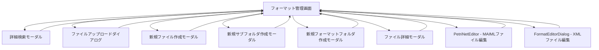

# フォーマット管理画面 UI仕様書

## 1. 概要

### 1.1 コンポーネントの目的
フォーマット管理画面は、実験で使用するXMLテンプレートファイルとMAIMLワークフローファイルを管理するためのメイン画面です。部門ごとに整理されたフォーマットフォルダの一覧表示、ファイルの閲覧・編集・作成・削除、フォルダの作成、ファイルのアップロード・ダウンロードなど、フォーマット管理に関する全ての操作を提供します。

### 1.2 使用場面
- **表示タイミング**: 実験管理者メニューの「フォーマット管理」タブを選択した時
- **主な用途**:
  - XMLテンプレートファイル（Material/Condition/Result）の管理
  - MAIMLワークフローファイルの管理
  - 部門ごとのフォーマットフォルダ管理
  - フォーマットファイルの検索・編集・作成

### 1.3 アクセス権限
- **必須ロール**: Experiment Admin（実験管理者）
- **認証**: JWT + Session Hybrid認証
- **組織分離**: organization_idによるマルチテナント分離

---

## 2. 画面構成

### 2.1 レイアウト構造

```
┌─────────────────────────────────────────────────────────────────────────┐
│ ツールバー（検索・フィルタ・新規フォーマットフォルダ作成）               │
├────────────────────┬────────────────────────────────────────────────────┤
│ 左側: フォーマット │ 右側: ファイル一覧                                 │
│ フォルダツリー     │ ┌──────────────────────────────────────────────┐ │
│ (33%幅)           │ │ フォーマット情報ヘッダー                     │ │
│                    │ ├──────────────────────────────────────────────┤ │
│ ┌────────────────┐ │ │ ファイル操作ツールバー                       │ │
│ │ フォーマット1  │ │ ├──────────────────────────────────────────────┤ │
│ │ フォーマット2  │ │ │ ファイル一覧テーブル                         │ │
│ │ フォーマット3  │ │ │ - フォルダ/ファイル                         │ │
│ │ ...            │ │ │ - 編集/ダウンロード/削除ボタン              │ │
│ └────────────────┘ │ └──────────────────────────────────────────────┘ │
└────────────────────┴────────────────────────────────────────────────────┘
```

### 2.2 主要UI要素

#### 2.2.1 ツールバー（上部）
- **カテゴリ絞込**（Select）: protocol/material/measurement/analysis/sample/device/all
- **ファイルタイプ絞込**（Select）: xml/maiml/all
- **検索バー**（Input）: フォーマット名、説明、タグで検索
- **詳細検索ボタン**（Button）: FormatSearchModalを開く
- **リフレッシュボタン**（Button）: フォーマット一覧を再取得
- **新規フォーマットフォルダボタン**（Button）: 部門直下に新規フォーマットフォルダを作成

#### 2.2.2 左側パネル（フォーマットフォルダツリー）
- **FormatFolderTree**コンポーネント
- フォーマットフォルダ一覧（カード形式）
- ソート機能（name/category/updatedAt）
- 選択されたフォーマットをハイライト表示

#### 2.2.3 右側パネル（ファイル一覧）

**フォーマット情報ヘッダー:**
- フォーマット名（Title level 5）
- フォーマット説明（Text secondary）

**ファイル操作ツールバー:**
- **新規ファイル作成ボタン**（Button）: XMLまたはMAIMLファイルを作成
- **新規サブフォルダ作成ボタン**（Button）: フォーマット内にサブフォルダを作成
- **アップロードボタン**（Button）: ファイルアップロードダイアログを開く

**ファイル一覧テーブル:**
- **FormatFileListTable**コンポーネント
- フォルダ・ファイルの一覧表示
- 各ファイルに編集/ダウンロード/削除ボタン

#### 2.2.4 フルスクリーンエディタ（条件付き表示）

**PetriNetEditor（MAIMLファイル編集時）:**
- 固定配置（position: fixed, z-index: 1000）
- ヘッダー（閉じるボタン、ファイル名表示）
- PetriNetEditorScreenコンポーネント

**FormatEditorDialog（XMLファイル編集時）:**
- TemplateEditorDialogをラップしたモーダル
- property/content要素の編集機能

### 2.3 画面遷移



---

## 3. 機能仕様

### 3.1 フォーマット一覧の表示と絞込

#### 3.1.1 初期表示処理

```typescript
// API経由でフォーマット一覧を取得
const { 
  data: formatsData, 
  isLoading: isLoadingFormats, 
  error: formatsError, 
  refetch: refetchFormats 
} = useApi<ApiResponse<FormatListResponse>>(
  fetchFormats,
  []
);

// フォーマットデータが取得できたらstateを更新
React.useEffect(() => {
  if (formatsData?.data.folders) {
    setFormats(formatsData.data.folders as Format[]);
  }
}, [formatsData]);
```

#### 3.1.2 フィルタリングとソート

```typescript
const filteredAndSortedFormats = useMemo(() => {
  const filtered = formats.filter((format) => {
    // 検索クエリでフィルタリング（全項目対象）
    const matchesSearch = searchQuery === '' || 
      format.id.toLowerCase().includes(searchQuery.toLowerCase()) ||
      format.name.toLowerCase().includes(searchQuery.toLowerCase()) ||
      // ... 他のフィールドも検索対象
      
    // カテゴリフィルタリング
    const matchesCategory = categoryFilter === 'all' || 
      format.category === categoryFilter;
      
    // ファイルタイプフィルタリング
    const matchesFileType = fileTypeFilter === 'all' || 
      format.fileType === fileTypeFilter;
      
    return matchesSearch && matchesCategory && matchesFileType;
  });
  
  // ソート処理（sortByがnullの場合はバックエンドの順序を維持）
  if (!sortBy) {
    return filtered;
  }
  
  const sorted = [...filtered].sort((a, b) => {
    let comparison = 0;
    switch (sortBy) {
      case 'name':
        comparison = a.name.localeCompare(b.name, 'ja');
        break;
      case 'category':
        comparison = a.category.localeCompare(b.category);
        break;
      case 'updatedAt':
        comparison = new Date(a.updatedAt).getTime() - new Date(b.updatedAt).getTime();
        break;
    }
    return sortOrder === 'asc' ? comparison : -comparison;
  });
  
  return sorted;
}, [formats, searchQuery, categoryFilter, fileTypeFilter, sortBy, sortOrder, t]);
```

#### 3.1.3 UI動作
- ユーザー操作: 検索バーに入力、フィルタを変更、ソートボタンをクリック
- 画面変化: フォーマット一覧がリアルタイムでフィルタリング・ソートされる
- 完了メッセージ: なし（即座に反映）

### 3.2 フォーマット選択とファイル一覧表示

#### 3.2.1 フォーマット選択処理

```typescript
const handleFormatSelectWithReset = useCallback((formatId: string) => {
  setSelectedFormatId(formatId);
  setCurrentFolderPath([]); // パスをリセット（ルートに戻る）
}, []);
```

#### 3.2.2 ファイル一覧取得

```typescript
React.useEffect(() => {
  const loadFormatFiles = async () => {
    if (!selectedFormatId || !selectedFormat) {
      return;
    }
    
    try {
      setIsLoadingFiles(true);
      
      // 現在のフォルダパスを取得
      const currentPath = currentFolderPath.length > 0 
        ? currentFolderPath.join('/')
        : undefined;
      
      // 現在のフォルダの直下のファイル・フォルダのみを取得
      const fileResponse = await fetchFormatFiles(selectedFormatId, currentPath);
      
      const files = (fileResponse.success && fileResponse.data?.files) 
        ? fileResponse.data.files as FormatFileData[] 
        : [];
      
      // キャッシュキーを生成（フォーマットID + パス）
      const cacheKey = currentPath 
        ? `${selectedFormatId}/${currentPath}`
        : selectedFormatId;
      
      setFormatFilesData(prev => ({
        ...prev,
        [cacheKey]: { allFiles: files }
      }));
    } catch (error) {
      message.error(t('formatManagement.messages.file_list_load_failed'));
    } finally {
      setIsLoadingFiles(false);
    }
  };
  
  loadFormatFiles();
}, [selectedFormatId, selectedFormat, currentFolderPath]);
```

#### 3.2.3 UI動作
- ユーザー操作: 左側のフォーマットフォルダをクリック
- 画面変化: 右側にフォーマット情報とファイル一覧が表示される
- ロード中: Spinコンポーネントで読み込み中を表示

### 3.3 フォルダ移動

#### 3.3.1 フォルダクリック処理

```typescript
const handleFolderClick = useCallback((folderId: string) => {
  if (folderId === 'back') {
    // 戻るボタン - 1階層だけ戻る
    setCurrentFolderPath(currentFolderPath.slice(0, -1));
  } else {
    // フォルダIDからフォルダ名を抽出
    const folderName = folderId.includes('/') 
      ? folderId.split('/').pop() || folderId 
      : folderId;
    
    setCurrentFolderPath([...currentFolderPath, folderName]);
  }
}, [currentFolderPath]);
```

#### 3.3.2 パンくずリストクリック処理

```typescript
const handleBreadcrumbClick = useCallback((index: number) => {
  if (index === -1) {
    // ルートに戻る
    setCurrentFolderPath([]);
  } else {
    // 指定されたフォルダまで戻る
    setCurrentFolderPath(currentFolderPath.slice(0, index + 1));
  }
}, [currentFolderPath]);
```

#### 3.3.3 UI動作
- ユーザー操作: フォルダをダブルクリック、または戻るボタンをクリック
- 画面変化: currentFolderPathが更新され、ファイル一覧が再取得される
- ローディング: ファイル取得中はSpinを表示

### 3.4 新規ファイル作成

#### 3.4.1 新規ファイル作成モーダルを開く

```typescript
const handleOpenCreateFileModal = useCallback(() => {
  if (!selectedFormatId) {
    message.warning(t('formatManagement.select_format'));
    return;
  }
  setCreateFileModalOpen(true);
}, [selectedFormatId, t]);
```

#### 3.4.2 ファイル作成処理

```typescript
const handleCreateFormatFile = useCallback(async (data: CreateFormatFileData) => {
  try {
    // formatApi.tsから直接呼び出し
    const apiRequestData = {
      fileName: data.fileNameWithExtension,
      currentPath: data.currentPath,
    };
    
    const response = await createFormatFile(data.formatId, apiRequestData);
    
    if (response.success) {
      console.log('✅ ファイル作成成功:', response.data);
    }
    
    // 成功メッセージを表示
    const successMessage = data.fileType === 'xml' && data.templateType
      ? `${data.templateType}テンプレートが作成されました`
      : 'ファイルが正常に作成されました';
    
    message.success(t('formatManagement.create.success') || successMessage);
    
    // モーダルを閉じる
    handleCloseCreateFileModal();
    
    // ファイル一覧を最新化
    if (selectedFormatId && selectedFormat) {
      const currentPath = currentFolderPath.length > 0 
        ? currentFolderPath.join('/')
        : undefined;
      
      const fileResponse = await fetchFormatFiles(selectedFormatId, currentPath);
      
      const cacheKey = currentPath 
        ? `${selectedFormatId}/${currentPath}`
        : selectedFormatId;
      
      setFormatFilesData(prev => ({
        ...prev,
        [cacheKey]: {
          allFiles: (fileResponse.success && fileResponse.data?.files) 
            ? fileResponse.data.files as FormatFileData[] 
            : [],
        }
      }));
    }
    
    // フォーマット一覧を更新
    handleRefresh();
  } catch (error) {
    console.error('❌ ファイル作成エラー:', error);
    
    // エラーメッセージを抽出
    let errorMessage = 'ファイルの作成に失敗しました';
    if (error && typeof error === 'object' && 'response' in error) {
      const axiosError = error as { 
        response?: { data?: { error?: { message?: string } } }; 
        message?: string 
      };
      if (axiosError.response?.data?.error?.message) {
        errorMessage = axiosError.response.data.error.message;
      } else if (axiosError.message) {
        errorMessage = axiosError.message;
      }
    } else if (error instanceof Error) {
      errorMessage = error.message;
    }
    
    message.error(errorMessage);
    throw new Error(errorMessage);
  }
}, [t, handleCloseCreateFileModal, handleRefresh, selectedFormatId, selectedFormat]);
```

#### 3.4.3 UI動作
- ユーザー操作: 「新規ファイル作成」ボタンをクリック
- 画面変化: CreateFormatFileModalが開く
- 完了メッセージ: 「ファイルが正常に作成されました」

### 3.5 新規サブフォルダ作成

#### 3.5.1 サブフォルダ作成処理

```typescript
const handleCreateFormatFolder = useCallback(async (data: CreateFormatFolderData) => {
  try {
    // formatApi.tsから直接呼び出し
    const response = await createFormatSubfolder(
      data.formatId,        // formatName
      data.folderName,      // subfolderName
      data.currentPath || '' // parentPath（現在のパス、未指定時はルート直下）
    );
    
    if (response.success) {
      console.log('✅ サブフォルダ作成成功:', response.data);
    }
    
    message.success(t('formatManagement.folder_create_success'));
    
    handleCloseCreateFolderModal();
    
    // ファイル一覧を最新化
    if (selectedFormatId && selectedFormat) {
      const currentPath = currentFolderPath.length > 0 
        ? currentFolderPath.join('/')
        : undefined;
      
      const fileResponse = await fetchFormatFiles(selectedFormatId, currentPath);
      
      const cacheKey = currentPath 
        ? `${selectedFormatId}/${currentPath}`
        : selectedFormatId;
      
      setFormatFilesData(prev => ({
        ...prev,
        [cacheKey]: {
          allFiles: (fileResponse.success && fileResponse.data?.files) 
            ? fileResponse.data.files as FormatFileData[] 
            : [],
        }
      }));
    }
  } catch (error) {
    console.error('❌ フォルダ作成エラー:', error);
    message.error((error as Error).message || t('formatManagement.folder_create_error'));
    throw error;
  }
}, [t, handleCloseCreateFolderModal, selectedFormatId, selectedFormat]);
```

#### 3.5.2 UI動作
- ユーザー操作: 「新規サブフォルダ作成」ボタンをクリック
- 画面変化: CreateFormatFolderModalが開く
- 完了メッセージ: 「フォルダが正常に作成されました」

### 3.6 新規フォーマットフォルダ作成（部門直下）

#### 3.6.1 フォーマットフォルダ作成処理

```typescript
const handleCreateFormat = useCallback(async (folderName: string) => {
  try {
    // API呼び出し（共通化されたcreateFormatFolderを使用）
    const response = await createFormatFolder(folderName);
    
    if (response.success) {
      console.log('✅ フォルダ作成成功:', response.data);
    }
    
    setCreateFormatModalOpen(false);
    
    // フォーマット一覧を更新
    handleRefresh();
  } catch (error) {
    console.error('❌ フォルダ作成エラー:', error);
    throw error;
  }
}, [handleRefresh]);
```

#### 3.6.2 UI動作
- ユーザー操作: ツールバーの「新規フォーマットフォルダ」ボタンをクリック
- 画面変化: CreateFormatModalが開く
- 完了メッセージ: モーダルが閉じ、フォーマット一覧が更新される

### 3.7 ファイル編集

#### 3.7.1 ファイル編集モード判定

```typescript
const handleFileEdit = useCallback(async (file: FormatFileDetailData) => {
  // ファイル拡張子で判定
  const fileName = file.name.toLowerCase();
  const isMaimlFile = fileName.endsWith('.maiml');
  const isXmlFile = fileName.endsWith('.xml');
  
  if (isMaimlFile) {
    // MAIMLファイル: PetriNetEditorを開く
    // ... (後述)
  } else if (isXmlFile) {
    // XMLファイル: FormatEditorDialogを開く
    // ... (後述)
  } else {
    message.error(t('formatManagement.messages.unsupported_file_type'));
  }
}, [t, message]);
```

#### 3.7.2 MAIMLファイル編集

```typescript
// MAIMLファイル編集
setEditingMaimlFile(file);

// ファイル内容を読み込む
setIsLoadingMaimlContent(true);
setMaimlFileContent(null);

try {
  if (file.path && file.path.trim() !== '') {
    // プロキシ方式: バックエンド経由でファイル内容を取得
    const client = createApiClient();
    
    const response = await client.post('/files/download-url', 
      { fileKey: file.path },
      { responseType: 'blob' }
    );
    
    // BlobをTextに変換
    const blob = response.data as Blob;
    const maimlContent = await blob.text();
    
    // 中身が実質空の場合は新規扱い
    if (maimlContent.trim().length > 0) {
      setMaimlFileContent(maimlContent);
    } else {
      setMaimlFileContent(null);
    }
  } else {
    // パスがない場合は新規作成
    setMaimlFileContent(null);
  }
  
  setShowPetriNetEditor(true);
} catch (error) {
  message.error(t('formatManagement.messages.file_load_failed'));
  setEditingMaimlFile(null);
} finally {
  setIsLoadingMaimlContent(false);
}
```

#### 3.7.3 XMLファイル編集

```typescript
// XMLファイル編集
let xmlContent = '';

if (file.path && file.path.trim() !== '') {
  try {
    const client = createApiClient();
    
    const response = await client.post('/files/download-url', 
      { fileKey: file.path },
      { responseType: 'blob' }
    );
    
    const blob = response.data as Blob;
    xmlContent = await blob.text();
  } catch (error) {
    xmlContent = '';
  }
}

// XMLをPropertyData形式にパース
const parsedProperties: Record<string, PropertyData> = {};
const parsedContents: Record<string, PropertyData> = {};
let isNewFile = false;

if (!xmlContent || xmlContent.trim() === '') {
  isNewFile = true;
} else {
  // DOMParserでXMLをパース
  const parser = new DOMParser();
  const xmlDoc = parser.parseFromString(xmlContent, 'application/xml');
  
  // パースエラーをチェック
  const parserError = xmlDoc.querySelector('parsererror');
  if (parserError) {
    throw new Error('XMLパースエラー');
  }
  
  // properties/contents を解析
  // ... (詳細省略)
}

// FormatEditorDialogを開く
setEditingXmlFile({
  ...file,
  content: xmlContent,
  parsedProperties,
  parsedContents,
  isNewFile
});
setShowTemplateEditor(true);
```

#### 3.7.4 UI動作
- ユーザー操作: ファイル一覧の「編集」ボタンをクリック
- 画面変化: 
  - MAIMLファイル: PetriNetEditorScreenが全画面表示される
  - XMLファイル: FormatEditorDialogモーダルが開く
- ロード中: Spinでファイル読み込み中を表示

### 3.8 ファイルダウンロード

#### 3.8.1 ダウンロード処理

```typescript
const handleFileDownload = useCallback(async (file: FormatFileData) => {
  try {
    // ファイルパスが存在するか確認
    if (!file.path || file.path.trim() === '') {
      throw new Error('ファイルパスが指定されていません');
    }

    // 既存APIを使用してダウンロード
    await getFileDownloadUrlByKey(file.path);

    // 成功メッセージ表示
    message.success(
      t('formatManagement.messages.download_started')
        .replace('{{fileName}}', file.name)
    );
  } catch (error) {
    message.error(
      t('formatManagement.messages.download_failed') + `: ${
        error instanceof Error ? error.message : '不明なエラー'
      }`
    );
  }
}, [t, message]);
```

#### 3.8.2 UI動作
- ユーザー操作: ファイル一覧の「ダウンロード」ボタンをクリック
- 画面変化: ブラウザのダウンロードが開始される
- 完了メッセージ: 「ダウンロードを開始しました: {{fileName}}」

### 3.9 ファイル削除

#### 3.9.1 削除確認と処理

```typescript
const handleFileDelete = useCallback(async (file: FormatFileData) => {
  // 削除確認モーダルを表示
  modal.confirm({
    title: t('formatManagement.dialog.delete_title'),
    content: t('formatManagement.dialog.delete_confirm')
      .replace('{{fileName}}', file.name),
    okText: t('formatManagement.dialog.delete_ok'),
    okButtonProps: { danger: true },
    cancelText: t('formatManagement.dialog.delete_cancel'),
    onOk: async () => {
      try {
        // 削除API呼び出し
        await deleteFileByKey(file.path);
        
        message.success(
          t('formatManagement.dialog.delete_success')
            .replace('{{fileName}}', file.name)
        );
        
        // ファイル一覧を更新
        if (selectedFormatId) {
          const currentPath = currentFolderPath.length > 0 
            ? currentFolderPath.join('/')
            : undefined;
          
          const fileResponse = await fetchFormatFiles(selectedFormatId, currentPath);
          
          const cacheKey = currentPath 
            ? `${selectedFormatId}/${currentPath}`
            : selectedFormatId;
          
          setFormatFilesData(prev => ({
            ...prev,
            [cacheKey]: {
              allFiles: (fileResponse.success && fileResponse.data?.files) 
                ? fileResponse.data.files as FormatFileData[] 
                : [],
            }
          }));
        }
        
        // フォーマット一覧も更新
        handleRefresh();
      } catch (error) {
        message.error(
          `ファイルの削除に失敗しました: ${
            error instanceof Error ? error.message : '不明なエラー'
          }`
        );
      }
    },
  });
}, [selectedFormatId, currentFolderPath, handleRefresh, message]);
```

#### 3.9.2 UI動作
- ユーザー操作: ファイル一覧の「削除」ボタンをクリック
- 画面変化: 削除確認モーダルが表示される
- 完了メッセージ: 「{{fileName}}を削除しました」

### 3.10 ファイル詳細表示

#### 3.10.1 詳細表示処理

```typescript
const handleFileDetail = useCallback((file: FormatFileDetailData) => {
  // 作成者情報を付与（現在はログインユーザー情報を使用）
  const fileWithCreator: FormatFileDetailData = {
    ...file,
    createdBy: user.id,
    createdByName: user.displayName,
    createdAt: file.createdAt || file.lastModified,
  };
  setSelectedFile(fileWithCreator);
  setDetailModalOpen(true);
}, [user]);
```

#### 3.10.2 UI動作
- ユーザー操作: ファイル名をクリック、または「詳細」ボタンをクリック
- 画面変化: FormatFileDetailModalが開く

### 3.11 リフレッシュ

#### 3.11.1 リフレッシュ処理

```typescript
const handleRefresh = React.useCallback(() => {
  console.log('Refreshing format list...');
  refetchFormats();
}, [refetchFormats]);
```

#### 3.11.2 UI動作
- ユーザー操作: ツールバーの「リフレッシュ」ボタンをクリック
- 画面変化: フォーマット一覧が再取得され、画面が更新される

---

## 4. データ仕様

### 4.1 Props定義

```typescript
interface FormatManagementProps {
  user: User;  // ログインユーザー情報
}
```

**Props説明:**
| Prop名 | 型 | 必須 | 説明 |
|--------|---|------|------|
| user | User | ✅ | ログインユーザー情報（組織ID、部門CD、表示名等） |

### 4.2 State定義

```typescript
// フォーマット一覧とフィルタ
const [formats, setFormats] = useState<Format[]>([]);
const [searchQuery, setSearchQuery] = useState('');
const [categoryFilter, setCategoryFilter] = useState<string>('all');
const [fileTypeFilter, setFileTypeFilter] = useState<'all' | 'xml' | 'maiml'>('all');
const [selectedFormatId, setSelectedFormatId] = useState<string | null>(null);
const [sortBy, setSortBy] = useState<'name' | 'category' | 'updatedAt' | null>(null);
const [sortOrder, setSortOrder] = useState<'asc' | 'desc'>('asc');

// フォルダパスとファイル
const [currentFolderPath, setCurrentFolderPath] = useState<string[]>([]);
const [formatFilesData, setFormatFilesData] = useState<Record<string, { allFiles: FormatFileData[] }>>({});

// モーダル開閉状態
const [searchModalOpen, setSearchModalOpen] = useState(false);
const [uploadDialogOpen, setUploadDialogOpen] = useState(false);
const [createFileModalOpen, setCreateFileModalOpen] = useState(false);
const [createFolderModalOpen, setCreateFolderModalOpen] = useState(false);
const [createFormatModalOpen, setCreateFormatModalOpen] = useState(false);
const [detailModalOpen, setDetailModalOpen] = useState(false);
const [selectedFile, setSelectedFile] = useState<FormatFileDetailData | null>(null);

// PetriNetEditor表示用State
const [showPetriNetEditor, setShowPetriNetEditor] = useState(false);
const [editingMaimlFile, setEditingMaimlFile] = useState<FormatFileDetailData | null>(null);
const [maimlFileContent, setMaimlFileContent] = useState<string | null>(null);
const [isLoadingMaimlContent, setIsLoadingMaimlContent] = useState(false);

// FormatEditorDialog表示用State
const [showTemplateEditor, setShowTemplateEditor] = useState(false);
const [editingXmlFile, setEditingXmlFile] = useState<FormatFileDetailData | null>(null);
```

**State説明:**
| State名 | 型 | 初期値 | 説明 |
|---------|---|--------|------|
| formats | Format[] | [] | フォーマット一覧 |
| searchQuery | string | '' | 検索クエリ |
| categoryFilter | string | 'all' | カテゴリフィルタ |
| fileTypeFilter | 'all' \| 'xml' \| 'maiml' | 'all' | ファイルタイプフィルタ |
| selectedFormatId | string \| null | null | 選択中のフォーマットID |
| currentFolderPath | string[] | [] | 現在のフォルダパス（階層構造） |
| formatFilesData | Record<string, { allFiles: FormatFileData[] }> | {} | フォーマット別ファイルデータキャッシュ |
| searchModalOpen | boolean | false | 検索モーダル開閉状態 |
| uploadDialogOpen | boolean | false | アップロードダイアログ開閉状態 |
| createFileModalOpen | boolean | false | ファイル作成モーダル開閉状態 |
| createFolderModalOpen | boolean | false | フォルダ作成モーダル開閉状態 |
| createFormatModalOpen | boolean | false | フォーマットフォルダ作成モーダル開閉状態 |
| detailModalOpen | boolean | false | 詳細モーダル開閉状態 |
| selectedFile | FormatFileDetailData \| null | null | 選択中のファイル |
| showPetriNetEditor | boolean | false | PetriNetEditor表示フラグ |
| editingMaimlFile | FormatFileDetailData \| null | null | 編集中のMAIMLファイル |
| maimlFileContent | string \| null | null | MAIMLファイル内容 |
| isLoadingMaimlContent | boolean | false | MAIML読み込み中フラグ |
| showTemplateEditor | boolean | false | FormatEditorDialog表示フラグ |
| editingXmlFile | FormatFileDetailData \| null | null | 編集中のXMLファイル |

### 4.3 型定義

#### 4.3.1 Format型

```typescript
interface Format {
  id: string;
  name: string;
  folderName: string;
  description: string;
  fileCount: number;
  fileType: 'xml' | 'maiml';
  category: string;
  department: string;
  createdAt: string;
  updatedAt: string;
  tags: string[];
}
```

#### 4.3.2 FormatFile型

```typescript
interface FormatFile {
  root: Array<{
    id: string;
    name: string;
    path: string;
    size: number;
    lastModified: string;
    type: string;
    version?: string;
    description?: string;
  }>;
}
```

#### 4.3.3 FormatFileData型（FormatFileListTable用）

型定義は `FormatFileListTable.tsx` で定義されています。

#### 4.3.4 FormatFileDetailData型（詳細表示用）

型定義は `FormatFileDetailModal.tsx` で定義されています。

#### 4.3.5 CreateFormatFileData型（ファイル作成用）

型定義は `CreateFormatFileModal.tsx` で定義されています。

#### 4.3.6 CreateFormatFolderData型（フォルダ作成用）

型定義は `CreateFormatFolderModal.tsx` で定義されています。

---

## 5. API連携

### 5.1 使用するAPI一覧

| # | API名 | メソッド | エンドポイント | 状態 | 説明 |
|---|------|---------|---------------|------|------|
| 1 | fetchFormats | GET | `/api/v1/formats` | ✅ 実装済み | フォーマット一覧を取得 |
| 2 | fetchFormatFiles | GET | `/api/v1/formats/:formatId/files` | ✅ 実装済み | フォーマット配下のファイル一覧を取得 |
| 3 | createFormatFile | POST | `/api/v1/formats/:formatId/files` | ✅ 実装済み | 新規ファイルを作成 |
| 4 | createFormatSubfolder | POST | `/api/v1/formats/:formatId/subfolders` | ✅ 実装済み | フォーマット内にサブフォルダを作成 |
| 5 | createFormatFolder | POST | `/api/v1/formats/folders` | ✅ 実装済み | 部門直下に新規フォーマットフォルダを作成 |
| 6 | updateFormatFileContent | PUT | `/api/v1/formats/files/content` | ✅ 実装済み | ファイル内容を更新 |
| 7 | getFileDownloadUrlByKey | POST | `/files/download-url` | ✅ 実装済み | ファイルダウンロード用署名付きURLを取得 |
| 8 | deleteFileByKey | DELETE | `/files/delete` | ✅ 実装済み | ファイルを削除 |

### 5.2 API呼び出しコード

#### 5.2.1 フォーマット一覧取得

```typescript
const { 
  data: formatsData, 
  isLoading: isLoadingFormats, 
  error: formatsError, 
  refetch: refetchFormats 
} = useApi<ApiResponse<FormatListResponse>>(
  fetchFormats,
  []
);
```

#### 5.2.2 ファイル一覧取得

```typescript
const currentPath = currentFolderPath.length > 0 
  ? currentFolderPath.join('/')
  : undefined;

const fileResponse = await fetchFormatFiles(selectedFormatId, currentPath);
```

#### 5.2.3 ファイル作成

```typescript
const apiRequestData = {
  fileName: data.fileNameWithExtension,
  currentPath: data.currentPath,
};

const response = await createFormatFile(data.formatId, apiRequestData);
```

#### 5.2.4 サブフォルダ作成

```typescript
const response = await createFormatSubfolder(
  data.formatId,        // formatName
  data.folderName,      // subfolderName
  data.currentPath || '' // parentPath
);
```

#### 5.2.5 フォーマットフォルダ作成

```typescript
const response = await createFormatFolder(folderName);
```

#### 5.2.6 ファイル内容更新（XML保存）

```typescript
await updateFormatFileContent(editingXmlFile.path, xmlContent);
```

#### 5.2.7 ファイルダウンロード

```typescript
await getFileDownloadUrlByKey(file.path);
```

#### 5.2.8 ファイル削除

```typescript
await deleteFileByKey(file.path);
```

### 5.3 リクエスト/レスポンス例

#### 5.3.1 フォーマット一覧取得

**Request:**
```http
GET /api/v1/formats
Authorization: Bearer {sessionToken}
X-Organization-Id: {organizationId}
```

**Response (200 OK):**
```json
{
  "success": true,
  "data": {
    "folders": [
      {
        "id": "format_001",
        "name": "材料テンプレート",
        "folderName": "material",
        "description": "材料情報のテンプレート",
        "fileCount": 5,
        "fileType": "xml",
        "category": "material",
        "department": "dept_001",
        "createdAt": "2026-01-15T10:00:00Z",
        "updatedAt": "2026-03-10T15:30:00Z",
        "tags": ["material", "template"]
      }
    ]
  }
}
```

#### 5.3.2 ファイル一覧取得

**Request:**
```http
GET /api/v1/formats/format_001/files?path=subfolder
Authorization: Bearer {sessionToken}
X-Organization-Id: {organizationId}
```

**Response (200 OK):**
```json
{
  "success": true,
  "data": {
    "files": [
      {
        "id": "file_001",
        "name": "material_template.xml",
        "path": "org_id/formats/material/subfolder/material_template.xml",
        "size": 1024,
        "lastModified": "2026-03-10T15:30:00Z",
        "type": "file",
        "isFolder": false
      },
      {
        "id": "folder_001",
        "name": "subsubfolder",
        "path": "org_id/formats/material/subfolder/subsubfolder",
        "size": 0,
        "lastModified": "2026-03-10T15:30:00Z",
        "type": "folder",
        "isFolder": true,
        "fileCount": 3
      }
    ]
  }
}
```

#### 5.3.3 ファイル作成

**Request:**
```http
POST /api/v1/formats/format_001/files
Authorization: Bearer {sessionToken}
X-Organization-Id: {organizationId}
Content-Type: application/json

{
  "fileName": "new_template.xml",
  "currentPath": "subfolder"
}
```

**Response (200 OK):**
```json
{
  "success": true,
  "data": {
    "fileKey": "org_id/formats/material/subfolder/new_template.xml",
    "fileName": "new_template.xml"
  }
}
```

---

## 6. エラーハンドリング

### 6.1 エラーケース一覧

| エラーケース | HTTPステータス | エラーコード | 対処方法 |
|-------------|---------------|-------------|----------|
| フォーマット一覧取得失敗 | 500 | `FETCH_ERROR` | message.error表示、refetchで再試行 |
| ファイル一覧取得失敗 | 500 | `FETCH_ERROR` | message.error表示 |
| ファイル作成失敗（同名ファイル存在） | 400 | `FILE_ALREADY_EXISTS` | message.error表示、ファイル名変更を促す |
| フォルダ作成失敗（同名フォルダ存在） | 400 | `FOLDER_ALREADY_EXISTS` | message.error表示、フォルダ名変更を促す |
| ファイル読み込み失敗 | 404/500 | `FILE_NOT_FOUND` | message.error表示、新規扱いで処理 |
| ファイル保存失敗 | 500 | `SAVE_ERROR` | message.error表示 |
| ファイルダウンロード失敗 | 404/500 | `DOWNLOAD_ERROR` | message.error表示 |
| ファイル削除失敗 | 500 | `DELETE_ERROR` | message.error表示 |
| XMLパースエラー | - | `PARSE_ERROR` | message.error表示、編集中止 |
| フォーマット未選択 | - | - | message.warning表示、処理中止 |

### 6.2 エラー処理コード

#### 6.2.1 ファイル一覧取得エラー

```typescript
try {
  setIsLoadingFiles(true);
  const fileResponse = await fetchFormatFiles(selectedFormatId, currentPath);
  // ...
} catch (error) {
  console.error('❌ Failed to fetch format files:', error);
  message.error(t('formatManagement.messages.file_list_load_failed'));
} finally {
  setIsLoadingFiles(false);
}
```

#### 6.2.2 ファイル作成エラー

```typescript
try {
  const response = await createFormatFile(data.formatId, apiRequestData);
  message.success(t('formatManagement.create.success'));
} catch (error) {
  // Axiosエラーからメッセージを抽出
  let errorMessage = 'ファイルの作成に失敗しました';
  
  if (error && typeof error === 'object' && 'response' in error) {
    const axiosError = error as { 
      response?: { data?: { error?: { message?: string } } }; 
      message?: string 
    };
    if (axiosError.response?.data?.error?.message) {
      errorMessage = axiosError.response.data.error.message;
    } else if (axiosError.message) {
      errorMessage = axiosError.message;
    }
  } else if (error instanceof Error) {
    errorMessage = error.message;
  }
  
  message.error(errorMessage);
  throw new Error(errorMessage);
}
```

#### 6.2.3 XMLパースエラー

```typescript
try {
  const parser = new DOMParser();
  const xmlDoc = parser.parseFromString(xmlContent, 'application/xml');
  
  const parserError = xmlDoc.querySelector('parsererror');
  if (parserError) {
    throw new Error('XMLパースエラー: ' + (parserError.textContent || '不明なエラー'));
  }
  
  // ... パース処理
} catch (parseError) {
  console.error('❌ XMLパースエラー:', parseError);
  message.error(
    t('formatManagement.messages.xml_parse_failed') + 
    ': ' + (parseError as Error).message
  );
  return;
}
```

#### 6.2.4 フォーマット未選択エラー

```typescript
const handleOpenCreateFileModal = useCallback(() => {
  if (!selectedFormatId) {
    message.warning(t('formatManagement.select_format'));
    return;
  }
  setCreateFileModalOpen(true);
}, [selectedFormatId, t]);
```

---

## 7. 実装ファイル

### 7.1 ファイルパス
- **メインファイル**: `frontend/src/components/format/FormatManagement.tsx`

### 7.2 関連ファイル
- **型定義**:
  - `frontend/src/types/auth.ts` (User型)
  - `frontend/src/types/api.ts` (ApiResponse型)
  - `frontend/src/types/format.ts` (FormatListResponse型)
  - `frontend/src/types/file.ts` (ProjectFile型)
  - `frontend/src/types/maiml-unified.ts` (Property, Content型)
  - `frontend/src/types/maimlEditor.ts` (MaimlEditorParams型)
- **API関数**:
  - `frontend/src/utils/formatApi.ts` (fetchFormats, fetchFormatFiles等)
  - `frontend/src/services/fileAccessService.ts` (getFileDownloadUrlByKey, deleteFileByKey)
- **ユーティリティ**:
  - `frontend/src/utils/authUtils.ts` (createApiClient)
  - `frontend/src/components/editorv2/utils/converters/reactFlowToMaiml.ts` (buildPropertyXML, buildContentXML, escapeXml)
- **Context**:
  - `frontend/src/contexts/LanguageContext.tsx` (useLanguage)
- **Hooks**:
  - `frontend/src/hooks/useApi.ts` (useApi)

### 7.3 依存コンポーネント
- `<FormatFolderTree />` - フォーマットフォルダ一覧表示
- `<FormatFileListTable />` - ファイル一覧テーブル
- `<FormatSearchModal />` - 詳細検索モーダル
- `<FormatUploadDialog />` - ファイルアップロードダイアログ
- `<CreateFormatFileModal />` - 新規ファイル作成モーダル
- `<CreateFormatFolderModal />` - 新規サブフォルダ作成モーダル
- `<CreateFormatModal />` - 新規フォーマットフォルダ作成モーダル
- `<FormatFileDetailModal />` - ファイル詳細表示モーダル
- `<PetriNetEditorScreen />` - MAIMLファイル編集画面
- `<FormatEditorDialog />` - XMLファイル編集ダイアログ

---

## 8. 変更履歴

| 日付 | 変更内容 | 担当者 |
|------|----------|--------|
| 2026-03-11 | 実装ベースで仕様書を再作成（Phase 4: フォーマット管理画面） | Cline |
