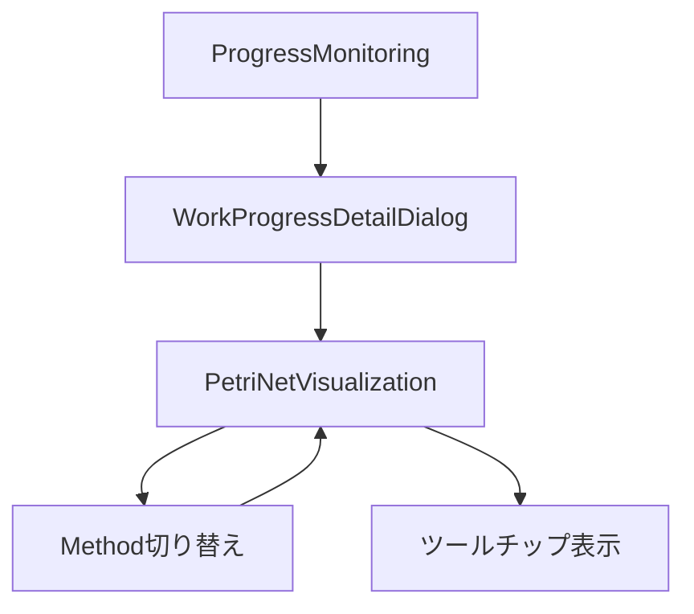

# Petri Net Visualization - UI仕様書

## 1. 概要

### 1.1 コンポーネントの目的
MAIMLファイルからPetri Net（ペトリネット）構造（Place、Transition、Arc）を抽出し、ReactFlowを使用して視覚的にフロー図として表示するコンポーネントです。実験ワークフローの構造と進捗状況を視覚的に把握できます。

### 1.2 使用場面
- **表示タイミング**: 進捗確認タブ内で作業進捗詳細ダイアログを開いた際に表示
- **表示場所**: `ProgressMonitoring` → `WorkProgressDetailDialog` 内のタブとして表示
- **トリガー**: プロジェクトとタスクが選択され、MAIMLファイルが存在する場合

### 1.3 アクセス権限
- **必須ロール**: Experiment Admin（実験管理者）
- **認証**: JWT + Session Hybrid認証
- **組織分離**: organization_idによるマルチテナント分離

---

## 2. 画面構成

### 2.1 レイアウト構造

```
┌─────────────────────────────────────────────────────────┐
│ ヘッダーカード (高さ: auto)                               │
│ ┌─────────────────────────────────────────────────────┐ │
│ │ タイトル: 実験フロー図                     [統計情報] │ │
│ │ Place: 10 | Transition: 5 | Arc: 15     [更新ボタン] │ │
│ └─────────────────────────────────────────────────────┘ │
├─────────────────────────────────────────────────────────┤
│ Method切り替えタブ (複数methodの場合のみ表示)            │
│ ┌─────────────────────────────────────────────────────┐ │
│ │ 🔬 Method 1 | 🔬 Method 2 | 🔬 Method 3              │ │
│ └─────────────────────────────────────────────────────┘ │
├─────────────────────────────────────────────────────────┤
│ React Flowダイアグラム (高さ: 700px)                     │
│ ┌─────────────────────────────────────────────────────┐ │
│ │                                                       │ │
│ │   ○ → ║ → ⬠ → ║ → ▭                                │ │
│ │                                                       │ │
│ │   [MiniMap]                   [Controls]             │ │
│ └─────────────────────────────────────────────────────┘ │
├─────────────────────────────────────────────────────────┤
│ 凡例 (高さ: auto)                                        │
│ ○ Material | ⬠ Condition | ▭ Result | ║ Transition    │
│ ✅ 完了 | 🔵 作業中                                      │
└─────────────────────────────────────────────────────────┘
```

### 2.2 主要UI要素

#### 2.2.1 ヘッダーカード
- **タイトル**（Typography.Title level={5}）: "実験フロー図"
- **統計情報タグ**（Tag）:
  - Place数（color="processing"）
  - Transition数（color="processing"）
  - Arc数（デフォルト）
- **更新ボタン**（Button）: アイコン（ReloadOutlined）、size="small"、type="text"

#### 2.2.2 Method切り替えタブ（複数methodの場合のみ）
- **タブコンポーネント**（Tabs）: methodごとのペトリネットを切り替え
- **タブラベル**: ExperimentOutlinedアイコン + method名（またはmethodId）
- **表示条件**: `isMultiMethod === true` かつ `methods.length > 1`

#### 2.2.3 React Flowダイアグラム
- **カスタムノード**:
  - **MaterialTemplateNode**: 円形（直径35px）、枠線のみ
  - **ConditionTemplateNode**: 五角形（38.5px）、枠線のみ
  - **ResultTemplateNode**: 四角形（42x28px）、枠線のみ
  - **TransitionNode**: 黒塗りつぶし長方形（5.6x28px）
- **進捗表示**:
  - 完了: 緑色（colorSuccess）、"✅ 発火済み"または進捗タグ
  - 作業中: プライマリ色（colorPrimary）、進捗タグ
  - 未着手: デフォルト色（colorText）
- **ツールチップ**（Transitionホバー時）:
  - 実験記録進捗（材料、測定条件、結果の件数）
  - 進捗報告ステータス
- **コントロール**:
  - MiniMap（120x200px、右下）
  - Controls（ズーム、フィット）
  - Background（グリッド表示）

#### 2.2.4 凡例エリア
- **ノード凡例**: Material（○）、Condition（⬠）、Result（▭）、Transition（║）
- **ステータス凡例**: 完了（✅）、作業中（🔵）

### 2.3 画面遷移



---

## 3. 機能仕様

### 3.1 ペトリネット構造取得・描画

#### 3.1.1 処理フロー

```typescript
const fetchPetriNetStructure = useCallback(async () => {
  // 1. ローディング開始
  setLoading(true);
  setError(null);

  try {
    // 2. API呼び出し（構造データ、進捗データ、実験記録データ）
    const structureResult = await fetchPetriNetStructureAPI(fileKey);
    const progressResult = await fetchTransitionStatusAPI(fileKey, methodId, taskNo);
    const recordsData = await fetchExperimentRecordsAPI(workId);

    // 3. データ処理
    setPetriNetData(structureResult.data);
    setTransitionProgressData(progressResult.data.transitionStatus);
    setExperimentRecordsData(recordsData.data);

    // 4. 複数method対応
    setIsMultiMethod(structureResult.data.isMultiMethod);
    setMethods(structureResult.data.methods);
    
    // 5. React Flowノード・エッジに変換
    const flowNodes = convertToFlowNodes(data, progress, experimentRecords);
    const flowEdges = convertToFlowEdges(data);
    
    // 6. 描画
    setNodes(flowNodes);
    setEdges(flowEdges);
  } catch (err) {
    setError(err.message);
  } finally {
    setLoading(false);
  }
}, [fileKey, workId, methodId, taskNo]);
```

#### 3.1.2 UI動作
- **ローディング**: Spin（大）+ "ペトリネット構造を読み込み中..." テキスト表示
- **エラー**: Alert（type="error"、エラーメッセージ表示）
- **成功**: ペトリネット図が表示され、fitViewで全体が見える状態

#### 3.1.3 トポロジカルソートによる自動レイアウト
- **アルゴリズム**: トポロジカルソートでTransitionのレベル（階層）を決定
- **配置ルール**:
  - 横方向（X座標）: レベルごとに`250px`間隔
  - 縦方向（Y座標）: 同レベル内で`80px`間隔、入力ノードの中央に配置
  - 独立ノード（入力専用Place）: Transitionと同じレベルに配置
- **衝突回避**: 既存ノードとの最小距離（`nodeSpacing * 0.8`）を確保

### 3.2 Method切り替え

#### 3.2.1 処理フロー

```typescript
<Tabs
  activeKey={selectedMethodId || undefined}
  onChange={(key) => {
    setSelectedMethodId(key);
    
    // 選択されたmethodデータを取得
    const newMethodData = methods.find((m) => m.methodId === key);
    
    // ペトリネットを再描画
    const flowNodes = convertToFlowNodes(newMethodData, transitionProgressData, experimentRecordsData);
    const flowEdges = convertToFlowEdges(newMethodData);
    setNodes(flowNodes);
    setEdges(flowEdges);
  }}
/>
```

#### 3.2.2 UI動作
- タブクリックで即座にペトリネット図が切り替わる
- 進捗データは保持され、新しいmethodの構造に適用される
- アニメーションなし（即座に切り替え）

### 3.3 進捗状態の可視化

#### 3.3.1 ステータス判定ロジック

```typescript
// 進捗状態判定（progressStatus優先）
const statusValue = transitionProgress?.progressStatus || 
                    transitionProgress?.latestStatus || 
                    '未着手';

// 完了判定: 進捗報告ベースのみ（実験記録では判定しない）
const isCompleted = statusValue === '完了' || 
                    statusValue === 'completed' || 
                    statusValue === 'complete';

const isInProgress = statusValue === '作業中' || 
                     statusValue === 'in_progress' || 
                     statusValue === '準備中';
```

#### 3.3.2 色とエフェクト
- **完了**: 
  - 背景色: `token.colorSuccessBg`
  - 枠線色: `token.colorSuccess`
  - グロー: `boxShadow: 0 0 8px ${token.colorSuccess}CC`
  - ラベル: "✅ 発火済み"
- **作業中**: 
  - 背景色: `token.colorPrimary`
  - グロー: `boxShadow: 0 0 8px ${token.colorPrimary}CC`
  - タグ: `<Tag color="processing">`
- **未着手**: 
  - 背景色: `token.colorBgContainer`
  - 枠線色: `token.colorText`
  - エフェクトなし

### 3.4 実験記録進捗の表示

#### 3.4.1 進捗計算

```typescript
const calculateExperimentProgress = (transitionId: string, experimentRecords: ExperimentRecordsData | null) => {
  // 各カテゴリでこのトランジションに紐づくレコード数を数える
  const materialCount = (experimentRecords.materials || [])
    .filter((r) => r.transitionId === transitionId).length;
  const conditionCount = (experimentRecords.conditions || [])
    .filter((r) => r.transitionId === transitionId).length;
  const resultCount = (experimentRecords.results || [])
    .filter((r) => r.transitionId === transitionId).length;

  return {
    materials: `${materialCount}/?`,
    conditions: `${conditionCount}/?`,
    results: `${resultCount}/?`,
    total: materialCount + conditionCount + resultCount,
  };
};
```

#### 3.4.2 ツールチップ表示

```typescript
const tooltipText = [
  `📊 実験記録進捗 (${experimentProgress.total}件)`,
  `• 材料: ${experimentProgress.materials}`,
  `• 測定条件: ${experimentProgress.conditions}`,
  `• 結果: ${experimentProgress.results}`,
  ``,
  `⚠️ 進捗報告: ${statusValue}`,
].join('\n');
```

- **表示条件**: Transitionノードにホバー時
- **スタイル**: `whiteSpace: 'pre-line'`（改行を保持）
- **配置**: `placement="top"`

### 3.5 更新ボタン

#### 3.5.1 処理フロー

```typescript
<Button
  size="small"
  icon={<ReloadOutlined />}
  onClick={fetchPetriNetStructure}
  type="text"
/>
```

#### 3.5.2 UI動作
- クリックで`fetchPetriNetStructure()`を再実行
- ローディング状態になり、APIから最新データを取得
- 完了メッセージなし（自動更新）

---

## 4. データ仕様

### 4.1 Props定義

```typescript
interface PetriNetVisualizationProps {
  /** MAIMLファイルのS3キー */
  fileKey: string;
  
  /** @deprecated バックエンドAPIでは不要。後方互換のため残存 */
  workerId: string;
  
  /** 作業ID（実験記録データ取得用） */
  workId: string;
  
  /** トランジション進捗データ（オプショナル、Props経由で渡される場合あり） */
  progressData?: TransitionProgress[];
  
  /** トランジション進捗APIを呼び出す際のメソッドID（オプショナル） */
  methodId?: string;
  
  /** トランジション進捗APIを呼び出す際のタスク連番（オプショナル、1以上） */
  taskNo?: number;
}
```

**Props説明:**
| Prop名 | 型 | 必須 | 説明 |
|--------|---|------|------|
| fileKey | string | ✅ | MAIMLファイルのS3キー（例: `org_123/projects/proj1/proj1.maiml`） |
| workerId | string | ✅ | ワーカーID（deprecated、互換性のため残存） |
| workId | string | ✅ | 作業ID（実験記録データ取得に使用） |
| progressData | TransitionProgress[] | - | トランジション進捗データ（Props経由で渡される場合あり） |
| methodId | string | - | メソッドID（進捗API呼び出し時に使用） |
| taskNo | number | - | タスク連番（進捗API呼び出し時に使用、1以上） |

### 4.2 State定義

```typescript
// React Flow State
const [nodes, setNodes, onNodesChange] = useNodesState([]);
const [edges, setEdges, onEdgesChange] = useEdgesState([]);

// データ State
const [loading, setLoading] = useState(true);
const [error, setError] = useState<string | null>(null);
const [petriNetData, setPetriNetData] = useState<PetriNetData | null>(null);
const [experimentRecordsData, setExperimentRecordsData] = useState<ExperimentRecordsData | null>(null);
const [transitionProgressData, setTransitionProgressData] = useState<TransitionProgress[]>([]);

// 複数method対応 State
const [isMultiMethod, setIsMultiMethod] = useState(false);
const [methods, setMethods] = useState<MethodData[]>([]);
const [selectedMethodId, setSelectedMethodId] = useState<string | null>(null);
```

**State説明:**
| State名 | 型 | 初期値 | 説明 |
|---------|---|--------|------|
| nodes | Node[] | [] | React Flowノード配列（Place、Transition） |
| edges | Edge[] | [] | React Flowエッジ配列（Arc） |
| loading | boolean | true | ローディング状態 |
| error | string \| null | null | エラーメッセージ |
| petriNetData | PetriNetData \| null | null | ペトリネット構造データ |
| experimentRecordsData | ExperimentRecordsData \| null | null | 実験記録データ |
| transitionProgressData | TransitionProgress[] | [] | トランジション進捗データ |
| isMultiMethod | boolean | false | 複数methodフラグ |
| methods | MethodData[] | [] | methodデータ配列 |
| selectedMethodId | string \| null | null | 選択中のmethodId |

### 4.3 カスタムノード型定義

```typescript
interface CustomNodeData {
  label: string;
  stereotype?: string;
  isFired?: boolean;           // Placeノード: 発火済みフラグ
  isCompleted?: boolean;        // Transitionノード: 完了フラグ
  isInProgress?: boolean;       // Transitionノード: 作業中フラグ
  progressChip?: React.ReactNode; // Transitionノード: 進捗タグ
  tooltip?: string;             // Transitionノード: ツールチップテキスト
}
```

### 4.4 API型定義

```typescript
// ペトリネット構造データ
interface PetriNetData {
  places: PlaceNode[];
  transitions: TransitionNode[];
  arcs: ArcEdge[];
  isMultiMethod?: boolean;  // 複数methodフラグ
  methods?: MethodData[];   // method配列
}

// Methodデータ
interface MethodData {
  methodId: string;
  methodName?: string;
  places: PlaceNode[];
  transitions: TransitionNode[];
  arcs: ArcEdge[];
}

// Placeノード
interface PlaceNode {
  id: string;
  type: 'place';
  data: {
    label: string;
    stereotype?: string; // 'Material', 'Condition', 'Result'
  };
}

// Transitionノード
interface TransitionNode {
  id: string;
  type: 'transition';
  data: {
    label: string;
    stereotype?: string;
  };
}

// Arcエッジ
interface ArcEdge {
  id: string;
  source: string;
  target: string;
}

// トランジション進捗
interface TransitionProgress {
  transitionId: string;
  transitionName: string;
  progressStatus?: string;  // '完了', '作業中', '未着手'
  latestStatus?: string;
}

// 実験記録データ
interface ExperimentRecordsData {
  materials?: Array<{ transitionId: string; [key: string]: any }>;
  conditions?: Array<{ transitionId: string; [key: string]: any }>;
  results?: Array<{ transitionId: string; [key: string]: any }>;
}
```

---

## 5. API連携

### 5.1 使用するAPI一覧

| # | API名 | メソッド | エンドポイント | 状態 | 説明 |
|---|------|---------|---------------|------|------|
| 1 | ペトリネット構造取得 | POST | `/api/v1/maiml/parse-petri-net-structure` | ✅ 実装済み | MAIMLからペトリネット構造を抽出 |
| 2 | トランジション進捗取得 | POST | `/api/v1/progress/transition-status` | ✅ 実装済み | トランジションごとの進捗状況を取得 |
| 3 | 実験記録取得 | GET | `/api/v1/experiment-records/{workId}` | ✅ 実装済み | 実験記録データを取得 |

### 5.2 API呼び出しコード

#### 5.2.1 ペトリネット構造取得

```typescript
const structureResult = await fetchPetriNetStructureAPI(fileKey);

// Request
POST /api/v1/maiml/parse-petri-net-structure
Content-Type: application/json
Authorization: Bearer ${sessionToken}
X-Organization-Id: ${organizationId}

{
  "fileKey": "org_123/projects/proj1/proj1.maiml"
}

// Response (200 OK)
{
  "success": true,
  "data": {
    "places": [...],
    "transitions": [...],
    "arcs": [...],
    "isMultiMethod": true,
    "methods": [
      {
        "methodId": "method1",
        "methodName": "Method 1",
        "places": [...],
        "transitions": [...],
        "arcs": [...]
      }
    ]
  }
}
```

#### 5.2.2 トランジション進捗取得

```typescript
const progressResult = await fetchTransitionStatusAPI(fileKey, methodId, taskNo);

// Request
POST /api/v1/progress/transition-status
Content-Type: application/json
Authorization: Bearer ${sessionToken}
X-Organization-Id: ${organizationId}

{
  "fileKey": "org_123/projects/proj1/proj1.maiml",
  "methodId": "method1",
  "taskNo": 1
}

// Response (200 OK)
{
  "success": true,
  "data": {
    "transitionStatus": [
      {
        "transitionId": "trans1",
        "transitionName": "Transition 1",
        "progressStatus": "完了",
        "latestStatus": "completed"
      }
    ]
  }
}
```

#### 5.2.3 実験記録取得

```typescript
const recordsData = await fetchExperimentRecordsAPI(workId);

// Request
GET /api/v1/experiment-records/{workId}
Authorization: Bearer ${sessionToken}
X-Organization-Id: ${organizationId}

// Response (200 OK)
{
  "success": true,
  "data": {
    "materials": [
      { "transitionId": "trans1", ... }
    ],
    "conditions": [
      { "transitionId": "trans1", ... }
    ],
    "results": [
      { "transitionId": "trans1", ... }
    ]
  }
}
```

### 5.3 モック/実API切り替え

```typescript
const useMock = shouldUseMockAPI();

if (useMock) {
  // モックデータを返す
  structureResult = await fetchPetriNetStructureAPI(fileKey);
} else {
  // 実APIを呼び出す
  structureResult = await fetchPetriNetStructureAPI(fileKey);
}
```

- `shouldUseMockAPI()`: 環境変数または設定に基づいてモック/実APIを判定
- モード: 開発中はモックAPI、本番環境では実API

---

## 6. エラーハンドリング

### 6.1 エラーケース一覧

| エラーケース | HTTPステータス | エラーコード | 対処方法 |
|-------------|---------------|-------------|----------|
| MAIMLファイルが見つからない | 404 | `FILE_NOT_FOUND` | Alert表示: "ペトリネット構造が見つかりません" |
| ペトリネット構造解析失敗 | 500 | `PARSE_ERROR` | Alert表示: エラーメッセージ |
| トランジション進捗取得失敗 | 500 | - | 警告ログ出力、空データで続行 |
| 実験記録取得失敗 | 500 | - | 警告ログ出力、空データで続行 |
| ネットワークエラー | - | - | Alert表示: "エラーが発生しました" |

### 6.2 エラー処理コード

```typescript
try {
  const structureResult = await fetchPetriNetStructureAPI(fileKey);
  
  if (structureResult.success && structureResult.data) {
    setPetriNetData(structureResult.data);
  } else {
    throw new Error(structureResult.error || 'ペトリネット構造の取得に失敗しました');
  }
} catch (err) {
  console.error('❌ [PetriNetVisualization] ペトリネット構造取得エラー:', err);
  setError(err instanceof Error ? err.message : 'エラーが発生しました');
}

// トランジション進捗取得失敗は続行
try {
  progressResult = await fetchTransitionStatusAPI(fileKey, methodId, taskNo);
} catch (error) {
  console.warn('⚠️ [PetriNetVisualization] トランジション進捗取得失敗（続行）:', error);
  progressResult = { success: true, data: { transitionStatus: [] } };
}
```

### 6.3 エラー表示UI

```typescript
// ローディング中
if (loading) {
  return (
    <Flex justify="center" align="center" style={{ height: 500 }}>
      <Space>
        <Spin size="large" />
        <Text>ペトリネット構造を読み込み中...</Text>
      </Space>
    </Flex>
  );
}

// エラー時
if (error) {
  return (
    <Alert
      title="エラー"
      description={error}
      type="error"
      showIcon
      style={{ margin: token.margin }}
    />
  );
}

// データなし時
if (!petriNetData) {
  return (
    <Alert
      title="ペトリネット構造が見つかりません"
      type="info"
      showIcon
      style={{ margin: token.margin }}
    />
  );
}
```

---

## 7. 実装ファイル

### 7.1 ファイルパス
- **メインファイル**: `frontend/src/components/progress/PetriNetVisualization.tsx`

### 7.2 関連ファイル
- **型定義**: `frontend/src/types/progress.ts`
  - `TransitionProgress`
  - `PetriNetData`
  - `MethodData`
  - `ExperimentRecordsData`
- **APIクライアント**: `frontend/src/utils/apiClient.ts`
  - `fetchPetriNetStructureAPI()`
  - `fetchTransitionStatusAPI()`
  - `fetchExperimentRecordsAPI()`
  - `shouldUseMockAPI()`
- **スタイル**: Ant Design Design Token（インライン）

### 7.3 依存コンポーネント
- `ReactFlow` (reactflow) - フロー図描画ライブラリ
  - `useNodesState` - ノード状態管理
  - `useEdgesState` - エッジ状態管理
  - `MiniMap` - ミニマップ表示
  - `Controls` - ズームコントロール
  - `Background` - グリッド背景
- Ant Design v6:
  - `Card` - カード表示
  - `Typography` - テキスト表示
  - `Alert` - エラー・情報表示
  - `Spin` - ローディング表示
  - `Tag` - タグ表示
  - `Tooltip` - ツールチップ表示
  - `Button` - ボタン
  - `Space` - スペース配置
  - `Flex` - フレックス配置
  - `Divider` - 区切り線
  - `Tabs` - タブ切り替え
  - `theme` - デザイントークン

### 7.4 カスタムノードコンポーネント
- `<MaterialTemplateNode />` - 円形ノード（Material Place用）
- `<ConditionTemplateNode />` - 五角形ノード（Condition Place用）
- `<ResultTemplateNode />` - 四角形ノード（Result Place用）
- `<TransitionNode />` - 長方形ノード（Transition用）

---

## 8. 変更履歴

| 日付 | 変更内容 | 担当者 |
|------|----------|--------|
| 2026-03-11 | 実装ベースで仕様書を新規作成 | Cline |
