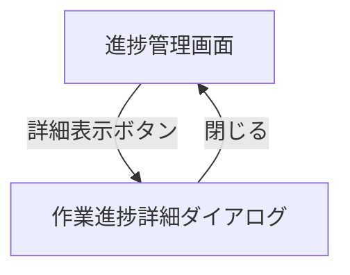

# 進捗管理画面 UI仕様書

## 1. 概要

### 1.1 コンポーネントの目的
プロジェクトの進捗状況を一覧で表示し、タスクの完了状況やプロジェクトステータスを確認するための画面です。実験管理者が各プロジェクトの進捗を監視し、必要に応じて詳細を確認できます。

### 1.2 使用場面
- 実験管理者メニューの「進捗確認」タブを選択した際に表示
- プロジェクト一覧を俯瞰して進捗状況を把握する際に使用
- 各プロジェクトの詳細な進捗を確認する際の起点として機能

### 1.3 アクセス権限
- **必須ロール**: Experiment Admin
- **認証**: JWT + Session Hybrid認証

---

## 2. 画面構成

### 2.1 レイアウト構造

```
┌────────────────────────────────────────────────────────────────┐
│ フィルタ・検索エリア (Card)                                      │
│ ┌────────────────────────────────────────────────────────────┐ │
│ │ [所有者] [部門] [プロジェクトステータス] [チェックアウト]   │ │
│ │ [検索入力]                                    [更新ボタン]  │ │
│ └────────────────────────────────────────────────────────────┘ │
└────────────────────────────────────────────────────────────────┘
┌────────────────────────────────────────────────────────────────┐
│ プロジェクト一覧テーブル (Card)                                  │
│ ┌────────────────────────────────────────────────────────────┐ │
│ │ プロジェクト名 │ 部門 │ ステータス │ … │ 操作              │ │
│ │─────────────────────────────────────────────────────────│ │
│ │ Project A      │ 研究 │ 実行中    │ … │ [詳細表示]       │ │
│ │ Project B      │ 開発 │ 完了      │ … │ [詳細表示]       │ │
│ └────────────────────────────────────────────────────────────┘ │
│ [ページネーション: 1 2 3 ... 10件/ページ]                        │
└────────────────────────────────────────────────────────────────┘

┌────────────────────────────────────────────────────────────────┐
│ 作業進捗詳細ダイアログ (WorkProgressDetailDialog)                │
│ - モーダル形式で表示                                             │
└────────────────────────────────────────────────────────────────┘
```

### 2.2 主要UI要素

#### 2.2.1 フィルタ・検索エリア
- **所有者フィルタ** (Select): 「自分所有のみ」「全体」
- **部門フィルタ** (Select): 「全部門」または個別部門選択
- **プロジェクトステータスフィルタ** (Select): 「全て」「計画中」「実行待ち」「実行中」「レビュー待ち」「完了」「エラー」
- **チェックアウトフィルタ** (Select): 「全て」「チェックアウト済み」「チェックイン済み」
- **検索入力** (Input): プロジェクト名、ID、所有者名等でフィルタリング
- **更新ボタン** (Button): データを再取得

#### 2.2.2 プロジェクト一覧テーブル
- **プロジェクト名**: プロジェクト名とID（サブテキスト）
- **部門**: 所属部門
- **プロジェクトステータス**: ステータスTag（色付き）
- **チェックアウト**: チェックアウト状態Tag（オレンジ/緑）
- **所有者**: 所有者名
- **タスク進捗**: 完了タスク数/総タスク数
- **操作**: 詳細表示ボタン

#### 2.2.3 その他
- **ページネーション**: 5/10/25/50件表示切り替え
- **ソート機能**: 各カラムヘッダークリックでソート可能

### 2.3 画面遷移



---

## 3. 機能仕様

### 3.1 データ取得とフィルタリング

#### 3.1.1 プロジェクト一覧取得
```typescript
// useApiフックでプロジェクト一覧を取得
const { 
  data: projectsData, 
  isLoading: isLoadingProjects, 
  error: projectsError, 
  refetch: refetchProjects 
} = useApi<ApiResponse<ProjectListResponse>>(
  fetchProjects,
  []
);
```

#### 3.1.2 データ変換処理
APIから取得したプロジェクトデータを表示用の`ProgressRecord`形式に変換します。

**プロジェクトステータスの変換:**
- APIは数値コード（0〜5）を返す
- 画面表示用に文字列キーに変換
- マッピング: 0→'planning', 1→'pending', 2→'in_progress', 3→'review_waiting', 4→'completed', 5→'error'

```typescript
const getStatusStringFromNumber = (status: number): string => {
  const map: Record<number, string> = {
    0: 'planning',
    1: 'pending',
    2: 'in_progress',
    3: 'review_waiting',
    4: 'completed',
    5: 'error',
  };
  return map[status] ?? 'planning';
};
```

#### 3.1.3 フィルタリング条件
- **検索テキスト**: プロジェクトID、プロジェクト名、ステータス、部門、所有者、タスク数で部分一致検索
- **所有者フィルタ**: 
  - `my_only`: ログインユーザーのemailまたはdisplayNameと一致するプロジェクトのみ
  - `all`: 全プロジェクト
- **部門フィルタ**: 選択した部門に一致するプロジェクトのみ
- **プロジェクトステータスフィルタ**: 選択したステータスに一致するプロジェクトのみ
- **チェックアウトフィルタ**: 
  - `checkedOut`: チェックアウト中のプロジェクトのみ
  - `checkedIn`: チェックイン済みのプロジェクトのみ
  - `all`: 全プロジェクト

#### 3.1.4 ソート機能
各カラムでソート可能（昇順/降順）:
- プロジェクト名、部門、プロジェクトステータス、チェックアウト状態、所有者、完了タスク数

### 3.2 詳細表示機能

#### 3.2.1 処理フロー
```typescript
const handleViewDetails = async (record: ProgressRecord) => {
  setSelectedProject(record);
  setLoadingProjectId(record.projectId);
  try {
    // プロジェクトのファイル情報を取得
    const filesResponse = await fetchProjectFilesReal(record.projectName);
    
    if (!filesResponse.success) {
      message.error(filesResponse.error?.message || 'ファイル情報の取得に失敗しました');
      return;
    }
    
    const mainFiles: ProjectFile[] = filesResponse.data.files ?? [];
    
    // .maimlファイルを検索
    const maimlFile = mainFiles.find((f: ProjectFile) => f.name.endsWith('.maiml'));
    
    if (!maimlFile) {
      message.error('MAIMLファイルが見つかりません');
      return;
    }
    
    // FileDataを作成してダイアログを開く
    const resolvedFileData: FileData = {
      maimlFileKey: maimlFile.path,
      fileName: maimlFile.name,
    };
    setFileData(resolvedFileData);
    setIsDetailDialogOpen(true);
  } catch (error) {
    console.error('handleViewDetails error:', error);
    message.error('ファイル情報の取得に失敗しました');
  } finally {
    setLoadingProjectId(null);
  }
};
```

#### 3.2.2 UI動作
- **ユーザー操作**: テーブル行の「詳細表示」ボタンをクリック
- **ローディング表示**: クリックしたボタンにローディングスピナーを表示し、他のボタンを無効化
- **画面変化**: `WorkProgressDetailDialog`がモーダル表示される
- **エラー時**: エラーメッセージをtoast表示

#### 3.2.3 条件分岐
- プロジェクトにMAIMLファイルが存在しない場合: エラーメッセージ表示
- API呼び出し失敗時: エラーメッセージ表示とローディング解除

### 3.3 更新機能

#### 3.3.1 処理フロー
```typescript
const handleRefresh = () => {
  console.log('Refresh data');
  refetchProjects();
};
```

#### 3.3.2 UI動作
- **ユーザー操作**: 「更新」ボタンをクリック
- **画面変化**: プロジェクト一覧を再取得し、テーブルを更新
- **完了メッセージ**: なし（自動更新）

### 3.4 ステータス表示

#### 3.4.1 プロジェクトステータスの色分け
```typescript
const getStatusColor = (status: string) => {
  switch (status) {
    case 'planning': return 'default';
    case 'pending': return 'blue';
    case 'in_progress': return 'cyan';
    case 'review_waiting': return 'purple';
    case 'completed': return 'success';
    case 'error': return 'error';
    default: return 'default';
  }
};
```

#### 3.4.2 ステータスラベルの多言語対応
```typescript
const getProjectStatusLabel = (status: string) => {
  switch (status) {
    case 'planning': return t('progress.filter.planning') || 'プロジェクト計画中';
    case 'pending': return t('progress.filter.pending') || 'タスク実行待ち';
    case 'in_progress': return t('progress.filter.inProgress') || 'タスク実行中';
    case 'review_waiting': return t('progress.filter.reviewWaiting') || 'タスク結果レビュー待ち';
    case 'completed': return t('progress.filter.completed') || 'プロジェクト完了';
    case 'error': return t('progress.filter.error') || 'タスク異常終了';
    default: return status;
  }
};
```

---

## 4. データ仕様

### 4.1 Props定義

このコンポーネントはPropsを持ちません（トップレベルコンポーネント）。

### 4.2 State定義

```typescript
// フィルタ関連State
const [searchText, setSearchText] = useState('');
const [ownerFilter, setOwnerFilter] = useState('my_only'); // 'my_only' | 'all'
const [checkoutFilter, setCheckoutFilter] = useState('all');
const [projectStatusFilter, setProjectStatusFilter] = useState('all');
const [departmentFilter, setDepartmentFilter] = useState('all');

// テーブル表示関連State
const [lastUpdated] = useState(new Date().toLocaleString('ja-JP'));
const [page, setPage] = useState(0);
const [rowsPerPage, setRowsPerPage] = useState(10);
const [order, setOrder] = useState<Order>('asc');
const [orderBy, setOrderBy] = useState<OrderBy>('projectName');

// モーダル関連State
const [isDetailDialogOpen, setIsDetailDialogOpen] = useState(false);
const [selectedProject, setSelectedProject] = useState<ProgressRecord | null>(null);
const [fileData, setFileData] = useState<FileData | null>(null);
const [managerId] = useState<string>(() => getUserInfo()?.id ?? '');

// ローディングState
const [loadingProjectId, setLoadingProjectId] = useState<string | null>(null);
```

**State説明:**

| State名 | 型 | 初期値 | 説明 |
|---------|---|--------|------|
| searchText | string | '' | 検索テキスト |
| ownerFilter | string | 'my_only' | 所有者フィルタ（'my_only' または 'all'） |
| checkoutFilter | string | 'all' | チェックアウトフィルタ |
| projectStatusFilter | string | 'all' | プロジェクトステータスフィルタ |
| departmentFilter | string | 'all' | 部門フィルタ |
| page | number | 0 | 現在のページ番号 |
| rowsPerPage | number | 10 | 1ページあたりの表示件数 |
| order | Order | 'asc' | ソート順序 |
| orderBy | OrderBy | 'projectName' | ソート対象カラム |
| isDetailDialogOpen | boolean | false | 詳細ダイアログの表示状態 |
| selectedProject | ProgressRecord \| null | null | 選択されたプロジェクト |
| fileData | FileData \| null | null | 詳細表示用のファイルデータ |
| managerId | string | getUserInfo()?.id ?? '' | ログイン中の管理者ID |
| loadingProjectId | string \| null | null | ローディング中のプロジェクトID |

### 4.3 その他の型定義

```typescript
/**
 * 進捗情報の型定義（表示用）
 */
interface ProgressRecord {
  key: string;
  projectId: string;
  projectName: string;
  projectStatus: string;
  department: string;
  isCheckedOut: boolean;
  ownerEmail: string;
  ownerName: string;
  completedTasks: number;
  totalTasks: number;
}

type Order = 'asc' | 'desc';
type OrderBy = keyof ProgressRecord;
```

**インポートされる型:**
```typescript
import type { FileData, Project } from '@/types/progress';
import type { ProjectFile } from '@/types/file';
import type { ApiResponse } from '@/types/api';
import type { ProjectListResponse } from '@/types/project';
```

---

## 5. API連携

### 5.1 使用するAPI一覧

| # | API名 | メソッド | エンドポイント | 状態 | 説明 |
|---|------|---------|---------------|------|------|
| 1 | fetchProjects | GET | `/api/v1/projects` | ✅ 実装済み | プロジェクト一覧を取得 |
| 2 | fetchProjectFilesReal | GET | `/api/v1/projects/:projectName/files` | ✅ 実装済み | プロジェクトのファイル情報を取得 |

### 5.2 API呼び出しコード

#### 5.2.1 プロジェクト一覧取得
```typescript
const { 
  data: projectsData, 
  isLoading: isLoadingProjects, 
  error: projectsError, 
  refetch: refetchProjects 
} = useApi<ApiResponse<ProjectListResponse>>(
  fetchProjects,
  []
);
```

#### 5.2.2 プロジェクトファイル取得
```typescript
const filesResponse = await fetchProjectFilesReal(record.projectName);
```

### 5.3 リクエスト/レスポンス例

#### 5.3.1 プロジェクト一覧取得

**Request:**
```http
GET /api/v1/projects HTTP/1.1
Authorization: Bearer {sessionToken}
X-Organization-Id: {organizationId}
```

**Response (200 OK):**
```json
{
  "success": true,
  "data": [
    {
      "id": "project-uuid-123",
      "name": "Sample Project",
      "status": 2,
      "department": "研究部",
      "isCheckedOut": false,
      "ownerEmail": "user@example.com",
      "ownerName": "山田太郎",
      "completedTasks": 5,
      "totalTasks": 10
    }
  ]
}
```

#### 5.3.2 プロジェクトファイル取得

**Request:**
```http
GET /api/v1/projects/Sample_Project/files HTTP/1.1
Authorization: Bearer {sessionToken}
X-Organization-Id: {organizationId}
```

**Response (200 OK):**
```json
{
  "success": true,
  "data": {
    "files": [
      {
        "name": "Sample_Project.maiml",
        "path": "projects/Sample_Project/Sample_Project.maiml",
        "size": 12345,
        "lastModified": "2026-03-10T12:00:00Z"
      }
    ]
  }
}
```

---

## 6. エラーハンドリング

### 6.1 エラーケース一覧

| エラーケース | HTTPステータス | エラーコード | 対処方法 |
|-------------|---------------|-------------|----------|
| プロジェクト一覧取得失敗 | 500 | - | useApiフック内で自動的にエラー処理 |
| ファイル情報取得失敗 | 404/500 | - | message.error表示 + ローディング解除 |
| MAIMLファイル未検出 | - | - | message.error表示 + ダイアログ非表示 |
| 認証エラー | 401 | - | ログイン画面へリダイレクト（共通処理） |
| 権限エラー | 403 | - | エラーメッセージ表示 |

### 6.2 エラー処理コード

```typescript
// ファイル取得エラー
if (!filesResponse.success) {
  message.error(filesResponse.error?.message || 'ファイル情報の取得に失敗しました');
  return;
}

// MAIMLファイル未検出エラー
if (!maimlFile) {
  message.error('MAIMLファイルが見つかりません');
  return;
}

// 例外処理
try {
  // ...処理
} catch (error) {
  console.error('handleViewDetails error:', error);
  message.error('ファイル情報の取得に失敗しました');
} finally {
  setLoadingProjectId(null);
}
```

---

## 7. 実装ファイル

### 7.1 ファイルパス
- **メインファイル**: `frontend/src/components/progress/ProgressMonitoring.tsx`

### 7.2 関連ファイル
- **型定義**: 
  - `frontend/src/types/progress.ts` - FileData, Project型
  - `frontend/src/types/file.ts` - ProjectFile型
  - `frontend/src/types/api.ts` - ApiResponse型
  - `frontend/src/types/project.ts` - ProjectListResponse型
- **API**: `frontend/src/utils/apiClient.ts` - fetchProjects, fetchProjectFilesReal
- **ユーティリティ**: `frontend/src/utils/sessionStorageHelper.ts` - getUserInfo
- **Context**: `frontend/src/contexts/LanguageContext.tsx` - useLanguage
- **カスタムフック**: `frontend/src/hooks/useApi.ts` - useApi

### 7.3 依存コンポーネント
- `<WorkProgressDetailDialog />` - 作業進捗詳細ダイアログ（`./WorkProgressDetailDialog`）
- Ant Designコンポーネント: Card, Input, Button, Select, Space, Table, Tag, Typography, theme, message

---

## 8. 変更履歴

| 日付 | 変更内容 | 担当者 |
|------|----------|--------|
| 2026-03-11 | 実装ベースで仕様書を再作成 | Cline |
