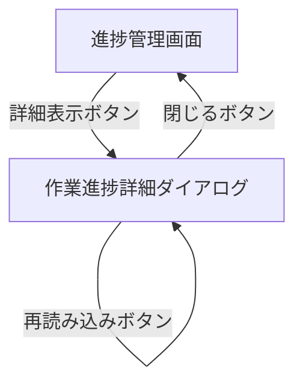

# 作業進捗詳細ダイアログ UI仕様書

## 1. 概要

### 1.1 コンポーネントの目的
プロジェクトの作業進捗を詳細に表示するモーダルダイアログです。タスク別の進捗状況、トランジション別の実行状況、Petri Net可視化などを統合的に表示します。

### 1.2 使用場面
- 進捗管理画面（ProgressMonitoring）で「詳細表示」ボタンをクリックした際に表示
- プロジェクトの詳細な進捗状況を確認する際に使用
- 各タスクのトランジション別進捗を把握する際に使用

### 1.3 アクセス権限
- **必須ロール**: Experiment Admin
- **認証**: JWT + Session Hybrid認証

---

## 2. 画面構成

### 2.1 レイアウト構造

```
┌──────────────────────────────────────────────────────────────┐
│ モーダルヘッダー: プロジェクト進捗詳細           [×]         │
├──────────────────────────────────────────────────────────────┤
│ プロジェクト基本情報 (Card)                                   │
│ ┌──────────────────────────────────────────────────────────┐ │
│ │ プロジェクト名 | ステータス                              │ │
│ │ プロジェクトID                                           │ │
│ │ 説明                                                     │ │
│ │ オーナー | 部門 | 更新日時                               │ │
│ └──────────────────────────────────────────────────────────┘ │
├──────────────────────────────────────────────────────────────┤
│ メソッドフィルタ (Card - 複数メソッドの場合のみ)             │
│ ┌──────────────────────────────────────────────────────────┐ │
│ │ メソッド: [ドロップダウン選択]                           │ │
│ └──────────────────────────────────────────────────────────┘ │
├──────────────────────────────────────────────────────────────┤
│ 作業ID別タブ (Tabs)                                          │
│ │ Task1 │ Task2 │ Task3 │ ...                              │
├──────────────────────────────────────────────────────────────┤
│ タスク詳細 (Card)                                            │
│ ┌──────────────────────────────────────────────────────────┐ │
│ │ タスクNo | タスクステータス | メソッド名                 │ │
│ └──────────────────────────────────────────────────────────┘ │
├──────────────────────────────────────────────────────────────┤
│ トランジションサマリー (Card)                                │
│ ┌──────────────────────────────────────────────────────────┐ │
│ │ [全体] [完了] [作業中] [未着手] [完了率]                 │ │
│ └──────────────────────────────────────────────────────────┘ │
├──────────────────────────────────────────────────────────────┤
│ 実験フロー図 (PetriNetVisualization)                         │
│ ┌──────────────────────────────────────────────────────────┐ │
│ │ [Petri Net図]                                            │ │
│ └──────────────────────────────────────────────────────────┘ │
├──────────────────────────────────────────────────────────────┤
│ トランジション詳細一覧                                        │
│ ┌──────────────────────────────────────────────────────────┐ │
│ │ [アイコン] Transition 1 | 完了 | 作業者 | 開始/終了日    │ │
│ │ [アイコン] Transition 2 | 作業中 | 作業者 | 開始/終了日  │ │
│ └──────────────────────────────────────────────────────────┘ │
├──────────────────────────────────────────────────────────────┤
│ フッター: [再読み込み]                            [閉じる]  │
└──────────────────────────────────────────────────────────────┘
```

### 2.2 主要UI要素

#### 2.2.1 モーダルヘッダー
- **タイトル**: 「プロジェクト進捗詳細」
- **閉じるボタン**: 右上の×ボタン

#### 2.2.2 プロジェクト基本情報
- **プロジェクト名**: プロジェクト名とステータスTag
- **プロジェクトID**: プロジェクト識別子
- **説明**: プロジェクトの説明（存在する場合）
- **オーナー**: プロジェクトオーナー名
- **部門**: 所属部門（存在する場合）
- **更新日時**: 最終更新日時

#### 2.2.3 メソッドフィルタ（複数メソッドの場合のみ表示）
- **メソッド選択**: Selectコンポーネントでメソッドをフィルタリング
- **クリア機能**: 「すべてのメソッド」でフィルタ解除

#### 2.2.4 作業ID別タブ
- **タブ**: Task1, Task2, Task3...（フィルタ適用後の作業リスト）
- **切り替え**: クリックでタブを切り替え

#### 2.2.5 タスク詳細
- **タスクNo**: タスク番号
- **タスクステータス**: ステータスTag（色付き）
- **メソッド名**: 実行メソッド名

#### 2.2.6 トランジションサマリー
- **全体**: トランジション総数
- **完了**: 完了したトランジション数（緑色背景）
- **作業中**: 作業中のトランジション数（青色背景）
- **未着手**: 未着手のトランジション数
- **完了率**: 完了率（パーセント表示、青色背景）

#### 2.2.7 実験フロー図
- **PetriNetVisualization**: Petri Net図を可視化
- **進捗表示**: トランジションの進捗状況を視覚的に表示

#### 2.2.8 トランジション詳細一覧
- **トランジション名**: トランジション名またはID
- **進捗ステータス**: ステータスTag（完了/作業中/準備中/休止中/異常中/未開始）
- **トランジションID**: 識別子
- **作業者**: 割り当てられた作業者名
- **開始日**: 作業開始日時
- **終了日**: 作業終了日時（完了の場合のみ）

#### 2.2.9 フッター
- **再読み込みボタン**: データを再取得
- **閉じるボタン**: ダイアログを閉じる

### 2.3 画面遷移



---

## 3. 機能仕様

### 3.1 データ取得機能

#### 3.1.1 処理フロー
```typescript
const fetchFileDetails = useCallback(async () => {
  if (!fileData || !fileData.maimlFileKey) {
    console.warn('⚠️ [FileProgressDetail] Missing required parameters');
    return;
  }

  setLoading(true);
  setError(null);

  try {
    // maimlFileKeyからプロジェクト名を抽出
    // 形式: "projects/{projectName}/{projectName}.maiml"
    const projectNameMatch = fileData.maimlFileKey.match(/(?:^|\/)projects\/([^/]+)\//);
    const projectName = projectNameMatch ? decodeURIComponent(projectNameMatch[1]) : null;

    if (!projectName) {
      throw new Error('maimlFileKeyからプロジェクト名を取得できませんでした');
    }

    // API呼び出し（createApiClient 経由で認証ヘッダーを自動付与）
    const { createApiClient } = await import('@/utils/authUtils');
    const client = createApiClient();
    const response = await client.get(
      `/progress/projects/${encodeURIComponent(projectName)}/work-details`
    );

    if (response.data.success) {
      const { projectInfo, fileInfo, workDetails } = response.data.data;

      setFileDetails({
        projectInfo: projectInfo ? {
          ...projectInfo,
          status: projectInfo.status as 'planning' | 'in_progress' | 'pending' | 'completed'
        } : undefined,
        fileInfo: {
          ...fileInfo,
          checkoutStatus: fileInfo.checkoutStatus ? {
            isCheckedOut: fileInfo.checkoutStatus.isCheckedOut,
            checkoutBy: fileInfo.checkoutStatus.checkoutBy || undefined
          } : undefined
        },
        workDetails: (workDetails || []) as WorkDetail[],
      });
      setSelectedWorkIndex(0);
    } else {
      throw new Error(response.data.error?.message || 'ファイル詳細の取得に失敗しました');
    }
  } catch (err) {
    console.error('❌ [FileProgressDetail] Fetch error:', err);
    const errorMessage =
      err instanceof Error
        ? err.message
        : 'ファイル詳細の取得に失敗しました';
    setError(errorMessage);
  } finally {
    setLoading(false);
  }
}, [fileData]);
```

#### 3.1.2 UI動作
- **ダイアログオープン時**: 自動的にデータ取得を開始
- **ローディング表示**: Spin コンポーネントで「ファイル詳細を読み込み中...」を表示
- **取得成功**: プロジェクト情報、作業詳細、トランジション進捗を表示
- **取得失敗**: エラーAlertを表示し、「再試行」ボタンを提供

#### 3.1.3 条件分岐
- fileDataが存在しない場合: 処理をスキップ
- maimlFileKeyからプロジェクト名が抽出できない場合: エラーメッセージ表示
- API呼び出し失敗時: エラーメッセージ表示

### 3.2 タブ切り替え機能

#### 3.2.1 処理フロー
```typescript
const handleTabChange = (activeKey: string) => {
  setSelectedWorkIndex(Number(activeKey));
};
```

#### 3.2.2 UI動作
- **ユーザー操作**: タブをクリック
- **画面変化**: 選択されたタスクの詳細を表示
- **フィルタ連携**: メソッドフィルタが適用されている場合は、フィルタ適用後のタスクリストから選択

### 3.3 メソッドフィルタ機能

#### 3.3.1 処理フロー
```typescript
const handleMethodFilterChange = (value: string | undefined) => {
  setSelectedMethod(value);
  setSelectedWorkIndex(0); // フィルタ変更時は最初のタブに戻す
};

const filteredWorkDetails = React.useMemo(() => {
  if (!fileDetails?.workDetails) return [];
  if (!selectedMethod) return fileDetails.workDetails;
  
  return fileDetails.workDetails.filter(work => {
    return work.methodName === selectedMethod;
  });
}, [fileDetails?.workDetails, selectedMethod]);
```

#### 3.3.2 UI動作
- **表示条件**: プロジェクトのメソッドが複数存在する場合のみ表示
- **ユーザー操作**: Selectコンポーネントでメソッドを選択
- **画面変化**: 
  - 選択したメソッドに一致するタスクのみをタブに表示
  - 最初のタブに自動的に切り替わる
  - クリア時は全タスクを表示

### 3.4 ステータス表示機能

#### 3.4.1 プロジェクトステータスの色分け
```typescript
// プロジェクトステータスTag
{fileDetails.projectInfo.status && (
  <Tag 
    color={
      fileDetails.projectInfo.status === 'completed' ? 'success' :
      fileDetails.projectInfo.status === 'in_progress' ? 'processing' :
      fileDetails.projectInfo.status === 'pending' ? 'warning' :
      'default'
    }
  >
    {/* ラベル表示 */}
  </Tag>
)}
```

#### 3.4.2 タスクステータスの色分け
```typescript
const getWorkStatusColor = (status: string): 
  'processing' | 'warning' | 'success' | 'default' | 'error' => {
  switch (status) {
    case 'pending': return 'default';
    case 'in_progress': return 'processing';
    case 'error': return 'error';
    case 'review_waiting': return 'warning';
    case 'completed': return 'success';
    default: return 'default';
  }
};
```

#### 3.4.3 進捗ステータスの色分けとアイコン
```typescript
const getProgressStatusColor = (progressStatus: string): 
  'success' | 'processing' | 'default' | 'warning' | 'error' => {
  switch (progressStatus) {
    case '完了': return 'success';
    case '作業中': return 'processing';
    case '準備中': return 'default';
    case '休止中': return 'warning';
    case '異常中': return 'error';
    case '未開始':
    default: return 'default';
  }
};

const getProgressStatusIcon = (progressStatus: string) => {
  switch (progressStatus) {
    case '完了': return <CheckOutlined />;
    case '作業中': return <PlayCircleOutlined />;
    case '準備中': return <ClockCircleOutlined />;
    case '休止中': return <PauseCircleOutlined />;
    case '異常中': return <ExclamationCircleOutlined />;
    case '未開始':
    default: return <MinusCircleOutlined />;
  }
};
```

### 3.5 再読み込み機能

#### 3.5.1 処理フロー
```typescript
// フッターの再読み込みボタンでfetchFileDetailsを実行
<Button
  icon={<ReloadOutlined />}
  onClick={fetchFileDetails}
  loading={loading}
  type="default"
>
  再読み込み
</Button>
```

#### 3.5.2 UI動作
- **ユーザー操作**: 「再読み込み」ボタンをクリック
- **ローディング表示**: ボタンにローディングスピナーを表示
- **画面変化**: データを再取得し、画面を更新
- **完了メッセージ**: なし（自動更新）

### 3.6 PetriNetVisualization統合

#### 3.6.1 表示条件
```typescript
{fileDetails?.fileInfo && fileDetails.fileInfo.maimlFileKey && (
  <PetriNetVisualization
    fileKey={fileDetails.fileInfo.maimlFileKey}
    workerId={selectedWork.assignedWorkerId || ''}
    workId={selectedWork.workId}
    progressData={selectedWork.transitionProgress}
  />
)}
```

#### 3.6.2 連携データ
- **fileKey**: MAIMLファイルのキー
- **workerId**: 割り当てられた作業者ID
- **workId**: 作業ID
- **progressData**: トランジション進捗データ

---

## 4. データ仕様

### 4.1 Props定義

```typescript
interface WorkProgressDetailDialogProps {
  open: boolean;
  onClose: () => void;
  fileData: FileData | null;
  managerId: string;
}
```

**Props説明:**
| Prop名 | 型 | 必須 | 説明 |
|--------|---|------|------|
| open | boolean | ✅ | ダイアログの表示状態 |
| onClose | () => void | ✅ | ダイアログを閉じるコールバック |
| fileData | FileData \| null | ✅ | 表示するファイルデータ |
| managerId | string | ✅ | 管理者ID（現在は未使用） |

### 4.2 State定義

```typescript
const [fileDetails, setFileDetails] = useState<FileDetails | null>(null);
const [loading, setLoading] = useState(false);
const [error, setError] = useState<string | null>(null);
const [selectedWorkIndex, setSelectedWorkIndex] = useState(0);
const [selectedMethod, setSelectedMethod] = useState<string | undefined>(undefined);
```

**State説明:**
| State名 | 型 | 初期値 | 説明 |
|---------|---|--------|------|
| fileDetails | FileDetails \| null | null | ファイルの詳細情報 |
| loading | boolean | false | データ取得中フラグ |
| error | string \| null | null | エラーメッセージ |
| selectedWorkIndex | number | 0 | 選択中の作業インデックス |
| selectedMethod | string \| undefined | undefined | 選択中のメソッドフィルタ |

### 4.3 その他の型定義

```typescript
import type {
  FileData,
  FileDetails,
  WorkDetail,
  TransitionProgress,
} from '@/types/progress';
```

**FileData:**
```typescript
interface FileData {
  maimlFileKey: string;  // MAIMLファイルのキー（相対パス）
  fileName: string;       // ファイル名
}
```

**FileDetails:**
```typescript
interface FileDetails {
  projectInfo?: {
    projectName: string;
    projectId: string;
    projectDescription?: string;
    status: 'planning' | 'in_progress' | 'pending' | 'completed';
    owner: string;
    department?: string;
    updatedAt: string;
    methods: string[];  // メソッドリスト
  };
  fileInfo: {
    maimlFileKey: string;
    checkoutStatus?: {
      isCheckedOut: boolean;
      checkoutBy?: string;
    };
  };
  workDetails: WorkDetail[];
}
```

**WorkDetail:**
```typescript
interface WorkDetail {
  workId: string;
  taskNo: number;
  workStatus: string;  // 'pending' | 'in_progress' | 'error' | 'review_waiting' | 'completed'
  methodName: string;
  assignedWorkerId?: string;
  stats: {
    totalTransitions: number;
    completed: number;
    working: number;
    notStarted: number;
    completionRate: number;
  };
  transitionProgress: TransitionProgress[];
}
```

**TransitionProgress:**
```typescript
interface TransitionProgress {
  transitionId: string;
  transitionName?: string;
  progressStatus: string;  // '完了' | '作業中' | '準備中' | '休止中' | '異常中' | '未開始'
  assignedWorker?: string;
  startDate?: string;
  endDate?: string;
}
```

---

## 5. API連携

### 5.1 使用するAPI一覧

| # | API名 | メソッド | エンドポイント | 状態 | 説明 |
|---|------|---------|---------------|------|------|
| 1 | getWorkDetails | GET | `/api/v1/progress/projects/:projectName/work-details` | ✅ 実装済み | プロジェクトの作業詳細を取得 |

### 5.2 API呼び出しコード

```typescript
const { createApiClient } = await import('@/utils/authUtils');
const client = createApiClient();
const response = await client.get(
  `/progress/projects/${encodeURIComponent(projectName)}/work-details`
);
```

### 5.3 リクエスト/レスポンス例

**Request:**
```http
GET /api/v1/progress/projects/Sample_Project/work-details HTTP/1.1
Authorization: Bearer {sessionToken}
X-Organization-Id: {organizationId}
```

**Response (200 OK):**
```json
{
  "success": true,
  "data": {
    "projectInfo": {
      "projectName": "Sample Project",
      "projectId": "project-uuid-123",
      "projectDescription": "サンプルプロジェクトです",
      "status": 2,
      "owner": "山田太郎",
      "department": "研究部",
      "updatedAt": "2026-03-10T12:00:00Z",
      "methods": ["Method_A", "Method_B"]
    },
    "fileInfo": {
      "maimlFileKey": "projects/Sample_Project/Sample_Project.maiml",
      "checkoutStatus": {
        "isCheckedOut": false,
        "checkoutBy": null
      }
    },
    "workDetails": [
      {
        "workId": "work-uuid-456",
        "taskNo": 1,
        "workStatus": "in_progress",
        "methodName": "Method_A",
        "assignedWorkerId": "worker-uuid-789",
        "stats": {
          "totalTransitions": 10,
          "completed": 5,
          "working": 2,
          "notStarted": 3,
          "completionRate": 50
        },
        "transitionProgress": [
          {
            "transitionId": "transition-001",
            "transitionName": "Transition 1",
            "progressStatus": "完了",
            "assignedWorker": "作業者A",
            "startDate": "2026-03-10T10:00:00Z",
            "endDate": "2026-03-10T11:00:00Z"
          }
        ]
      }
    ]
  }
}
```

---

## 6. エラーハンドリング

### 6.1 エラーケース一覧

| エラーケース | HTTPステータス | エラーコード | 対処方法 |
|-------------|---------------|-------------|----------|
| fileDataが存在しない | - | - | 警告ログを出力し、処理をスキップ |
| プロジェクト名抽出失敗 | - | - | エラーメッセージ表示 + Alert表示 |
| API呼び出し失敗 | 404/500 | - | エラーメッセージ表示 + 再試行ボタン提供 |
| 作業IDなし | - | - | 「作業IDが割り当てられていません」Alert表示 |
| トランジション進捗なし | - | - | 「トランジション進捗データがありません」Alert表示 |
| 認証エラー | 401 | - | ログイン画面へリダイレクト（共通処理） |

### 6.2 エラー処理コード

```typescript
// プロジェクト名抽出エラー
if (!projectName) {
  throw new Error('maimlFileKeyからプロジェクト名を取得できませんでした');
}

// API呼び出しエラー
if (!response.data.success) {
  throw new Error(response.data.error?.message || 'ファイル詳細の取得に失敗しました');
}

// 例外処理
try {
  // ...処理
} catch (err) {
  console.error('❌ [FileProgressDetail] Fetch error:', err);
  const errorMessage =
    err instanceof Error
      ? err.message
      : 'ファイル詳細の取得に失敗しました';
  setError(errorMessage);
} finally {
  setLoading(false);
}
```

---

## 7. 実装ファイル

### 7.1 ファイルパス
- **メインファイル**: `frontend/src/components/progress/WorkProgressDetailDialog.tsx`

### 7.2 関連ファイル
- **型定義**: `frontend/src/types/progress.ts` - FileData, FileDetails, WorkDetail, TransitionProgress型
- **API**: `frontend/src/utils/authUtils.ts` - createApiClient
- **コンポーネント**: `./PetriNetVisualization.tsx` - Petri Net可視化

### 7.3 依存コンポーネント
- `<PetriNetVisualization />` - Petri Net可視化コンポーネント（`./PetriNetVisualization`）
- Ant Designコンポーネント: Modal, Button, Typography, Tabs, Card, Tag, Spin, Alert, Space, Flex, Divider, theme, Grid, Row, Col, Select
- Ant Designアイコン: CloseOutlined, ReloadOutlined, CheckCircleOutlined, ClockCircleOutlined, ExclamationCircleOutlined, PauseCircleOutlined, PlayCircleOutlined, CheckOutlined, MinusCircleOutlined

---

## 8. 変更履歴

| 日付 | 変更内容 | 担当者 |
|------|----------|--------|
| 2026-03-11 | 実装ベースで仕様書を再作成 | Cline |
