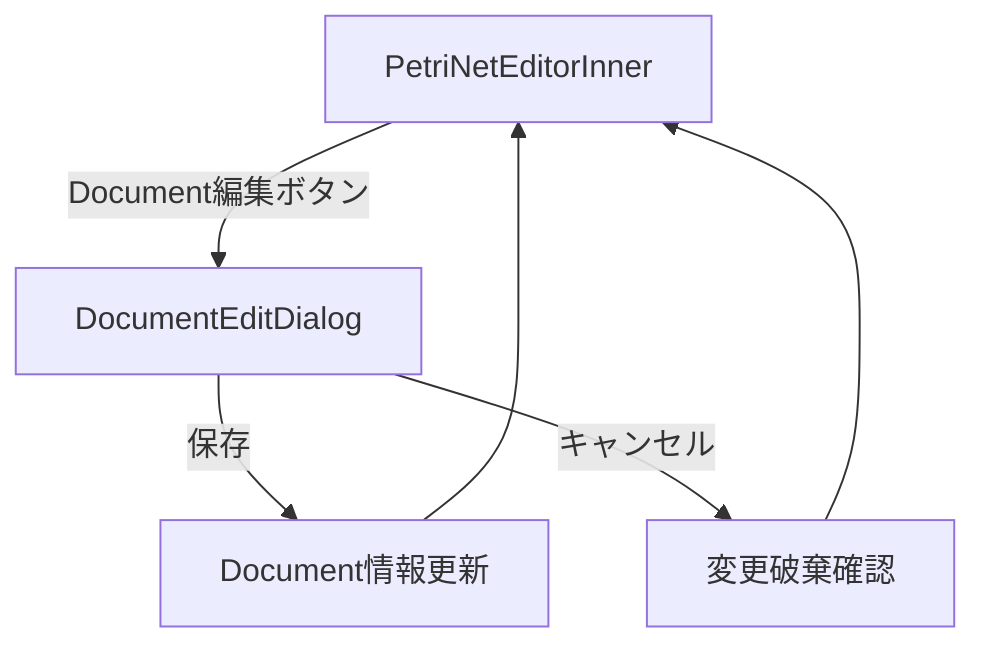

# DocumentEditDialog - Document編集ダイアログ

## 1. 概要

### 1.1 コンポーネントの目的

DocumentEditDialogは、MAIMLファイルのDocument要素（Creator、Vendor、Owner、Instrument）を編集するモーダルダイアログです。Document情報の基本プロパティ、MaiML ID属性、XML署名設定、および複数のDocument関連要素（Creator/Vendor/Owner/Instrument）を一元管理します。

**主要機能:**
- Document基本情報の編集（id、uuid、name、description、date）
- MaiML ID属性の編集（protocolId、methodId、pnmlId、programId）
- XML署名設定（改ざん防止機能）
- Creator/Vendor/Owner/Instrument要素の編集（MultiObjectEditor使用）
- マスタデータからの選択機能
- UUID自動生成
- リアルタイムバリデーション

### 1.2 使用場面

- **表示タイミング**: PetriNetEditorInner の「Document編集」ボタンクリック時
- **表示条件**: MAIML編集画面（PetriNetEditorScreen）からアクセス
- **編集モード**: 新規作成、既存Document編集

### 1.3 アクセス権限

- **必須ロール**: Experiment Admin (Level 2)
- **認証**: JWT + Session Hybrid認証
- **組織制限**: 自組織のMAIMLファイルのみ編集可能

---

## 2. 目次

1. [概要](#1-概要)
2. [目次](#2-目次)
3. [画面構成](#3-画面構成)
4. [機能仕様](#4-機能仕様)
5. [データ仕様](#5-データ仕様)
6. [API連携](#6-api連携)
7. [エラーハンドリング](#7-エラーハンドリング)
8. [実装ファイル](#8-実装ファイル)
9. [変更履歴](#9-変更履歴)

---

## 3. 画面構成

### 3.1 レイアウト構造

```
┌─────────────────────────────────────────────────────────────┐
│ Modal Header                                                 │
│ 📄 Document編集                                      [×]     │
├─────────────────────────────────────────────────────────────┤
│ Modal Body (スクロール可能)                                 │
│ ┌───────────────────────────────────────────────────────┐   │
│ │ バリデーションエラー表示（エラー時のみ）              │   │
│ ├───────────────────────────────────────────────────────┤   │
│ │ [UUID一括生成] ボタン                                  │   │
│ ├───────────────────────────────────────────────────────┤   │
│ │ Collapse: 基本プロパティ（展開状態）                   │   │
│ │ - Document ID（必須）                                  │   │
│ │ - UUID（生成ボタン付き）                               │   │
│ │ - Name（必須）                                         │   │
│ │ - Description                                          │   │
│ │ - Date（DatePicker + 現在時刻ボタン）                  │   │
│ ├───────────────────────────────────────────────────────┤   │
│ │ Collapse: MaiML ID属性（折りたたみ状態）               │   │
│ │ - Protocol ID                                          │   │
│ │ - Method ID                                            │   │
│ │ - PNML ID                                              │   │
│ │ - Program ID                                           │   │
│ ├───────────────────────────────────────────────────────┤   │
│ │ Collapse: XML署名（折りたたみ状態）                    │   │
│ │ - 改ざん防止のためのXML署名を行う（Checkbox）          │   │
│ ├───────────────────────────────────────────────────────┤   │
│ │ MultiObjectEditor: Creator（折りたたみ状態）           │   │
│ │ - 追加/削除/編集機能                                   │   │
│ │ - マスタデータから選択                                 │   │
│ ├───────────────────────────────────────────────────────┤   │
│ │ MultiObjectEditor: Vendor（折りたたみ状態）            │   │
│ ├───────────────────────────────────────────────────────┤   │
│ │ MultiObjectEditor: Owner（折りたたみ状態）             │   │
│ ├───────────────────────────────────────────────────────┤   │
│ │ MultiObjectEditor: Instrument（折りたたみ状態）        │   │
│ ├───────────────────────────────────────────────────────┤   │
│ │ ヒント（Info Alert）                                   │   │
│ └───────────────────────────────────────────────────────┘   │
├─────────────────────────────────────────────────────────────┤
│ Modal Footer                                                 │
│ [⚠️ 未保存の変更があります]  [キャンセル] [💾 Document保存] │
└─────────────────────────────────────────────────────────────┘
```

### 3.2 主要UI要素

#### 3.2.1 バリデーションエラー表示
- エラー時のみ表示
- リスト形式でエラー内容を表示

#### 3.2.2 UUID一括生成ボタン
- Documentのuuidを一括生成

#### 3.2.3 基本プロパティ（Collapseパネル）
- Document ID: 必須入力
- UUID: UUID生成ボタン付き
- Name: 必須入力
- Description: テキストエリア
- Date: DatePicker（現在時刻設定ボタン付き）

#### 3.2.4 MaiML ID属性（Collapseパネル）
- Protocol ID, Method ID, PNML ID, Program ID
- 最大64文字の英数字・アンダースコア・ハイフン

#### 3.2.5 XML署名（Collapseパネル）
- 改ざん防止のためのXML署名を行う（Checkbox）
- W3C XMLDSig仕様に基づく署名

#### 3.2.6 Creator/Vendor/Owner/Instrument編集
- MultiObjectEditorコンポーネントを使用
- 追加/削除/編集/並び替え機能
- マスタデータから選択可能
- Creator: 最低1件必須、Reference設定可能
- Vendor: 最低1件必須
- Owner: 最低1件必須
- Instrument: 任意（0件可）

### 3.3 画面遷移



---

## 4. 機能仕様

### 4.1 ダイアログ初期化

#### 4.1.1 処理フロー

```typescript
useEffect(() => {
  if (open && documentData) {
    // stateリセット
    setHasChanges(false);
    setValidationErrors([]);
    
    // フォーム初期化
    form.setFieldsValue({
      ...documentData,
      date: documentData.date ? dayjs(documentData.date) : dayjs(),
      signatureEnabled: documentData.signatureEnabled || false,
    });
  }
}, [open, documentData, form]);
```

**注意**: PetriNetEditorInnerから初期化済みのdocumentDataが渡されるため、DocumentEditDialog側での追加の初期化は不要です。

#### 4.1.2 マスタデータ取得

```typescript
useEffect(() => {
  const loadMasterData = async () => {
    if (!open) return;
    
    setIsLoadingMasters(true);
    const [creatorsData, vendorsData, instrumentsData] = await Promise.all([
      fetchMasters('creator'),
      fetchMasters('vendor'),
      fetchMasters('instrument'),
    ]);
    
    setCreators(creatorsData.map(convertCreatorToDocumentTag));
    setVendors(vendorsData.map(convertVendorToDocumentTag));
    setInstruments(instrumentsData.map(convertInstrumentToDocumentTag));
  };
  
  loadMasterData();
}, [open]);
```

### 4.2 UUID生成機能

#### 4.2.1 UUID一括生成

```typescript
const handleAutoGenerateUUIDs = useCallback(() => {
  const values = form.getFieldsValue(true);
  form.setFieldsValue({
    ...values,
    uuid: generateUUID(),
  });
  setHasChanges(true);
  message.success('UUID を生成しました');
}, [form, generateUUID]);
```

#### 4.2.2 個別UUID生成

```typescript
<Button
  icon={<ThunderboltOutlined />}
  onClick={() => {
    const uuid = generateUUID();
    form.setFieldValue('uuid', uuid);
    setHasChanges(true);
  }}
>
  生成
</Button>
```

**UUID形式**: `xxxxxxxx-xxxx-4xxx-yxxx-xxxxxxxxxxxx` (RFC 4122 Version 4)

### 4.3 現在時刻設定

```typescript
const handleSetCurrentDateTime = useCallback(() => {
  form.setFieldValue('date', dayjs());
  setHasChanges(true);
  message.success('現在時刻を設定しました');
}, [form]);
```

### 4.4 バリデーション機能

#### 4.4.1 リアルタイムバリデーション

```typescript
const handleFormChange = useCallback(() => {
  setHasChanges(true);

  if (validationTimeoutRef.current) {
    clearTimeout(validationTimeoutRef.current);
  }

  validationTimeoutRef.current = setTimeout(() => {
    const values = form.getFieldsValue(true);
    const errors = validateDocumentData(values);
    setValidationErrors(errors);
  }, 500);
}, [form, validateDocumentData]);
```

**検証タイミング**: 入力後500msのデバウンス

#### 4.4.2 バリデーションルール

```typescript
const validateDocumentData = useMemo(() => (data: DocumentData): string[] => {
  const errors: string[] = [];
  
  // 基本プロパティ
  if (!data.name?.trim()) {
    errors.push('❌ Document name is required');
  }
  if (!data.id?.trim()) {
    errors.push('❌ Document ID is required');
  }
  
  // UUID形式チェック
  const uuidRegex = /^[0-9a-f]{8}-[0-9a-f]{4}-[0-9a-f]{4}-[0-9a-f]{4}-[0-9a-f]{12}$/i;
  if (data.uuid && !uuidRegex.test(data.uuid)) {
    errors.push('❌ Invalid UUID format');
  }
  
  // 日付形式チェック
  if (data.date && isNaN(Date.parse(data.date))) {
    errors.push('❌ Invalid date format');
  }
  
  // 必須要素チェック
  if (!data.creators || data.creators.length === 0) {
    errors.push('❌ At least one Creator is required');
  }
  if (!data.vendors || data.vendors.length === 0) {
    errors.push('❌ At least one Vendor is required');
  }
  if (!data.owners || data.owners.length === 0) {
    errors.push('❌ At least one Owner is required');
  }
  
  // ID重複チェック
  const ids: string[] = [data.id];
  if (data.creators) data.creators.forEach(c => c.id && ids.push(c.id));
  if (data.vendors) data.vendors.forEach(v => v.id && ids.push(v.id));
  if (data.owners) data.owners.forEach(o => o.id && ids.push(o.id));
  if (data.instruments) data.instruments.forEach(i => i.id && ids.push(i.id));
  
  const duplicateIds = ids.filter((id, index) => ids.indexOf(id) !== index);
  if (duplicateIds.length > 0) {
    errors.push(`❌ Duplicate IDs found: ${duplicateIds.join(', ')}`);
  }
  
  return errors;
}, []);
```

### 4.5 セクション展開管理

```typescript
const [expandedSections, setExpandedSections] = useState<Record<string, boolean>>({
  basic: true,
  maimlIds: false,
  signature: false,
  creators: false,
  vendors: false,
  owners: false,
  instruments: false,
});

const handleToggleSection = useCallback((sectionKey: string) => {
  setExpandedSections(prev => ({
    ...prev,
    [sectionKey]: !prev[sectionKey]
  }));
}, []);
```

### 4.6 MultiObjectEditor連携

#### 4.6.1 データ変更ハンドラー

```typescript
const handleMultiObjectDataChange = useCallback((
  objectKey: 'creators' | 'vendors' | 'owners' | 'instruments',
  objectsArray: DocumentTagData[]
) => {
  form.setFieldsValue({ [objectKey]: objectsArray });
  setHasChanges(true);
  
  // バリデーション
  if (validationTimeoutRef.current) {
    clearTimeout(validationTimeoutRef.current);
  }
  validationTimeoutRef.current = setTimeout(() => {
    const values = form.getFieldsValue(true);
    const errors = validateDocumentData(values);
    setValidationErrors(errors);
  }, 500);
}, [form, validateDocumentData]);
```

#### 4.6.2 VendorとInstrumentのIDリスト算出

```typescript
const vendorIds = useMemo(() => {
  const vendors = form.getFieldValue('vendors') || [];
  return vendors.map((v: DocumentTagData) => v.id).filter(Boolean);
}, [form]);

const instrumentIds = useMemo(() => {
  const instruments = form.getFieldValue('instruments') || [];
  return instruments.map((i: DocumentTagData) => i.id).filter(Boolean);
}, [form]);
```

**用途**: CreatorのReference設定時に、VendorとInstrumentのIDリストを渡す

### 4.7 保存処理

```typescript
const handleSave = useCallback(async () => {
  try {
    await form.validateFields();
    
    const values = form.getFieldsValue(true);

    const documentToSave: DocumentData = {
      ...values,
      date: values.date ? values.date : new Date(),
      signatureEnabled: values.signatureEnabled,
    };

    const errors = validateDocumentData(documentToSave);
    setValidationErrors(errors);
    
    if (errors.length > 0) {
      message.error('バリデーションエラーがあります');
      return;
    }
    
    onSave(documentToSave);
    onClose();
    message.success('Document を保存しました');
  } catch (error) {
    console.error('Validation failed:', error);
    message.error('入力内容を確認してください');
  }
}, [form, validateDocumentData, onSave, onClose]);
```

### 4.8 キャンセル処理

```typescript
const handleCancel = useCallback(() => {
  if (hasChanges) {
    Modal.confirm({
      title: '未保存の変更があります',
      content: '変更を破棄しますか？',
      okText: '破棄',
      cancelText: 'キャンセル',
      onOk: onClose,
    });
  } else {
    onClose();
  }
}, [hasChanges, onClose]);
```

---

## 5. データ仕様

### 5.1 Props定義

```typescript
export interface DocumentEditDialogProps {
  open: boolean;
  documentData?: DocumentData | null;
  onClose: () => void;
  onSave: (document: DocumentData) => void;
  readOnly?: boolean;
}
```

| Prop名 | 型 | 必須 | 説明 |
|--------|---|------|------|
| open | boolean | ✅ | ダイアログ表示フラグ |
| documentData | DocumentData \| null | - | 編集対象のDocument情報（新規作成時はnull） |
| onClose | () => void | ✅ | ダイアログ閉じるコールバック |
| onSave | (document: DocumentData) => void | ✅ | Document保存コールバック |
| readOnly | boolean | - | 読み取り専用モード（未使用） |

### 5.2 State定義

```typescript
const [form] = Form.useForm();
const [hasChanges, setHasChanges] = useState<boolean>(false);
const [validationErrors, setValidationErrors] = useState<string[]>([]);
const [expandedSections, setExpandedSections] = useState<Record<string, boolean>>({ /* ... */ });
const [creators, setCreators] = useState<DocumentTagData[]>([]);
const [vendors, setVendors] = useState<DocumentTagData[]>([]);
const [owners, setOwners] = useState<DocumentTagData[]>([]);
const [instruments, setInstruments] = useState<DocumentTagData[]>([]);
const [isLoadingMasters, setIsLoadingMasters] = useState(false);
const validationTimeoutRef = useRef<NodeJS.Timeout | null>(null);
```

| State名 | 型 | 初期値 | 説明 |
|---------|---|--------|------|
| form | FormInstance | - | Ant Design Formインスタンス |
| hasChanges | boolean | false | 未保存の変更があるかフラグ |
| validationErrors | string[] | [] | バリデーションエラー配列 |
| expandedSections | Record<string, boolean> | {...} | セクション展開状態 |
| creators | DocumentTagData[] | [] | Creatorマスタデータ |
| vendors | DocumentTagData[] | [] | Vendorマスタデータ |
| owners | DocumentTagData[] | [] | Ownerマスタデータ（保留） |
| instruments | DocumentTagData[] | [] | Instrumentマスタデータ |
| isLoadingMasters | boolean | false | マスタデータ読み込み中フラグ |
| validationTimeoutRef | Ref<NodeJS.Timeout> | null | バリデーションデバウンス用タイマー |

### 5.3 主要な型定義

#### 5.3.1 DocumentData型

```typescript
interface DocumentData {
  id: string;
  uuid?: string;
  name: string;
  description?: string;
  date?: string | Date;
  protocolId?: string;
  methodId?: string;
  pnmlId?: string;
  programId?: string;
  signatureEnabled?: boolean;
  creators?: DocumentTagData[];
  vendors?: DocumentTagData[];
  owners?: DocumentTagData[];
  instruments?: DocumentTagData[];
  [key: string]: unknown;
}
```

#### 5.3.2 DocumentTagData型

```typescript
interface DocumentTagData {
  tagName: 'Creator' | 'Vendor' | 'Owner' | 'Instrument';
  id: string;
  uuid?: string;
  name: string;
  description?: string;
  annotation?: string;
  vendorRefs?: string[];    // Creator用
  instrumentRefs?: string[]; // Creator用
}
```

#### 5.3.3 マスタデータ型

```typescript
// CreatorRecord
interface CreatorRecord {
  creatorId: string;
  creatorUuid: string;
  creatorName: string;
  creatorDescription: string;
  creatorAnnotation: string;
}

// VendorRecord
interface VendorRecord {
  vendorId: string;
  vendorUuid: string;
  vendorName: string;
  vendorDescription: string;
  vendorAnnotation: string;
}

// InstrumentRecord
interface InstrumentRecord {
  instrumentId: string;
  instrumentUuid: string;
  instrumentName: string;
  instrumentDescription: string;
  instrumentAnnotation: string;
}
```

### 5.4 フォームフィールド

| フィールド名 | 型 | 必須 | 初期値 | 説明 |
|-------------|---|------|--------|------|
| id | string | ✅ | - | Document ID |
| uuid | string | - | - | UUID（生成可能） |
| name | string | ✅ | - | Document名 |
| description | string | - | - | 説明 |
| date | Dayjs | - | dayjs() | 日付 |
| protocolId | string | - | - | Protocol ID |
| methodId | string | - | - | Method ID |
| pnmlId | string | - | - | PNML ID |
| programId | string | - | - | Program ID |
| signatureEnabled | boolean | - | false | XML署名有効化フラグ |
| creators | DocumentTagData[] | ✅ | [] | Creator配列（最低1件） |
| vendors | DocumentTagData[] | ✅ | [] | Vendor配列（最低1件） |
| owners | DocumentTagData[] | ✅ | [] | Owner配列（最低1件） |
| instruments | DocumentTagData[] | - | [] | Instrument配列（任意） |

---

## 6. API連携

### 6.1 使用するAPI一覧

| # | API名 | メソッド | エンドポイント | 説明 | 使用箇所 |
|---|------|---------|---------------|------|----------|
| 1 | マスタ取得（Creator） | GET | `/api/v1/masters/creator` | Creatorマスタデータ取得 | ダイアログ開閉時 |
| 2 | マスタ取得（Vendor） | GET | `/api/v1/masters/vendor` | Vendorマスタデータ取得 | ダイアログ開閉時 |
| 3 | マスタ取得（Instrument） | GET | `/api/v1/masters/instrument` | Instrumentマスタデータ取得 | ダイアログ開閉時 |

### 6.2 API呼び出しコード

#### 6.2.1 マスタデータ取得API

```typescript
// masterApiService.fetchMasters
const creatorsData = await fetchMasters('creator') as Promise<CreatorRecord[]>;
const vendorsData = await fetchMasters('vendor') as Promise<VendorRecord[]>;
const instrumentsData = await fetchMasters('instrument') as Promise<InstrumentRecord[]>;

// リクエスト
GET /api/v1/masters/creator
GET /api/v1/masters/vendor
GET /api/v1/masters/instrument

Headers:
  Authorization: Bearer ${sessionToken}
  X-Organization-Id: ${organizationId}

// レスポンス (200 OK) - Creator
{
  "success": true,
  "data": [
    {
      "creatorId": "creator_001",
      "creatorUuid": "550e8400-e29b-41d4-a716-446655440000",
      "creatorName": "Creator Name",
      "creatorDescription": "Description",
      "creatorAnnotation": "Annotation"
    }
  ]
}

// レスポンス (200 OK) - Vendor
{
  "success": true,
  "data": [
    {
      "vendorId": "vendor_001",
      "vendorUuid": "550e8400-e29b-41d4-a716-446655440001",
      "vendorName": "Vendor Name",
      "vendorDescription": "Description",
      "vendorAnnotation": "Annotation"
    }
  ]
}

// レスポンス (200 OK) - Instrument
{
  "success": true,
  "data": [
    {
      "instrumentId": "instrument_001",
      "instrumentUuid": "550e8400-e29b-41d4-a716-446655440002",
      "instrumentName": "Instrument Name",
      "instrumentDescription": "Description",
      "instrumentAnnotation": "Annotation"
    }
  ]
}
```

#### 6.2.2 マスタデータ変換

```typescript
const convertCreatorToDocumentTag = (creator: CreatorRecord): DocumentTagData => ({
  tagName: 'Creator',
  id: creator.creatorId,
  uuid: creator.creatorUuid,
  name: creator.creatorName,
  description: creator.creatorDescription,
  annotation: creator.creatorAnnotation,
});

const convertVendorToDocumentTag = (vendor: VendorRecord): DocumentTagData => ({
  tagName: 'Vendor',
  id: vendor.vendorId,
  uuid: vendor.vendorUuid,
  name: vendor.vendorName,
  description: vendor.vendorDescription,
  annotation: vendor.vendorAnnotation,
});

const convertInstrumentToDocumentTag = (instrument: InstrumentRecord): DocumentTagData => ({
  tagName: 'Instrument',
  id: instrument.instrumentId,
  uuid: instrument.instrumentUuid,
  name: instrument.instrumentName,
  description: instrument.instrumentDescription,
  annotation: instrument.instrumentAnnotation,
});
```

### 6.3 エラーレスポンス

すべてのAPIで共通のエラーレスポンス形式：

```json
{
  "success": false,
  "error": {
    "message": "エラーメッセージ",
    "code": "ERROR_CODE",
    "details": {}
  }
}
```

---

## 7. エラーハンドリング

### 7.1 エラーケース一覧

| エラーケース | HTTPステータス | エラーコード | 対処方法 |
|-------------|---------------|-------------|----------|
| マスタデータ取得失敗 | 400/500 | - | エラーメッセージ表示、ダイアログ表示継続 |
| バリデーションエラー | - | - | エラーリスト表示、保存ボタン無効化 |
| フォームバリデーション失敗 | - | - | エラーメッセージ表示、保存中断 |
| 保存失敗 | - | - | エラーメッセージ表示 |
| 未保存変更の破棄確認 | - | - | 確認ダイアログ表示 |

### 7.2 エラー処理コード

#### 7.2.1 マスタデータ取得エラー

```typescript
try {
  setIsLoadingMasters(true);
  const [creatorsData, vendorsData, instrumentsData] = await Promise.all([
    fetchMasters('creator') as Promise<CreatorRecord[]>,
    fetchMasters('vendor') as Promise<VendorRecord[]>,
    fetchMasters('instrument') as Promise<InstrumentRecord[]>,
  ]);
  
  setCreators(creatorsData.map(convertCreatorToDocumentTag));
  setVendors(vendorsData.map(convertVendorToDocumentTag));
  setInstruments(instrumentsData.map(convertInstrumentToDocumentTag));
  
  console.log('✅ [DocumentEditDialog] マスタデータ取得完了', {
    creators: creatorsData.length,
    vendors: vendorsData.length,
    instruments: instrumentsData.length,
  });
} catch (error) {
  console.error('❌ [DocumentEditDialog] マスタデータ取得エラー:', error);
  message.error('マスタデータの取得に失敗しました');
} finally {
  setIsLoadingMasters(false);
}
```

**エラー時の動作**:
- エラーメッセージをToastで表示
- マスタデータなしでもダイアログ表示は継続
- 手入力での編集は可能

#### 7.2.2 バリデーションエラー表示

```typescript
{validationErrors.length > 0 && (
  <Alert
    message="バリデーションエラー"
    description={
      <ul style={{ margin: '8px 0 0 20px', padding: 0 }}>
        {validationErrors.map((error, index) => (
          <li key={index}>{error}</li>
        ))}
      </ul>
    }
    type="error"
    showIcon
  />
)}
```

**エラー表示条件**:
- リアルタイムバリデーション（500msデバウンス）
- 保存ボタン無効化（`disabled={validationErrors.length > 0}`）

#### 7.2.3 保存時のエラー処理

```typescript
const handleSave = useCallback(async () => {
  try {
    await form.validateFields();
    
    const values = form.getFieldsValue(true);

    const documentToSave: DocumentData = {
      ...values,
      date: values.date ? values.date : new Date(),
      signatureEnabled: values.signatureEnabled,
    };

    const errors = validateDocumentData(documentToSave);
    setValidationErrors(errors);
    
    if (errors.length > 0) {
      message.error('バリデーションエラーがあります');
      return;
    }
    
    onSave(documentToSave);
    onClose();
    message.success('Document を保存しました');
  } catch (error) {
    console.error('Validation failed:', error);
    message.error('入力内容を確認してください');
  }
}, [form, validateDocumentData, onSave, onClose]);
```

#### 7.2.4 未保存変更の確認

```typescript
const handleCancel = useCallback(() => {
  if (hasChanges) {
    Modal.confirm({
      title: '未保存の変更があります',
      content: '変更を破棄しますか？',
      okText: '破棄',
      cancelText: 'キャンセル',
      onOk: onClose,
    });
  } else {
    onClose();
  }
}, [hasChanges, onClose]);
```

### 7.3 バリデーションエラー詳細

| エラー種別 | エラーメッセージ | 発生条件 |
|-----------|----------------|---------|
| Document name required | ❌ Document name is required | name が空文字 |
| Document ID required | ❌ Document ID is required | id が空文字 |
| Invalid UUID format | ❌ Invalid UUID format | UUID形式が不正 |
| Invalid date format | ❌ Invalid date format | 日付形式が不正 |
| Creator required | ❌ At least one Creator is required | Creatorが0件 |
| Vendor required | ❌ At least one Vendor is required | Vendorが0件 |
| Owner required | ❌ At least one Owner is required | Ownerが0件 |
| Duplicate IDs | ❌ Duplicate IDs found: {ids} | ID重複検出 |

### 7.4 エラー回復方法

#### 7.4.1 マスタデータ取得失敗時

1. エラーメッセージを確認
2. ネットワーク接続を確認
3. ダイアログを閉じて再度開く
4. マスタデータなしでも手入力で編集可能

#### 7.4.2 バリデーションエラー時

1. 画面上部のエラーリストを確認
2. 該当フィールドを修正
3. 500ms後に自動再検証される
4. エラーがなくなれば保存ボタンが有効化

#### 7.4.3 保存失敗時

1. エラーメッセージを確認
2. 入力内容を見直す
3. 再度保存を試みる
4. ダイアログは閉じずに編集継続可能

---

## 8. 実装ファイル

### 8.1 ファイルパス

- **メインファイル**: `frontend/src/components/editorv2/components/DocumentEditDialog.tsx`

### 8.2 関連ファイル

- **型定義**: `frontend/src/types/editor.ts`, `frontend/src/types/maiml-unified.ts`
- **サービス**: `frontend/src/services/masterApiService.ts`
- **子コンポーネント**: `frontend/src/components/editorv2/components/MultiObjectEditor.tsx`

### 8.3 依存ライブラリ

- **Ant Design**: Modal, Button, Input, Form, Collapse, Alert, Space, Typography, Checkbox, DatePicker, Tag
- **dayjs**: 日付操作
- **Ant Design Icons**: ThunderboltOutlined, ClockCircleOutlined, SaveOutlined, SecurityScanOutlined

---

## 9. 変更履歴

| 日付 | 変更内容 | 担当者 |
|------|----------|--------|
| 2026-03-11 | 実装ベースでUI仕様書を新規作成（DocumentEditDialog.tsx 約600行を分析） | Cline |
