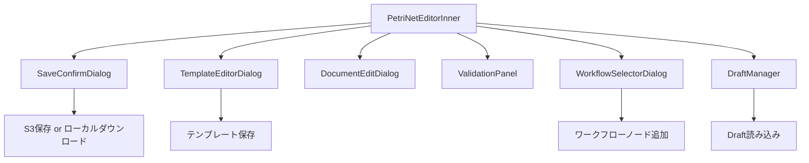

# PetriNetEditorInner - Petri Netエディタ（内部コンポーネント）

## 1. 概要

### 1.1 コンポーネントの目的

PetriNetEditorInnerは、React Flowを使用したペトリネットの表示・編集を行うメインコンポーネントです。MAIMLファイルのペトリネット構造を可視化し、ノード（Place/Transition）とエッジ（Arc）の追加・編集・削除、テンプレート管理、複数Method対応、バリデーション、自動保存などの高度な編集機能を提供します。

**主要機能:**
- ペトリネットの可視化（React Flow使用）
- ノード・エッジの追加・編集・削除
- テンプレート編集・管理
- 複数Method対応（Method切り替え、追加、削除）
- Document情報編集
- バリデーション機能（自動・手動）
- 自動保存・Draft管理
- Undo/Redo機能
- ワークフロー追加機能
- キーボードショートカット
- 共通テンプレート管理

### 1.2 使用場面

- **表示タイミング**: PetriNetEditorScreenから呼び出される内部コンポーネント
- **表示条件**: プロジェクト管理画面でMAIMLファイルを編集、または新規作成時
- **編集モード**: 
  - `project`: プロジェクトフォルダのMAIMLファイル編集（アーカイブ化保存）
  - `format`: フォーマットフォルダのMAIMLファイル編集（上書き保存）
  - `draft`: Draft復元モード

### 1.3 アクセス権限

- **必須ロール**: Experiment Admin (Level 2)
- **認証**: JWT + Session Hybrid認証
- **組織制限**: 自組織のファイルのみ編集可能

---

## 2. 目次

1. [概要](#1-概要)
2. [目次](#2-目次)
3. [画面構成](#3-画面構成)
4. [機能仕様](#4-機能仕様)
5. [データ仕様](#5-データ仕様)
6. [API連携](#6-api連携)
7. [エラーハンドリング](#7-エラーハンドリング)
8. [実装ファイル](#8-実装ファイル)
9. [変更履歴](#9-変更履歴)

---

## 3. 画面構成

### 3.1 レイアウト構造

```
┌─────────────────────────────────────────────────────────────┐
│ EditorToolbar (高さ: 56px)                                   │
│ - ノード追加ボタン / Undo/Redo / 保存 / Document編集        │
│ - バリデーション / ワークフロー追加 / Draft管理 / ビュー切替 │
├─────────────────────────────────────────────────────────────┤
│ MethodTabPanel (複数Method時のみ表示)                        │
│ - Method切り替えタブ / Method追加 / Method削除               │
├─────────────────────────────────────────────────────────────┤
│ 非致命的エラー警告バナー (エラーがある場合のみ表示)          │
├─────────────────────────────────────────────────────────────┤
│ React Flowキャンバス または TemplateList                     │
│ ┌───────────────────────────────────────────────────────┐   │
│ │ React Flow Canvas (viewMode='petriNet')               │   │
│ │ - ノード（Material/Condition/Result/Transition）      │   │
│ │ - エッジ（Arc）                                        │   │
│ │ - Background / Controls / MiniMap                     │   │
│ │                                                        │   │
│ │ PropertyPanel (選択時のみ表示、右側オーバーレイ)      │   │
│ └───────────────────────────────────────────────────────┘   │
│                                                              │
│ または                                                        │
│                                                              │
│ ┌───────────────────────────────────────────────────────┐   │
│ │ TemplateList (viewMode='templates')                   │   │
│ │ - カテゴリ別テンプレート一覧                           │   │
│ │ - 共通テンプレート / メソッド内テンプレート切り替え    │   │
│ └───────────────────────────────────────────────────────┘   │
└─────────────────────────────────────────────────────────────┘

【ダイアログ（モーダル）】
- SaveConfirmDialog: 保存確認・バリデーション結果表示
- TemplateEditorDialog: テンプレート編集
- DocumentEditDialog: Document情報編集
- ValidationPanel: バリデーション結果詳細
- WorkflowSelectorDialog: ワークフロー選択
- DraftManager: Draft管理
```

### 3.2 主要UI要素

#### 3.2.1 EditorToolbar
- ノード追加ボタン（Material/Condition/Result/Transition）
- Undo/Redoボタン
- 保存ボタン
- Document編集ボタン
- バリデーションボタン
- ワークフロー追加ボタン
- Draft管理ボタン
- 自動保存トグル
- ビューモード切替（Petri Net / Templates）

#### 3.2.2 MethodTabPanel（複数Method時）
- Method切り替えタブ
- Method追加ボタン
- Method削除ボタン
- Method ID編集機能

#### 3.2.3 React Flowキャンバス
- ノード（MaterialTemplateNode, ConditionTemplateNode, ResultTemplateNode, TransitionNode）
- エッジ（Arc、矢印付き）
- Background（ドット柄）
- Controls（ズーム、フィットビュー）
- MiniMap

#### 3.2.4 PropertyPanel（右側オーバーレイ）
- ノードプロパティ編集
- エッジプロパティ編集
- テンプレート編集ボタン
- 削除ボタン

#### 3.2.5 TemplateList
- カテゴリ別テンプレート表示（Material/Condition/Result）
- 共通テンプレート / メソッド内テンプレート切り替え
- テンプレート選択・編集・削除

### 3.3 画面遷移



---

## 4. 機能仕様

### 4.1 ペトリネット初期化・読み込み

#### 4.1.1 処理フロー

```typescript
useEffect(() => {
  const fetchPetriNetData = async () => {
    // 新規作成モード: maimlDataがnullの場合
    if (!maimlData) {
      const { documentData: initialDocumentData } = generateInitialDocumentData(editingFileName, {
        documentId: initialDocumentId,
        description: initialDescription,
      });
      setDocumentData(initialDocumentData);
      
      const initialMethod = generateInitialMethod(initialDocumentData.methodId);
      setMethods([initialMethod]);
      return;
    }
    
    // 既存ファイル読み込み
    const parser = new MaimlParserTyped(maimlData);
    const methodsData = parser.getMethods();
    
    // 複数method判定
    const isMultiMethod = methodsData.length > 1;
    
    // テンプレートマップ構築
    const templateMap = buildTemplateMap(maimlData);
    
    // 共通テンプレート検出
    const { material, condition, result } = parser.getTemplates();
    const allTemplates = [...material, ...condition, ...result];
    
    // 各methodをReact Flow形式に変換
    const convertedMethods = methodsData.map((method, index) => {
      const { nodes, edges } = convertToReactFlowFormat(parser, methodPetriNetData, templateMap);
      return { methodId: method.id, nodes, edges, /* ... */ };
    });
    
    setMethods(convertedMethods);
    setNodes(convertedMethods[0].nodes);
    setEdges(convertedMethods[0].edges);
  };
  
  fetchPetriNetData();
}, [maimlData]);
```

#### 4.1.2 UI動作

- **ローディング中**: Spinアイコンとメッセージ表示
- **読み込み完了**: ペトリネットを表示、自動フィットビュー
- **エラー時**: エラーアラート表示

### 4.2 ノード操作

#### 4.2.1 ノード追加

**方法1: ツールバーボタン**
```typescript
const handleAddNode = useCallback((nodeType: string) => {
  const newNode: Node<NodeData> = {
    id: `${nodeType}-${Date.now()}`,
    type: /* ... */,
    position: { x: Math.random() * 400 + 100, y: Math.random() * 400 + 100 },
    data: { /* ... */ },
  };
  setNodes((nds) => [...nds, newNode]);
  pushState({ nodes: [...nodes, newNode], edges });
}, []);
```

**方法2: キーボード + クリック**
- M/C/R/Tキーを押しながらキャンバスクリック
- 押下中のキーに応じてノードタイプを決定

#### 4.2.2 ノード編集

- PropertyPanelで編集（ID、name、description）
- テンプレート編集ボタンでTemplateEditorDialog表示

#### 4.2.3 ノード削除

- Deleteキー押下
- PropertyPanelの削除ボタン
- 接続されているエッジも自動削除

### 4.3 エッジ操作

#### 4.3.1 エッジ接続

```typescript
const handleConnect = useCallback((connection: Connection) => {
  const newEdge = {
    ...connection,
    id: `arc-${Date.now()}`,
    type: 'default',
    markerEnd: { type: MarkerType.ArrowClosed },
  };
  setEdges((eds) => addEdge(newEdge, eds));
  pushState({ nodes, edges: [...edges, newEdge] });
}, []);
```

#### 4.3.2 エッジ削除

- Deleteキー押下
- PropertyPanelの削除ボタン

### 4.4 テンプレート管理

#### 4.4.1 テンプレート編集

```typescript
const handleOpenTemplateEditor = useCallback((node: Node<NodeData>) => {
  // methodIdを補完
  const currentMethodId = methods[activeMethodIndex]?.methodId;
  const nodeWithMethodId = {
    ...node,
    data: {
      ...node.data,
      methodId: node.data.methodId ?? currentMethodId,
    },
  };
  setTemplateEditNode(nodeWithMethodId);
  setTemplateEditorOpen(true);
}, [methods, activeMethodIndex]);
```

#### 4.4.2 テンプレート保存

```typescript
const handleSaveTemplate = useCallback((
  nodeId: string,
  templateRef: Template,
  isNewTemplate: boolean,
  templateCategory: string,
  isCommonTemplate: boolean,
  methodId: string | undefined
) => {
  // Properties変換（NestedPropertyEditor形式 → 配列形式）
  const convertedTemplateRef = {
    ...templateRef,
    properties: convertNestedPropertiesToArray(templateRef.properties),
  };
  
  // 新規テンプレート作成
  if (isNewTemplate) {
    window.clineAddTemplate({ category, template: convertedTemplateRef });
  } else {
    // 既存テンプレート更新
    window.clineUpdateTemplate(templateId, convertedTemplateRef);
  }
  
  // ノードにテンプレート紐付け
  setNodes((nds) => nds.map((node) => {
    if (templateRef.placeRefs.some((pr) => pr.ref === node.id)) {
      return {
        ...node,
        data: { ...node.data, template: convertedTemplateRef },
      };
    }
    return node;
  }));
}, []);
```

#### 4.4.3 テンプレート削除

```typescript
const handleTemplateDelete = useCallback((templateId: string) => {
  if (!window.confirm('テンプレートを削除しますか？')) return;
  window.clineDeleteTemplate(templateId);
}, []);
```

### 4.5 複数Method管理

#### 4.5.1 Method切り替え

```typescript
const handleMethodChange = useCallback((newIndex: number) => {
  // 現在のmethod状態を保存（ビューポート含む）
  const currentViewport = getViewport();
  setMethods(prev => {
    const updated = [...prev];
    updated[activeMethodIndex] = {
      ...updated[activeMethodIndex],
      nodes, edges, viewport: currentViewport
    };
    return updated;
  });
  
  // 新しいmethodのノード/エッジを読み込み
  const newMethod = methods[newIndex];
  setNodes(newMethod.nodes);
  setEdges(newMethod.edges);
  setActiveMethodIndex(newIndex);
  
  // ビューポート復元
  if (newMethod.viewport) {
    setTimeout(() => setViewport(newMethod.viewport), 50);
  }
}, [methods, activeMethodIndex, nodes, edges, getViewport, setViewport]);
```

#### 4.5.2 Method追加

```typescript
const handleAddMethod = useCallback(() => {
  const newMethod = {
    methodId: `method_${Date.now()}`,
    methodIndex: methods.length,
    name: `Method ${methods.length + 1}`,
    nodes: [],
    edges: [],
    viewport: { x: 0, y: 0, zoom: 1 }
  };
  setMethods(prev => [...prev, newMethod]);
  setActiveMethodIndex(methods.length);
  setMultiMethodMode(true);
}, [methods]);
```

### 4.6 バリデーション機能

#### 4.6.1 自動バリデーション（ファイル読み込み時）

```typescript
useEffect(() => {
  // ペトリネット読み込み完了後、500ms後に自動実行
  setTimeout(async () => {
    const base64Data = btoa(unescape(encodeURIComponent(maimlData)));
    const response = await maimlService.validateMaiml(base64Data);
    if (response.success) {
      setValidationResult(response.data);
    }
  }, 500);
}, [maimlData]);
```

#### 4.6.2 手動バリデーション

```typescript
const handleOpenValidationPanel = useCallback(async () => {
  setIsValidating(true);
  
  // MaiML生成
  const maimlXml = multiMethodMode
    ? convertMultipleMethodsToMaiML(methods, metadata, documentData, allTemplates)
    : await convertReactFlowToMaiML(nodes, edges, metadata, documentData, null, allTemplates);
  
  // バリデーションAPI呼び出し
  const base64Data = btoa(unescape(encodeURIComponent(maimlXml)));
  const response = await maimlService.validateMaiml(base64Data);
  
  setValidationResult(response.data);
  setValidationPanelOpen(true);
  setIsValidating(false);
}, [nodes, edges, documentData, methods, multiMethodMode]);
```

#### 4.6.3 エラー分類と視覚化

```typescript
useEffect(() => {
  if (validationResult && validationResult.errors) {
    const criticalTypes = ['syntax_error', 'invalid_structure'];
    const critical = validationResult.errors.filter(err => criticalTypes.includes(err.type));
    const nonCritical = validationResult.errors.filter(err => !criticalTypes.includes(err.type));
    
    setCriticalErrors(critical);
    setNonCriticalErrors(nonCritical);
    
    // エラーノード/エッジに視覚効果を追加
    setNodes(prevNodes => prevNodes.map(node => ({
      ...node,
      data: { ...node.data, hasError: /* ... */, errors: /* ... */ },
      className: hasError ? 'error-node' : ''
    })));
  }
}, [validationResult]);
```

### 4.7 保存機能

#### 4.7.1 保存確認ダイアログを開く

```typescript
const handleOpenSaveConfirmDialog = useCallback(async () => {
  // MaiML生成
  const maimlXml = multiMethodMode
    ? convertMultipleMethodsToMaiML(methods, metadata, documentData, allTemplates)
    : await convertReactFlowToMaiML(nodes, edges, metadata, documentData, null, allTemplates);
  
  // バリデーション実行
  const base64Data = btoa(unescape(encodeURIComponent(maimlXml)));
  const response = await maimlService.validateMaiml(base64Data);
  
  setValidationResult(response.data);
  setSaveConfirmDialogOpen(true);
}, [nodes, edges, documentData, methods, multiMethodMode]);
```

#### 4.7.2 保存実行

```typescript
const handleSaveConfirmAction = useCallback(async (action: string, saveDestination: string, folder?: string) => {
  if (action === 'cancel') {
    handleCloseSaveConfirmDialog();
    return;
  }
  
  setIsSaving(true);
  
  // MaiML生成
  const maimlXml = /* ... */;
  
  // 自動補正の場合
  if (action === 'auto-correct') {
    const response = await maimlService.autoCorrectMaimlRealtime(base64Data, [], organizationId);
    maimlXml = atob(response.data.correctedContent);
  }
  
  // 保存先分岐
  if (saveDestination === 's3') {
    // S3保存
    const archive = editMode === 'project';  // projectモードはアーカイブ化
    await maimlService.saveMaiml(fileKey, base64Data, archive);
    alert('S3に保存しました');
  } else {
    // ローカルダウンロード
    const blob = new Blob([maimlXml], { type: 'application/xml' });
    const url = URL.createObjectURL(blob);
    const link = document.createElement('a');
    link.href = url;
    link.download = `${fileName}.maiml`;
    link.click();
  }
  
  setSaveConfirmDialogOpen(false);
  setIsSaving(false);
}, [nodes, edges, documentData, editMode]);
```

### 4.8 Draft管理

#### 4.8.1 自動保存

```typescript
const { autoSaveEnabled, setAutoSaveEnabled, lastSavedDraft, lastAutoSaveTime } = useDraftManager(
  currentEditState,
  {
    userId: currentUserId,
    autoSaveInterval: 30 * 1000,  // 30秒
    onAutoSaveSuccess: (draft) => console.log('自動保存成功:', draft),
    onAutoSaveError: (error) => console.error('自動保存エラー:', error),
  }
);
```

#### 4.8.2 Draft読み込み

```typescript
const handleLoadDraft = useCallback((draft: Draft) => {
  const loadedNodes = draft.nodes || [];
  const loadedEdges = draft.edges || [];
  
  setNodes(loadedNodes);
  setEdges(loadedEdges);
  
  if (draft.documentData) {
    setDocumentData(draft.documentData);
  }
  
  reset({ nodes: loadedNodes, edges: loadedEdges });
  
  setTimeout(() => fitView({ padding: 0.2, duration: 300 }), 100);
}, [setNodes, setEdges, reset, fitView]);
```

### 4.9 ワークフロー追加

#### 4.9.1 ワークフローモード有効化

```typescript
const handleWorkflowModeToggle = useCallback(() => {
  if (selectedTool === 'workflow') {
    setSelectedTool('select');
  } else {
    setSelectedTool('workflow');
  }
}, [selectedTool]);
```

#### 4.9.2 ワークフロー選択・追加

```typescript
const handleWorkflowFileSelect = useCallback(async (file: FileInfo) => {
  // MAIMLファイル取得
  const response = await maimlService.getStorageFileContent(file.key);
  const maimlContent = response.data.data.content;
  
  // ワークフロー追加実行
  const result = await addWorkflow(targetPosition, maimlContent, file.name);
  
  if (result.success) {
    // ノード・エッジを追加
    setNodes(prev => [...prev, ...result.nodes]);
    setEdges(prev => [...prev, ...result.edges]);
    
    // テンプレートをContextに追加
    if (result.templates && window.clineAddTemplate) {
      ['material', 'condition', 'result'].forEach((category) => {
        result.templates[category].forEach(t => {
          window.clineAddTemplate({ category, template: t });
        });
      });
    }
  }
  
  setSelectedTool('select');
}, [addWorkflow]);
```

### 4.10 Undo/Redo

```typescript
// useHistoryフックで管理
const { undo, redo, canUndo, canRedo, pushState } = useHistory({ nodes: [], edges: [] });

// ノード/エッジ変更時にpushState呼び出し
setNodes((nds) => {
  const newNodes = [...nds, newNode];
  pushState({ nodes: newNodes, edges });
  return newNodes;
});
```

### 4.11 キーボードショートカット

useKeyboardShortcutsフックで以下を実装：

- **Ctrl+Z**: Undo
- **Ctrl+Shift+Z**: Redo
- **Ctrl+C**: コピー
- **Ctrl+V**: ペースト
- **Ctrl+S**: 保存ダイアログ表示
- **M/C/R/T + クリック**: ノード追加
- **Delete**: 選択削除

### 4.12 ビューモード切替

```typescript
const handleViewModeChange = useCallback((newMode: 'petriNet' | 'templates') => {
  // ペトリネットモードから切り替える場合、ビューポートを保存
  if (viewMode === 'petriNet' && newMode !== 'petriNet') {
    const currentViewport = getViewport();
    setSavedPetriNetViewport(currentViewport);
  }
  
  setViewMode(newMode);
  setSelectedNode(null);
  setSelectedEdge(null);
}, [viewMode, getViewport]);
```

---

## 5. データ仕様

### 5.1 Props定義

```typescript
export interface PetriNetEditorInnerProps {
  maimlData: string | null;
  onError?: (error: Error) => void;
  editingFileName?: string;
  editMode: string;
  /** DocumentData.id の初期値（新規作成時のみ適用） */
  initialDocumentId?: string;
  /** DocumentData.description の初期値（新規作成時のみ適用） */
  initialDescription?: string;
  originalFileName?: string;
  sourceS3Key?: string;
  [key: string]: unknown;
}
```

**Props説明:**

| Prop名 | 型 | 必須 | 説明 |
|--------|---|------|------|
| maimlData | string \| null | ✅ | MAIMLファイルのXML文字列。nullの場合は新規作成モード |
| onError | (error: Error) => void | - | エラーハンドラー（親コンポーネントへエラー通知） |
| editingFileName | string | - | 編集中のファイル名 |
| editMode | string | ✅ | 編集モード: 'project' / 'format' / 'draft' |
| initialDocumentId | string | - | 新規作成時のDocument ID初期値 |
| initialDescription | string | - | 新規作成時のDocument description初期値 |
| originalFileName | string | - | 元のファイル名（保存時のデフォルト名） |
| sourceS3Key | string | - | 元のS3キー（保存先フォルダ判定用） |

### 5.2 State定義

#### 5.2.1 React Flow関連State

```typescript
const [nodes, setNodes, onNodesChange] = useNodesState<NodeData>([]);
const [edges, setEdges, onEdgesChange] = useEdgesState<EdgeData>([]);
```

| State名 | 型 | 初期値 | 説明 |
|---------|---|--------|------|
| nodes | Node<NodeData>[] | [] | ペトリネットのノード配列（Place/Transition） |
| edges | Edge<EdgeData>[] | [] | ペトリネットのエッジ配列（Arc） |

#### 5.2.2 UI状態管理

```typescript
const [isLoading, setIsLoading] = useState<boolean>(false);
const [selectedTool, setSelectedTool] = useState<'select' | 'workflow'>('select');
const [selectedNode, setSelectedNode] = useState<Node<NodeData> | null>(null);
const [selectedEdge, setSelectedEdge] = useState<Edge<EdgeData> | null>(null);
const [selectedNodes, setSelectedNodes] = useState<Node<NodeData>[]>([]);
const [clipboard, setClipboard] = useState<ClipboardData | null>(null);
const [pressedKeys, setPressedKeys] = useState<Set<string>>(new Set());
```

| State名 | 型 | 初期値 | 説明 |
|---------|---|--------|------|
| isLoading | boolean | false | ペトリネット読み込み中フラグ |
| selectedTool | 'select' \| 'workflow' | 'select' | 選択ツール（通常選択/ワークフロー追加） |
| selectedNode | Node<NodeData> \| null | null | 選択中のノード |
| selectedEdge | Edge<EdgeData> \| null | null | 選択中のエッジ |
| selectedNodes | Node<NodeData>[] | [] | 複数選択中のノード配列 |
| clipboard | ClipboardData \| null | null | コピー&ペースト用クリップボード |
| pressedKeys | Set<string> | new Set() | 押下中のキー（ショートカット判定用） |

#### 5.2.3 バリデーション関連State

```typescript
const [saveConfirmDialogOpen, setSaveConfirmDialogOpen] = useState<boolean>(false);
const [validationResult, setValidationResult] = useState<AnalysisResult | null>(null);
const [error, setError] = useState<string | null>(null);
const [validationPanelOpen, setValidationPanelOpen] = useState<boolean>(false);
const [isValidating, setIsValidating] = useState<boolean>(false);
const [isCorrecting, setIsCorrecting] = useState<boolean>(false);
const [isSaving, setIsSaving] = useState<boolean>(false);
const [criticalErrors, setCriticalErrors] = useState<ErrorContent[]>([]);
const [nonCriticalErrors, setNonCriticalErrors] = useState<ErrorContent[]>([]);
```

| State名 | 型 | 初期値 | 説明 |
|---------|---|--------|------|
| saveConfirmDialogOpen | boolean | false | 保存確認ダイアログ表示フラグ |
| validationResult | AnalysisResult \| null | null | バリデーション結果 |
| error | string \| null | null | エラーメッセージ |
| validationPanelOpen | boolean | false | バリデーション詳細パネル表示フラグ |
| isValidating | boolean | false | バリデーション実行中フラグ |
| isCorrecting | boolean | false | 自動補正実行中フラグ |
| isSaving | boolean | false | 保存中フラグ |
| criticalErrors | ErrorContent[] | [] | 致命的エラー配列 |
| nonCriticalErrors | ErrorContent[] | [] | 非致命的エラー配列 |

#### 5.2.4 ダイアログ表示State

```typescript
const [templateEditorOpen, setTemplateEditorOpen] = useState<boolean>(false);
const [templateEditNode, setTemplateEditNode] = useState<Node<NodeData> | null>(null);
const [documentDialogOpen, setDocumentDialogOpen] = useState<boolean>(false);
const [documentData, setDocumentData] = useState<DocumentData | null>(null);
const [workflowDialogOpen, setWorkflowDialogOpen] = useState<boolean>(false);
const [availableFiles, setAvailableFiles] = useState<Array<{ key: string; name: string; lastModified?: string; size?: number }>>([]); 
const [isLoadingFiles, setIsLoadingFiles] = useState<boolean>(false);
const [pendingClickPosition, setPendingClickPosition] = useState<{ x: number; y: number } | null>(null);
const [draftManagerOpen, setDraftManagerOpen] = useState<boolean>(false);
const [draftModeHandled, setDraftModeHandled] = useState<boolean>(false);
```

| State名 | 型 | 初期値 | 説明 |
|---------|---|--------|------|
| templateEditorOpen | boolean | false | テンプレート編集ダイアログ表示フラグ |
| templateEditNode | Node<NodeData> \| null | null | 編集中のノード（テンプレートエディタ用） |
| documentDialogOpen | boolean | false | Document編集ダイアログ表示フラグ |
| documentData | DocumentData \| null | null | Document情報 |
| workflowDialogOpen | boolean | false | ワークフロー選択ダイアログ表示フラグ |
| availableFiles | Array | [] | 利用可能なMAIMLファイル一覧 |
| isLoadingFiles | boolean | false | ファイル一覧読み込み中フラグ |
| pendingClickPosition | { x: number; y: number } \| null | null | ワークフロー追加位置 |
| draftManagerOpen | boolean | false | Draft管理ダイアログ表示フラグ |
| draftModeHandled | boolean | false | Draftモード処理済みフラグ |

#### 5.2.5 テンプレート表示関連State

```typescript
const [viewMode, setViewMode] = useState<'petriNet' | 'templates'>('petriNet');
const [selectedTemplate, setSelectedTemplate] = useState<Template | null>(null);
const [showCommonTemplates, setShowCommonTemplates] = useState<boolean>(false);
const [savedPetriNetViewport, setSavedPetriNetViewport] = useState<{ x: number; y: number; zoom: number } | null>(null);
```

| State名 | 型 | 初期値 | 説明 |
|---------|---|--------|------|
| viewMode | 'petriNet' \| 'templates' | 'petriNet' | 表示モード（ペトリネット/テンプレート一覧） |
| selectedTemplate | Template \| null | null | 選択中のテンプレート |
| showCommonTemplates | boolean | false | 共通テンプレート表示フラグ |
| savedPetriNetViewport | object \| null | null | ペトリネットモードのビューポート保存 |

#### 5.2.6 複数Method管理State

```typescript
const [methods, setMethods] = useState<MethodData[]>([]);
const [activeMethodIndex, setActiveMethodIndex] = useState<number>(0);
const [multiMethodMode, setMultiMethodMode] = useState<boolean>(false);
```

| State名 | 型 | 初期値 | 説明 |
|---------|---|--------|------|
| methods | MethodData[] | [] | Method配列（複数Method対応） |
| activeMethodIndex | number | 0 | 現在アクティブなMethodのインデックス |
| multiMethodMode | boolean | false | 複数Methodモードフラグ |

### 5.3 主要な型定義

#### 5.3.1 NodeData型

```typescript
interface NodeData {
  id: string;
  name: string;
  description?: string;
  nodeType: 'place' | 'transition';
  placeType?: 'material' | 'condition' | 'result';
  template?: Template;
  templateRef?: Template;
  isCommonTemplate?: boolean;
  commonTemplateRef?: string;
  methodId?: string | null;
  hasError?: boolean;
  errors?: ErrorContent[];
  isNewTemplate?: boolean;
  templateCategory?: string;
}
```

#### 5.3.2 EdgeData型

```typescript
interface EdgeData {
  id: string;
  hasError?: boolean;
  errors?: ErrorContent[];
}
```

#### 5.3.3 MethodData型

```typescript
interface MethodData {
  methodId: string;
  methodIndex: number;
  name: string;
  nodes: Node<NodeData>[];
  edges: Edge<EdgeData>[];
  viewport: { x: number; y: number; zoom: number };
}
```

#### 5.3.4 DocumentData型

```typescript
interface DocumentData {
  id: string;
  name: string;
  description?: string;
  methodId: string;
  properties?: Property[];
  [key: string]: unknown;
}
```

### 5.4 カスタムフック

#### 5.4.1 useHistory (Undo/Redo)

```typescript
const { history, undo, redo, canUndo, canRedo, pushState, reset } = useHistory({
  nodes: [],
  edges: [],
});
```

#### 5.4.2 useWorkflow

```typescript
const { addWorkflow } = useWorkflow({
  addToHistory: (action: string, data: unknown) => { /* ... */ },
});
```

#### 5.4.3 useDraftManager

```typescript
const {
  autoSaveEnabled,
  setAutoSaveEnabled,
  lastSavedDraft,
  lastAutoSaveTime,
} = useDraftManager(currentEditState, {
  userId: currentUserId,
  autoSaveInterval: 30 * 1000,
  onAutoSaveSuccess: (draft) => { /* ... */ },
  onAutoSaveError: (error) => { /* ... */ },
});
```

#### 5.4.4 useKeyboardShortcuts

```typescript
const { pressedKeys: keysPressedFromHook } = useKeyboardShortcuts({
  nodes,
  clipboard,
  canUndo,
  canRedo,
  selectedNodes,
  templateEditorOpen,
  saveConfirmDialogOpen,
  workflowDialogOpen,
  undo,
  redo,
  handleCopy,
  handlePaste,
  handleOpenSaveConfirmDialog,
});
```

#### 5.4.5 useEditorActions

```typescript
const { handleCopy, handlePaste } = useEditorActions({
  nodes,
  edges,
  selectedNodes,
  clipboard,
  setNodes,
  setEdges,
  setClipboard,
  setSelectedNode,
  setSelectedEdge,
  pushState,
});
```

### 5.5 Context利用

#### 5.5.1 TemplateContext

```typescript
const { templateErrors, addTemplate, deleteTemplate, updateTemplate, allTemplates } = useTemplates();
```

- **templateErrors**: テンプレートのエラー一覧
- **addTemplate**: テンプレート追加関数
- **deleteTemplate**: テンプレート削除関数
- **updateTemplate**: テンプレート更新関数
- **allTemplates**: 全テンプレート（material/condition/result別）

#### 5.5.2 window.cline* グローバル変数

```typescript
declare global {
  interface Window {
    clineAddTemplate: (templateData: { category: 'material' | 'condition' | 'result'; template: Template }) => void;
    clineDeleteTemplate: (templateId: string) => void;
    clineUpdateTemplate: (templateId: string, updatedTemplate: Template) => void;
    clineAllTemplates: TemplatesByCategory;
  }
}
```

TemplateEditorDialogからアクセスするため、TemplateContextの関数をwindowオブジェクトに設定します。

---

## 6. API連携

### 6.1 使用するAPI一覧

| # | API名 | メソッド | エンドポイント | 説明 | 使用箇所 |
|---|------|---------|---------------|------|----------|
| 1 | バリデーション | POST | `/api/v1/maiml/validate` | MAIMLファイルのバリデーション | 自動/手動バリデーション、保存時 |
| 2 | 自動補正 | POST | `/api/v1/maiml/auto-correct/realtime` | MAIMLファイルの自動補正 | SaveConfirmDialog |
| 3 | S3保存 | POST | `/api/v1/maiml/save` | MAIMLファイルをS3に保存 | 保存実行 |
| 4 | ストレージファイル一覧取得 | GET | `/api/v1/storage/list` | 利用可能なMAIMLファイル一覧取得 | ワークフロー追加 |
| 5 | ストレージファイル内容取得 | GET | `/api/v1/storage/content` | MAIMLファイル内容取得 | ワークフロー追加 |

### 6.2 API呼び出しコード

#### 6.2.1 バリデーションAPI

```typescript
// maimlService.validateMaiml
const response = await maimlService.validateMaiml(base64Data);

// リクエスト
POST /api/v1/maiml/validate
Headers:
  Content-Type: application/json
  Authorization: Bearer ${sessionToken}
  X-Organization-Id: ${organizationId}
Body:
{
  "maimlData": "base64encoded_string"
}

// レスポンス (200 OK)
{
  "success": true,
  "data": {
    "fileKey": "",
    "isValid": true,
    "errors": [],
    "warnings": [],
    "autoCorrections": []
  }
}
```

#### 6.2.2 自動補正API

```typescript
// maimlService.autoCorrectMaimlRealtime
const response = await maimlService.autoCorrectMaimlRealtime(
  base64Data,
  selectedErrors,
  organizationId
);

// リクエスト
POST /api/v1/maiml/auto-correct/realtime
Body:
{
  "maimlData": "base64encoded_string",
  "errorIndices": [0, 1, 2],
  "organizationId": "uuid"
}

// レスポンス (200 OK)
{
  "success": true,
  "data": {
    "correctedContent": "base64encoded_corrected_string",
    "corrections": []
  }
}
```

#### 6.2.3 S3保存API

```typescript
// maimlService.saveMaiml
const response = await maimlService.saveMaiml(fileKey, base64Data, archive);

// リクエスト
POST /api/v1/maiml/save
Body:
{
  "fileKey": "org_id/folder/filename.maiml",
  "content": "base64encoded_string",
  "archive": true  // projectモード: true, formatモード: false
}

// レスポンス (200 OK)
{
  "success": true,
  "data": {
    "fileKey": "org_id/folder/filename.maiml",
    "archivedKey": "org_id/folder/archive/filename_v1.maiml"
  }
}
```

#### 6.2.4 ストレージファイル一覧取得API

```typescript
// maimlService.listStorageFiles
const response = await maimlService.listStorageFiles(organizationId);

// リクエスト
GET /api/v1/storage/list?organizationId=${organizationId}

// レスポンス (200 OK)
{
  "success": true,
  "data": {
    "files": [
      {
        "key": "org_id/folder/file1.maiml",
        "name": "file1.maiml",
        "lastModified": "2026-03-11T12:00:00Z",
        "size": 12345
      }
    ]
  }
}
```

#### 6.2.5 ストレージファイル内容取得API

```typescript
// maimlService.getStorageFileContent
const response = await maimlService.getStorageFileContent(fileKey);

// リクエスト
GET /api/v1/storage/content?key=${fileKey}

// レスポンス (200 OK)
{
  "success": true,
  "data": {
    "data": {
      "content": "<?xml version='1.0'?>...",
      "key": "org_id/folder/file1.maiml"
    }
  }
}
```

### 6.3 エラーレスポンス

すべてのAPIで共通のエラーレスポンス形式：

```json
{
  "success": false,
  "error": {
    "message": "エラーメッセージ",
    "code": "ERROR_CODE",
    "details": {}
  }
}
```

---

## 7. エラーハンドリング

### 7.1 エラーケース一覧

| エラーケース | HTTPステータス | エラーコード | 対処方法 |
|-------------|---------------|-------------|----------|
| ペトリネット読み込み失敗 | - | `syntax_error` | エラーアラート表示、ペトリネット非表示 |
| 致命的なバリデーションエラー | - | `syntax_error`, `invalid_structure` | エラーアラート表示、編集不可 |
| 非致命的なバリデーションエラー | - | その他 | 警告バナー表示、エラーノード視覚化 |
| バリデーションAPI失敗 | 400/500 | - | エラーメッセージ表示 |
| 自動補正API失敗 | 400/500 | - | エラーメッセージ表示 |
| S3保存失敗 | 400/500 | - | エラーメッセージ表示、保存ダイアログ維持 |
| ファイル一覧取得失敗 | 400/500 | - | エラーメッセージ表示、ダイアログ閉じる |
| ファイル内容取得失敗 | 400/500 | - | エラーメッセージ表示 |
| Draft保存失敗 | - | - | コンソールログのみ（自動保存） |
| Template操作失敗 | - | - | エラーメッセージ表示 |

### 7.2 エラー処理コード

#### 7.2.1 ペトリネット読み込みエラー

```typescript
try {
  // ペトリネット読み込み処理
  const parser = new MaimlParserTyped(maimlData);
  // ...
} catch (err: unknown) {
  const errorMessage = getErrorMessage(err);
  console.error('❌ [PetriNetEditorInner] 初期化エラー:', errorMessage);
  
  // Phase 3: エラーをvalidationResultに変換
  const errorValidationResult: AnalysisResult = {
    fileKey: '',
    isValid: false,
    errors: [{
      type: 'syntax_error',
      severity: 'error',
      message: errorMessage || 'ペトリネット構造の読み込みに失敗しました',
      details: err instanceof Error ? err.stack : undefined
    }],
    warnings: [],
    autoCorrections: [],
  };
  setValidationResult(errorValidationResult);
  setError(errorMessage);
  setIsLoading(false);
  
  if (onError) {
    onError(err instanceof Error ? err : new Error(errorMessage));
  }
}
```

#### 7.2.2 バリデーションエラー処理

```typescript
try {
  const response = await maimlService.validateMaiml(base64Data);
  
  if (!response.success) {
    throw new Error(`バリデーションエラー: ${response.error?.message}`);
  }
  
  const result = response.data as AnalysisResult;
  setValidationResult(result);
  
} catch (err: unknown) {
  const errorMessage = getErrorMessage(err);
  console.error('❌ [PetriNetEditorInner] バリデーションエラー:', errorMessage);
  alert(`バリデーション実行に失敗しました: ${errorMessage}`);
}
```

#### 7.2.3 保存エラー処理

```typescript
try {
  setIsSaving(true);
  
  // MaiML生成
  const maimlXml = /* ... */;
  
  // S3保存
  const response = await maimlService.saveMaiml(fileKey, base64Data, archive);
  
  if (!response.success) {
    throw new Error(response.error?.message || 'S3保存に失敗しました');
  }
  
  alert('S3に保存しました');
  setSaveConfirmDialogOpen(false);
  
} catch (err: unknown) {
  const errorMessage = getErrorMessage(err);
  console.error('❌ [PetriNetEditorInner] 保存エラー:', {
    message: errorMessage,
    error: err instanceof Error ? {
      name: err.name,
      message: err.message,
      stack: err.stack
    } : { raw: String(err) }
  });
  alert(`保存に失敗しました: ${errorMessage}\n\n詳細はコンソールログを確認してください。`);
} finally {
  setIsSaving(false);
}
```

#### 7.2.4 ワークフロー追加エラー処理

```typescript
try {
  const response = await maimlService.getStorageFileContent(file.key);
  
  if (!response.success || !response.data) {
    throw new Error(response.error?.message || 'ファイル内容取得に失敗しました');
  }
  
  const maimlContent = response.data.data.content;
  const result = await addWorkflow(targetPosition, maimlContent, file.name);
  
  if (result.success) {
    setNodes(prev => [...prev, ...result.nodes]);
    setEdges(prev => [...prev, ...result.edges]);
    alert(result.message);
  } else {
    throw new Error(result.error);
  }
  
} catch (err: unknown) {
  const errorMessage = getErrorMessage(err);
  console.error('❌ [PetriNetEditorInner] ワークフロー追加エラー:', errorMessage);
  alert(`ワークフロー追加に失敗しました: ${errorMessage}`);
  throw err;
} finally {
  setSelectedTool('select');
  setPendingClickPosition(null);
}
```

### 7.3 エラー分類と表示

#### 7.3.1 致命的エラー（Petri Net表示不可）

```typescript
// 致命的エラータイプ
const criticalTypes = ['syntax_error', 'invalid_structure'];

// エラー分類
const critical = validationResult.errors.filter(err => 
  criticalTypes.includes(err.type)
);

if (critical.length > 0) {
  // エラーアラート表示、ペトリネット非表示
  return (
    <Alert
      type="error"
      message="致命的なエラーが発生しました"
      description="ペトリネットを表示できません。"
    />
  );
}
```

#### 7.3.2 非致命的エラー（警告表示）

```typescript
const nonCritical = validationResult.errors.filter(err => 
  !criticalTypes.includes(err.type)
);

if (nonCritical.length > 0) {
  // 警告バナー表示
  <Alert 
    type="warning"
    message={`${nonCritical.length}件の警告があります`}
    banner
  />
  
  // エラーノード/エッジに視覚効果
  setNodes(prevNodes => prevNodes.map(node => ({
    ...node,
    data: { ...node.data, hasError: true, errors: nodeErrors },
    className: 'error-node'
  })));
}
```

### 7.4 ユーティリティ関数

```typescript
/**
 * unknown型のエラーからメッセージを安全に抽出
 */
const getErrorMessage = (err: unknown): string => {
  if (err instanceof Error) return err.message;
  if (typeof err === 'string') return err;
  return '不明なエラーが発生しました';
};
```

---

## 8. 実装ファイル

### 8.1 ファイルパス

- **メインファイル**: `frontend/src/components/editorv2/PetriNetEditorInner.tsx`

### 8.2 関連ファイル

- **型定義**: `frontend/src/types/editor.ts`, `frontend/src/types/maiml-unified.ts`
- **コンテキスト**: `frontend/src/contexts/TemplateContext.tsx`
- **カスタムフック**: 
  - `frontend/src/components/editorv2/hooks/useHistory.ts`
  - `frontend/src/components/editorv2/hooks/useWorkflow.ts`
  - `frontend/src/components/editorv2/hooks/useDraftManager.ts`
  - `frontend/src/components/editorv2/hooks/useKeyboardShortcuts.ts`
  - `frontend/src/components/editorv2/hooks/useEditorActions.ts`
- **ユーティリティ**: 
  - `frontend/src/components/editorv2/utils/converters/reactFlowToMaiml.ts`
  - `frontend/src/components/editorv2/utils/converters/multiMethodConverter.ts`
  - `frontend/src/components/editorv2/utils/documentInitializer.ts`
  - `frontend/src/utils/petriNetExtractor.ts`
  - `frontend/src/utils/reactFlowConverter.ts`
  - `frontend/src/utils/maimlParserTyped.ts`

### 8.3 依存コンポーネント

- `<EditorToolbar />` - ツールバー
- `<MethodTabPanel />` - Method管理タブ
- `<PropertyPanel />` - プロパティパネル
- `<SaveConfirmDialog />` - 保存確認ダイアログ
- `<TemplateEditorDialog />` - テンプレート編集
- `<DocumentEditDialog />` - Document編集
- `<ValidationPanel />` - バリデーション結果
- `<WorkflowSelectorDialog />` - ワークフロー選択
- `<DraftManager />` - Draft管理
- `<TemplateList />` - テンプレート一覧
- `<MaterialTemplateNode />`, `<ConditionTemplateNode />`, `<ResultTemplateNode />`, `<TransitionNode />` - ノードコンポーネント

---

## 9. 変更履歴

| 日付 | 変更内容 | 担当者 |
|------|----------|--------|
| 2026-03-11 | 実装ベースでUI仕様書を新規作成（PetriNetEditorInner.tsx 約2,000行を分析） | Cline |
| 2026-03-11 | セクション5: データ仕様（Props/State/型定義/カスタムフック）を追加 | Cline |
| 2026-03-11 | セクション4: 機能仕様（12の主要機能）を追加 | Cline |
| 2026-03-11 | セクション6: API連携（5つのAPI）を追加 | Cline |
| 2026-03-11 | セクション7: エラーハンドリング（10のエラーケース）を追加 | Cline |
