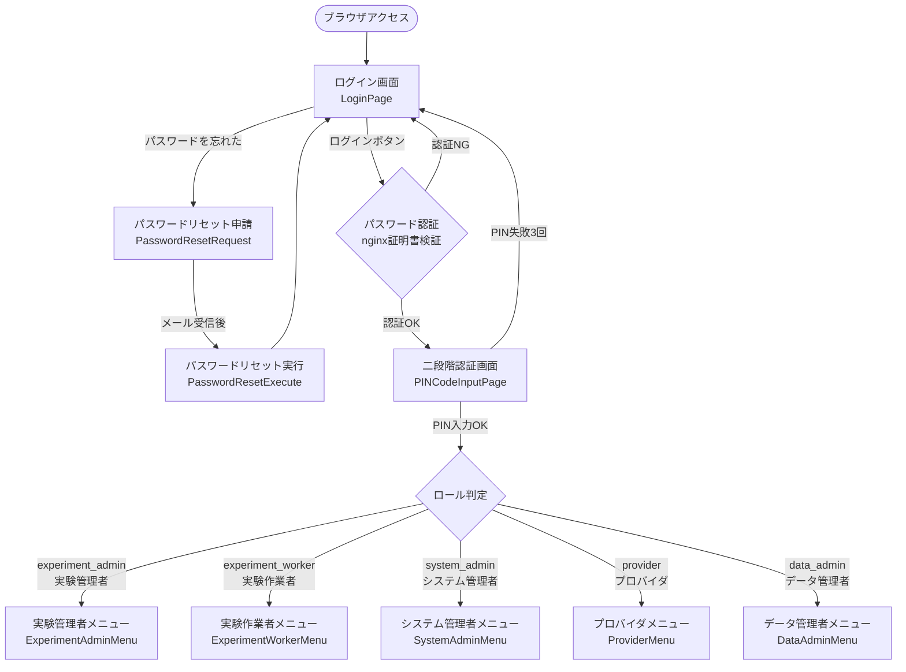
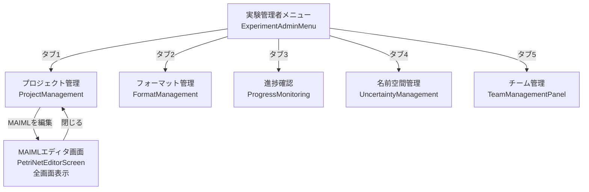
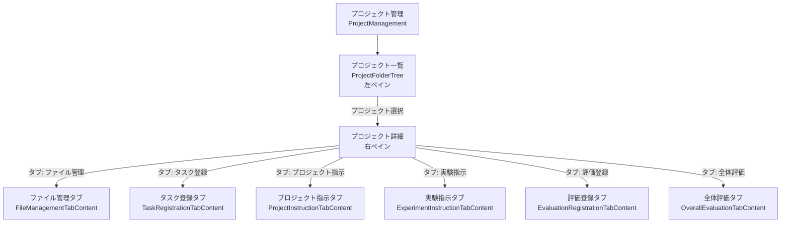
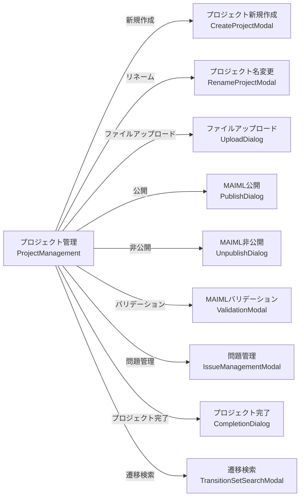
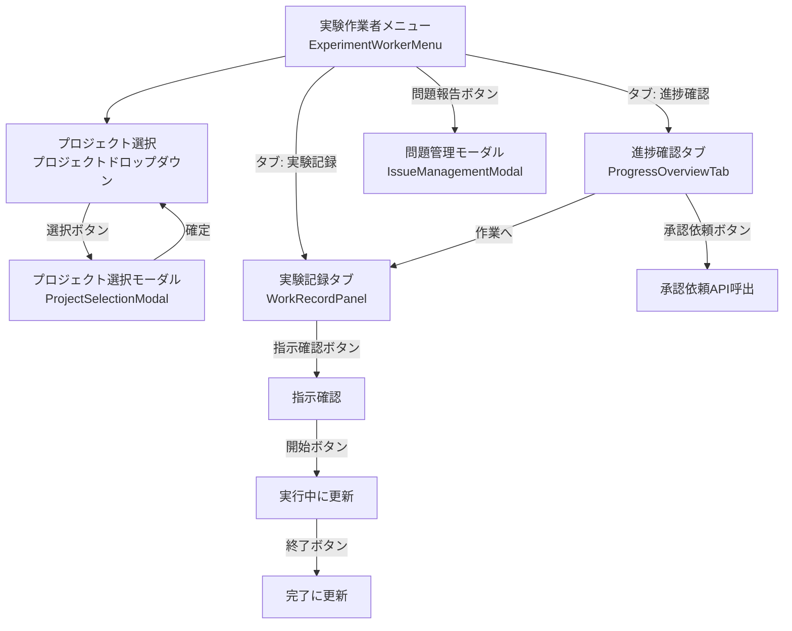
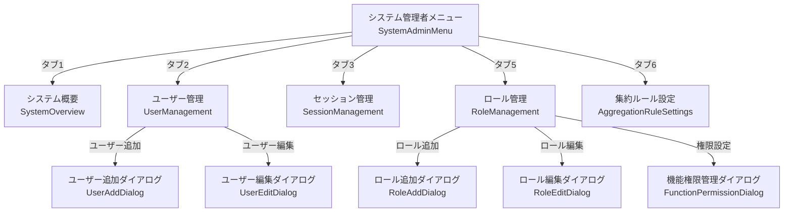
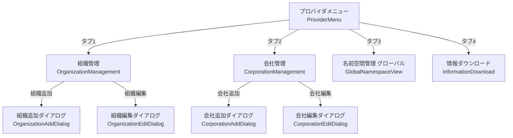
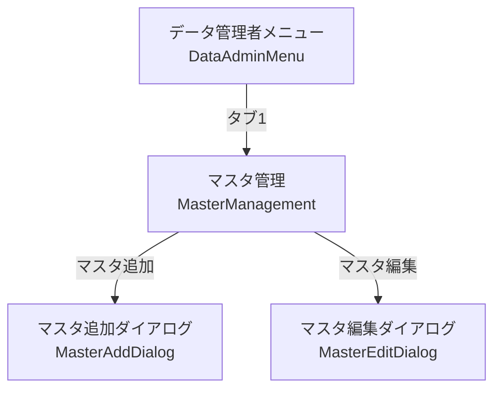
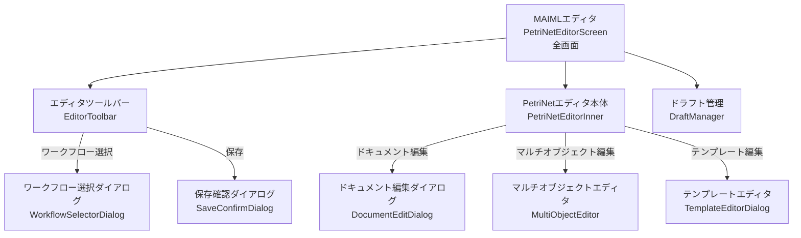
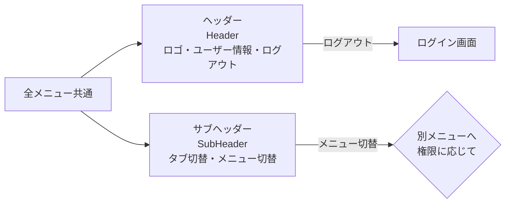

# 画面遷移図

## 概要

mmdpfプロジェクトの全画面遷移を、最新のソースコードをもとに整理したドキュメントです。

- **作成日**: 2026-08-24
- **ソース**: `frontend/src/components/menus/` 配下の各Menuコンポーネント

---

## 1. 全体概要（認証〜ロール別メニュー）

---

## 2. 実験管理者メニュー（ExperimentAdminMenu）

### 2.1 プロジェクト管理（ProjectManagement）の内部タブ

### 2.2 プロジェクト管理から呼び出されるモーダル・ダイアログ

---

## 3. 実験作業者メニュー（ExperimentWorkerMenu）

---

## 4. システム管理者メニュー（SystemAdminMenu）

---

## 5. プロバイダメニュー（ProviderMenu）

---

## 6. データ管理者メニュー（DataAdminMenu）

---

## 7. MAIMLエディタ（PetriNetEditorScreen）の内部遷移

---

## 8. 共通コンポーネント

---

## 更新履歴

| 日付 | 変更内容 | 担当者 |
|------|----------|--------|
| 2026-08-26 | §3 実験作業者メニュー: 問題報告ボタン → `IssueManagementModal` のフロー追加（タスク: 問題報告ボタン修正） | Cline |
| 2026-08-24 | 初版作成（最新ソースコードをもとにMermaid形式で作成） | Cline |
