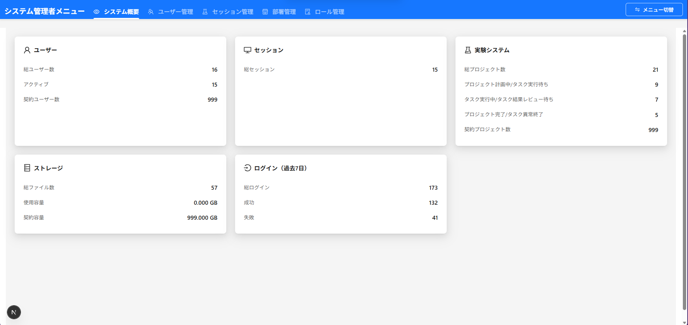

# システム概要画面UI設計書

## メタデータ
---
title: システム概要画面UI設計書
category: UI設計
version: 1.2.0
last_updated: 2026-03-05
author: Development Team
tags: [system_admin, dashboard, statistics, ui]
---

## 関連ドキュメント
- [システム概要API仕様](../api/api_system_overview.md)
- [API一覧](../api/api_list.md)
- [セキュリティ規約](../../.clinerules/development/security.md)

---

## 1. 概要

### 1.1. 目的

システム管理者がログインユーザーの組織に紐づくシステム統計情報（ユーザー・セッション・実験システム・ストレージ・ログイン履歴）をダッシュボード形式で確認できる画面を定義します。

### 1.2. 画面の特徴

- **ダッシュボード形式**: 5枚の統計カードで各種システム状況を一覧表示
- **system_admin 専用画面**: system_admin ロールのユーザーのみがアクセス可能
- **自組織データのみ表示**: テナント分離により、ログインユーザーの組織データのみ表示
- **並列データ取得**: 5つのデータソースを Promise.all で並列取得し、高速表示

### 1.3. アクセス権限

| 項目 | 内容 |
|------|------|
| 対象ロール | system_admin |
| 認証方式 | JWT（Cookieセッション） |
| アクセスURL | `/system-admin/system-overview`（システム管理メニュー配下） |

---

## 2. 画面構成

### 2.1. 画面一覧

| 画面名 | URL | 説明 |
|--------|-----|------|
| システム概要画面 | `/system-admin/system-overview` | システム統計ダッシュボード |

---

## 3. システム概要画面

### 3.1. 画面概要

**URL**: `/system-admin/system-overview`

**目的**: 組織のシステム利用状況を統計カードで一覧表示する

**前提条件**:
- system_admin ロールでログイン済み
- セッションが有効であること

### 3.2. 画面全体イメージ



### 3.3. レイアウト

#### デスクトップ（lg: 1列3枚）

```
┌────────────────────────────────────────────────────────────────────┐
│  [サイドメニュー]  │  システム概要                                  │
│                   │──────────────────────────────────────────────│
│  ・システム概要    │                                                │
│  ・ユーザー管理    │  ┌──────────────┐┌──────────────┐┌──────────┐│
│  ・ロール管理      │  │  ユーザー    ││  セッション  ││実験システム││
│  ・部門管理        │  │ 総ユーザー数 ││ 総セッション ││総プロジェクト││
│                   │  │ アクティブ   ││              ││計画中     ││
│                   │  │             ││              ││実行中     ││
│                   │  │             ││              ││完了       ││
│                   │  └──────────────┘└──────────────┘└──────────┘│
│                   │  ┌──────────────┐┌──────────────┐             │
│                   │  │ ストレージ   ││ログイン(過去7日)│             │
│                   │  │ 総ファイル数 ││ 総ログイン    │             │
│                   │  │ 使用容量     ││ 成功          │             │
│                   │  │             ││ 失敗          │             │
│                   │  └──────────────┘└──────────────┘             │
└────────────────────────────────────────────────────────────────────┘
```

#### タブレット（md: 1列2枚）

```
┌──────────────────────────────────┐
│  ┌─────────────┐┌─────────────┐  │
│  │  ユーザー   ││  セッション  │  │
│  └─────────────┘└─────────────┘  │
│  ┌─────────────┐┌─────────────┐  │
│  │ 実験システム││ ストレージ  │  │
│  └─────────────┘└─────────────┘  │
│  ┌─────────────┐                  │
│  │ログイン(7日)│                  │
│  └─────────────┘                  │
└──────────────────────────────────┘
```

#### モバイル（xs: 1列1枚）

```
┌────────────────────┐
│  ┌──────────────┐  │
│  │  ユーザー    │  │
│  └──────────────┘  │
│  ┌──────────────┐  │
│  │  セッション  │  │
│  └──────────────┘  │
│  ┌──────────────┐  │
│  │ 実験システム │  │
│  └──────────────┘  │
│  ┌──────────────┐  │
│  │ ストレージ   │  │
│  └──────────────┘  │
│  ┌──────────────┐  │
│  │ログイン(7日) │  │
│  └──────────────┘  │
└────────────────────┘
```

### 3.4. コンポーネント構成

```
SystemOverview (React.FC)
└── <div> (ページラッパー, padding: token.paddingLG, background: token.colorBgLayout)
    └── <Row gutter={[24, 24]}>
        ├── <Col xs={24} md={12} lg={8}> ユーザーカード
        │   └── <Card variant="borderless">
        │       ├── タイトル行 (<UserOutlined /> ユーザー)
        │       ├── 総ユーザー数
        │       └── アクティブ
        ├── <Col xs={24} md={12} lg={8}> セッションカード
        │   └── <Card variant="borderless">
        │       ├── タイトル行 (<DesktopOutlined /> セッション)
        │       └── 総セッション
        ├── <Col xs={24} md={12} lg={8}> 実験システムカード
        │   └── <Card variant="borderless">
        │       ├── タイトル行 (<ExperimentOutlined /> 実験システム)
        │       ├── 総プロジェクト数
        │       ├── プロジェクト計画中/タスク実行待ち
        │       ├── タスク実行中/タスク結果レビュー待ち
        │       └── プロジェクト完了/タスク異常終了
        ├── <Col xs={24} md={12} lg={8}> ストレージカード
        │   └── <Card variant="borderless">
        │       ├── タイトル行 (<DatabaseOutlined /> ストレージ)
        │       ├── 総ファイル数
        │       └── 使用容量
        └── <Col xs={24} md={12} lg={8}> ログインカード
            └── <Card variant="borderless">
                ├── タイトル行 (<LoginOutlined /> ログイン（過去7日）)
                ├── 総ログイン
                ├── 成功
                └── 失敗
```

---

## 4. 統計カード仕様

### 4.1. 共通スタイル

| 項目 | 値 |
|------|-----|
| カードコンポーネント | `<Card>` |
| variant | `borderless` |
| height | `100%` |
| borderRadius | `token.borderRadiusLG` |
| boxShadow | `token.boxShadow` |

**タイトル行スタイル**:

| 項目 | 値 |
|------|-----|
| fontSize | `token.fontSizeLG` |
| fontWeight | `token.fontWeightStrong` |
| marginBottom | `token.marginMD` |
| display | `flex` |
| alignItems | `center` |
| gap | `token.marginXS` |

**統計行スタイル**:

| 項目 | 値 |
|------|-----|
| display | `flex` |
| justifyContent | `space-between` |
| alignItems | `center` |
| padding | `token.paddingXS px 0` |

**ラベルスタイル**:

| 項目 | 値 |
|------|-----|
| fontSize | `token.fontSize` |
| color | `token.colorTextSecondary` |

**値スタイル**:

| 項目 | 値 |
|------|-----|
| fontSize | `token.fontSizeHeading5` |
| fontWeight | `token.fontWeightStrong` |
| color | `token.colorText` |

### 4.2. ユーザーカード

**アイコン**: `<UserOutlined />`  
**タイトル**: 「ユーザー」

| ラベル | データソース | 説明 |
|--------|------------|------|
| 総ユーザー数 | `users.total` | 組織の総ユーザー数 |
| アクティブ | `users.active` | アクティブユーザー数（is_active = true） |

### 4.3. セッションカード

**アイコン**: `<DesktopOutlined />`  
**タイトル**: 「セッション」

| ラベル | データソース | 説明 |
|--------|------------|------|
| 総セッション | `sessions.total` | 現在のアクティブセッション数（Redis） |

### 4.4. 実験システムカード

**アイコン**: `<ExperimentOutlined />`  
**タイトル**: 「実験システム」

| ラベル | データソース | 説明 |
|--------|------------|------|
| 総プロジェクト数 | `experimentSystem.totalProjects` | 組織の総プロジェクト数 |
| プロジェクト計画中/タスク実行待ち | `experimentSystem.planning` | project_status: '0', '1' |
| タスク実行中/タスク結果レビュー待ち | `experimentSystem.inProgress` | project_status: '2', '3' |
| プロジェクト完了/タスク異常終了 | `experimentSystem.completed` | project_status: '4', '5' |
| 契約プロジェクト数 | `experimentSystem.contractedProjects` | organizationテーブルの contracted_projects カラム |

### 4.5. ストレージカード

**アイコン**: `<DatabaseOutlined />`  
**タイトル**: 「ストレージ」

| ラベル | データソース | 説明 |
|--------|------------|------|
| 総ファイル数 | `storage.totalFiles` | ストレージ（Swift/S3）の総ファイル数 |
| 使用容量 | `storage.usedCapacityGB` | 使用容量（GB、小数点3桁）。表示形式: `{値} GB` |

### 4.6. ログイン（過去7日）カード

**アイコン**: `<LoginOutlined />`  
**タイトル**: 「ログイン（過去7日）」

| ラベル | データソース | 説明 |
|--------|------------|------|
| 総ログイン | `loginLast7Days.total` | 過去7日間の総ログイン試行数 |
| 成功 | `loginLast7Days.success` | 過去7日間のログイン成功数 |
| 失敗 | `loginLast7Days.failed` | 過去7日間のログイン失敗数 |

---

## 5. ローディング・エラー状態

### 5.1. ローディング状態

**表示条件**: API呼び出し中（`loading === true`）

**コンポーネント**: `<Spin size="large">`

**レイアウト**:

```
┌──────────────────────────────────────────┐
│                                          │
│                                          │
│                  ⟳                       │
│              （スピナー）                 │
│                                          │
│                                          │
└──────────────────────────────────────────┘
```

**スタイル**:

| 項目 | 値 |
|------|-----|
| padding | `token.paddingLG` |
| background | `token.colorBgLayout` |
| minHeight | `calc(100vh - 112px)` |
| display | `flex` |
| alignItems | `center` |
| justifyContent | `center` |

### 5.2. エラー状態

**表示条件**: API呼び出し失敗時（`error !== null` または `data === null`）

**コンポーネント**: `<Alert>`

| 項目 | 値 |
|------|-----|
| type | `error` |
| title | 「データ取得エラー」 |
| description | エラーメッセージ（または「データが取得できませんでした」） |
| showIcon | `true` |

---

## 6. project_status 定義

実験システムカードの分類に使用する `project_status` の値定義：

| 値 | 意味 | 分類 |
|----|------|------|
| `'0'` | プロジェクト計画中 | `planning` |
| `'1'` | タスク実行待ち | `planning` |
| `'2'` | タスク実行中 | `inProgress` |
| `'3'` | タスク結果レビュー待ち | `inProgress` |
| `'4'` | プロジェクト完了 | `completed` |
| `'5'` | タスク異常終了 | `completed` |

---

## 7. APIリクエスト仕様

### 7.1. エンドポイント

`GET /api/v1/systemManagement/system-overview`

### 7.2. ミドルウェアチェーン

```
authMiddleware → tenantIsolation → getOverview
```

### 7.3. リクエスト

**クエリパラメータ**: なし  
**リクエストボディ**: なし  
**リクエストヘッダー**: Cookie（セッションCookie）

### 7.4. レスポンス（成功時）

```json
{
  "success": true,
  "data": {
    "users": {
      "total": 10,
      "active": 8
    },
    "sessions": {
      "total": 3
    },
      "experimentSystem": {
      "totalProjects": 15,
      "planning": 5,
      "inProgress": 6,
      "completed": 4,
      "contractedProjects": 30
    },
    "storage": {
      "totalFiles": 120,
      "usedCapacityGB": 1.45
    },
    "loginLast7Days": {
      "total": 42,
      "success": 40,
      "failed": 2
    }
  },
  "meta": {
    "timestamp": "2026-02-26T10:30:00.000Z",
    "requestId": "xxxxxxxx-xxxx-xxxx-xxxx-xxxxxxxxxxxx"
  }
}
```

### 7.5. エラーレスポンス

| ステータスコード | エラーコード | 説明 |
|----------------|-------------|------|
| 401 Unauthorized | `UNAUTHORIZED` | 認証エラー |
| 403 Forbidden | `FORBIDDEN` | 権限不足（system_admin以外） |
| 500 Internal Server Error | `SYSTEM_ERROR` | サーバー内部エラー |

### 7.6. データ取得元

| 統計 | 取得元 |
|-----|--------|
| ユーザー統計 | PostgreSQL（`organization_user`テーブル） |
| プロジェクト統計 | PostgreSQL（`project`テーブル） |
| ログイン統計 | PostgreSQL（`login_history`テーブル、過去7日間） |
| セッション統計 | Redis（アクティブリフレッシュトークン） |
| ストレージ統計 | Swift / S3 |

**取得方式**: 5つのデータソースを `Promise.all` で並列取得  
**エラー耐性**: セッション・ストレージ取得失敗時は `0` を返却し、画面表示を継続

---

## 8. 型定義

```typescript
// frontend/src/types/systemOverview.ts

/**
 * システム概要データ
 */
export interface SystemOverviewData {
  users: {
    total: number;
    active: number;
  };
  sessions: {
    total: number;
  };
  experimentSystem: {
    totalProjects: number;
    planning: number;
    inProgress: number;
    completed: number;
    contractedProjects: number;
  };
  storage: {
    totalFiles: number;
    usedCapacityGB: number;
  };
  loginLast7Days: {
    total: number;
    success: number;
    failed: number;
  };
}
```

---

## 9. セキュリティ考慮事項

- `authMiddleware` によるJWT認証必須
- `tenantIsolation` ミドルウェアにより `organizationId` を自動設定
- すべてのDBクエリに `organization_id` フィルタを適用（マルチテナント分離）
- 他組織のデータへのアクセスは不可
- system_admin 権限のユーザーのみアクセス可能

---

## 10. テスト要件

### 10.1. 単体テスト（Unit Test）

#### テスト対象
- データ取得 `useEffect` フック
- ローディング状態管理
- エラー状態表示

#### テストケース例

```typescript
describe('SystemOverview', () => {
  test('ページ表示時にAPIが呼び出され、統計データが表示される', async () => {
    // APIモックを設定（正常レスポンス）
    // コンポーネントをレンダリング
    // ローディングスピナーが表示されることを確認
    // データ取得後に各カードが表示されることを確認
  });

  test('APIエラー時にエラーアラートが表示される', async () => {
    // APIエラーをモック
    // エラーアラートが表示されることを確認
  });

  test('ユーザーカードに総ユーザー数・アクティブ数が表示される', async () => {
    // users.total = 10, users.active = 8 のモックデータ
    // カードに正しい値が表示されることを確認
  });

  test('実験システムカードにproject_statusの分類が正しく表示される', async () => {
    // experimentSystem.planning = 5, inProgress = 6, completed = 4 のモックデータ
    // 各ラベルと値が正しく表示されることを確認
  });

  test('ストレージカードの使用容量にGB単位が表示される', async () => {
    // storage.usedCapacityGB = 1.45 のモックデータ
    // "1.45 GB" が表示されることを確認
  });
});
```

### 10.2. 手動テスト

| No | テスト内容 | 期待結果 |
|----|-----------|---------|
| 1 | system_admin でログインしシステム概要画面を表示する | 5枚の統計カードが表示される |
| 2 | ユーザーカードの数値を確認する | 総ユーザー数・アクティブ数が正しく表示される |
| 3 | セッションカードの数値を確認する | 現在のアクティブセッション数が表示される |
| 4 | 実験システムカードの数値を確認する | 総プロジェクト数・計画中・実行中・完了の数値が表示される |
| 5 | ストレージカードの数値を確認する | 総ファイル数と使用容量（GB）が表示される |
| 6 | ログインカードの数値を確認する | 過去7日間の総ログイン・成功・失敗数が表示される |
| 7 | ページ読み込み中にスピナーが表示されることを確認する | ローディングスピナーが表示される |
| 8 | system_admin 以外のロールでページにアクセスする | アクセスが拒否される（リダイレクトまたはエラー表示） |
| 9 | ブラウザ幅を変えてレスポンシブ表示を確認する | デスクトップ: 3列、タブレット: 2列、モバイル: 1列で表示される |

---

## 11. 変更履歴

| バージョン | 日付 | 変更内容 | 担当者 |
|-----------|------|----------|--------|
| 1.2.0 | 2026-03-05 | 実験システムカードに「契約プロジェクト数」を追加 | Cline |
| | | - `experimentSystem.contractedProjects` フィールド追加 | |
| | | - organizationテーブルの `contracted_projects` カラムから取得 | |
| 1.1.0 | 2026-02-27 | ストレージカード「使用容量」の小数点桁数を2桁→3桁に変更 | Cline |
| | | ストレージ統計の取得元をSwift/S3直接取得（`storageService.listFiles()`）に変更 | |
| 1.0.0 | 2026-02-26 | 初版作成 | Development Team |
