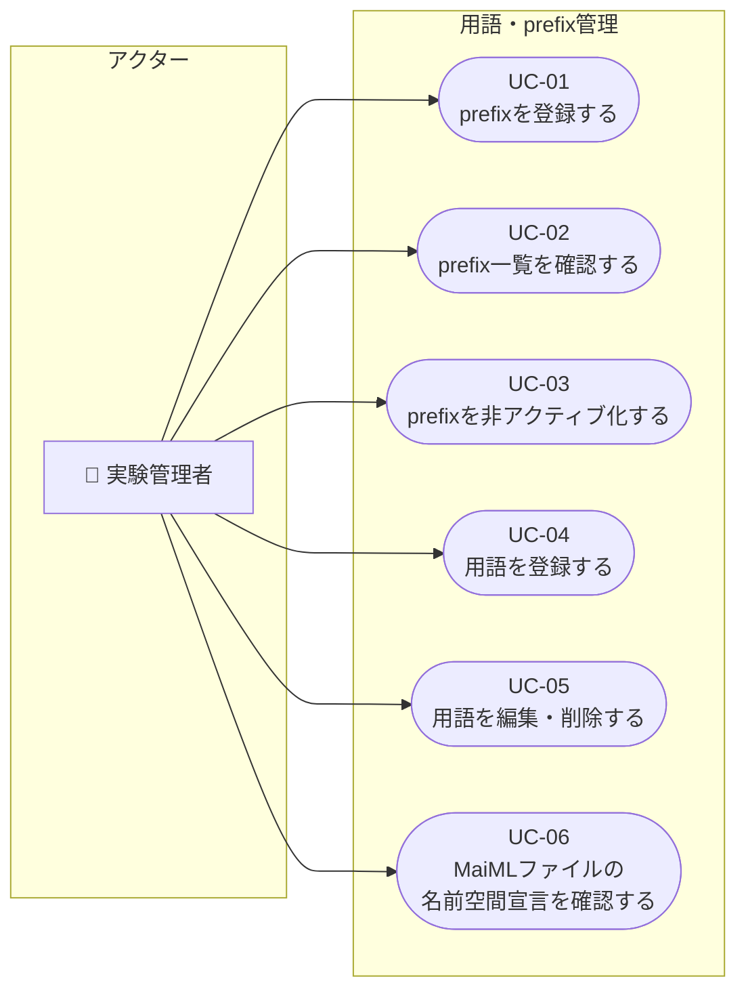
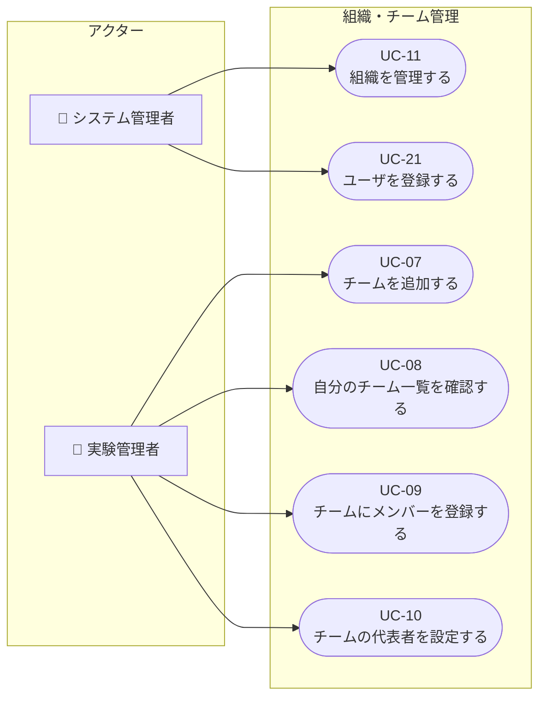
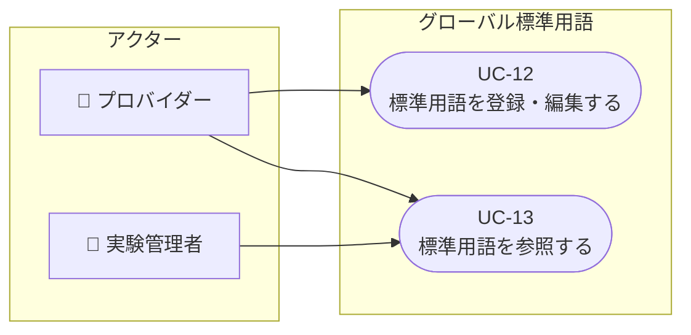
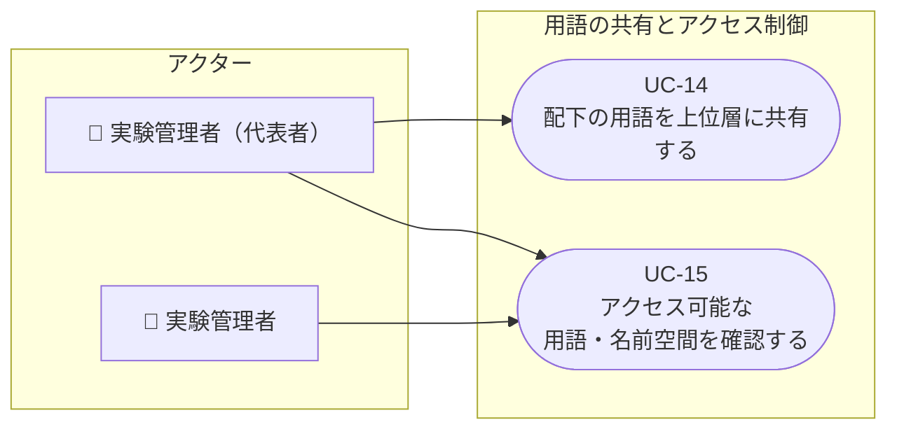
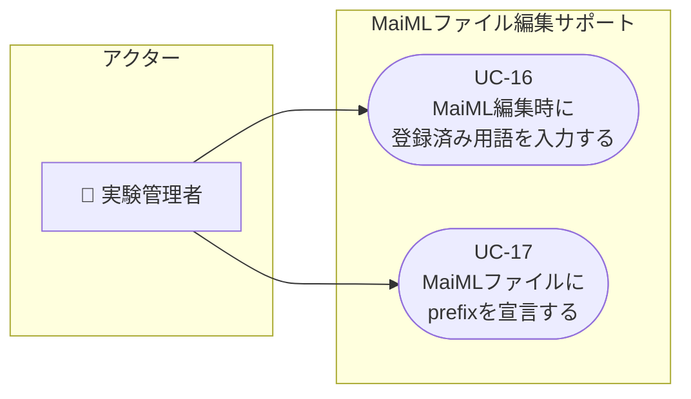
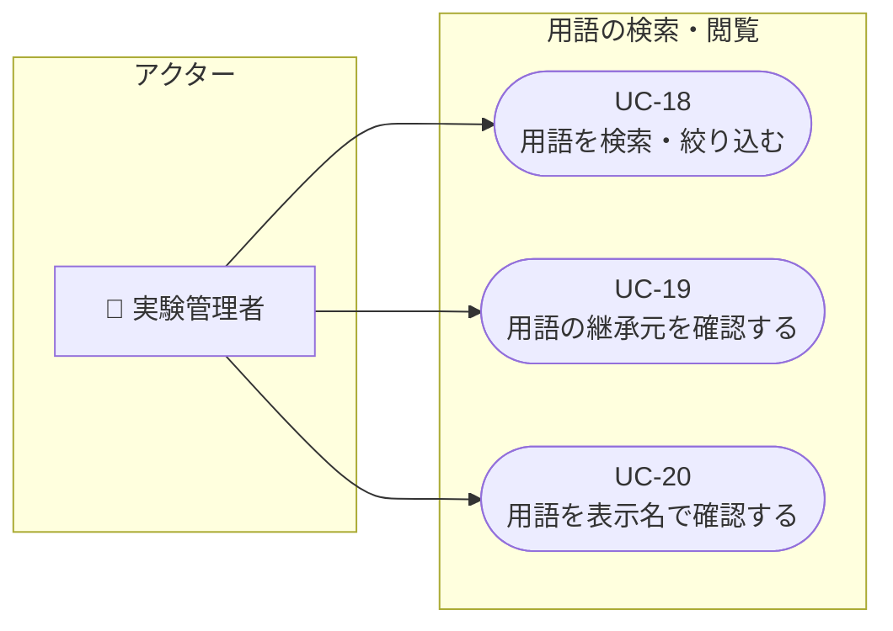
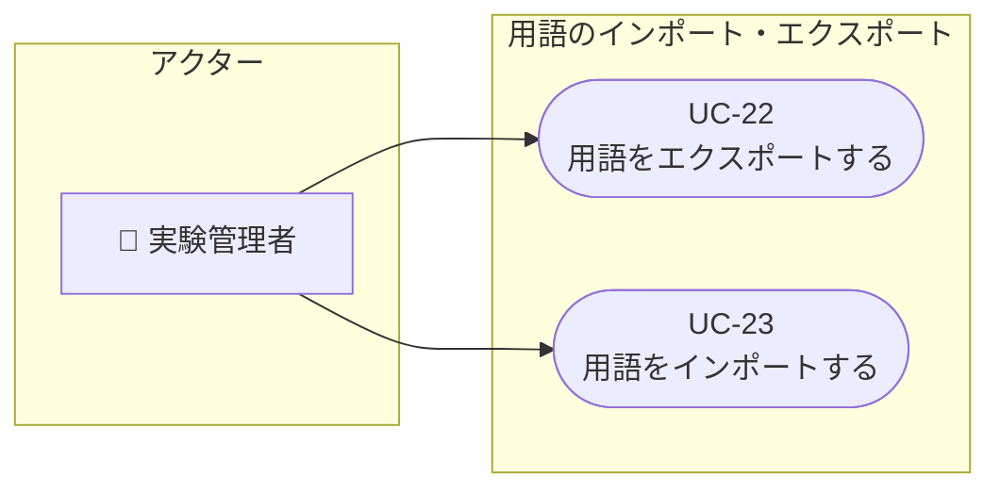

# 名前空間・用語管理機能 ― ユースケース一覧

**作成日**: 2026-07-17
**作成者**: SSV
**対象**: お客様との認識合わせ用
**対象機能**: 名前空間・用語管理機能
**前提資料**: [01_Objectives.md](./01_Objectives.md) / [02_Required_Features.md](./02_Required_Features.md)

---

## 目次

- [登場人物（アクター）](#登場人物アクター)
- [ユースケース一覧](#ユースケース一覧)
  - [目的1・7：用語・prefix の登録と管理](#目的17用語prefixの登録と管理)
  - [目的2・9：組織・チームの管理](#目的29組織チームの管理)
  - [目的3：グローバル標準用語の管理と参照](#目的3グローバル標準用語の管理と参照)
  - [目的4・5：用語の共有とアクセス制御](#目的45用語の共有とアクセス制御)
  - [目的6：MaiMLファイル編集サポート](#目的6maimlファイル編集サポート)
  - [目的8：用語の検索・閲覧](#目的8用語の検索閲覧)
  - [目的10：ユーザ登録と個人名前空間の準備](#目的10ユーザ登録と個人名前空間の準備)
  - [目的11：用語のインポート・エクスポート](#目的11用語のインポートエクスポート)
- [ユースケース図](#ユースケース図)

---

## 登場人物（アクター）

| アクター | 役割概要 |
|----------|----------|
| **プロバイダー** | グローバル層の標準用語を登録・管理する。全組織のprefix一覧を閲覧できる |
| **システム管理者** | ユーザ登録・組織管理を行う |
| **実験管理者（代表者）** | チームの代表者。配下の用語を上位層へ共有する権限を持つ |
| **実験管理者** | 自分の名前空間・チームの用語・prefixを登録・管理する |

---

## ユースケース一覧

### 目的1・7：用語・prefixの登録と管理

| ユースケース | アクター | 概要 | 利用する機能 | 確認事項 |
|--------------|----------|------|--------------|----------|
| UC-01：prefixを登録する | 実験管理者 | 自分の名前空間に対して、MaiMLファイルのxmlns宣言で使うprefixを登録する | F-07-01：prefix登録・管理機能 | |
| UC-02：prefix一覧を確認する | 実験管理者、プロバイダー | 登録済みのprefixと対応する名前空間URIの一覧を確認する | F-07-01：prefix登録・管理機能 | |
| UC-03：prefixを非アクティブ化する | 実験管理者 | 使用を停止したいprefixを無効化する。その際、対象prefixを使用中のMaiMLファイルへの影響が警告表示される | F-07-03：prefix非アクティブ化機能 | |
| UC-04：用語を登録する | 実験管理者 | 自分の名前空間に用語（ローカル名・表示名・説明・型ヒント・単位ヒント）を登録する | F-08-01：用語登録・編集機能、F-07-02：重複チェック機能 | |
| UC-05：用語を編集・削除する | 実験管理者 | 自分の名前空間に登録済みの用語を編集・削除する | F-08-01：用語登録・編集機能 | |
| UC-06：MaiMLファイルの名前空間宣言を確認する | 実験管理者 | MaiMLファイル内の名前空間宣言が`prefix:URI`で記述されていること、重複が無いことを確認し、違反箇所を把握する | F-01-02：名前空間宣言バリデーション機能 | |

---

### 目的2・9：組織・チームの管理

| ユースケース | アクター | 概要 | 利用する機能 | 確認事項 |
|--------------|----------|------|--------------|----------|
| UC-07：チームを追加する | 実験管理者 | 自分の権限範囲内で新しいチームを追加する。チームCDを手入力できる。チーム作成時に名前空間URIが自動採番される | F-09-01：チーム追加・管理機能、F-02-02：名前空間URI自動採番機能 | チームの非アクティブ化が必要かどうか未確定 |
| UC-08：自分のチーム一覧を確認する | 実験管理者 | 自分が作成・所属するチームの一覧を確認する | F-09-01：チーム追加・管理機能 | |
| UC-09：チームにメンバーを登録する | 実験管理者 | チームにユーザを追加・削除する。ユーザは複数チームに所属できる | F-09-02：チームメンバー管理機能 | |
| UC-10：チームの代表者を設定する | 実験管理者 | チームに代表者を設定する。代表者のみが上位層への用語共有操作を行える | F-09-03：チーム代表者指定機能 | |
| UC-11：組織を管理する | システム管理者 | 組織全体の登録・管理する | F-02-01：組織階層グループ管理機能 | |

---

### 目的3：グローバル標準用語の管理と参照

| ユースケース | アクター | 概要 | 利用する機能 | 確認事項 |
|--------------|----------|------|--------------|----------|
| UC-12：標準用語を登録・編集する | プロバイダー | MaiML標準・業界共通用語（QUDTなど）をグローバル層の名前空間に登録・編集・削除する | F-03-01：グローバル層用語登録・管理機能 | 標準用語はシステム導入時に初期データとして提供されるか、プロバイダーが手動で登録するか未確定 |
| UC-13：標準用語を参照する | 実験管理者 | グローバル層に登録された標準用語の一覧を閲覧・検索する（読み取り専用） | F-03-02：標準用語参照機能 | |

---

### 目的4・5：用語の共有とアクセス制御

| ユースケース | アクター | 概要 | 利用する機能 | 確認事項 |
|--------------|----------|------|--------------|----------|
| UC-14：配下の用語を上位層に共有する | 実験管理者（代表者） | 配下（個人・下位チーム）が定義した用語を、上位層の名前空間に移動して共有する | F-04-01：用語上位層移動（共有）機能、F-05-01：名前空間・用語アクセス権限制御機能 | |
| UC-15：アクセス可能な用語・名前空間を確認する | 実験管理者 | 自分がアクセスできる階層（自分の名前空間・上位層）の用語・名前空間を閲覧する。同階層の他チームの情報は見えない | F-05-01：名前空間・用語アクセス権限制御機能 | |

---

### 目的6：MaiMLファイル編集サポート

| ユースケース | アクター | 概要 | 利用する機能 | 確認事項 |
|--------------|----------|------|--------------|----------|
| UC-16：MaiML編集時に登録済み用語を入力する | 実験管理者 | MaiMLエディターでプロパティキーを入力する際に、登録済み用語の候補から選択して入力する。選択時に型・単位・説明がデフォルト設定される | F-06-01：用語オートコンプリート機能 | |
| UC-17：MaiMLファイルにprefixを宣言する | 実験管理者 | 使用する名前空間のprefixをMaiMLファイルに宣言する。使用中のprefixは外せないよう警告される。グローバルprefixは常に宣言される | F-06-02：prefix自動宣言機能 | |

---

### 目的8：用語の検索・閲覧

| ユースケース | アクター | 概要 | 利用する機能 | 確認事項 |
|--------------|----------|------|--------------|----------|
| UC-18：用語を検索・絞り込む | 実験管理者 | 用語一覧をローカル名・表示名・説明などで部分一致検索・絞り込みする | F-08-02：用語検索・絞り込み機能 | |
| UC-19：用語の継承元を確認する | 実験管理者 | 用語一覧で、各用語がどの階層（グローバル・チーム・個人）に属するかを確認する | F-08-03：継承元表示機能 | |
| UC-20：用語を表示名で確認する | 実験管理者 | 用語のキーではなく、登録した表示名で用語の意味を確認する | F-08-04：キー→表示名変換機能 | |

---

### 目的10：ユーザ登録と個人名前空間の準備

| ユースケース | アクター | 概要 | 利用する機能 | 確認事項 |
|--------------|----------|------|--------------|----------|
| UC-21：ユーザを登録する | システム管理者 | 新規ユーザをシステムに登録する。登録と同時にそのユーザ専用の個人名前空間が自動作成される | F-10-01：ユーザ登録時個人名前空間自動作成機能 | |

---

### 目的11：用語のインポート・エクスポート

| ユースケース | アクター | 概要 | 利用する機能 | 確認事項 |
|--------------|----------|------|--------------|----------|
| UC-22：用語をエクスポートする | 実験管理者 | 用語一覧からチェックボックスで対象を選択し、CSV形式でエクスポートする | F-11-01：用語エクスポート機能 | |
| UC-23：用語をインポートする | 実験管理者 | 外部から提供された用語リスト（CSV）を読み込み、自分の名前空間に一括登録する | F-11-02：用語インポート機能 | |

---

## ユースケース図

### 図1：用語・prefixの登録と管理（目的1・7）

---

### 図2：組織・チームの管理（目的2・9・10）

---

### 図3：グローバル標準用語の管理と参照（目的3）

---

### 図4：用語の共有とアクセス制御（目的4・5）

---

### 図5：MaiMLファイル編集サポート（目的6）

---

### 図6：用語の検索・閲覧（目的8）

---

### 図7：インポート・エクスポート（目的11）

---

## ユースケースIDと機能の対応表

| ユースケースID | ユースケース名 | 関連目的 | 関連機能ID |
|---------------|--------------|----------|-----------|
| UC-01 | prefixを登録する | 目的1・7 | F-07-01 |
| UC-02 | prefix一覧を確認する | 目的7 | F-07-01 |
| UC-03 | prefixを非アクティブ化する | 目的7 | F-07-03 |
| UC-04 | 用語を登録する | 目的1・8 | F-08-01、F-07-02 |
| UC-05 | 用語を編集・削除する | 目的8 | F-08-01 |
| UC-06 | MaiMLファイルの名前空間宣言を確認する | 目的1・6 | F-01-02 |
| UC-07 | チームを追加する | 目的2・9 | F-09-01、F-02-02 |
| UC-08 | 自分のチーム一覧を確認する | 目的9 | F-09-01 |
| UC-09 | チームにメンバーを登録する | 目的9・5 | F-09-02 |
| UC-10 | チームの代表者を設定する | 目的9・4・5 | F-09-03 |
| UC-11 | 組織の階層構造を管理する | 目的2 | F-02-01 |
| UC-12 | 標準用語を登録・編集する | 目的3 | F-03-01 |
| UC-13 | 標準用語を参照する | 目的3・8 | F-03-02 |
| UC-14 | 配下の用語を上位層に共有する | 目的4・5 | F-04-01、F-05-01 |
| UC-15 | アクセス可能な用語・名前空間を確認する | 目的5 | F-05-01 |
| UC-16 | MaiML編集時に登録済み用語を入力する | 目的6 | F-06-01 |
| UC-17 | MaiMLファイルにprefixを宣言する | 目的6・7 | F-06-02 |
| UC-18 | 用語を検索・絞り込む | 目的8 | F-08-02 |
| UC-19 | 用語の継承元を確認する | 目的8・5 | F-08-03 |
| UC-20 | 用語を表示名で確認する | 目的8 | F-08-04 |
| UC-21 | ユーザを登録する | 目的10 | F-10-01 |
| UC-22 | 用語をエクスポートする | 目的11 | F-11-01 |
| UC-23 | 用語をインポートする | 目的11 | F-11-02 |
