# 名前空間・用語管理機能 ― 業務フロー一覧

**作成日**: 2026-07-22
**作成者**: SSV
**対象**: お客様との認識合わせ用
**対象機能**: 名前空間・用語管理機能
**前提資料**: [03_Use_Cases.md](./03_Use_Cases.md)

---

## 目次

- [BF-01：prefixを登録する](#bf-01prefixを登録する)
- [BF-02：prefix一覧を確認する](#bf-02prefix一覧を確認する)
- [BF-03：prefixを非アクティブ化する](#bf-03prefixを非アクティブ化する)
- [BF-04：用語を登録する](#bf-04用語を登録する)
- [BF-05：用語を編集・削除する](#bf-05用語を編集削除する)
- [BF-06：MaiMLファイルの名前空間宣言を確認する](#bf-06maimlファイルの名前空間宣言を確認する)
- [BF-07：チームを追加する](#bf-07チームを追加する)
- [BF-08：自分のチーム一覧を確認する](#bf-08自分のチーム一覧を確認する)
- [BF-09：チームにメンバーを登録する](#bf-09チームにメンバーを登録する)
- [BF-10：チームの代表者を設定する](#bf-10チームの代表者を設定する)
- [BF-11：組織を管理する](#bf-11組織を管理する)
- [BF-12：標準用語を登録・編集する](#bf-12標準用語を登録編集する)
- [BF-13：標準用語を参照する](#bf-13標準用語を参照する)
- [BF-14：配下の用語を上位層に共有する](#bf-14配下の用語を上位層に共有する)
- [BF-15：アクセス可能な用語・名前空間を確認する](#bf-15アクセス可能な用語名前空間を確認する)
- [BF-16：MaiML編集時に登録済み用語を入力する](#bf-16maiml編集時に登録済み用語を入力する)
- [BF-17：MaiMLファイルにprefixを宣言する](#bf-17maimlファイルにprefixを宣言する)
- [BF-18：用語を検索・絞り込む](#bf-18用語を検索絞り込む)
- [BF-19：用語の継承元を確認する](#bf-19用語の継承元を確認する)
- [BF-20：用語を表示名で確認する](#bf-20用語を表示名で確認する)
- [BF-21：ユーザを登録する](#bf-21ユーザを登録する)
- [BF-22：用語をエクスポートする](#bf-22用語をエクスポートする)
- [BF-23：用語をインポートする](#bf-23用語をインポートする)

---

## BF-01：prefixを登録する

## Mermaid

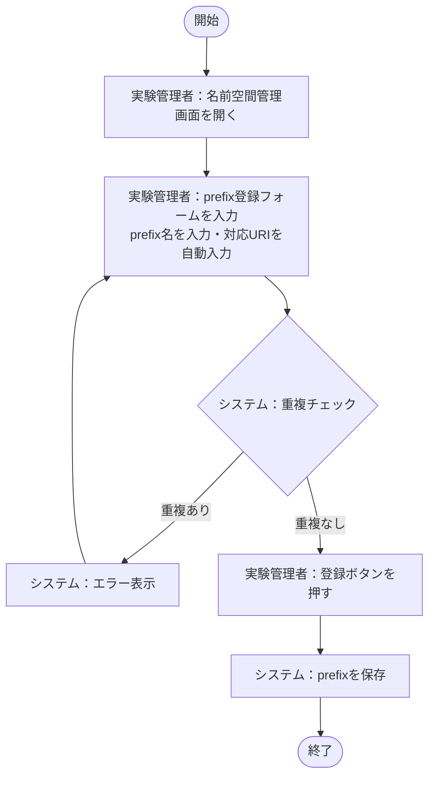

## 業務概要

実験管理者が自分の名前空間に対してprefixを登録する。登録したprefixはMaiMLファイルの`xmlns`宣言で使用できるようになる。

## 前提条件

- 実験管理者としてログイン済み
- 個人名前空間またはチーム名前空間が存在すること

## 終了条件

- prefixが正常に登録され、一覧に表示される

## 関連ユースケース

- UC-01：prefixを登録する

## 確認事項

- なし

---

## BF-02：prefix一覧を確認する

## Mermaid

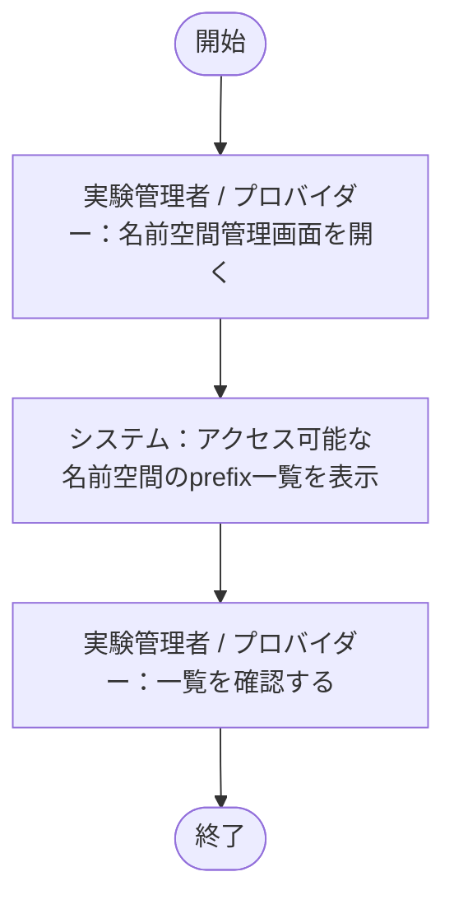

## 業務概要

実験管理者またはプロバイダーが、登録済みのprefixを一覧で確認する。

## 前提条件

- ログイン済み

## 終了条件

- prefix一覧が表示される

## 関連ユースケース

- UC-02：prefix一覧を確認する

## 確認事項

- なし

---

## BF-03：prefixを非アクティブ化する

## Mermaid

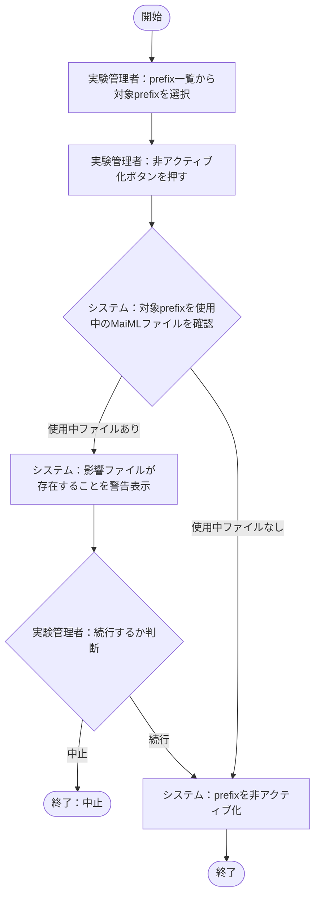

## 業務概要

使用を停止したいprefixを非アクティブ化する。使用中のMaiMLファイルがある場合は影響の警告が表示され、利用者が続行を判断する。

## 前提条件

- 実験管理者としてログイン済み
- 対象prefixが自分の名前空間に存在すること

## 終了条件

- prefixが非アクティブ化される、または中止される

## 関連ユースケース

- UC-03：prefixを非アクティブ化する

## 確認事項

- 非アクティブ化後、そのprefixを使用しているMaiMLファイルの挙動（エラー扱いになるか）を確認

---

## BF-04：用語を登録する

## Mermaid

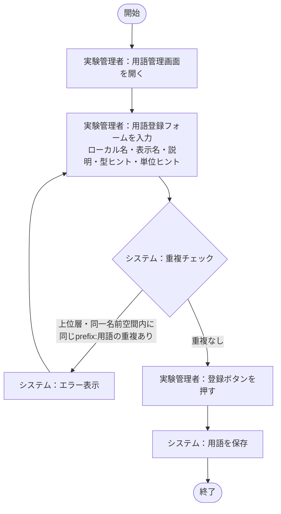

## 業務概要

実験管理者が自分の名前空間に用語（ローカル名・表示名・説明・型ヒント・単位ヒント）を登録する。

## 前提条件

- 実験管理者としてログイン済み
- 登録先の名前空間が存在すること

## 終了条件

- 用語が正常に登録され、一覧に表示される

## 関連ユースケース

- UC-04：用語を登録する

## 確認事項

- なし

---

## BF-05：用語を編集・削除する

## Mermaid

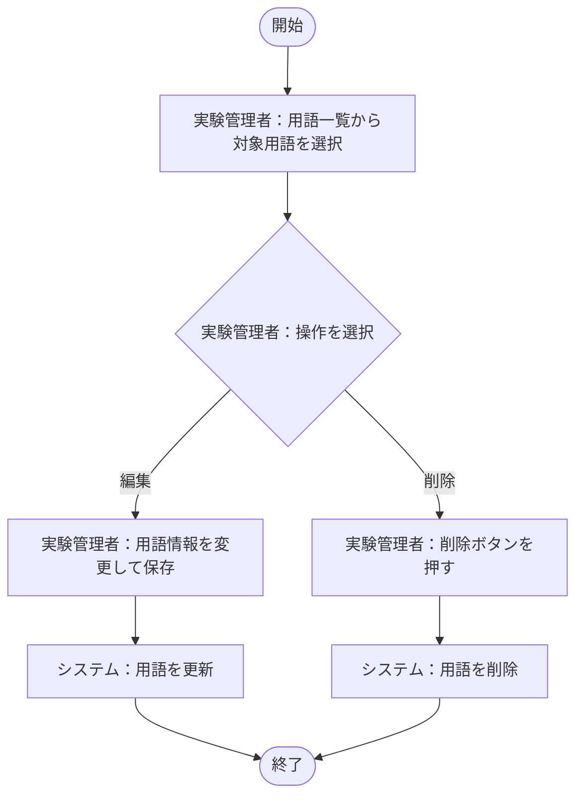

## 業務概要

実験管理者が自分の名前空間に登録済みの用語を編集または削除する。

## 前提条件

- 実験管理者としてログイン済み
- 対象用語が自分の名前空間に存在すること

## 終了条件

- 用語が更新または削除（非アクティブ化）される

## 関連ユースケース

- UC-05：用語を編集・削除する

## 確認事項

- なし

---

## BF-06：MaiMLファイルの名前空間宣言を確認する

## Mermaid

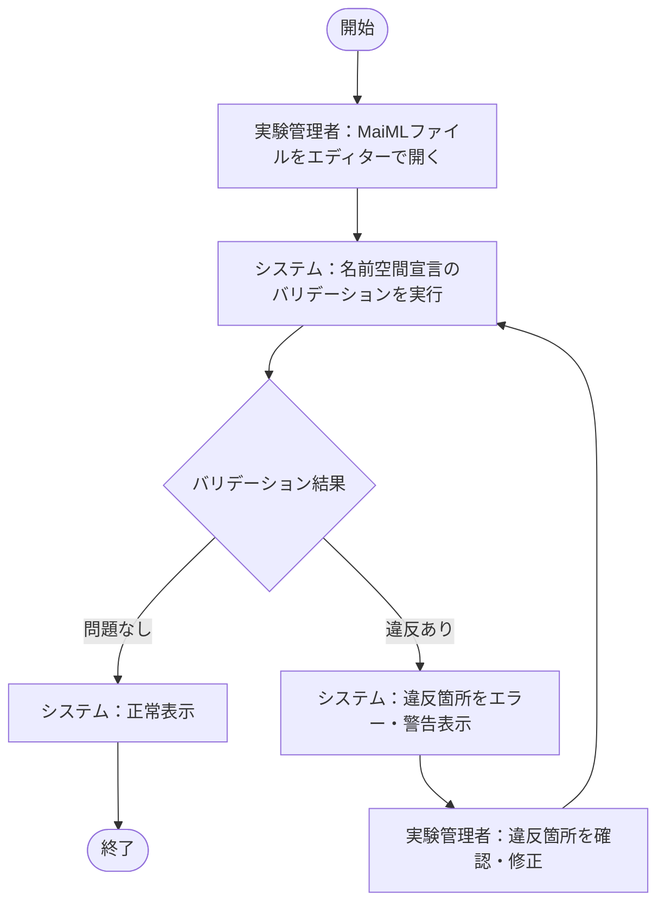

## 業務概要

実験管理者がMaiMLファイルを開いた際に、名前空間宣言の形式が正しいか確認する。違反箇所はエラー・警告として表示される。

## 前提条件

- 実験管理者としてログイン済み
- 対象のMaiMLファイルが存在すること

## 終了条件

- バリデーション結果が表示される

## 関連ユースケース

- UC-06：MaiMLファイルの名前空間宣言を確認する

## 確認事項

- なし

---

## BF-07：チームを追加する

## Mermaid

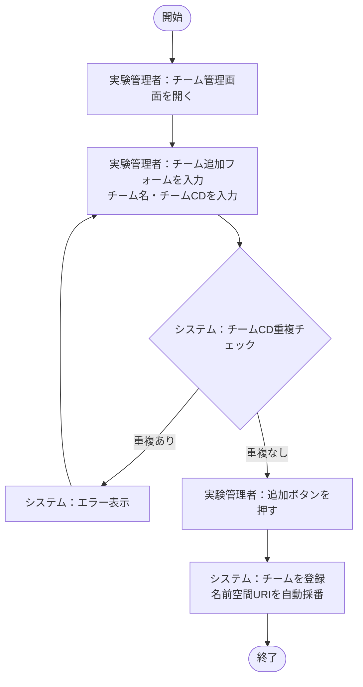

## 業務概要

実験管理者が自分の権限範囲内で新しいチームを追加する。チーム追加時にチームCDを手入力でき、名前空間URIは自動採番される。

## 前提条件

- 実験管理者としてログイン済み

## 終了条件

- チームが登録され、チーム一覧に表示される

## 関連ユースケース

- UC-07：チームを追加する

## 確認事項

- なし

---

## BF-08：自分のチーム一覧を確認する

## Mermaid

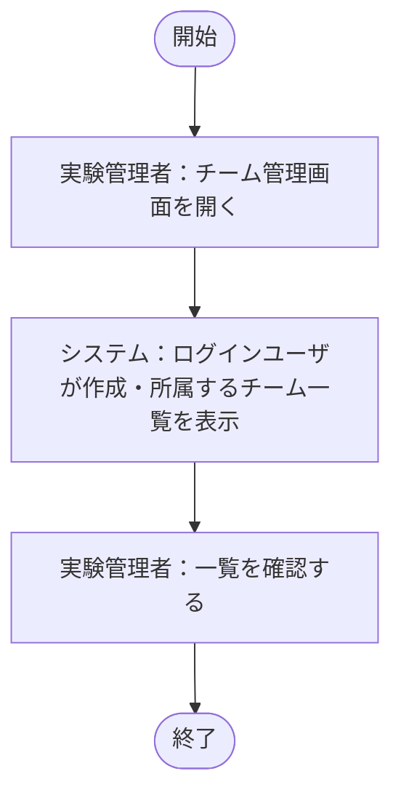

## 業務概要

実験管理者が自分が作成・所属するチームの一覧を確認する。

## 前提条件

- 実験管理者としてログイン済み

## 終了条件

- チーム一覧が表示される

## 関連ユースケース

- UC-08：自分のチーム一覧を確認する

## 確認事項

- なし

---

## BF-09：チームにメンバーを登録する

## Mermaid

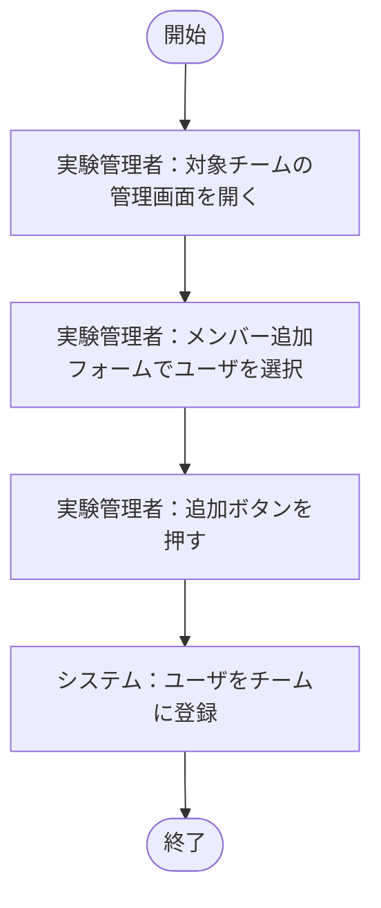

## 業務概要

実験管理者がチームにメンバーを追加または削除する。ユーザは複数チームに所属できる。

## 前提条件

- 実験管理者としてログイン済み
- 対象チームが存在すること
- 追加対象ユーザがシステムに登録済みであること

## 終了条件

- ユーザがチームのメンバーとして登録される

## 関連ユースケース

- UC-09：チームにメンバーを登録する

## 確認事項

- なし

---

## BF-10：チームの代表者を設定する

## Mermaid

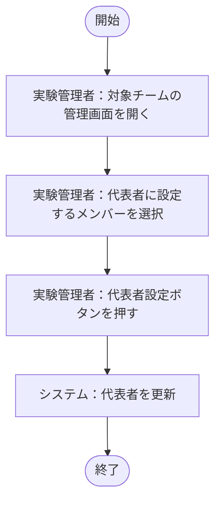

## 業務概要

実験管理者がチームに代表者を設定する。代表者のみが上位層への用語共有操作を行える。

## 前提条件

- 実験管理者としてログイン済み
- 対象チームが存在すること
- 代表者候補がチームメンバーに登録済みであること

## 終了条件

- 代表者が設定される

## 関連ユースケース

- UC-10：チームの代表者を設定する

## 確認事項

- なし

---

## BF-11：組織を管理する

## Mermaid

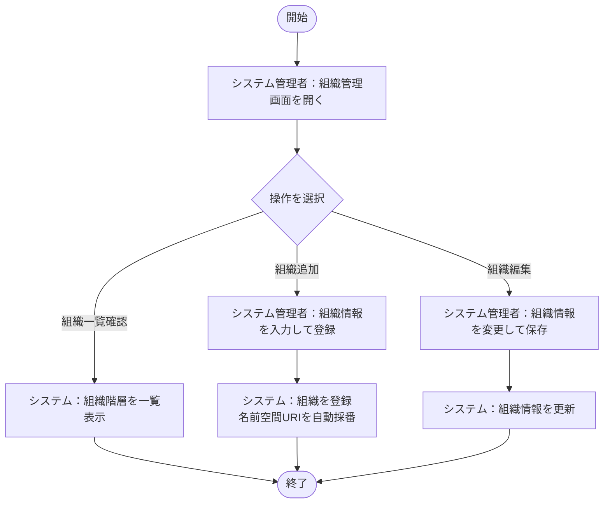

## 業務概要

システム管理者が組織全体の階層構造を登録・管理する。

## 前提条件

- システム管理者としてログイン済み

## 終了条件

- 組織が登録・更新される

## 関連ユースケース

- UC-11：組織を管理する

## 確認事項

- なし

---

## BF-12：標準用語を登録・編集する

## Mermaid

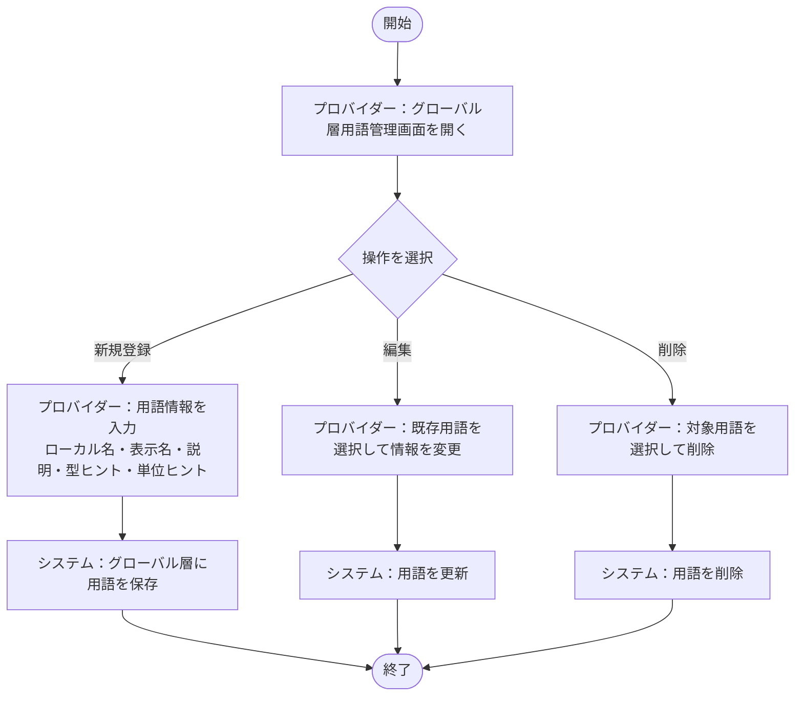

## 業務概要

プロバイダーがMaiML標準・業界共通用語（QUDTなど）をグローバル層の名前空間に登録・編集・削除する。

## 前提条件

- プロバイダーとしてログイン済み

## 終了条件

- グローバル層に用語が登録・更新・削除される

## 関連ユースケース

- UC-12：標準用語を登録・編集する

## 確認事項

- 標準用語はシステム導入時に初期データとして提供されるか、プロバイダーが手動で登録するか未確定

---

## BF-13：標準用語を参照する

## Mermaid

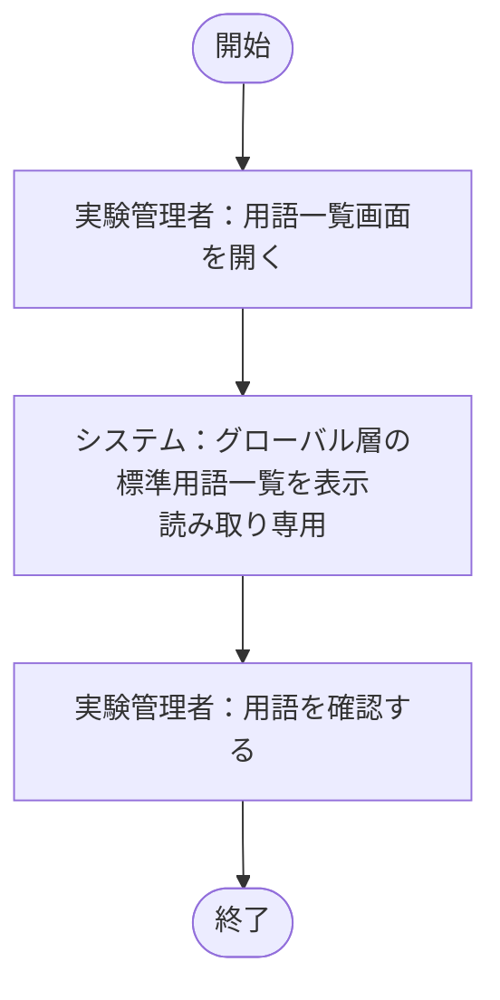

## 業務概要

実験管理者がグローバル層に登録された標準用語の一覧を閲覧・検索する。編集は不可。

## 前提条件

- 実験管理者としてログイン済み

## 終了条件

- 標準用語一覧が表示される

## 関連ユースケース

- UC-13：標準用語を参照する

## 確認事項

- なし

---

## BF-14：配下の用語を上位層に共有する

## Mermaid

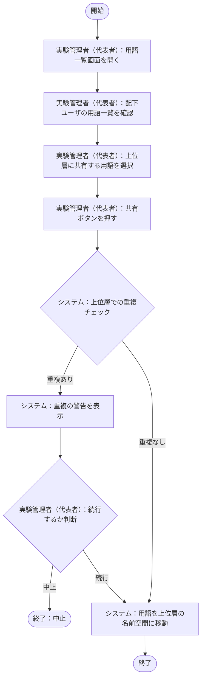

## 業務概要

チーム代表者が、配下（個人・下位チーム）の用語を上位層の名前空間に移動して共有する。

## 前提条件

- 実験管理者（代表者）としてログイン済み
- 共有対象の用語が配下の名前空間に存在すること

## 終了条件

- 用語が上位層の名前空間に移動される

## 関連ユースケース

- UC-14：配下の用語を上位層に共有する

## 確認事項

- なし

---

## BF-15：アクセス可能な用語・名前空間を確認する

## Mermaid

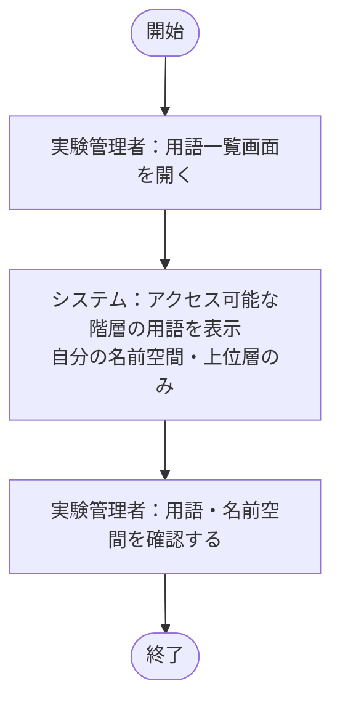

## 業務概要

実験管理者が自分のアクセス権限範囲内の用語・名前空間を確認する。同階層の他チームの情報は表示されない。

## 前提条件

- 実験管理者としてログイン済み

## 終了条件

- アクセス可能な用語・名前空間が表示される

## 関連ユースケース

- UC-15：アクセス可能な用語・名前空間を確認する

## 確認事項

- なし

---

## BF-16：MaiML編集時に登録済み用語を入力する

## Mermaid

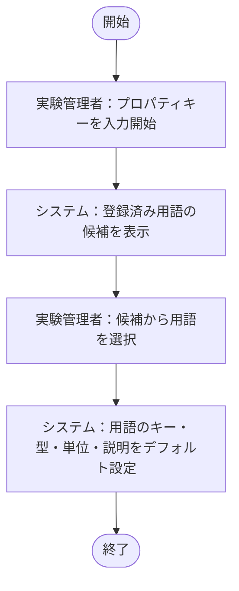

## 業務概要

実験管理者がプロパティキーを入力する際は、必ず登録済み用語の候補から選択して入力する。手入力は行わない。選択した用語の型・単位・説明がデフォルト設定される。

## 前提条件

- 実験管理者としてログイン済み
- 名前空間に用語が登録済みであること

## 終了条件

- プロパティキーが入力される

## 関連ユースケース

- UC-16：MaiML編集時に登録済み用語を入力する

## 確認事項

- なし

---

## BF-17：MaiMLファイルにprefixを宣言する

## Mermaid

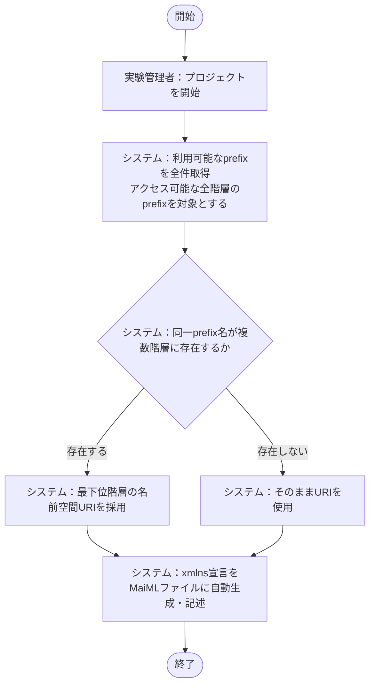

## 業務概要

実験管理者がMaiMLファイルを開くと、システムが利用可能なprefixをすべて取得し、xmlns宣言を自動的にMaiMLファイルに記述する。利用者によるprefix追加・除去の操作は行わない。同一prefix名が複数の階層に存在する場合は、最下位階層の名前空間URIが優先して使用される。

## 前提条件

- 実験管理者としてログイン済み
- アクセス可能な名前空間にprefixが登録済みであること

## 終了条件

- 利用可能なprefixのxmlns宣言がMaiMLファイルに自動記述される

## 関連ユースケース

- UC-17：MaiMLファイルにprefixを宣言する

## 確認事項

- なし

---

## BF-18：用語を検索・絞り込む

## Mermaid

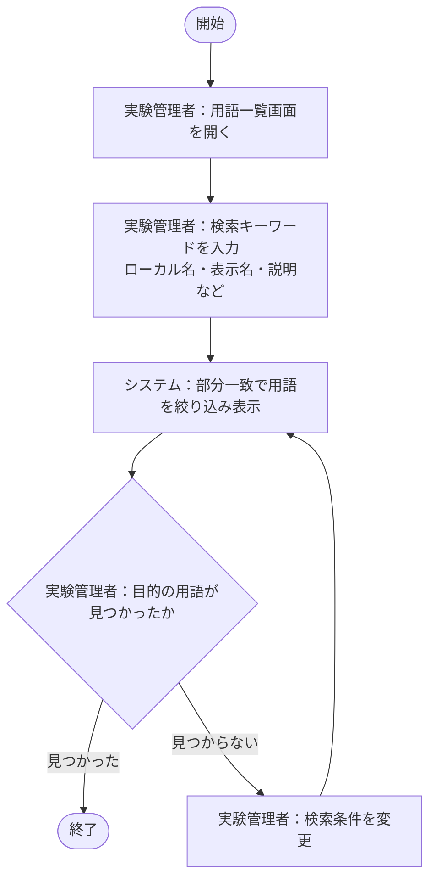

## 業務概要

実験管理者が用語一覧をローカル名・表示名・説明などで部分一致検索・絞り込みする。

## 前提条件

- 実験管理者としてログイン済み

## 終了条件

- 目的の用語が表示される

## 関連ユースケース

- UC-18：用語を検索・絞り込む

## 確認事項

- なし

---

## BF-19：用語のスコープを確認する

## Mermaid

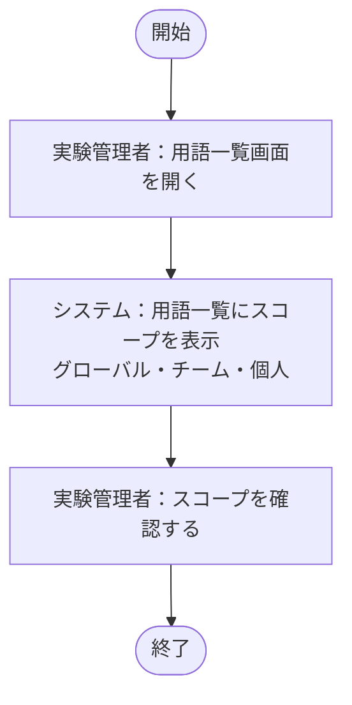

## 業務概要

実験管理者が用語一覧で、各用語がどの階層（グローバル・チーム・個人）に属するかを確認する。

## 前提条件

- 実験管理者としてログイン済み

## 終了条件

- 用語のスコープが一覧で表示される

## 関連ユースケース

- UC-19：用語の継承元を確認する

## 確認事項

- なし

---

## BF-20：用語を表示名で確認する

## Mermaid

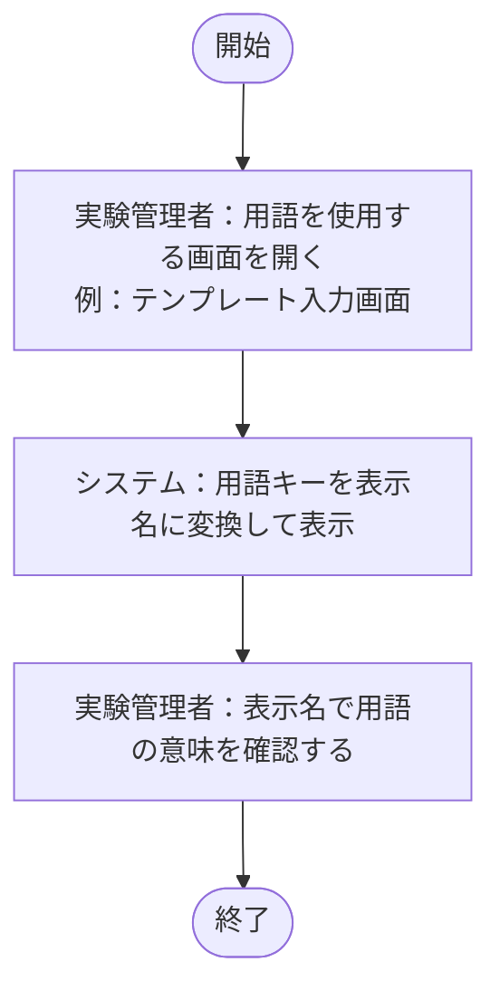

## 業務概要

実験管理者が用語のキー（ローカル名）ではなく、登録された表示名で用語の意味を確認する。

## 前提条件

- 実験管理者としてログイン済み
- 用語に表示名が登録済みであること

## 終了条件

- 表示名で用語が表示される

## 関連ユースケース

- UC-20：用語を表示名で確認する

## 確認事項

- なし

---

## BF-21：ユーザを登録する

## Mermaid

```mermaid
flowchart TD
  A([開始]) --> B[システム管理者：ユーザ管理画面を開く]
  B --> C[システム管理者：ユーザ情報を入力\nメールアドレス・氏名・ロールなど]
  C --> D[システム管理者：登録ボタンを押す]
  D --> E[システム：ユーザを登録]
  E --> F[システム：個人名前空間を自動作成\nURIはメールアドレスのドメイン前を使用・重複時は連番]
  F --> G([終了])
```

## 業務概要

システム管理者が新規ユーザをシステムに登録する。登録と同時にそのユーザ専用の個人名前空間が自動作成される。

## 前提条件

- システム管理者としてログイン済み

## 終了条件

- ユーザが登録され、個人名前空間が自動作成される

## 関連ユースケース

- UC-21：ユーザを登録する

## 確認事項

- なし

---

## BF-22：用語をエクスポートする

## Mermaid

```mermaid
flowchart TD
  A([開始]) --> B[実験管理者：用語一覧画面を開く]
  B --> C[実験管理者：エクスポートしたい用語をチェックボックスで選択]
  C --> D[実験管理者：エクスポートボタンを押す]
  D --> E[システム：選択した用語をCSV形式で出力]
  E --> F([終了])
```

## 業務概要

実験管理者が用語一覧からチェックボックスで対象を選択し、CSV形式でエクスポートする。

## 前提条件

- 実験管理者としてログイン済み
- エクスポート対象の用語が存在すること

## 終了条件

- 選択した用語がCSVとしてダウンロードされる

## 関連ユースケース

- UC-22：用語をエクスポートする

## 確認事項

- なし

---

## BF-23：用語をインポートする

## Mermaid

```mermaid
flowchart TD
  A([開始]) --> B[実験管理者：用語管理画面を開く]
  B --> C[実験管理者：インポート用CSVファイルを選択]
  C --> D[システム：CSVの形式チェック・バリデーション]
  D -- エラーあり --> E[システム：エラー内容を表示]
  E --> C
  D -- 問題なし --> F[実験管理者：インポートボタンを押す]
  F --> G{システム：重複チェック}
  G -- 重複あり --> H[システム：重複用語を警告表示]
  H --> I{実験管理者：続行するか判断}
  I -- 中止 --> J([終了：中止])
  I -- 続行 --> K[システム：用語を名前空間に一括登録]
  G -- 重複なし --> K
  K --> L([終了])
```

## 業務概要

実験管理者が外部から提供された用語リスト（CSV）を読み込み、自分の名前空間に一括登録する。

## 前提条件

- 実験管理者としてログイン済み
- インポート用CSVファイルが準備済みであること

## 終了条件

- CSVの用語が名前空間に一括登録される

## 関連ユースケース

- UC-23：用語をインポートする

## 確認事項

- インポート時のCSVフォーマット（列定義）を確認
