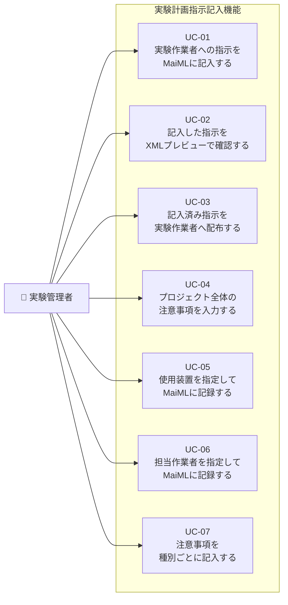
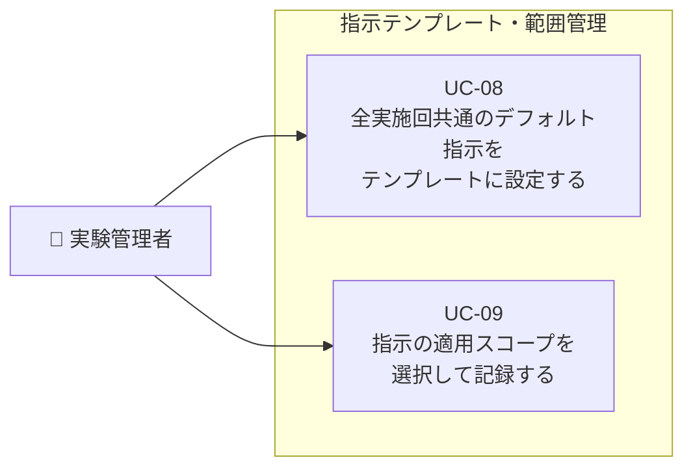
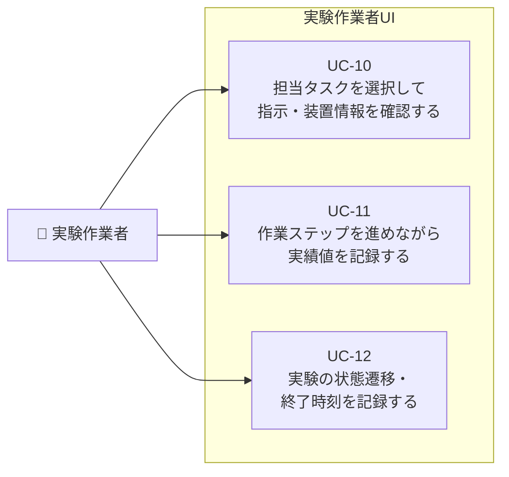
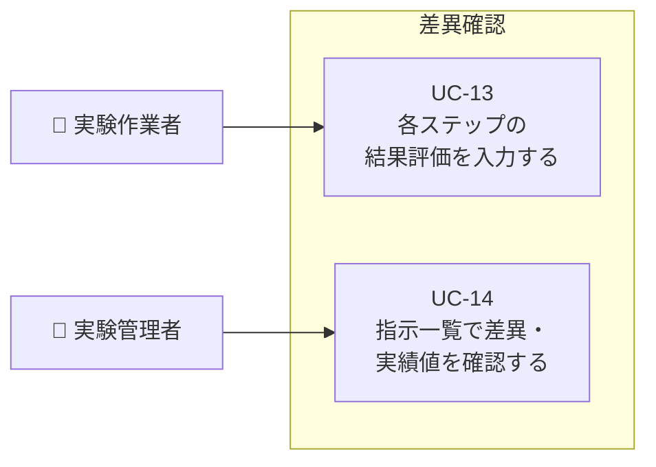
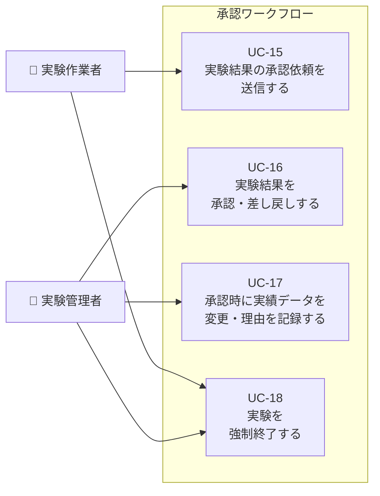

# 実験計画指示記入機能・実験作業者UI ― ユースケース一覧

**作成日**: 2026-08-07
**作成者**: SSV
**対象**: お客様との認識合わせ用
**対象機能**: 実験計画指示記入機能・実験作業者UI
**前提資料**: [01_Objectives.md](./01_Objectives.md) / [02_Required_Features.md](./02_Required_Features.md)

---

## 目次

- [アクター一覧](#アクター一覧)
- [ユースケース一覧](#ユースケース一覧)
  - [目的1〜3：実験指示の記入・配布](#目的13実験指示の記入配布)
  - [目的4〜5：指示の範囲・テンプレート管理](#目的45指示の範囲テンプレート管理)
  - [目的6〜7：実験作業の実施と実績記録](#目的67実験作業の実施と実績記録)
  - [目的8：差異確認](#目的8差異確認)
  - [目的9：承認ワークフロー](#目的9承認ワークフロー)
- [ユースケース図](#ユースケース図)

---

## アクター一覧

| アクター | 説明 |
|---------|------|
| 実験管理者 | 実験計画を立案し、実験作業者への指示を記入・配布する。実験結果を確認・承認する。 |
| 実験作業者 | 実験管理者の指示に従って実験を実施し、実績値を記録する。承認依頼を送信する。 |

---

## ユースケース一覧

### 目的1〜3：実験指示の記入・配布

| ユースケース | アクター | 概要 | 利用する機能 | 確認事項 |
|--------------|----------|------|--------------|----------|
| UC-01：実験作業者への指示をMaiMLに記入する | 実験管理者 | 実験管理者がUIを操作し、XML構造を意識せずに実験条件に対する指示（装置・パラメータ・注意事項など）を入力する | F-01-01 指示記入機能 | |
| UC-02：記入した指示をXMLプレビューで確認する | 実験管理者 | 指示を入力しながら、リアルタイムで対応するXML構造を確認し、記入ミスを防ぐ | F-01-02 XMLプレビュー機能 | |
| UC-03：記入済み指示を実験作業者へ配布する | 実験管理者 | 記入済みのMaiMLファイルを実験作業者に配布し、参照できるようにする | F-01-03 指示配布機能 | |
| UC-04：プロジェクト全体の注意事項を入力する | 実験管理者 | プロジェクト全体に対する注意事項をMaiMLファイルに記録し、実験作業者が参照できるようにする | F-01-04 プロジェクト注意事項入力機能 | |
| UC-05：使用装置を指定してMaiMLに記録する | 実験管理者 | 使用装置をドロップダウンから選択し、MaiMLの適切な場所にUUIDと装置名を記録する | F-02-01 装置選択・記録機能、F-02-03 装置名人間可読化表示機能 | |
| UC-06：担当作業者を指定してMaiMLに記録する | 実験管理者 | 担当作業者をドロップダウンから選択し、MaiMLに記録する | F-02-02 担当作業者選択・記録機能 | |
| UC-07：注意事項を種別ごとに記入する | 実験管理者 | プロジェクトに対して注意事項・禁止事項・操作注記・確認事項を種別ごとに入力し、MaiMLに記録する | F-03-01 注意事項種別記入機能 | |

---

### 目的4〜5：指示の範囲・テンプレート管理

| ユースケース | アクター | 概要 | 利用する機能 | 確認事項 |
|--------------|----------|------|--------------|----------|
| UC-08：全実施回共通のデフォルト指示をテンプレートに設定する | 実験管理者 | 全実施回に共通する装置・パラメータをTemplateに一度記入し、毎回同じ指示を繰り返し入力する手間を省く | F-04-01 テンプレート仮置き設定機能 | |
| UC-09：指示の適用スコープを選択して記録する | 実験管理者 | 指示の適用範囲（実験全体 / 特定タスク / 特定transition）を選択し、MaiMLの適切な場所に記録する | F-05-01 指示記録範囲選択機能 | |

---

### 目的6〜7：実験作業の実施と実績記録

| ユースケース | アクター | 概要 | 利用する機能 | 確認事項 |
|--------------|----------|------|--------------|----------|
| UC-10：担当タスクを選択して指示・装置情報を確認する | 実験作業者 | プロジェクトを選択してトランジション一覧を開き、担当タスクの指示内容・装置・注意事項・仮値を一画面で確認する | F-06-01 タスク一覧・選択機能、F-06-02 タスク詳細表示機能、F-06-03 タスク・トランジションロック制御機能 | |
| UC-11：作業ステップを進めながら実績値を記録する | 実験作業者 | 各作業ステップを実施しながら、仮値と対比しつつ実績値（数値・テキスト・日時）をフォームに入力してMaiMLに記録する | F-07-01 実績値入力機能、F-07-02 型対応入力コントロール機能 | |
| UC-12：実験の状態遷移・終了時刻を記録する | 実験作業者 | 実験の状態遷移を登録し、終状態もしくは異常終了状態となった時刻を記録する | F-06-05 状態遷移登録機能、F-06-07 実験終状態時刻記録機能 | |

---

### 目的8：差異確認

| ユースケース | アクター | 概要 | 利用する機能 | 確認事項 |
|--------------|----------|------|--------------|----------|
| UC-13：各ステップの結果評価を入力する | 実験作業者 | 実績値を入力した後に、各ステップの結果評価（OK / NG など）を入力する | F-08-01 結果評価入力機能 | |
| UC-14：指示一覧で差異・実績値を確認する | 実験管理者 | 指示一覧ビューで、各ステップの仮値・実績値・差異の状況を確認する | F-08-03 差異ステータス確認機能 | |

---

### 目的9：承認ワークフロー

| ユースケース | アクター | 概要 | 利用する機能 | 確認事項 |
|--------------|----------|------|--------------|----------|
| UC-15：実験結果の承認依頼を送信する | 実験作業者 | 実験結果（実績値・不確かさ評価）を記録後、実験管理者に承認依頼を送信する | F-09-01 承認依頼機能 | |
| UC-16：実験結果を承認・差し戻しする | 実験管理者 | 実験結果と不確かさ評価を同一の画面・フローで確認し、承認または差し戻しを行う。差し戻し時は理由を入力できる。 | F-09-02 承認・差し戻し機能、F-09-03 実験結果・不確かさ承認統合機能 | |
| UC-17：承認時に実績データを変更・理由を記録する | 実験管理者 | 承認時に実績データを変更する場合、変更理由をイベントログに記録する | F-09-04 承認時データ変更・変更理由記録機能 | |
| UC-18：実験を強制終了する | 実験作業者、実験管理者 | 作業者・管理者のどちらからでも実験を強制終了でき、強制終了時に評価NGが自動登録される | F-09-06 強制終了機能 | |

---

## ユースケース図

### 図1：実験指示の記入・配布（目的1〜3）

---

### 図2：指示の範囲・テンプレート管理（目的4〜5）

---

### 図3：実験作業の実施と実績記録（目的6〜7）

---

### 図4：差異確認（目的8）

---

### 図5：承認ワークフロー（目的9）

