# 実験計画指示記入機能・実験作業者UI ― 業務フロー一覧

**作成日**: 2026-08-07
**作成者**: SSV
**対象**: お客様との認識合わせ用
**対象機能**: 実験計画指示記入機能・実験作業者UI
**前提資料**: [01_Objectives.md](./01_Objectives.md) / [02_Required_Features.md](./02_Required_Features.md) / [03_Use_Cases.md](./03_Use_Cases.md)

---

## 目次

- [BF-01：実験作業者への指示をMaiMLに記入する](#bf-01実験作業者への指示をmaimlに記入する)
- [BF-02：記入した指示をXMLプレビューで確認する](#bf-02記入した指示をxmlプレビューで確認する)
- [BF-03：記入済み指示を実験作業者へ配布する](#bf-03記入済み指示を実験作業者へ配布する)
- [BF-04：プロジェクト全体の注意事項を入力する](#bf-04プロジェクト全体の注意事項を入力する)
- [BF-05：使用装置を指定してMaiMLに記録する](#bf-05使用装置を指定してmaimlに記録する)
- [BF-06：担当作業者を指定してMaiMLに記録する](#bf-06担当作業者を指定してmaimlに記録する)
- [BF-07：注意事項を種別ごとに記入する](#bf-07注意事項を種別ごとに記入する)
- [BF-09：指示の適用スコープを選択して記録する](#bf-09指示の適用スコープを選択して記録する)
- [BF-10：担当タスクを選択して指示・装置情報を確認する](#bf-10担当タスクを選択して指示装置情報を確認する)
- [BF-11：作業ステップを進めながら実績値を記録する](#bf-11作業ステップを進めながら実績値を記録する)
- [BF-12：実験の状態遷移・終了時刻を記録する](#bf-12実験の状態遷移終了時刻を記録する)
- [BF-13：各ステップの結果評価を入力する](#bf-13各ステップの結果評価を入力する)
- [BF-14：指示一覧で差異・実績値を確認する](#bf-14指示一覧で差異実績値を確認する)
- [BF-15：実験結果の承認依頼を送信する](#bf-15実験結果の承認依頼を送信する)
- [BF-16：実験結果を承認・差し戻しする](#bf-16実験結果を承認差し戻しする)
- [BF-17：承認時に実績データを変更・理由を記録する](#bf-17承認時に実績データを変更理由を記録する)
- [BF-18：実験を強制終了する](#bf-18実験を強制終了する)

---

## BF-01：実験作業者への指示をMaiMLに記入する

### Mermaid

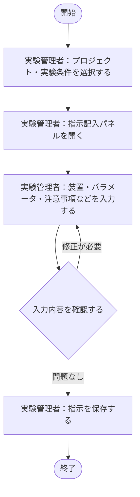

### 業務概要

実験管理者が、指示記入パネルを通じてXML構造を意識せずに実験条件への指示を入力し、MaiMLファイルに保存する。

### 前提条件

- プロジェクト・実験条件（MaiMLファイル）が作成済みであること

### 終了条件

- 入力した指示がMaiMLファイルに保存されていること

### 関連ユースケース

- UC-01：実験作業者への指示をMaiMLに記入する

### 確認事項

---

## BF-02：記入した指示をXMLプレビューで確認する

### Mermaid

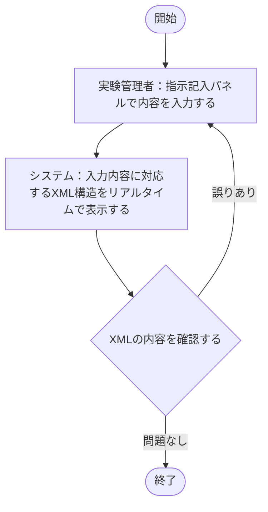

### 業務概要

実験管理者が指示を入力しながら、リアルタイムで対応するXML構造をプレビューで確認し、記入ミスを防ぐ。

### 前提条件

- 指示記入パネルが開かれていること

### 終了条件

- XMLプレビューで入力内容が正しく反映されていることを確認できること

### 関連ユースケース

- UC-02：記入した指示をXMLプレビューで確認する

### 確認事項

- プレビューの更新タイミング（リアルタイム・保存時）を確認

---

## BF-03：記入済み指示を実験作業者へ配布する

### Mermaid

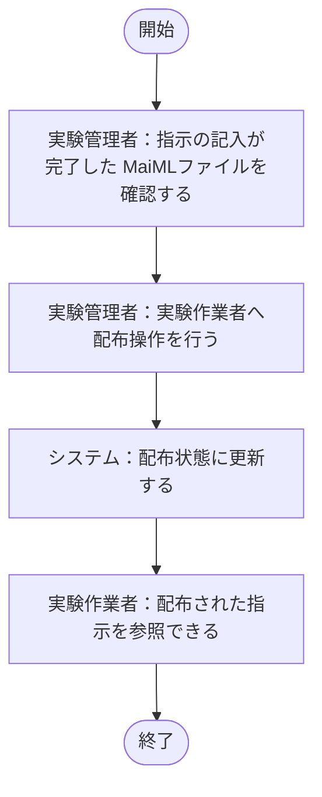

### 業務概要

実験管理者が記入済みのMaiMLファイルを実験作業者へ配布し、実験作業者が指示を参照できる状態にする。

### 前提条件

- 実験管理者が指示の記入を完了していること

### 終了条件

- 実験作業者がシステム上で指示を参照できること

### 関連ユースケース

- UC-03：記入済み指示を実験作業者へ配布する

### 確認事項

- 配布の方法（ファイル共有・システム内通知・ステータス変更）を確認

---

## BF-04：プロジェクト全体の注意事項を入力する

### Mermaid

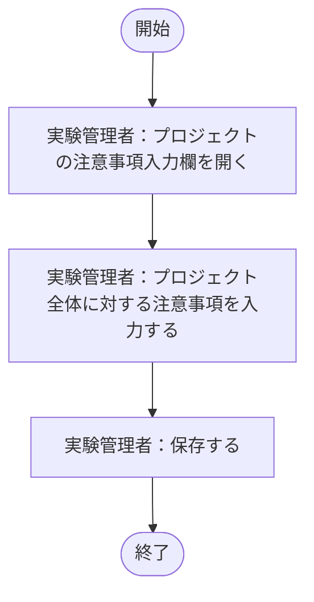

### 業務概要

実験管理者がプロジェクト全体に対する注意事項をMaiMLファイルに記録し、実験作業者が参照できるようにする。

### 前提条件

- プロジェクトが作成済みであること

### 終了条件

- プロジェクト全体の注意事項がMaiMLファイルに保存されていること

### 関連ユースケース

- UC-04：プロジェクト全体の注意事項を入力する

### 確認事項

- 注意事項の記録先（MaiMLファイルのどの要素か）を確認

---

## BF-05：使用装置を指定してMaiMLに記録する

### Mermaid

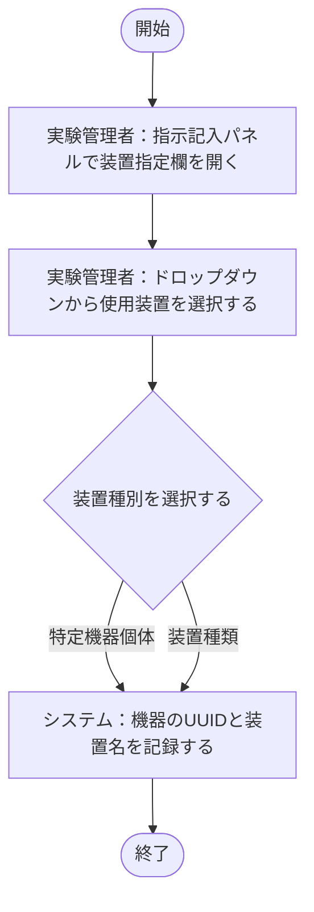

### 業務概要

実験管理者が使用装置をドロップダウンから選択し、MaiMLの適切な場所にUUIDと装置名を記録する。

### 前提条件

- 装置マスタが登録済みであること

### 終了条件

- 選択した装置のUUIDと装置名がMaiMLファイルに記録されていること

### 関連ユースケース

- UC-05：使用装置を指定してMaiMLに記録する

### 確認事項

- 装置マスタはどこで管理するか（システム内マスタ・MaiMLファイル内か）確認が必要

---

## BF-06：担当作業者を指定してMaiMLに記録する

### Mermaid

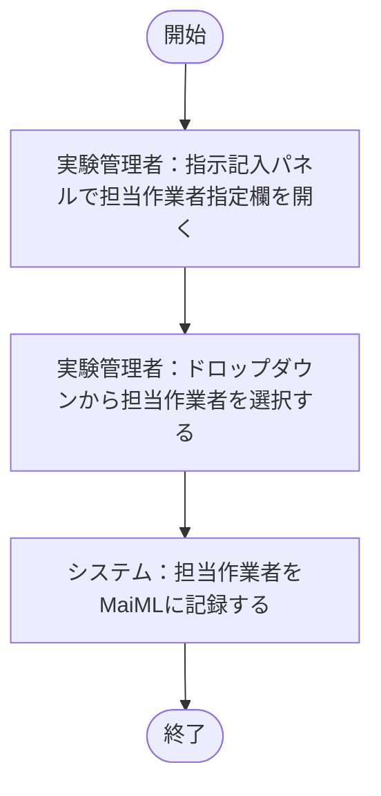

### 業務概要

実験管理者が担当作業者をドロップダウンから選択し、MaiMLに記録する。

### 前提条件

- 担当者一覧（ownerリスト）が登録済みであること

### 終了条件

- 選択した担当作業者がMaiMLファイルに記録されていること

### 関連ユースケース

- UC-06：担当作業者を指定してMaiMLに記録する

### 確認事項

- 担当者一覧（ownerリスト）の管理方法を確認

---

## BF-07：注意事項を種別ごとに記入する

### Mermaid

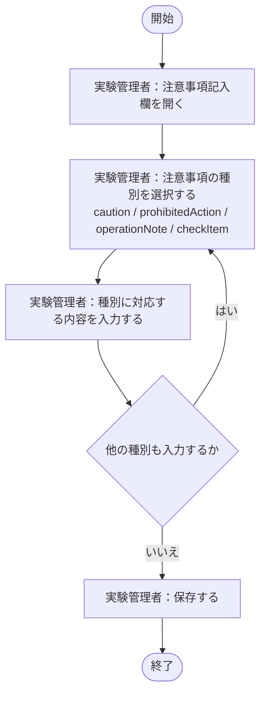

### 業務概要

実験管理者がプロジェクトに対して注意事項・禁止事項・操作注記・確認事項を種別ごとに入力し、MaiMLに記録する。

### 前提条件

- プロジェクトが作成済みであること

### 終了条件

- 入力した注意事項が種別ごとにMaiMLファイルに保存されていること

### 関連ユースケース

- UC-07：注意事項を種別ごとに記入する

### 確認事項

- 注意事項の種類（caution / prohibitedAction / operationNote / checkItem）の定義をお客様と確認

---

## BF-09：指示の適用スコープを選択して記録する

### Mermaid

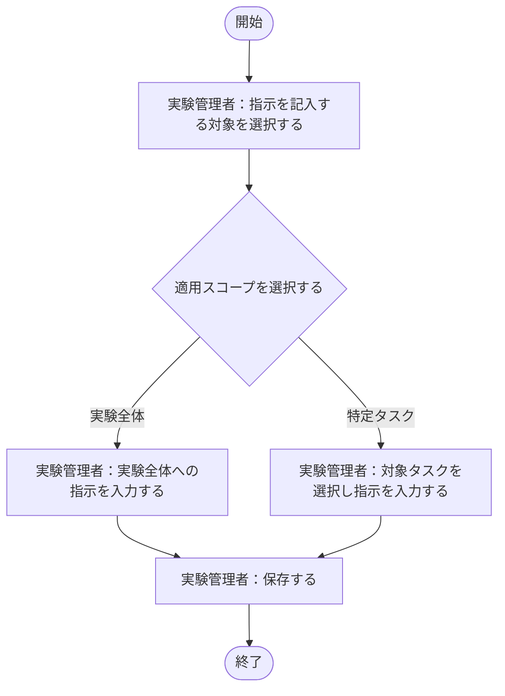

### 業務概要

実験管理者が指示の適用範囲（実験全体 / 特定タスク）を選択し、MaiMLの適切な場所に記録する。

### 前提条件

- MaiMLファイルが作成済みであること

### 終了条件

- 指示が選択したスコープに対応するMaiMLの場所に保存されていること

### 関連ユースケース

- UC-09：指示の適用スコープを選択して記録する

### 確認事項

- どの粒度まで選択可能にするか確認

---

## BF-10：担当タスクを選択して指示・装置情報を確認する

### Mermaid

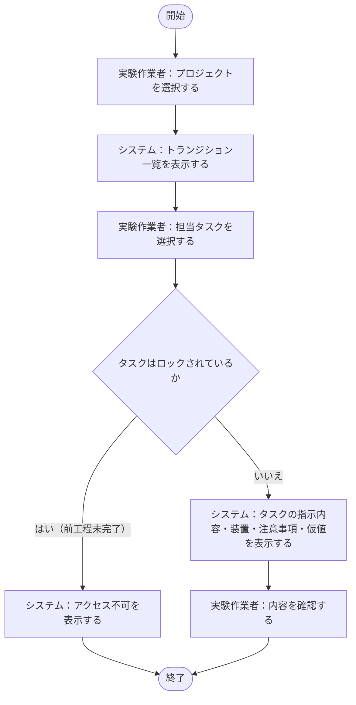

### 業務概要

実験作業者がプロジェクトを選択してトランジション一覧を開き、担当タスクの指示内容・装置・注意事項・仮値を一画面で確認する。

### 前提条件

- 実験管理者が指示を記入・配布済みであること
- 実験作業者がシステムにログイン済みであること

### 終了条件

- 実験作業者がタスクの指示内容を確認できること

### 関連ユースケース

- UC-10：担当タスクを選択して指示・装置情報を確認する

### 確認事項

- 担当タスクの絞り込み方法（全タスク表示か担当者割り当て済みのみか）を確認

---

## BF-11：作業ステップを進めながら実績値を記録する

### Mermaid

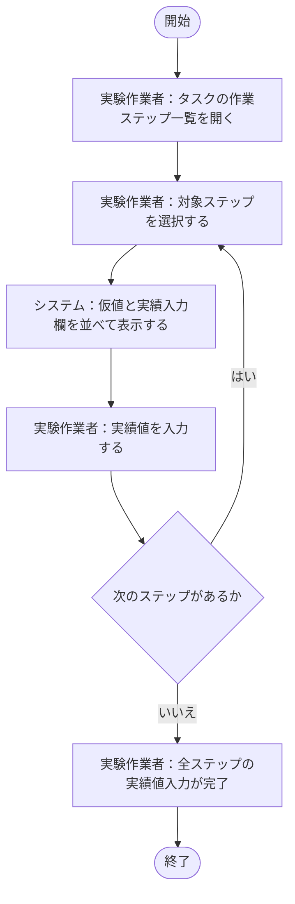

### 業務概要

実験作業者が各作業ステップを実施しながら、仮値と対比しつつ実績値をフォームに入力してMaiMLに記録する。

### 前提条件

- 実験作業者が担当タスクを選択し、作業を開始していること

### 終了条件

- 全ステップの実績値がMaiMLファイルに記録されていること

### 関連ユースケース

- UC-11：作業ステップを進めながら実績値を記録する

### 確認事項

- 実績値の保存タイミング（ステップごとに都度保存か、タスク完了時にまとめて保存か）を確認

---

## BF-12：実験の状態遷移・終了時刻を記録する

### Mermaid

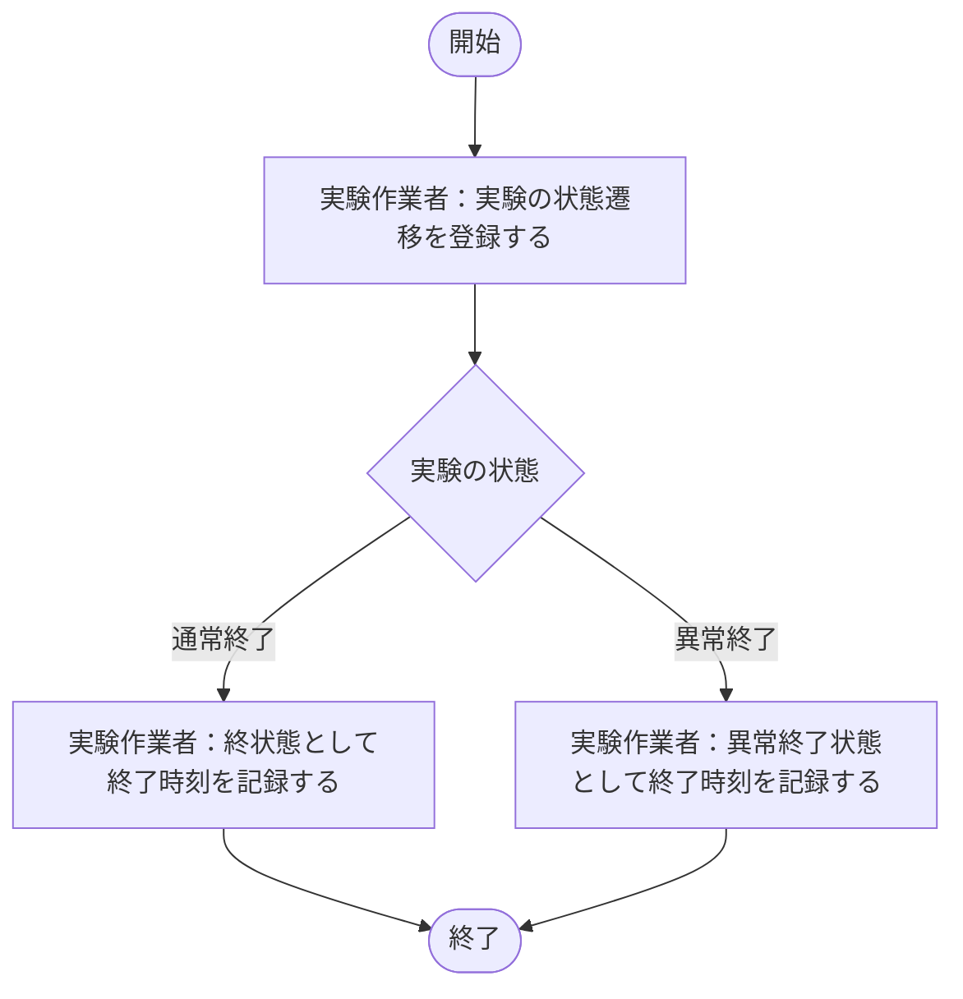

### 業務概要

実験作業者が実験の状態遷移を登録し、終状態もしくは異常終了状態となった時刻を記録する。

### 前提条件

- 実験が進行中であること

### 終了条件

- 実験の終了時刻がMaiMLファイルに記録されていること

### 関連ユースケース

- UC-12：実験の状態遷移・終了時刻を記録する

### 確認事項

- 状態遷移登録の対象・内容・登録タイミングを確認
- MaiMLファイルのどの要素に記録するかを確認

---

## BF-13：各ステップの結果評価を入力する

### Mermaid

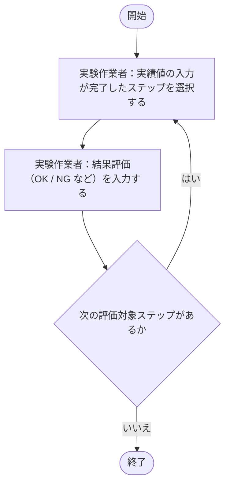

### 業務概要

実験作業者が実績値を入力した後に、各ステップの結果評価（OK / NG など）を入力する。

### 前提条件

- 対象ステップの実績値が入力済みであること

### 終了条件

- 全ステップの結果評価が入力されていること

### 関連ユースケース

- UC-13：各ステップの結果評価を入力する

### 確認事項

- 評価の選択肢（OK / NG / 要確認など）をお客様と確認
- 評価結果のMaiMLへの記録場所を確認

---

## BF-14：指示一覧で差異・実績値を確認する

### Mermaid

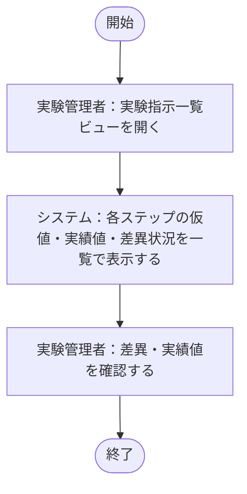

### 業務概要

実験管理者が指示一覧ビューで、各ステップの仮値・実績値・差異の状況を確認する。

### 前提条件

- 実験作業者が実績値を入力済みであること

### 終了条件

- 実験管理者が差異・実績値の状況を確認できること

### 関連ユースケース

- UC-14：指示一覧で差異・実績値を確認する

### 確認事項

---

## BF-15：実験結果の承認依頼を送信する

### Mermaid

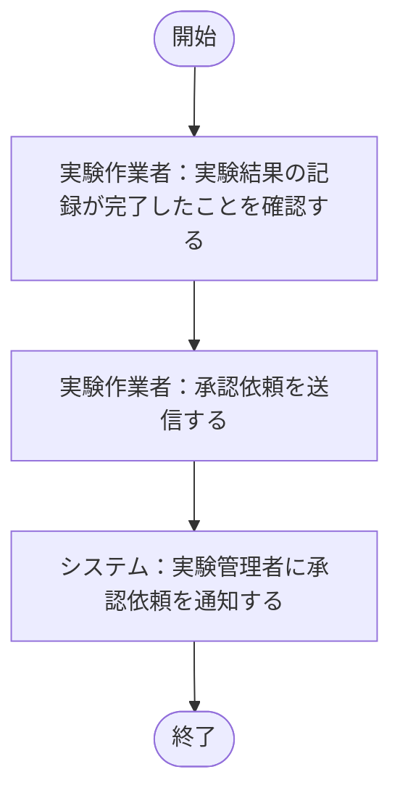

### 業務概要

実験作業者が実験結果（実績値・不確かさ評価）の記録完了後、実験管理者に承認依頼を送信する。

### 前提条件

- 実験作業者が実験結果の記録を完了していること

### 終了条件

- 実験管理者が承認依頼を受け取っていること

### 関連ユースケース

- UC-15：実験結果の承認依頼を送信する

### 確認事項

- 承認依頼のタイミング（タスク単位か、プロジェクト全体単位か）を確認

---

## BF-16：実験結果を承認・差し戻しする

### Mermaid

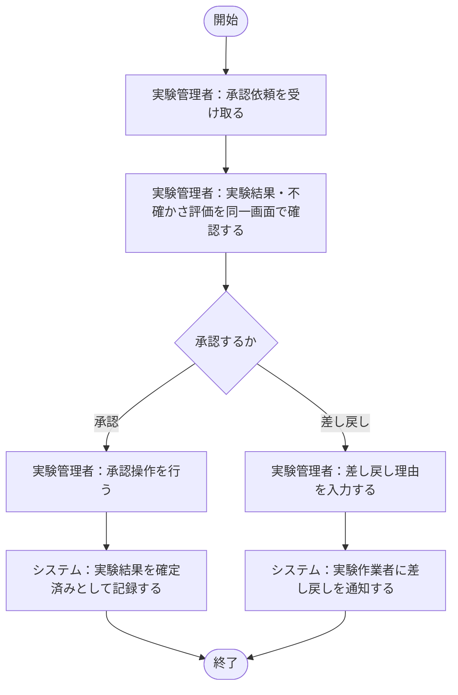

### 業務概要

実験管理者が実験結果と不確かさ評価を同一の画面・フローで確認し、承認または差し戻しを行う。差し戻し時は理由を入力できる。

### 前提条件

- 実験作業者から承認依頼が送信済みであること

### 終了条件

- 承認の場合：実験結果が確定済みとして記録されること
- 差し戻しの場合：実験作業者に差し戻しが通知されること

### 関連ユースケース

- UC-16：実験結果を承認・差し戻しする

### 確認事項

- 差し戻しパターン（記録ミスの書き直し・部分再実験・全体再実験）ごとの導線をお客様と確認

---

## BF-17：承認時に実績データを変更・理由を記録する

### Mermaid

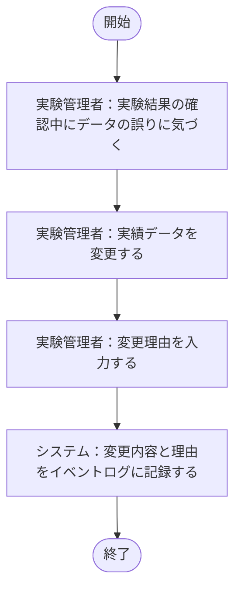

### 業務概要

承認時に実験管理者が実績データを変更する場合、変更理由をイベントログに記録する。

### 前提条件

- 実験管理者が実験結果を承認・確認中であること

### 終了条件

- 変更後の実績データと変更理由がイベントログに記録されていること

### 関連ユースケース

- UC-17：承認時に実績データを変更・理由を記録する

### 確認事項

- 変更理由の入力は任意か必須かを確認

---

## BF-18：実験を強制終了する

### Mermaid

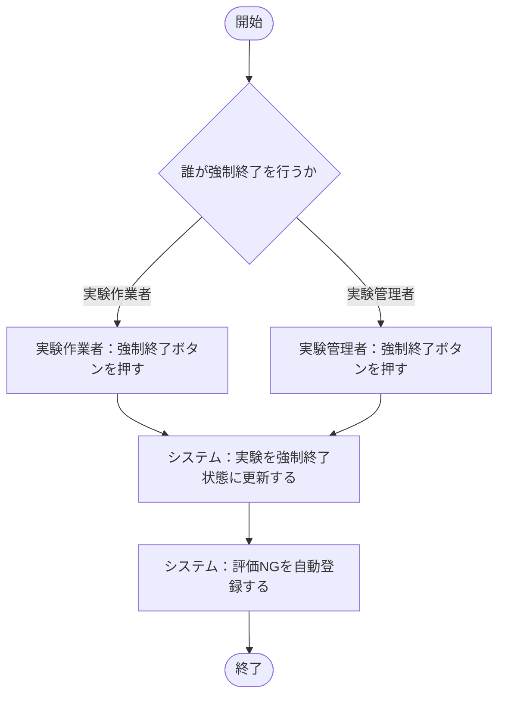

### 業務概要

作業者・管理者のどちらからでも実験を強制終了でき、強制終了時に評価NGが自動登録される。

### 前提条件

- 実験が進行中であること

### 終了条件

- 実験が強制終了状態に更新され、評価NGが自動登録されていること

### 関連ユースケース

- UC-18：実験を強制終了する

### 確認事項

- 強制終了フロー（作業者側・管理者側それぞれ）の詳細をお客様と確認
