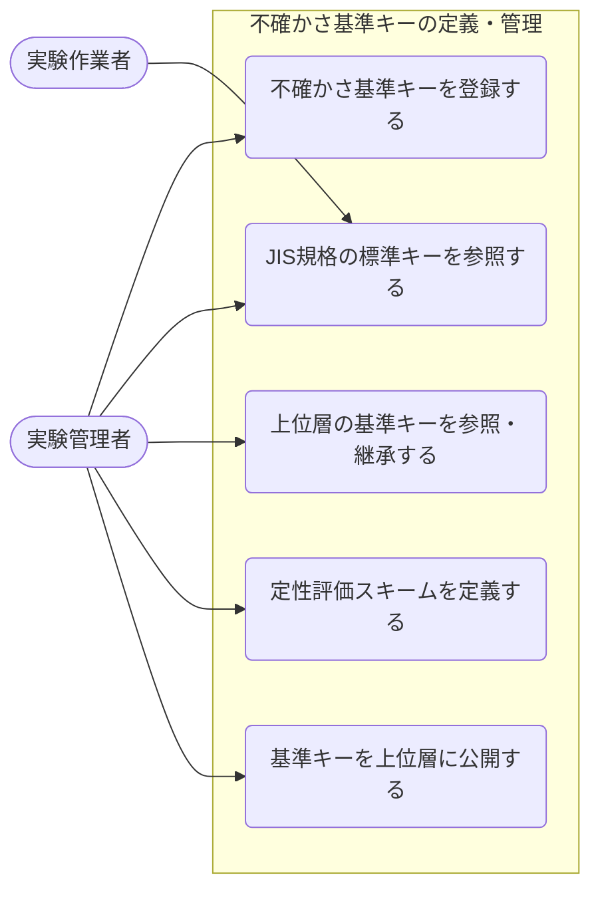
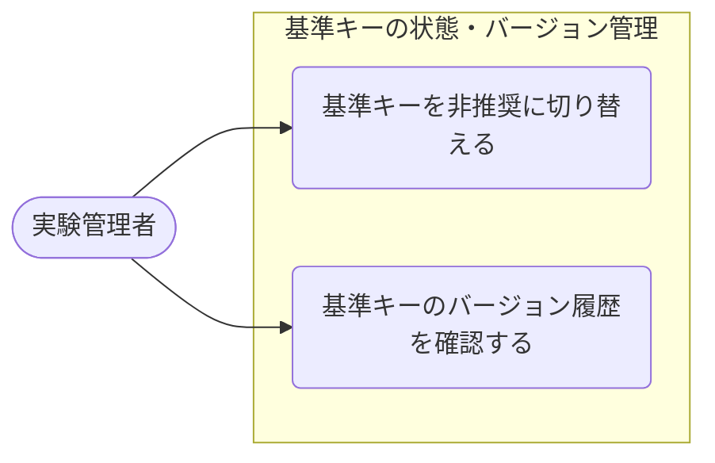
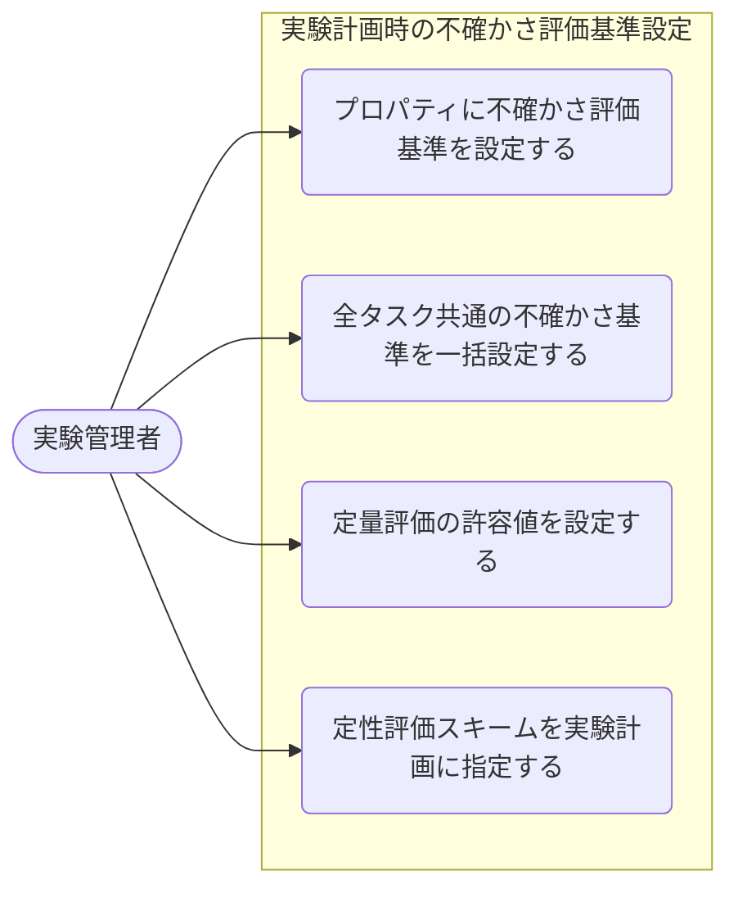
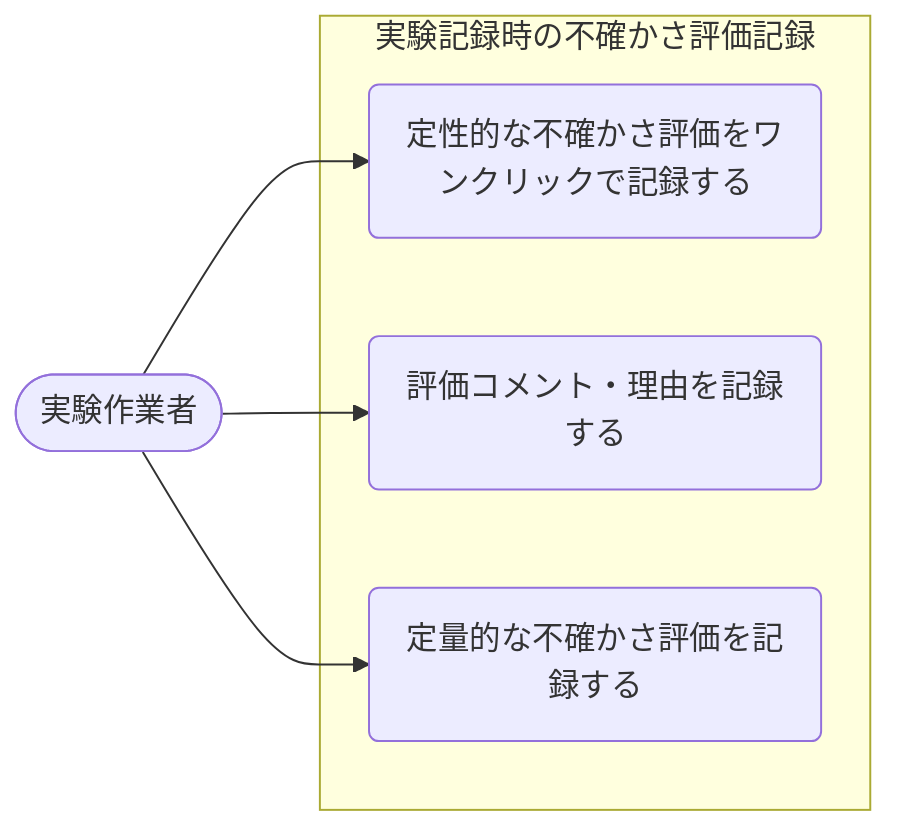
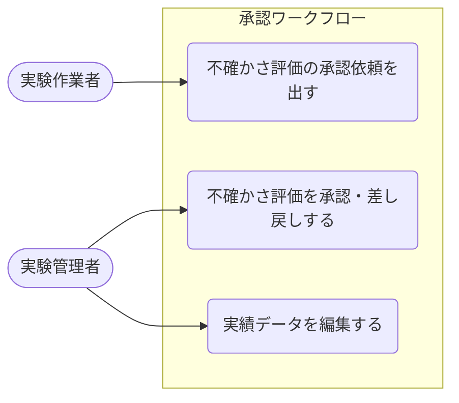

# 不確かさ（Uncertainty）記録 ― ユースケース一覧

**作成日**: 2026-08-05
**作成者**: SSV
**対象**: お客様との認識合わせ用
**対象機能**: 不確かさ（Uncertainty）記録
**入力資料**: 01_Objectives.md / 02_Required_Features.md

---

## 目次

- [1. ユースケース一覧](#1-ユースケース一覧)
  - [目的1：不確かさ基準（キー）を組織・個人の階層構造で定義・管理したい](#目的1不確かさ基準キーを組織個人の階層構造で定義管理したい)
  - [目的2：不確かさ基準キーの状態（有効・非推奨）を管理したい](#目的2不確かさ基準キーの状態有効非推奨を管理したい)
  - [目的3：実験計画段階で、各プロパティに対して不確かさの評価基準を設定・指示したい](#目的3実験計画段階で各プロパティに対して不確かさの評価基準を設定指示したい)
  - [目的4：実験記録時に、定性的な不確かさ評価を記録したい](#目的4実験記録時に定性的な不確かさ評価を記録したい)
  - [目的5：実験記録時に、定量的な不確かさ評価を記録したい](#目的5実験記録時に定量的な不確かさ評価を記録したい)
  - [目的6：不確かさの記録内容を承認ワークフローで確定させたい](#目的6不確かさの記録内容を承認ワークフローで確定させたい)
- [2. ユースケース図](#2-ユースケース図)
  - [図1：不確かさ基準キーの定義・管理](#図1不確かさ基準キーの定義管理)
  - [図2：基準キーの状態・バージョン管理](#図2基準キーの状態バージョン管理)
  - [図3：実験計画時の不確かさ評価基準設定](#図3実験計画時の不確かさ評価基準設定)
  - [図4：実験記録時の不確かさ評価記録（定性・定量）](#図4実験記録時の不確かさ評価記録定性定量)
  - [図5：承認ワークフロー](#図5承認ワークフロー)

---

## 1. ユースケース一覧

### 目的1：不確かさ基準（キー）を組織・個人の階層構造で定義・管理したい

| ユースケース | アクター | 概要 | 利用する機能 | 確認事項 |
|--------------|----------|------|--------------|----------|
| UC-01-01：不確かさ基準キーを登録する | 実験管理者 | キー名・評価方式・型・単位・説明などを、自分のスコープ（会社・部門・グループ・個人）に登録する | F-01-01：不確かさ基準キー登録機能 | |
| UC-01-02：JIS規格の標準キーを参照する | 全ユーザー | JIS K 0200 附属書Bに基づきGlobal層にあらかじめ用意された標準キー（Bias 等）を参照・利用する | F-01-02：標準キー提供機能 | |
| UC-01-03：上位層の基準キーを参照・継承する | 実験管理者、実験作業者 | 会社・部門などの上位層で定義された基準キーを、下位層（グループ・個人）のスコープで参照・利用する | F-01-03：基準キー参照・継承機能 | 上位層のキーを「そのまま使う」か「ローカルにコピーして使う」かの仕様を確認する必要があります |
| UC-01-04：定性評価スキームを定義する | 実験管理者 | 定性評価に使用する選択肢（例：確か / 曖昧 / 不確か）を、組織・個人ごとにカスタムスキームとして定義する | F-01-04：定性評価スキーム定義機能 | |
| UC-01-05：基準キーを上位層に公開する | 実験管理者 | 自分のスコープで定義した基準キーを用語管理画面から上位層へ公開し、他のユーザーが参照できるようにする | F-01-05：用語管理連携機能 | |

---

### 目的2：不確かさ基準キーの状態（有効・非推奨）を管理したい

| ユースケース | アクター | 概要 | 利用する機能 | 確認事項 |
|--------------|----------|------|--------------|----------|
| UC-02-01：基準キーを非推奨に切り替える | 実験管理者 | 使用しなくなった基準キーを削除せず「非推奨」に切り替えることで、既存データへの参照を維持したまま安全に廃止する | F-02-01：基準キー状態変更機能 | |
| UC-02-02：基準キーのバージョン履歴を確認する | 実験管理者 | 基準キーの変更履歴（変更日時・変更者・変更内容）を参照し、旧バージョンとの差分を確認する | F-02-02：基準キーバージョン履歴管理機能 | |

---

### 目的3：実験計画段階で、各プロパティに対して不確かさの評価基準を設定・指示したい

| ユースケース | アクター | 概要 | 利用する機能 | 確認事項 |
|--------------|----------|------|--------------|----------|
| UC-03-01：プロパティに不確かさ評価基準を設定する | 実験管理者 | 実験計画時に、各プロパティ（property要素）それぞれに対して不確かさの評価基準（定量・定性・未設定）を選択・設定し、実験作業者への指示として記録する | F-03-01：テンプレートの不確かさ基準設定機能 | |
| UC-03-02：全タスク共通の不確かさ基準を一括設定する | 実験管理者 | 繰り返し実験において、全タスク共通の不確かさ評価基準を「一括」タブで設定し、各タスクへ一括展開する | F-03-02：不確かさ基準一括設定・タスク展開機能 | |
| UC-03-03：定量評価の許容値を設定する | 実験管理者 | 定量評価の基準を設定する際に、あわせて許容値を設定し、実験作業者が測定値の許容範囲を判断できるようにする | F-03-03：定量評価許容値設定機能 | |
| UC-03-04：定性評価スキームを実験計画に指定する | 実験管理者 | 実験計画段階で、実験作業者が使用する定性評価スキーム（選択肢の種類）を指定し、MaiMLファイルに記録する | F-03-04：定性評価スキーム指示機能 | |

---

### 目的4：実験記録時に、定性的な不確かさ評価を記録したい

| ユースケース | アクター | 概要 | 利用する機能 | 確認事項 |
|--------------|----------|------|--------------|----------|
| UC-04-01：定性的な不確かさ評価をワンクリックで記録する | 実験作業者 | 実験記録画面で各プロパティに対して定性評価の選択肢ボタン（例：確か / 曖昧 / 不確か）をワンクリックで選択・記録する。スキームが未設定の場合は標準3段階スキームが自動適用される | F-04-01：定性評価ワンクリック記録機能、F-04-02：定性評価デフォルトスキーム適用機能 | |
| UC-04-02：評価コメント・理由を記録する | 実験作業者 | 定性評価に加えて付与理由・コメントを任意で入力し、評価の根拠を記録する | F-04-03：評価コメント・理由記録機能 |  |
| UC-04-03：キーボード操作のみで不確かさ評価を完結させる | 実験作業者 | 実績値の入力から不確かさ評価・保存まで、マウスを使わずタブキー等のキーボード操作のみで完結させる | F-04-04：キーボード操作対応機能 | |

---

### 目的5：実験記録時に、定量的な不確かさ評価を記録したい

| ユースケース | アクター | 概要 | 利用する機能 | 確認事項 |
|--------------|----------|------|--------------|----------|
| UC-05-01：定量的な不確かさ評価を記録する | 実験作業者 | 定量評価に使用する基準キー（例：StandardDeviation）をプルダウンで選択し、対応する数値を入力してMaiMLファイルに記録する。入力は任意で、入力しない場合は空白とする | F-05-01：定量評価基準キー選択機能、F-05-02：定量値入力・記録機能 | |

---

### 目的6：不確かさの記録内容を承認ワークフローで確定させたい

| ユースケース | アクター | 概要 | 利用する機能 | 確認事項 |
|--------------|----------|------|--------------|----------|
| UC-06-01：不確かさ評価の承認依頼を出す | 実験作業者 | 不確かさの付与完了後、実験結果（実績値）の承認依頼と一体で実験管理者に承認依頼を出す。承認はプロジェクト全体単位で実施する | F-06-01：不確かさ承認依頼機能 | |
| UC-06-02：不確かさ評価を承認・差し戻しする | 実験管理者 | 不確かさの記録内容を確認し、承認または差し戻しを行う。差し戻し時は理由の入力が必須。承認NGの場合はチェックアウト状態に自動移行する | F-06-02：不確かさ承認・差し戻し機能 | |
| UC-06-03：実績データを編集する | 実験管理者 | 実績データを編集する場合は変更理由を入力し、変更内容・変更者・変更日時がイベントログに記録される | F-06-03：実績データ編集機能 | |

---

## 2. ユースケース図

### 図1：不確かさ基準キーの定義・管理

---

### 図2：基準キーの状態・バージョン管理

---

### 図3：実験計画時の不確かさ評価基準設定

---

### 図4：実験記録時の不確かさ評価記録（定性・定量）

---

### 図5：承認ワークフロー

