# 不確かさ（Uncertainty）記録 ― 業務フロー一覧

**作成日**: 2026-08-05
**作成者**: SSV
**対象**: お客様との認識合わせ用
**対象機能**: 不確かさ（Uncertainty）記録
**入力資料**: 01_Objectives.md / 02_Required_Features.md / 03_Use_Cases.md

---

## 目次

- [BF-01-01：不確かさ基準キーを登録する](#bf-01-01不確かさ基準キーを登録する)
- [BF-01-02：JIS規格の標準キーを参照する](#bf-01-02jis規格の標準キーを参照する)
- [BF-01-03：上位層の基準キーを参照・継承する](#bf-01-03上位層の基準キーを参照継承する)
- [BF-01-04：定性評価スキームを定義する](#bf-01-04定性評価スキームを定義する)
- [BF-01-05：基準キーを上位層に公開する](#bf-01-05基準キーを上位層に公開する)
- [BF-02-01：基準キーを非推奨に切り替える](#bf-02-01基準キーを非推奨に切り替える)
- [BF-02-02：基準キーのバージョン履歴を確認する](#bf-02-02基準キーのバージョン履歴を確認する)
- [BF-03-01：実験計画で不確かさ評価基準を設定する](#bf-03-01実験計画で不確かさ評価基準を設定する)
- [BF-04-01：定性的な不確かさ評価を記録する](#bf-04-01定性的な不確かさ評価を記録する)
- [BF-05-01：定量的な不確かさ評価を記録する](#bf-05-01定量的な不確かさ評価を記録する)
- [BF-06-01：不確かさ評価の承認依頼〜承認・差し戻し](#bf-06-01不確かさ評価の承認依頼承認差し戻し)
- [BF-06-02：実績データを編集する](#bf-06-02実績データを編集する)

---

## BF-01-01：不確かさ基準キーを登録する

## Mermaid

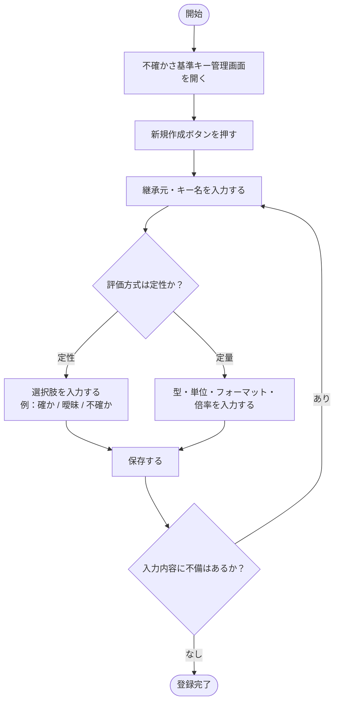

## 業務概要

実験管理者が、自分のスコープ（会社・部門・グループ・個人）に不確かさ評価の基準キーを新規登録する。キー名・評価方式（定性/定量）・型・単位・説明を入力し、定性評価の場合は選択肢もあわせて登録する。

## 前提条件

- 実験管理者としてログインしていること
- 不確かさ基準キー管理画面にアクセスできること

## 終了条件

- 入力した基準キーが自分のスコープに登録されること

## 関連ユースケース

- UC-01-01：不確かさ基準キーを登録する

## 確認事項

---

## BF-01-02：JIS規格の標準キーを参照する

## Mermaid

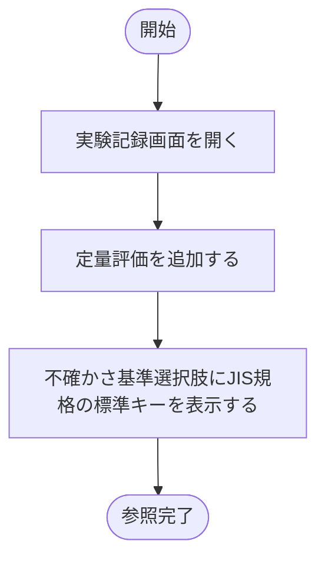

## 業務概要

全ユーザーが、JIS K 0200 附属書Bに基づいてGlobal層にあらかじめ登録されている標準キー（Bias等）を参照・確認する。追加登録は不可で、参照のみ行う。

## 前提条件

- システムにログインしていること
- Global層の標準キーがシステムに初期データとして登録されていること

## 終了条件

- 目的の標準キーの内容を確認できること

## 関連ユースケース

- UC-01-02：JIS規格の標準キーを参照する

## 確認事項

- 特になし

---

## BF-01-03：上位層の基準キーを参照・継承する

## Mermaid

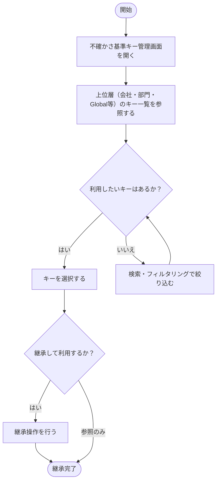

## 業務概要

実験管理者が、上位層・Globalで定義された基準キーを参照し、自分のスコープで利用できるよう継承する。

## 前提条件

- システムにログインしていること
- 上位層に参照可能な基準キーが登録されていること

## 終了条件

- 上位層の基準キーを自分のスコープで利用できる状態になること

## 関連ユースケース

- UC-01-03：上位層の基準キーを参照・継承する

## 確認事項

- 上位層のキーを「そのまま使う」か「ローカルにコピーして使う」かの仕様を確認する必要があります

---

## BF-01-04：定性評価スキームを定義する

## Mermaid

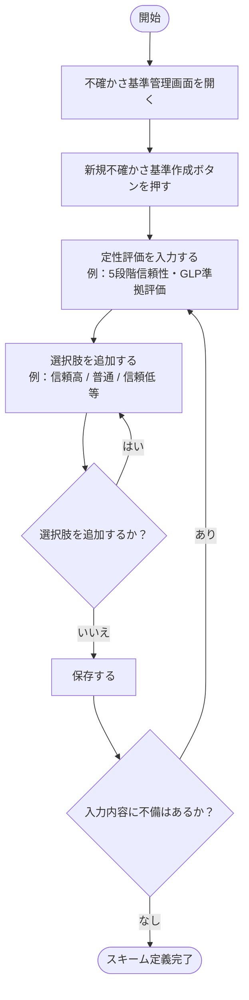

## 業務概要

実験管理者が、組織・個人固有の定性評価スキーム（選択肢の種類）をカスタム定義する。標準の3段階（確か/曖昧/不確か）以外に、5段階信頼性やGLP準拠評価など独自の評価体系を作成できる。

## 前提条件

- 実験管理者としてログインしていること

## 終了条件

- カスタムスキームが登録され、実験計画で選択できる状態になること

## 関連ユースケース

- UC-01-04：定性評価スキームを定義する

## 確認事項

- 特になし

---

## BF-01-05：基準キーを上位層に公開する

## Mermaid

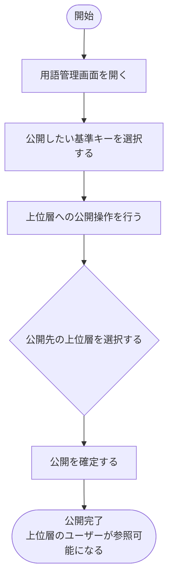

## 業務概要

実験管理者が、自分のスコープで定義した基準キーを用語管理画面から上位層（部門・会社等）へ公開し、他のユーザーが参照・継承できるようにする。

## 前提条件

- 実験管理者としてログインしていること
- 公開対象の基準キーが自スコープに登録されていること

## 終了条件

- 基準キーが上位層へ公開され、他のユーザーから参照可能になること

## 関連ユースケース

- UC-01-05：基準キーを上位層に公開する

## 確認事項

- 特になし

---

## BF-02-01：基準キーを非推奨に切り替える

## Mermaid

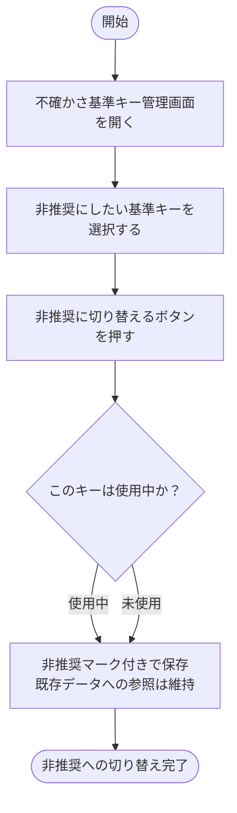

## 業務概要

実験管理者が、使用しなくなった基準キーを削除せず「非推奨」状態に切り替える。使用中のキーも削除できないが非推奨に変更でき、既存データへの参照は維持される。

## 前提条件

- 実験管理者としてログインしていること
- 対象の基準キーが登録されていること

## 終了条件

- 基準キーが「非推奨」状態になり、新規の実験計画での使用が抑制されること

## 関連ユースケース

- UC-02-01：基準キーを非推奨に切り替える

## 確認事項

- 特になし

---

## BF-02-02：基準キーのバージョン履歴を確認する

## Mermaid

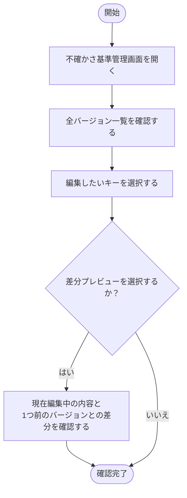

## 業務概要

実験管理者が、基準キーの変更履歴（変更日時・変更者・変更内容）を参照し、必要に応じて旧バージョンとの差分を確認する。

## 前提条件

- 実験管理者としてログインしていること
- 対象の基準キーに変更履歴が存在すること

## 終了条件

- 変更履歴または差分の内容を確認できること

## 関連ユースケース

- UC-02-02：基準キーのバージョン履歴を確認する

## 確認事項

- 特になし

---

## BF-03-01：実験計画で不確かさ評価基準を設定する

## Mermaid

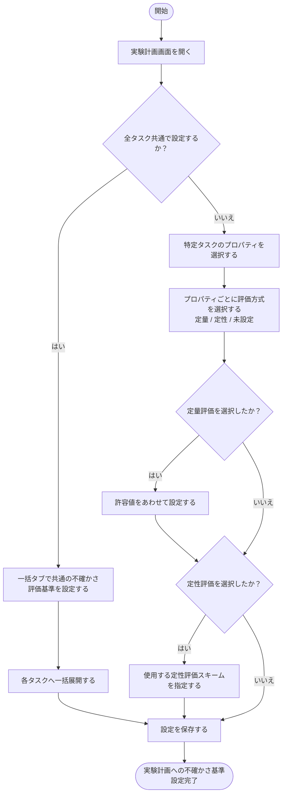

## 業務概要

実験管理者が、実験計画時に各プロパティ（property要素）に対して不確かさの評価基準を設定する。全タスク共通の設定は「一括」タブで行い各タスクへ展開することができる。定量評価の場合は許容値、定性評価の場合は使用するスキームをあわせて指定する。

## 前提条件

- 実験管理者としてログインしていること
- 実験計画が作成済みであること
- 利用する不確かさ基準キー・定性評価スキームが登録されていること

## 終了条件

- 各プロパティに不確かさ評価基準が設定され、MaiMLファイルに記録されること

## 関連ユースケース

- UC-03-01：プロパティに不確かさ評価基準を設定する
- UC-03-02：全タスク共通の不確かさ基準を一括設定する
- UC-03-03：定量評価の許容値を設定する
- UC-03-04：定性評価スキームを実験計画に指定する

## 確認事項

- 特になし

---

## BF-04-01：定性的な不確かさ評価を記録する

## Mermaid

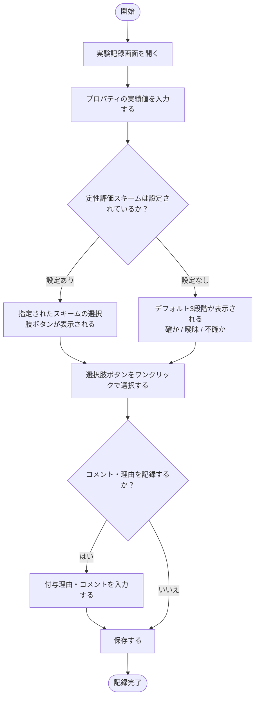

## 業務概要

実験作業者が、実験記録画面で各プロパティの実績値入力後に定性的な不確かさ評価をワンクリックで記録する。スキームが設定されていない場合はデフォルトの標準3段階が表示される。コメント記録は任意。

## 前提条件

- 実験作業者としてログインしていること
- 実験計画が割り当てられ、実験記録画面にアクセスできること

## 終了条件

- 定性評価がMaiMLの `<uncertainty>` 要素として保存されること

## 関連ユースケース

- UC-04-01：定性的な不確かさ評価をワンクリックで記録する
- UC-04-02：評価コメント・理由を記録する

## 確認事項

- 特になし

---

## BF-05-01：定量的な不確かさ評価を記録する

## Mermaid

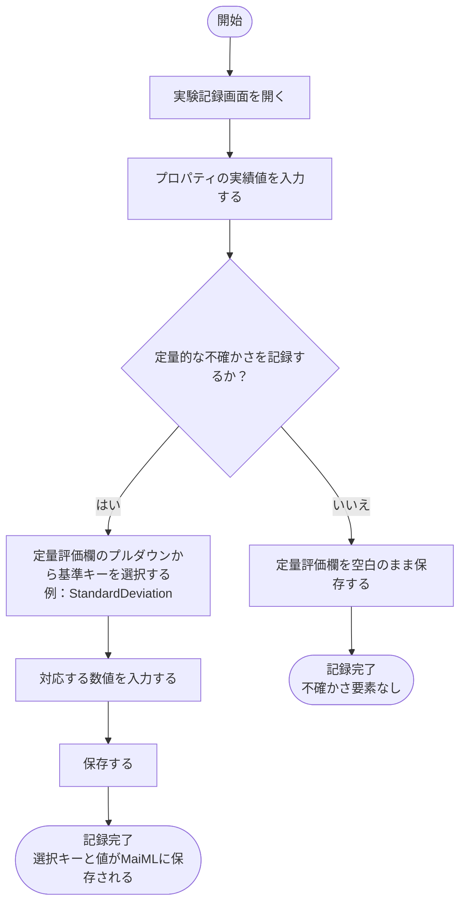

## 業務概要

実験作業者が、実験記録画面で各プロパティに対して定量的な不確かさ評価（標準偏差・誤差等）を記録する。使用する基準キーをプルダウンで選択し、対応する数値を入力する。入力は任意で、未入力の場合は空白となる。

## 前提条件

- 実験作業者としてログインしていること
- Global名前空間に定量評価用の標準キーが登録されていること

## 終了条件

- 選択した基準キーと入力値がMaiMLの `<uncertainty>` 要素として保存されること（未入力の場合は要素なし）

## 関連ユースケース

- UC-05-01：定量的な不確かさ評価を記録する

## 確認事項

- 特になし

---

## BF-06-01：不確かさ評価の承認依頼〜承認・差し戻し

## Mermaid

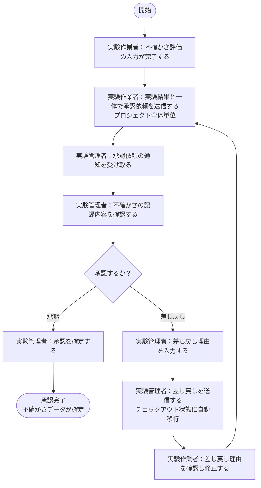

## 業務概要

実験作業者が不確かさ評価の入力完了後、実験結果（実績値）の承認依頼と一体でプロジェクト全体単位に承認依頼を出す。実験管理者が内容を確認し、承認または差し戻しを行う。差し戻し時は理由の入力が必須で、承認NGの場合はチェックアウト状態に自動移行する。

## 前提条件

- 実験作業者が不確かさ評価を含む実験記録を入力済みであること
- 実験管理者が承認権限を持っていること

## 終了条件

- 承認：不確かさデータが確定済みとして管理されること
- 差し戻し：実験作業者へ修正依頼が送られ、チェックアウト状態に戻ること

## 関連ユースケース

- UC-06-01：不確かさ評価の承認依頼を出す
- UC-06-02：不確かさ評価を承認・差し戻しする

## 確認事項

- 特になし

---

## BF-06-02：実績データを編集する

## Mermaid

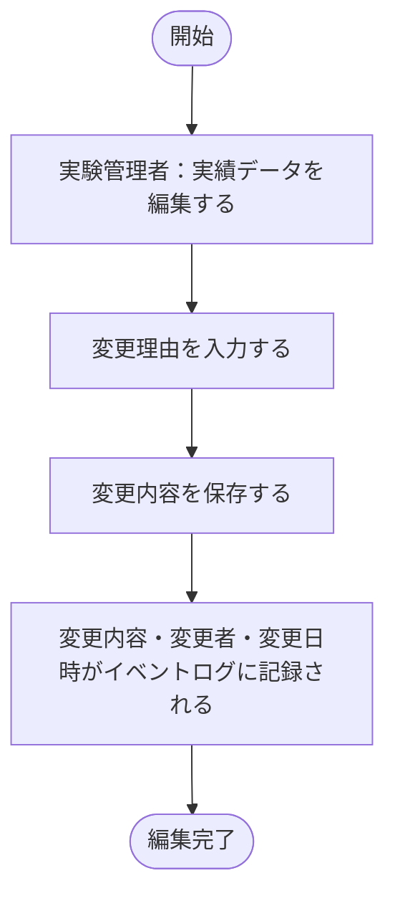

## 業務概要

実験管理者が実績データを編集する際に変更理由を入力する。変更内容・変更者・変更日時はイベントログに自動記録され、後から追跡できるようになる。

## 前提条件

- 実験管理者としてログインしていること
- 編集対象の実績データが存在すること

## 終了条件

- 変更内容が保存され、イベントログに変更履歴が記録されること

## 関連ユースケース

- UC-06-03：実績データを編集する

## 確認事項

- 特になし
